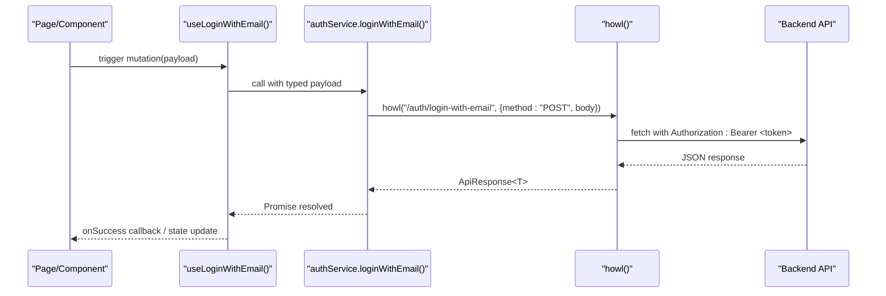
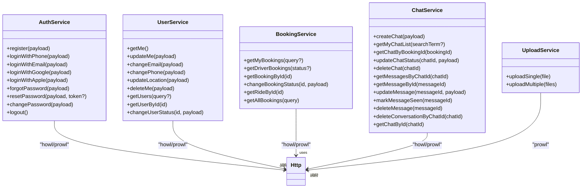
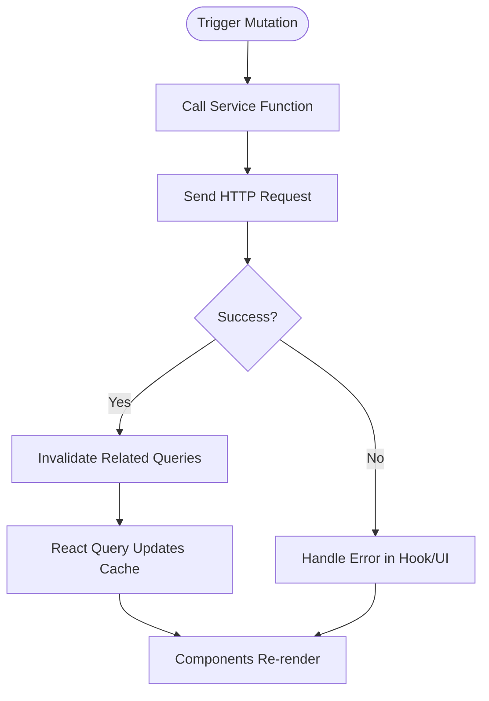
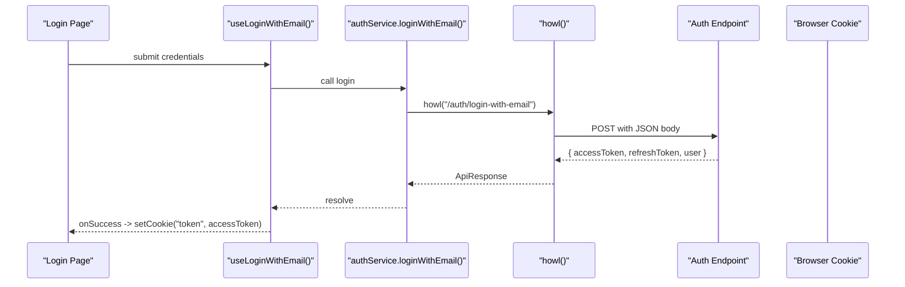
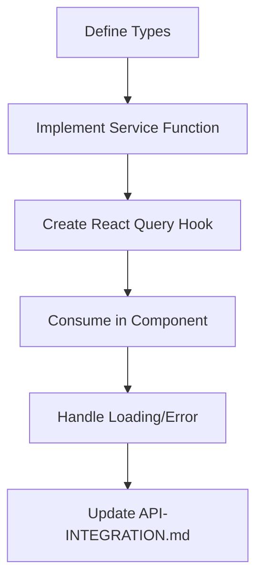
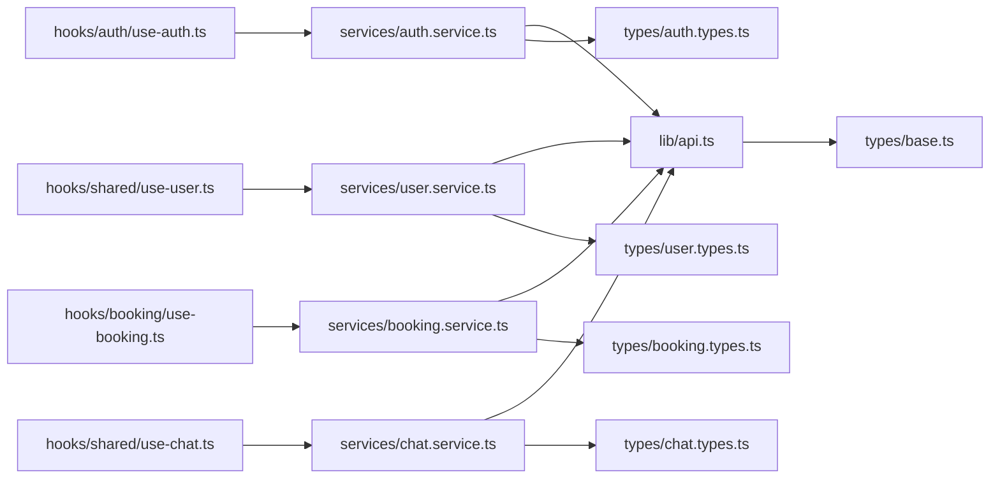

# API Integration Layer

<cite>
**Referenced Files in This Document**
- [api.ts](file://src/lib/api.ts)
- [auth.service.ts](file://src/services/auth.service.ts)
- [user.service.ts](file://src/services/user.service.ts)
- [booking.service.ts](file://src/services/booking.service.ts)
- [upload.service.ts](file://src/services/upload.service.ts)
- [chat.service.ts](file://src/services/chat.service.ts)
- [use-auth.ts](file://src/hooks/auth/use-auth.ts)
- [use-user.ts](file://src/hooks/shared/use-user.ts)
- [use-chat.ts](file://src/hooks/shared/use-chat.ts)
- [use-booking.ts](file://src/hooks/booking/use-booking.ts)
- [base.ts](file://src/types/base.ts)
- [auth.types.ts](file://src/types/auth.types.ts)
- [user.types.ts](file://src/types/user.types.ts)
- [booking.types.ts](file://src/types/booking.types.ts)
- [API-INTEGRATION.md](file://API-INTEGRATION.md)
</cite>

## Table of Contents
1. Introduction
2. Project Structure
3. Core Components
4. Architecture Overview
5. Detailed Component Analysis
6. Dependency Analysis
7. Performance Considerations
8. Troubleshooting Guide
9. Conclusion
10. Appendices

## Introduction
This document explains the API integration layer and service architecture, focusing on:
- Service layer pattern and request/response handling
- Error management strategies
- API client configuration and authentication middleware
- Request interceptors (current behavior and recommended enhancements)
- Patterns for loading states, caching, and optimistic updates
- Type definitions, error codes, and response schemas
- Guidelines for adding new endpoints and services

The codebase follows a clear separation:
- HTTP primitives in lib/api.ts
- Domain-specific services in src/services/*
- React Query hooks in src/hooks/*
- Shared types in src/types/*

## Project Structure
High-level structure relevant to API integration:
- lib/api.ts: JSON and FormData fetch wrappers with token injection
- services/*: Thin domain services that call lib/api.ts
- hooks/*: React Query hooks wrapping services for data fetching and mutations
- types/*: Shared TypeScript interfaces for payloads and responses
- API-INTEGRATION.md: End-to-end endpoint registry and workflow guide

```mermaid
graph TB
subgraph "Client"
UI["Pages / Components"]
Hooks["React Query Hooks"]
end
subgraph "Service Layer"
Services["Domain Services<br/>auth, user, booking, chat, upload"]
end
subgraph "HTTP Client"
Api["lib/api.ts<br/>howl() / prowl()"]
end
subgraph "Types"
Types["types/*<br/>ApiResponse, PagedResponse, domain types"]
end
UI --> Hooks
Hooks --> Services
Services --> Api
Services --> Types
Hooks --> Types
```

**Diagram sources**
- [api.ts:1-106](file://src/lib/api.ts#L1-L106)
- [auth.service.ts:1-43](file://src/services/auth.service.ts#L1-L43)
- [user.service.ts:1-117](file://src/services/user.service.ts#L1-L117)
- [booking.service.ts:1-45](file://src/services/booking.service.ts#L1-L45)
- [chat.service.ts:1-50](file://src/services/chat.service.ts#L1-L50)
- [upload.service.ts:1-20](file://src/services/upload.service.ts#L1-L20)
- [use-auth.ts:1-68](file://src/hooks/auth/use-auth.ts#L1-L68)
- [use-user.ts:1-117](file://src/hooks/shared/use-user.ts#L1-L117)
- [use-booking.ts:1-60](file://src/hooks/booking/use-booking.ts#L1-L60)
- [use-chat.ts:1-92](file://src/hooks/shared/use-chat.ts#L1-L92)
- [base.ts:1-28](file://src/types/base.ts#L1-L28)
- [auth.types.ts:1-113](file://src/types/auth.types.ts#L1-L113)
- [user.types.ts:1-49](file://src/types/user.types.ts#L1-L49)
- [booking.types.ts:1-166](file://src/types/booking.types.ts#L1-L166)

**Section sources**
- [API-INTEGRATION.md:1-380](file://API-INTEGRATION.md#L1-L380)

## Core Components
- HTTP primitives
  - howl<T>(endpoint, options): JSON requests; sets Authorization header from cookie; handles non-JSON responses gracefully; throws Error with message from server payload or status text.
  - prowl<T>(endpoint, options): FormData requests; omits Content-Type to let browser set multipart boundary; throws Error with server message when not ok.
- Authentication middleware
  - Token is read from cookie named token and injected as Bearer token automatically by both howl and prowl.
- Base URL and versioning
  - base_url from environment variable; base_api prefix "/api/v1".
- Response schema
  - ApiResponse<T>: { status: boolean; message: string; data: T }
  - PagedResponse<T>: pagination envelope used by list endpoints
  - Paginator<T>: alternative pagination shape used elsewhere
- Services
  - Each domain exposes a small object with functions that map directly to backend endpoints using howl/prowl.
- Hooks
  - useQuery wraps GET endpoints with stable query keys
  - useMutation wraps POST/PUT/PATCH/DELETE endpoints with invalidation callbacks

**Section sources**
- [api.ts:1-106](file://src/lib/api.ts#L1-L106)
- [base.ts:1-28](file://src/types/base.ts#L1-L28)
- [auth.service.ts:1-43](file://src/services/auth.service.ts#L1-L43)
- [user.service.ts:1-117](file://src/services/user.service.ts#L1-L117)
- [booking.service.ts:1-45](file://src/services/booking.service.ts#L1-L45)
- [chat.service.ts:1-50](file://src/services/chat.service.ts#L1-L50)
- [upload.service.ts:1-20](file://src/services/upload.service.ts#L1-L20)
- [use-auth.ts:1-68](file://src/hooks/auth/use-auth.ts#L1-L68)
- [use-user.ts:1-117](file://src/hooks/shared/use-user.ts#L1-L117)
- [use-booking.ts:1-60](file://src/hooks/booking/use-booking.ts#L1-L60)
- [use-chat.ts:1-92](file://src/hooks/shared/use-chat.ts#L1-L92)

## Architecture Overview
End-to-end flow for a typical mutation (e.g., login):



**Diagram sources**
- [use-auth.ts:27-31](file://src/hooks/auth/use-auth.ts#L27-L31)
- [auth.service.ts:22-23](file://src/services/auth.service.ts#L22-L23)
- [api.ts:23-73](file://src/lib/api.ts#L23-L73)

## Detailed Component Analysis

### HTTP Client Configuration and Interceptors
- Base URL composition: base_url + base_api + endpoint
- Cookie-based auth: reads token from cookie and injects Authorization header
- Headers: Accept and Content-Type set for JSON; FormData uploads omit Content-Type
- Credentials: include cookies across origins
- Error handling:
  - Non-ok responses throw Error with server-provided message if available
  - Non-JSON bodies are handled by attempting JSON parse then falling back to raw text
- Recommendations for interceptors:
  - Centralized retry policy for transient errors
  - Global refresh-token flow on 401
  - Request/response logging in development
  - Consistent error normalization into typed error objects

**Section sources**
- [api.ts:1-106](file://src/lib/api.ts#L1-L106)

### Service Layer Pattern
- Services are thin, pure functions over howl/prowl
- They encapsulate endpoint paths, HTTP methods, and payload typing
- Examples:
  - Auth: register, login variants, password reset, logout
  - User: profile CRUD, admin listing with query params
  - Booking: my bookings, driver bookings, admin listing
  - Chat: create/list/update messages and chats
  - Upload: single/multiple file uploads via FormData



**Diagram sources**
- [auth.service.ts:1-43](file://src/services/auth.service.ts#L1-L43)
- [user.service.ts:1-117](file://src/services/user.service.ts#L1-L117)
- [booking.service.ts:1-45](file://src/services/booking.service.ts#L1-L45)
- [chat.service.ts:1-50](file://src/services/chat.service.ts#L1-L50)
- [upload.service.ts:1-20](file://src/services/upload.service.ts#L1-L20)
- [api.ts:1-106](file://src/lib/api.ts#L1-L106)

**Section sources**
- [auth.service.ts:1-43](file://src/services/auth.service.ts#L1-L43)
- [user.service.ts:1-117](file://src/services/user.service.ts#L1-L117)
- [booking.service.ts:1-45](file://src/services/booking.service.ts#L1-L45)
- [chat.service.ts:1-50](file://src/services/chat.service.ts#L1-L50)
- [upload.service.ts:1-20](file://src/services/upload.service.ts#L1-L20)

### React Query Hooks and Caching Strategy
- Read queries
  - useQuery wraps GET endpoints with stable query keys
  - Example keys: ["booking","my",status], ["user","me"], ["chats","my-list",search]
- Mutations
  - useMutation wraps write operations
  - Typical onSuccess invalidates related query keys to keep cache consistent
- Example patterns
  - useChangeBookingStatus invalidates my bookings and detail
  - useUpdateMe invalidates user.me
  - useCreateChat invalidates chats lists
  - useMarkMessageSeen invalidates messages



**Diagram sources**
- [use-booking.ts:35-44](file://src/hooks/booking/use-booking.ts#L35-L44)
- [use-user.ts:30-37](file://src/hooks/shared/use-user.ts#L30-L37)
- [use-chat.ts:18-24](file://src/hooks/shared/use-chat.ts#L18-L24)

**Section sources**
- [use-auth.ts:1-68](file://src/hooks/auth/use-auth.ts#L1-L68)
- [use-user.ts:1-117](file://src/hooks/shared/use-user.ts#L1-L117)
- [use-booking.ts:1-60](file://src/hooks/booking/use-booking.ts#L1-L60)
- [use-chat.ts:1-92](file://src/hooks/shared/use-chat.ts#L1-L92)

### Loading States, Caching, and Optimistic Updates
- Loading states
  - Use hook result fields like isLoading/isFetching to show spinners or skeletons
- Caching
  - Rely on React Query’s default caching; define explicit queryKeys per resource
  - Use enabled flags for optional queries (e.g., by id)
- Optimistic updates
  - Implement onMutate to temporarily update cache
  - Rollback on error using onError
  - Refetch or invalidate after success to converge with server state
- Note: Current hooks do not implement optimistic updates; add them where UX benefits outweigh complexity (e.g., mark-as-seen, quick toggles).

[No sources needed since this section provides general guidance]

### Authentication Middleware and Token Handling
- Token source: cookie named token
- Injection: Authorization: Bearer <token> added automatically by howl/prowl
- Post-login: set cookie with access token returned from login endpoints
- Logout: call logout service and clear local state/cookies



**Diagram sources**
- [use-auth.ts:27-31](file://src/hooks/auth/use-auth.ts#L27-L31)
- [auth.service.ts:22-23](file://src/services/auth.service.ts#L22-L23)
- [api.ts:5-13](file://src/lib/api.ts#L5-L13)
- [API-INTEGRATION.md:299-308](file://API-INTEGRATION.md#L299-L308)

**Section sources**
- [api.ts:5-13](file://src/lib/api.ts#L5-L13)
- [auth.service.ts:1-43](file://src/services/auth.service.ts#L1-L43)
- [API-INTEGRATION.md:299-308](file://API-INTEGRATION.md#L299-L308)

### Request Interceptors (Current Behavior and Enhancements)
- Current behavior
  - No global interceptor layer; logic lives inside howl/prowl
  - Basic error extraction from server JSON message
- Recommended enhancements
  - Retry on network failures with exponential backoff
  - Automatic token refresh on 401
  - Normalize all errors into a structured type with code/message/context
  - Add request tracing IDs for observability

[No sources needed since this section provides general guidance]

### Type Definitions, Error Codes, and Response Schemas
- Response envelopes
  - ApiResponse<T>: status, message, data
  - PagedResponse<T>: code, message, pagination, data[]
  - Paginator<T>: current_page, data, next_page_url, path, per_page, prev_page_url, to, total
- Domain types
  - Auth: RegisterPayload, LoginWithEmailPayload, SocialLoginPayload, LoginResponse, OtpTokenResponse
  - User: UpdateProfilePayload, ChangeEmailPayload, ChangePhonePayload, UpdateLocationPayload, DeleteProfilePayload, ChangeUserStatusPayload, GetUsersQuery
  - Booking: BookingStatus, ChangeBookingStatusPayload, GetAllBookingsQuery, DriverBooking, RideDetail
- Error codes
  - Not currently defined as typed enums; errors thrown as generic Error with message from server
  - Recommendation: introduce a typed error model and map common HTTP codes to application-level codes

**Section sources**
- [base.ts:1-28](file://src/types/base.ts#L1-L28)
- [auth.types.ts:1-113](file://src/types/auth.types.ts#L1-L113)
- [user.types.ts:1-49](file://src/types/user.types.ts#L1-L49)
- [booking.types.ts:1-166](file://src/types/booking.types.ts#L1-L166)

### Adding New API Endpoints and Services
Step-by-step:
1. Define types
   - Create payload and response types in src/types/<domain>.types.ts
2. Add service function
   - In src/services/<domain>.service.ts, add a function calling howl/prowl with correct method and path
3. Create React Query hook
   - In src/hooks/<domain>/use-<feature>.ts, wrap with useQuery or useMutation
   - Define stable queryKey(s) and invalidate related keys on success
4. Wire into UI
   - Consume hook in page/component; handle loading/error states
5. Update integration tracker
   - Mark endpoint status in API-INTEGRATION.md



**Section sources**
- [API-INTEGRATION.md:288-296](file://API-INTEGRATION.md#L288-L296)

## Dependency Analysis
Relationships between layers and modules:



**Diagram sources**
- [use-auth.ts:1-68](file://src/hooks/auth/use-auth.ts#L1-L68)
- [auth.service.ts:1-43](file://src/services/auth.service.ts#L1-L43)
- [use-user.ts:1-117](file://src/hooks/shared/use-user.ts#L1-L117)
- [user.service.ts:1-117](file://src/services/user.service.ts#L1-L117)
- [use-booking.ts:1-60](file://src/hooks/booking/use-booking.ts#L1-L60)
- [booking.service.ts:1-45](file://src/services/booking.service.ts#L1-L45)
- [use-chat.ts:1-92](file://src/hooks/shared/use-chat.ts#L1-L92)
- [chat.service.ts:1-50](file://src/services/chat.service.ts#L1-L50)
- [api.ts:1-106](file://src/lib/api.ts#L1-L106)
- [base.ts:1-28](file://src/types/base.ts#L1-L28)
- [auth.types.ts:1-113](file://src/types/auth.types.ts#L1-L113)
- [user.types.ts:1-49](file://src/types/user.types.ts#L1-L49)
- [booking.types.ts:1-166](file://src/types/booking.types.ts#L1-L166)

**Section sources**
- [use-auth.ts:1-68](file://src/hooks/auth/use-auth.ts#L1-L68)
- [auth.service.ts:1-43](file://src/services/auth.service.ts#L1-L43)
- [use-user.ts:1-117](file://src/hooks/shared/use-user.ts#L1-L117)
- [user.service.ts:1-117](file://src/services/user.service.ts#L1-L117)
- [use-booking.ts:1-60](file://src/hooks/booking/use-booking.ts#L1-L60)
- [booking.service.ts:1-45](file://src/services/booking.service.ts#L1-L45)
- [use-chat.ts:1-92](file://src/hooks/shared/use-chat.ts#L1-L92)
- [chat.service.ts:1-50](file://src/services/chat.service.ts#L1-L50)
- [api.ts:1-106](file://src/lib/api.ts#L1-L106)
- [base.ts:1-28](file://src/types/base.ts#L1-L28)
- [auth.types.ts:1-113](file://src/types/auth.types.ts#L1-L113)
- [user.types.ts:1-49](file://src/types/user.types.ts#L1-L49)
- [booking.types.ts:1-166](file://src/types/booking.types.ts#L1-L166)

## Performance Considerations
- Prefer query keys that reflect actual parameters to avoid stale caches
- Use enabled flags for conditional queries (e.g., by id)
- Avoid unnecessary refetches by invalidating only affected keys
- For high-frequency updates (e.g., messages), consider manual cache updates instead of full refetch
- Keep FormData uploads separate via prowl to prevent incorrect headers

[No sources needed since this section provides general guidance]

## Troubleshooting Guide
Common issues and resolutions:
- 401 Unauthorized
  - Ensure token cookie is present and valid
  - After login, set cookie with access token
- Network errors
  - Check base_url and base_api configuration
  - Verify CORS and credentials: include
- Non-JSON responses
  - howl attempts JSON parse; fallback returns raw text
- File uploads failing
  - Use prowl for FormData; do not set Content-Type manually
- Pagination mismatch
  - Confirm whether endpoint returns PagedResponse or Paginator shapes

**Section sources**
- [api.ts:42-73](file://src/lib/api.ts#L42-L73)
- [api.ts:83-105](file://src/lib/api.ts#L83-L105)
- [API-INTEGRATION.md:299-308](file://API-INTEGRATION.md#L299-L308)

## Conclusion
The integration layer is clean and consistent:
- Thin services over two well-defined HTTP primitives
- Strong typing across payloads and responses
- Predictable React Query hooks with explicit query keys and invalidation
To evolve further, consider adding centralized interceptors for retries, token refresh, and normalized error models.

[No sources needed since this section summarizes without analyzing specific files]

## Appendices

### API Client Configuration Reference
- Base URL: NEXT_PUBLIC_SERVER_URL + "/api/v1"
- Cookies: token
- Headers:
  - JSON: Accept: application/json, Content-Type: application/json
  - FormData: no Content-Type (browser sets boundary)
- Credentials: include

**Section sources**
- [api.ts:1-13](file://src/lib/api.ts#L1-L13)
- [api.ts:30-40](file://src/lib/api.ts#L30-L40)
- [api.ts:89-97](file://src/lib/api.ts#L89-L97)

### Error Management Strategies
- Current strategy
  - Throw Error with message extracted from server JSON or status text
- Recommended strategy
  - Introduce typed error codes and messages
  - Map HTTP statuses to application-level codes
  - Provide context (endpoint, payload) for debugging

**Section sources**
- [api.ts:45-54](file://src/lib/api.ts#L45-L54)
- [api.ts:99-102](file://src/lib/api.ts#L99-L102)