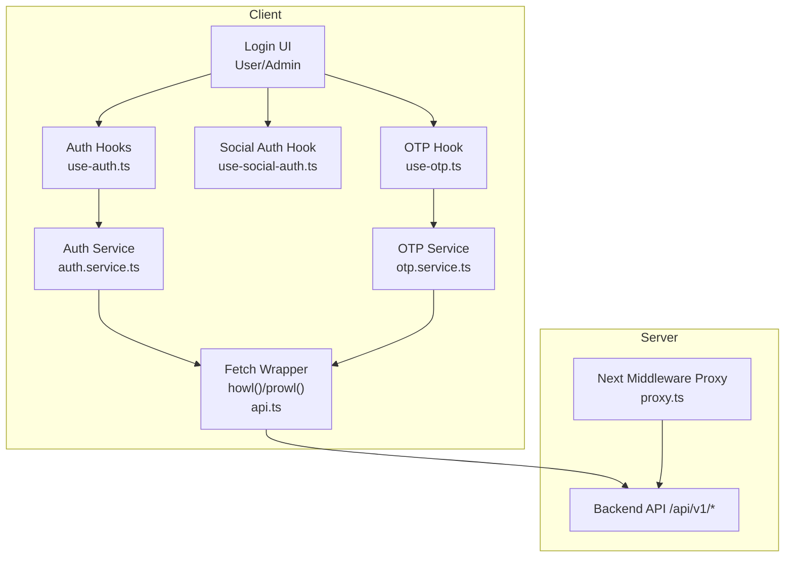
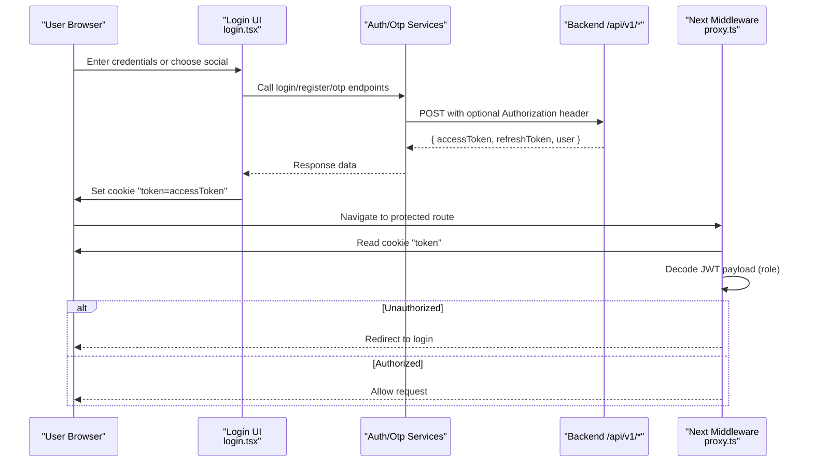
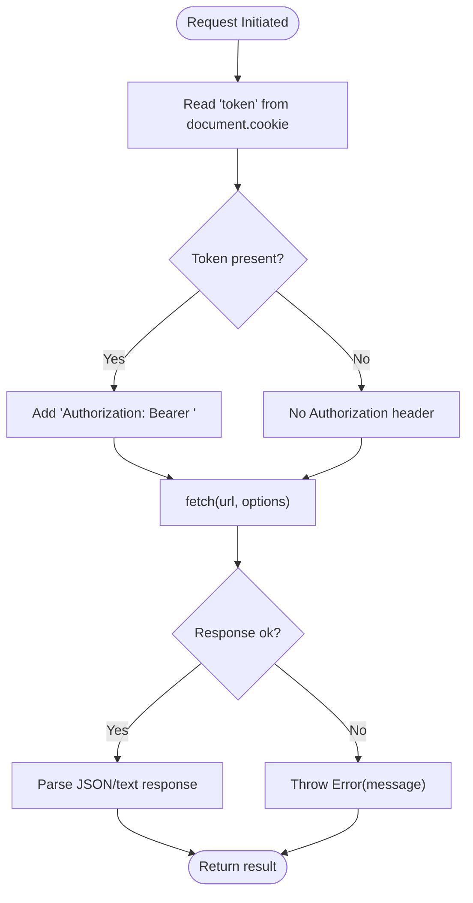
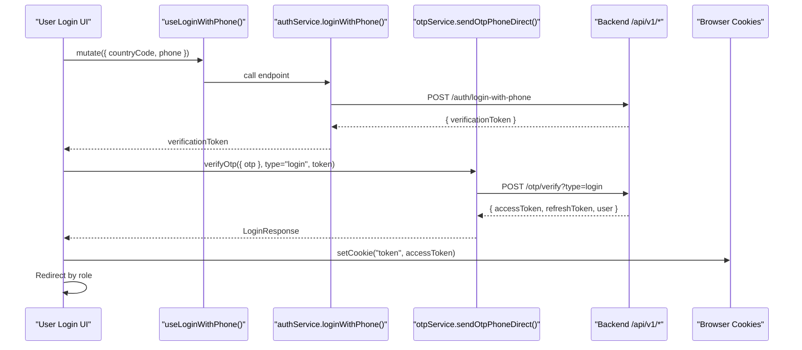
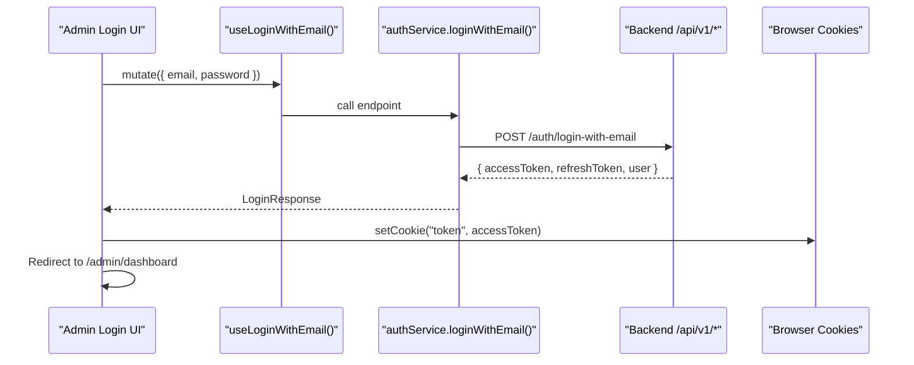
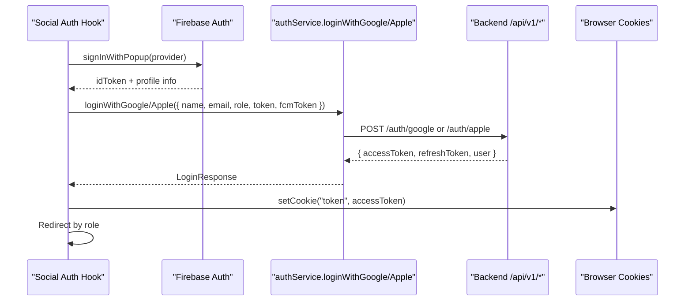
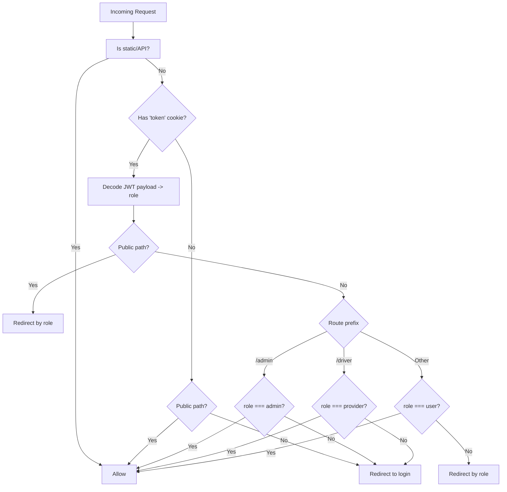
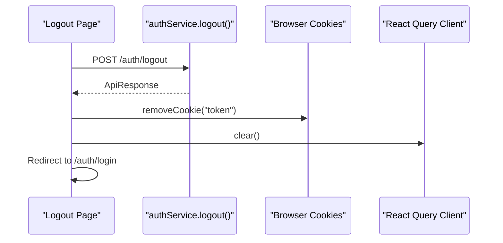
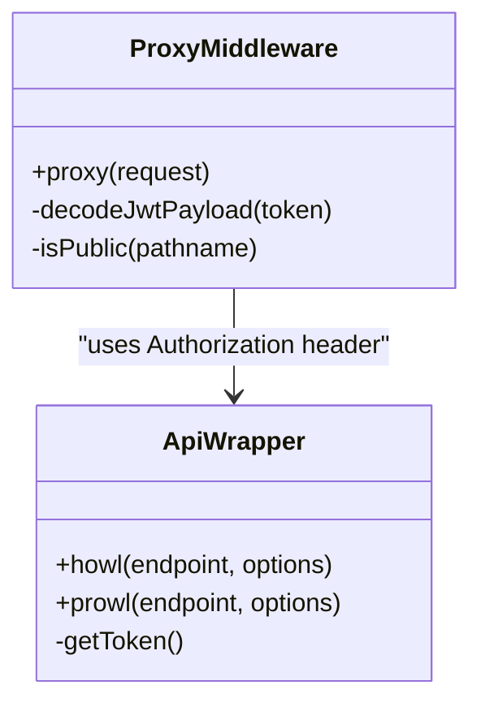
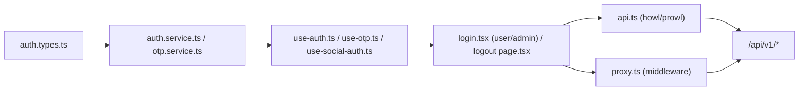

# Authentication & Authorization

<cite>
**Referenced Files in This Document**
- [api.ts](file://src/lib/api.ts)
- [proxy.ts](file://src/proxy.ts)
- [auth.service.ts](file://src/services/auth.service.ts)
- [otp.service.ts](file://src/services/otp.service.ts)
- [use-auth.ts](file://src/hooks/auth/use-auth.ts)
- [use-social-auth.ts](file://src/hooks/auth/use-social-auth.ts)
- [use-otp.ts](file://src/hooks/auth/use-otp.ts)
- [login.tsx (user)](file://src/app/auth/login/login.tsx)
- [page.tsx (user login)](file://src/app/auth/login/page.tsx)
- [login.tsx (admin)](file://src/app/admin/auth/login/login.tsx)
- [logout page.tsx](file://src/app/logout/page.tsx)
- [auth.types.ts](file://src/types/auth.types.ts)
</cite>

## Table of Contents
1. Introduction
2. Project Structure
3. Core Components
4. Architecture Overview
5. Detailed Component Analysis
6. Dependency Analysis
7. Performance Considerations
8. Troubleshooting Guide
9. Conclusion

## Introduction
This document explains the authentication and authorization mechanisms implemented at the API layer and client side for this Next.js application. It covers:
- JWT token management via cookies
- Automatic attachment of tokens to HTTP requests
- Role-based access control (RBAC) enforced by a middleware proxy
- OTP-based flows for phone and email
- Social sign-in with Google and Apple
- Logout flow and session cleanup
- Error handling patterns and multi-role authorization strategies

The system uses an HTTP-only cookie named token that stores the JWT access token. The client automatically attaches it to outgoing requests, while the server-side proxy enforces route-level authorization based on the role decoded from the token.

## Project Structure
Authentication-related code is organized into:
- Client API helpers and fetch wrapper
- Services for auth and OTP endpoints
- React Query hooks for mutations
- UI components for login, OTP, social auth, and logout
- Server-side Next.js middleware proxy for RBAC
- Shared types for payloads and responses

**Diagram sources**
- [api.ts:1-106](file://src/lib/api.ts#L1-L106)
- [auth.service.ts:1-43](file://src/services/auth.service.ts#L1-L43)
- [otp.service.ts:1-27](file://src/services/otp.service.ts#L1-L27)
- [use-auth.ts:1-68](file://src/hooks/auth/use-auth.ts#L1-L68)
- [use-social-auth.ts:1-102](file://src/hooks/auth/use-social-auth.ts#L1-L102)
- [use-otp.ts:1-32](file://src/hooks/auth/use-otp.ts#L1-L32)
- [proxy.ts:1-99](file://src/proxy.ts#L1-L99)

**Section sources**
- [api.ts:1-106](file://src/lib/api.ts#L1-L106)
- [proxy.ts:1-99](file://src/proxy.ts#L1-L99)
- [auth.service.ts:1-43](file://src/services/auth.service.ts#L1-L43)
- [otp.service.ts:1-27](file://src/services/otp.service.ts#L1-L27)
- [use-auth.ts:1-68](file://src/hooks/auth/use-auth.ts#L1-L68)
- [use-social-auth.ts:1-102](file://src/hooks/auth/use-social-auth.ts#L1-L102)
- [use-otp.ts:1-32](file://src/hooks/auth/use-otp.ts#L1-L32)

## Core Components
- Fetch wrapper (howl/prowl): Reads the token from the cookie and attaches it as an Authorization header; sets credentials to include for cross-origin cookie support.
- Auth service: Exposes endpoints for register, login (phone/email/social), password reset/change, and logout.
- OTP service: Handles sending and verifying OTPs for phone and email flows.
- React Query hooks: Wrap services for mutation lifecycle and error handling.
- Login UIs: User and Admin login pages orchestrate OTP and social flows, set the token cookie, and redirect based on role.
- Social auth hook: Performs Firebase sign-in, exchanges ID tokens for backend sessions, sets the token cookie, and redirects by role.
- Middleware proxy: Enforces route protection and role-based access by decoding the JWT from the cookie.

Key responsibilities:
- Token storage: Cookie named token with path "/" and sameSite lax.
- Token attachment: Automatic Authorization header injection for all JSON requests.
- Route protection: Redirect unauthenticated users to appropriate login pages.
- Role routing: Direct admin/provider/user to their respective dashboards.

**Section sources**
- [api.ts:5-73](file://src/lib/api.ts#L5-L73)
- [auth.service.ts:15-42](file://src/services/auth.service.ts#L15-L42)
- [otp.service.ts:11-26](file://src/services/otp.service.ts#L11-L26)
- [use-auth.ts:15-67](file://src/hooks/auth/use-auth.ts#L15-L67)
- [use-social-auth.ts:11-101](file://src/hooks/auth/use-social-auth.ts#L11-L101)
- [proxy.ts:25-95](file://src/proxy.ts#L25-L95)

## Architecture Overview
End-to-end authentication and authorization flow:

**Diagram sources**
- [login.tsx (user):196-222](file://src/app/auth/login/login.tsx#L196-L222)
- [login.tsx (user):69-86](file://src/app/auth/login/login.tsx#L69-L86)
- [use-social-auth.ts:27-59](file://src/hooks/auth/use-social-auth.ts#L27-L59)
- [auth.service.ts:15-42](file://src/services/auth.service.ts#L15-L42)
- [otp.service.ts:11-26](file://src/services/otp.service.ts#L11-L26)
- [api.ts:23-73](file://src/lib/api.ts#L23-L73)
- [proxy.ts:25-95](file://src/proxy.ts#L25-L95)

## Detailed Component Analysis

### JWT Cookie Management and Request Attachment
- Token source: Cookie named token with path "/" and sameSite lax.
- Automatic attachment: howl() reads the token from cookies and adds Authorization: Bearer <token> to headers. prowl() does the same for FormData uploads.
- Credentials: Requests use credentials: include to ensure cookies are sent across origins.

**Diagram sources**
- [api.ts:5-13](file://src/lib/api.ts#L5-L13)
- [api.ts:23-73](file://src/lib/api.ts#L23-L73)

**Section sources**
- [api.ts:5-13](file://src/lib/api.ts#L5-L13)
- [api.ts:23-73](file://src/lib/api.ts#L23-L73)

### Phone OTP Login Flow
- Steps:
  - Submit phone number to send OTP.
  - Verify OTP; on success, receive accessToken and store it in cookie.
  - Redirect based on role.

**Diagram sources**
- [login.tsx (user):196-222](file://src/app/auth/login/login.tsx#L196-L222)
- [login.tsx (user):69-86](file://src/app/auth/login/login.tsx#L69-L86)
- [use-auth.ts:21-25](file://src/hooks/auth/use-auth.ts#L21-L25)
- [auth.service.ts:19-20](file://src/services/auth.service.ts#L19-L20)
- [use-otp.ts:8-13](file://src/hooks/auth/use-otp.ts#L8-L13)
- [otp.service.ts:11-16](file://src/services/otp.service.ts#L11-L16)

**Section sources**
- [login.tsx (user):196-222](file://src/app/auth/login/login.tsx#L196-L222)
- [login.tsx (user):69-86](file://src/app/auth/login/login.tsx#L69-L86)
- [use-auth.ts:21-25](file://src/hooks/auth/use-auth.ts#L21-L25)
- [auth.service.ts:19-20](file://src/services/auth.service.ts#L19-L20)
- [use-otp.ts:8-13](file://src/hooks/auth/use-otp.ts#L8-L13)
- [otp.service.ts:11-16](file://src/services/otp.service.ts#L11-L16)

### Email Password Login Flow (Admin)
- Steps:
  - Submit email/password.
  - On success, set token cookie and redirect to admin dashboard.

**Diagram sources**
- [login.tsx (admin):46-67](file://src/app/admin/auth/login/login.tsx#L46-L67)
- [use-auth.ts:27-31](file://src/hooks/auth/use-auth.ts#L27-L31)
- [auth.service.ts:22-23](file://src/services/auth.service.ts#L22-L23)

**Section sources**
- [login.tsx (admin):46-67](file://src/app/admin/auth/login/login.tsx#L46-L67)
- [use-auth.ts:27-31](file://src/hooks/auth/use-auth.ts#L27-L31)
- [auth.service.ts:22-23](file://src/services/auth.service.ts#L22-L23)

### Social Sign-In (Google/Apple)
- Steps:
  - Use Firebase popup to obtain ID token.
  - Send ID token to backend to exchange for session tokens.
  - Store token cookie and redirect by role.

**Diagram sources**
- [use-social-auth.ts:27-59](file://src/hooks/auth/use-social-auth.ts#L27-L59)
- [use-social-auth.ts:61-93](file://src/hooks/auth/use-social-auth.ts#L61-L93)
- [auth.service.ts:25-29](file://src/services/auth.service.ts#L25-L29)

**Section sources**
- [use-social-auth.ts:27-59](file://src/hooks/auth/use-social-auth.ts#L27-L59)
- [use-social-auth.ts:61-93](file://src/hooks/auth/use-social-auth.ts#L61-L93)
- [auth.service.ts:25-29](file://src/services/auth.service.ts#L25-L29)

### Role-Based Access Control (Middleware Proxy)
- Behavior:
  - Skip static assets and API routes.
  - If no token, redirect to appropriate login page.
  - If already logged in, redirect away from public auth pages to role-specific destinations.
  - Enforce route roles:
    - /admin requires role=admin
    - /driver requires role=provider
    - Other routes allow role=user (and redirect admin/provider away)

**Diagram sources**
- [proxy.ts:25-95](file://src/proxy.ts#L25-L95)

**Section sources**
- [proxy.ts:25-95](file://src/proxy.ts#L25-L95)

### Logout Flow and Session Cleanup
- Steps:
  - Call logout endpoint (best-effort).
  - Remove token cookie.
  - Clear local state and query cache.
  - Redirect to login page.

**Diagram sources**
- [logout page.tsx:14-20](file://src/app/logout/page.tsx#L14-L20)
- [auth.service.ts:40-42](file://src/services/auth.service.ts#L40-L42)

**Section sources**
- [logout page.tsx:14-20](file://src/app/logout/page.tsx#L14-L20)
- [auth.service.ts:40-42](file://src/services/auth.service.ts#L40-L42)

### Protected Routes and Permission Checks
- Route-level protection is handled by the middleware proxy using the role field in the JWT payload.
- Additional permission checks can be implemented in server handlers by reading the Authorization header attached by howl().

**Diagram sources**
- [proxy.ts:1-99](file://src/proxy.ts#L1-L99)
- [api.ts:23-73](file://src/lib/api.ts#L23-L73)

**Section sources**
- [proxy.ts:1-99](file://src/proxy.ts#L1-L99)
- [api.ts:23-73](file://src/lib/api.ts#L23-L73)

### Multi-Role Authorization Patterns
- Roles supported: user, provider, admin.
- Routing rules:
  - Admin routes (/admin*) require role=admin.
  - Driver routes (/driver*) require role=provider.
  - Public auth pages redirect authenticated users to role-appropriate dashboards.
- Extensibility:
  - Extend PUBLIC_PATHS and route checks in the proxy for new areas.
  - Add fine-grained permissions by checking additional fields in the JWT payload within server handlers.

**Section sources**
- [auth.types.ts:1](file://src/types/auth.types.ts#L1)
- [proxy.ts:59-94](file://src/proxy.ts#L59-L94)

## Dependency Analysis
High-level dependencies among authentication components:

**Diagram sources**
- [auth.types.ts:1-113](file://src/types/auth.types.ts#L1-L113)
- [auth.service.ts:1-43](file://src/services/auth.service.ts#L1-L43)
- [otp.service.ts:1-27](file://src/services/otp.service.ts#L1-L27)
- [use-auth.ts:1-68](file://src/hooks/auth/use-auth.ts#L1-L68)
- [use-otp.ts:1-32](file://src/hooks/auth/use-otp.ts#L1-L32)
- [use-social-auth.ts:1-102](file://src/hooks/auth/use-social-auth.ts#L1-L102)
- [login.tsx (user):1-325](file://src/app/auth/login/login.tsx#L1-L325)
- [login.tsx (admin):1-223](file://src/app/admin/auth/login/login.tsx#L1-L223)
- [logout page.tsx:1-24](file://src/app/logout/page.tsx#L1-L24)
- [api.ts:1-106](file://src/lib/api.ts#L1-L106)
- [proxy.ts:1-99](file://src/proxy.ts#L1-L99)

**Section sources**
- [auth.types.ts:1-113](file://src/types/auth.types.ts#L1-L113)
- [auth.service.ts:1-43](file://src/services/auth.service.ts#L1-L43)
- [otp.service.ts:1-27](file://src/services/otp.service.ts#L1-L27)
- [use-auth.ts:1-68](file://src/hooks/auth/use-auth.ts#L1-L68)
- [use-otp.ts:1-32](file://src/hooks/auth/use-otp.ts#L1-L32)
- [use-social-auth.ts:1-102](file://src/hooks/auth/use-social-auth.ts#L1-L102)
- [login.tsx (user):1-325](file://src/app/auth/login/login.tsx#L1-L325)
- [login.tsx (admin):1-223](file://src/app/admin/auth/login/login.tsx#L1-L223)
- [logout page.tsx:1-24](file://src/app/logout/page.tsx#L1-L24)
- [api.ts:1-106](file://src/lib/api.ts#L1-L106)
- [proxy.ts:1-99](file://src/proxy.ts#L1-L99)

## Performance Considerations
- Token lookup cost is minimal (single cookie read per request).
- Avoid redundant re-renders by keeping token updates centralized in login flows.
- Consider implementing token refresh strategies if short-lived access tokens are used (not currently implemented).
- Keep middleware logic lightweight; avoid heavy computations during request interception.

[No sources needed since this section provides general guidance]

## Troubleshooting Guide
Common issues and resolutions:
- 401 Unauthorized on protected routes:
  - Ensure the token cookie is set after successful login.
  - Confirm the browser sends cookies (credentials: include is set in howl()).
  - Verify the middleware allows the requested path or redirects appropriately.
- CORS or missing cookies:
  - Ensure base_url and NEXT_PUBLIC_SERVER_URL are configured correctly.
  - Confirm SameSite and Path attributes for the token cookie match your deployment domain.
- Social login failures:
  - Check Firebase configuration and provider setup.
  - Validate that the backend accepts the provided role and token format.
- Logout not clearing session:
  - Ensure removeCookie is called with the correct path ("/").
  - Clear React Query cache and local state as done in the logout page.

**Section sources**
- [api.ts:23-73](file://src/lib/api.ts#L23-L73)
- [proxy.ts:25-95](file://src/proxy.ts#L25-L95)
- [logout page.tsx:14-20](file://src/app/logout/page.tsx#L14-L20)

## Conclusion
The application implements a robust, cookie-based JWT authentication model with automatic token attachment and server-side role-based access control. Flows cover phone OTP, email password, and social sign-in, with consistent redirection and error handling. The middleware proxy centralizes authorization decisions, making it straightforward to extend with additional roles or permissions. For future enhancements, consider adding token refresh logic and more granular server-side permission checks.