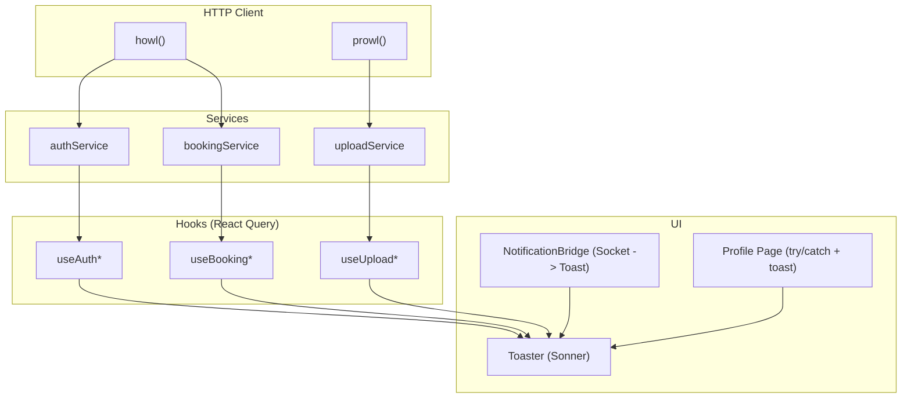
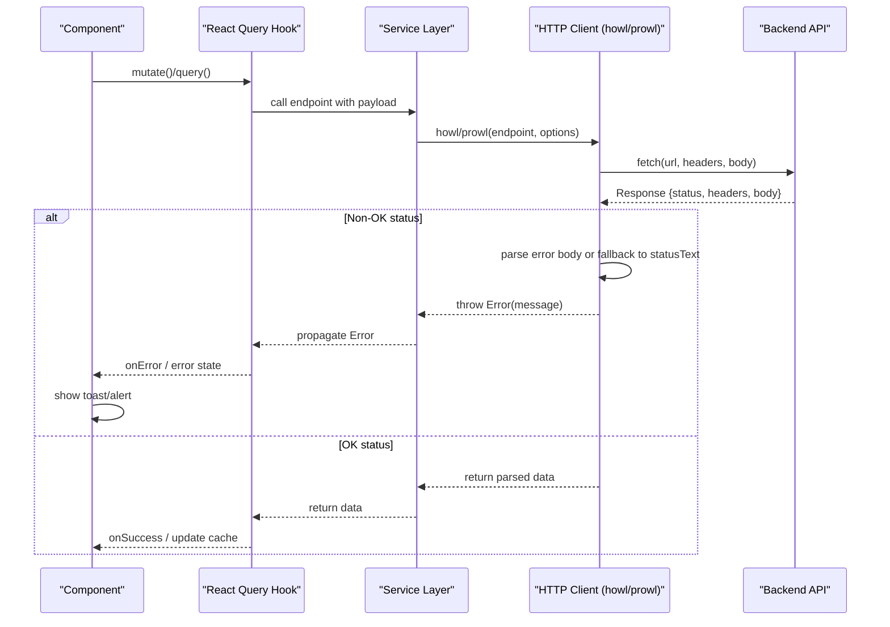
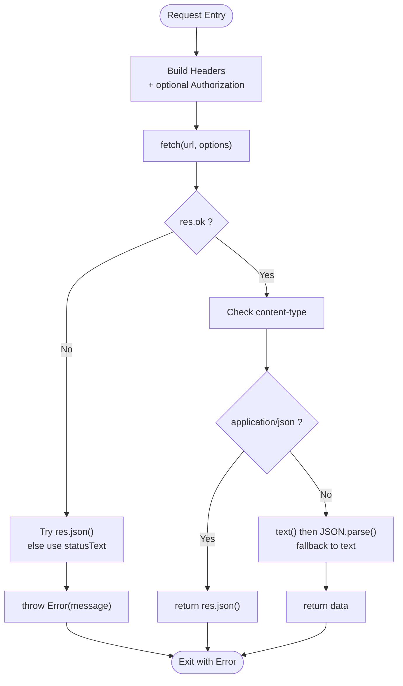
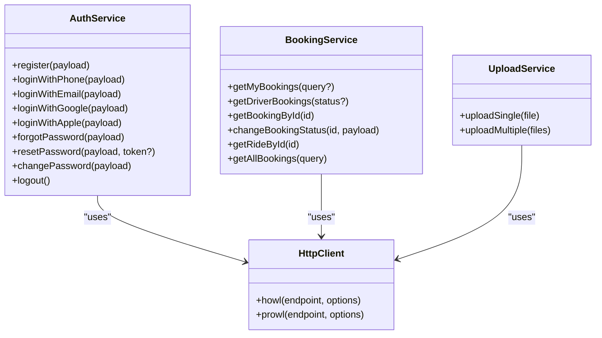
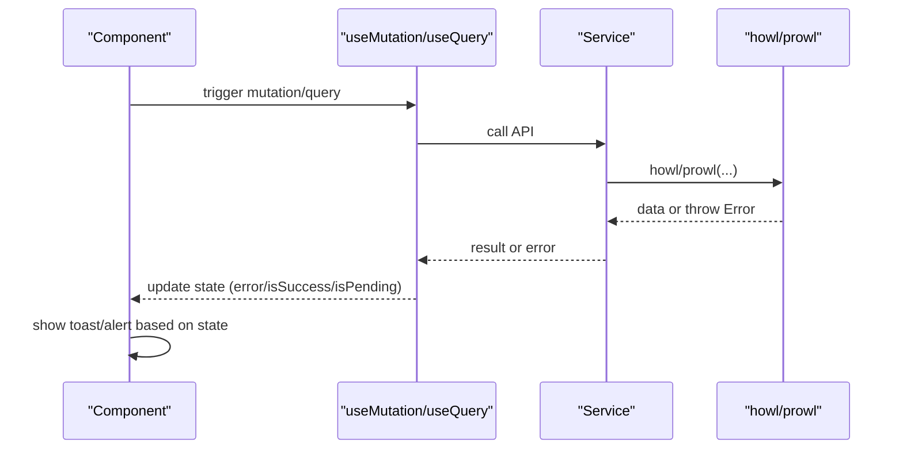
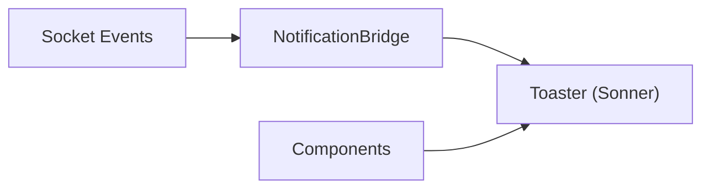
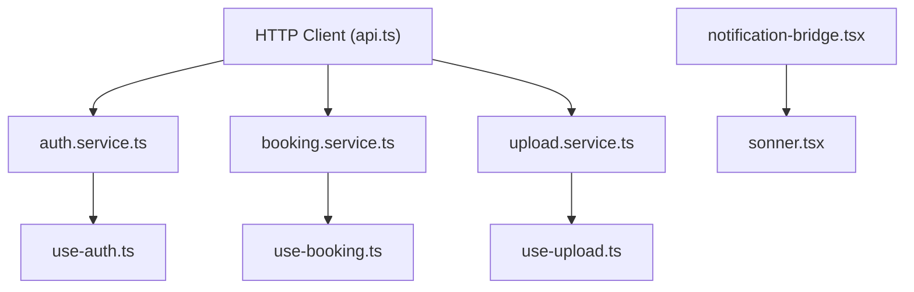

# Error Handling & Response Management

<cite>
**Referenced Files in This Document**
- [api.ts](file://src/lib/api.ts)
- [base.ts](file://src/types/base.ts)
- [auth.service.ts](file://src/services/auth.service.ts)
- [use-auth.ts](file://src/hooks/auth/use-auth.ts)
- [booking.service.ts](file://src/services/booking.service.ts)
- [use-booking.ts](file://src/hooks/booking/use-booking.ts)
- [upload.service.ts](file://src/services/upload.service.ts)
- [use-upload.ts](file://src/hooks/shared/use-upload.ts)
- [notification-bridge.tsx](file://src/provider/notification-bridge.tsx)
- [sonner.tsx](file://src/components/ui/sonner.tsx)
- [me.tsx](file://src/components/core/privacy-pages/me.tsx)
</cite>

## Table of Contents
1. Introduction
2. Project Structure
3. Core Components
4. Architecture Overview
5. Detailed Component Analysis
6. Dependency Analysis
7. Performance Considerations
8. Troubleshooting Guide
9. Conclusion

## Introduction
This document explains the error handling and response management strategies used across the application. It covers the unified HTTP client behavior, custom response types, error propagation patterns from services to hooks and UI, user-facing notifications, and guidance for implementing retry logic, timeouts, graceful degradation, response transformation, data validation, and type safety.

## Project Structure
Error handling spans a few key layers:
- HTTP client layer: centralized fetch wrappers that normalize responses and errors
- Service layer: typed API calls returning standardized response shapes
- Hooks layer: React Query-based mutations/queries that surface status and errors to components
- UI layer: toast notifications and alert components for user feedback

**Diagram sources**
- [api.ts:23-73](file://src/lib/api.ts#L23-L73)
- [api.ts:83-105](file://src/lib/api.ts#L83-L105)
- [auth.service.ts:15-42](file://src/services/auth.service.ts#L15-L42)
- [booking.service.ts:13-44](file://src/services/booking.service.ts#L13-L44)
- [upload.service.ts:5-19](file://src/services/upload.service.ts#L5-L19)
- [use-auth.ts:15-67](file://src/hooks/auth/use-auth.ts#L15-L67)
- [use-booking.ts:7-60](file://src/hooks/booking/use-booking.ts#L7-L60)
- [use-upload.ts:6-16](file://src/hooks/shared/use-upload.ts#L6-L16)
- [notification-bridge.tsx:16-57](file://src/provider/notification-bridge.tsx#L16-L57)
- [sonner.tsx:14-76](file://src/components/ui/sonner.tsx#L14-L76)
- [me.tsx:115-137](file://src/components/core/privacy-pages/me.tsx#L115-L137)

**Section sources**
- [api.ts:23-73](file://src/lib/api.ts#L23-L73)
- [api.ts:83-105](file://src/lib/api.ts#L83-L105)
- [auth.service.ts:15-42](file://src/services/auth.service.ts#L15-L42)
- [booking.service.ts:13-44](file://src/services/booking.service.ts#L13-L44)
- [upload.service.ts:5-19](file://src/services/upload.service.ts#L5-L19)
- [use-auth.ts:15-67](file://src/hooks/auth/use-auth.ts#L15-L67)
- [use-booking.ts:7-60](file://src/hooks/booking/use-booking.ts#L7-L60)
- [use-upload.ts:6-16](file://src/hooks/shared/use-upload.ts#L6-L16)
- [notification-bridge.tsx:16-57](file://src/provider/notification-bridge.tsx#L16-L57)
- [sonner.tsx:14-76](file://src/components/ui/sonner.tsx#L14-L76)
- [me.tsx:115-137](file://src/components/core/privacy-pages/me.tsx#L115-L137)

## Core Components
- Unified HTTP clients
  - howl<T>: JSON requests with automatic Authorization header injection, non-OK status normalization, and content-type-aware parsing. Throws a standard Error with a user-friendly message when possible.
  - prowl<T>: FormData requests with similar error normalization; returns parsed JSON on success.
- Standardized response types
  - ApiResponse<T>, PagedResponse<T>, Paginator<T> define consistent shapes for server payloads.
- Services
  - Thin wrappers around howl/prowl that enforce typed endpoints and payloads.
- Hooks (React Query)
  - useMutation/useQuery wrappers that expose mutation/query state and allow centralized error handling at the component level.
- UI feedback
  - Toaster (Sonner) provides global toast notifications.
  - NotificationBridge maps socket events to toasts.
  - Example component uses try/catch to display friendly messages.

**Section sources**
- [api.ts:23-73](file://src/lib/api.ts#L23-L73)
- [api.ts:83-105](file://src/lib/api.ts#L83-L105)
- [base.ts:2-28](file://src/types/base.ts#L2-L28)
- [auth.service.ts:15-42](file://src/services/auth.service.ts#L15-L42)
- [booking.service.ts:13-44](file://src/services/booking.service.ts#L13-L44)
- [upload.service.ts:5-19](file://src/services/upload.service.ts#L5-L19)
- [use-auth.ts:15-67](file://src/hooks/auth/use-auth.ts#L15-L67)
- [use-booking.ts:7-60](file://src/hooks/booking/use-booking.ts#L7-L60)
- [use-upload.ts:6-16](file://src/hooks/shared/use-upload.ts#L6-L16)
- [notification-bridge.tsx:16-57](file://src/provider/notification-bridge.tsx#L16-L57)
- [sonner.tsx:14-76](file://src/components/ui/sonner.tsx#L14-L76)
- [me.tsx:115-137](file://src/components/core/privacy-pages/me.tsx#L115-L137)

## Architecture Overview
The request lifecycle and error flow:

**Diagram sources**
- [api.ts:23-73](file://src/lib/api.ts#L23-L73)
- [api.ts:83-105](file://src/lib/api.ts#L83-L105)
- [auth.service.ts:15-42](file://src/services/auth.service.ts#L15-L42)
- [use-auth.ts:15-67](file://src/hooks/auth/use-auth.ts#L15-L67)
- [me.tsx:115-137](file://src/components/core/privacy-pages/me.tsx#L115-L137)

## Detailed Component Analysis

### HTTP Client: howl<T> and prowl<T>
- Behavior
  - Adds Accept and Content-Type headers; injects Authorization if token present.
  - For non-OK responses, attempts to extract a message from JSON body; falls back to statusText or a generic message.
  - Throws a standard Error to be caught by callers.
  - Returns JSON when content-type indicates JSON; otherwise tries to parse text as JSON or returns raw text.
- Error propagation
  - Errors bubble up through services into hooks and finally to UI where they can be surfaced via toasts or alerts.

**Diagram sources**
- [api.ts:23-73](file://src/lib/api.ts#L23-L73)
- [api.ts:83-105](file://src/lib/api.ts#L83-L105)

**Section sources**
- [api.ts:23-73](file://src/lib/api.ts#L23-L73)
- [api.ts:83-105](file://src/lib/api.ts#L83-L105)

### Response Types and Data Validation
- ApiResponse<T>
  - Enforces a uniform envelope with status, message, and data fields.
- PagedResponse<T>
  - Provides pagination metadata and an array of items.
- Paginator<T>
  - Alternative pagination shape used by some endpoints.

Recommendations
- Validate incoming data at service boundaries using runtime validators (e.g., zod) before passing to UI.
- Map backend messages to localized strings in the UI layer.

**Section sources**
- [base.ts:2-28](file://src/types/base.ts#L2-L28)

### Services: Auth, Booking, Upload
- Pattern
  - Each service method wraps a howl/prowl call with explicit TypeScript generics for input/output.
  - Errors thrown by the client are propagated unchanged to callers.
- Examples
  - Authentication endpoints return ApiResponse<OtpTokenResponse> or ApiResponse<LoginResponse>.
  - Booking endpoints return PagedResponse<...> or ApiResponse<...>.
  - Upload endpoints use prowl for FormData and return ApiResponse<...>.

**Diagram sources**
- [auth.service.ts:15-42](file://src/services/auth.service.ts#L15-L42)
- [booking.service.ts:13-44](file://src/services/booking.service.ts#L13-L44)
- [upload.service.ts:5-19](file://src/services/upload.service.ts#L5-L19)
- [api.ts:23-73](file://src/lib/api.ts#L23-L73)
- [api.ts:83-105](file://src/lib/api.ts#L83-L105)

**Section sources**
- [auth.service.ts:15-42](file://src/services/auth.service.ts#L15-L42)
- [booking.service.ts:13-44](file://src/services/booking.service.ts#L13-L44)
- [upload.service.ts:5-19](file://src/services/upload.service.ts#L5-L19)

### Hooks: React Query Integration
- Patterns
  - useMutation/useQuery wrap service calls, exposing isPending, isError, error, onSuccess, etc.
  - Some mutations invalidate related queries on success to keep UI in sync.
- Error exposure
  - Errors thrown by services bubble into React Query’s error state; components should handle them (e.g., show toasts).

**Diagram sources**
- [use-auth.ts:15-67](file://src/hooks/auth/use-auth.ts#L15-L67)
- [use-booking.ts:7-60](file://src/hooks/booking/use-booking.ts#L7-L60)
- [use-upload.ts:6-16](file://src/hooks/shared/use-upload.ts#L6-L16)
- [api.ts:23-73](file://src/lib/api.ts#L23-L73)
- [api.ts:83-105](file://src/lib/api.ts#L83-L105)

**Section sources**
- [use-auth.ts:15-67](file://src/hooks/auth/use-auth.ts#L15-L67)
- [use-booking.ts:7-60](file://src/hooks/booking/use-booking.ts#L7-L60)
- [use-upload.ts:6-16](file://src/hooks/shared/use-upload.ts#L6-L16)

### User-Friendly Messages and Notifications
- Global toasts
  - Toaster (Sonner) is configured with icons and theme integration.
- Socket-driven notifications
  - NotificationBridge listens to real-time events and shows contextual toasts.
- Component-level handling
  - Example profile page uses try/catch to convert errors into user-friendly toasts.

**Diagram sources**
- [notification-bridge.tsx:16-57](file://src/provider/notification-bridge.tsx#L16-L57)
- [sonner.tsx:14-76](file://src/components/ui/sonner.tsx#L14-L76)
- [me.tsx:115-137](file://src/components/core/privacy-pages/me.tsx#L115-L137)

**Section sources**
- [notification-bridge.tsx:16-57](file://src/provider/notification-bridge.tsx#L16-L57)
- [sonner.tsx:14-76](file://src/components/ui/sonner.tsx#L14-L76)
- [me.tsx:115-137](file://src/components/core/privacy-pages/me.tsx#L115-L137)

## Dependency Analysis
- Coupling
  - Services depend only on the HTTP client; hooks depend on services; UI depends on hooks and notification utilities.
- Cohesion
  - Each module has a single responsibility: networking, domain operations, state orchestration, or presentation.
- External dependencies
  - React Query for caching and lifecycle management.
  - Sonner for toast notifications.
  - Next.js environment variables for base URL configuration.

**Diagram sources**
- [api.ts:23-73](file://src/lib/api.ts#L23-L73)
- [api.ts:83-105](file://src/lib/api.ts#L83-L105)
- [auth.service.ts:15-42](file://src/services/auth.service.ts#L15-L42)
- [booking.service.ts:13-44](file://src/services/booking.service.ts#L13-L44)
- [upload.service.ts:5-19](file://src/services/upload.service.ts#L5-L19)
- [use-auth.ts:15-67](file://src/hooks/auth/use-auth.ts#L15-L67)
- [use-booking.ts:7-60](file://src/hooks/booking/use-booking.ts#L7-L60)
- [use-upload.ts:6-16](file://src/hooks/shared/use-upload.ts#L6-L16)
- [notification-bridge.tsx:16-57](file://src/provider/notification-bridge.tsx#L16-L57)
- [sonner.tsx:14-76](file://src/components/ui/sonner.tsx#L14-L76)

**Section sources**
- [api.ts:23-73](file://src/lib/api.ts#L23-L73)
- [api.ts:83-105](file://src/lib/api.ts#L83-L105)
- [auth.service.ts:15-42](file://src/services/auth.service.ts#L15-L42)
- [booking.service.ts:13-44](file://src/services/booking.service.ts#L13-L44)
- [upload.service.ts:5-19](file://src/services/upload.service.ts#L5-L19)
- [use-auth.ts:15-67](file://src/hooks/auth/use-auth.ts#L15-L67)
- [use-booking.ts:7-60](file://src/hooks/booking/use-booking.ts#L7-L60)
- [use-upload.ts:6-16](file://src/hooks/shared/use-upload.ts#L6-L16)
- [notification-bridge.tsx:16-57](file://src/provider/notification-bridge.tsx#L16-L57)
- [sonner.tsx:14-76](file://src/components/ui/sonner.tsx#L14-L76)

## Performance Considerations
- Avoid redundant retries by leveraging React Query’s built-in retry settings for idempotent queries.
- Use query invalidation strategically to refresh only affected caches after mutations.
- Prefer streaming or progressive loading for large datasets; paginate using PagedResponse/Paginator shapes.
- Minimize network overhead by batching uploads when possible and reusing tokens.

[No sources needed since this section provides general guidance]

## Troubleshooting Guide
Common issues and remedies:
- Network failures
  - The client throws a generic Error when the underlying fetch fails. Wrap calls in try/catch or use React Query’s onError to show user-friendly toasts.
- Non-OK HTTP responses
  - The client extracts a message from the JSON body when available; otherwise falls back to statusText or a default message. Ensure your backend consistently returns a message field in error payloads.
- Mixed content types
  - If the server returns non-JSON on success, the client will attempt to parse it as JSON or return raw text. Verify content-type headers match expectations.
- Real-time errors
  - Socket error events are mapped to toasts via NotificationBridge. Inspect event payloads to improve messaging.

Actionable tips:
- Centralize toast usage via the Toaster component.
- Normalize error messages in the client layer to avoid leaking technical details.
- Add logging around failed requests for diagnostics without exposing sensitive data.

**Section sources**
- [api.ts:23-73](file://src/lib/api.ts#L23-L73)
- [api.ts:83-105](file://src/lib/api.ts#L83-L105)
- [notification-bridge.tsx:16-57](file://src/provider/notification-bridge.tsx#L16-L57)
- [sonner.tsx:14-76](file://src/components/ui/sonner.tsx#L14-L76)
- [me.tsx:115-137](file://src/components/core/privacy-pages/me.tsx#L115-L137)

## Conclusion
The application employs a clear separation of concerns for error handling and response management:
- A unified HTTP client normalizes errors and responses.
- Services provide typed, predictable interfaces.
- React Query hooks centralize state and lifecycle.
- UI components and a global toaster deliver user-friendly feedback.

Adopting the recommendations above—such as adding retry logic, timeouts, validation, and localization—will further strengthen reliability and user experience.

[No sources needed since this section summarizes without analyzing specific files]