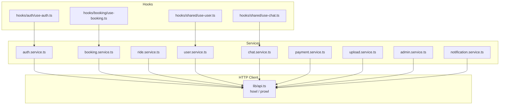
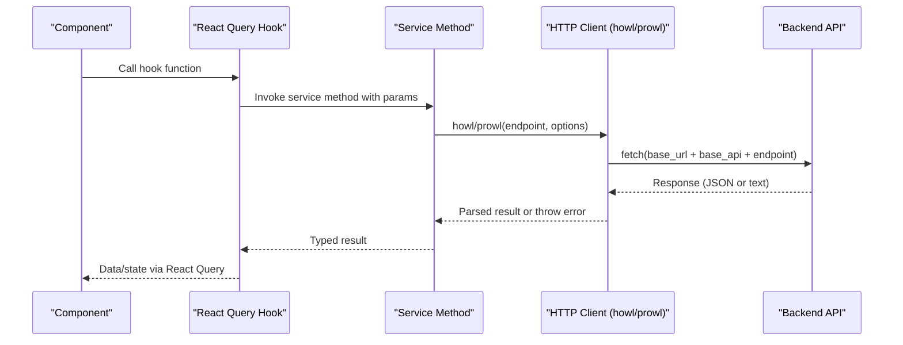
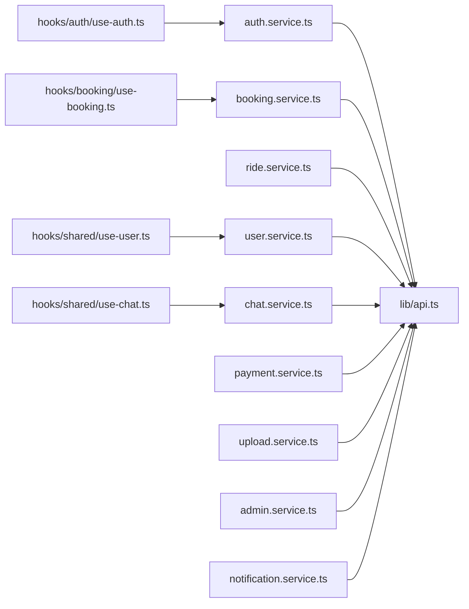

# Service Architecture

<cite>
**Referenced Files in This Document**
- [api.ts](file://src/lib/api.ts)
- [auth.service.ts](file://src/services/auth.service.ts)
- [booking.service.ts](file://src/services/booking.service.ts)
- [ride.service.ts](file://src/services/ride.service.ts)
- [user.service.ts](file://src/services/user.service.ts)
- [chat.service.ts](file://src/services/chat.service.ts)
- [payment.service.ts](file://src/services/payment.service.ts)
- [upload.service.ts](file://src/services/upload.service.ts)
- [admin.service.ts](file://src/services/admin.service.ts)
- [notification.service.ts](file://src/services/notification.service.ts)
- [use-auth.ts](file://src/hooks/auth/use-auth.ts)
- [use-booking.ts](file://src/hooks/booking/use-booking.ts)
- [use-chat.ts](file://src/hooks/shared/use-chat.ts)
- [use-user.ts](file://src/hooks/shared/use-user.ts)
- [base.ts](file://src/types/base.ts)
- [auth.types.ts](file://src/types/auth.types.ts)
- [booking.types.ts](file://src/types/booking.types.ts)
</cite>

## Table of Contents
1. Introduction
2. Project Structure
3. Core Components
4. Architecture Overview
5. Detailed Component Analysis
6. Dependency Analysis
7. Performance Considerations
8. Troubleshooting Guide
9. Conclusion

## Introduction
This document explains the service layer architecture and how it separates concerns between business logic, API access, and UI components. Services encapsulate HTTP calls, normalize request/response shapes, and expose typed methods that React Query hooks consume. The pattern ensures:
- Clear separation of data access (services) from UI state management (hooks) and presentation (components).
- Centralized error handling and token injection at the HTTP client level.
- Consistent parameter building for query strings and pagination.
- Strong typing across payloads, responses, and query options.

## Project Structure
The service layer is organized by domain with one file per feature area. Each service exports a plain object containing methods that call a shared HTTP client. Hooks wrap these services using React Query to provide caching, background refetching, and mutation lifecycle control.

**Diagram sources**
- [api.ts:1-106](file://src/lib/api.ts#L1-L106)
- [auth.service.ts:1-43](file://src/services/auth.service.ts#L1-L43)
- [booking.service.ts:1-45](file://src/services/booking.service.ts#L1-L45)
- [ride.service.ts:1-127](file://src/services/ride.service.ts#L1-L127)
- [user.service.ts:1-117](file://src/services/user.service.ts#L1-L117)
- [chat.service.ts:1-50](file://src/services/chat.service.ts#L1-L50)
- [payment.service.ts:1-72](file://src/services/payment.service.ts#L1-L72)
- [upload.service.ts:1-20](file://src/services/upload.service.ts#L1-L20)
- [admin.service.ts:1-28](file://src/services/admin.service.ts#L1-L28)
- [notification.service.ts:1-18](file://src/services/notification.service.ts#L1-L18)
- [use-auth.ts:1-68](file://src/hooks/auth/use-auth.ts#L1-L68)
- [use-booking.ts:1-60](file://src/hooks/booking/use-booking.ts#L1-L60)
- [use-chat.ts:1-95](file://src/hooks/shared/use-chat.ts#L1-L95)
- [use-user.ts:1-117](file://src/hooks/shared/use-user.ts#L1-L117)

**Section sources**
- [api.ts:1-106](file://src/lib/api.ts#L1-L106)
- [auth.service.ts:1-43](file://src/services/auth.service.ts#L1-L43)
- [booking.service.ts:1-45](file://src/services/booking.service.ts#L1-L45)
- [ride.service.ts:1-127](file://src/services/ride.service.ts#L1-L127)
- [user.service.ts:1-117](file://src/services/user.service.ts#L1-L117)
- [chat.service.ts:1-50](file://src/services/chat.service.ts#L1-L50)
- [payment.service.ts:1-72](file://src/services/payment.service.ts#L1-L72)
- [upload.service.ts:1-20](file://src/services/upload.service.ts#L1-L20)
- [admin.service.ts:1-28](file://src/services/admin.service.ts#L1-L28)
- [notification.service.ts:1-18](file://src/services/notification.service.ts#L1-L18)
- [use-auth.ts:1-68](file://src/hooks/auth/use-auth.ts#L1-L68)
- [use-booking.ts:1-60](file://src/hooks/booking/use-booking.ts#L1-L60)
- [use-chat.ts:1-95](file://src/hooks/shared/use-chat.ts#L1-L95)
- [use-user.ts:1-117](file://src/hooks/shared/use-user.ts#L1-L117)

## Core Components
- HTTP client (howl/prowl):
  - Base URL and API version are centralized.
  - Token resolution from cookies and optional override via parameters.
  - JSON and FormData support with consistent headers and credentials.
  - Error normalization into thrown errors with message extraction.
- Services:
  - Domain-scoped modules exporting method objects.
  - Parameter building for query strings and pagination.
  - Typed requests/responses using TypeScript interfaces.
- Hooks:
  - Thin wrappers around services using React Query.
  - Query keys for cache invalidation and selective refetching.
  - Mutation side effects like cache updates after successful writes.

Key responsibilities:
- Services abstract API endpoints and payload/response shapes.
- Hooks manage caching, loading states, and mutations.
- Types enforce contract consistency across layers.

**Section sources**
- [api.ts:1-106](file://src/lib/api.ts#L1-L106)
- [base.ts:1-28](file://src/types/base.ts#L1-L28)
- [auth.service.ts:1-43](file://src/services/auth.service.ts#L1-L43)
- [use-auth.ts:1-68](file://src/hooks/auth/use-auth.ts#L1-L68)

## Architecture Overview
The service layer sits between React Query hooks and the HTTP client. It centralizes endpoint composition, header/token handling, and response typing.

**Diagram sources**
- [api.ts:23-73](file://src/lib/api.ts#L23-L73)
- [auth.service.ts:15-42](file://src/services/auth.service.ts#L15-L42)
- [use-auth.ts:15-67](file://src/hooks/auth/use-auth.ts#L15-L67)

## Detailed Component Analysis

### HTTP Client: howl and prowl
- howl:
  - Builds full URLs using base_url and base_api.
  - Injects Authorization header from cookie when available; supports explicit token override.
  - Sends JSON bodies with Content-Type application/json.
  - Normalizes non-ok responses into thrown errors with message extraction.
  - Parses JSON responses; falls back to text parsing if needed.
- prowl:
  - Designed for FormData uploads.
  - Omits Content-Type to let browser set multipart boundaries.
  - Throws normalized errors on non-ok responses.

Best practices:
- Prefer howl for JSON APIs and prowl for file uploads.
- Use optional token parameter only when overriding default cookie-based auth.

**Section sources**
- [api.ts:1-106](file://src/lib/api.ts#L1-L106)

### Service Pattern Implementation
- File structure:
  - One service per domain (e.g., auth, booking, user).
  - Export a single object with methods named after actions (e.g., register, loginWithPhone).
- Method organization:
  - GET endpoints return typed results directly.
  - POST/PUT/PATCH/DELETE include method and body fields.
  - Query parameters are built inline or via URLSearchParams for complex filters.
- Parameter handling:
  - Optional parameters are guarded before appending to query strings.
  - Pagination uses standard page/limit patterns.
- Request/response transformations:
  - Services do not mutate server responses; they pass through typed data.
  - Transformations occur in hooks when necessary (e.g., composing messages from chat detail).

Examples of patterns:
- Simple GET with optional query string: [getMyBookings:14-17](file://src/services/booking.service.ts#L14-L17), [getDriverRides:27-30](file://src/services/ride.service.ts#L27-L30).
- Complex filtering with URLSearchParams: [getAllBookings:34-43](file://src/services/booking.service.ts#L34-L43), [getUsers:34-44](file://src/services/user.service.ts#L34-L44).
- File upload with FormData: [uploadSingle:6-10](file://src/services/upload.service.ts#L6-L10), [uploadMultiple:12-18](file://src/services/upload.service.ts#L12-L18).

**Section sources**
- [booking.service.ts:14-43](file://src/services/booking.service.ts#L14-L43)
- [ride.service.ts:27-30](file://src/services/ride.service.ts#L27-L30)
- [user.service.ts:34-44](file://src/services/user.service.ts#L34-L44)
- [upload.service.ts:6-18](file://src/services/upload.service.ts#L6-L18)

### Separation of Concerns: Services vs Hooks
- Services:
  - Pure data access; no UI state or caching.
  - Encapsulate endpoint composition and typing.
- Hooks:
  - Manage caching, retries, and invalidation.
  - Provide convenient APIs to components.
  - Compose multiple service calls when needed.

Example flows:
- Authentication flow: [useRegister:15-19](file://src/hooks/auth/use-auth.ts#L15-L19) -> [authService.register:16-17](file://src/services/auth.service.ts#L16-L17).
- Booking status change with cache invalidation: [useChangeBookingStatus:35-44](file://src/hooks/booking/use-booking.ts#L35-L44) -> [bookingService.changeBookingStatus:27-28](file://src/services/booking.service.ts#L27-L28).
- Chat messages composition: [useMessagesByChatId:51-60](file://src/hooks/shared/use-chat.ts#L51-L60) -> [chatService.getChatById:47-49](file://src/services/chat.service.ts#L47-L49).

**Section sources**
- [use-auth.ts:15-19](file://src/hooks/auth/use-auth.ts#L15-L19)
- [auth.service.ts:16-17](file://src/services/auth.service.ts#L16-L17)
- [use-booking.ts:35-44](file://src/hooks/booking/use-booking.ts#L35-L44)
- [booking.service.ts:27-28](file://src/services/booking.service.ts#L27-L28)
- [use-chat.ts:51-60](file://src/hooks/shared/use-chat.ts#L51-L60)
- [chat.service.ts:47-49](file://src/services/chat.service.ts#L47-L49)

### Creating New Services
Steps:
1. Define types for payloads and responses in the corresponding types file.
2. Create a new service file under src/services/<domain>.service.ts.
3. Export an object with methods that call howl or prowl.
4. Build query parameters safely using URLSearchParams or template literals.
5. Wrap the service in a React Query hook under src/hooks/<domain>/use-<feature>.ts.
6. Use query keys for precise cache invalidation.

Guidelines:
- Keep services small and focused on one domain.
- Avoid business logic in services; keep it in hooks or components.
- Always type inputs and outputs to catch mismatches early.

**Section sources**
- [base.ts:1-28](file://src/types/base.ts#L1-L28)
- [auth.service.ts:1-43](file://src/services/auth.service.ts#L1-L43)
- [use-auth.ts:1-68](file://src/hooks/auth/use-auth.ts#L1-L68)

### Handling Request/Response Transformations
- Services should not transform responses; they return raw typed data.
- Perform transformations in hooks where UI needs differ from server shape.
- Example: Composing messages array from chat detail response in a hook.

**Section sources**
- [use-chat.ts:51-60](file://src/hooks/shared/use-chat.ts#L51-L60)

### Managing Service Dependencies
- Services are stateless and depend only on the HTTP client.
- If cross-service composition is needed, prefer doing it in hooks to maintain clear boundaries.
- For example, a hook can call multiple services and aggregate results.

**Section sources**
- [use-chat.ts:51-60](file://src/hooks/shared/use-chat.ts#L51-L60)

### Best Practices for Service Composition
- Use query keys consistently to enable targeted invalidation.
- Prefer URLSearchParams for complex queries to avoid manual string concatenation errors.
- Normalize error messages at the HTTP client level; handle specific cases in hooks.
- Keep methods idempotent where possible; use appropriate HTTP verbs.

**Section sources**
- [use-booking.ts:14-18](file://src/hooks/booking/use-booking.ts#L14-L18)
- [use-user.ts:17-21](file://src/hooks/shared/use-user.ts#L17-L21)

### Testing Strategies
- Unit test services by mocking the HTTP client functions (howl/prowl) and asserting endpoint construction and parameters.
- Test hooks by wrapping them in a React Query provider and using testing utilities to assert query/mutation behavior.
- Validate query key structures and invalidation paths.
- Mock network failures to ensure error handling paths are covered.

[No sources needed since this section provides general guidance]

## Dependency Analysis
The following diagram shows how services depend on the HTTP client and how hooks depend on services.

**Diagram sources**
- [api.ts:1-106](file://src/lib/api.ts#L1-L106)
- [auth.service.ts:1-43](file://src/services/auth.service.ts#L1-L43)
- [booking.service.ts:1-45](file://src/services/booking.service.ts#L1-L45)
- [ride.service.ts:1-127](file://src/services/ride.service.ts#L1-L127)
- [user.service.ts:1-117](file://src/services/user.service.ts#L1-L117)
- [chat.service.ts:1-50](file://src/services/chat.service.ts#L1-L50)
- [payment.service.ts:1-72](file://src/services/payment.service.ts#L1-L72)
- [upload.service.ts:1-20](file://src/services/upload.service.ts#L1-L20)
- [admin.service.ts:1-28](file://src/services/admin.service.ts#L1-L28)
- [notification.service.ts:1-18](file://src/services/notification.service.ts#L1-L18)
- [use-auth.ts:1-68](file://src/hooks/auth/use-auth.ts#L1-L68)
- [use-booking.ts:1-60](file://src/hooks/booking/use-booking.ts#L1-L60)
- [use-chat.ts:1-95](file://src/hooks/shared/use-chat.ts#L1-L95)
- [use-user.ts:1-117](file://src/hooks/shared/use-user.ts#L1-L117)

**Section sources**
- [api.ts:1-106](file://src/lib/api.ts#L1-L106)
- [auth.service.ts:1-43](file://src/services/auth.service.ts#L1-L43)
- [booking.service.ts:1-45](file://src/services/booking.service.ts#L1-L45)
- [ride.service.ts:1-127](file://src/services/ride.service.ts#L1-L127)
- [user.service.ts:1-117](file://src/services/user.service.ts#L1-L117)
- [chat.service.ts:1-50](file://src/services/chat.service.ts#L1-L50)
- [payment.service.ts:1-72](file://src/services/payment.service.ts#L1-L72)
- [upload.service.ts:1-20](file://src/services/upload.service.ts#L1-L20)
- [admin.service.ts:1-28](file://src/services/admin.service.ts#L1-L28)
- [notification.service.ts:1-18](file://src/services/notification.service.ts#L1-L18)
- [use-auth.ts:1-68](file://src/hooks/auth/use-auth.ts#L1-L68)
- [use-booking.ts:1-60](file://src/hooks/booking/use-booking.ts#L1-L60)
- [use-chat.ts:1-95](file://src/hooks/shared/use-chat.ts#L1-L95)
- [use-user.ts:1-117](file://src/hooks/shared/use-user.ts#L1-L117)

## Performance Considerations
- Leverage React Query caching to minimize redundant network calls.
- Use precise query keys to invalidate only affected caches.
- Prefer paginated endpoints and limit large payloads.
- Avoid heavy transformations in services; perform them in hooks where necessary.
- Use credentials: include for cookie-based sessions to reduce token overhead.

[No sources needed since this section provides general guidance]

## Troubleshooting Guide
Common issues and resolutions:
- Missing Authorization header:
  - Ensure the token cookie exists or pass token explicitly to howl/prowl.
- Non-JSON responses:
  - howl attempts JSON parse; if content-type is not JSON, it returns text. Verify backend content-type.
- Error messages not shown:
  - Errors are normalized to throw with message field; inspect caught errors in hooks.
- Query parameters not applied:
  - Confirm optional checks before setting params; verify URLSearchParams usage.

Operational references:
- Token retrieval and header injection: [getToken and howl headers:5-13](file://src/lib/api.ts#L5-L13), [requestOptions headers:30-40](file://src/lib/api.ts#L30-L40).
- Error normalization: [non-ok handling:45-54](file://src/lib/api.ts#L45-L54).
- Query parameter building examples: [getAllBookings:34-43](file://src/services/booking.service.ts#L34-L43), [getUsers:34-44](file://src/services/user.service.ts#L34-L44).

**Section sources**
- [api.ts:5-13](file://src/lib/api.ts#L5-L13)
- [api.ts:30-40](file://src/lib/api.ts#L30-L40)
- [api.ts:45-54](file://src/lib/api.ts#L45-L54)
- [booking.service.ts:34-43](file://src/services/booking.service.ts#L34-L43)
- [user.service.ts:34-44](file://src/services/user.service.ts#L34-L44)

## Conclusion
The service layer cleanly separates data access from UI concerns, providing a consistent, typed, and maintainable foundation. Services encapsulate HTTP details, while hooks manage caching and state. Following the outlined patterns and best practices will improve reliability, testability, and performance across the application.