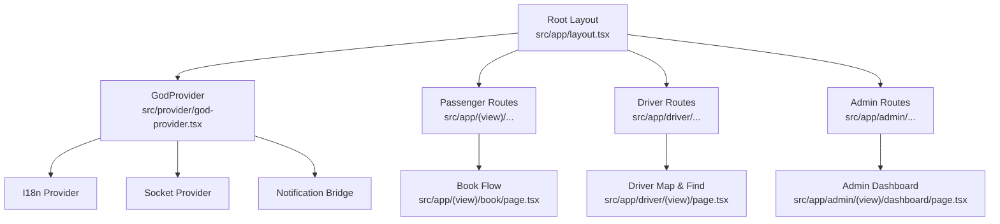
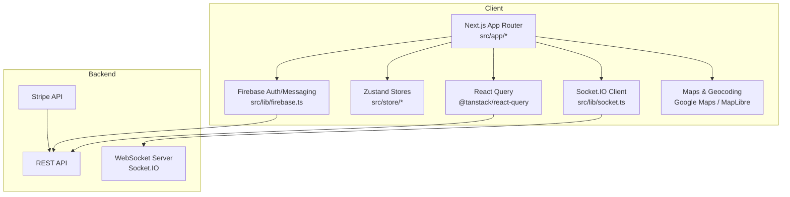
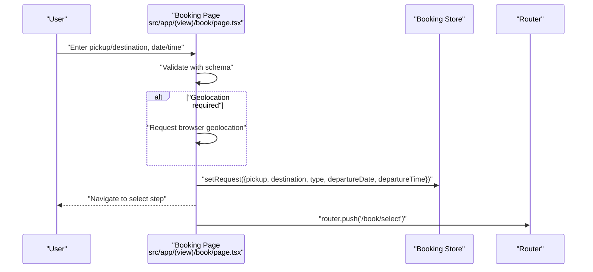
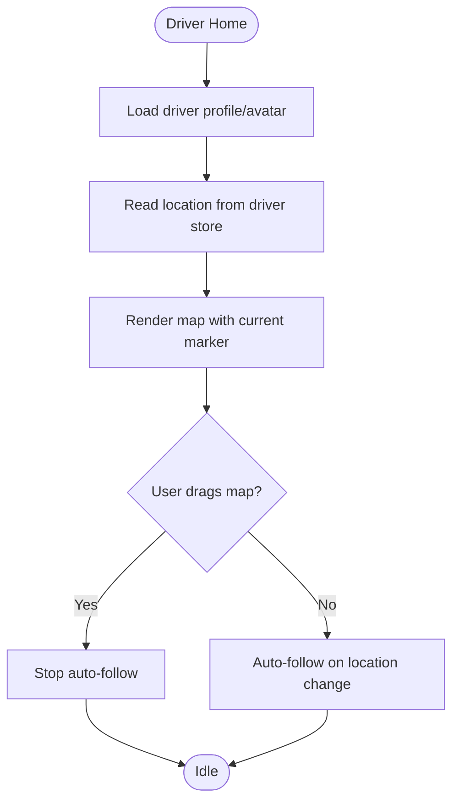
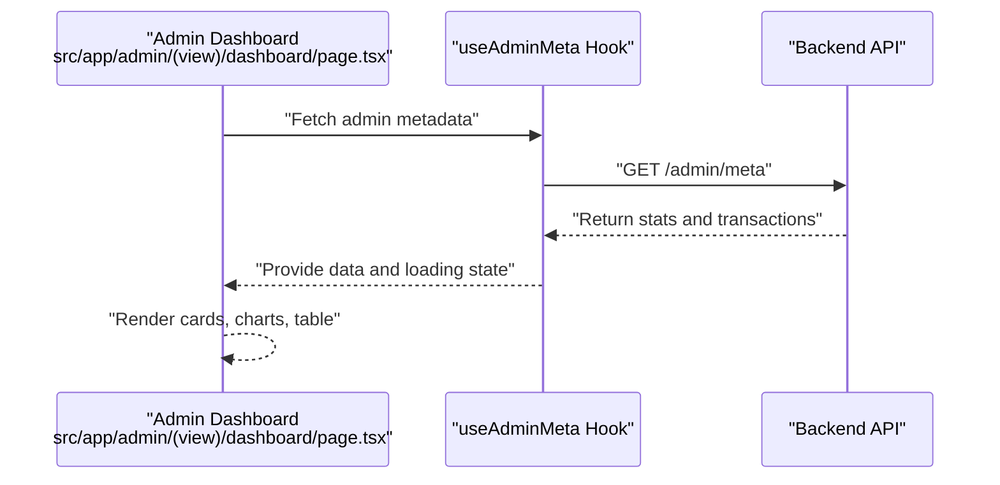
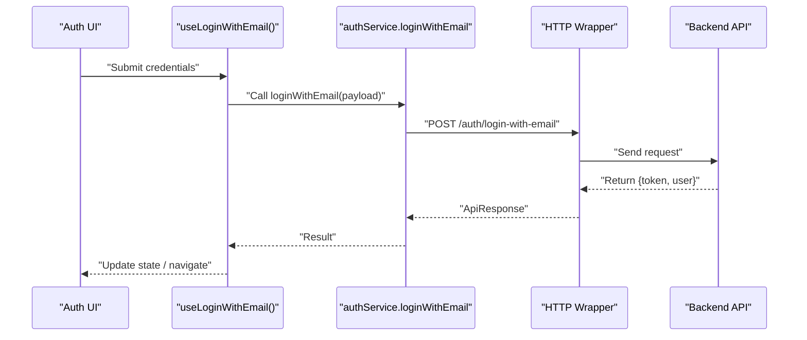
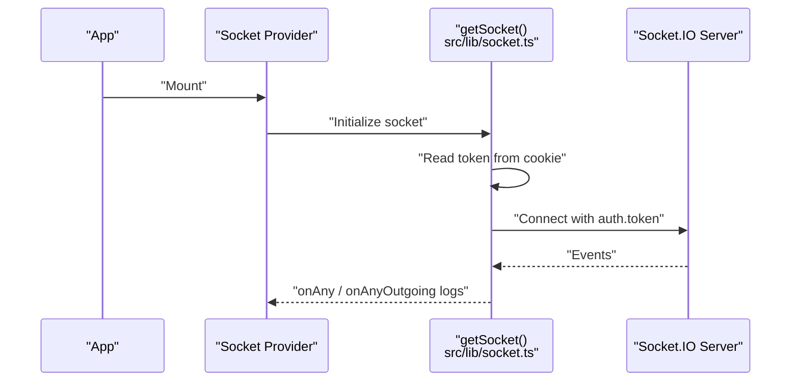
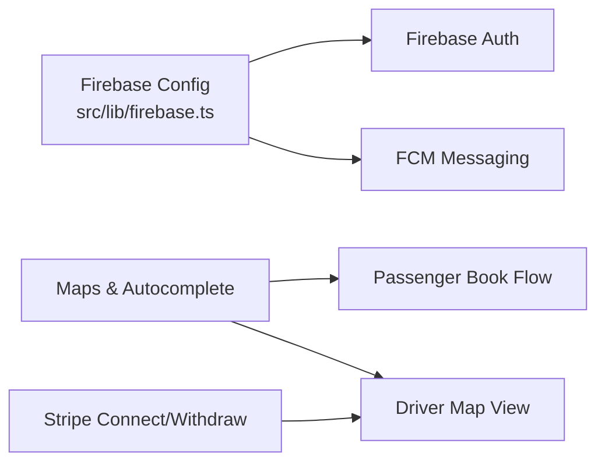
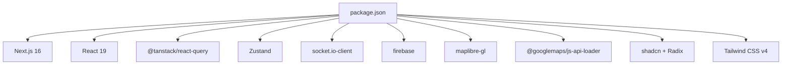

# Architecture Overview

<cite>
**Referenced Files in This Document**
- [README.md](file://README.md)
- [package.json](file://package.json)
- [next.config.ts](file://next.config.ts)
- [src/app/layout.tsx](file://src/app/layout.tsx)
- [src/provider/god-provider.tsx](file://src/provider/god-provider.tsx)
- [src/lib/socket.ts](file://src/lib/socket.ts)
- [src/lib/firebase.ts](file://src/lib/firebase.ts)
- [src/app/(view)/layout.tsx](file://src/app/(view)/layout.tsx)
- [src/app/driver/layout.tsx](file://src/app/driver/layout.tsx)
- [src/services/auth.service.ts](file://src/services/auth.service.ts)
- [src/hooks/auth/use-auth.ts](file://src/hooks/auth/use-auth.ts)
- [src/app/(view)/book/page.tsx](file://src/app/(view)/book/page.tsx)
- [src/app/driver/(view)/page.tsx](file://src/app/driver/(view)/page.tsx)
- [src/app/admin/(view)/dashboard/page.tsx](file://src/app/admin/(view)/dashboard/page.tsx)
</cite>

## Table of Contents
1. Introduction
2. Project Structure
3. Core Components
4. Architecture Overview
5. Detailed Component Analysis
6. Dependency Analysis
7. Performance Considerations
8. Troubleshooting Guide
9. Conclusion

## Introduction
Split Ride is a Next.js-based ride-sharing platform with three distinct interfaces: passenger, driver, and admin. The application uses the Next.js App Router for routing and layout composition, React Query for server state management, Zustand for client-side state, Socket.IO for real-time communication, Firebase for authentication and push notifications, Google Maps/MapLibre for mapping, and Stripe for payments. The system is designed to be scalable, modular, and easy to extend across multiple user roles.

## Project Structure
The project follows a feature-oriented structure under src/app grouped by route segments:
- Passenger routes under (view)
- Driver routes under driver
- Admin routes under admin
Shared UI components live under src/components, hooks under src/hooks, services under src/services, stores under src/store, types under src/types, and providers under src/provider.

**Diagram sources**
- [src/app/layout.tsx:1-48](file://src/app/layout.tsx#L1-L48)
- [src/provider/god-provider.tsx:1-48](file://src/provider/god-provider.tsx#L1-L48)
- [src/app/(view)/layout.tsx](file://src/app/(view)/layout.tsx#L1-L14)
- [src/app/driver/layout.tsx:1-15](file://src/app/driver/layout.tsx#L1-L15)
- [src/app/(view)/book/page.tsx](file://src/app/(view)/book/page.tsx#L1-L305)
- [src/app/driver/(view)/page.tsx](file://src/app/driver/(view)/page.tsx#L1-L164)
- [src/app/admin/(view)/dashboard/page.tsx](file://src/app/admin/(view)/dashboard/page.tsx#L1-L227)

**Section sources**
- [README.md:1-37](file://README.md#L1-L37)
- [package.json:1-68](file://package.json#L1-L68)
- [next.config.ts:1-37](file://next.config.ts#L1-L37)
- [src/app/layout.tsx:1-48](file://src/app/layout.tsx#L1-L48)
- [src/app/(view)/layout.tsx:1-14](file://src/app/(view)/layout.tsx#L1-L14)
- [src/app/driver/layout.tsx:1-15](file://src/app/driver/layout.tsx#L1-L15)

## Core Components
- Root layout and global providers:
  - Global fonts, metadata, TooltipProvider, GodProvider, and I18nProvider are composed at the root.
  - GodProvider wires up cookies, React Query, socket connection, notification bridge, and suspense boundaries.
- Real-time layer:
  - Socket provider initializes a single Socket.IO instance with token-based auth via cookie and logs events for debugging.
- Authentication and backend integration:
  - Auth service methods wrap HTTP calls to backend endpoints using a shared howl utility.
  - React Query hooks encapsulate mutations for register/login/password flows.
- Mapping and location:
  - Passenger booking page integrates address autocomplete and geolocation fallbacks.
  - Driver view renders a map with markers and camera controls.
- Admin dashboard:
  - Displays aggregated metrics and recent transactions, driven by admin hooks.

**Section sources**
- [src/app/layout.tsx:1-48](file://src/app/layout.tsx#L1-L48)
- [src/provider/god-provider.tsx:1-48](file://src/provider/god-provider.tsx#L1-L48)
- [src/lib/socket.ts:1-50](file://src/lib/socket.ts#L1-L50)
- [src/services/auth.service.ts:1-43](file://src/services/auth.service.ts#L1-L43)
- [src/hooks/auth/use-auth.ts:1-68](file://src/hooks/auth/use-auth.ts#L1-L68)
- [src/app/(view)/book/page.tsx:1-305](file://src/app/(view)/book/page.tsx#L1-L305)
- [src/app/driver/(view)/page.tsx:1-164](file://src/app/driver/(view)/page.tsx#L1-L164)
- [src/app/admin/(view)/dashboard/page.tsx:1-227](file://src/app/admin/(view)/dashboard/page.tsx#L1-L227)

## Architecture Overview
High-level architecture:
- Client app (Next.js) serves SSR/CSR pages and composes role-specific layouts.
- State management:
  - Server state via React Query.
  - Client state via Zustand stores.
- External integrations:
  - Firebase Auth and Messaging for identity and push notifications.
  - Google Maps/MapLibre for maps and geocoding.
  - Socket.IO for real-time updates between clients and backend.
  - Stripe for driver payouts and payment flows.
- API boundary:
  - All backend interactions go through typed service modules that call a common HTTP wrapper.

**Diagram sources**
- [src/app/layout.tsx:1-48](file://src/app/layout.tsx#L1-L48)
- [src/provider/god-provider.tsx:1-48](file://src/provider/god-provider.tsx#L1-L48)
- [src/lib/socket.ts:1-50](file://src/lib/socket.ts#L1-L50)
- [src/lib/firebase.ts:1-46](file://src/lib/firebase.ts#L1-L46)
- [src/services/auth.service.ts:1-43](file://src/services/auth.service.ts#L1-L43)

## Detailed Component Analysis

### Passenger Interface
- Routing and layout:
  - Passenger routes are grouped under (view) with a shared layout providing navbar and content area.
- Booking flow:
  - The booking page collects pickup and dropoff locations, date/time, and type (split/private). It validates inputs, attempts geolocation if needed, persists request data into a store, and navigates to the next step.
- Data flow:
  - Form state is local; selected locations and coordinates are persisted to a Zustand store for later steps.
  - Validation uses Zod schemas and user feedback via toast notifications.

**Diagram sources**
- [src/app/(view)/book/page.tsx:1-305](file://src/app/(view)/book/page.tsx#L1-L305)

**Section sources**
- [src/app/(view)/layout.tsx:1-14](file://src/app/(view)/layout.tsx#L1-L14)
- [src/app/(view)/book/page.tsx:1-305](file://src/app/(view)/book/page.tsx#L1-L305)

### Driver Interface
- Routing and layout:
  - Driver routes under driver include a dedicated layout with a driver-aware navbar and a driver context provider.
- Live map and availability:
  - The driver home page shows a map centered on the driver’s location, supports re-centering, and displays other cars as markers.
- Data flow:
  - Driver location and related state are managed in a Zustand store and consumed by the map UI.

**Diagram sources**
- [src/app/driver/layout.tsx:1-15](file://src/app/driver/layout.tsx#L1-L15)
- [src/app/driver/(view)/page.tsx:1-164](file://src/app/driver/(view)/page.tsx#L1-L164)

**Section sources**
- [src/app/driver/layout.tsx:1-15](file://src/app/driver/layout.tsx#L1-L15)
- [src/app/driver/(view)/page.tsx:1-164](file://src/app/driver/(view)/page.tsx#L1-L164)

### Admin Interface
- Dashboard:
  - Displays key metrics (net income, total rides, users, drivers), sales breakdown, and recent transactions.
- Data flow:
  - Uses an admin hook to fetch metadata and render charts and tables.

**Diagram sources**
- [src/app/admin/(view)/dashboard/page.tsx:1-227](file://src/app/admin/(view)/dashboard/page.tsx#L1-L227)

**Section sources**
- [src/app/admin/(view)/dashboard/page.tsx:1-227](file://src/app/admin/(view)/dashboard/page.tsx#L1-L227)

### Authentication and Backend Integration
- Service layer:
  - Auth service exposes typed functions for registration, login (phone/email/social), password reset/change, and logout.
- Hooks:
  - React Query hooks wrap each mutation for consistent error handling and caching behavior.
- Token propagation:
  - Tokens are stored in cookies and read by the socket client for WebSocket authentication.

**Diagram sources**
- [src/services/auth.service.ts:1-43](file://src/services/auth.service.ts#L1-L43)
- [src/hooks/auth/use-auth.ts:1-68](file://src/hooks/auth/use-auth.ts#L1-L68)

**Section sources**
- [src/services/auth.service.ts:1-43](file://src/services/auth.service.ts#L1-L43)
- [src/hooks/auth/use-auth.ts:1-68](file://src/hooks/auth/use-auth.ts#L1-L68)

### Real-Time Communication
- Socket initialization:
  - A singleton Socket.IO client is created with transports ["websocket", "polling"], withCredentials enabled, and token passed via auth callback reading from cookies.
- Event logging:
  - Incoming and outgoing events are logged for easier debugging.

**Diagram sources**
- [src/lib/socket.ts:1-50](file://src/lib/socket.ts#L1-L50)
- [src/provider/god-provider.tsx:1-48](file://src/provider/god-provider.tsx#L1-L48)

**Section sources**
- [src/lib/socket.ts:1-50](file://src/lib/socket.ts#L1-L50)
- [src/provider/god-provider.tsx:1-48](file://src/provider/god-provider.tsx#L1-L48)

### External Integrations
- Firebase:
  - Initializes Firebase app and auth providers; lazily imports messaging to obtain FCM tokens when supported.
- Maps:
  - Passenger booking uses address autocomplete and geolocation; driver view uses a map component with markers and controls.
- Stripe:
  - Payment-related routes exist under driver/my-payments/connect-stripe and withdraw flows.

**Diagram sources**
- [src/lib/firebase.ts:1-46](file://src/lib/firebase.ts#L1-L46)
- [src/app/(view)/book/page.tsx:1-305](file://src/app/(view)/book/page.tsx#L1-L305)
- [src/app/driver/(view)/page.tsx:1-164](file://src/app/driver/(view)/page.tsx#L1-L164)

**Section sources**
- [src/lib/firebase.ts:1-46](file://src/lib/firebase.ts#L1-L46)
- [src/app/(view)/book/page.tsx:1-305](file://src/app/(view)/book/page.tsx#L1-L305)
- [src/app/driver/(view)/page.tsx:1-164](file://src/app/driver/(view)/page.tsx#L1-L164)

## Dependency Analysis
Key runtime dependencies and their roles:
- Next.js 16 with Turbopack configured for fast builds and dev experience.
- React 19 and React DOM for UI rendering.
- @tanstack/react-query for server state and caching.
- zustand for lightweight client state.
- socket.io-client for real-time communication.
- firebase for auth and messaging.
- maplibre-gl and Google Maps loader for mapping.
- shadcn/ui and Radix primitives for accessible UI components.
- Tailwind CSS v4 for styling.

**Diagram sources**
- [package.json:1-68](file://package.json#L1-L68)

**Section sources**
- [package.json:1-68](file://package.json#L1-L68)

## Performance Considerations
- Use React Query default options (stale time, retry) to reduce network chatter and improve perceived performance.
- Prefer code splitting and Suspense boundaries around heavy components like maps and chat panels.
- Lazy-load Firebase messaging to avoid blocking initial load.
- Optimize images via Next.js image optimization and allowlist remote patterns in Next config.
- Keep socket connections alive but throttle event processing on the client to prevent UI jank.

[No sources needed since this section provides general guidance]

## Troubleshooting Guide
- Socket connectivity issues:
  - Verify token presence in cookies and correct socket URL configuration.
  - Check console logs for incoming/outgoing events emitted by the socket client.
- Firebase messaging not working:
  - Ensure VAPID key is set and environment variables are present.
  - Confirm browser support for messaging and permission prompts.
- Image loading errors:
  - Validate allowed remotePatterns in Next config for external image hosts.
- Authentication failures:
  - Inspect response payloads from auth endpoints and ensure proper error handling in hooks.

**Section sources**
- [src/lib/socket.ts:1-50](file://src/lib/socket.ts#L1-L50)
- [src/lib/firebase.ts:1-46](file://src/lib/firebase.ts#L1-L46)
- [next.config.ts:1-37](file://next.config.ts#L1-L37)
- [src/services/auth.service.ts:1-43](file://src/services/auth.service.ts#L1-L43)

## Conclusion
Split Ride leverages a modern, modular stack built on Next.js App Router, React Query, Zustand, Socket.IO, Firebase, and mapping libraries. The separation of passenger, driver, and admin interfaces is achieved through route groups and dedicated layouts/providers. Real-time features and external integrations are cleanly abstracted behind services and hooks, enabling scalability and maintainability. With thoughtful use of caching, lazy-loading, and robust error handling, the platform can scale to meet growing demand while preserving a responsive user experience.