# Authentication & Authorization

<cite>
**Referenced Files in This Document**
- [auth.service.ts](file://src/services/auth.service.ts)
- [otp.service.ts](file://src/services/otp.service.ts)
- [api.ts](file://src/lib/api.ts)
- [firebase.ts](file://src/lib/firebase.ts)
- [use-auth.ts](file://src/hooks/auth/use-auth.ts)
- [use-otp.ts](file://src/hooks/auth/use-otp.ts)
- [use-social-auth.ts](file://src/hooks/auth/use-social-auth.ts)
- [auth.types.ts](file://src/types/auth.types.ts)
- [register.tsx](file://src/app/auth/register/register.tsx)
- [otp.tsx](file://src/app/auth/register/otp.tsx)
- [page.tsx (admin login)](file://src/app/admin/auth/login/page.tsx)
- [logout page.tsx](file://src/app/logout/page.tsx)
</cite>

## Table of Contents
1. Introduction
2. Project Structure
3. Core Components
4. Architecture Overview
5. Detailed Component Analysis
6. Dependency Analysis
7. Performance Considerations
8. Troubleshooting Guide
9. Conclusion

## Introduction
This document describes the authentication and authorization system for the application, focusing on:
- JWT-based authentication flow
- Role-based access control (RBAC) with user roles
- Multi-step registration process with OTP verification
- Integration with Firebase Authentication for social sign-in
- Token management strategy and session handling
- Protected route behavior and logout flows
- Security considerations and token refresh mechanisms

The system uses HTTP-only cookies to store a server-issued JWT access token, attaches it to API requests via a centralized HTTP client, and routes users based on their role after successful authentication.

## Project Structure
Authentication-related code is organized into services, hooks, types, UI pages, and shared libraries:
- Services: API endpoints for auth and OTP
- Hooks: React Query wrappers for mutations
- Types: Payloads, responses, and user models
- UI: Registration, OTP verification, login, and logout pages
- Libraries: HTTP client and Firebase configuration

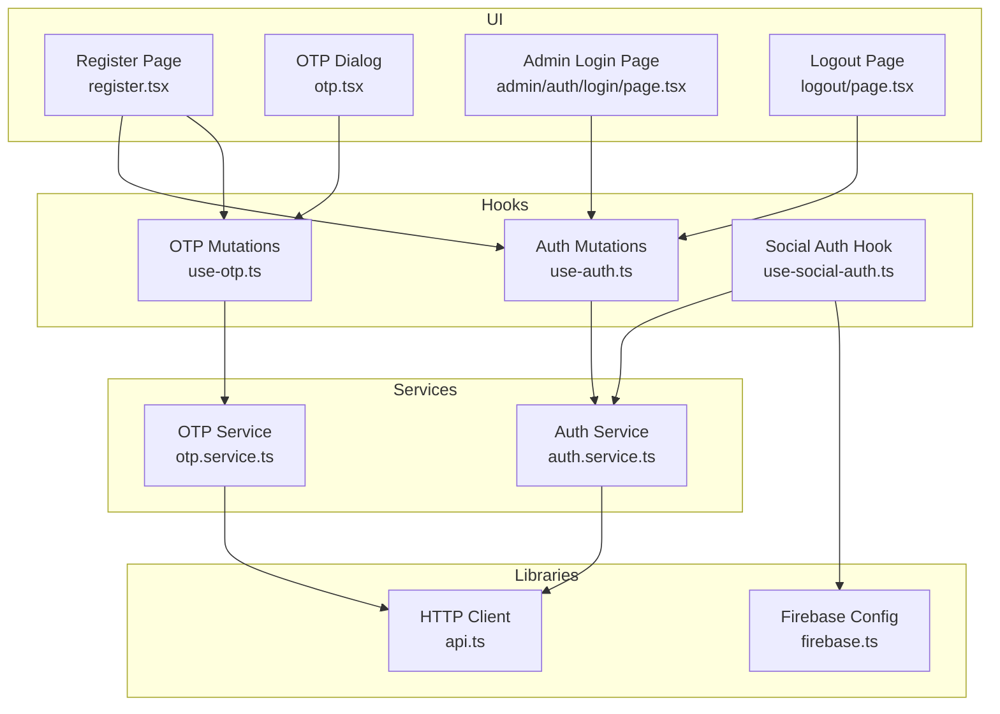

**Diagram sources**
- [register.tsx](file://src/app/auth/register/register.tsx)
- [otp.tsx](file://src/app/auth/register/otp.tsx)
- [page.tsx (admin login)](file://src/app/admin/auth/login/page.tsx)
- [logout page.tsx](file://src/app/logout/page.tsx)
- [use-auth.ts](file://src/hooks/auth/use-auth.ts)
- [use-otp.ts](file://src/hooks/auth/use-otp.ts)
- [use-social-auth.ts](file://src/hooks/auth/use-social-auth.ts)
- [auth.service.ts](file://src/services/auth.service.ts)
- [otp.service.ts](file://src/services/otp.service.ts)
- [api.ts](file://src/lib/api.ts)
- [firebase.ts](file://src/lib/firebase.ts)

**Section sources**
- [auth.service.ts](file://src/services/auth.service.ts)
- [otp.service.ts](file://src/services/otp.service.ts)
- [api.ts](file://src/lib/api.ts)
- [firebase.ts](file://src/lib/firebase.ts)
- [use-auth.ts](file://src/hooks/auth/use-auth.ts)
- [use-otp.ts](file://src/hooks/auth/use-otp.ts)
- [use-social-auth.ts](file://src/hooks/auth/use-social-auth.ts)
- [register.tsx](file://src/app/auth/register/register.tsx)
- [otp.tsx](file://src/app/auth/register/otp.tsx)
- [page.tsx (admin login)](file://src/app/admin/auth/login/page.tsx)
- [logout page.tsx](file://src/app/logout/page.tsx)

## Core Components
- HTTP client: Centralized fetch wrapper that reads the JWT from cookies and attaches it as an Authorization header for all API calls. It also handles error normalization and JSON parsing.
- Auth service: Exposes endpoints for register, login (phone/email), social login (Google/Apple), password reset/change, and logout.
- OTP service: Handles sending OTPs (email or phone) and verifying OTPs, returning either a verification token or full login tokens depending on context.
- Social auth hook: Orchestrates Firebase popup sign-in, obtains FCM token, calls backend social login, stores the JWT cookie, and redirects by role.
- Registration flow: Collects user info, sends registration request, opens OTP dialog, verifies OTP, stores JWT, and navigates based on role.
- Logout flow: Calls server logout endpoint, removes JWT cookie, clears local state and query cache, and redirects to login.

Key data contracts:
- Roles: user, provider, admin
- OTP types: signup, forgot, login, changeEmail, changePhone
- Responses include accessToken and refreshToken; user object includes role and profile completion flags

**Section sources**
- [api.ts](file://src/lib/api.ts)
- [auth.service.ts](file://src/services/auth.service.ts)
- [otp.service.ts](file://src/services/otp.service.ts)
- [use-social-auth.ts](file://src/hooks/auth/use-social-auth.ts)
- [register.tsx](file://src/app/auth/register/register.tsx)
- [otp.tsx](file://src/app/auth/register/otp.tsx)
- [auth.types.ts](file://src/types/auth.types.ts)

## Architecture Overview
The authentication architecture combines server-side JWT issuance with client-side cookie storage and role-based navigation.

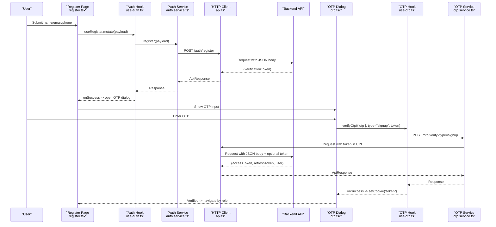

**Diagram sources**
- [register.tsx](file://src/app/auth/register/register.tsx)
- [otp.tsx](file://src/app/auth/register/otp.tsx)
- [use-auth.ts](file://src/hooks/auth/use-auth.ts)
- [use-otp.ts](file://src/hooks/auth/use-otp.ts)
- [auth.service.ts](file://src/services/auth.service.ts)
- [otp.service.ts](file://src/services/otp.service.ts)
- [api.ts](file://src/lib/api.ts)

## Detailed Component Analysis

### JWT-Based Authentication Flow
- The HTTP client reads the JWT from the cookie named token and attaches it as Authorization: Bearer <token> for every request. If no token is present, requests are sent without Authorization.
- Successful login or OTP verification returns an accessToken and refreshToken. The client stores accessToken in a cookie with path "/" and expiration.
- All protected endpoints rely on the presence of this cookie.

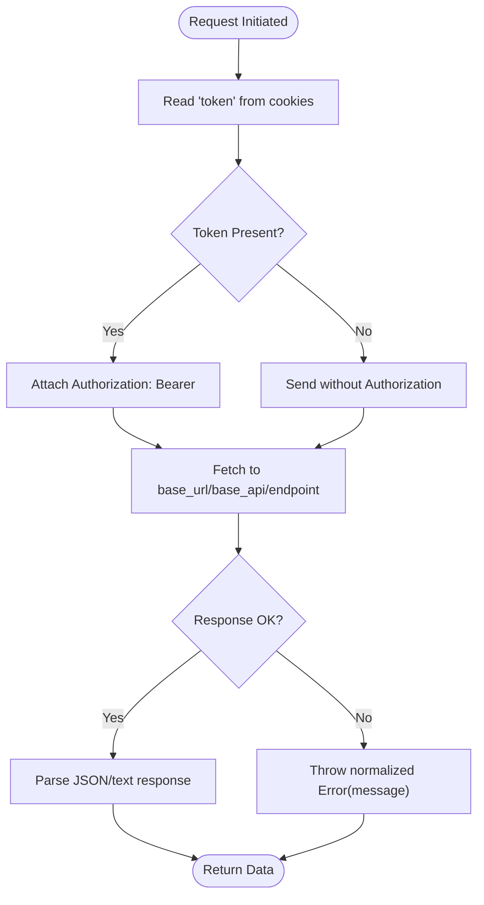

**Diagram sources**
- [api.ts](file://src/lib/api.ts)

**Section sources**
- [api.ts](file://src/lib/api.ts)
- [auth.service.ts](file://src/services/auth.service.ts)
- [otp.service.ts](file://src/services/otp.service.ts)

### Role-Based Access Control (RBAC)
- Roles: user, provider, admin
- After successful authentication, the client inspects the user.role and navigates accordingly:
  - admin -> /admin/dashboard
  - provider -> /driver if KYC submitted, else /auth/register/info
  - user -> home page (/)
- This logic is implemented in the social auth hook and can be mirrored in other flows where needed.

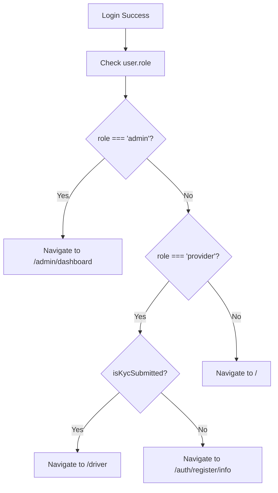

**Diagram sources**
- [use-social-auth.ts](file://src/hooks/auth/use-social-auth.ts)
- [auth.types.ts](file://src/types/auth.types.ts)

**Section sources**
- [use-social-auth.ts](file://src/hooks/auth/use-social-auth.ts)
- [auth.types.ts](file://src/types/auth.types.ts)

### Multi-Step Registration Process
- Step 1: User submits name, email, and phone. The app calls register, which returns a verificationToken.
- Step 2: An OTP dialog opens. The user enters the 6-digit code.
- Step 3: The app verifies the OTP using the verificationToken. On success, the server returns accessToken and refreshToken.
- Step 4: The client stores the accessToken in a cookie and navigates based on role.

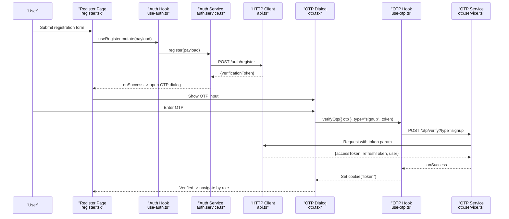

**Diagram sources**
- [register.tsx](file://src/app/auth/register/register.tsx)
- [otp.tsx](file://src/app/auth/register/otp.tsx)
- [use-auth.ts](file://src/hooks/auth/use-auth.ts)
- [use-otp.ts](file://src/hooks/auth/use-otp.ts)
- [auth.service.ts](file://src/services/auth.service.ts)
- [otp.service.ts](file://src/services/otp.service.ts)
- [api.ts](file://src/lib/api.ts)

**Section sources**
- [register.tsx](file://src/app/auth/register/register.tsx)
- [otp.tsx](file://src/app/auth/register/otp.tsx)
- [use-auth.ts](file://src/hooks/auth/use-auth.ts)
- [use-otp.ts](file://src/hooks/auth/use-otp.ts)
- [auth.service.ts](file://src/services/auth.service.ts)
- [otp.service.ts](file://src/services/otp.service.ts)

### Firebase Authentication Integration
- Google and Apple providers are configured via Firebase.
- The social auth hook performs a popup sign-in, retrieves the provider ID token, and optionally collects an FCM token.
- The ID token is sent to the backend social login endpoints (/auth/google, /auth/apple).
- On success, the client stores the server’s accessToken in a cookie and redirects by role.

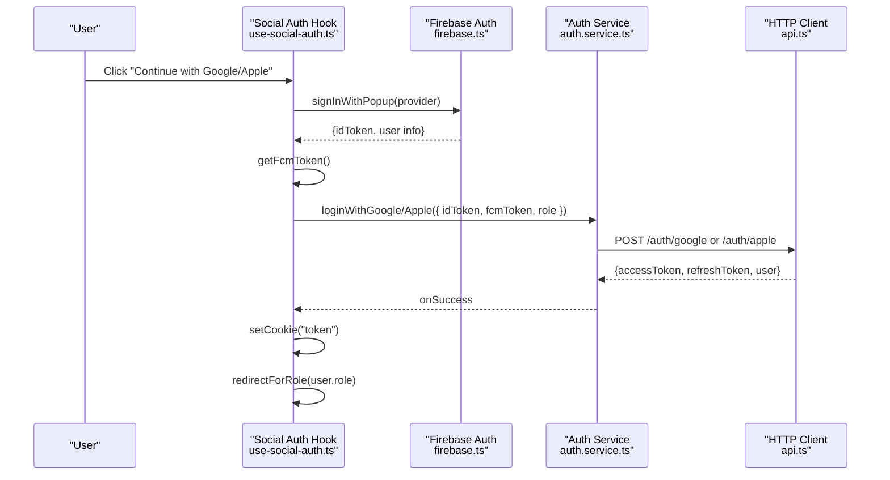

**Diagram sources**
- [use-social-auth.ts](file://src/hooks/auth/use-social-auth.ts)
- [firebase.ts](file://src/lib/firebase.ts)
- [auth.service.ts](file://src/services/auth.service.ts)
- [api.ts](file://src/lib/api.ts)

**Section sources**
- [use-social-auth.ts](file://src/hooks/auth/use-social-auth.ts)
- [firebase.ts](file://src/lib/firebase.ts)
- [auth.service.ts](file://src/services/auth.service.ts)

### OTP Verification System
- OTP types include signup, forgot, login, changeEmail, changePhone.
- Sending OTP:
  - Email: /otp/send-otp-in-email
  - Phone via token: /otp/send-otp-via-token-in-phone
  - Phone direct: /otp/send-otp-via-direct-phone (returns verificationToken)
- Verifying OTP:
  - /otp/verify?type=<type> with optional token parameter when required by flow.

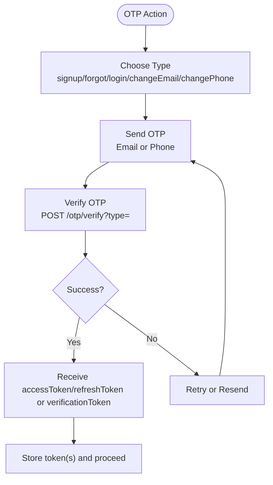

**Diagram sources**
- [otp.service.ts](file://src/services/otp.service.ts)
- [use-otp.ts](file://src/hooks/auth/use-otp.ts)
- [auth.types.ts](file://src/types/auth.types.ts)

**Section sources**
- [otp.service.ts](file://src/services/otp.service.ts)
- [use-otp.ts](file://src/hooks/auth/use-otp.ts)
- [auth.types.ts](file://src/types/auth.types.ts)

### Token Management Strategy and Session Handling
- Storage: The client stores the JWT access token in a cookie named token with path "/" and a fixed maxAge.
- Attachment: The HTTP client automatically attaches the token to requests via Authorization header.
- Scope: Cookies are used across the app; credentials are included in fetch requests.
- Refresh: The server may return a refreshToken in login responses; however, there is no explicit client-side refresh mechanism implemented in the current codebase.

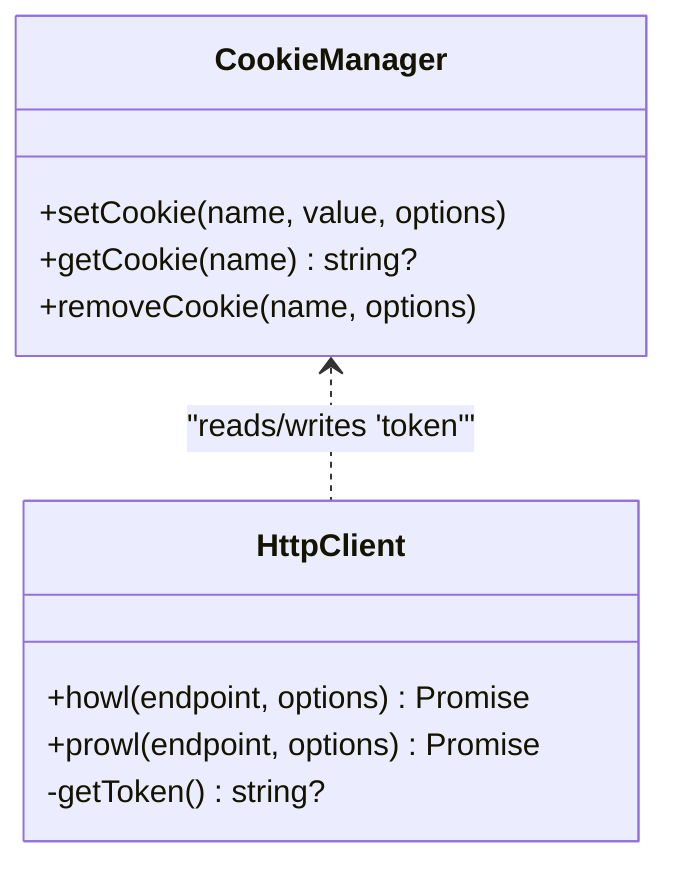

**Diagram sources**
- [api.ts](file://src/lib/api.ts)
- [use-social-auth.ts](file://src/hooks/auth/use-social-auth.ts)
- [otp.tsx](file://src/app/auth/register/otp.tsx)

**Section sources**
- [api.ts](file://src/lib/api.ts)
- [use-social-auth.ts](file://src/hooks/auth/use-social-auth.ts)
- [otp.tsx](file://src/app/auth/register/otp.tsx)

### Protected Route Implementation
- Navigation decisions are made post-authentication based on user.role.
- For social login, the hook redirects to admin dashboard, driver area, or home.
- For registration OTP verification, the client navigates to home or provider info page depending on role.

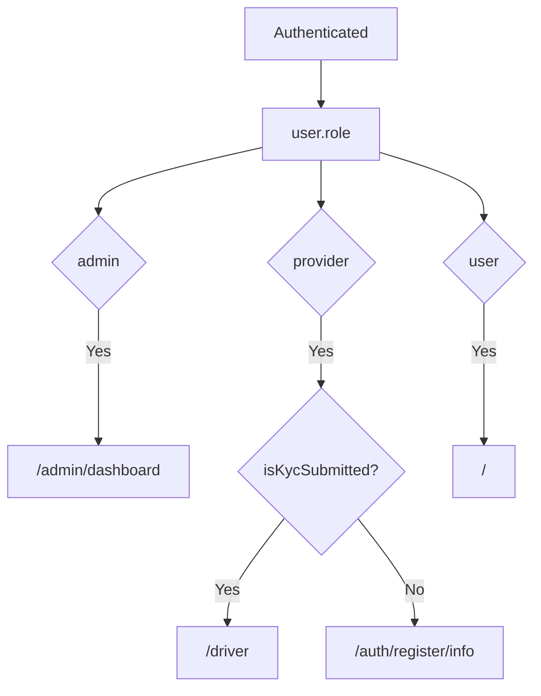

**Diagram sources**
- [use-social-auth.ts](file://src/hooks/auth/use-social-auth.ts)
- [otp.tsx](file://src/app/auth/register/otp.tsx)

**Section sources**
- [use-social-auth.ts](file://src/hooks/auth/use-social-auth.ts)
- [otp.tsx](file://src/app/auth/register/otp.tsx)

### Logout Flow
- The logout page calls the server logout endpoint, removes the token cookie, clears local user state and query cache, and redirects to login.

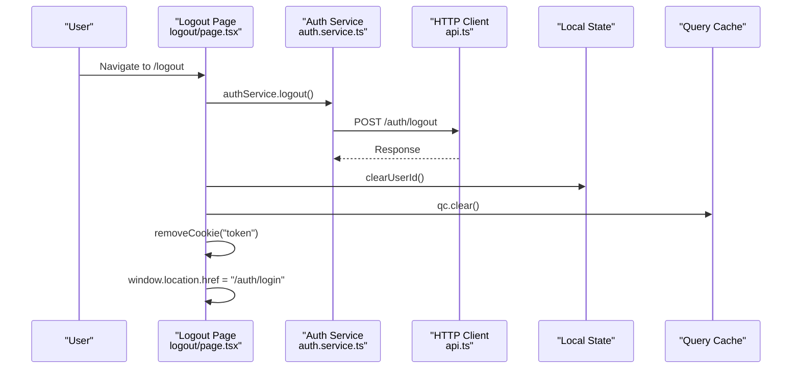

**Diagram sources**
- [logout page.tsx](file://src/app/logout/page.tsx)
- [auth.service.ts](file://src/services/auth.service.ts)
- [api.ts](file://src/lib/api.ts)

**Section sources**
- [logout page.tsx](file://src/app/logout/page.tsx)
- [auth.service.ts](file://src/services/auth.service.ts)

## Dependency Analysis
- Services depend on the HTTP client for network I/O.
- Hooks wrap services with React Query mutations.
- UI components call hooks and manage local state and navigation.
- Firebase integration is isolated in a library module and consumed by the social auth hook.

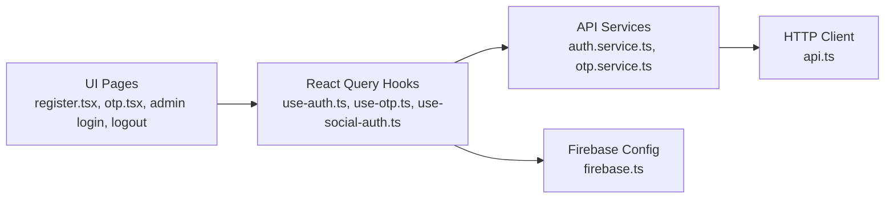

**Diagram sources**
- [register.tsx](file://src/app/auth/register/register.tsx)
- [otp.tsx](file://src/app/auth/register/otp.tsx)
- [page.tsx (admin login)](file://src/app/admin/auth/login/page.tsx)
- [logout page.tsx](file://src/app/logout/page.tsx)
- [use-auth.ts](file://src/hooks/auth/use-auth.ts)
- [use-otp.ts](file://src/hooks/auth/use-otp.ts)
- [use-social-auth.ts](file://src/hooks/auth/use-social-auth.ts)
- [auth.service.ts](file://src/services/auth.service.ts)
- [otp.service.ts](file://src/services/otp.service.ts)
- [api.ts](file://src/lib/api.ts)
- [firebase.ts](file://src/lib/firebase.ts)

**Section sources**
- [register.tsx](file://src/app/auth/register/register.tsx)
- [otp.tsx](file://src/app/auth/register/otp.tsx)
- [page.tsx (admin login)](file://src/app/admin/auth/login/page.tsx)
- [logout page.tsx](file://src/app/logout/page.tsx)
- [use-auth.ts](file://src/hooks/auth/use-auth.ts)
- [use-otp.ts](file://src/hooks/auth/use-otp.ts)
- [use-social-auth.ts](file://src/hooks/auth/use-social-auth.ts)
- [auth.service.ts](file://src/services/auth.service.ts)
- [otp.service.ts](file://src/services/otp.service.ts)
- [api.ts](file://src/lib/api.ts)
- [firebase.ts](file://src/lib/firebase.ts)

## Performance Considerations
- Network requests are centralized; ensure proper caching strategies for read operations where applicable.
- Avoid unnecessary re-renders by keeping mutation states minimal and leveraging React Query’s built-in caching.
- Keep cookie size small; only store the access token.
- Defer heavy operations (e.g., FCM token retrieval) until needed.

[No sources needed since this section provides general guidance]

## Troubleshooting Guide
Common issues and resolutions:
- Missing Authorization header: Ensure the token cookie exists before making authenticated requests.
- Invalid or expired token: Implement a token refresh mechanism if the server supports refresh tokens.
- CORS or cookie domain issues: Verify base_url and cookie settings match your deployment environment.
- Social login failures: Confirm Firebase project configuration and provider scopes.

**Section sources**
- [api.ts](file://src/lib/api.ts)
- [firebase.ts](file://src/lib/firebase.ts)
- [use-social-auth.ts](file://src/hooks/auth/use-social-auth.ts)

## Conclusion
The authentication and authorization system leverages JWT stored in cookies, a centralized HTTP client for secure requests, and role-based navigation. Registration uses a multi-step OTP flow, while social sign-in integrates with Firebase. Current implementation focuses on storing and using the access token; additional enhancements such as automatic token refresh and robust server-side session invalidation can further improve security and reliability.

[No sources needed since this section summarizes without analyzing specific files]