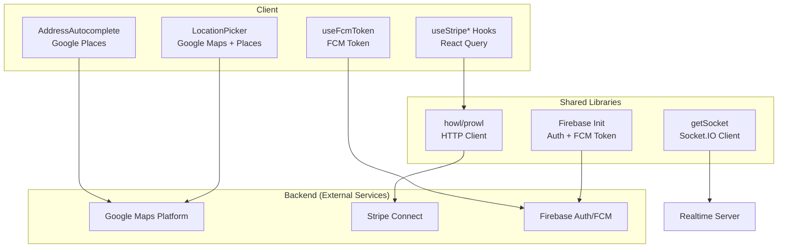
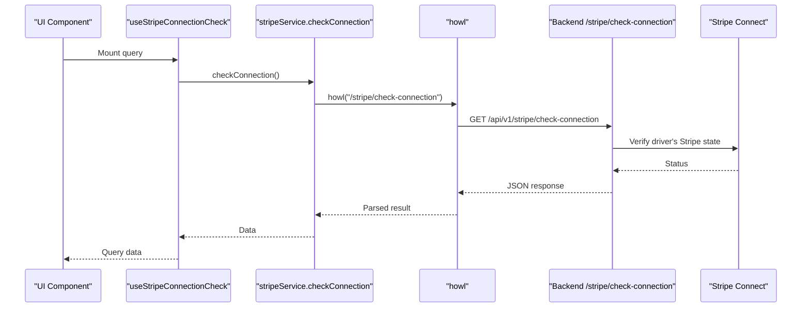
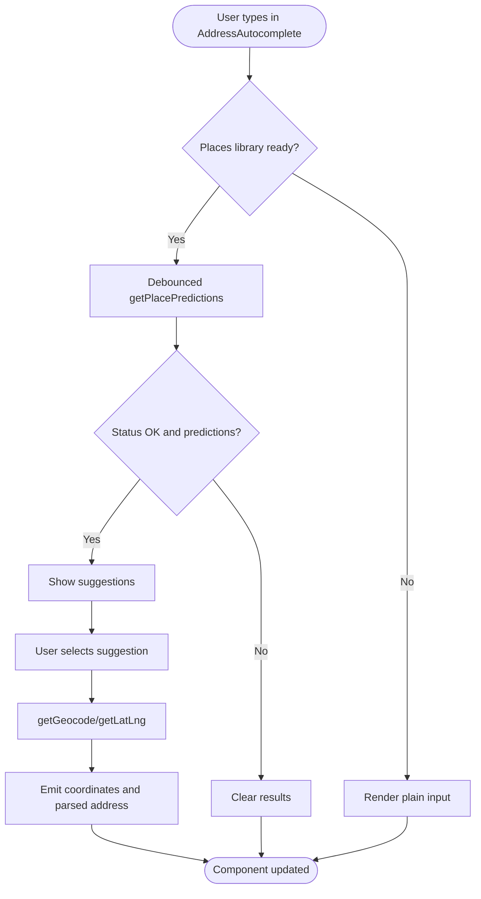
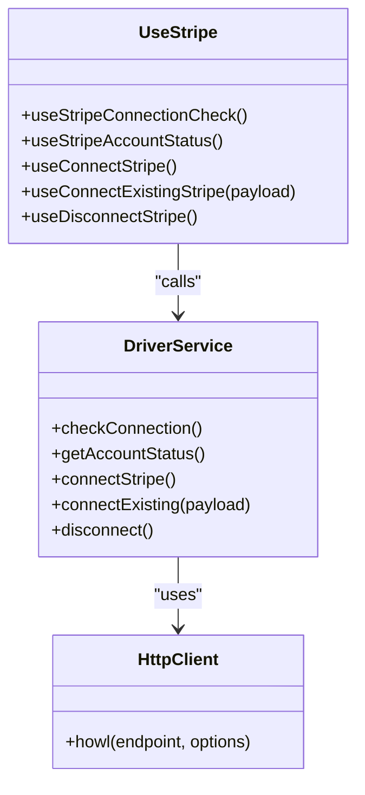
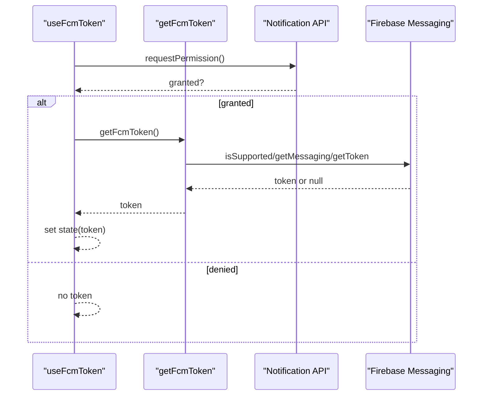
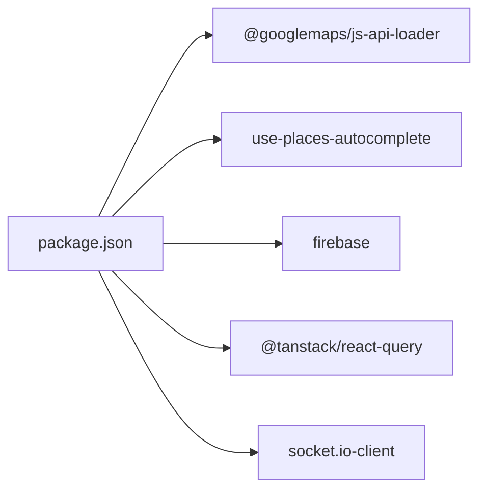

# External Integrations

<cite>
**Referenced Files in This Document**
- [address-autocomplete.tsx](file://src/components/ui/address-autocomplete.tsx)
- [location-picker.tsx](file://src/components/core/location-picker.tsx)
- [firebase.ts](file://src/lib/firebase.ts)
- [use-fcm.ts](file://src/hooks/shared/use-fcm.ts)
- [driver.service.ts](file://src/services/driver.service.ts)
- [use-stripe.ts](file://src/hooks/driver/use-stripe.ts)
- [api.ts](file://src/lib/api.ts)
- [socket.ts](file://src/lib/socket.ts)
- [next.config.ts](file://next.config.ts)
- [package.json](file://package.json)
</cite>

## Table of Contents
1. Introduction
2. Project Structure
3. Core Components
4. Architecture Overview
5. Detailed Component Analysis
6. Dependency Analysis
7. Performance Considerations
8. Troubleshooting Guide
9. Conclusion

## Introduction
This document explains the external service integrations used by the application: Google Maps for location services and address autocomplete, Stripe Connect for payment processing and driver payouts, and Firebase for authentication and cloud messaging. It focuses on the abstraction layer pattern that isolates external dependencies, error handling strategies, fallback mechanisms, configuration management, environment-specific settings, integration testing approaches, rate limiting considerations, error recovery, and monitoring of external service calls.

## Project Structure
External integrations are implemented across client components, hooks, and shared libraries:
- Google Maps: Address autocomplete and interactive map with Places API
- Stripe Connect: Driver payout flows via backend endpoints
- Firebase: Authentication providers and FCM token acquisition
- HTTP and Socket abstractions: Centralized API client and real-time transport

**Diagram sources**
- [address-autocomplete.tsx:131-169](file://src/components/ui/address-autocomplete.tsx#L131-L169)
- [location-picker.tsx:78-103](file://src/components/core/location-picker.tsx#L78-L103)
- [use-fcm.ts:6-19](file://src/hooks/shared/use-fcm.ts#L6-L19)
- [use-stripe.ts:12-48](file://src/hooks/driver/use-stripe.ts#L12-L48)
- [api.ts:23-73](file://src/lib/api.ts#L23-L73)
- [socket.ts:23-42](file://src/lib/socket.ts#L23-L42)
- [firebase.ts:1-45](file://src/lib/firebase.ts#L1-L45)

**Section sources**
- [address-autocomplete.tsx:1-170](file://src/components/ui/address-autocomplete.tsx#L1-170)
- [location-picker.tsx:78-280](file://src/components/core/location-picker.tsx#L78-L280)
- [firebase.ts:1-45](file://src/lib/firebase.ts#L1-L45)
- [use-fcm.ts:1-20](file://src/hooks/shared/use-fcm.ts#L1-L20)
- [driver.service.ts:50-65](file://src/services/driver.service.ts#L50-L65)
- [use-stripe.ts:1-49](file://src/hooks/driver/use-stripe.ts#L1-L49)
- [api.ts:1-106](file://src/lib/api.ts#L1-L106)
- [socket.ts:1-49](file://src/lib/socket.ts#L1-L49)
- [next.config.ts:1-36](file://next.config.ts#L1-L36)
- [package.json:12-47](file://package.json#L12-L47)

## Core Components
- Google Maps Integration
  - Address Autocomplete component dynamically loads the Google Places library and provides a searchable input with geocoding and structured address data.
  - Location Picker component bootstraps the Google Maps script, initializes Map and Places services, supports search, marker placement, and drag-and-drop updates.
- Stripe Connect Integration
  - React Query hooks encapsulate Stripe connection checks, account status retrieval, connect/disconnect mutations, and existing account linking through backend endpoints.
  - The driver service module centralizes Stripe-related API calls using the shared HTTP client.
- Firebase Integration
  - Firebase initialization exports auth providers and a function to obtain an FCM token when supported by the browser.
  - A hook requests notification permission and retrieves the FCM token for push notifications.

**Section sources**
- [address-autocomplete.tsx:1-170](file://src/components/ui/address-autocomplete.tsx#L1-L170)
- [location-picker.tsx:78-280](file://src/components/core/location-picker.tsx#L78-L280)
- [driver.service.ts:50-65](file://src/services/driver.service.ts#L50-L65)
- [use-stripe.ts:1-49](file://src/hooks/driver/use-stripe.ts#L1-L49)
- [firebase.ts:1-45](file://src/lib/firebase.ts#L1-L45)
- [use-fcm.ts:1-20](file://src/hooks/shared/use-fcm.ts#L1-L20)

## Architecture Overview
The system uses an abstraction layer pattern to isolate external dependencies:
- UI components call typed hooks or services rather than directly invoking third-party SDKs or APIs.
- Shared HTTP client abstracts fetch behavior, headers, and error normalization.
- Real-time communication is abstracted via a singleton socket instance.
- Environment variables configure external services without leaking secrets into business logic.

**Diagram sources**
- [use-stripe.ts:12-17](file://src/hooks/driver/use-stripe.ts#L12-L17)
- [driver.service.ts:50-53](file://src/services/driver.service.ts#L50-L53)
- [api.ts:23-73](file://src/lib/api.ts#L23-L73)

## Detailed Component Analysis

### Google Maps Integration
Responsibilities:
- Dynamically load Google Maps and Places libraries
- Provide address autocomplete with debounced queries
- Render interactive map with markers and draggable pins
- Convert place predictions to coordinates and structured address fields

Key implementation patterns:
- Lazy loading of Google Maps via script injection and library import
- Debounced search to reduce API calls
- Graceful fallback to plain input when libraries are not ready
- Error handling around Places API responses

**Diagram sources**
- [address-autocomplete.tsx:131-169](file://src/components/ui/address-autocomplete.tsx#L131-L169)
- [address-autocomplete.tsx:76-88](file://src/components/ui/address-autocomplete.tsx#L76-L88)
- [location-picker.tsx:233-265](file://src/components/core/location-picker.tsx#L233-L265)

Configuration and environment:
- Google Maps API key is read from environment and passed to the loader and script URL.

Error handling and fallbacks:
- If Places library fails to load, the component falls back to a basic input.
- Search errors clear results and stop searching state.

Rate limiting and throttling:
- Debounce input to limit prediction requests.
- Avoid redundant searches when user clicks map or drags marker.

Monitoring:
- Errors are logged to console; consider adding telemetry for failed lookups.

**Section sources**
- [address-autocomplete.tsx:131-169](file://src/components/ui/address-autocomplete.tsx#L131-L169)
- [address-autocomplete.tsx:76-88](file://src/components/ui/address-autocomplete.tsx#L76-L88)
- [location-picker.tsx:78-103](file://src/components/core/location-picker.tsx#L78-L103)
- [location-picker.tsx:233-265](file://src/components/core/location-picker.tsx#L233-L265)

### Stripe Connect Integration
Responsibilities:
- Check Stripe connection status
- Retrieve account status
- Initiate new Stripe Connect flow
- Link existing Stripe account
- Disconnect Stripe account

Abstraction layer:
- React Query hooks encapsulate queries and mutations, invalidating cache on success.
- Driver service centralizes endpoint calls using the shared HTTP client.

**Diagram sources**
- [use-stripe.ts:12-48](file://src/hooks/driver/use-stripe.ts#L12-L48)
- [driver.service.ts:50-65](file://src/services/driver.service.ts#L50-L65)
- [api.ts:23-73](file://src/lib/api.ts#L23-L73)

Error handling and recovery:
- HTTP client normalizes non-ok responses and throws descriptive errors.
- React Query hooks invalidate related queries on successful mutations to refresh UI state.

Rate limiting and retries:
- No explicit retry/backoff in the HTTP client; consider implementing exponential backoff for transient failures.

Monitoring:
- Add logging around mutation outcomes and errors for auditability.

Integration testing approach:
- Mock backend endpoints for Stripe flows and assert React Query cache invalidation.
- Validate error paths by returning non-ok responses and ensuring user-facing messages.

**Section sources**
- [use-stripe.ts:1-49](file://src/hooks/driver/use-stripe.ts#L1-L49)
- [driver.service.ts:50-65](file://src/services/driver.service.ts#L50-L65)
- [api.ts:23-73](file://src/lib/api.ts#L23-L73)

### Firebase Integration (Authentication and Cloud Messaging)
Responsibilities:
- Initialize Firebase app and export auth providers
- Obtain FCM token when supported by the browser
- Request notification permission and persist token in state

Abstraction layer:
- Firebase initialization and token acquisition are centralized in a single module.
- A dedicated hook encapsulates permission and token retrieval.

**Diagram sources**
- [use-fcm.ts:6-19](file://src/hooks/shared/use-fcm.ts#L6-L19)
- [firebase.ts:23-45](file://src/lib/firebase.ts#L23-L45)

Error handling and fallbacks:
- If messaging is unsupported or token acquisition fails, the function returns null gracefully.
- Permission denial prevents token retrieval.

Environment configuration:
- Firebase config values and VAPID key are loaded from environment variables.

Monitoring:
- Consider logging support status and token acquisition outcomes.

**Section sources**
- [firebase.ts:1-45](file://src/lib/firebase.ts#L1-L45)
- [use-fcm.ts:1-20](file://src/hooks/shared/use-fcm.ts#L1-L20)

## Dependency Analysis
External dependencies relevant to integrations:
- Google Maps JS API Loader and Places Autocomplete utilities
- Firebase SDK for auth and messaging
- React Query for caching and mutations
- Socket.IO client for real-time features

**Diagram sources**
- [package.json:12-47](file://package.json#L12-L47)

Server-side package exclusion:
- Firebase packages are marked as server external to avoid bundling them on the server.

**Section sources**
- [package.json:12-47](file://package.json#L12-L47)
- [next.config.ts:32](file://next.config.ts#L32)

## Performance Considerations
- Google Maps
  - Debounce address input to minimize Places API calls.
  - Load maps and places libraries only when needed.
  - Reuse map and places instances to avoid repeated initialization.
- Stripe
  - Leverage React Query caching to avoid redundant network calls.
  - Invalidate caches selectively after mutations to keep UI consistent.
- Firebase
  - Acquire FCM token once per session and reuse it.
  - Avoid repeated permission prompts; handle permission changes gracefully.
- HTTP Client
  - Centralize headers and credentials to reduce overhead.
  - Consider adding timeouts and retry policies for resilience.

[No sources needed since this section provides general guidance]

## Troubleshooting Guide
Common issues and resolutions:
- Google Maps not loading
  - Ensure NEXT_PUBLIC_GOOGLE_MAPS_API_KEY is configured.
  - Verify network access to Google domains and correct script/library loading.
- Address autocomplete not showing results
  - Confirm Places library is loaded and status is OK.
  - Check debounce timing and input trimming before search.
- Stripe Connect flow fails
  - Inspect backend responses for error messages normalized by the HTTP client.
  - Verify cookie-based token presence for authenticated requests.
- FCM token not obtained
  - Confirm browser supports notifications and messaging.
  - Validate VAPID key and Firebase project configuration.

Operational tips:
- Add logging around external calls to capture status codes and payloads.
- Implement retry/backoff for transient network errors.
- Monitor rate limits and implement client-side throttling where applicable.

**Section sources**
- [api.ts:45-73](file://src/lib/api.ts#L45-L73)
- [address-autocomplete.tsx:140-145](file://src/components/ui/address-autocomplete.tsx#L140-L145)
- [location-picker.tsx:233-265](file://src/components/core/location-picker.tsx#L233-L265)
- [firebase.ts:23-45](file://src/lib/firebase.ts#L23-L45)

## Conclusion
The application employs a clean abstraction layer pattern to integrate Google Maps, Stripe Connect, and Firebase. UI components interact with typed hooks and services, while shared libraries manage HTTP and real-time transports. Configuration is centralized via environment variables, and error handling is standardized at the HTTP client level. To improve resilience, consider adding retry/backoff, comprehensive monitoring, and robust integration tests covering both happy paths and failure scenarios.