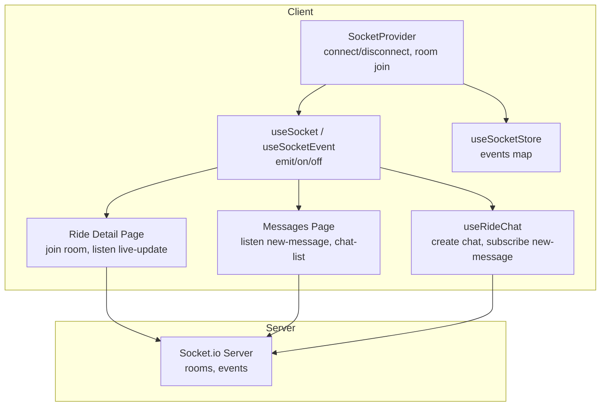
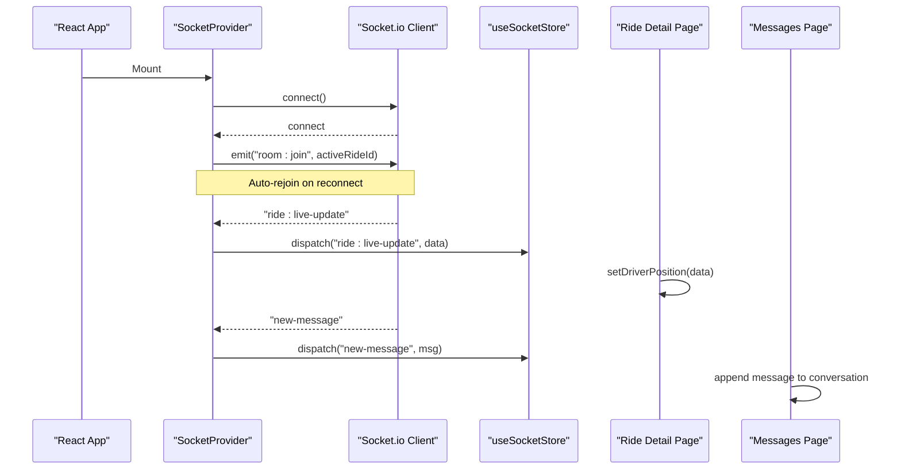
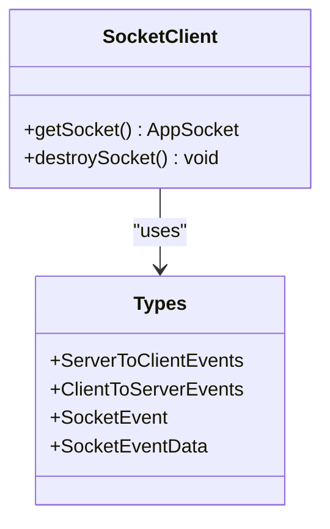
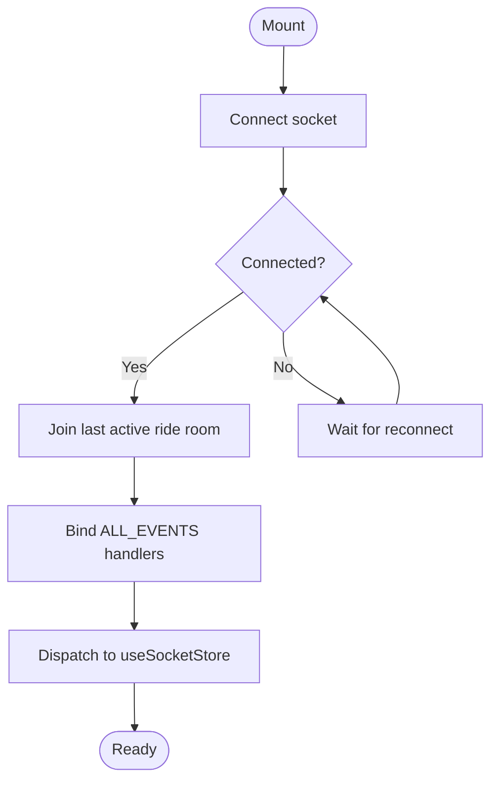
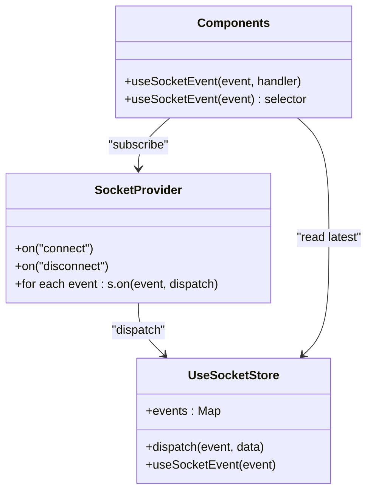
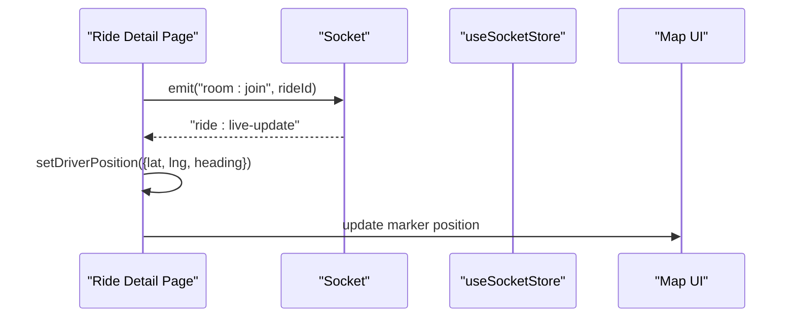
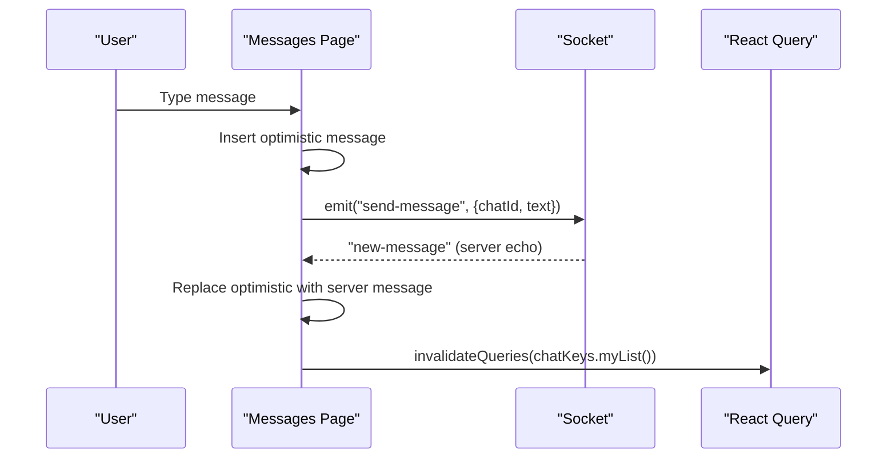
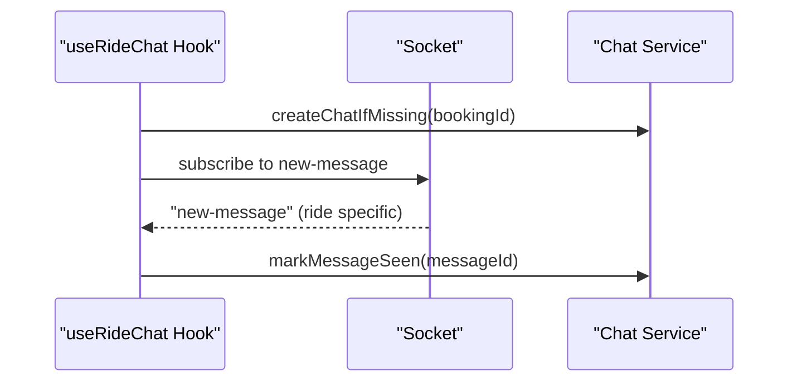
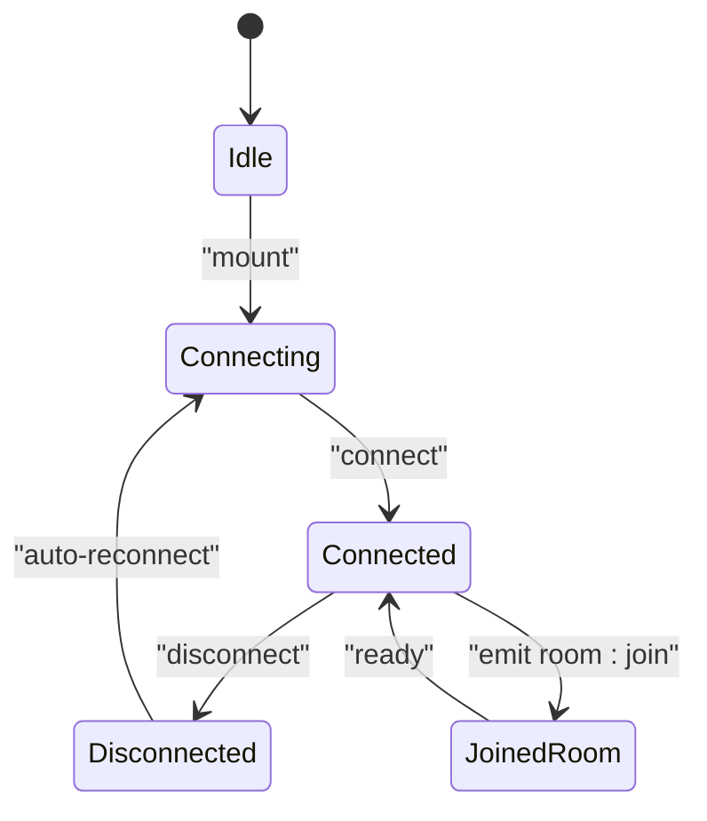
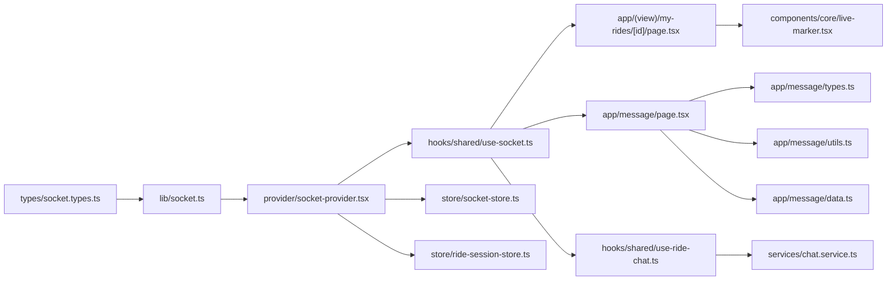

# Real-time Communication Architecture

<cite>
**Referenced Files in This Document**
- [socket.ts](file://src/lib/socket.ts)
- [socket-provider.tsx](file://src/provider/socket-provider.tsx)
- [use-socket.ts](file://src/hooks/shared/use-socket.ts)
- [socket-store.ts](file://src/store/socket-store.ts)
- [socket.types.ts](file://src/types/socket.types.ts)
- [ride-session-store.ts](file://src/store/ride-session-store.ts)
- [page.tsx (my-rides/[id])](file://src/app/(view)/my-rides/[id]/page.tsx)
- [chat.tsx (my-rides/[id])](file://src/app/(view)/my-rides/[id]/chat.tsx)
- [use-ride-chat.ts](file://src/hooks/shared/use-ride-chat.ts)
- [page.tsx (message)](file://src/app/message/page.tsx)
- [layout.tsx (message)](file://src/app/message/layout.tsx)
- [types.ts (message)](file://src/app/message/types.ts)
- [utils.ts (message)](file://src/app/message/utils.ts)
- [data.ts (message)](file://src/app/message/data.ts)
- [chat.service.ts](file://src/services/chat.service.ts)
- [live-marker.tsx](file://src/components/core/live-marker.tsx)
</cite>

## Update Summary
**Changes Made**
- Updated message page implementation from `src/app/(view)/message/page.tsx` to `src/app/message/page.tsx`
- Enhanced messaging system with improved event handling and connection management
- Added new message components and utilities for the relocated message system
- Updated socket communication patterns for enhanced real-time messaging

## Table of Contents
1. Introduction
2. Project Structure
3. Core Components
4. Architecture Overview
5. Detailed Component Analysis
6. Dependency Analysis
7. Performance Considerations
8. Troubleshooting Guide
9. Conclusion

## Introduction
This document describes the real-time communication architecture for the ride-sharing application. It focuses on Socket.io integration, WebSocket connection management, and an event-driven design that powers chat, presence indicators, and live ride tracking. The system uses a centralized socket provider pattern to manage lifecycle, automatic reconnection via Socket.io, room-based routing, and a global event store for state synchronization across components.

## Project Structure
The real-time layer is implemented as a thin client-side stack:
- A singleton Socket.io client with typed events
- A React context provider that manages connection lifecycle and centralizes event dispatching
- Hooks for emitting and subscribing to events
- A Zustand store that holds the latest server events for UI consumption
- Feature-specific hooks and pages that join rooms and react to events

**Diagram sources**
- [socket-provider.tsx:66-115](file://src/provider/socket-provider.tsx#L66-L115)
- [use-socket.ts:12-56](file://src/hooks/shared/use-socket.ts#L12-L56)
- [socket-store.ts:19-31](file://src/store/socket-store.ts#L19-L31)
- [page.tsx (my-rides/[id])](file://src/app/(view)/my-rides/[id]/page.tsx#L75-L103)
- [page.tsx (message):207-305](file://src/app/message/page.tsx#L207-L305)
- [use-ride-chat.ts:71-102](file://src/hooks/shared/use-ride-chat.ts#L71-L102)

**Section sources**
- [socket.ts:1-50](file://src/lib/socket.ts#L1-L50)
- [socket-provider.tsx:1-122](file://src/provider/socket-provider.tsx#L1-L122)
- [use-socket.ts:1-57](file://src/hooks/shared/use-socket.ts#L1-L57)
- [socket-store.ts:1-34](file://src/store/socket-store.ts#L1-L34)
- [socket.types.ts:1-304](file://src/types/socket.types.ts#L1-L304)

## Core Components
- Centralized Socket.io client:
  - Singleton instance with environment-based URL, credentials, transports, and auth token injection from cookies.
  - Global debug logging for incoming/outgoing events.
- SocketProvider:
  - Manages connect/disconnect, tracks connected state, joins the last active ride room after reconnect, and attaches handlers for all known server events.
  - Dispatches every incoming event into a global event store.
- useSocket and useSocketEvent:
  - Typed helpers to emit events and subscribe/unsubscribe safely within component lifecycles.
- useSocketStore:
  - Holds the latest payload per event type with timestamps; provides a selector hook to read the most recent event data.
- Room management:
  - Clients join ride rooms using a dedicated room event; the provider re-joins automatically after reconnect based on persisted active ride ID.

Key responsibilities:
- Connection lifecycle: connect on mount, disconnect on unmount, auto-reconnect via Socket.io.
- Event routing: centralized subscription list mapped to a global store.
- Room scoping: ride-specific updates delivered by joining/leaving rooms.

**Section sources**
- [socket.ts:6-42](file://src/lib/socket.ts#L6-L42)
- [socket-provider.tsx:66-115](file://src/provider/socket-provider.tsx#L66-L115)
- [use-socket.ts:12-56](file://src/hooks/shared/use-socket.ts#L12-L56)
- [socket-store.ts:19-31](file://src/store/socket-store.ts#L19-L31)
- [ride-session-store.ts:9-20](file://src/store/ride-session-store.ts#L9-L20)

## Architecture Overview
The system follows an event-driven architecture with clear separation between transport, lifecycle, and feature logic.

**Diagram sources**
- [socket-provider.tsx:71-108](file://src/provider/socket-provider.tsx#L71-L108)
- [socket-store.ts:19-31](file://src/store/socket-store.ts#L19-L31)
- [page.tsx (my-rides/[id])](file://src/app/(view)/my-rides/[id]/page.tsx#L87-L103)
- [page.tsx (message):207-249](file://src/app/message/page.tsx#L207-L249)

## Detailed Component Analysis

### Socket Client and Types
- Singleton client creation with:
  - Environment-based URL fallbacks
  - Credentials enabled
  - Transport fallbacks (WebSocket then polling)
  - Auth callback injecting token from cookie
  - Global listeners for debugging
- Type-safe event contracts define both client-to-server and server-to-client payloads.

**Diagram sources**
- [socket.ts:1-50](file://src/lib/socket.ts#L1-L50)
- [socket.types.ts:1-304](file://src/types/socket.types.ts#L1-L304)

**Section sources**
- [socket.ts:6-42](file://src/lib/socket.ts#L6-L42)
- [socket.types.ts:28-296](file://src/types/socket.types.ts#L28-L296)

### Centralized Socket Provider Pattern
Responsibilities:
- Connect on mount and track connected state
- Reattach to the last active ride room after any (re)connect
- Attach handlers for all known server events and forward them to the global store
- Clean up subscriptions and destroy the socket on unmount

**Diagram sources**
- [socket-provider.tsx:71-108](file://src/provider/socket-provider.tsx#L71-L108)
- [ride-session-store.ts:9-20](file://src/store/ride-session-store.ts#L9-L20)

**Section sources**
- [socket-provider.tsx:66-115](file://src/provider/socket-provider.tsx#L66-L115)
- [ride-session-store.ts:9-20](file://src/store/ride-session-store.ts#L9-L20)

### Event System and State Synchronization
- All server events are listed centrally and bound once at provider level.
- Each event is dispatched into a global store keyed by event name, storing the latest payload and timestamp.
- Components can either:
  - Subscribe directly via useSocketEvent for fine-grained handling
  - Read the latest event via useSocketEvent(event) selector for simple state access

**Diagram sources**
- [socket-provider.tsx:89-108](file://src/provider/socket-provider.tsx#L89-L108)
- [socket-store.ts:19-31](file://src/store/socket-store.ts#L19-L31)
- [use-socket.ts:42-56](file://src/hooks/shared/use-socket.ts#L42-L56)

**Section sources**
- [socket-provider.tsx:89-108](file://src/provider/socket-provider.tsx#L89-L108)
- [socket-store.ts:19-31](file://src/store/socket-store.ts#L19-L31)
- [use-socket.ts:42-56](file://src/hooks/shared/use-socket.ts#L42-L56)

### Live Ride Tracking
- The ride detail page joins the ride room when mounted and leaves on unmount.
- Listens for driver location updates and renders a moving marker.
- Uses a lightweight visual indicator for live presence.

**Diagram sources**
- [page.tsx (my-rides/[id])](file://src/app/(view)/my-rides/[id]/page.tsx#L75-L96)
- [live-marker.tsx:6-29](file://src/components/core/live-marker.tsx#L6-L29)

**Section sources**
- [page.tsx (my-rides/[id])](file://src/app/(view)/my-rides/[id]/page.tsx#L75-L103)
- [live-marker.tsx:6-29](file://src/components/core/live-marker.tsx#L6-L29)

### Enhanced Messaging System
**Updated** The messaging system has been reorganized and enhanced with improved event handling and connection management.

- **Enhanced Messages Page**:
  - Relocated from `src/app/(view)/message/page.tsx` to `src/app/message/page.tsx`
  - Implements optimistic messaging with immediate UI updates
  - Handles multiple socket events: `new-message`, `chat-list`, and `send-message`
  - Features conversation management with unread message counts and last message timestamps
  - Integrates with React Query for efficient data fetching and caching

- **Improved Event Handling**:
  - Direct socket event subscriptions using `useSocketEvent` hook
  - Optimistic UI updates with placeholder messages
  - Automatic deduplication of incoming messages
  - Real-time conversation list updates via `chat-list` events

- **Message Components**:
  - Modular component structure with chat-panel, conversation-item, and sidebar-list
  - Mobile-responsive layout with list/chat view switching
  - Integration with user authentication and profile data

**Diagram sources**
- [page.tsx (message):323-353](file://src/app/message/page.tsx#L323-L353)
- [page.tsx (message):207-249](file://src/app/message/page.tsx#L207-L249)
- [page.tsx (message):252-305](file://src/app/message/page.tsx#L252-L305)

**Section sources**
- [page.tsx (message):89-386](file://src/app/message/page.tsx#L89-L386)
- [layout.tsx (message):7-23](file://src/app/message/layout.tsx#L7-L23)
- [types.ts (message):1-22](file://src/app/message/types.ts#L1-L22)
- [utils.ts (message):1-17](file://src/app/message/utils.ts#L1-L17)
- [data.ts (message):1-72](file://src/app/message/data.ts#L1-L72)

### Ride-Specific Chat Functionality
- Ride-specific chat:
  - useRideChat lazily creates a 1:1 chat for a booking if missing, fetches history, and listens for new messages.
  - Marks messages seen and sends acknowledgment to the server.

**Diagram sources**
- [use-ride-chat.ts:71-102](file://src/hooks/shared/use-ride-chat.ts#L71-L102)
- [chat.service.ts:38-39](file://src/services/chat.service.ts#L38-L39)

**Section sources**
- [use-ride-chat.ts:17-116](file://src/hooks/shared/use-ride-chat.ts#L17-L116)
- [chat.service.ts:11-49](file://src/services/chat.service.ts#L11-L49)

### Connection Lifecycle and Automatic Reconnection
- The provider connects on mount and sets connected state.
- On connect, it re-joins the last active ride room using persisted state.
- On disconnect, it clears connected state.
- Cleanup removes all event listeners and destroys the socket instance.

**Diagram sources**
- [socket-provider.tsx:71-108](file://src/provider/socket-provider.tsx#L71-L108)
- [ride-session-store.ts:9-20](file://src/store/ride-session-store.ts#L9-L20)

**Section sources**
- [socket-provider.tsx:71-108](file://src/provider/socket-provider.tsx#L71-L108)
- [ride-session-store.ts:9-20](file://src/store/ride-session-store.ts#L9-L20)

## Dependency Analysis
The following diagram shows how modules depend on each other for real-time features.

**Diagram sources**
- [socket.types.ts:1-304](file://src/types/socket.types.ts#L1-L304)
- [socket.ts:1-50](file://src/lib/socket.ts#L1-L50)
- [socket-provider.tsx:1-122](file://src/provider/socket-provider.tsx#L1-L122)
- [use-socket.ts:1-57](file://src/hooks/shared/use-socket.ts#L1-L57)
- [socket-store.ts:1-34](file://src/store/socket-store.ts#L1-L34)
- [ride-session-store.ts:1-21](file://src/store/ride-session-store.ts#L1-L21)
- [page.tsx (my-rides/[id])](file://src/app/(view)/my-rides/[id]/page.tsx#L1-L120)
- [page.tsx (message):1-386](file://src/app/message/page.tsx#L1-L386)
- [use-ride-chat.ts:1-116](file://src/hooks/shared/use-ride-chat.ts#L1-L116)
- [chat.service.ts:1-50](file://src/services/chat.service.ts#L1-L50)
- [live-marker.tsx:1-30](file://src/components/core/live-marker.tsx#L1-L30)
- [types.ts (message):1-22](file://src/app/message/types.ts#L1-L22)
- [utils.ts (message):1-17](file://src/app/message/utils.ts#L1-L17)
- [data.ts (message):1-72](file://src/app/message/data.ts#L1-L72)

**Section sources**
- [socket.types.ts:1-304](file://src/types/socket.types.ts#L1-L304)
- [socket.ts:1-50](file://src/lib/socket.ts#L1-L50)
- [socket-provider.tsx:1-122](file://src/provider/socket-provider.tsx#L1-L122)
- [use-socket.ts:1-57](file://src/hooks/shared/use-socket.ts#L1-L57)
- [socket-store.ts:1-34](file://src/store/socket-store.ts#L1-L34)
- [ride-session-store.ts:1-21](file://src/store/ride-session-store.ts#L1-L21)
- [page.tsx (my-rides/[id])](file://src/app/(view)/my-rides/[id]/page.tsx#L1-L120)
- [page.tsx (message):1-386](file://src/app/message/page.tsx#L1-L386)
- [use-ride-chat.ts:1-116](file://src/hooks/shared/use-ride-chat.ts#L1-L116)
- [chat.service.ts:1-50](file://src/services/chat.service.ts#L1-L50)
- [live-marker.tsx:1-30](file://src/components/core/live-marker.tsx#L1-L30)
- [types.ts (message):1-22](file://src/app/message/types.ts#L1-L22)
- [utils.ts (message):1-17](file://src/app/message/utils.ts#L1-L17)
- [data.ts (message):1-72](file://src/app/message/data.ts#L1-L72)

## Performance Considerations
- Connection pooling:
  - A single shared Socket.io instance is used app-wide, avoiding multiple connections and reducing overhead.
- Event binding:
  - Centralized binding ensures one listener per event type; components reuse these bindings rather than creating duplicates.
- Location updates:
  - Geolocation watch uses a minimum delta threshold to avoid excessive updates and reduce network churn.
- Message deduplication:
  - Incoming messages are deduplicated before appending to prevent duplicate bubbles.
- Optimistic UI:
  - Chat insertions are immediate and later reconciled with server echoes, improving perceived latency.
- Room scoping:
  - Joining specific ride rooms limits broadcast scope and reduces unnecessary processing.
- **Enhanced Message Performance**:
  - React Query integration for efficient data caching and invalidation
  - Optimistic messaging with placeholder replacement
  - Efficient conversation state management with minimal re-renders
  - Mobile-responsive design with conditional rendering

[No sources needed since this section provides general guidance]

## Troubleshooting Guide
Common issues and checks:
- No events received:
  - Verify the socket is connected and the correct room was joined.
  - Ensure the event name matches the server contract.
- Duplicate messages:
  - Confirm deduplication logic runs before appending.
- Missing chat history:
  - For ride chats, ensure the chat exists or is created lazily before listening for new messages.
- Authentication failures:
  - Check that the token cookie is present and correctly injected during socket initialization.
- Stale room membership:
  - After reconnect, confirm the active ride ID is persisted and the provider re-joins the room.
- **Enhanced Messaging Issues**:
  - Verify message page is properly loaded from new location `src/app/message/page.tsx`
  - Check React Query cache invalidation for conversation updates
  - Ensure optimistic message placeholders are properly replaced with server responses
  - Validate mobile view switching between list and chat views

**Section sources**
- [socket-provider.tsx:71-108](file://src/provider/socket-provider.tsx#L71-L108)
- [page.tsx (message):207-305](file://src/app/message/page.tsx#L207-L305)
- [use-ride-chat.ts:17-55](file://src/hooks/shared/use-ride-chat.ts#L17-L55)
- [socket.ts:11-32](file://src/lib/socket.ts#L11-L32)

## Conclusion
The real-time layer is built around a robust, type-safe Socket.io client, a centralized provider managing lifecycle and room membership, and a global event store enabling consistent state synchronization. Features like live ride tracking and chat leverage room-scoped events and optimistic UI patterns for responsiveness. The enhanced messaging system provides improved performance through React Query integration and better event handling. The design balances simplicity and scalability while providing clear extension points for additional real-time capabilities.