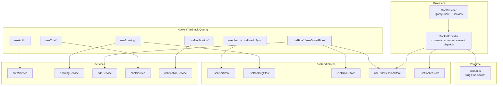
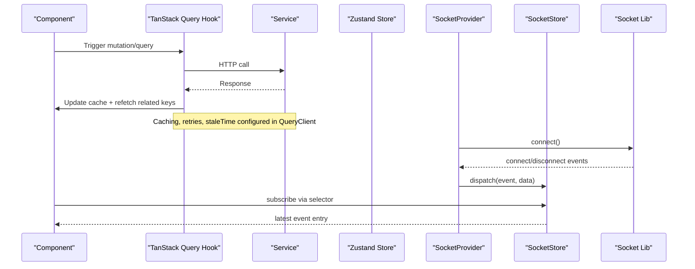
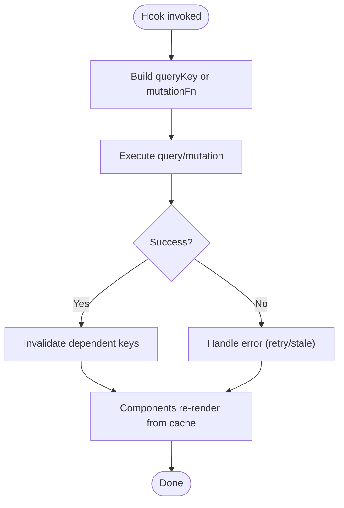
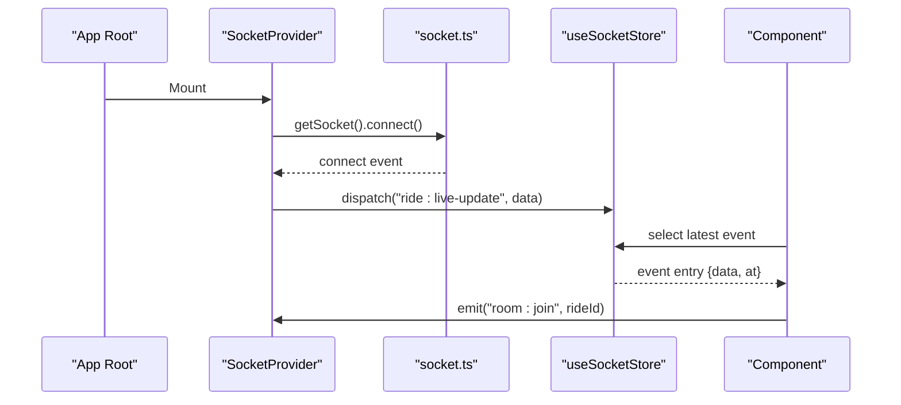
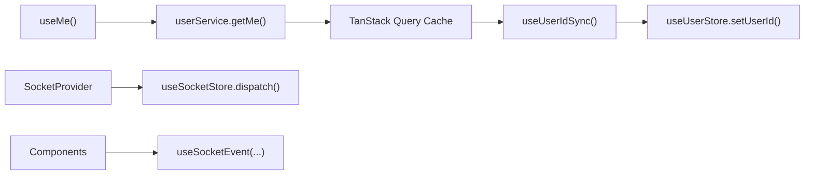
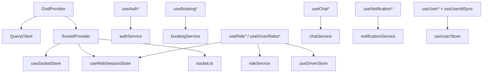

# State Management Patterns

<cite>
**Referenced Files in This Document**
- [user-store.ts](file://src/store/user-store.ts)
- [booking-store.ts](file://src/store/booking-store.ts)
- [socket-store.ts](file://src/store/socket-store.ts)
- [driver-store.ts](file://src/store/driver-store.ts)
- [ride-session-store.ts](file://src/store/ride-session-store.ts)
- [use-auth.ts](file://src/hooks/auth/use-auth.ts)
- [use-booking.ts](file://src/hooks/booking/use-booking.ts)
- [use-driver-ride.ts](file://src/hooks/driver/use-driver-ride.ts)
- [use-ride.ts](file://src/hooks/booking/use-ride.ts)
- [use-user.ts](file://src/hooks/shared/use-user.ts)
- [use-chat.ts](file://src/hooks/shared/use-chat.ts)
- [use-notification.ts](file://src/hooks/shared/use-notification.ts)
- [use-socket.ts](file://src/hooks/shared/use-socket.ts)
- [socket-provider.tsx](file://src/provider/socket-provider.tsx)
- [god-provider.tsx](file://src/provider/god-provider.tsx)
- [socket.ts](file://src/lib/socket.ts)
- [auth.service.ts](file://src/services/auth.service.ts)
</cite>

## Table of Contents
1. [Introduction](#introduction)
2. [Project Structure](#project-structure)
3. [Core Components](#core-components)
4. [Architecture Overview](#architecture-overview)
5. [Detailed Component Analysis](#detailed-component-analysis)
6. [Dependency Analysis](#dependency-analysis)
7. [Performance Considerations](#performance-considerations)
8. [Troubleshooting Guide](#troubleshooting-guide)
9. [Conclusion](#conclusion)

## Introduction
This document explains the state management architecture of Split Ride, focusing on a dual approach:
- Client state with Zustand for ephemeral UI and session concerns
- Server state with TanStack Query for caching, synchronization, and optimistic updates

It covers store design (user, booking, socket, driver, ride session), custom hooks that encapsulate business logic, data flows between server and client state, caching strategies, persistence, error handling, and performance optimizations.

## Project Structure
State is organized into:
- Stores under src/store for lightweight client state
- Hooks under src/hooks for server state and orchestration
- Providers under src/provider for global setup (QueryClient, Socket)
- Services under src/services for HTTP calls
- Types under src/types for shared contracts



**Diagram sources**
- [god-provider.tsx:16-47](file://src/provider/god-provider.tsx#L16-L47)
- [socket-provider.tsx:66-115](file://src/provider/socket-provider.tsx#L66-L115)
- [socket.ts:23-42](file://src/lib/socket.ts#L23-L42)
- [user-store.ts:9-13](file://src/store/user-store.ts#L9-L13)
- [booking-store.ts:19-27](file://src/store/booking-store.ts#L19-L27)
- [driver-store.ts:17-36](file://src/store/driver-store.ts#L17-L36)
- [ride-session-store.ts:9-20](file://src/store/ride-session-store.ts#L9-L20)
- [socket-store.ts:19-31](file://src/store/socket-store.ts#L19-L31)
- [use-auth.ts:15-67](file://src/hooks/auth/use-auth.ts#L15-L67)
- [use-booking.ts:7-51](file://src/hooks/booking/use-booking.ts#L7-L51)
- [use-ride.ts:16-59](file://src/hooks/booking/use-ride.ts#L16-L59)
- [use-driver-ride.ts:13-34](file://src/hooks/driver/use-driver-ride.ts#L13-L34)
- [use-chat.ts:18-94](file://src/hooks/shared/use-chat.ts#L18-L94)
- [use-notification.ts:10-39](file://src/hooks/shared/use-notification.ts#L10-L39)
- [auth.service.ts:15-42](file://src/services/auth.service.ts#L15-L42)

**Section sources**
- [god-provider.tsx:16-47](file://src/provider/god-provider.tsx#L16-L47)
- [socket-provider.tsx:66-115](file://src/provider/socket-provider.tsx#L66-L115)

## Core Components
- Zustand stores:
  - User store: holds current userId for quick access across components
  - Booking store: transient request/response and status during booking flow
  - Driver store: driver location, online status, and incoming requests; persisted to sessionStorage (partialize)
  - Ride session store: active ride id persisted to localStorage for room rejoin after reconnects
  - Socket store: typed last event entry per event name; used by components to react to latest events
- TanStack Query hooks:
  - Authentication mutations
  - Booking queries/mutations with query key factories
  - Ride queries/mutations for riders and drivers
  - Chat and notification queries/mutations
- Providers:
  - GodProvider sets up QueryClient, cookies, user sync, socket provider, notifications, and devtools
  - SocketProvider manages socket lifecycle, connects rooms based on persisted ride session, and dispatches events to the socket store

**Section sources**
- [user-store.ts:3-13](file://src/store/user-store.ts#L3-L13)
- [booking-store.ts:7-27](file://src/store/booking-store.ts#L7-L27)
- [driver-store.ts:7-36](file://src/store/driver-store.ts#L7-L36)
- [ride-session-store.ts:4-20](file://src/store/ride-session-store.ts#L4-L20)
- [socket-store.ts:14-31](file://src/store/socket-store.ts#L14-L31)
- [use-auth.ts:15-67](file://src/hooks/auth/use-auth.ts#L15-L67)
- [use-booking.ts:14-51](file://src/hooks/booking/use-booking.ts#L14-L51)
- [use-ride.ts:7-59](file://src/hooks/booking/use-ride.ts#L7-L59)
- [use-driver-ride.ts:7-34](file://src/hooks/driver/use-driver-ride.ts#L7-L34)
- [use-chat.ts:11-94](file://src/hooks/shared/use-chat.ts#L11-L94)
- [use-notification.ts:6-39](file://src/hooks/shared/use-notification.ts#L6-L39)
- [god-provider.tsx:16-47](file://src/provider/god-provider.tsx#L16-L47)
- [socket-provider.tsx:66-115](file://src/provider/socket-provider.tsx#L66-L115)

## Architecture Overview
The system separates concerns:
- Server state is owned by TanStack Query caches keyed by stable query keys
- Client state is held in Zustand stores for UI/session needs
- Real-time events are funneled through a single socket singleton and dispatched into a typed socket store
- Providers wire everything together at app root



**Diagram sources**
- [god-provider.tsx:21-47](file://src/provider/god-provider.tsx#L21-L47)
- [socket-provider.tsx:71-108](file://src/provider/socket-provider.tsx#L71-L108)
- [socket-store.ts:19-31](file://src/store/socket-store.ts#L19-L31)
- [socket.ts:23-42](file://src/lib/socket.ts#L23-L42)
- [use-booking.ts:35-44](file://src/hooks/booking/use-booking.ts#L35-L44)

## Detailed Component Analysis

### Zustand Store Architecture
Stores are small, focused, and optionally persisted:
- User store: minimal identity slice for fast checks
- Booking store: temporary form/response state during booking wizard
- Driver store: driver-specific state persisted partially to sessionStorage
- Ride session store: active ride id persisted to localStorage for room rejoin
- Socket store: last event per type with timestamp for reactive UI

```mermaid
classDiagram
class UserStore {
+userId : string | null
+setUserId(id)
+clearUserId()
}
class BookingStore {
+request
+response
+status
+setRequest(data)
+setResponse(data)
+setStatus(s)
+reset()
}
class DriverStore {
+location
+isOnline
+requests
+setLocation(loc)
+setIsOnline(v)
+addRequest(req)
+removeRequest(id)
}
class RideSessionStore {
+activeRideId
+setActiveRideId(rideId)
}
class SocketStore {
+events
+dispatch(event, data)
}
DriverStore <..|> "persist(sessionStorage, partialize)"
RideSessionStore <..|> "persist(localStorage)"
```

**Diagram sources**
- [user-store.ts:9-13](file://src/store/user-store.ts#L9-L13)
- [booking-store.ts:19-27](file://src/store/booking-store.ts#L19-L27)
- [driver-store.ts:17-36](file://src/store/driver-store.ts#L17-L36)
- [ride-session-store.ts:9-20](file://src/store/ride-session-store.ts#L9-L20)
- [socket-store.ts:19-31](file://src/store/socket-store.ts#L19-L31)

**Section sources**
- [user-store.ts:3-13](file://src/store/user-store.ts#L3-L13)
- [booking-store.ts:7-27](file://src/store/booking-store.ts#L7-L27)
- [driver-store.ts:7-36](file://src/store/driver-store.ts#L7-L36)
- [ride-session-store.ts:4-20](file://src/store/ride-session-store.ts#L4-L20)
- [socket-store.ts:14-31](file://src/store/socket-store.ts#L14-L31)

### Custom Hooks Pattern
Hooks encapsulate:
- Server state via TanStack Query (queries and mutations)
- Business logic such as invalidation of dependent caches
- Synchronization between server and client state (e.g., syncing userId from server to Zustand)

Examples:
- Authentication: register/login/logout mutations
- Bookings: list/detail/status change with query key factories
- Rides: rider and driver endpoints with dedicated key namespaces
- Chat and notifications: CRUD operations with targeted invalidations
- User sync: useEffect-driven sync from server to Zustand



**Diagram sources**
- [use-booking.ts:35-44](file://src/hooks/booking/use-booking.ts#L35-L44)
- [use-ride.ts:16-22](file://src/hooks/booking/use-ride.ts#L16-L22)
- [use-chat.ts:18-24](file://src/hooks/shared/use-chat.ts#L18-L24)
- [use-notification.ts:17-23](file://src/hooks/shared/use-notification.ts#L17-L23)

**Section sources**
- [use-auth.ts:15-67](file://src/hooks/auth/use-auth.ts#L15-L67)
- [use-booking.ts:7-51](file://src/hooks/booking/use-booking.ts#L7-L51)
- [use-ride.ts:7-59](file://src/hooks/booking/use-ride.ts#L7-L59)
- [use-driver-ride.ts:7-34](file://src/hooks/driver/use-driver-ride.ts#L7-L34)
- [use-chat.ts:11-94](file://src/hooks/shared/use-chat.ts#L11-L94)
- [use-notification.ts:6-39](file://src/hooks/shared/use-notification.ts#L6-L39)
- [use-user.ts:94-116](file://src/hooks/shared/use-user.ts#L94-L116)

### Real-Time Event Flow and Socket Integration
The socket provider:
- Creates a singleton socket instance with auth token from cookies
- Connects on mount and tracks connected state
- Rejoins the last active ride room using persisted ride session id
- Subscribes to a known set of events and dispatches them into the socket store
- Provides typed helpers to emit and listen to events



**Diagram sources**
- [socket-provider.tsx:66-115](file://src/provider/socket-provider.tsx#L66-L115)
- [socket.ts:23-42](file://src/lib/socket.ts#L23-L42)
- [socket-store.ts:19-31](file://src/store/socket-store.ts#L19-L31)
- [ride-session-store.ts:9-20](file://src/store/ride-session-store.ts#L9-L20)

**Section sources**
- [socket-provider.tsx:66-115](file://src/provider/socket-provider.tsx#L66-L115)
- [socket.ts:1-50](file://src/lib/socket.ts#L1-L50)
- [use-socket.ts:12-56](file://src/hooks/shared/use-socket.ts#L12-L56)

### Data Flows and Synchronization
- Server-to-client: Queries populate TanStack Query cache; mutations invalidate dependent keys
- Client-to-server: Mutations trigger service calls; success handlers update cache
- Real-time-to-client: SocketProvider dispatches events into socket store; components subscribe via selectors
- Cross-state sync: useUserIdSync reads server user data and writes to Zustand user store



**Diagram sources**
- [use-user.ts:23-36](file://src/hooks/shared/use-user.ts#L23-L36)
- [use-user.ts:94-116](file://src/hooks/shared/use-user.ts#L94-L116)
- [socket-provider.tsx:89-108](file://src/provider/socket-provider.tsx#L89-L108)
- [socket-store.ts:19-31](file://src/store/socket-store.ts#L19-L31)
- [use-socket.ts:42-56](file://src/hooks/shared/use-socket.ts#L42-L56)

**Section sources**
- [use-user.ts:23-36](file://src/hooks/shared/use-user.ts#L23-L36)
- [use-user.ts:94-116](file://src/hooks/shared/use-user.ts#L94-L116)
- [socket-provider.tsx:89-108](file://src/provider/socket-provider.tsx#L89-L108)

### Caching Strategies and Optimistic Updates
- QueryClient defaults:
  - staleTime: 60 seconds
  - retry: 1
- Query key factories ensure precise invalidations after mutations
- Optimistic updates pattern:
  - Use local Zustand stores for immediate UI feedback (e.g., driver requests)
  - On success, persist partial state (e.g., driver requests) and reconcile with server
  - On failure, rollback persisted state and show errors

[No sources needed since this section provides general guidance]

### State Persistence
- Driver store persists only requests to sessionStorage via partialize
- Ride session store persists activeRideId to localStorage
- Both use createJSONStorage for serialization

**Section sources**
- [driver-store.ts:17-36](file://src/store/driver-store.ts#L17-L36)
- [ride-session-store.ts:9-20](file://src/store/ride-session-store.ts#L9-L20)

### Error Handling
- TanStack Query retry and staleTime reduce flakiness
- Mutations invalidate affected keys to recover consistency
- Socket provider logs all incoming/outgoing events for debugging
- User sync triggers refetch when a cookie exists but no userId is present

**Section sources**
- [god-provider.tsx:21-32](file://src/provider/god-provider.tsx#L21-L32)
- [socket.ts:34-39](file://src/lib/socket.ts#L34-L39)
- [use-user.ts:109-116](file://src/hooks/shared/use-user.ts#L109-L116)

## Dependency Analysis
High-level dependencies among providers, stores, hooks, and services:



**Diagram sources**
- [god-provider.tsx:16-47](file://src/provider/god-provider.tsx#L16-L47)
- [socket-provider.tsx:66-115](file://src/provider/socket-provider.tsx#L66-L115)
- [socket.ts:23-42](file://src/lib/socket.ts#L23-L42)
- [use-auth.ts:15-67](file://src/hooks/auth/use-auth.ts#L15-L67)
- [use-booking.ts:7-51](file://src/hooks/booking/use-booking.ts#L7-L51)
- [use-ride.ts:7-59](file://src/hooks/booking/use-ride.ts#L7-L59)
- [use-driver-ride.ts:7-34](file://src/hooks/driver/use-driver-ride.ts#L7-L34)
- [use-chat.ts:11-94](file://src/hooks/shared/use-chat.ts#L11-L94)
- [use-notification.ts:6-39](file://src/hooks/shared/use-notification.ts#L6-L39)
- [use-user.ts:94-116](file://src/hooks/shared/use-user.ts#L94-L116)
- [driver-store.ts:17-36](file://src/store/driver-store.ts#L17-L36)
- [ride-session-store.ts:9-20](file://src/store/ride-session-store.ts#L9-L20)
- [socket-store.ts:19-31](file://src/store/socket-store.ts#L19-L31)

**Section sources**
- [god-provider.tsx:16-47](file://src/provider/god-provider.tsx#L16-L47)
- [socket-provider.tsx:66-115](file://src/provider/socket-provider.tsx#L66-L115)

## Performance Considerations
- Prefer fine-grained selectors in Zustand to minimize re-renders
- Use query key factories to scope invalidations precisely
- Leverage staleTime and retry to reduce network churn
- Persist only necessary slices (partialize) to avoid large storage payloads
- Avoid unnecessary subscriptions to socket events; use scoped hooks where possible

[No sources needed since this section provides general guidance]

## Troubleshooting Guide
- If real-time events do not appear:
  - Verify socket connection state and room join behavior
  - Check that events are being dispatched into the socket store
- If user identity is missing:
  - Confirm that useUserIdSync runs and refetches when a token cookie exists
- If cache inconsistencies occur:
  - Ensure mutations invalidate all relevant query keys
- For debugging:
  - Inspect socket logs for incoming/outgoing events
  - Use React Query Devtools in development

**Section sources**
- [socket-provider.tsx:71-108](file://src/provider/socket-provider.tsx#L71-L108)
- [socket.ts:34-39](file://src/lib/socket.ts#L34-L39)
- [use-user.ts:109-116](file://src/hooks/shared/use-user.ts#L109-L116)
- [god-provider.tsx:42-43](file://src/provider/god-provider.tsx#L42-L43)

## Conclusion
Split Ride’s state management combines:
- Zustand for lightweight, persistent client state
- TanStack Query for robust server state with caching and invalidation
- A centralized socket provider that normalizes real-time events into a typed store
- Custom hooks that encapsulate business logic and keep components declarative

This separation yields predictable data flows, resilient caching, and responsive UI updates across both synchronous and asynchronous interactions.