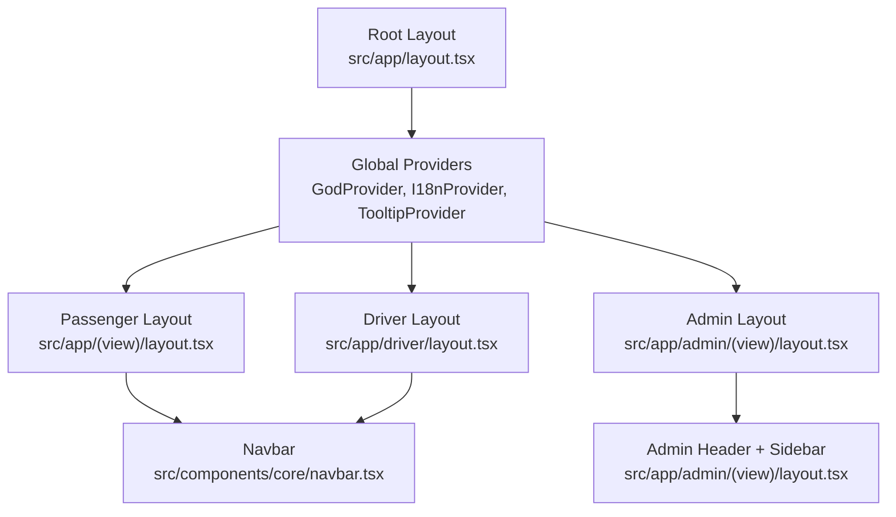
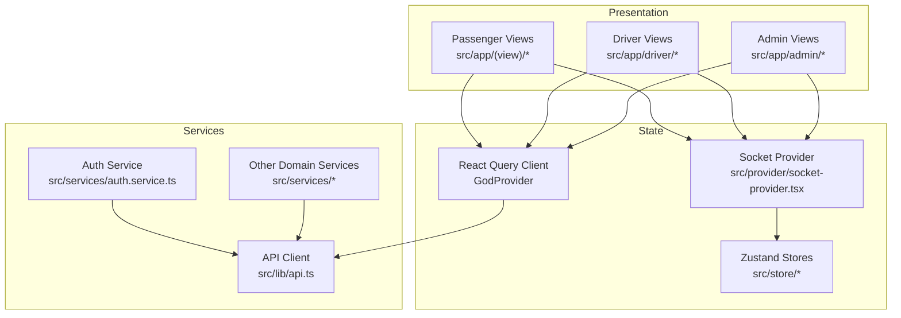
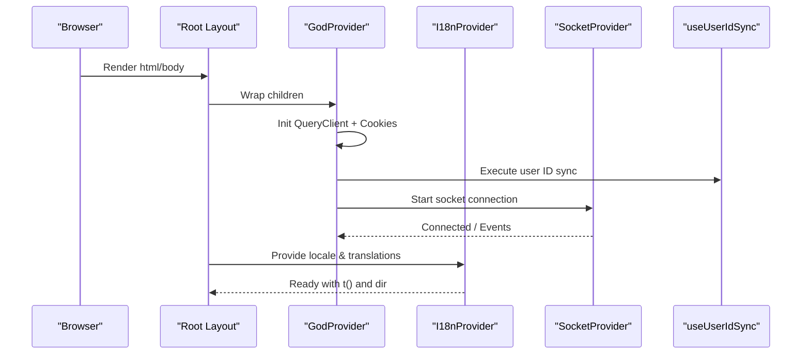
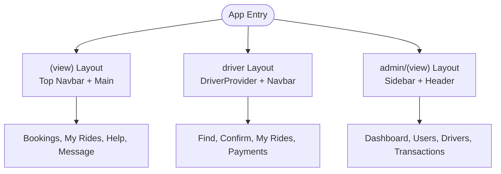
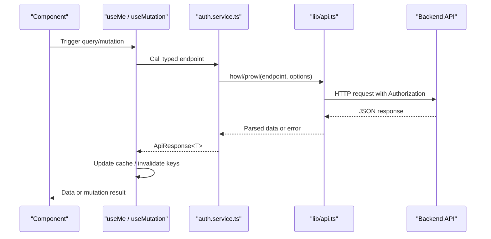
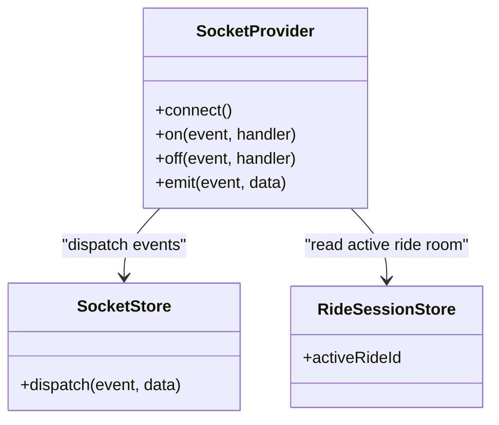
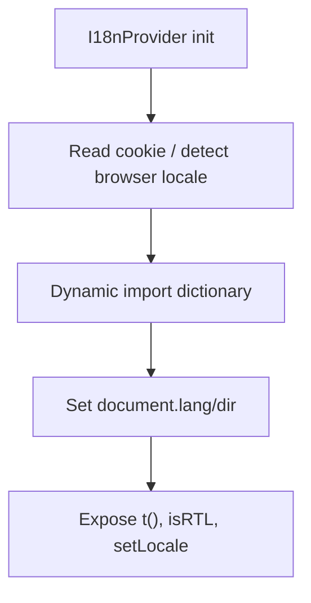
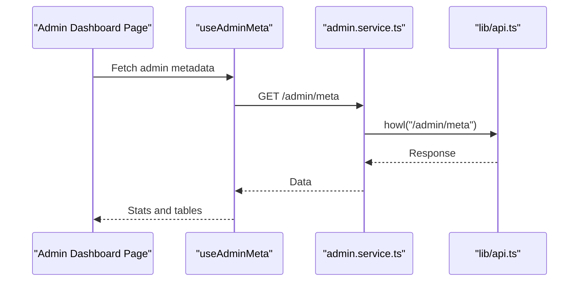
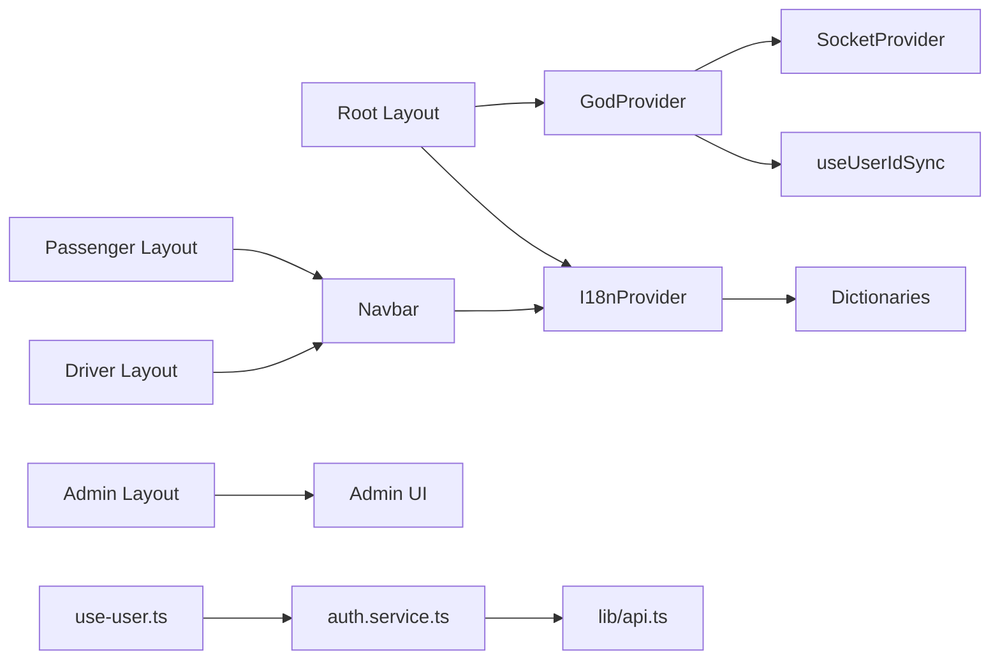

# System Architecture

<cite>
**Referenced Files in This Document**
- [layout.tsx](file://src/app/layout.tsx)
- [god-provider.tsx](file://src/provider/god-provider.tsx)
- [context.tsx](file://src/i18n/context.tsx)
- [socket-provider.tsx](file://src/provider/socket-provider.tsx)
- [api.ts](file://src/lib/api.ts)
- [auth.service.ts](file://src/services/auth.service.ts)
- [use-user.ts](file://src/hooks/shared/use-user.ts)
- [user-store.ts](file://src/store/user-store.ts)
- [navbar.tsx](file://src/components/core/navbar.tsx)
- [view-layout.tsx](file://src/app/(view)/layout.tsx)
- [driver-layout.tsx](file://src/app/driver/layout.tsx)
- [admin-view-layout.tsx](file://src/app/admin/(view)/layout.tsx)
- [admin-dashboard-page.tsx](file://src/app/admin/(view)/dashboard/page.tsx)
</cite>

## Table of Contents
1. [Introduction](#introduction)
2. [Project Structure](#project-structure)
3. [Core Components](#core-components)
4. [Architecture Overview](#architecture-overview)
5. [Detailed Component Analysis](#detailed-component-analysis)
6. [Dependency Analysis](#dependency-analysis)
7. [Performance Considerations](#performance-considerations)
8. [Troubleshooting Guide](#troubleshooting-guide)
9. [Conclusion](#conclusion)

## Introduction
This document describes the Split Ride system architecture with a focus on the Next.js App Router structure, component hierarchy, root layout configuration, global providers, and application bootstrap process. It explains how passenger, driver, and admin interfaces are separated using route groups, outlines system boundaries and module organization patterns, and maps the overall data flow from components to services. The technology stack decisions and architectural principles guiding the codebase structure are also addressed.

## Project Structure
The application uses Next.js App Router with feature-oriented directories:
- src/app: Application routes and layouts grouped by role and view
  - (view): Passenger-facing pages and shared layout
  - driver: Driver-specific routes and layout
  - admin: Admin dashboard and management routes
  - auth: Authentication flows for passengers and drivers
- src/components: Reusable UI and core features
- src/hooks: React hooks encapsulating business logic and data fetching
- src/services: API service modules wrapping HTTP calls
- src/store: Zustand stores for client-side state
- src/i18n: Internationalization context and dictionaries
- src/lib: Shared utilities including API client and socket helpers

**Diagram sources**
- [layout.tsx:1-48](file://src/app/layout.tsx#L1-L48)
- [god-provider.tsx:1-48](file://src/provider/god-provider.tsx#L1-L48)
- [context.tsx:1-101](file://src/i18n/context.tsx#L1-L101)
- [view-layout.tsx](file://src/app/(view)/layout.tsx#L1-L14)
- [driver-layout.tsx:1-15](file://src/app/driver/layout.tsx#L1-L15)
- [admin-view-layout.tsx](file://src/app/admin/(view)/layout.tsx#L1-L58)
- [navbar.tsx:1-502](file://src/components/core/navbar.tsx#L1-L502)

**Section sources**
- [layout.tsx:1-48](file://src/app/layout.tsx#L1-L48)
- [view-layout.tsx](file://src/app/(view)/layout.tsx#L1-L14)
- [driver-layout.tsx:1-15](file://src/app/driver/layout.tsx#L1-L15)
- [admin-view-layout.tsx](file://src/app/admin/(view)/layout.tsx#L1-L58)

## Core Components
- Root layout configures fonts, metadata, and wraps the app with global providers: TooltipProvider, GodProvider, and I18nProvider.
- GodProvider initializes cookies, React Query client, Socket connection, notifications bridge, and Suspense boundary; it also runs user ID synchronization.
- I18nProvider manages locale detection, dictionary loading, RTL support, and exposes translation utilities.
- SocketProvider establishes a persistent WebSocket connection, subscribes to ride/chat/booking events, and dispatches them into a store for reactive UI updates.
- Navbar adapts navigation based on user role (passenger vs driver), provides profile actions, and integrates with i18n.

Key responsibilities:
- Global state and infrastructure wiring at the root level
- Role-based layout composition via route groups
- Real-time event distribution through sockets
- Internationalization across all views

**Section sources**
- [layout.tsx:1-48](file://src/app/layout.tsx#L1-L48)
- [god-provider.tsx:1-48](file://src/provider/god-provider.tsx#L1-L48)
- [context.tsx:1-101](file://src/i18n/context.tsx#L1-L101)
- [socket-provider.tsx:1-122](file://src/provider/socket-provider.tsx#L1-L122)
- [navbar.tsx:1-502](file://src/components/core/navbar.tsx#L1-L502)

## Architecture Overview
High-level design:
- Presentation layer: Pages and layouts under src/app organized by role and feature
- State layer: React Query for server state, Zustand for client state, SocketProvider for real-time events
- Services layer: Typed API clients per domain (auth, booking, driver, etc.)
- Utilities: Shared API client, socket helpers, i18n context

**Diagram sources**
- [god-provider.tsx:1-48](file://src/provider/god-provider.tsx#L1-L48)
- [socket-provider.tsx:1-122](file://src/provider/socket-provider.tsx#L1-L122)
- [api.ts:1-106](file://src/lib/api.ts#L1-L106)
- [auth.service.ts:1-43](file://src/services/auth.service.ts#L1-L43)

## Detailed Component Analysis

### Root Layout and Bootstrap Process
- Root layout sets up HTML lang, applies font variables, and defines site metadata.
- Provider chain order: TooltipProvider -> GodProvider -> I18nProvider.
- GodProvider:
  - Initializes CookiesProvider and React Query client with default options.
  - Runs useUserIdSync to keep local user ID in sync with server identity.
  - Wraps children with SocketProvider and NotificationBridge.
  - Adds Toaster and dev-only React Query Devtools.
- I18nProvider:
  - Detects locale from cookie or browser settings.
  - Dynamically loads dictionaries and sets document language and direction.
  - Exposes t() function and isRTL flag.

**Diagram sources**
- [layout.tsx:1-48](file://src/app/layout.tsx#L1-L48)
- [god-provider.tsx:1-48](file://src/provider/god-provider.tsx#L1-L48)
- [context.tsx:1-101](file://src/i18n/context.tsx#L1-L101)
- [socket-provider.tsx:1-122](file://src/provider/socket-provider.tsx#L1-L122)
- [use-user.ts:1-117](file://src/hooks/shared/use-user.ts#L1-L117)

**Section sources**
- [layout.tsx:1-48](file://src/app/layout.tsx#L1-L48)
- [god-provider.tsx:1-48](file://src/provider/god-provider.tsx#L1-L48)
- [context.tsx:1-101](file://src/i18n/context.tsx#L1-L101)
- [use-user.ts:1-117](file://src/hooks/shared/use-user.ts#L1-L117)

### Route Groups and Interface Separation
- Passenger interface:
  - Grouped under src/app/(view) with its own layout that includes a top navbar and main content area.
  - Default page redirects to a primary action (e.g., my rides).
- Driver interface:
  - Grouped under src/app/driver with a dedicated layout that injects DriverProvider and a driver-aware navbar.
- Admin interface:
  - Grouped under src/app/admin/(view) with a sidebar layout, search bar, notification bell, and admin user info.

**Diagram sources**
- [view-layout.tsx](file://src/app/(view)/layout.tsx#L1-L14)
- [driver-layout.tsx:1-15](file://src/app/driver/layout.tsx#L1-L15)
- [admin-view-layout.tsx](file://src/app/admin/(view)/layout.tsx#L1-L58)

**Section sources**
- [view-layout.tsx](file://src/app/(view)/layout.tsx#L1-L14)
- [driver-layout.tsx:1-15](file://src/app/driver/layout.tsx#L1-L15)
- [admin-view-layout.tsx](file://src/app/admin/(view)/layout.tsx#L1-L58)

### Data Flow: Components to Services
Typical request lifecycle:
- Component invokes a hook (e.g., useMe) which uses React Query to call a service method.
- Service method uses the API client to perform fetch requests with token handling and error normalization.
- On success, React Query caches the result and invalidates related queries when mutations occur.
- For real-time updates, SocketProvider listens to events and dispatches them into Zustand stores, which components subscribe to.

**Diagram sources**
- [auth.service.ts:1-43](file://src/services/auth.service.ts#L1-L43)
- [api.ts:1-106](file://src/lib/api.ts#L1-L106)
- [use-user.ts:1-117](file://src/hooks/shared/use-user.ts#L1-L117)

**Section sources**
- [auth.service.ts:1-43](file://src/services/auth.service.ts#L1-L43)
- [api.ts:1-106](file://src/lib/api.ts#L1-L106)
- [use-user.ts:1-117](file://src/hooks/shared/use-user.ts#L1-L117)

### Real-Time Event Handling
- SocketProvider connects once and reattaches to active ride rooms after reconnects.
- All known events are registered dynamically and dispatched to the socket store for consumption by hooks and components.
- Connection status is exposed via context for UI indicators.

**Diagram sources**
- [socket-provider.tsx:1-122](file://src/provider/socket-provider.tsx#L1-L122)

**Section sources**
- [socket-provider.tsx:1-122](file://src/provider/socket-provider.tsx#L1-L122)

### Internationalization Integration
- I18nProvider reads locale from cookie or browser, loads dictionaries on demand, and sets document attributes for RTL/LTR.
- Components access translations via useT() and adapt UI accordingly.

**Diagram sources**
- [context.tsx:1-101](file://src/i18n/context.tsx#L1-L101)

**Section sources**
- [context.tsx:1-101](file://src/i18n/context.tsx#L1-L101)

### Admin Dashboard Example
- Admin dashboard page consumes an admin meta hook to render statistics, charts, and recent transactions.
- Uses i18n for labels and links to other admin sections.

**Diagram sources**
- [admin-dashboard-page.tsx](file://src/app/admin/(view)/dashboard/page.tsx#L1-L227)
- [api.ts:1-106](file://src/lib/api.ts#L1-L106)

**Section sources**
- [admin-dashboard-page.tsx](file://src/app/admin/(view)/dashboard/page.tsx#L1-L227)

## Dependency Analysis
- Root dependencies:
  - Root layout depends on global providers and styles.
  - GodProvider depends on React Query, cookies, socket, notifications, and user sync.
  - I18nProvider depends on locale definitions and dynamic dictionary imports.
- Feature dependencies:
  - Passenger and driver layouts depend on Navbar and their specific providers.
  - Admin layout depends on sidebar and header components.
- Data dependencies:
  - Services depend on the API client for HTTP operations.
  - Hooks depend on services and React Query for caching and mutations.
  - SocketProvider depends on socket library and Zustand stores.

**Diagram sources**
- [layout.tsx:1-48](file://src/app/layout.tsx#L1-L48)
- [god-provider.tsx:1-48](file://src/provider/god-provider.tsx#L1-L48)
- [context.tsx:1-101](file://src/i18n/context.tsx#L1-L101)
- [socket-provider.tsx:1-122](file://src/provider/socket-provider.tsx#L1-L122)
- [navbar.tsx:1-502](file://src/components/core/navbar.tsx#L1-L502)
- [view-layout.tsx](file://src/app/(view)/layout.tsx#L1-L14)
- [driver-layout.tsx:1-15](file://src/app/driver/layout.tsx#L1-L15)
- [admin-view-layout.tsx](file://src/app/admin/(view)/layout.tsx#L1-L58)
- [auth.service.ts:1-43](file://src/services/auth.service.ts#L1-L43)
- [api.ts:1-106](file://src/lib/api.ts#L1-L106)
- [use-user.ts:1-117](file://src/hooks/shared/use-user.ts#L1-L117)

**Section sources**
- [layout.tsx:1-48](file://src/app/layout.tsx#L1-L48)
- [god-provider.tsx:1-48](file://src/provider/god-provider.tsx#L1-L48)
- [context.tsx:1-101](file://src/i18n/context.tsx#L1-L101)
- [socket-provider.tsx:1-122](file://src/provider/socket-provider.tsx#L1-L122)
- [navbar.tsx:1-502](file://src/components/core/navbar.tsx#L1-L502)
- [view-layout.tsx](file://src/app/(view)/layout.tsx#L1-L14)
- [driver-layout.tsx:1-15](file://src/app/driver/layout.tsx#L1-L15)
- [admin-view-layout.tsx](file://src/app/admin/(view)/layout.tsx#L1-L58)
- [auth.service.ts:1-43](file://src/services/auth.service.ts#L1-L43)
- [api.ts:1-106](file://src/lib/api.ts#L1-L106)
- [use-user.ts:1-117](file://src/hooks/shared/use-user.ts#L1-L117)

## Performance Considerations
- React Query default options include stale time and retry limits to balance freshness and network usage.
- Dynamic dictionary imports reduce initial bundle size for internationalization.
- SocketProvider centralizes event subscriptions and avoids redundant listeners by cleaning up on unmount.
- Using Suspense boundaries around route content improves perceived performance during data loading.

[No sources needed since this section provides general guidance]

## Troubleshooting Guide
- Missing provider errors:
  - If useI18n throws “must be used inside I18nProvider”, ensure I18nProvider wraps the component tree.
  - If useSocketContext throws “must be inside SocketProvider”, verify SocketProvider is present in the provider chain.
- Token and authentication:
  - The API client reads tokens from cookies; ensure cookies are properly set and accessible.
  - useUserIdSync refetches user data if a token exists but no userId is present in local store.
- Socket connectivity:
  - Check connect/disconnect handlers and ensure room join events are emitted for active rides.
- Error responses:
  - The API client normalizes error messages from JSON payloads; inspect thrown Error messages for details.

**Section sources**
- [context.tsx:96-101](file://src/i18n/context.tsx#L96-L101)
- [socket-provider.tsx:117-122](file://src/provider/socket-provider.tsx#L117-L122)
- [api.ts:42-73](file://src/lib/api.ts#L42-L73)
- [use-user.ts:94-117](file://src/hooks/shared/use-user.ts#L94-L117)

## Conclusion
Split Ride’s architecture leverages Next.js App Router route groups to cleanly separate passenger, driver, and admin experiences. The root layout composes global providers for tooltips, internationalization, React Query, cookies, sockets, and notifications. Data flows from components through typed hooks and services to a centralized API client, while real-time updates are handled by a single SocketProvider that dispatches events into Zustand stores. This modular, layered approach promotes maintainability, scalability, and clear separation of concerns.