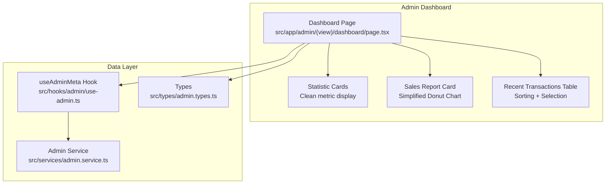
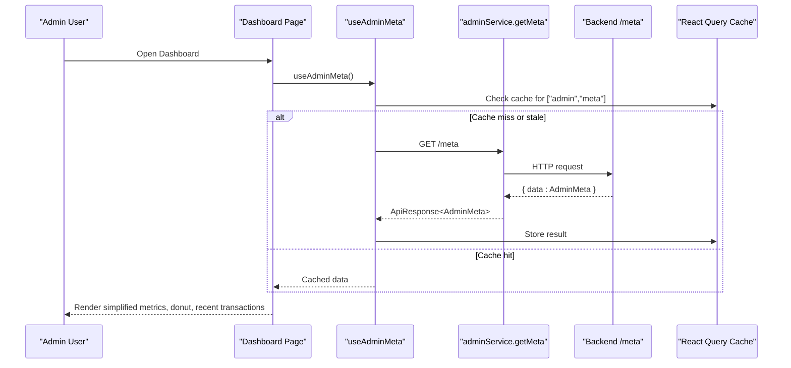
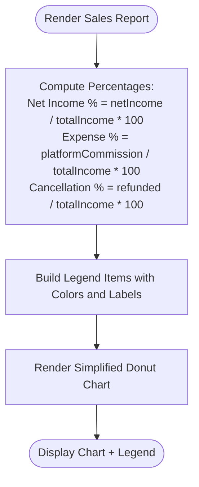
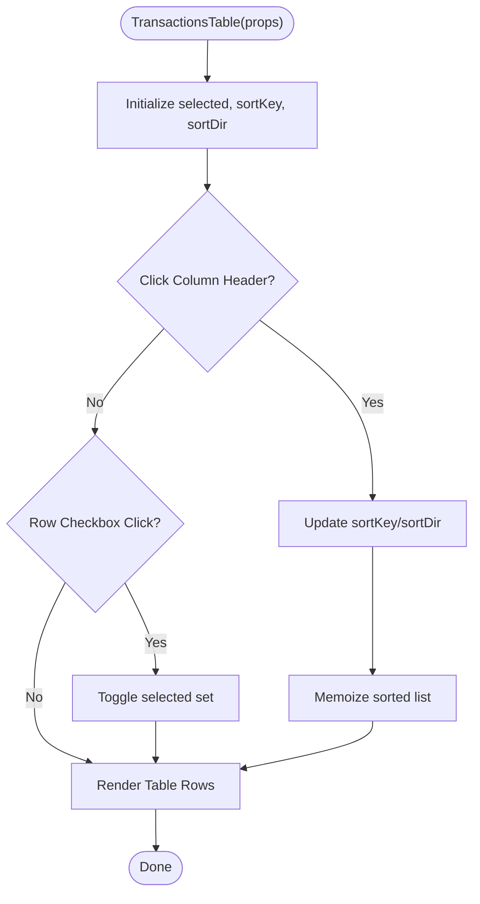
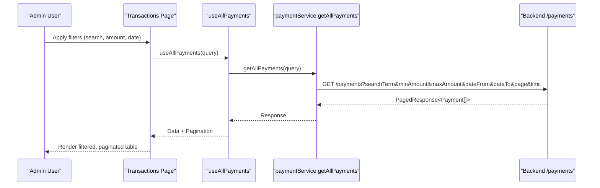
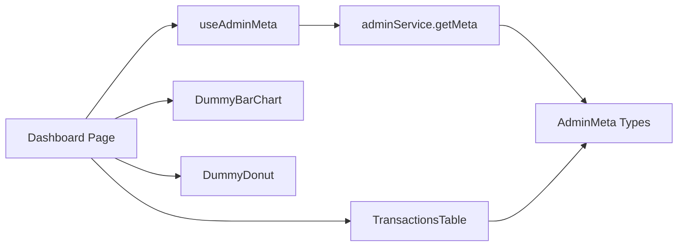

# Admin Dashboard & Analytics

<cite>
**Referenced Files in This Document**
- [dashboard/page.tsx](file://src/app/admin/(view)/dashboard/page.tsx)
- [transactions-table.tsx](file://src/app/admin/(view)/_components/transactions-table.tsx)
- [dummy-chart.tsx](file://src/app/admin/(view)/_components/dummy-chart.tsx)
- [dummy-donut.tsx](file://src/app/admin/(view)/_components/dummy-donut.tsx)
- [use-admin.ts](file://src/hooks/admin/use-admin.ts)
- [admin.service.ts](file://src/services/admin.service.ts)
- [admin.types.ts](file://src/types/admin.types.ts)
- [transactions/page.tsx](file://src/app/admin/(view)/transactions/page.tsx)
- [use-payment.ts](file://src/hooks/booking/use-payment.ts)
- [payment.service.ts](file://src/services/payment.service.ts)
- [payment.types.ts](file://src/types/payment.types.ts)
</cite>

## Update Summary
**Changes Made**
- Updated dashboard interface description to reflect removal of trend indicators and simplified UI elements
- Revised sales report section documentation to match streamlined donut chart implementation
- Updated component structure descriptions to align with current simplified architecture
- Modified performance considerations to reflect reduced complexity

## Table of Contents
1. [Introduction](#introduction)
2. [Project Structure](#project-structure)
3. [Core Components](#core-components)
4. [Architecture Overview](#architecture-overview)
5. [Detailed Component Analysis](#detailed-component-analysis)
6. [Dependency Analysis](#dependency-analysis)
7. [Performance Considerations](#performance-considerations)
8. [Troubleshooting Guide](#troubleshooting-guide)
9. [Conclusion](#conclusion)

## Introduction
This document explains the admin dashboard and analytics system for the ride-sharing application. The dashboard provides a streamlined interface focused on essential metrics and data visualization:
- The main dashboard interface displaying key metrics (net income, total rides, user counts, driver statistics).
- Sales report visualization with a donut chart representing income distribution, platform commissions, and cancellation rates.
- Recent transactions table functionality with sorting and selection capabilities.
- Time period selection controls for filtering dashboard data.
- Responsive grid layout optimized for clean data presentation.

## Project Structure
The admin dashboard is implemented as a client-side Next.js page that composes several reusable UI components and hooks to fetch and display analytics data in a simplified, focused interface.

**Diagram sources**
- [dashboard/page.tsx:1-227](file://src/app/admin/(view)/dashboard/page.tsx#L1-L227)
- [use-admin.ts:1-44](file://src/hooks/admin/use-admin.ts#L1-L44)
- [admin.service.ts:1-28](file://src/services/admin.service.ts#L1-L28)
- [admin.types.ts:1-62](file://src/types/admin.types.ts#L1-L62)

**Section sources**
- [dashboard/page.tsx:1-227](file://src/app/admin/(view)/dashboard/page.tsx#L1-L227)
- [use-admin.ts:1-44](file://src/hooks/admin/use-admin.ts#L1-L44)
- [admin.service.ts:1-28](file://src/services/admin.service.ts#L1-L28)
- [admin.types.ts:1-62](file://src/types/admin.types.ts#L1-L62)

## Core Components
- Dashboard page: Renders metric cards, sales report card with time period selector, and recent transactions preview.
- Transactions table component: Displays recent transactions with column sorting and row selection.
- Bar chart component: A minimal decorative bar chart shown inside each metric card.
- Donut chart component: Visualizes sales report proportions in a simplified format.

Key responsibilities:
- Data fetching via React Query hooks.
- Formatting currency and numbers.
- Rendering responsive grids and interactive elements.

**Updated** Removed references to trend indicators and complex visualizations in favor of a cleaner, more focused interface.

**Section sources**
- [dashboard/page.tsx:1-227](file://src/app/admin/(view)/dashboard/page.tsx#L1-L227)
- [transactions-table.tsx:1-225](file://src/app/admin/(view)/_components/transactions-table.tsx#L1-L225)
- [dummy-chart.tsx:1-67](file://src/app/admin/(view)/_components/dummy-chart.tsx#L1-L67)
- [dummy-donut.tsx:1-57](file://src/app/admin/(view)/_components/dummy-donut.tsx#L1-L57)

## Architecture Overview
The dashboard uses a client-side architecture with React Query for caching and background updates, designed for simplicity and performance.

**Diagram sources**
- [dashboard/page.tsx:34-38](file://src/app/admin/(view)/dashboard/page.tsx#L34-L38)
- [use-admin.ts:13-18](file://src/hooks/admin/use-admin.ts#L13-L18)
- [admin.service.ts:9-10](file://src/services/admin.service.ts#L9-L10)

## Detailed Component Analysis

### Dashboard Page
Responsibilities:
- Fetches aggregated admin metadata including sales report and recent transactions.
- Displays four primary metrics: net income, total rides, total users, total drivers.
- Shows a sales report card with a donut chart and legend indicating percentages for total income, expense (platform commission), and cancellation (refunded).
- Includes a time period selector (week/month/year) for the sales report.
- Embeds a recent transactions table preview with a link to the full transactions page.

Data flow:
- Uses useAdminMeta to fetch AdminMeta from /meta.
- Computes percentage values for the donut legend based on salesReport fields.
- Passes recentTransactions to the TransactionsTable component.

Time period selection:
- A Select control provides options for last week, last month, and last year.
- Currently, the selected value is not wired to refetch or filter data; it serves as a UI placeholder for future integration.

Refresh mechanism:
- React Query caches the meta query by default.
- No explicit refetch interval is configured in the hook; data will be re-fetched when the cache becomes stale according to React Query defaults.

Responsive layout:
- Uses a responsive grid: single column on small screens, two columns for stats on medium, and three-column overall layout on large screens.

**Updated** Simplified layout removes complex trend indicators and focuses on core metric presentation.

**Section sources**
- [dashboard/page.tsx:34-111](file://src/app/admin/(view)/dashboard/page.tsx#L34-L111)
- [dashboard/page.tsx:113-227](file://src/app/admin/(view)/dashboard/page.tsx#L113-L227)
- [use-admin.ts:13-18](file://src/hooks/admin/use-admin.ts#L13-L18)
- [admin.types.ts:13-30](file://src/types/admin.types.ts#L13-L30)

#### Sales Report Visualization
- Donut chart displays proportions for total income, expense (platform commission), and cancellation (refunded).
- Percentages are computed from salesReport fields relative to totalIncome.
- Legend shows color-coded labels and percentage values.
- Center icon provides visual context for the sales data.

**Diagram sources**
- [dashboard/page.tsx:62-111](file://src/app/admin/(view)/dashboard/page.tsx#L62-L111)
- [dummy-donut.tsx:36-56](file://src/app/admin/(view)/_components/dummy-donut.tsx#L36-L56)

**Updated** Streamlined visualization removes complex trend overlays and focuses on clear proportional representation.

**Section sources**
- [dashboard/page.tsx:163-208](file://src/app/admin/(view)/dashboard/page.tsx#L163-L208)
- [dummy-donut.tsx:1-57](file://src/app/admin/(view)/_components/dummy-donut.tsx#L1-L57)

### Recent Transactions Table
Features:
- Sortable columns: transactionId, createdAt, customer, amount, status.
- Row selection with "select all" support.
- Status rendering: paid, unpaid (Pay Now button), refunded.
- Empty state handling when no transactions are available.

Sorting logic:
- Maintains sort key and direction state.
- Converts createdAt strings to timestamps for correct chronological sorting.
- Memoizes sorted results to avoid unnecessary recomputation.

Selection logic:
- Tracks selected IDs in a Set.
- Supports toggling individual rows and selecting all visible rows.

**Diagram sources**
- [transactions-table.tsx:65-128](file://src/app/admin/(view)/_components/transactions-table.tsx#L65-L128)
- [transactions-table.tsx:130-224](file://src/app/admin/(view)/_components/transactions-table.tsx#L130-L224)

**Section sources**
- [transactions-table.tsx:1-225](file://src/app/admin/(view)/_components/transactions-table.tsx#L1-L225)

### Full Transactions Page
Capabilities:
- Server-side pagination with configurable page size.
- Filters: search term, amount range slider, date range picker.
- Columns include transaction ID, date, customer, method, commission, driver earning, amount, and status.
- Download action button (disabled until selections are made).
- Pagination controls with ellipsis for large page sets.

Filtering behavior:
- Search input triggers a new query with searchTerm.
- Amount range activates minAmount/maxAmount filters.
- Date range formats dates and sends dateFrom/dateTo parameters.
- All filters reset to page 1 to reflect changes immediately.

Data fetching:
- Uses useAllPayments with GetPaymentsQuery to call /payments with query parameters.

**Diagram sources**
- [transactions/page.tsx:145-170](file://src/app/admin/(view)/transactions/page.tsx#L145-L170)
- [use-payment.ts:42-47](file://src/hooks/booking/use-payment.ts#L42-L47)
- [payment.service.ts:27-38](file://src/services/payment.service.ts#L27-L38)

**Section sources**
- [transactions/page.tsx:1-500](file://src/app/admin/(view)/transactions/page.tsx#L1-L500)
- [use-payment.ts:42-47](file://src/hooks/booking/use-payment.ts#L42-L47)
- [payment.service.ts:27-38](file://src/services/payment.service.ts#L27-L38)
- [payment.types.ts:64-72](file://src/types/payment.types.ts#L64-L72)

### Chart Components
- Bar chart: Used as a visual accent within metric cards with minimal styling.
- Donut chart: Used in the sales report card to show proportional breakdown with center icon.

Both components are built on Recharts and styled using CSS variables for theme consistency, with simplified configurations for better performance.

**Updated** Chart components have been simplified to reduce visual complexity while maintaining essential data representation.

**Section sources**
- [dummy-chart.tsx:1-67](file://src/app/admin/(view)/_components/dummy-chart.tsx#L1-L67)
- [dummy-donut.tsx:1-57](file://src/app/admin/(view)/_components/dummy-donut.tsx#L1-L57)

## Dependency Analysis
High-level dependencies between dashboard components and data services:

**Diagram sources**
- [dashboard/page.tsx:24-28](file://src/app/admin/(view)/dashboard/page.tsx#L24-L28)
- [use-admin.ts:13-18](file://src/hooks/admin/use-admin.ts#L13-L18)
- [admin.service.ts:9-10](file://src/services/admin.service.ts#L9-L10)
- [admin.types.ts:1-30](file://src/types/admin.types.ts#L1-L30)

**Section sources**
- [dashboard/page.tsx:1-227](file://src/app/admin/(view)/dashboard/page.tsx#L1-L227)
- [use-admin.ts:1-44](file://src/hooks/admin/use-admin.ts#L1-L44)
- [admin.service.ts:1-28](file://src/services/admin.service.ts#L1-L28)
- [admin.types.ts:1-62](file://src/types/admin.types.ts#L1-L62)

## Performance Considerations
- Caching: React Query caches the meta query automatically; consider setting explicit staleTime and refetchOnWindowFocus if you need more predictable refresh behavior.
- Sorting and selection: The transactions table sorts and selects client-side; for very large datasets, consider virtualization or server-side sorting/filtering.
- Charts: Simplified Recharts implementations render efficiently for moderate data sizes; keep dataset sizes reasonable for responsiveness.
- Network requests: Avoid redundant calls by leveraging query keys and ensuring filters update only when necessary.
- Reduced complexity: The streamlined interface reduces computational overhead by eliminating trend calculations and complex visual computations.

**Updated** Performance improvements through simplified visualizations and reduced computational requirements.

## Troubleshooting Guide
Common issues and resolutions:
- Metrics not loading:
  - Verify the /meta endpoint returns expected fields (salesReport, totalBookings, totalUsers, totalDrivers).
  - Ensure useAdminMeta is invoked and the query key matches the service implementation.
- Donut percentages incorrect:
  - Confirm totalIncome is non-zero before computing percentages; handle division-by-zero gracefully.
- Recent transactions empty:
  - Check that recentTransactions array exists in the response; ensure the table handles empty states.
- Time period selector not filtering:
  - The current implementation does not wire the selector to data fetching; integrate onChange to refetch with appropriate period parameters.
- Missing trend indicators:
  - Trend indicators have been intentionally removed as part of the interface simplification; focus on core metric display.

**Updated** Added troubleshooting guidance for the removed trend indicators feature.

**Section sources**
- [dashboard/page.tsx:34-111](file://src/app/admin/(view)/dashboard/page.tsx#L34-L111)
- [dashboard/page.tsx:163-208](file://src/app/admin/(view)/dashboard/page.tsx#L163-L208)
- [transactions-table.tsx:169-178](file://src/app/admin/(view)/_components/transactions-table.tsx#L169-L178)

## Conclusion
The admin dashboard provides a streamlined overview of key business metrics, an intuitive sales report visualization, and a functional recent transactions table. The interface has been simplified to remove complex trend indicators and focus on essential data presentation. While the time period selector is present, it currently acts as a UI placeholder and can be extended to drive data filtering and refetching. The architecture leverages React Query for efficient data management and simplified Recharts implementations for robust visualizations. With minor enhancements—such as wiring the period selector and adding explicit refresh policies—the dashboard offers a clean, responsive analytics experience optimized for clarity and performance.

**Updated** Emphasizes the benefits of the simplified interface design and reduced complexity.