# Administrative Features

<cite>
**Referenced Files in This Document**
- [layout.tsx](file://src/app/admin/(view)/layout.tsx)
- [dashboard/page.tsx](file://src/app/admin/(view)/dashboard/page.tsx)
- [users/page.tsx](file://src/app/admin/(view)/users/page.tsx)
- [drivers/page.tsx](file://src/app/admin/(view)/drivers/page.tsx)
- [transactions/page.tsx](file://src/app/admin/(view)/transactions/page.tsx)
- [bookings/page.tsx](file://src/app/admin/(view)/bookings/page.tsx)
- [faq/page.tsx](file://src/app/admin/(view)/faq/page.tsx)
- [help-and-support/page.tsx](file://src/app/admin/(view)/help-and-support/page.tsx)
- [settings/layout.tsx](file://src/app/admin/(view)/settings/layout.tsx)
- [settings/page.tsx](file://src/app/admin/(view)/settings/page.tsx)
- [settings/platform-charges/page.tsx](file://src/app/admin/(view)/settings/platform-charges/page.tsx)
- [withdraw-request/page.tsx](file://src/app/admin/(view)/withdraw-request/page.tsx)
- [delete-account/page.tsx](file://src/app/admin/(view)/delete-account/page.tsx)
- [admin.service.ts](file://src/services/admin.service.ts)
- [use-admin.ts](file://src/hooks/admin/use-admin.ts)
</cite>

## Table of Contents
1. Introduction
2. Project Structure
3. Core Components
4. Architecture Overview
5. Detailed Component Analysis
6. Dependency Analysis
7. Performance Considerations
8. Troubleshooting Guide
9. Conclusion

## Introduction
This document provides comprehensive documentation for the administrative features of the Split Ride platform. It covers the admin dashboard with analytics, user and driver management, transaction monitoring, financial oversight, platform configuration settings, content management (FAQs and support), reporting capabilities, and system health monitoring tools. The goal is to help administrators understand how to operate each feature effectively and how the frontend integrates with backend services.

## Project Structure
The admin area is organized under a dedicated route group with a shared layout that includes a sidebar, global search, admin profile info, and notifications. Feature pages are grouped by domain: dashboard, users, drivers, transactions, bookings, FAQs, help and support, settings, withdraw requests, and account deletion requests.

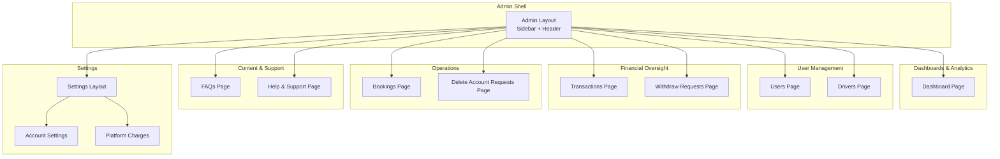

**Diagram sources**
- [layout.tsx](file://src/app/admin/(view)/layout.tsx#L1-L58)
- [dashboard/page.tsx](file://src/app/admin/(view)/dashboard/page.tsx#L1-L227)
- [users/page.tsx](file://src/app/admin/(view)/users/page.tsx#L1-L511)
- [drivers/page.tsx](file://src/app/admin/(view)/drivers/page.tsx#L1-L591)
- [transactions/page.tsx](file://src/app/admin/(view)/transactions/page.tsx#L1-L500)
- [bookings/page.tsx](file://src/app/admin/(view)/bookings/page.tsx#L1-L341)
- [faq/page.tsx](file://src/app/admin/(view)/faq/page.tsx#L1-L606)
- [help-and-support/page.tsx](file://src/app/admin/(view)/help-and-support/page.tsx#L1-L614)
- [settings/layout.tsx](file://src/app/admin/(view)/settings/layout.tsx#L1-L150)
- [settings/page.tsx](file://src/app/admin/(view)/settings/page.tsx#L1-L92)
- [settings/platform-charges/page.tsx](file://src/app/admin/(view)/settings/platform-charges/page.tsx#L1-L335)
- [withdraw-request/page.tsx](file://src/app/admin/(view)/withdraw-request/page.tsx#L1-L648)
- [delete-account/page.tsx](file://src/app/admin/(view)/delete-account/page.tsx#L1-L387)

**Section sources**
- [layout.tsx](file://src/app/admin/(view)/layout.tsx#L1-L58)

## Core Components
- Admin shell: Provides consistent navigation, global search, admin profile, and notification bell.
- Dashboard: Displays key metrics (net income, total rides, total users, total drivers), sales report breakdown, and recent transactions.
- Users: Lists all users with role filtering, status badges, KYC verification indicator, online presence, pagination, and block/unblock controls.
- Drivers: Specialized view for providers with additional columns (rides completed, earnings), creation flow, review actions, and status-based controls.
- Transactions: Comprehensive payment listing with filters (search, amount range, date range), export capability, and detailed columns including commission and driver earnings.
- Bookings: Upcoming/past tabs with filters (ride type, departure date/time) and pagination.
- FAQs: Create, view, edit, delete FAQs per audience (user/driver) with search and pagination.
- Help & Support: Ticket list with search and status filter; detail dialog to reply or mark resolved.
- Settings: Sub-navigation for account, language, password, general settings (platform charges), and terms.
- Withdraw Requests: Driver payout requests with filters, detail view, approve/reject workflow.
- Delete Account Requests: List and remove deletion requests with search and pagination.

**Section sources**
- [dashboard/page.tsx](file://src/app/admin/(view)/dashboard/page.tsx#L1-L227)
- [users/page.tsx](file://src/app/admin/(view)/users/page.tsx#L1-L511)
- [drivers/page.tsx](file://src/app/admin/(view)/drivers/page.tsx#L1-L591)
- [transactions/page.tsx](file://src/app/admin/(view)/transactions/page.tsx#L1-L500)
- [bookings/page.tsx](file://src/app/admin/(view)/bookings/page.tsx#L1-L341)
- [faq/page.tsx](file://src/app/admin/(view)/faq/page.tsx#L1-L606)
- [help-and-support/page.tsx](file://src/app/admin/(view)/help-and-support/page.tsx#L1-L614)
- [settings/layout.tsx](file://src/app/admin/(view)/settings/layout.tsx#L1-L150)
- [settings/page.tsx](file://src/app/admin/(view)/settings/page.tsx#L1-L92)
- [settings/platform-charges/page.tsx](file://src/app/admin/(view)/settings/platform-charges/page.tsx#L1-L335)
- [withdraw-request/page.tsx](file://src/app/admin/(view)/withdraw-request/page.tsx#L1-L648)
- [delete-account/page.tsx](file://src/app/admin/(view)/delete-account/page.tsx#L1-L387)

## Architecture Overview
The admin UI follows a client-side React architecture using Next.js App Router. Data fetching and mutations are handled via hooks (React Query) that wrap service functions calling the backend API.

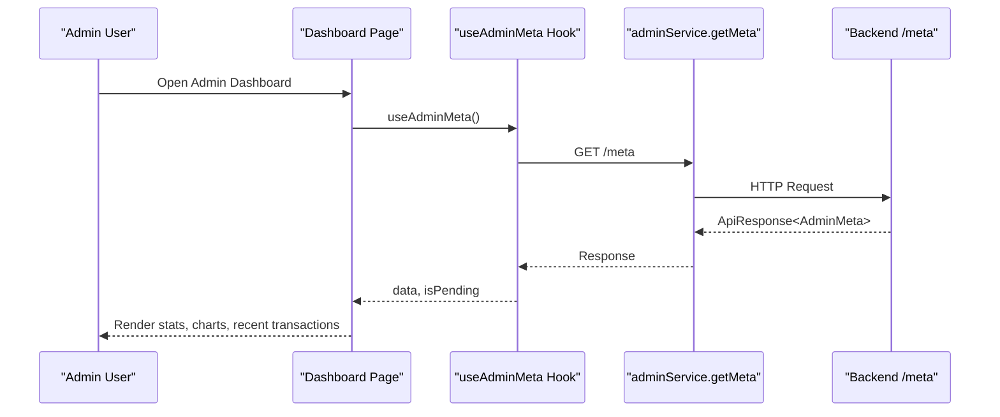

**Diagram sources**
- [dashboard/page.tsx](file://src/app/admin/(view)/dashboard/page.tsx#L1-L227)
- [use-admin.ts:1-44](file://src/hooks/admin/use-admin.ts#L1-L44)
- [admin.service.ts:1-28](file://src/services/admin.service.ts#L1-L28)

## Detailed Component Analysis

### Admin Dashboard
- Purpose: Provide high-level analytics and quick access to recent transactions.
- Key features:
  - Metrics cards: net income, total rides, total users, total drivers.
  - Sales report donut chart with percentage breakdowns.
  - Recent transactions table with link to full transactions page.
- Data source: Admin meta endpoint via hook.

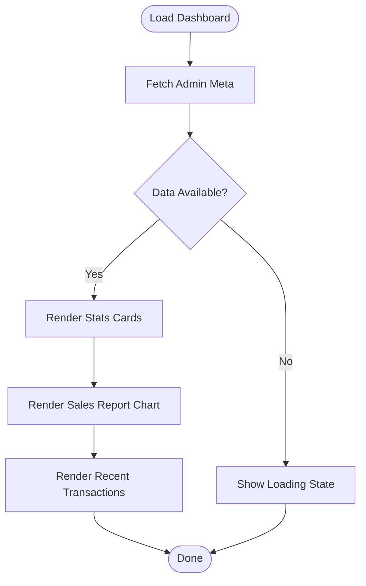

**Diagram sources**
- [dashboard/page.tsx](file://src/app/admin/(view)/dashboard/page.tsx#L1-L227)
- [use-admin.ts:1-44](file://src/hooks/admin/use-admin.ts#L1-L44)

**Section sources**
- [dashboard/page.tsx](file://src/app/admin/(view)/dashboard/page.tsx#L1-L227)
- [use-admin.ts:1-44](file://src/hooks/admin/use-admin.ts#L1-L44)
- [admin.service.ts:1-28](file://src/services/admin.service.ts#L1-L28)

### Users Administration
- Purpose: Manage all users across roles with status control and basic profile visibility.
- Key features:
  - Role filter (all, user, provider).
  - Search by name.
  - Status badge (active, pending, inactive, blocked).
  - KYC verification indicator.
  - Online presence indicator.
  - Block/Unblock action.
  - Pagination and import button.
- Data source: Users list hook with query parameters.

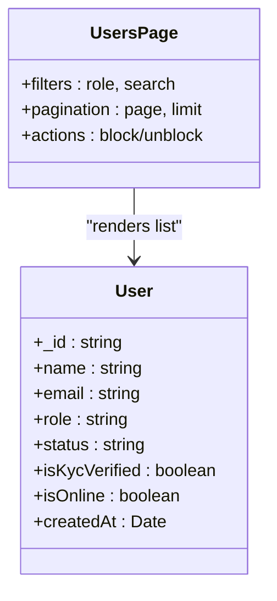

**Diagram sources**
- [users/page.tsx](file://src/app/admin/(view)/users/page.tsx#L1-L511)

**Section sources**
- [users/page.tsx](file://src/app/admin/(view)/users/page.tsx#L1-L511)

### Drivers Administration
- Purpose: Manage drivers (providers) with enhanced operational controls.
- Key features:
  - Status filter (all, active, pending, blocked).
  - Search by name.
  - KYC verification indicator.
  - Rides completed and earnings display.
  - Review action for non-active drivers.
  - Block/Unblock action.
  - Add new driver dialog with validation and registration mutation.
  - Pagination and import button.
- Data source: Users list filtered by role provider.

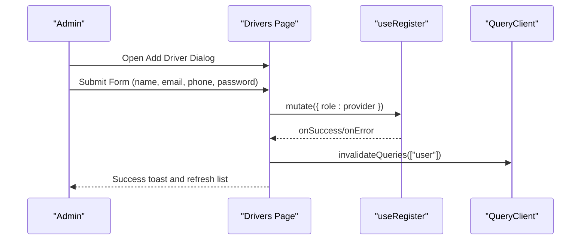

**Diagram sources**
- [drivers/page.tsx](file://src/app/admin/(view)/drivers/page.tsx#L1-L591)

**Section sources**
- [drivers/page.tsx](file://src/app/admin/(view)/drivers/page.tsx#L1-L591)

### Transaction Monitoring
- Purpose: Monitor all payments with advanced filtering and export.
- Key features:
  - Search by identifier.
  - Amount range filter using dual-range slider.
  - Date range picker.
  - Columns: transaction ID, date, customer, method, commission, driver earning, amount, status.
  - Export/download button.
  - Pagination.
- Data source: Payments list hook with query parameters.

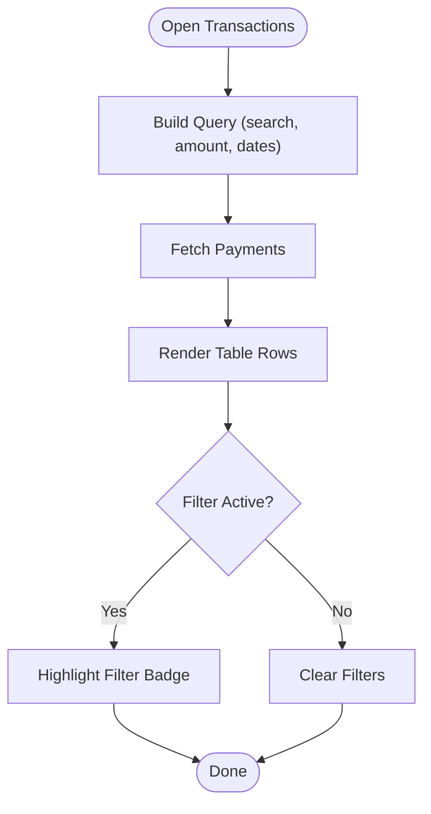

**Diagram sources**
- [transactions/page.tsx](file://src/app/admin/(view)/transactions/page.tsx#L1-L500)

**Section sources**
- [transactions/page.tsx](file://src/app/admin/(view)/transactions/page.tsx#L1-L500)

### Bookings Management
- Purpose: View upcoming and past bookings with filters.
- Key features:
  - Tabs: upcoming vs past.
  - Filters: ride type (private/shared), departure date, departure time.
  - Pagination and empty state with scheduling link.
- Data source: Bookings list hook with status and filters.

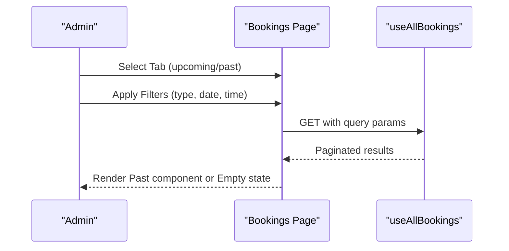

**Diagram sources**
- [bookings/page.tsx](file://src/app/admin/(view)/bookings/page.tsx#L1-L341)

**Section sources**
- [bookings/page.tsx](file://src/app/admin/(view)/bookings/page.tsx#L1-L341)

### Content Management: FAQs
- Purpose: Manage FAQ entries per audience (user/driver).
- Key features:
  - Audience tabs (users/drivers).
  - Search within questions/answers.
  - Add/Edit/Delete dialogs.
  - Pagination and result count.
- Data source: FAQ hooks for CRUD operations.

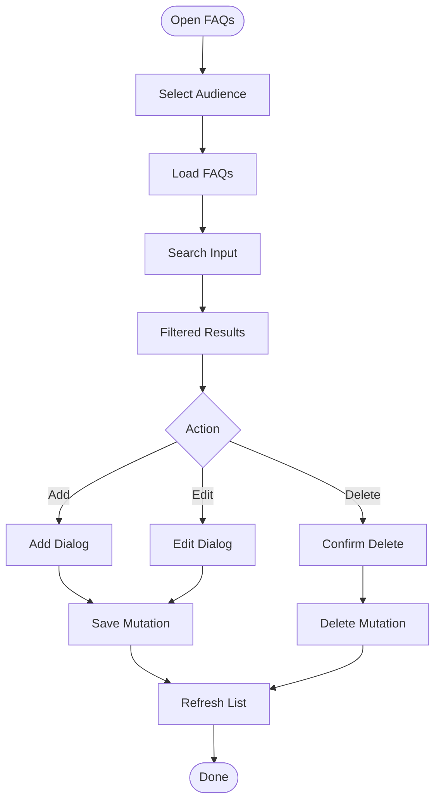

**Diagram sources**
- [faq/page.tsx](file://src/app/admin/(view)/faq/page.tsx#L1-L606)

**Section sources**
- [faq/page.tsx](file://src/app/admin/(view)/faq/page.tsx#L1-L606)

### Help and Support System
- Purpose: Handle user support tickets with replies and resolution.
- Key features:
  - Search by ticket ID/name/email.
  - Status filter (pending, replied, resolved).
  - Detail dialog showing user info, reason, and actions.
  - Send reply with contact method selection.
  - Mark as resolved.
  - Delete ticket confirmation.
- Data source: Support hooks for listing, messaging, status change, and deletion.

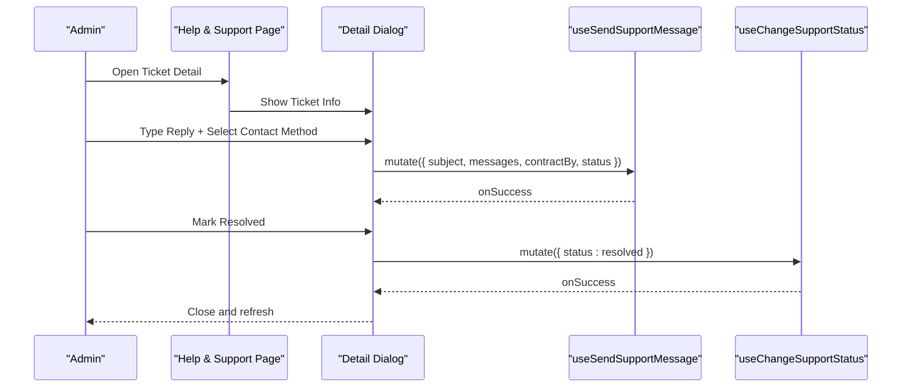

**Diagram sources**
- [help-and-support/page.tsx](file://src/app/admin/(view)/help-and-support/page.tsx#L1-L614)

**Section sources**
- [help-and-support/page.tsx](file://src/app/admin/(view)/help-and-support/page.tsx#L1-L614)

### Platform Configuration Settings
- Purpose: Centralize platform-wide configuration including ride rules, fares, and support contacts.
- Key features:
  - Settings layout with sub-navigation (account, languages, password, general settings, terms).
  - General settings form with sections: Access & Validation, Ride & Charge, Support.
  - Reset and Save changes actions.
  - Numeric fields with optional prefixes (% or €).
- Data source: General settings hooks for fetch and update.

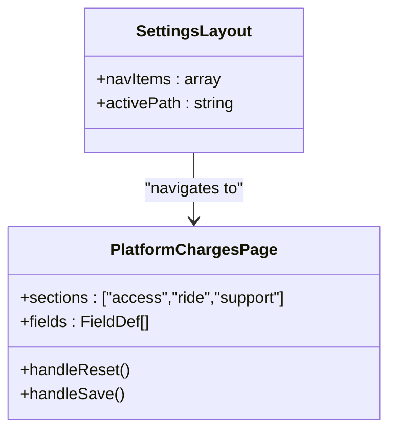

**Diagram sources**
- [settings/layout.tsx](file://src/app/admin/(view)/settings/layout.tsx#L1-L150)
- [settings/platform-charges/page.tsx](file://src/app/admin/(view)/settings/platform-charges/page.tsx#L1-L335)

**Section sources**
- [settings/layout.tsx](file://src/app/admin/(view)/settings/layout.tsx#L1-L150)
- [settings/page.tsx](file://src/app/admin/(view)/settings/page.tsx#L1-L92)
- [settings/platform-charges/page.tsx](file://src/app/admin/(view)/settings/platform-charges/page.tsx#L1-L335)

### Financial Oversight: Withdraw Requests
- Purpose: Approve or reject driver withdrawal requests.
- Key features:
  - Search by request ID.
  - Amount range filter and date range picker.
  - Detail dialog with request info and actions.
  - Quick proceed confirmation dialog.
  - Status badges and pagination.
- Data source: Withdraw hooks for listing and status change.

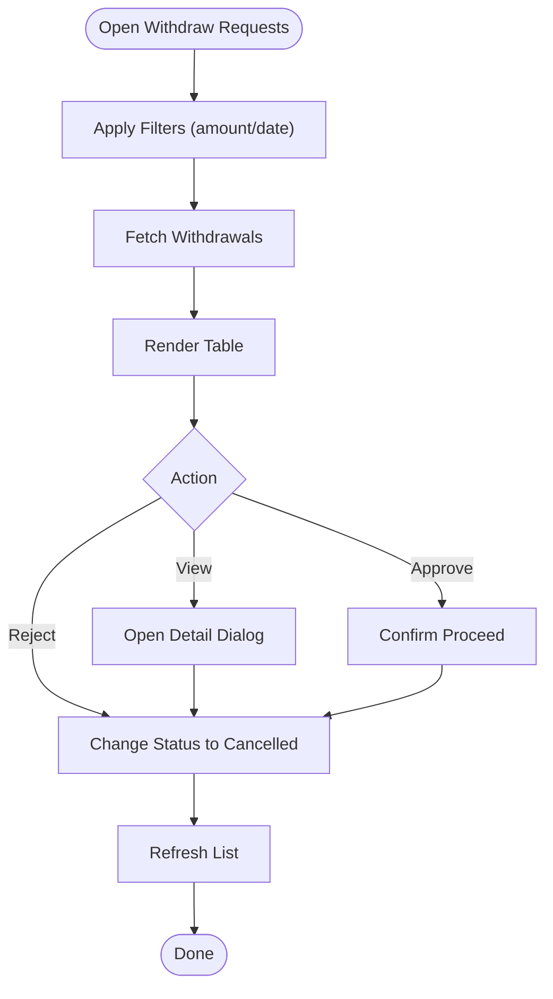

**Diagram sources**
- [withdraw-request/page.tsx](file://src/app/admin/(view)/withdraw-request/page.tsx#L1-L648)

**Section sources**
- [withdraw-request/page.tsx](file://src/app/admin/(view)/withdraw-request/page.tsx#L1-L648)

### Account Deletion Requests
- Purpose: Review and remove account deletion requests.
- Key features:
  - Filter by user type (all, customer, driver).
  - Search by username.
  - Table with avatar, name, reason, and delete action.
  - Pagination and result count.
  - Confirmation dialog before removal.
- Data source: Admin hooks for account deletion list and deletion mutation.

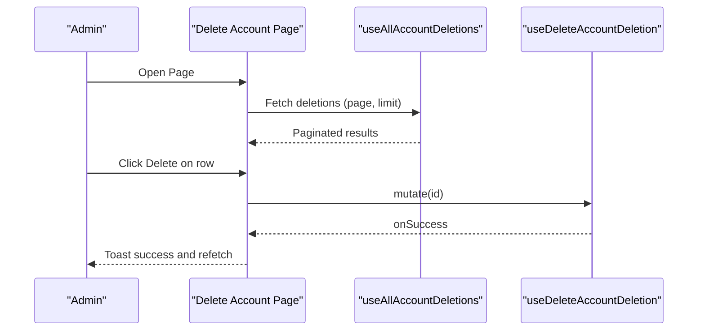

**Diagram sources**
- [delete-account/page.tsx](file://src/app/admin/(view)/delete-account/page.tsx#L1-L387)
- [use-admin.ts:1-44](file://src/hooks/admin/use-admin.ts#L1-L44)

**Section sources**
- [delete-account/page.tsx](file://src/app/admin/(view)/delete-account/page.tsx#L1-L387)
- [use-admin.ts:1-44](file://src/hooks/admin/use-admin.ts#L1-L44)
- [admin.service.ts:1-28](file://src/services/admin.service.ts#L1-L28)

## Dependency Analysis
- Admin shell depends on shared UI components and i18n utilities.
- Dashboard depends on admin hooks and dummy chart components.
- Users and Drivers pages depend on shared user hooks and auth registration hook.
- Transactions page depends on booking payment hooks.
- Bookings page depends on booking hooks.
- FAQs and Help & Support pages depend on respective shared hooks.
- Settings pages depend on shared settings hooks.
- Withdraw requests depend on driver-specific hooks.
- Delete account requests depend on admin hooks and services.

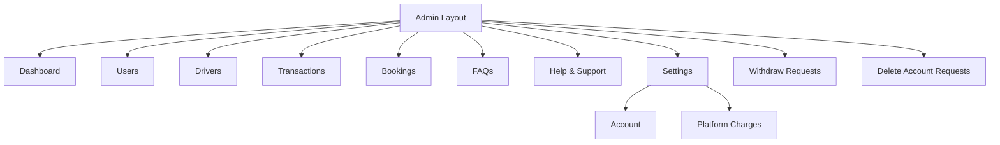

**Diagram sources**
- [layout.tsx](file://src/app/admin/(view)/layout.tsx#L1-L58)
- [dashboard/page.tsx](file://src/app/admin/(view)/dashboard/page.tsx#L1-L227)
- [users/page.tsx](file://src/app/admin/(view)/users/page.tsx#L1-L511)
- [drivers/page.tsx](file://src/app/admin/(view)/drivers/page.tsx#L1-L591)
- [transactions/page.tsx](file://src/app/admin/(view)/transactions/page.tsx#L1-L500)
- [bookings/page.tsx](file://src/app/admin/(view)/bookings/page.tsx#L1-L341)
- [faq/page.tsx](file://src/app/admin/(view)/faq/page.tsx#L1-L606)
- [help-and-support/page.tsx](file://src/app/admin/(view)/help-and-support/page.tsx#L1-L614)
- [settings/layout.tsx](file://src/app/admin/(view)/settings/layout.tsx#L1-L150)
- [settings/page.tsx](file://src/app/admin/(view)/settings/page.tsx#L1-L92)
- [settings/platform-charges/page.tsx](file://src/app/admin/(view)/settings/platform-charges/page.tsx#L1-L335)
- [withdraw-request/page.tsx](file://src/app/admin/(view)/withdraw-request/page.tsx#L1-L648)
- [delete-account/page.tsx](file://src/app/admin/(view)/delete-account/page.tsx#L1-L387)

**Section sources**
- [layout.tsx](file://src/app/admin/(view)/layout.tsx#L1-L58)

## Performance Considerations
- Use pagination consistently to avoid large dataset rendering.
- Debounce search inputs where applicable to reduce re-renders and network calls.
- Leverage React Query caching and invalidation to minimize redundant requests.
- Prefer server-side filtering when available to reduce payload sizes.
- Optimize images and avatars with appropriate sizing and lazy loading.
- Avoid unnecessary state updates; batch related mutations.

[No sources needed since this section provides general guidance]

## Troubleshooting Guide
- Dashboard not loading:
  - Check admin meta endpoint availability and response structure.
  - Verify network requests and error handling in hooks.
- Users/Drivers lists empty:
  - Validate query parameters (role, search term, pagination).
  - Ensure backend returns expected fields (KYC, status, online flag).
- Transactions filters not applying:
  - Confirm date formatting and amount range values are correctly passed.
  - Inspect query construction and backend acceptance of filters.
- FAQ/Support actions failing:
  - Validate required fields before submitting mutations.
  - Check toast messages and error responses from backend.
- Settings save errors:
  - Ensure numeric fields parse correctly and payloads match expected schema.
  - Verify field keys align with backend configuration keys.
- Withdraw request approvals:
  - Confirm request status is pending before proceeding.
  - Validate confirmation dialog triggers correct mutation.

**Section sources**
- [dashboard/page.tsx](file://src/app/admin/(view)/dashboard/page.tsx#L1-L227)
- [users/page.tsx](file://src/app/admin/(view)/users/page.tsx#L1-L511)
- [drivers/page.tsx](file://src/app/admin/(view)/drivers/page.tsx#L1-L591)
- [transactions/page.tsx](file://src/app/admin/(view)/transactions/page.tsx#L1-L500)
- [faq/page.tsx](file://src/app/admin/(view)/faq/page.tsx#L1-L606)
- [help-and-support/page.tsx](file://src/app/admin/(view)/help-and-support/page.tsx#L1-L614)
- [settings/platform-charges/page.tsx](file://src/app/admin/(view)/settings/platform-charges/page.tsx#L1-L335)
- [withdraw-request/page.tsx](file://src/app/admin/(view)/withdraw-request/page.tsx#L1-L648)

## Conclusion
The Split Ride admin platform provides a robust set of tools for managing users and drivers, monitoring transactions and withdrawals, configuring platform settings, and handling content and support workflows. The modular architecture and consistent UI patterns enable efficient administration and clear operational insights. By following the documented flows and troubleshooting steps, administrators can maintain platform health and deliver a reliable service experience.

[No sources needed since this section summarizes without analyzing specific files]