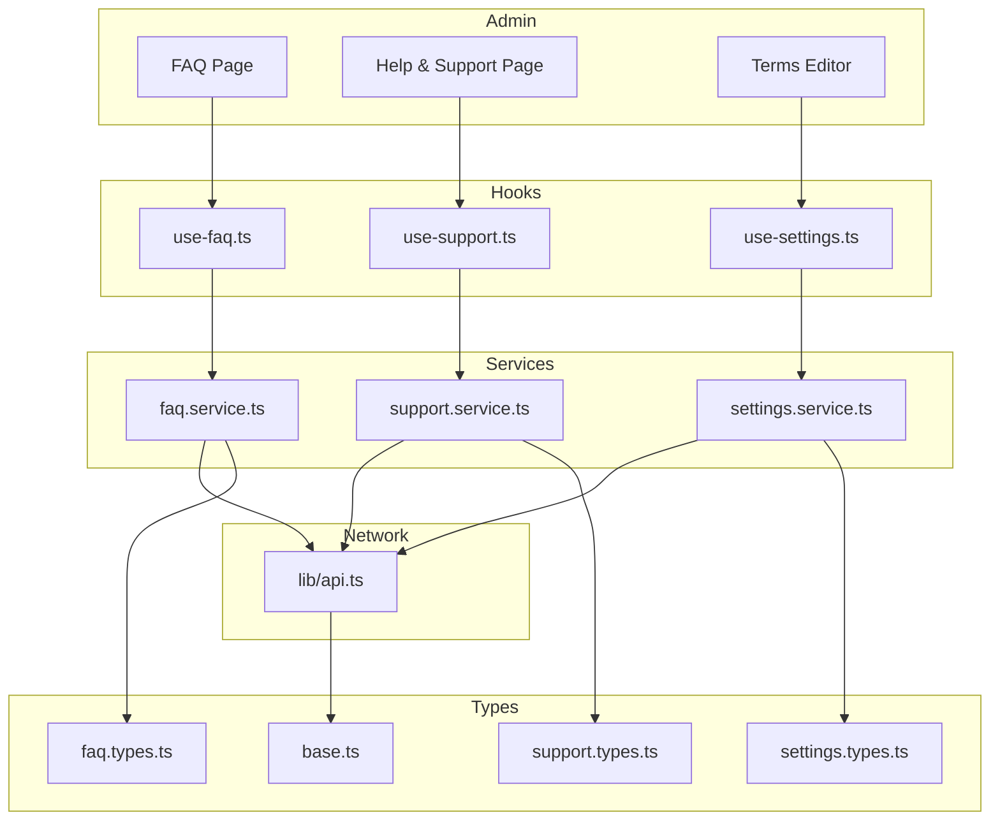
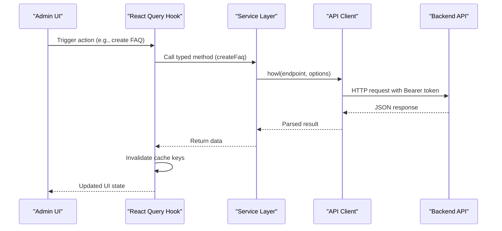
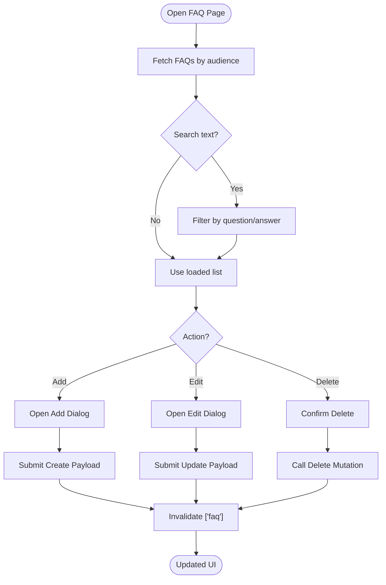
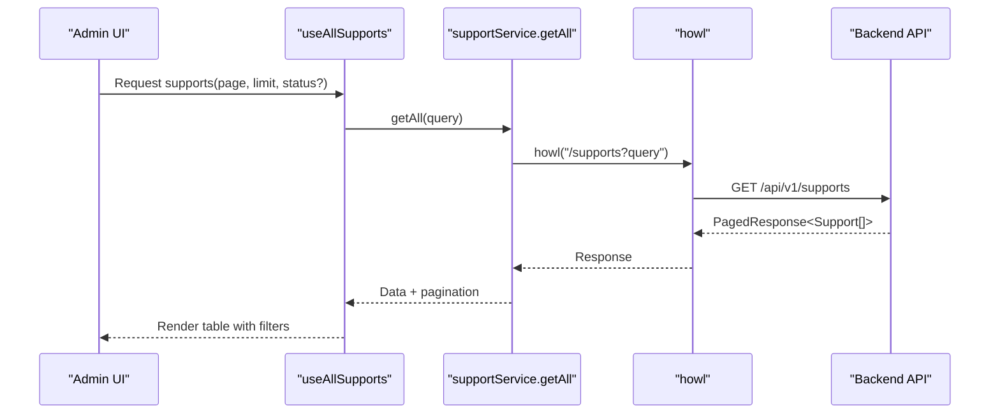
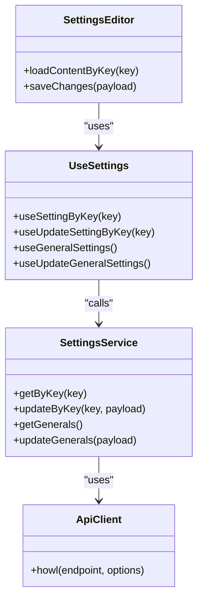
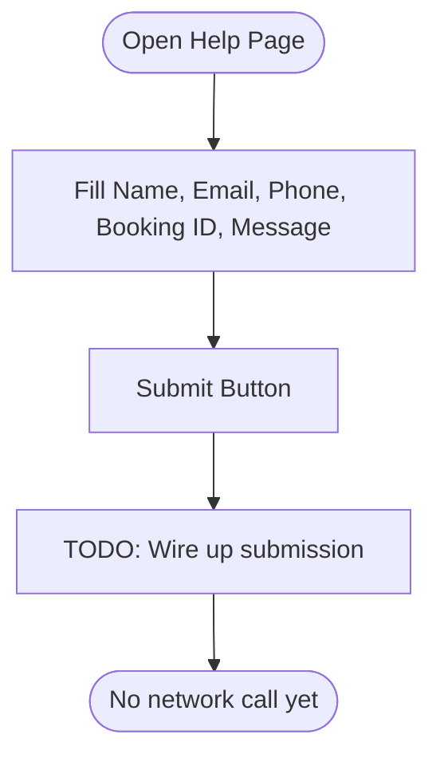
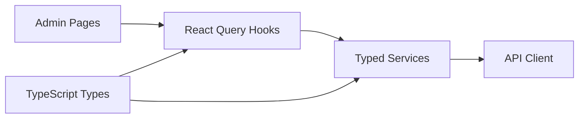

# Content Management System

<cite>
**Referenced Files in This Document**
- [faq page](file://src/app/admin/(view)/faq/page.tsx)
- [help and support page](file://src/app/admin/(view)/help-and-support/page.tsx)
- [user help page](file://src/app/(view)/help/page.tsx)
- [FAQ service](file://src/services/faq.service.ts)
- [Support service](file://src/services/support.service.ts)
- [Settings service](file://src/services/settings.service.ts)
- [use-faq hook](file://src/hooks/shared/use-faq.ts)
- [use-support hook](file://src/hooks/shared/use-support.ts)
- [use-settings hook](file://src/hooks/shared/use-settings.ts)
- [API client](file://src/lib/api.ts)
- [Base types](file://src/types/base.ts)
- [FAQ types](file://src/types/faq.types.ts)
- [Support types](file://src/types/support.types.ts)
- [Settings types](file://src/types/settings.types.ts)
</cite>

## Table of Contents
1. [Introduction](#introduction)
2. [Project Structure](#project-structure)
3. [Core Components](#core-components)
4. [Architecture Overview](#architecture-overview)
5. [Detailed Component Analysis](#detailed-component-analysis)
6. [Dependency Analysis](#dependency-analysis)
7. [Performance Considerations](#performance-considerations)
8. [Troubleshooting Guide](#troubleshooting-guide)
9. [Conclusion](#conclusion)
10. [Appendices](#appendices)

## Introduction
This document describes the content management system implemented in the application, focusing on:
- FAQ management for creating, editing, and organizing frequently asked questions by audience (User or Driver).
- Help and Support ticketing for handling user inquiries, replying, marking as resolved, and deleting tickets.
- Content categorization via audience filters and status filters, with search capabilities.
- Version control aspects through settings-based content (Terms and Conditions) and general settings updates.
- Publishing workflows and approval processes are not present in the current codebase; this section clarifies what is implemented versus what is not.
- Integration with backend services using a typed API client and React Query for caching and invalidation.

## Project Structure
The CMS-related features are organized under admin views and shared hooks/services:
- Admin pages: FAQ management and Help & Support ticket management.
- User-facing Help page: A form to submit support requests (currently unconnected to the backend).
- Services: Typed HTTP clients for FAQ, Support, and Settings endpoints.
- Hooks: React Query wrappers for data fetching and mutations with cache invalidation.
- Types: Shared TypeScript interfaces for payloads and responses.
- API client: Centralized fetch wrapper with token injection and error normalization.

**Diagram sources**
- [faq page](file://src/app/admin/(view)/faq/page.tsx)
- [help and support page](file://src/app/admin/(view)/help-and-support/page.tsx)
- [use-faq hook](file://src/hooks/shared/use-faq.ts)
- [use-support hook](file://src/hooks/shared/use-support.ts)
- [use-settings hook](file://src/hooks/shared/use-settings.ts)
- [FAQ service](file://src/services/faq.service.ts)
- [Support service](file://src/services/support.service.ts)
- [Settings service](file://src/services/settings.service.ts)
- [API client](file://src/lib/api.ts)
- [Base types](file://src/types/base.ts)
- [FAQ types](file://src/types/faq.types.ts)
- [Support types](file://src/types/support.types.ts)
- [Settings types](file://src/types/settings.types.ts)

**Section sources**
- [faq page](file://src/app/admin/(view)/faq/page.tsx)
- [help and support page](file://src/app/admin/(view)/help-and-support/page.tsx)
- [FAQ service](file://src/services/faq.service.ts)
- [Support service](file://src/services/support.service.ts)
- [Settings service](file://src/services/settings.service.ts)
- [use-faq hook](file://src/hooks/shared/use-faq.ts)
- [use-support hook](file://src/hooks/shared/use-support.ts)
- [use-settings hook](file://src/hooks/shared/use-settings.ts)
- [API client](file://src/lib/api.ts)
- [Base types](file://src/types/base.ts)
- [FAQ types](file://src/types/faq.types.ts)
- [Support types](file://src/types/support.types.ts)
- [Settings types](file://src/types/settings.types.ts)

## Core Components
- FAQ Management Interface
  - Audience tabs: Users vs Drivers.
  - Search across question and answer fields.
  - Add/Edit/Delete FAQs with confirmation dialogs.
  - Pagination with configurable page size.
  - Uses React Query hooks for list, create, update, delete with cache invalidation.

- Help & Support Ticket System
  - List all tickets with server-side pagination and optional status filter.
  - Client-side search by ticket ID, name, or email.
  - Detail dialog to view user info, reason, and status.
  - Send reply messages and mark tickets as resolved.
  - Delete tickets with confirmation.

- Settings-Based Content (Terms and Conditions)
  - Tabbed editor for User and Provider terms.
  - Load content by key, edit inline, save changes.
  - General settings retrieval and updates.

- User Help Form
  - Collects contact details and message.
  - Currently not wired to the backend submission flow.

**Section sources**
- [faq page](file://src/app/admin/(view)/faq/page.tsx)
- [help and support page](file://src/app/admin/(view)/help-and-support/page.tsx)
- [user help page](file://src/app/(view)/help/page.tsx)
- [use-faq hook](file://src/hooks/shared/use-faq.ts)
- [use-support hook](file://src/hooks/shared/use-support.ts)
- [use-settings hook](file://src/hooks/shared/use-settings.ts)

## Architecture Overview
The CMS uses a layered architecture:
- UI Pages: Admin views orchestrate state and user interactions.
- Hooks: Encapsulate React Query logic for data fetching and mutations.
- Services: Define typed API calls against backend endpoints.
- API Client: Centralizes HTTP requests, token injection, and error handling.
- Types: Provide strict contracts for payloads and responses.

**Diagram sources**
- [use-faq hook](file://src/hooks/shared/use-faq.ts)
- [FAQ service](file://src/services/faq.service.ts)
- [API client](file://src/lib/api.ts)

## Detailed Component Analysis

### FAQ Management Interface
- Features
  - Audience filtering (User/Driver).
  - Local search across question and answer.
  - Add/Edit/Delete operations with confirmation dialogs.
  - Pagination with dynamic page size selection.
- Data Flow
  - useFaqs fetches FAQs by audience.
  - useCreateFaq, useUpdateFaq, useDeleteFaq mutate data and invalidate ["faq"] queries.
- UI Interactions
  - View dialog shows full details and navigates to edit.
  - Edit dialog submits partial updates.
  - Add dialog sets default audience from active tab.
  - Delete triggers AlertDialog before calling mutation.

**Diagram sources**
- [faq page](file://src/app/admin/(view)/faq/page.tsx)
- [use-faq hook](file://src/hooks/shared/use-faq.ts)

**Section sources**
- [faq page](file://src/app/admin/(view)/faq/page.tsx)
- [use-faq hook](file://src/hooks/shared/use-faq.ts)
- [FAQ service](file://src/services/faq.service.ts)
- [FAQ types](file://src/types/faq.types.ts)

### Help and Support Ticket System
- Features
  - Server-side pagination and optional status filter.
  - Client-side search by ID, name, or email.
  - Detail dialog with user avatar, contact info, and status badge.
  - Reply messaging and mark-as-resolved actions.
  - Delete ticket with confirmation.
- Data Flow
  - useAllSupports fetches paginated tickets with query params.
  - useSendSupportMessage and useChangeSupportStatus mutate and invalidate ["supports"].
  - useDeleteSupport removes tickets and refreshes list.

**Diagram sources**
- [help and support page](file://src/app/admin/(view)/help-and-support/page.tsx)
- [use-support hook](file://src/hooks/shared/use-support.ts)
- [Support service](file://src/services/support.service.ts)
- [API client](file://src/lib/api.ts)

**Section sources**
- [help and support page](file://src/app/admin/(view)/help-and-support/page.tsx)
- [use-support hook](file://src/hooks/shared/use-support.ts)
- [Support service](file://src/services/support.service.ts)
- [Support types](file://src/types/support.types.ts)

### Settings-Based Content (Terms and Conditions)
- Features
  - Tabs for User and Provider terms.
  - Load content by key, edit in textarea, save changes.
  - General settings retrieval and updates.
- Data Flow
  - useSettingByKey fetches content by key.
  - useUpdateSettingByKey saves updated value and invalidates specific key query.
  - useGeneralSettings and useUpdateGeneralSettings manage global settings.

**Diagram sources**
- [use-settings hook](file://src/hooks/shared/use-settings.ts)
- [Settings service](file://src/services/settings.service.ts)
- [API client](file://src/lib/api.ts)

**Section sources**
- [use-settings hook](file://src/hooks/shared/use-settings.ts)
- [Settings service](file://src/services/settings.service.ts)
- [Settings types](file://src/types/settings.types.ts)

### User Help Form
- Purpose
  - Collects user contact information and message.
  - Displays contact info and guidance for finding Booking ID.
- Current State
  - The form exists but does not call the backend; submission handler is a placeholder.

**Diagram sources**
- [user help page](file://src/app/(view)/help/page.tsx)

**Section sources**
- [user help page](file://src/app/(view)/help/page.tsx)

## Dependency Analysis
- Coupling and Cohesion
  - Pages depend on hooks for data operations.
  - Hooks depend on services for API calls.
  - Services depend on the API client for HTTP transport.
  - Types provide contracts across layers, improving cohesion.
- External Dependencies
  - React Query for caching and invalidation.
  - Lucide icons and Hugeicons for UI elements.
  - Shadcn UI components for consistent design.
- Potential Circular Dependencies
  - None observed; dependencies are strictly layered.

**Diagram sources**
- [faq page](file://src/app/admin/(view)/faq/page.tsx)
- [help and support page](file://src/app/admin/(view)/help-and-support/page.tsx)
- [use-faq hook](file://src/hooks/shared/use-faq.ts)
- [use-support hook](file://src/hooks/shared/use-support.ts)
- [use-settings hook](file://src/hooks/shared/use-settings.ts)
- [FAQ service](file://src/services/faq.service.ts)
- [Support service](file://src/services/support.service.ts)
- [Settings service](file://src/services/settings.service.ts)
- [API client](file://src/lib/api.ts)
- [Base types](file://src/types/base.ts)
- [FAQ types](file://src/types/faq.types.ts)
- [Support types](file://src/types/support.types.ts)
- [Settings types](file://src/types/settings.types.ts)

**Section sources**
- [faq page](file://src/app/admin/(view)/faq/page.tsx)
- [help and support page](file://src/app/admin/(view)/help-and-support/page.tsx)
- [use-faq hook](file://src/hooks/shared/use-faq.ts)
- [use-support hook](file://src/hooks/shared/use-support.ts)
- [use-settings hook](file://src/hooks/shared/use-settings.ts)
- [FAQ service](file://src/services/faq.service.ts)
- [Support service](file://src/services/support.service.ts)
- [Settings service](file://src/services/settings.service.ts)
- [API client](file://src/lib/api.ts)
- [Base types](file://src/types/base.ts)
- [FAQ types](file://src/types/faq.types.ts)
- [Support types](file://src/types/support.types.ts)
- [Settings types](file://src/types/settings.types.ts)

## Performance Considerations
- Caching Strategy
  - React Query caches lists keyed by audience (FAQ) and query parameters (Support).
  - Mutations invalidate relevant query keys to keep UI in sync.
- Pagination
  - Server-side pagination for support tickets reduces payload size.
  - Client-side pagination for FAQs simplifies UI but may be less efficient at scale.
- Network Efficiency
  - Centralized API client avoids duplicate fetch logic and ensures consistent headers and error handling.
- Recommendations
  - Consider server-side search and filtering for FAQs if the dataset grows.
  - Implement optimistic updates for non-critical mutations where appropriate.
  - Introduce background polling or WebSocket integration for real-time ticket updates if needed.

[No sources needed since this section provides general guidance]

## Troubleshooting Guide
- Authentication Errors
  - The API client reads a Bearer token from cookies; ensure the token cookie is present and valid.
  - Non-OK responses throw normalized errors with message extraction.
- Cache Invalidation Issues
  - Verify that mutations invalidate correct query keys (e.g., ["faq"], ["supports"]).
  - Check that query keys include necessary variables (audience, query params).
- Empty States
  - Both FAQ and Support pages handle empty states gracefully; confirm data shape matches expected types.
- User Help Form Not Submitting
  - The user help page has a placeholder submission handler; wire it to the support creation endpoint when ready.

**Section sources**
- [API client](file://src/lib/api.ts)
- [use-faq hook](file://src/hooks/shared/use-faq.ts)
- [use-support hook](file://src/hooks/shared/use-support.ts)
- [user help page](file://src/app/(view)/help/page.tsx)

## Conclusion
The content management system provides robust admin tools for managing FAQs and support tickets, with clear separation of concerns across UI, hooks, services, and types. Caching and invalidation are handled via React Query, ensuring responsive UI updates. While version control and publishing workflows are not implemented beyond settings-based content, the architecture allows for future enhancements such as server-side search, real-time updates, and formal approval pipelines.

[No sources needed since this section summarizes without analyzing specific files]

## Appendices

### API Contracts Summary
- FAQ Endpoints
  - GET /faq?audience=user|provider
  - POST /faq
  - PUT /faq/:id
  - DELETE /faq/:id
- Support Endpoints
  - POST /supports
  - GET /supports?page&limit&status
  - POST /supports/:id (send message)
  - PATCH /supports/:id (change status)
  - DELETE /supports/:id
- Settings Endpoints
  - GET /setting?key=...
  - POST /setting/:key
  - GET /setting/generals
  - POST /setting/generals

**Section sources**
- [FAQ service](file://src/services/faq.service.ts)
- [Support service](file://src/services/support.service.ts)
- [Settings service](file://src/services/settings.service.ts)
- [Base types](file://src/types/base.ts)