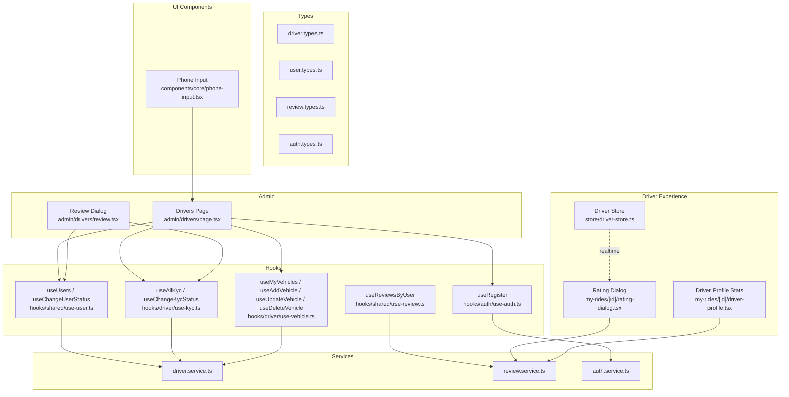
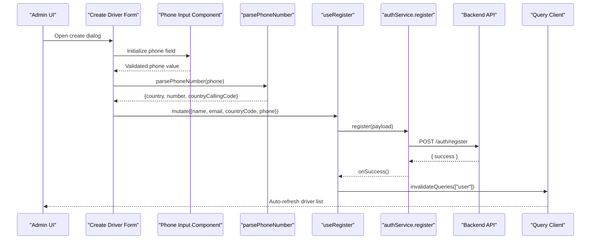
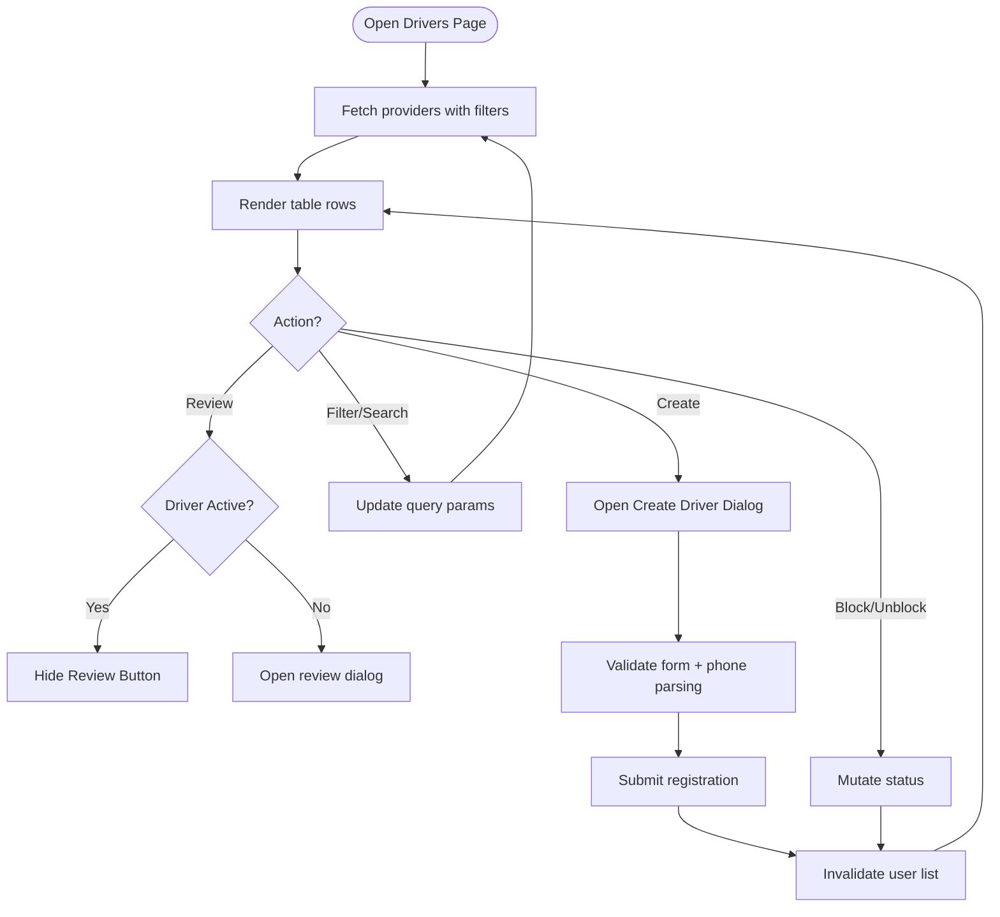
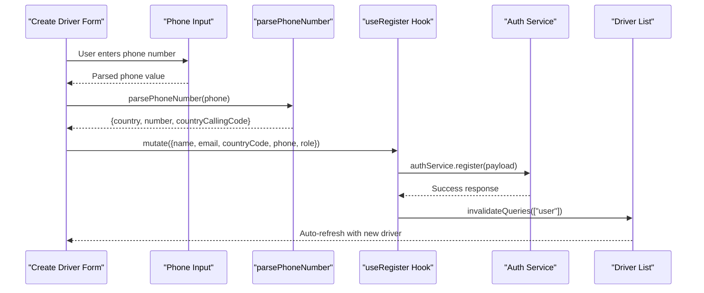
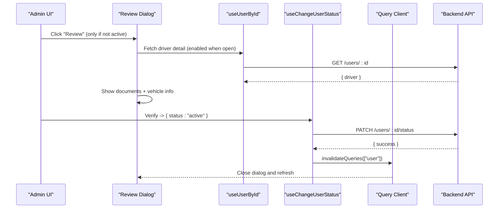
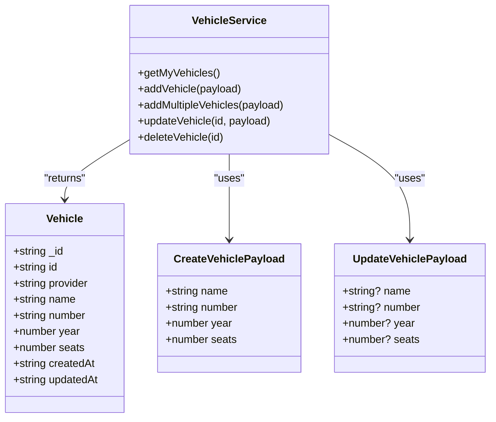
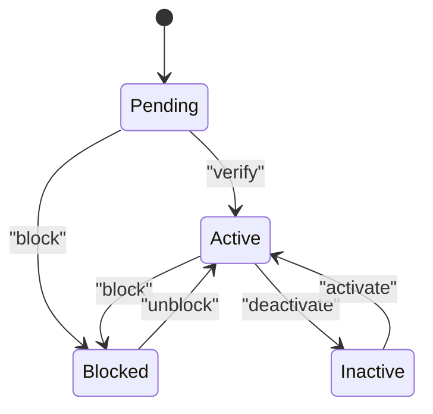
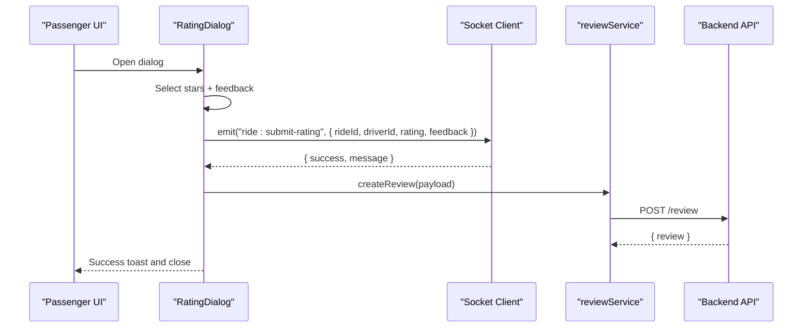
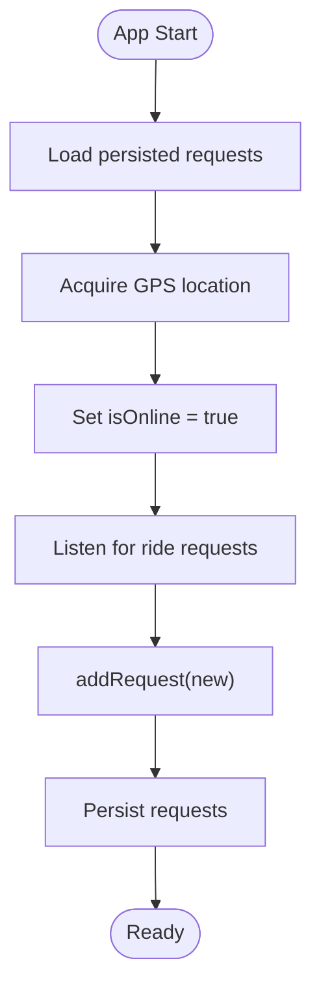
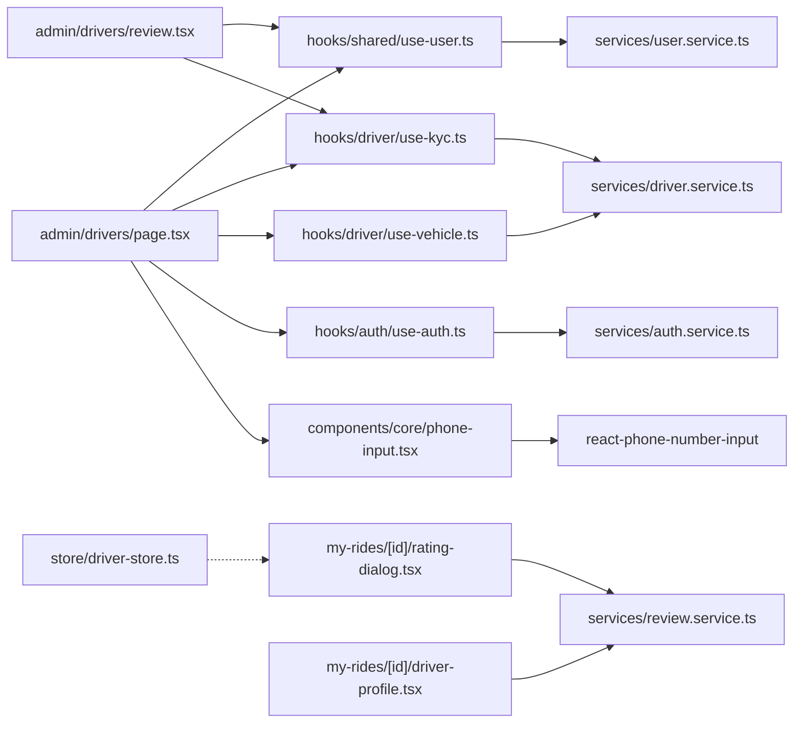

# Driver Management & Verification

<cite>
**Referenced Files in This Document**
- [driver.service.ts](file://src/services/driver.service.ts)
- [driver.types.ts](file://src/types/driver.types.ts)
- [use-kyc.ts](file://src/hooks/driver/use-kyc.ts)
- [use-vehicle.ts](file://src/hooks/driver/use-vehicle.ts)
- [page.tsx](file://src/app/admin/(view)/drivers/page.tsx)
- [review.tsx](file://src/app/admin/(view)/drivers/review.tsx)
- [use-user.ts](file://src/hooks/shared/use-user.ts)
- [user.types.ts](file://src/types/user.types.ts)
- [use-review.ts](file://src/hooks/shared/use-review.ts)
- [review.service.ts](file://src/services/review.service.ts)
- [review.types.ts](file://src/types/review.types.ts)
- [rating-dialog.tsx](file://src/app/(view)/my-rides/[id]/rating-dialog.tsx)
- [driver-profile.tsx](file://src/app/(view)/my-rides/[id]/driver-profile.tsx)
- [driver-store.ts](file://src/store/driver-store.ts)
- [phone-input.tsx](file://src/components/core/phone-input.tsx)
- [use-auth.ts](file://src/hooks/auth/use-auth.ts)
- [auth.service.ts](file://src/services/auth.service.ts)
- [auth.types.ts](file://src/types/auth.types.ts)
</cite>

## Update Summary
**Changes Made**
- Added comprehensive driver creation functionality within admin panel with full-featured dialog form
- Integrated international phone number validation using react-phone-number-input with parsePhoneNumber utility
- Implemented seamless integration with registration system via useRegister hook
- Added toast notifications for immediate user feedback during driver creation
- Enhanced filtering capabilities with improved status-based rendering
- Updated review system to only appear for non-active drivers to prevent workflow confusion
- Implemented automatic query invalidation for real-time list refresh after driver creation

## Table of Contents
1. Introduction
2. Project Structure
3. Core Components
4. Architecture Overview
5. Detailed Component Analysis
6. Dependency Analysis
7. Performance Considerations
8. Troubleshooting Guide
9. Conclusion

## Introduction
This document explains the driver management and verification workflows implemented in the application. It covers:
- Enhanced driver listing interface with comprehensive creation capabilities and international phone validation
- Profile management and vehicle information oversight
- KYC review system, document approval processes, and compliance checks
- Driver status management (activation, suspension/blocking, deactivation)
- Driver performance metrics and rating systems
- Integration with services for real-time updates and verification flows

The goal is to provide both a high-level overview and detailed code-level insights so that developers and operators can understand how drivers are onboarded, verified, monitored, and managed.

## Project Structure
The driver management features span several layers:
- Admin UI pages for listing and reviewing drivers with enhanced creation capabilities
- Client hooks for data fetching and mutations
- Services layer for API calls
- Type definitions for request/response payloads
- Local state stores for driver session and location
- Rating submission via socket events
- International phone number input component

**Diagram sources**
- [page.tsx](file://src/app/admin/(view)/drivers/page.tsx#L1-L591)
- [review.tsx](file://src/app/admin/(view)/drivers/review.tsx#L1-L307)
- [use-user.ts:1-117](file://src/hooks/shared/use-user.ts#L1-L117)
- [use-kyc.ts:1-43](file://src/hooks/driver/use-kyc.ts#L1-L43)
- [use-vehicle.ts:1-57](file://src/hooks/driver/use-vehicle.ts#L1-L57)
- [driver.service.ts:1-97](file://src/services/driver.service.ts#L1-L97)
- [review.service.ts:1-12](file://src/services/review.service.ts#L1-L12)
- [auth.service.ts:1-43](file://src/services/auth.service.ts#L1-L43)
- [driver.types.ts:1-129](file://src/types/driver.types.ts#L1-L129)
- [user.types.ts:1-49](file://src/types/user.types.ts#L1-L49)
- [review.types.ts:1-17](file://src/types/review.types.ts#L1-L17)
- [auth.types.ts:1-113](file://src/types/auth.types.ts#L1-L113)
- [rating-dialog.tsx](file://src/app/(view)/my-rides/[id]/rating-dialog.tsx#L1-L116)
- [driver-profile.tsx](file://src/app/(view)/my-rides/[id]/driver-profile.tsx#L85-L110)
- [driver-store.ts:1-37](file://src/store/driver-store.ts#L1-L37)
- [phone-input.tsx:1-234](file://src/components/core/phone-input.tsx#L1-L234)
- [use-auth.ts:15-19](file://src/hooks/auth/use-auth.ts#L15-L19)

**Section sources**
- [page.tsx](file://src/app/admin/(view)/drivers/page.tsx#L1-L591)
- [review.tsx](file://src/app/admin/(view)/drivers/review.tsx#L1-L307)
- [use-user.ts:1-117](file://src/hooks/shared/use-user.ts#L1-L117)
- [use-kyc.ts:1-43](file://src/hooks/driver/use-kyc.ts#L1-L43)
- [use-vehicle.ts:1-57](file://src/hooks/driver/use-vehicle.ts#L1-L57)
- [driver.service.ts:1-97](file://src/services/driver.service.ts#L1-L97)
- [review.service.ts:1-12](file://src/services/review.service.ts#L1-L12)
- [auth.service.ts:1-43](file://src/services/auth.service.ts#L1-L43)
- [driver.types.ts:1-129](file://src/types/driver.types.ts#L1-L129)
- [user.types.ts:1-49](file://src/types/user.types.ts#L1-L49)
- [review.types.ts:1-17](file://src/types/review.types.ts#L1-L17)
- [auth.types.ts:1-113](file://src/types/auth.types.ts#L1-L113)
- [rating-dialog.tsx](file://src/app/(view)/my-rides/[id]/rating-dialog.tsx#L1-L116)
- [driver-profile.tsx](file://src/app/(view)/my-rides/[id]/driver-profile.tsx#L85-L110)
- [driver-store.ts:1-37](file://src/store/driver-store.ts#L1-L37)
- [phone-input.tsx:1-234](file://src/components/core/phone-input.tsx#L1-L234)
- [use-auth.ts:15-19](file://src/hooks/auth/use-auth.ts#L15-L19)

## Core Components
- **Enhanced Drivers Listing Interface**
  - Provides search, pagination, filtering by status, selection, and comprehensive driver creation.
  - Features integrated phone number validation using react-phone-number-input with international support.
  - Displays key driver attributes including name, email, status, KYC status, completed rides, earnings, and join date.
  - Integrates actions to review and block/unblock drivers with status-based rendering.

- **Comprehensive Driver Creation System**
  - Modal dialog with complete form validation for name, email, phone, and password fields.
  - Real-time phone number parsing and validation using parsePhoneNumber utility from react-phone-number-input.
  - Automatic query invalidation for seamless list refresh after successful creation.
  - Integrated registration flow with proper error handling and toast notifications for immediate feedback.
  - Country code extraction and formatting for international phone numbers.

- **Driver Review System (KYC)**
  - Opens a dialog to inspect submitted documents (CNIC front/back, license, car papers).
  - Shows default vehicle details for quick verification.
  - Allows admin to activate or block a driver after review with automatic list refresh.
  - **Enhanced**: Review button only appears for non-active drivers to prevent workflow confusion.

- **Vehicle Information Oversight**
  - CRUD operations for vehicles: add single/multiple, update, delete.
  - Lists current vehicles for the logged-in provider.

- **Driver Status Management**
  - Supports active, pending, inactive, blocked statuses.
  - Admin can change user status directly from listing or review dialog.
  - Status-based action rendering shows appropriate buttons based on current status.

- **Ratings and Quality Assurance**
  - Passengers submit ratings via a star-based dialog using a socket event.
  - Driver profile displays average rating and total rating count.

- **Real-time Integration**
  - Driver store maintains online/offline state, location, and ride requests.
  - Rating submission uses socket events for immediate feedback.

**Section sources**
- [page.tsx](file://src/app/admin/(view)/drivers/page.tsx#L162-L591)
- [review.tsx](file://src/app/admin/(view)/drivers/review.tsx#L19-L307)
- [use-vehicle.ts:1-57](file://src/hooks/driver/use-vehicle.ts#L1-L57)
- [use-kyc.ts:1-43](file://src/hooks/driver/use-kyc.ts#L1-L43)
- [use-user.ts:82-92](file://src/hooks/shared/use-user.ts#L82-L92)
- [rating-dialog.tsx](file://src/app/(view)/my-rides/[id]/rating-dialog.tsx#L1-L116)
- [driver-profile.tsx](file://src/app/(view)/my-rides/[id]/driver-profile.tsx#L85-L110)
- [driver-store.ts:1-37](file://src/store/driver-store.ts#L1-L37)
- [phone-input.tsx:1-234](file://src/components/core/phone-input.tsx#L1-L234)
- [use-auth.ts:15-19](file://src/hooks/auth/use-auth.ts#L15-L19)

## Architecture Overview
The architecture follows a layered approach with enhanced driver creation capabilities:
- UI Layer: Admin pages and dialogs for driver management, reviews, and comprehensive creation forms.
- Hooks Layer: React Query hooks encapsulate queries and mutations with automatic invalidation.
- Services Layer: Thin wrappers around HTTP calls for authentication and data operations.
- Types Layer: Shared TypeScript interfaces for payloads and responses.
- State Layer: Zustand store for driver session and real-time state.
- Real-time Layer: Socket events for rating submission and live updates.
- Phone Input Layer: Custom component wrapping react-phone-number-input for international support.

**Diagram sources**
- [page.tsx:236-271](file://src/app/admin/(view)/drivers/page.tsx#L236-L271)
- [phone-input.tsx:56-87](file://src/components/core/phone-input.tsx#L56-L87)
- [use-auth.ts:15-19](file://src/hooks/auth/use-auth.ts#L15-L19)

## Detailed Component Analysis

### Enhanced Driver Listing Interface
- **Features**:
  - Search by name/email with real-time filtering
  - Filter by status (all, active, pending, blocked)
  - Pagination with configurable page size
  - Bulk selection support
  - **New**: Comprehensive driver creation via modal form with full validation
  - Inline actions: Review and Block/Unblock with status-based rendering
  - **Enhanced**: Review button only appears for non-active drivers to prevent workflow confusion

- **Data Flow**:
  - Fetches users filtered by role "provider"
  - Displays aggregated stats like completedRides and totalEarning
  - Uses query invalidation on create and status changes for automatic refresh

**Diagram sources**
- [page.tsx:236-271](file://src/app/admin/(view)/drivers/page.tsx#L236-L271)
- [page.tsx:299-365](file://src/app/admin/(view)/drivers/page.tsx#L299-L365)
- [use-user.ts:67-92](file://src/hooks/shared/use-user.ts#L67-L92)

**Section sources**
- [page.tsx](file://src/app/admin/(view)/drivers/page.tsx#L162-L591)
- [use-user.ts:67-92](file://src/hooks/shared/use-user.ts#L67-L92)

### Comprehensive Driver Creation System
- **Form Validation**:
  - Required field validation for name, email, and phone
  - Real-time phone number parsing using parsePhoneNumber utility
  - Country code extraction and formatting
  - Password field for initial driver setup

- **Phone Number Integration**:
  - International phone number support via react-phone-number-input
  - Country flag display and selection
  - Automatic country detection based on browser locale
  - Phone number validation and formatting

- **Registration Flow**:
  - Integrated useRegister hook for backend communication
  - Success/error handling with toast notifications
  - Automatic form reset after successful creation
  - Query invalidation for seamless list refresh

**Diagram sources**
- [page.tsx:236-271](file://src/app/admin/(view)/drivers/page.tsx#L236-L271)
- [phone-input.tsx:56-87](file://src/components/core/phone-input.tsx#L56-L87)
- [use-auth.ts:15-19](file://src/hooks/auth/use-auth.ts#L15-L19)

**Section sources**
- [page.tsx:236-271](file://src/app/admin/(view)/drivers/page.tsx#L236-L271)
- [phone-input.tsx:1-234](file://src/components/core/phone-input.tsx#L1-L234)
- [use-auth.ts:15-19](file://src/hooks/auth/use-auth.ts#L15-L19)

### Driver Review System (KYC)
- Purpose:
  - Allow admins to verify identity and vehicle documents before activating a driver.
- Workflow:
  - Open review dialog for a selected driver
  - View CNIC front/back, driving license, and car papers
  - Inspect default vehicle info (name, number, year, seats)
  - Activate or block driver based on review outcome with automatic list refresh
- **Enhanced**: Review button visibility controlled by driver status to prevent workflow confusion

**Diagram sources**
- [review.tsx:70-92](file://src/app/admin/(view)/drivers/review.tsx#L70-L92)
- [use-user.ts:74-92](file://src/hooks/shared/use-user.ts#L74-L92)

**Section sources**
- [review.tsx](file://src/app/admin/(view)/drivers/review.tsx#L19-L307)
- [use-user.ts:74-92](file://src/hooks/shared/use-user.ts#L74-L92)

### Vehicle Information Oversight
- Capabilities:
  - List my vehicles
  - Add single or multiple vehicles
  - Update existing vehicle details
  - Delete vehicles
- Integration:
  - Mutations invalidate cached lists and related user profiles
  - Payloads conform to typed interfaces for validation

**Diagram sources**
- [driver.types.ts:1-27](file://src/types/driver.types.ts#L1-L27)
- [driver.service.ts:18-33](file://src/services/driver.service.ts#L18-L33)
- [use-vehicle.ts:1-57](file://src/hooks/driver/use-vehicle.ts#L1-L57)

**Section sources**
- [use-vehicle.ts:1-57](file://src/hooks/driver/use-vehicle.ts#L1-L57)
- [driver.service.ts:18-33](file://src/services/driver.service.ts#L18-L33)
- [driver.types.ts:1-27](file://src/types/driver.types.ts#L1-L27)

### Driver Status Management
- Supported statuses:
  - active, pending, inactive, blocked
- Operations:
  - Activate driver after successful KYC review
  - Block/unblock driver from listing or review dialog
  - Deactivate/inactivate via status mutation
  - **Enhanced**: Status-based action rendering shows appropriate buttons based on current status
  - **Enhanced**: Review functionality restricted to non-active drivers

**Diagram sources**
- [user.types.ts:37-39](file://src/types/user.types.ts#L37-L39)
- [use-user.ts:82-92](file://src/hooks/shared/use-user.ts#L82-L92)
- [page.tsx:538-544](file://src/app/admin/(view)/drivers/page.tsx#L538-L544)
- [review.tsx:70-92](file://src/app/admin/(view)/drivers/review.tsx#L70-L92)

**Section sources**
- [user.types.ts:37-39](file://src/types/user.types.ts#L37-L39)
- [use-user.ts:82-92](file://src/hooks/shared/use-user.ts#L82-L92)
- [page.tsx:538-544](file://src/app/admin/(view)/drivers/page.tsx#L538-L544)
- [review.tsx:70-92](file://src/app/admin/(view)/drivers/review.tsx#L70-L92)

### Ratings and Quality Assurance
- Submission:
  - Star rating (1–5) with optional feedback
  - Submitted via socket event "ride:submit-rating"
- Display:
  - Average rating and total rating count shown in driver profile
- Storage:
  - Reviews persisted via review service endpoints

**Diagram sources**
- [rating-dialog.tsx](file://src/app/(view)/my-rides/[id]/rating-dialog.tsx#L1-L116)
- [review.service.ts:1-12](file://src/services/review.service.ts#L1-L12)
- [use-review.ts:1-24](file://src/hooks/shared/use-review.ts#L1-L24)
- [review.types.ts:1-17](file://src/types/review.types.ts#L1-L17)
- [driver-profile.tsx](file://src/app/(view)/my-rides/[id]/driver-profile.tsx#L85-L110)

**Section sources**
- [rating-dialog.tsx](file://src/app/(view)/my-rides/[id]/rating-dialog.tsx#L1-L116)
- [review.service.ts:1-12](file://src/services/review.service.ts#L1-L12)
- [use-review.ts:1-24](file://src/hooks/shared/use-review.ts#L1-L24)
- [review.types.ts:1-17](file://src/types/review.types.ts#L1-L17)
- [driver-profile.tsx](file://src/app/(view)/my-rides/[id]/driver-profile.tsx#L85-L110)

### Real-time Integration and Driver Session
- Driver Store:
  - Tracks location, online status, and incoming ride requests
  - Persists requests across sessions; re-acquires location on load
- Usage:
  - Driver app updates location and toggles online/offline
  - Incoming requests are added/removed from local state

**Diagram sources**
- [driver-store.ts:1-37](file://src/store/driver-store.ts#L1-L37)

**Section sources**
- [driver-store.ts:1-37](file://src/store/driver-store.ts#L1-L37)

## Dependency Analysis
Key dependencies and relationships with enhanced driver creation:
- Admin UI depends on shared user hooks, driver-specific hooks, and auth hooks
- Phone input component provides international phone number support
- Hooks depend on services for HTTP calls with automatic query invalidation
- Services rely on typed payloads and responses
- Rating flow integrates socket events and review persistence
- Driver store provides local state for driver experience

**Diagram sources**
- [page.tsx](file://src/app/admin/(view)/drivers/page.tsx#L1-L591)
- [review.tsx](file://src/app/admin/(view)/drivers/review.tsx#L1-L307)
- [use-user.ts:1-117](file://src/hooks/shared/use-user.ts#L1-L117)
- [use-kyc.ts:1-43](file://src/hooks/driver/use-kyc.ts#L1-L43)
- [use-vehicle.ts:1-57](file://src/hooks/driver/use-vehicle.ts#L1-L57)
- [driver.service.ts:1-97](file://src/services/driver.service.ts#L1-L97)
- [review.service.ts:1-12](file://src/services/review.service.ts#L1-L12)
- [auth.service.ts:1-43](file://src/services/auth.service.ts#L1-L43)
- [rating-dialog.tsx](file://src/app/(view)/my-rides/[id]/rating-dialog.tsx#L1-L116)
- [driver-profile.tsx](file://src/app/(view)/my-rides/[id]/driver-profile.tsx#L85-L110)
- [driver-store.ts:1-37](file://src/store/driver-store.ts#L1-L37)
- [phone-input.tsx:1-234](file://src/components/core/phone-input.tsx#L1-L234)
- [use-auth.ts:15-19](file://src/hooks/auth/use-auth.ts#L15-L19)

**Section sources**
- [page.tsx](file://src/app/admin/(view)/drivers/page.tsx#L1-L591)
- [review.tsx](file://src/app/admin/(view)/drivers/review.tsx#L1-L307)
- [use-user.ts:1-117](file://src/hooks/shared/use-user.ts#L1-L117)
- [use-kyc.ts:1-43](file://src/hooks/driver/use-kyc.ts#L1-L43)
- [use-vehicle.ts:1-57](file://src/hooks/driver/use-vehicle.ts#L1-L57)
- [driver.service.ts:1-97](file://src/services/driver.service.ts#L1-L97)
- [review.service.ts:1-12](file://src/services/review.service.ts#L1-L12)
- [auth.service.ts:1-43](file://src/services/auth.service.ts#L1-L43)
- [rating-dialog.tsx](file://src/app/(view)/my-rides/[id]/rating-dialog.tsx#L1-L116)
- [driver-profile.tsx](file://src/app/(view)/my-rides/[id]/driver-profile.tsx#L85-L110)
- [driver-store.ts:1-37](file://src/store/driver-store.ts#L1-L37)
- [phone-input.tsx:1-234](file://src/components/core/phone-input.tsx#L1-L234)
- [use-auth.ts:15-19](file://src/hooks/auth/use-auth.ts#L15-L19)

## Performance Considerations
- Use query keys to scope invalidations precisely and avoid unnecessary refetches.
- Prefer server-side pagination and filtering for large driver lists.
- Debounce search inputs to reduce network churn.
- Cache vehicle lists and KYC details aggressively; invalidate only on mutations.
- For real-time updates, batch socket events where possible and minimize UI re-renders.
- **Enhanced**: Phone number parsing is performed client-side to reduce server load.
- **Enhanced**: Query invalidation is optimized to refresh only affected components.
- **Enhanced**: Toast notifications provide immediate feedback without blocking UI.

## Troubleshooting Guide
Common issues and resolutions:
- Driver not appearing after activation
  - Ensure status mutation succeeded and query invalidation ran.
  - Check that the filter does not exclude the newly activated driver.
- Documents missing in review dialog
  - Confirm that driver detail includes provider fields (cnicFront, cnicBack, licenseFront, carPapers).
  - Validate image URLs and permissions.
- Rating submission fails
  - Verify socket connection and event name "ride:submit-rating".
  - Check backend response and ensure review endpoint accepts payload.
- Vehicle updates not reflected
  - Confirm mutation triggers invalidation of vehicle list and user profile cache.
  - Validate payload fields match typed interfaces.
- **New**: Driver creation fails with phone validation errors
  - Ensure react-phone-number-input is properly configured.
  - Check parsePhoneNumber utility returns valid results.
  - Verify country code extraction logic handles edge cases.
- **New**: Created driver doesn't appear in list
  - Confirm query invalidation is triggered after successful registration.
  - Check that the new driver matches current filters (role: "provider").
  - Verify the driver's initial status allows it to be displayed.
- **New**: Review button not visible for pending drivers
  - Ensure driver status is not "active" - review button only appears for non-active drivers.
  - Check that the driver has submitted KYC documents.
- **New**: Toast notifications not showing
  - Verify sonner toast library is properly initialized.
  - Check that toast.error and toast.success methods are called correctly.

**Section sources**
- [use-user.ts:82-92](file://src/hooks/shared/use-user.ts#L82-L92)
- [review.tsx](file://src/app/admin/(view)/drivers/review.tsx#L19-L307)
- [rating-dialog.tsx](file://src/app/(view)/my-rides/[id]/rating-dialog.tsx#L1-L116)
- [use-vehicle.ts:1-57](file://src/hooks/driver/use-vehicle.ts#L1-L57)
- [page.tsx:236-271](file://src/app/admin/(view)/drivers/page.tsx#L236-L271)

## Conclusion
The driver management and verification system combines robust admin tools, clear KYC workflows, comprehensive vehicle oversight, and quality assurance through ratings. The recent enhancements include a comprehensive driver creation dialog with advanced phone number validation, integrated registration flow, toast notifications for immediate feedback, and improved filtering capabilities. The review system has been enhanced to only appear for non-active drivers, preventing workflow confusion. The layered architecture ensures maintainability and scalability, while real-time integration enhances operational responsiveness. By following the documented flows and leveraging the provided hooks and services, teams can extend and adapt these capabilities effectively.