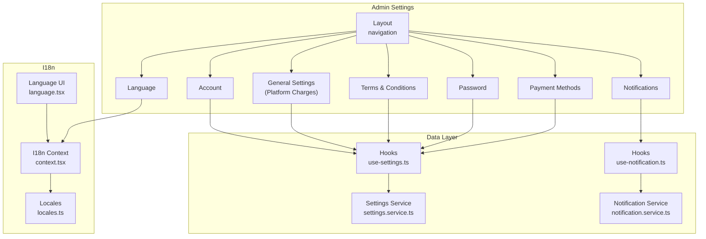
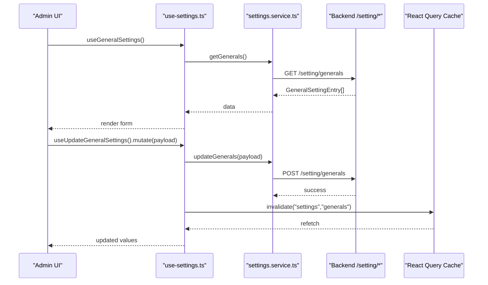
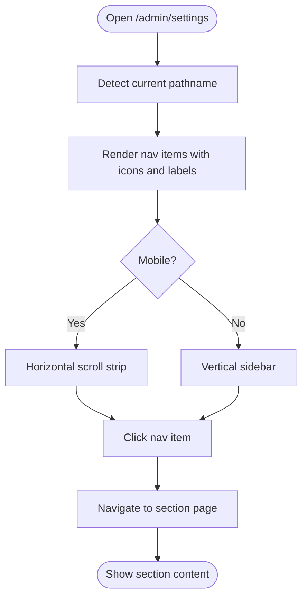
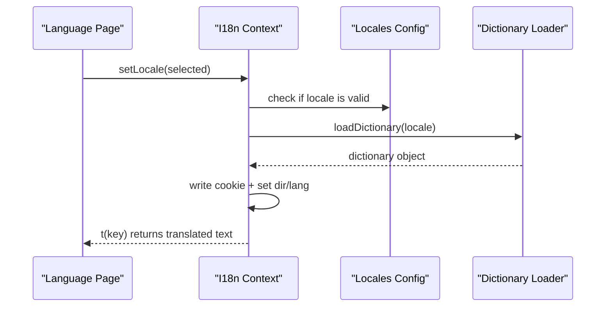
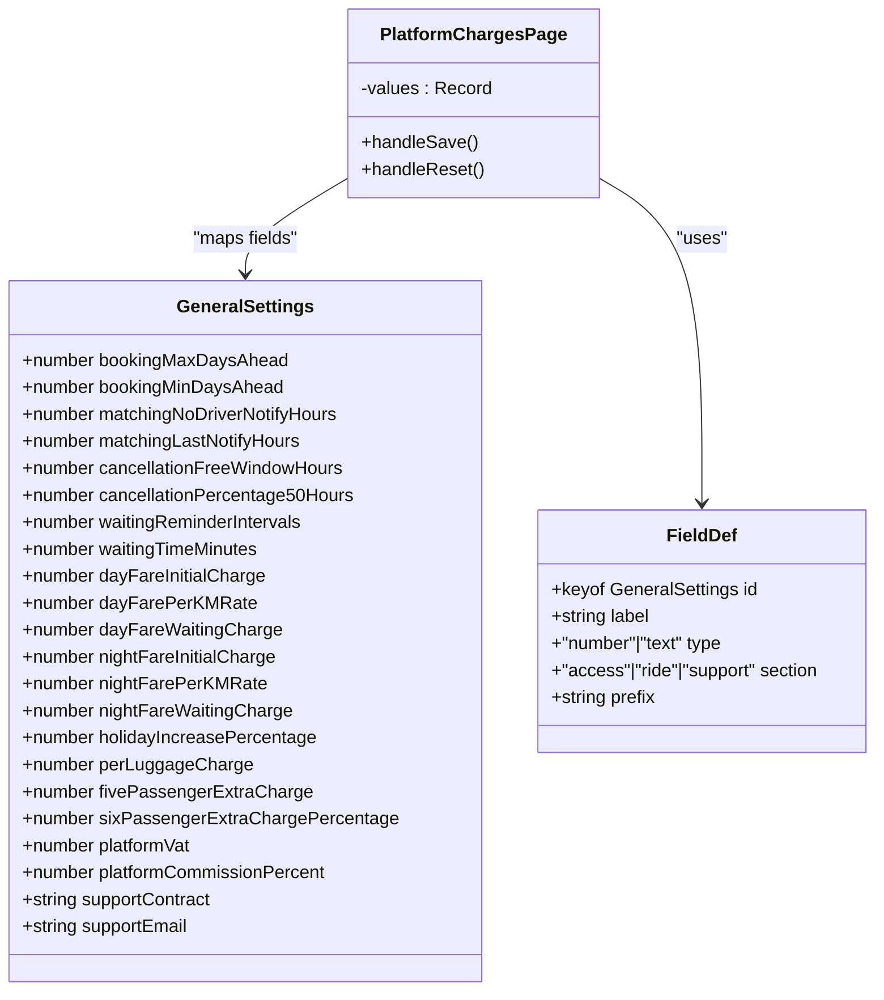
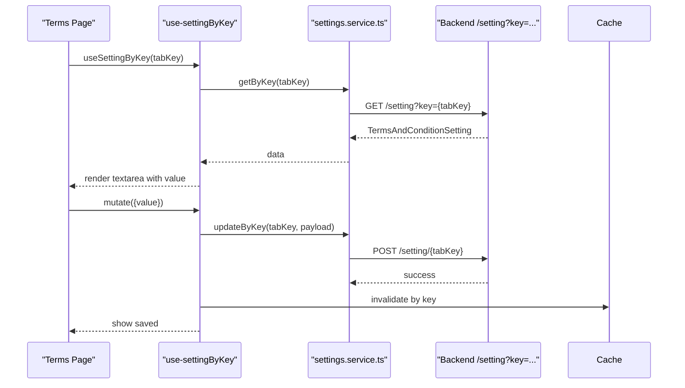
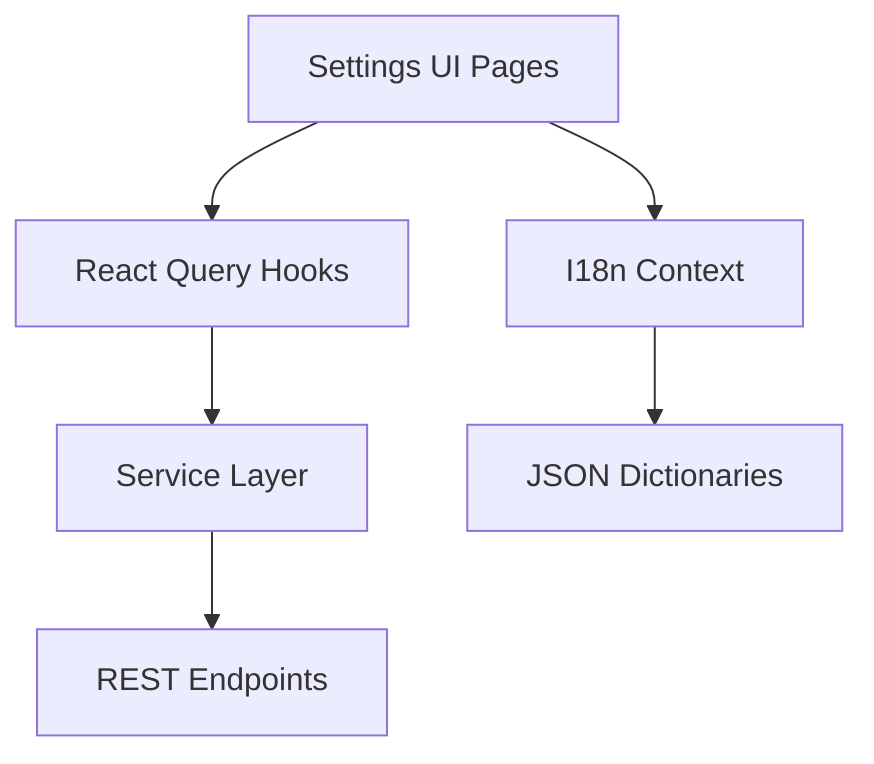
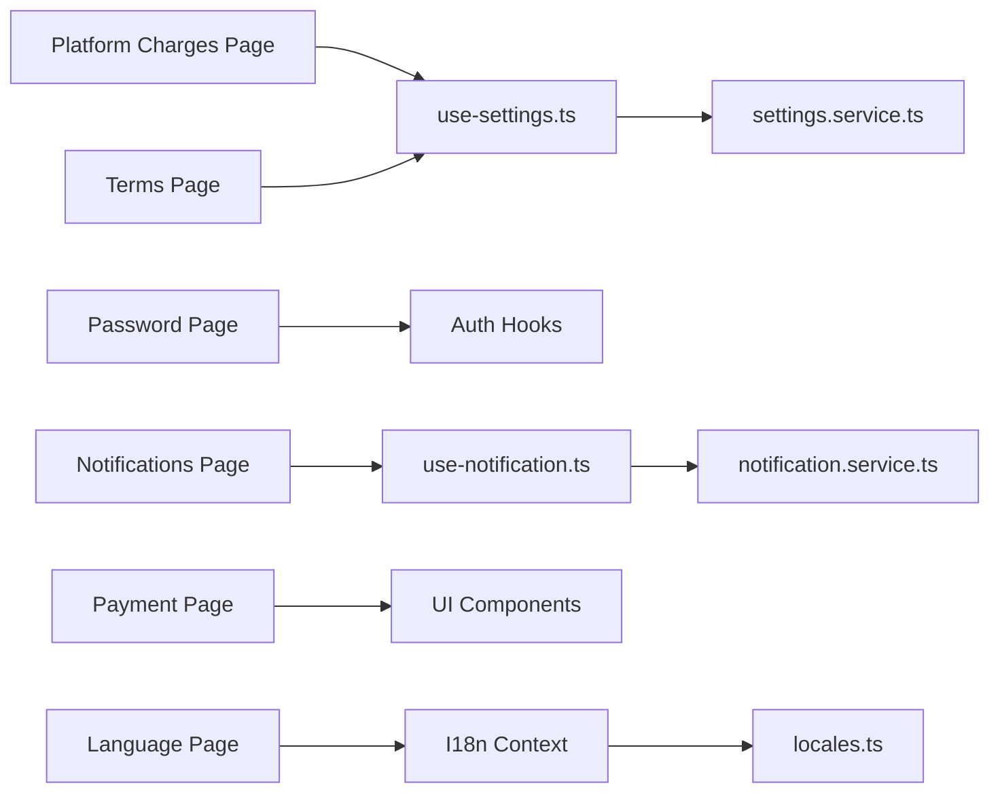

# Platform Configuration & Settings

<cite>
**Referenced Files in This Document**
- [layout.tsx](file://src/app/admin/(view)/settings/layout.tsx)
- [page.tsx](file://src/app/admin/(view)/settings/page.tsx)
- [language-page.tsx](file://src/app/admin/(view)/settings/language/page.tsx)
- [password-page.tsx](file://src/app/admin/(view)/settings/password/page.tsx)
- [platform-charges-page.tsx](file://src/app/admin/(view)/settings/platform-charges/page.tsx)
- [terms-page.tsx](file://src/app/admin/(view)/settings/terms/page.tsx)
- [notifications-page.tsx](file://src/app/admin/(view)/settings/notifications/page.tsx)
- [payment-page.tsx](file://src/app/admin/(view)/settings/payment/page.tsx)
- [use-settings.ts](file://src/hooks/shared/use-settings.ts)
- [settings.service.ts](file://src/services/settings.service.ts)
- [settings.types.ts](file://src/types/settings.types.ts)
- [context.tsx](file://src/i18n/context.tsx)
- [locales.ts](file://src/i18n/locales.ts)
- [index.ts](file://src/i18n/index.ts)
- [use-t.ts](file://src/i18n/use-t.ts)
- [language-component.tsx](file://src/components/core/privacy-pages/language.tsx)
- [use-notification.ts](file://src/hooks/shared/use-notification.ts)
- [notification.service.ts](file://src/services/notification.service.ts)
</cite>

## Table of Contents
1. Introduction
2. Project Structure
3. Core Components
4. Architecture Overview
5. Detailed Component Analysis
6. Dependency Analysis
7. Performance Considerations
8. Troubleshooting Guide
9. Conclusion

## Introduction
This document explains the platform configuration and settings management system, focusing on:
- Settings layout structure and navigation between sections
- Language settings for internationalization (i18n)
- Notification preferences for system alerts
- Password security configurations
- Payment settings including platform charges, commission rates, and payment gateway toggles
- Terms and conditions management and policy enforcement
- Settings persistence mechanism and real-time configuration updates across the platform

The implementation is a Next.js client-side admin interface with React Query-based data fetching and caching, a service layer for API calls, and an i18n context that persists locale via cookies.

## Project Structure
The settings area is organized under the admin route group with a shared layout providing navigation and a content area for each section. Key files include:
- Layout and navigation for settings pages
- Individual setting pages (account, language, password, general settings, terms, notifications, payment)
- Shared hooks and services for settings and notifications
- Internationalization provider and utilities

**Diagram sources**
- [layout.tsx](file://src/app/admin/(view)/settings/layout.tsx#L1-L150)
- [page.tsx](file://src/app/admin/(view)/settings/page.tsx#L1-L92)
- [platform-charges-page.tsx](file://src/app/admin/(view)/settings/platform-charges/page.tsx#L1-L335)
- [terms-page.tsx](file://src/app/admin/(view)/settings/terms/page.tsx#L1-L109)
- [password-page.tsx](file://src/app/admin/(view)/settings/password/page.tsx#L1-L116)
- [notifications-page.tsx](file://src/app/admin/(view)/settings/notifications/page.tsx#L1-L93)
- [payment-page.tsx](file://src/app/admin/(view)/settings/payment/page.tsx#L1-L53)
- [language-page.tsx](file://src/app/admin/(view)/settings/language/page.tsx#L1-L6)
- [use-settings.ts:1-41](file://src/hooks/shared/use-settings.ts#L1-L41)
- [settings.service.ts:1-32](file://src/services/settings.service.ts#L1-L32)
- [use-notification.ts:1-40](file://src/hooks/shared/use-notification.ts#L1-L40)
- [notification.service.ts:1-18](file://src/services/notification.service.ts#L1-L18)
- [context.tsx:1-101](file://src/i18n/context.tsx#L1-L101)
- [locales.ts:1-34](file://src/i18n/locales.ts#L1-L34)
- [language-component.tsx:1-98](file://src/components/core/privacy-pages/language.tsx#L1-L98)

**Section sources**
- [layout.tsx](file://src/app/admin/(view)/settings/layout.tsx#L1-L150)
- [page.tsx](file://src/app/admin/(view)/settings/page.tsx#L1-L92)

## Core Components
- Settings layout and navigation: Provides a responsive sidebar/tab navigation for all settings sections.
- General settings (platform charges): Centralized form to configure ride rules, fares, surcharges, VAT, commission, and support contacts.
- Terms and conditions editor: Tabbed editor for user and driver policies with search and save operations.
- Password change: Secure form to update admin password with validation and feedback.
- Notifications preferences: Toggleable notification categories for system alerts.
- Payment methods: Enable/disable payment gateways such as Stripe, Card, Google Pay.
- Language selection: Choose and persist locale with RTL support and dictionary loading.

**Section sources**
- [layout.tsx](file://src/app/admin/(view)/settings/layout.tsx#L1-L150)
- [platform-charges-page.tsx](file://src/app/admin/(view)/settings/platform-charges/page.tsx#L1-L335)
- [terms-page.tsx](file://src/app/admin/(view)/settings/terms/page.tsx#L1-L109)
- [password-page.tsx](file://src/app/admin/(view)/settings/password/page.tsx#L1-L116)
- [notifications-page.tsx](file://src/app/admin/(view)/settings/notifications/page.tsx#L1-L93)
- [payment-page.tsx](file://src/app/admin/(view)/settings/payment/page.tsx#L1-L53)
- [language-component.tsx:1-98](file://src/components/core/privacy-pages/language.tsx#L1-L98)

## Architecture Overview
The settings architecture follows a layered approach:
- UI Pages: Each settings page renders forms or controls and uses hooks for data operations.
- Hooks: React Query hooks encapsulate queries/mutations and cache invalidation.
- Services: Thin HTTP wrappers around API endpoints.
- Types: Strongly typed request/response models.
- I18n: Contextual language switching with cookie persistence and dynamic dictionary loading.

**Diagram sources**
- [use-settings.ts:1-41](file://src/hooks/shared/use-settings.ts#L1-L41)
- [settings.service.ts:1-32](file://src/services/settings.service.ts#L1-L32)
- [platform-charges-page.tsx](file://src/app/admin/(view)/settings/platform-charges/page.tsx#L1-L335)

## Detailed Component Analysis

### Settings Layout and Navigation
- Responsive navigation: Horizontal scroll strip on mobile; vertical sidebar on desktop.
- Active state detection based on pathname matching.
- Sections exposed: Account, Languages, Password, General settings, Terms.
- Placeholder entries exist for Payments and Notifications but are not currently active in navigation.

**Diagram sources**
- [layout.tsx](file://src/app/admin/(view)/settings/layout.tsx#L1-L150)

**Section sources**
- [layout.tsx](file://src/app/admin/(view)/settings/layout.tsx#L1-L150)

### Account Settings
- Displays and edits admin profile name fields.
- Uses user hooks to fetch and update profile information.
- Shows email and phone as read-only.

**Section sources**
- [page.tsx](file://src/app/admin/(view)/settings/page.tsx#L1-L92)

### Language Settings (Internationalization)
- Lists available locales from the i18n configuration.
- Supports searching and selecting a language.
- Persists selected locale via cookie and applies RTL direction when needed.
- Dynamically loads dictionaries per locale.

**Diagram sources**
- [language-component.tsx:1-98](file://src/components/core/privacy-pages/language.tsx#L1-L98)
- [context.tsx:1-101](file://src/i18n/context.tsx#L1-L101)
- [locales.ts:1-34](file://src/i18n/locales.ts#L1-L34)
- [index.ts:1-5](file://src/i18n/index.ts#L1-L5)
- [use-t.ts:1-6](file://src/i18n/use-t.ts#L1-L6)

**Section sources**
- [language-page.tsx](file://src/app/admin/(view)/settings/language/page.tsx#L1-L6)
- [language-component.tsx:1-98](file://src/components/core/privacy-pages/language.tsx#L1-L98)
- [context.tsx:1-101](file://src/i18n/context.tsx#L1-L101)
- [locales.ts:1-34](file://src/i18n/locales.ts#L1-L34)
- [index.ts:1-5](file://src/i18n/index.ts#L1-L5)
- [use-t.ts:1-6](file://src/i18n/use-t.ts#L1-L6)

### Password Security Configuration
- Requires current password, new password, and confirmation.
- Validates match before submission.
- Uses auth hook to perform password change mutation.
- Provides immediate toast feedback on success/failure.

**Section sources**
- [password-page.tsx](file://src/app/admin/(view)/settings/password/page.tsx#L1-L116)

### General Settings (Platform Charges, Commission, Support)
- Centralized form grouped into Access & Validation, Ride & Charge, and Support sections.
- Fields map to strongly typed keys and types.
- Fetches settings via query and saves partial updates via mutation.
- Resets form to server values and provides save/reset actions.

**Diagram sources**
- [settings.types.ts:1-48](file://src/types/settings.types.ts#L1-L48)
- [platform-charges-page.tsx](file://src/app/admin/(view)/settings/platform-charges/page.tsx#L1-L335)

**Section sources**
- [platform-charges-page.tsx](file://src/app/admin/(view)/settings/platform-charges/page.tsx#L1-L335)
- [settings.types.ts:1-48](file://src/types/settings.types.ts#L1-L48)

### Terms and Conditions Management
- Tabbed interface for Users and Drivers policies.
- Loads content by key and allows editing and saving.
- Includes a simple search input for content review.

**Diagram sources**
- [terms-page.tsx](file://src/app/admin/(view)/settings/terms/page.tsx#L1-L109)
- [use-settings.ts:1-41](file://src/hooks/shared/use-settings.ts#L1-L41)
- [settings.service.ts:1-32](file://src/services/settings.service.ts#L1-L32)
- [settings.types.ts:1-48](file://src/types/settings.types.ts#L1-L48)

**Section sources**
- [terms-page.tsx](file://src/app/admin/(view)/settings/terms/page.tsx#L1-L109)

### Notification Preferences
- Presents notification categories with descriptive labels and descriptions.
- Each category has a toggle switch for enabling/disabling.
- Currently UI-only; no persistence implemented in this page.

**Section sources**
- [notifications-page.tsx](file://src/app/admin/(view)/settings/notifications/page.tsx#L1-L93)

### Payment Settings
- Lists supported payment methods with default enabled states.
- Toggle switches enable/disable methods locally.
- Save button present; persistence not wired to backend in this page.

**Section sources**
- [payment-page.tsx](file://src/app/admin/(view)/settings/payment/page.tsx#L1-L53)

### Conceptual Overview
The settings system separates concerns:
- UI components focus on presentation and user interactions.
- Hooks manage data fetching, mutations, and cache invalidation.
- Services abstract HTTP calls.
- Types enforce contracts between layers.
- I18n manages language switching and dictionary loading.

[No sources needed since this diagram shows conceptual workflow, not actual code structure]

## Dependency Analysis
- Settings pages depend on shared hooks for data access.
- Hooks depend on services for HTTP requests.
- Services rely on a common API wrapper.
- I18n depends on locale configuration and dictionary imports.

**Diagram sources**
- [platform-charges-page.tsx](file://src/app/admin/(view)/settings/platform-charges/page.tsx#L1-L335)
- [terms-page.tsx](file://src/app/admin/(view)/settings/terms/page.tsx#L1-L109)
- [password-page.tsx](file://src/app/admin/(view)/settings/password/page.tsx#L1-L116)
- [notifications-page.tsx](file://src/app/admin/(view)/settings/notifications/page.tsx#L1-L93)
- [payment-page.tsx](file://src/app/admin/(view)/settings/payment/page.tsx#L1-L53)
- [language-page.tsx](file://src/app/admin/(view)/settings/language/page.tsx#L1-L6)
- [use-settings.ts:1-41](file://src/hooks/shared/use-settings.ts#L1-L41)
- [settings.service.ts:1-32](file://src/services/settings.service.ts#L1-L32)
- [use-notification.ts:1-40](file://src/hooks/shared/use-notification.ts#L1-L40)
- [notification.service.ts:1-18](file://src/services/notification.service.ts#L1-L18)
- [context.tsx:1-101](file://src/i18n/context.tsx#L1-L101)
- [locales.ts:1-34](file://src/i18n/locales.ts#L1-L34)

**Section sources**
- [use-settings.ts:1-41](file://src/hooks/shared/use-settings.ts#L1-L41)
- [settings.service.ts:1-32](file://src/services/settings.service.ts#L1-L32)
- [use-notification.ts:1-40](file://src/hooks/shared/use-notification.ts#L1-L40)
- [notification.service.ts:1-18](file://src/services/notification.service.ts#L1-L18)
- [context.tsx:1-101](file://src/i18n/context.tsx#L1-L101)
- [locales.ts:1-34](file://src/i18n/locales.ts#L1-L34)

## Performance Considerations
- Use React Query caching and invalidation to minimize redundant network requests.
- Defer heavy dictionary loading until locale changes.
- Avoid unnecessary re-renders by memoizing callbacks and stable query keys.
- For large settings forms, consider debounced saves or field-level updates to reduce payload size.

[No sources needed since this section provides general guidance]

## Troubleshooting Guide
- Settings not updating: Ensure mutation triggers cache invalidation and that the correct query key is used.
- Language not changing: Verify cookie is written and dictionary import resolves; fallback to English is handled.
- Terms save fails: Check API response and ensure the key matches expected enum values.
- Password change errors: Confirm current password and match validation; inspect toast messages for error details.

**Section sources**
- [use-settings.ts:1-41](file://src/hooks/shared/use-settings.ts#L1-L41)
- [settings.service.ts:1-32](file://src/services/settings.service.ts#L1-L32)
- [context.tsx:1-101](file://src/i18n/context.tsx#L1-L101)
- [password-page.tsx](file://src/app/admin/(view)/settings/password/page.tsx#L1-L116)

## Conclusion
The platform configuration and settings system provides a modular, type-safe, and internationalized admin experience. It centralizes critical operational parameters, supports secure password management, offers flexible notification and payment toggles, and ensures persistent language preferences. The separation of UI, hooks, services, and types promotes maintainability and scalability.

[No sources needed since this section summarizes without analyzing specific files]