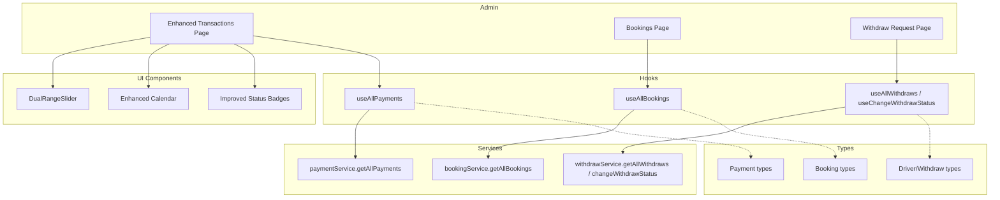
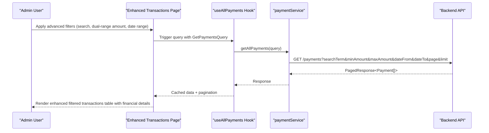
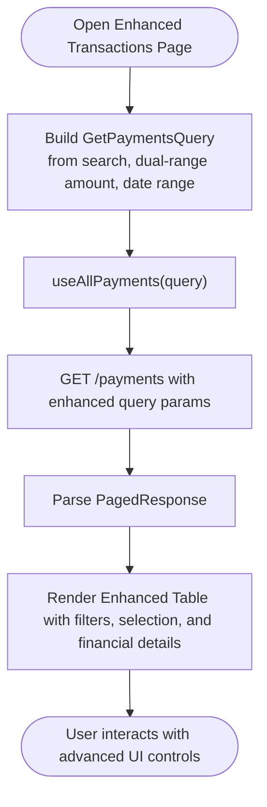
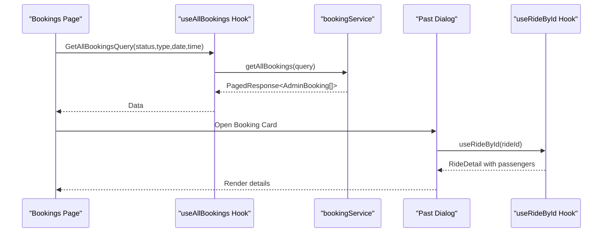
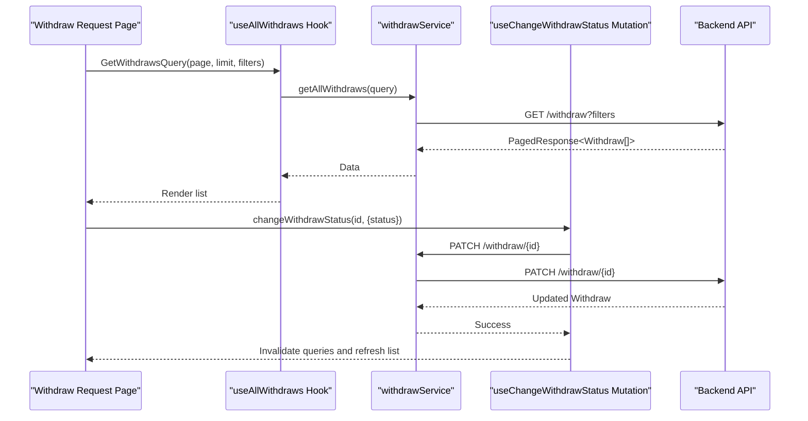
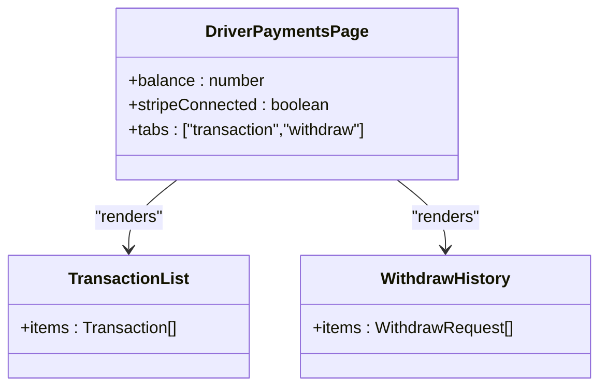
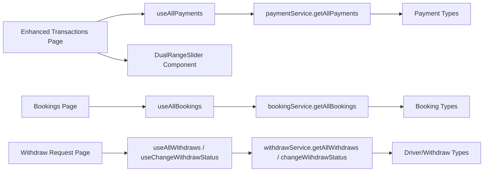

# Transaction Monitoring & Financial Oversight

<cite>
**Referenced Files in This Document**
- [src/app/admin/(view)/transactions/page.tsx](file://src/app/admin/(view)/transactions/page.tsx)
- [src/hooks/booking/use-payment.ts](file://src/hooks/booking/use-payment.ts)
- [src/services/payment.service.ts](file://src/services/payment.service.ts)
- [src/types/payment.types.ts](file://src/types/payment.types.ts)
- [src/components/spectrumui/dual-range-slider-dependecies.tsx](file://src/components/spectrumui/dual-range-slider-dependecies.tsx)
- [src/app/admin/(view)/bookings/page.tsx](file://src/app/admin/(view)/bookings/page.tsx)
- [src/app/admin/(view)/_components/past.tsx](file://src/app/admin/(view)/_components/past.tsx)
- [src/hooks/booking/use-booking.ts](file://src/hooks/booking/use-booking.ts)
- [src/types/booking.types.ts](file://src/types/booking.types.ts)
- [src/app/admin/(view)/withdraw-request/page.tsx](file://src/app/admin/(view)/withdraw-request/page.tsx)
- [src/hooks/driver/use-withdraw.ts](file://src/hooks/driver/use-withdraw.ts)
- [src/services/driver.service.ts](file://src/services/driver.service.ts)
- [src/types/driver.types.ts](file://src/types/driver.types.ts)
- [src/app/driver/(view)/my-payments/page.tsx](file://src/app/driver/(view)/my-payments/page.tsx)
- [src/app/driver/(view)/my-payments/_components/transaction-list.tsx](file://src/app/driver/(view)/my-payments/_components/transaction-list.tsx)
- [src/app/driver/(view)/my-payments/_components/withdraw-history.tsx](file://src/app/driver/(view)/my-payments/_components/withdraw-history.tsx)
</cite>

## Update Summary
**Changes Made**
- Enhanced transactions page with improved UI components including dual-range sliders for amount filtering
- Added better date range filtering with calendar integration and visual indicators
- Improved table rendering with enhanced status badges and payment method display
- Added detailed platform commissions and driver earnings display with proper formatting
- Implemented more robust data handling with better error states and loading indicators
- Enhanced user experience with selection capabilities and improved pagination controls

## Table of Contents
1. Introduction
2. Project Structure
3. Core Components
4. Architecture Overview
5. Detailed Component Analysis
6. Dependency Analysis
7. Performance Considerations
8. Troubleshooting Guide
9. Conclusion

## Introduction
This document explains the transaction monitoring and financial oversight capabilities implemented in the application. It covers:
- **Enhanced Admin Transactions Page** with sophisticated filtering including dual-range amount sliders, advanced date range selection, search functionality, and improved table rendering with detailed financial breakdowns.
- Bookings management for ride oversight and dispute resolution, including upcoming/past views and detailed passenger breakdowns.
- Withdrawal request processing workflow for driver payouts, including approval/rejection flows and Stripe integration points.
- Financial reporting elements such as commission display, provider earnings, refund management, and payment status tracking.
- Integration with payment services and data synchronization via React Query hooks and typed service methods.

## Project Structure
The financial oversight features are primarily located under admin pages and shared hooks/services:
- **Enhanced Admin Transactions**: Lists payments with advanced filters (dual-range amount slider, date range picker), improved table rendering, and comprehensive financial details.
- Admin Bookings: Lists and inspects bookings with detailed ride and passenger information.
- Admin Withdraw Requests: Reviews and processes driver withdrawal requests.
- Driver My Payments: Displays driver-side transaction and withdrawal history (mocked UI).
- Shared Services and Hooks: Provide API calls and caching for payments, refunds, cards, bookings, and withdrawals.

**Diagram sources**
- [src/app/admin/(view)/transactions/page.tsx](file://src/app/admin/(view)/transactions/page.tsx)
- [src/components/spectrumui/dual-range-slider-dependecies.tsx](file://src/components/spectrumui/dual-range-slider-dependecies.tsx)
- [src/hooks/booking/use-payment.ts](file://src/hooks/booking/use-payment.ts)
- [src/services/payment.service.ts](file://src/services/payment.service.ts)
- [src/app/admin/(view)/bookings/page.tsx](file://src/app/admin/(view)/bookings/page.tsx)
- [src/hooks/booking/use-booking.ts](file://src/hooks/booking/use-booking.ts)
- [src/app/admin/(view)/withdraw-request/page.tsx](file://src/app/admin/(view)/withdraw-request/page.tsx)
- [src/hooks/driver/use-withdraw.ts](file://src/hooks/driver/use-withdraw.ts)
- [src/services/driver.service.ts](file://src/services/driver.service.ts)
- [src/types/payment.types.ts](file://src/types/payment.types.ts)
- [src/types/booking.types.ts](file://src/types/booking.types.ts)
- [src/types/driver.types.ts](file://src/types/driver.types.ts)

**Section sources**
- [src/app/admin/(view)/transactions/page.tsx](file://src/app/admin/(view)/transactions/page.tsx)
- [src/app/admin/(view)/bookings/page.tsx](file://src/app/admin/(view)/bookings/page.tsx)
- [src/app/admin/(view)/withdraw-request/page.tsx](file://src/app/admin/(view)/withdraw-request/page.tsx)
- [src/hooks/booking/use-payment.ts](file://src/hooks/booking/use-payment.ts)
- [src/hooks/booking/use-booking.ts](file://src/hooks/booking/use-booking.ts)
- [src/hooks/driver/use-withdraw.ts](file://src/hooks/driver/use-withdraw.ts)
- [src/services/payment.service.ts](file://src/services/payment.service.ts)
- [src/services/driver.service.ts](file://src/services/driver.service.ts)
- [src/types/payment.types.ts](file://src/types/payment.types.ts)
- [src/types/booking.types.ts](file://src/types/booking.types.ts)
- [src/types/driver.types.ts](file://src/types/driver.types.ts)

## Core Components
- **Enhanced Admin Transactions Page**
  - **Advanced Filtering System**: Dual-range amount slider for precise amount filtering, integrated calendar for date range selection, and text search functionality.
  - **Improved Table Rendering**: Enhanced table with avatar displays for customers, formatted currency values, and color-coded status badges.
  - **Financial Details Display**: Dedicated columns for platform commission and driver earnings with proper decimal formatting.
  - **Selection Capabilities**: Multi-row selection with checkbox controls and bulk action support.
  - **Responsive Pagination**: Custom paginator component with ellipsis navigation and page size controls.
  - Uses React Query to fetch and cache payment data with optimized query parameters.

- Admin Bookings Page
  - Tabs for upcoming vs past bookings.
  - Filters by ride type (private/shared), departure date, and departure time.
  - Renders booking cards that open a dialog with full ride details and passenger breakdowns.

- Admin Withdraw Requests Page
  - Lists driver withdrawal requests with search, amount range, and date range filters.
  - Shows status badges and actions to view details, approve (proceed), or reject (cancel).
  - Uses a confirmation dialog before proceeding with disbursement.

- Driver My Payments Page
  - Displays balance, tabs for transactions and withdraw history, and a call-to-action to request a withdrawal or connect Stripe.
  - Currently uses mock data for lists; UI is ready for API integration.

**Section sources**
- [src/app/admin/(view)/transactions/page.tsx](file://src/app/admin/(view)/transactions/page.tsx)
- [src/components/spectrumui/dual-range-slider-dependecies.tsx](file://src/components/spectrumui/dual-range-slider-dependecies.tsx)
- [src/app/admin/(view)/bookings/page.tsx](file://src/app/admin/(view)/bookings/page.tsx)
- [src/app/admin/(view)/_components/past.tsx](file://src/app/admin/(view)/_components/past.tsx)
- [src/app/admin/(view)/withdraw-request/page.tsx](file://src/app/admin/(view)/withdraw-request/page.tsx)
- [src/app/driver/(view)/my-payments/page.tsx](file://src/app/driver/(view)/my-payments/page.tsx)
- [src/app/driver/(view)/my-payments/_components/transaction-list.tsx](file://src/app/driver/(view)/my-payments/_components/transaction-list.tsx)
- [src/app/driver/(view)/my-payments/_components/withdraw-history.tsx](file://src/app/driver/(view)/my-payments/_components/withdraw-history.tsx)

## Architecture Overview
The system follows a client-side architecture using Next.js pages, React Query hooks, and typed service functions to communicate with backend endpoints. Data models are defined in TypeScript types to ensure consistency across UI and services. The enhanced transactions page integrates custom UI components like dual-range sliders and improved calendar interfaces.

**Diagram sources**
- [src/app/admin/(view)/transactions/page.tsx](file://src/app/admin/(view)/transactions/page.tsx)
- [src/hooks/booking/use-payment.ts](file://src/hooks/booking/use-payment.ts)
- [src/services/payment.service.ts](file://src/services/payment.service.ts)
- [src/types/payment.types.ts](file://src/types/payment.types.ts)

## Detailed Component Analysis

### Enhanced Admin Transactions Page
- **Advanced Filtering and Search**
  - Text search via searchTerm parameter with real-time updates.
  - **Dual-range amount filter** using custom DualRangeSlider component with minAmount/maxAmount parameters.
  - **Enhanced date range selection** via integrated calendar with visual indicators and clear functionality.
  - Active filter indicators with badge counts for better user feedback.

- **Improved Table Rendering**
  - **Customer avatars** with profile images and fallback initials.
  - **Formatted currency display** with proper decimal places for amounts, commissions, and earnings.
  - **Color-coded status badges** with distinct styling for paid/completed/refunded states.
  - **Multi-row selection** with checkbox controls and select-all functionality.

- **Financial Details Display**
  - Dedicated columns for platformCommission and providerEarning with dollar formatting.
  - Enhanced payment method display with capitalization and proper styling.
  - Transaction ID display with monospace font for better readability.

- **Pagination and Controls**
  - Custom Paginator component with ellipsis navigation for large datasets.
  - Page size selector with options for 10, 20, and 50 items per page.
  - Result count display showing current range and total records.

**Diagram sources**
- [src/app/admin/(view)/transactions/page.tsx](file://src/app/admin/(view)/transactions/page.tsx)
- [src/hooks/booking/use-payment.ts](file://src/hooks/booking/use-payment.ts)
- [src/services/payment.service.ts](file://src/services/payment.service.ts)

**Updated** Enhanced with dual-range amount filtering, improved date range selection, better table rendering, and detailed financial display.

**Section sources**
- [src/app/admin/(view)/transactions/page.tsx](file://src/app/admin/(view)/transactions/page.tsx)
- [src/components/spectrumui/dual-range-slider-dependecies.tsx](file://src/components/spectrumui/dual-range-slider-dependecies.tsx)
- [src/hooks/booking/use-payment.ts](file://src/hooks/booking/use-payment.ts)
- [src/services/payment.service.ts](file://src/services/payment.service.ts)
- [src/types/payment.types.ts](file://src/types/payment.types.ts)

### Admin Bookings Management
- Tabs and Filters
  - Upcoming vs Past tabs map to status "scheduled" vs "completed".
  - Filters include ride type (private/shared), departure date, and departure time.
- Detail View
  - Clicking a booking opens a dialog showing route, driver, vehicle, and passengers.
  - Passenger breakdown includes fare components, timestamps, and payment status.

**Diagram sources**
- [src/app/admin/(view)/bookings/page.tsx](file://src/app/admin/(view)/bookings/page.tsx)
- [src/app/admin/(view)/_components/past.tsx](file://src/app/admin/(view)/_components/past.tsx)
- [src/hooks/booking/use-booking.ts](file://src/hooks/booking/use-booking.ts)
- [src/types/booking.types.ts](file://src/types/booking.types.ts)

**Section sources**
- [src/app/admin/(view)/bookings/page.tsx](file://src/app/admin/(view)/bookings/page.tsx)
- [src/app/admin/(view)/_components/past.tsx](file://src/app/admin/(view)/_components/past.tsx)
- [src/hooks/booking/use-booking.ts](file://src/hooks/booking/use-booking.ts)
- [src/types/booking.types.ts](file://src/types/booking.types.ts)

### Withdrawal Request Processing Workflow
- Listing and Filtering
  - Search by ID, amount range, and date range.
  - Status badges reflect pending/proceed/completed/cancelled.
- Actions
  - View detail dialog shows driver info, amount, dates, Stripe transfer ID if available, and note.
  - Approve triggers proceed status; Reject triggers cancelled status.
  - Confirmation dialog prevents accidental disbursements.

**Diagram sources**
- [src/app/admin/(view)/withdraw-request/page.tsx](file://src/app/admin/(view)/withdraw-request/page.tsx)
- [src/hooks/driver/use-withdraw.ts](file://src/hooks/driver/use-withdraw.ts)
- [src/services/driver.service.ts](file://src/services/driver.service.ts)
- [src/types/driver.types.ts](file://src/types/driver.types.ts)

**Section sources**
- [src/app/admin/(view)/withdraw-request/page.tsx](file://src/app/admin/(view)/withdraw-request/page.tsx)
- [src/hooks/driver/use-withdraw.ts](file://src/hooks/driver/use-withdraw.ts)
- [src/services/driver.service.ts](file://src/services/driver.service.ts)
- [src/types/driver.types.ts](file://src/types/driver.types.ts)

### Driver My Payments
- Balance Display
  - Static balance value placeholder; intended to be replaced with session/API-driven balance.
- Tabs
  - Transaction list and withdraw history tabs.
- Withdraw Action
  - Button routes to withdraw flow or Stripe connection depending on Stripe account status.
- Mock Data
  - Transaction and withdraw history currently use mocked arrays; ready for API integration.

**Diagram sources**
- [src/app/driver/(view)/my-payments/page.tsx](file://src/app/driver/(view)/my-payments/page.tsx)
- [src/app/driver/(view)/my-payments/_components/transaction-list.tsx](file://src/app/driver/(view)/my-payments/_components/transaction-list.tsx)
- [src/app/driver/(view)/my-payments/_components/withdraw-history.tsx](file://src/app/driver/(view)/my-payments/_components/withdraw-history.tsx)

**Section sources**
- [src/app/driver/(view)/my-payments/page.tsx](file://src/app/driver/(view)/my-payments/page.tsx)
- [src/app/driver/(view)/my-payments/_components/transaction-list.tsx](file://src/app/driver/(view)/my-payments/_components/transaction-list.tsx)
- [src/app/driver/(view)/my-payments/_components/withdraw-history.tsx](file://src/app/driver/(view)/my-payments/_components/withdraw-history.tsx)

### Financial Reporting Elements
- Commission and Earnings
  - Admin transactions show platformCommission and providerEarning per payment with proper formatting.
- Refund Management
  - Payment types define refund statuses and operations to change refund status.
  - Hooks provide mutations to update refund status and invalidate caches.
- Payment Status Tracking
  - Payment status values include pending/completed/refunded.
  - Booking passenger records include paymentStatus and refundAmount fields for granular visibility.

**Section sources**
- [src/types/payment.types.ts](file://src/types/payment.types.ts)
- [src/hooks/booking/use-payment.ts](file://src/hooks/booking/use-payment.ts)
- [src/types/booking.types.ts](file://src/types/booking.types.ts)

## Dependency Analysis
- Pages depend on hooks for data fetching and mutations.
- Hooks depend on services for HTTP calls.
- Services rely on typed payloads and responses.
- Types enforce consistent shapes across layers.
- **Enhanced UI components** like DualRangeSlider provide reusable filtering interfaces.

**Diagram sources**
- [src/app/admin/(view)/transactions/page.tsx](file://src/app/admin/(view)/transactions/page.tsx)
- [src/components/spectrumui/dual-range-slider-dependecies.tsx](file://src/components/spectrumui/dual-range-slider-dependecies.tsx)
- [src/hooks/booking/use-payment.ts](file://src/hooks/booking/use-payment.ts)
- [src/services/payment.service.ts](file://src/services/payment.service.ts)
- [src/types/payment.types.ts](file://src/types/payment.types.ts)
- [src/app/admin/(view)/bookings/page.tsx](file://src/app/admin/(view)/bookings/page.tsx)
- [src/hooks/booking/use-booking.ts](file://src/hooks/booking/use-booking.ts)
- [src/types/booking.types.ts](file://src/types/booking.types.ts)
- [src/app/admin/(view)/withdraw-request/page.tsx](file://src/app/admin/(view)/withdraw-request/page.tsx)
- [src/hooks/driver/use-withdraw.ts](file://src/hooks/driver/use-withdraw.ts)
- [src/services/driver.service.ts](file://src/services/driver.service.ts)
- [src/types/driver.types.ts](file://src/types/driver.types.ts)

**Section sources**
- [src/app/admin/(view)/transactions/page.tsx](file://src/app/admin/(view)/transactions/page.tsx)
- [src/components/spectrumui/dual-range-slider-dependecies.tsx](file://src/components/spectrumui/dual-range-slider-dependecies.tsx)
- [src/app/admin/(view)/bookings/page.tsx](file://src/app/admin/(view)/bookings/page.tsx)
- [src/app/admin/(view)/withdraw-request/page.tsx](file://src/app/admin/(view)/withdraw-request/page.tsx)
- [src/hooks/booking/use-payment.ts](file://src/hooks/booking/use-payment.ts)
- [src/hooks/booking/use-booking.ts](file://src/hooks/booking/use-booking.ts)
- [src/hooks/driver/use-withdraw.ts](file://src/hooks/driver/use-withdraw.ts)
- [src/services/payment.service.ts](file://src/services/payment.service.ts)
- [src/services/driver.service.ts](file://src/services/driver.service.ts)
- [src/types/payment.types.ts](file://src/types/payment.types.ts)
- [src/types/booking.types.ts](file://src/types/booking.types.ts)
- [src/types/driver.types.ts](file://src/types/driver.types.ts)

## Performance Considerations
- Use server-side pagination and filtering to reduce payload sizes.
- Leverage React Query caching and invalidation to avoid redundant network calls.
- Debounce search inputs if needed to minimize frequent refetches.
- Optimize rendering by memoizing expensive computations and avoiding unnecessary re-renders.
- **Custom UI components** like DualRangeSlider are optimized for touch interactions and performance.

## Troubleshooting Guide
- No data displayed
  - Verify query parameters are correctly built and sent.
  - Check network tab for API errors and response structure.
- Filters not applied
  - Ensure filter state resets page to 1 and updates query accordingly.
  - Check dual-range slider value changes trigger proper state updates.
- Withdraw action not updating
  - Confirm mutation success callbacks invalidate related queries.
  - Validate status transitions allowed by backend.
- Stripe integration issues
  - Check Stripe connection endpoints and account status flags.
  - Ensure redirect URLs and account permissions are configured.
- **Enhanced UI issues**
  - Verify DualRangeSlider component imports and dependencies.
  - Check calendar integration and date formatting functions.

**Section sources**
- [src/hooks/booking/use-payment.ts](file://src/hooks/booking/use-payment.ts)
- [src/hooks/driver/use-withdraw.ts](file://src/hooks/driver/use-withdraw.ts)
- [src/services/payment.service.ts](file://src/services/payment.service.ts)
- [src/services/driver.service.ts](file://src/services/driver.service.ts)
- [src/components/spectrumui/dual-range-slider-dependecies.tsx](file://src/components/spectrumui/dual-range-slider-dependecies.tsx)

## Conclusion
The application provides robust administrative tools for monitoring transactions, managing bookings, and processing driver withdrawals. The **enhanced transactions page** now features sophisticated filtering capabilities with dual-range amount sliders, improved date range selection, and detailed financial breakdowns. The layered architecture with typed services, React Query, and custom UI components ensures maintainability and performance. Future enhancements should integrate live data into driver-facing screens and expand reporting dashboards with aggregated metrics.