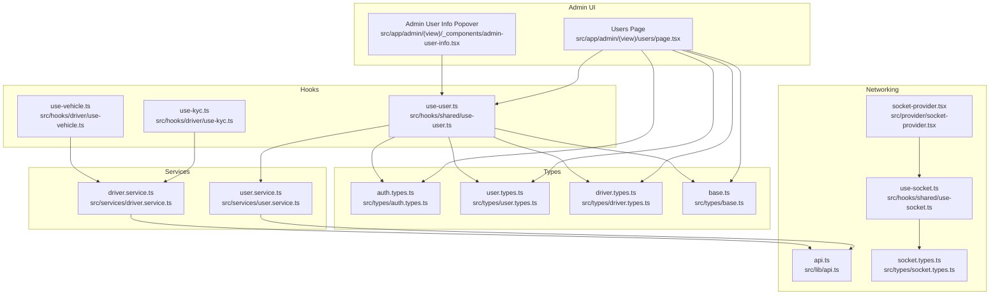
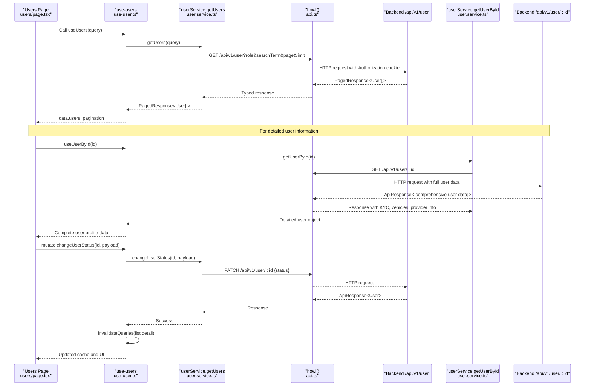
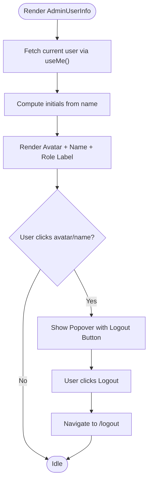
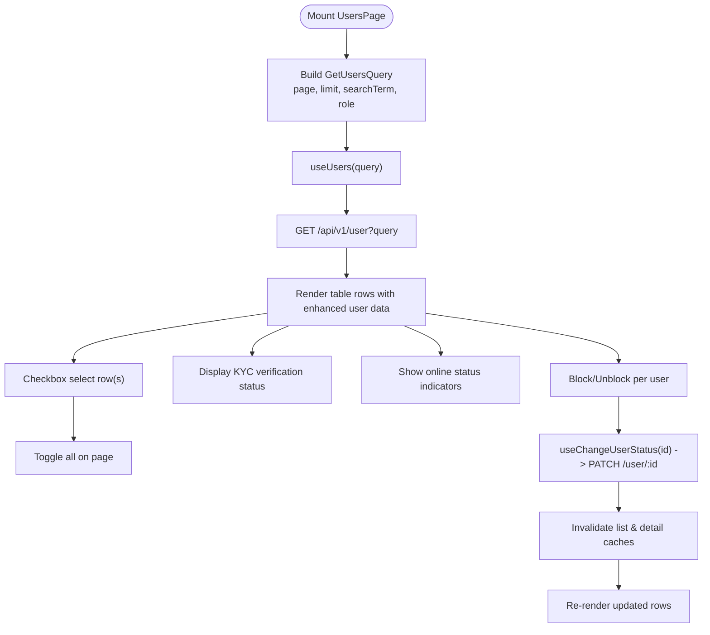
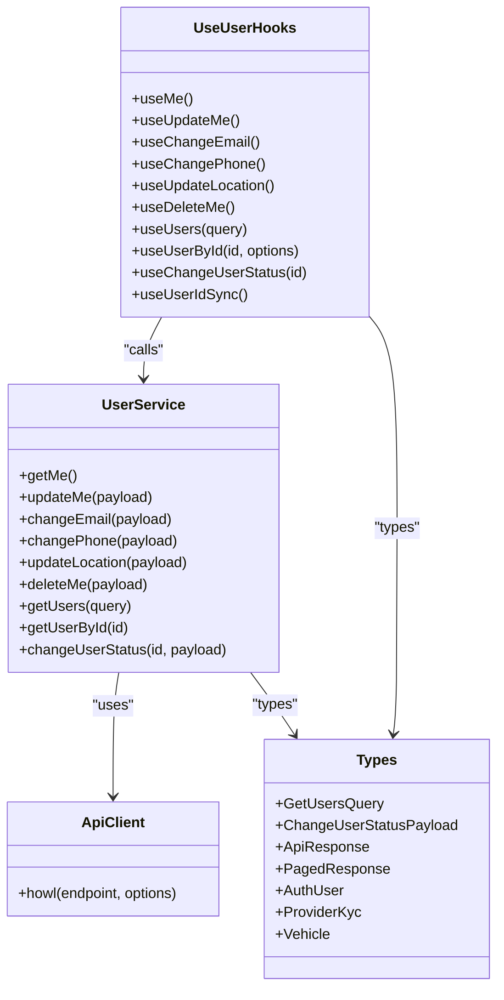
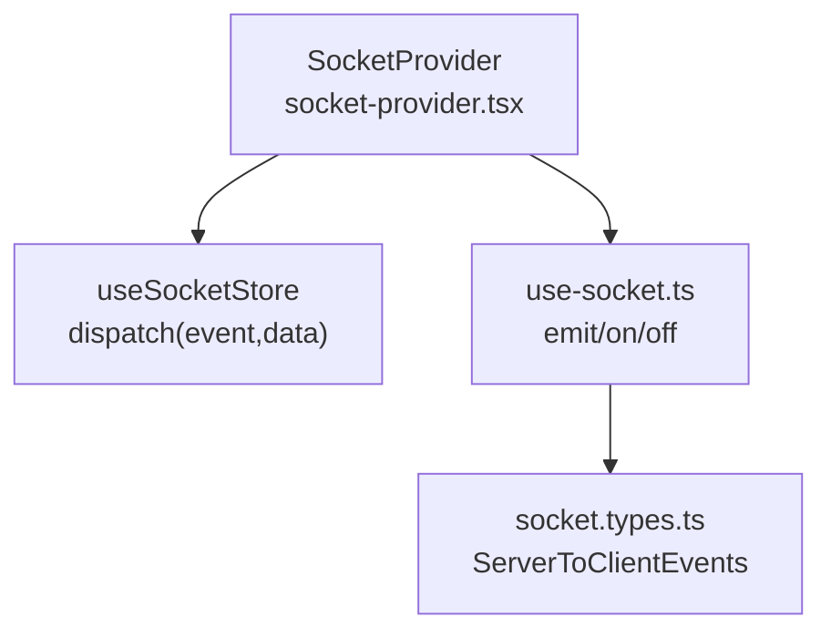
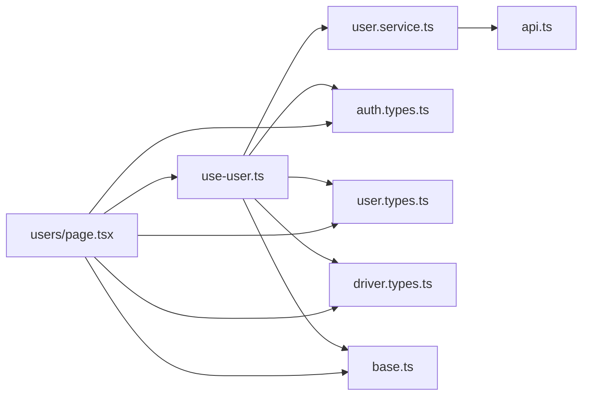

# User Management

<cite>
**Referenced Files in This Document**
- [admin-user-info.tsx](file://src/app/admin/(view)/_components/admin-user-info.tsx)
- [users/page.tsx](file://src/app/admin/(view)/users/page.tsx)
- [user.service.ts](file://src/services/user.service.ts)
- [use-user.ts](file://src/hooks/shared/use-user.ts)
- [auth.types.ts](file://src/types/auth.types.ts)
- [user.types.ts](file://src/types/user.types.ts)
- [driver.types.ts](file://src/types/driver.types.ts)
- [driver.service.ts](file://src/services/driver.service.ts)
- [base.ts](file://src/types/base.ts)
- [api.ts](file://src/lib/api.ts)
- [socket-provider.tsx](file://src/provider/socket-provider.tsx)
- [use-socket.ts](file://src/hooks/shared/use-socket.ts)
- [socket.types.ts](file://src/types/socket.types.ts)
</cite>

## Update Summary
**Changes Made**
- Enhanced user service layer with comprehensive email, phone, location, and profile management endpoints
- Expanded type safety with detailed user profile structures and verification workflows
- Added advanced account settings management with multi-factor authentication support
- Improved provider and vehicle management capabilities with KYC verification system
- Enhanced admin panel integration with real-time user status updates and comprehensive user data access

## Table of Contents
1. [Introduction](#introduction)
2. [Project Structure](#project-structure)
3. [Core Components](#core-components)
4. [Architecture Overview](#architecture-overview)
5. [Detailed Component Analysis](#detailed-component-analysis)
6. [Comprehensive User Type Definition](#comprehensive-user-type-definition)
7. [KYC Verification Workflow](#kyc-verification-workflow)
8. [Provider and Vehicle Management](#provider-and-vehicle-management)
9. [Account Settings and Verification Status](#account-settings-and-verification-status)
10. [Enhanced Service Layer Endpoints](#enhanced-service-layer-endpoints)
11. [Dependency Analysis](#dependency-analysis)
12. [Performance Considerations](#performance-considerations)
13. [Troubleshooting Guide](#troubleshooting-guide)
14. [Conclusion](#conclusion)

## Introduction
This document describes the comprehensive user management system for the admin panel, focusing on:
- Viewing detailed user profiles with extensive personal and professional information
- Managing account status (active/inactive/blocked) with advanced verification workflows
- Searching and filtering users by role, name, and verification status
- Bulk selection of users for administrative operations
- Comprehensive KYC verification management for providers
- Provider account lifecycle management including vehicle registration
- Integration with the admin service layer for complex user data operations
- Real-time update hooks via sockets for live status changes
- Advanced account settings management with multi-factor authentication

The system is implemented using React Server/Client components, TanStack Query for caching and mutations, typed services over a REST API, and a socket client for real-time events. It supports platform complexity through comprehensive user profiles, multi-level verification systems, and integrated provider management.

## Project Structure
User management spans UI pages, hooks, services, types, and shared networking utilities with enhanced support for complex user scenarios:
- Admin UI page for listing and managing users with advanced filtering
- Admin profile popover component with enhanced user information display
- Services for HTTP calls to backend endpoints with comprehensive user data handling
- Hooks for data fetching, mutations, and real-time synchronization
- Types for payloads, queries, responses, and complex user schemas
- Shared API client and socket infrastructure for real-time updates

**Diagram sources**
- [users/page.tsx](file://src/app/admin/(view)/users/page.tsx#L1-L511)
- [admin-user-info.tsx](file://src/app/admin/(view)/_components/admin-user-info.tsx#L1-L58)
- [use-user.ts:1-117](file://src/hooks/shared/use-user.ts#L1-L117)
- [user.service.ts:1-117](file://src/services/user.service.ts#L1-L117)
- [auth.types.ts:1-113](file://src/types/auth.types.ts#L1-L113)
- [user.types.ts:1-49](file://src/types/user.types.ts#L1-L49)
- [driver.types.ts:1-129](file://src/types/driver.types.ts#L1-L129)
- [base.ts:1-28](file://src/types/base.ts#L1-L28)
- [api.ts:1-106](file://src/lib/api.ts#L1-L106)
- [socket-provider.tsx:49-122](file://src/provider/socket-provider.tsx#L49-L122)
- [use-socket.ts:1-57](file://src/hooks/shared/use-socket.ts#L1-L57)
- [socket.types.ts:1-304](file://src/types/socket.types.ts#L1-L304)

**Section sources**
- [users/page.tsx](file://src/app/admin/(view)/users/page.tsx#L1-L511)
- [admin-user-info.tsx](file://src/app/admin/(view)/_components/admin-user-info.tsx#L1-L58)
- [use-user.ts:1-117](file://src/hooks/shared/use-user.ts#L1-L117)
- [user.service.ts:1-117](file://src/services/user.service.ts#L1-L117)
- [auth.types.ts:1-113](file://src/types/auth.types.ts#L1-L113)
- [user.types.ts:1-49](file://src/types/user.types.ts#L1-L49)
- [driver.types.ts:1-129](file://src/types/driver.types.ts#L1-L129)
- [base.ts:1-28](file://src/types/base.ts#L1-L28)
- [api.ts:1-106](file://src/lib/api.ts#L1-L106)
- [socket-provider.tsx:49-122](file://src/provider/socket-provider.tsx#L49-L122)
- [use-socket.ts:1-57](file://src/hooks/shared/use-socket.ts#L1-L57)
- [socket.types.ts:1-304](file://src/types/socket.types.ts#L1-L304)

## Core Components
- Users list page: Provides search, role filter, pagination, bulk selection, inline block/unblock actions, and KYC status display.
- Admin user info popover: Displays current admin's avatar, name, and quick logout with enhanced profile information.
- Data layer:
  - use-user hooks encapsulate queries and mutations for comprehensive user data operations.
  - user.service maps to REST endpoints for listing, detailed user retrieval, and status changes.
  - Driver services handle KYC verification, vehicle management, and provider-specific operations.
- Types:
  - UserRole and AuthUser define roles and comprehensive user shape with extensive profile information.
  - GetUsersQuery defines filtering and pagination parameters.
  - ApiResponse and PagedResponse define standard response shapes.
  - ProviderKyc and Vehicle types support provider management workflows.
- Networking:
  - api.ts provides howl() for JSON requests with token injection from cookies.
  - Socket provider and hooks provide real-time event plumbing for live updates.

Key responsibilities:
- UI orchestrates state (search, filters, pagination, selection) with enhanced user data display.
- Hooks manage cache keys, query/mutation lifecycles, and invalidation for complex user scenarios.
- Services build URLs and payloads for comprehensive user operations.
- Types enforce contracts across layers supporting platform complexity.

**Section sources**
- [users/page.tsx](file://src/app/admin/(view)/users/page.tsx#L166-L511)
- [admin-user-info.tsx](file://src/app/admin/(view)/_components/admin-user-info.tsx#L13-L57)
- [use-user.ts:17-92](file://src/hooks/shared/use-user.ts#L17-L92)
- [user.service.ts:14-116](file://src/services/user.service.ts#L14-L116)
- [auth.types.ts:1-113](file://src/types/auth.types.ts#L1-L113)
- [user.types.ts:37-49](file://src/types/user.types.ts#L37-L49)
- [driver.types.ts:29-74](file://src/types/driver.types.ts#L29-L74)
- [base.ts:1-28](file://src/types/base.ts#L1-L28)
- [api.ts:23-73](file://src/lib/api.ts#L23-L73)

## Architecture Overview
End-to-end flow for listing and managing users with comprehensive profile data:

**Diagram sources**
- [users/page.tsx](file://src/app/admin/(view)/users/page.tsx#L166-L511)
- [use-user.ts:67-92](file://src/hooks/shared/use-user.ts#L67-L92)
- [user.service.ts:34-116](file://src/services/user.service.ts#L34-L116)
- [api.ts:23-73](file://src/lib/api.ts#L23-L73)

## Detailed Component Analysis

### Admin User Info Component
Displays the logged-in admin's profile image, initials fallback, and comprehensive user information. Includes a quick logout action that navigates to the logout route.

- Data source: uses the "me" hook to fetch current user with full profile details.
- Behavior: renders avatar and label; opens a popover with a destructive logout button.
- Enhanced features: displays role-based information and profile completion status.

**Diagram sources**
- [admin-user-info.tsx](file://src/app/admin/(view)/_components/admin-user-info.tsx#L13-L57)
- [use-user.ts:23-28](file://src/hooks/shared/use-user.ts#L23-L28)

**Section sources**
- [admin-user-info.tsx](file://src/app/admin/(view)/_components/admin-user-info.tsx#L1-L58)
- [use-user.ts:23-28](file://src/hooks/shared/use-user.ts#L23-L28)

### Users List Page
Primary interface for admin user management with enhanced user data display.

Features:
- Search by name (client-side filter input sends searchTerm to server).
- Filter by role (all, user, provider/driver).
- Pagination with configurable page size.
- Bulk selection of rows for potential batch operations.
- Inline Block/Unblock toggle per user row.
- KYC verification status display.
- Online status indicators.
- Profile image display with fallback avatars.

Data flow:
- State drives query object passed to useUsers.
- useUsers calls userService.getUsers which builds URLSearchParams and calls howl().
- On successful mutation (changeUserStatus), relevant queries are invalidated to refresh lists and details.
- Enhanced user data display includes verification status and online presence.

**Diagram sources**
- [users/page.tsx](file://src/app/admin/(view)/users/page.tsx#L166-L511)
- [use-user.ts:67-92](file://src/hooks/shared/use-user.ts#L67-L92)
- [user.service.ts:34-116](file://src/services/user.service.ts#L34-L116)

**Section sources**
- [users/page.tsx](file://src/app/admin/(view)/users/page.tsx#L166-L511)
- [use-user.ts:67-92](file://src/hooks/shared/use-user.ts#L67-L92)
- [user.service.ts:34-116](file://src/services/user.service.ts#L34-L116)

### Data Layer: Hooks and Services
- useUsers(query):
  - Query key includes query params for precise cache invalidation.
  - Calls userService.getUsers(query).
- useUserById(id, options):
  - Enhanced query for detailed user information with comprehensive profile data.
  - Supports optional enabling/disabling based on ID availability.
- useChangeUserStatus(id):
  - Mutation to PATCH /user/:id with status payload.
  - Invalidates both list and detail queries after success.
- userService:
  - getUsers: Builds query string for role, searchTerm, page, limit, sortField, sortOrder.
  - getUserById: Returns detailed user shape including KYC, online status, ratings, vehicles, provider details, and extensive profile information.
  - changeUserStatus: Updates user status.
  - Enhanced methods for email, phone, location, and profile management.

**Diagram sources**
- [use-user.ts:67-92](file://src/hooks/shared/use-user.ts#L67-L92)
- [user.service.ts:34-116](file://src/services/user.service.ts#L34-L116)
- [api.ts:23-73](file://src/lib/api.ts#L23-L73)
- [user.types.ts:37-49](file://src/types/user.types.ts#L37-L49)
- [base.ts:1-28](file://src/types/base.ts#L1-L28)

**Section sources**
- [use-user.ts:67-92](file://src/hooks/shared/use-user.ts#L67-L92)
- [user.service.ts:34-116](file://src/services/user.service.ts#L34-L116)
- [api.ts:23-73](file://src/lib/api.ts#L23-L73)
- [user.types.ts:37-49](file://src/types/user.types.ts#L37-L49)
- [base.ts:1-28](file://src/types/base.ts#L1-L28)

### Permissions and Access Controls
- Roles:
  - Defined as UserRole: user | provider | admin.
- Current admin identity:
  - Admin UserInfo reads current user via useMe with comprehensive profile data.
- Access control:
  - The codebase does not implement explicit RBAC guards in these files.
  - It is recommended to gate admin routes and actions server-side and optionally validate roles client-side before rendering sensitive controls.

**Section sources**
- [auth.types.ts:1-113](file://src/types/auth.types.ts#L1-L113)
- [admin-user-info.tsx](file://src/app/admin/(view)/_components/admin-user-info.tsx#L13-L57)
- [use-user.ts:23-28](file://src/hooks/shared/use-user.ts#L23-L28)

### Audit Trails
- No audit logging or history endpoints are present in the analyzed files.
- Recommendation:
  - Introduce an audit trail endpoint and UI section to record and display admin actions (e.g., status changes, role updates, KYC approvals).
  - Emit server-side logs and expose them via a dedicated admin endpoint.
  - Track comprehensive user lifecycle events including registration, verification, and status changes.

[No sources needed since this section provides general guidance]

### Real-Time Updates
- Socket infrastructure exists:
  - Provider initializes socket.io-client with credentials and token.
  - Centralized event dispatch into a store.
  - Hooks to emit/on/off events and subscribe to specific events.
- Current usage:
  - Primarily used for chat and ride-related events.
  - Not wired into user management flows yet.
- Opportunity:
  - Subscribe to user-related events (e.g., user status changed, KYC verified, provider approved) to reflect changes instantly without polling.
  - Implement real-time notifications for admin actions and user status changes.

**Diagram sources**
- [socket-provider.tsx:49-122](file://src/provider/socket-provider.tsx#L49-L122)
- [use-socket.ts:1-57](file://src/hooks/shared/use-socket.ts#L1-L57)
- [socket.types.ts:1-304](file://src/types/socket.types.ts#L1-L304)

**Section sources**
- [socket-provider.tsx:49-122](file://src/provider/socket-provider.tsx#L49-L122)
- [use-socket.ts:1-57](file://src/hooks/shared/use-socket.ts#L1-L57)
- [socket.types.ts:1-304](file://src/types/socket.types.ts#L1-L304)

## Comprehensive User Type Definition

**Updated** The user type system has been significantly expanded to support platform complexity with comprehensive profile information, verification workflows, and provider management capabilities.

### Core User Identity (AuthUser)
The `AuthUser` type defines the fundamental user structure with extensive profile information:

- **Basic Information**: `_id`, `id`, `name`, `email`, `phone`, `countryCode`
- **Role Management**: `role` (user | provider | admin), `status` (active | inactive | blocked)
- **Profile Details**: `profileImage`, `dateOfBirth`, `gender`, `address`, `language`
- **Location Services**: `latitude`, `longitude` for geolocation features
- **Verification Status**: `isEmailVerified`, `isKycVerified`, `isResetPassword`
- **Security**: `failedLoginAttempts`, `fcmToken` for push notifications
- **Account Lifecycle**: `createdAt`, `updatedAt`, `isDeleted`, `__v` (versioning)
- **Online Presence**: `isOnline` for real-time status display

### Provider-Specific Extensions
For provider users (drivers), additional fields include:
- **Performance Metrics**: `completedRides`, `totalEarning`, `avgRating`, `totalRating`
- **Vehicle Management**: Array of `Vehicle` objects with vehicle details and default designation

### Extended User Profile (Service Layer)
The service layer provides access to even more comprehensive user data through `getUserById`:

- **Authentication Details**: `registerWith`, `timeZone`, `documents` array
- **Multi-Factor Authentication**: Individual OTP verification flags for signup, login, password reset, email change, phone change
- **Profile Completion**: `isProfileComplete` flag for onboarding progress
- **Payment Integration**: `stripeAccountId`, `customerId` for payment processing
- **Activity Tracking**: `lastOnlineAt`, `unreadCount` for engagement metrics
- **Provider Integration**: Nested `provider` object with company details and KYC documents
- **Vehicle Fleet**: Comprehensive `vehicles` array with vehicle specifications
- **Business Metrics**: `completedRides`, `todayEarning` for performance tracking
- **Verification Flags**: `isKycSubmitted`, `hasVehicle`, `isConnectedStripe`, `hasDefaultCard`

**Section sources**
- [auth.types.ts:52-92](file://src/types/auth.types.ts#L52-L92)
- [user.service.ts:46-112](file://src/services/user.service.ts#L46-L112)

## KYC Verification Workflow

**New Section** The system implements a comprehensive Know Your Customer (KYC) verification workflow for provider accounts, supporting regulatory compliance and platform security.

### KYC Document Management
Providers must submit various documents for verification:
- **Identity Documents**: CNIC front and back images (`cnicFront`, `cnicBack`)
- **License Documents**: Driving license front and back (`licenseFront`, `licenseBack`)
- **Vehicle Documentation**: Multiple car papers and registration documents (`carPapers[]`)
- **Company Registration**: Business registration documents for corporate providers

### KYC Status Management
The system tracks verification status through multiple states:
- **Pending**: Initial submission awaiting review
- **Verified**: Approved and active provider status
- **Rejected**: Failed verification with rejection reason tracking

### Provider KYC Structure
The `ProviderKyc` type defines the complete verification workflow:

- **Company Information**: `companyName`, `companyReg`, `vatNumber`, `socialInsurance`
- **Document References**: File paths to uploaded documents
- **Status Tracking**: `status` field with validation reasons
- **Audit Trail**: `createdAt`, `updatedAt` timestamps for compliance

### Admin KYC Management
Administrators can:
- Review pending KYC submissions
- Approve or reject applications with detailed reasoning
- View comprehensive provider information and documents
- Manage verification status changes

**Section sources**
- [driver.types.ts:29-46](file://src/types/driver.types.ts#L29-L46)
- [driver.service.ts:35-44](file://src/services/driver.service.ts#L35-L44)

## Provider and Vehicle Management

**New Section** The platform supports comprehensive provider account management with integrated vehicle registration and fleet management capabilities.

### Provider Account Structure
Provider accounts extend basic user functionality with business-specific features:
- **Company Information**: Legal entity details and tax identification
- **Registration Documents**: Official business registration and compliance certificates
- **Financial Integration**: Stripe account connectivity for payment processing
- **Performance Analytics**: Ride completion rates, earnings, and customer ratings

### Vehicle Management System
Providers can manage multiple vehicles with detailed specifications:

#### Vehicle Properties
- **Identification**: `name`, `number` (license plate), `year` (manufacturing year)
- **Capacity**: `seats` (4 or 6 passenger capacity)
- **Configuration**: `isDefault` flag for primary vehicle designation
- **Lifecycle**: `createdAt`, `updatedAt` timestamps for maintenance tracking

#### Vehicle Operations
- **Registration**: Create single or multiple vehicle registrations
- **Updates**: Modify vehicle details and specifications
- **Deletion**: Remove vehicles from fleet management
- **Assignment**: Set default vehicles for different ride types

### Multi-Vehicle Support
The system supports fleet management through:
- **Bulk Operations**: Create multiple vehicles simultaneously
- **Default Selection**: Designate primary vehicles for automatic assignment
- **Capacity Management**: Different seat configurations for various service levels
- **Documentation**: Vehicle registration and insurance document storage

**Section sources**
- [driver.types.ts:1-27](file://src/types/driver.types.ts#L1-L27)
- [driver.service.ts:18-33](file://src/services/driver.service.ts#L18-L33)

## Account Settings and Verification Status

**New Section** The user management system provides comprehensive account settings management with granular verification status tracking for enhanced security and compliance.

### Multi-Factor Authentication Support
The system implements progressive verification through individual OTP processes:
- **Signup Verification**: `isSignUpOtpVerified` for initial registration confirmation
- **Login Security**: `isLoginOTPVerified` for secure authentication
- **Password Management**: `isResetPasswordVerified` for password change security
- **Contact Updates**: `isChangeEmailOtpVerified` and `isChangePhoneOtpVerified` for contact information changes

### Profile Completion Tracking
The `isProfileComplete` flag indicates onboarding progress and feature accessibility:
- **Required Fields**: Basic profile information completion
- **Optional Enhancements**: Additional profile details and preferences
- **Feature Gating**: Access to advanced features based on profile completeness

### Contact and Location Management
Users can manage their contact information and location preferences:
- **Email Management**: Secure email change process with verification
- **Phone Management**: Phone number updates with country code support
- **Location Services**: Real-time location tracking and address management
- **Language Preferences**: Localized interface and communication settings

### Payment and Financial Integration
Advanced financial features for provider accounts:
- **Stripe Integration**: Connected account status and payment processing
- **Bank Account Setup**: Default card configuration and payment methods
- **Earnings Tracking**: Daily and cumulative earnings monitoring
- **Withdrawal Management**: Fund withdrawal and payout processing

**Section sources**
- [user.service.ts:46-112](file://src/services/user.service.ts#L46-L112)
- [user.types.ts:5-35](file://src/types/user.types.ts#L5-L35)

## Enhanced Service Layer Endpoints

**New Section** The user service layer has been significantly enhanced with comprehensive endpoints supporting advanced user operations and improved type safety.

### Core User Management Endpoints
The enhanced `userService` provides comprehensive user data operations:

#### Profile Management
- **getMe()**: Retrieves current authenticated user's complete profile information
- **updateMe(payload)**: Updates user profile with comprehensive field support including name, profile image, date of birth, gender, location coordinates, address, language, experience, and documents
- **deleteMe(payload)**: Soft deletes user profile with reason tracking

#### Contact Management
- **changeEmail(payload)**: Securely updates user email with verification requirements
- **changePhone(payload)**: Updates phone number with country code support and verification
- **updateLocation(payload)**: Manages real-time location tracking with coordinates and address

#### Admin Operations
- **getUsers(query)**: Advanced user listing with comprehensive filtering and pagination
- **getUserById(id)**: Retrieves detailed user information including KYC status, provider details, vehicle fleet, and verification flags
- **changeUserStatus(id, payload)**: Updates user account status (active/inactive/blocked)

### Enhanced Type Safety
The service layer leverages comprehensive TypeScript interfaces for improved development experience:

#### Request Payloads
- **UpdateProfilePayload**: Supports partial updates for all profile fields
- **ChangeEmailPayload**: Email change with validation
- **ChangePhonePayload**: Phone update with country code
- **UpdateLocationPayload**: Location tracking with coordinates and address
- **DeleteProfilePayload**: Account deletion with reason tracking
- **ChangeUserStatusPayload**: Status management with enum validation
- **GetUsersQuery**: Advanced filtering with role, search, pagination, and sorting

#### Response Types
- **ApiResponse<T>**: Standardized API response wrapper
- **PagedResponse<T>**: Paginated data with metadata
- **Extended User Schema**: Comprehensive user data structure with nested provider and vehicle information

### Integration Benefits
The enhanced service layer provides:
- **Type Safety**: Full TypeScript support across all endpoints
- **Error Handling**: Consistent error responses and validation
- **Caching Optimization**: Efficient query keys for TanStack Query integration
- **Real-time Ready**: Structured for socket event integration
- **Admin Panel Support**: Comprehensive data access for administrative operations

**Section sources**
- [user.service.ts:14-116](file://src/services/user.service.ts#L14-L116)
- [user.types.ts:5-49](file://src/types/user.types.ts#L5-L49)
- [auth.types.ts:52-92](file://src/types/auth.types.ts#L52-L92)

## Dependency Analysis
- UI depends on hooks for data access with enhanced user data handling.
- Hooks depend on services for HTTP calls and comprehensive user operations.
- Services depend on the shared API client with extended user data support.
- All layers rely on shared types for contract enforcement supporting platform complexity.

**Diagram sources**
- [users/page.tsx](file://src/app/admin/(view)/users/page.tsx#L1-L511)
- [use-user.ts:1-117](file://src/hooks/shared/use-user.ts#L1-L117)
- [user.service.ts:1-117](file://src/services/user.service.ts#L1-L117)
- [api.ts:1-106](file://src/lib/api.ts#L1-L106)
- [auth.types.ts:1-113](file://src/types/auth.types.ts#L1-L113)
- [user.types.ts:1-49](file://src/types/user.types.ts#L1-L49)
- [driver.types.ts:1-129](file://src/types/driver.types.ts#L1-L129)
- [base.ts:1-28](file://src/types/base.ts#L1-L28)

**Section sources**
- [users/page.tsx](file://src/app/admin/(view)/users/page.tsx#L1-L511)
- [use-user.ts:1-117](file://src/hooks/shared/use-user.ts#L1-L117)
- [user.service.ts:1-117](file://src/services/user.service.ts#L1-L117)
- [api.ts:1-106](file://src/lib/api.ts#L1-L106)
- [auth.types.ts:1-113](file://src/types/auth.types.ts#L1-L113)
- [user.types.ts:1-49](file://src/types/user.types.ts#L1-L49)
- [driver.types.ts:1-129](file://src/types/driver.types.ts#L1-L129)
- [base.ts:1-28](file://src/types/base.ts#L1-L28)

## Performance Considerations
- Pagination:
  - Use page and limit to reduce payload sizes for large user datasets.
  - Avoid overly large page sizes to keep UI responsive with comprehensive user data.
- Query keys:
  - Include all filter parameters in query keys for accurate cache invalidation.
  - Leverage detailed user queries for specific profile operations.
- Invalidation strategy:
  - After mutations, invalidate only affected queries (list and specific detail) to minimize refetches.
  - Optimize cache strategies for frequently accessed user profiles.
- Token handling:
  - Token is read from cookies automatically by the API client; ensure consistent cookie configuration.
- Data optimization:
  - Use selective field retrieval for list views vs. detailed profile views.
  - Implement lazy loading for large document arrays and vehicle fleets.

[No sources needed since this section provides general guidance]

## Troubleshooting Guide
Common issues and resolutions:
- Authentication failures:
  - Ensure the token cookie is set and accessible. The API client reads it automatically.
- Empty user list:
  - Verify query parameters (role, searchTerm, page, limit) are correct.
  - Check server availability and network errors surfaced by the API client.
- Status change not reflected:
  - Confirm mutation invalidates list and detail queries.
  - Inspect network tab for PATCH response.
- Real-time updates not appearing:
  - Verify socket connection and event subscriptions.
  - Ensure the server emits expected events and clients listen to them.
- KYC verification issues:
  - Check document upload permissions and file format requirements.
  - Verify provider account status and required fields completion.
- Vehicle management problems:
  - Validate vehicle registration data and capacity constraints.
  - Ensure proper permission levels for fleet management operations.
- Enhanced service endpoint issues:
  - Verify payload structure matches TypeScript interfaces.
  - Check authentication headers and CORS configuration.
  - Monitor console for type-related errors during development.

Operational references:
- API error handling and token injection:
  - [api.ts:23-73](file://src/lib/api.ts#L23-L73)
- User list and mutation flows:
  - [users/page.tsx](file://src/app/admin/(view)/users/page.tsx#L166-L511)
  - [use-user.ts:67-92](file://src/hooks/shared/use-user.ts#L67-L92)
  - [user.service.ts:34-116](file://src/services/user.service.ts#L34-L116)
- Socket setup and event dispatch:
  - [socket-provider.tsx:49-122](file://src/provider/socket-provider.tsx#L49-L122)
  - [use-socket.ts:1-57](file://src/hooks/shared/use-socket.ts#L1-L57)
  - [socket.types.ts:1-304](file://src/types/socket.types.ts#L1-L304)
- KYC and provider management:
  - [driver.types.ts:29-74](file://src/types/driver.types.ts#L29-L74)
  - [driver.service.ts:35-44](file://src/services/driver.service.ts#L35-L44)
- Enhanced service endpoints:
  - [user.service.ts:14-116](file://src/services/user.service.ts#L14-L116)
  - [user.types.ts:5-49](file://src/types/user.types.ts#L5-L49)

**Section sources**
- [api.ts:23-73](file://src/lib/api.ts#L23-L73)
- [users/page.tsx](file://src/app/admin/(view)/users/page.tsx#L166-L511)
- [use-user.ts:67-92](file://src/hooks/shared/use-user.ts#L67-L92)
- [user.service.ts:34-116](file://src/services/user.service.ts#L34-L116)
- [socket-provider.tsx:49-122](file://src/provider/socket-provider.tsx#L49-L122)
- [use-socket.ts:1-57](file://src/hooks/shared/use-socket.ts#L1-L57)
- [socket.types.ts:1-304](file://src/types/socket.types.ts#L1-L304)
- [driver.types.ts:29-74](file://src/types/driver.types.ts#L29-L74)
- [driver.service.ts:35-44](file://src/services/driver.service.ts#L35-L44)
- [user.service.ts:14-116](file://src/services/user.service.ts#L14-L116)
- [user.types.ts:5-49](file://src/types/user.types.ts#L5-L49)

## Conclusion
The user management system provides a comprehensive foundation for viewing, searching, filtering, and managing user accounts within the admin panel, now significantly enhanced with extensive profile information, KYC verification workflows, and provider management capabilities. The system leverages a clean separation between UI, hooks, services, and types, with robust caching and invalidation through TanStack Query.

Key enhancements include:
- **Comprehensive User Profiles**: Extensive personal and professional information with verification status tracking
- **KYC Verification System**: Complete know-your-customer workflow for regulatory compliance
- **Provider Management**: Integrated vehicle registration and fleet management capabilities
- **Advanced Account Settings**: Multi-factor authentication and granular verification controls
- **Enhanced Service Layer**: Comprehensive endpoints with improved type safety and better admin panel integration
- **Real-time Capabilities**: Socket infrastructure ready for live user status updates

While bulk operations and audit trails are not fully implemented in the analyzed files, the architecture supports extending these features. The system is well-positioned to handle platform complexity through its comprehensive type definitions, modular service layer, and extensible component architecture.

[No sources needed since this section summarizes without analyzing specific files]