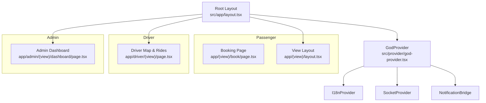
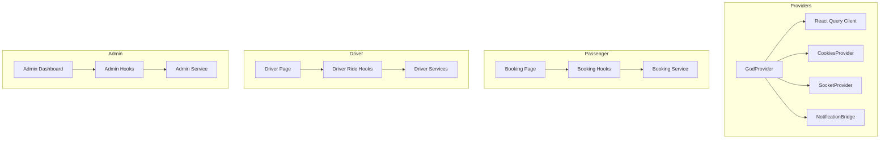
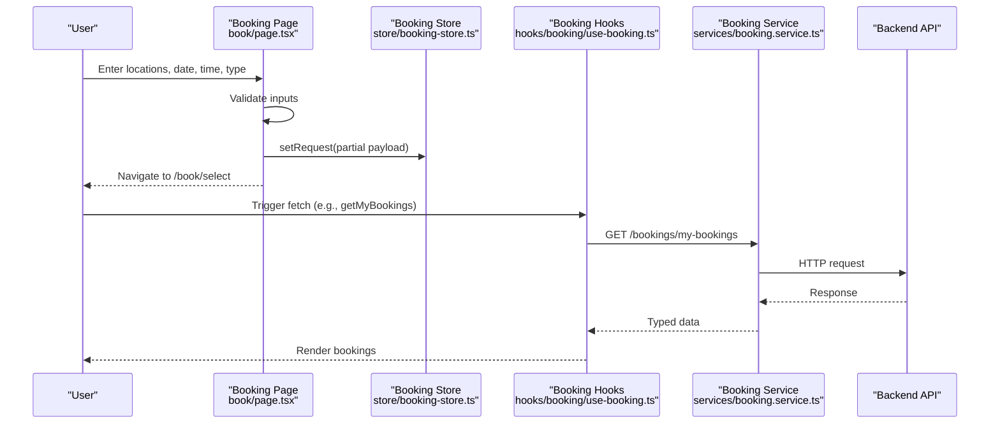
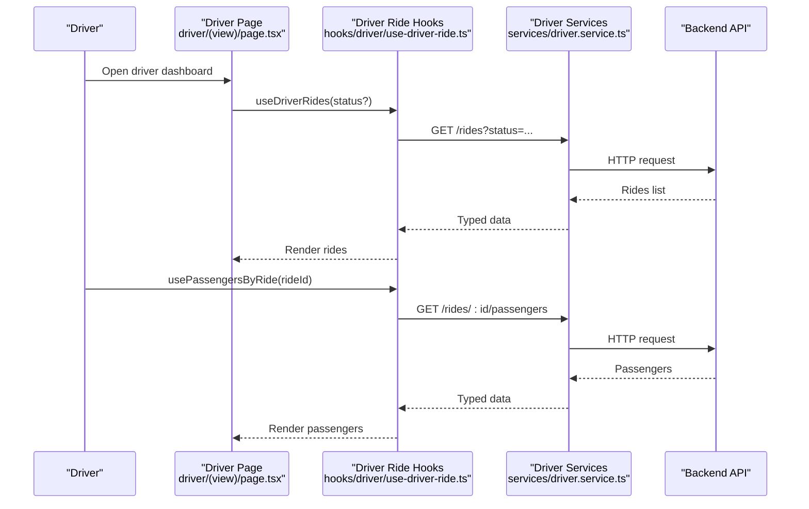
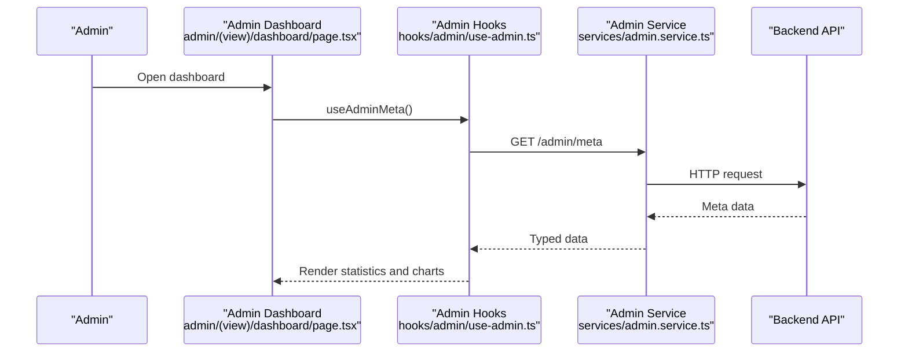
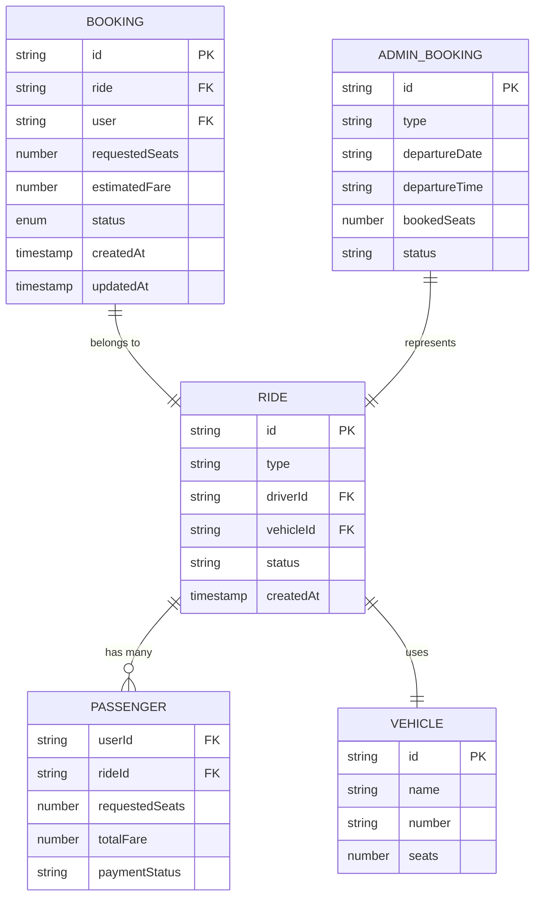
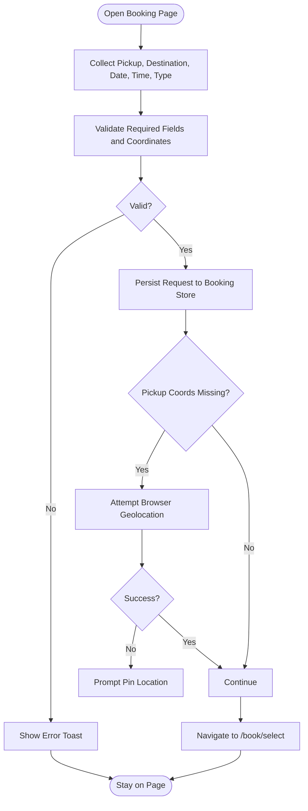
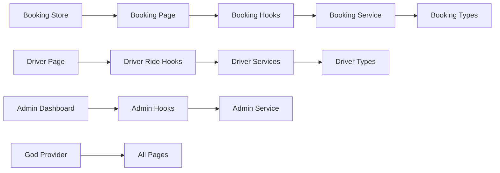

# Core Features

<cite>
**Referenced Files in This Document**
- [README.md](file://README.md)
- [layout.tsx](file://src/app/layout.tsx)
- [layout.tsx](file://src/app/(view)/layout.tsx)
- [god-provider.tsx](file://src/provider/god-provider.tsx)
- [page.tsx](file://src/app/(view)/book/page.tsx)
- [use-booking.ts](file://src/hooks/booking/use-booking.ts)
- [booking.service.ts](file://src/services/booking.service.ts)
- [booking.types.ts](file://src/types/booking.types.ts)
- [booking-store.ts](file://src/store/booking-store.ts)
- [page.tsx](file://src/app/driver/(view)/page.tsx)
- [use-driver-ride.ts](file://src/hooks/driver/use-driver-ride.ts)
- [driver.service.ts](file://src/services/driver.service.ts)
- [dashboard/page.tsx](file://src/app/admin/(view)/dashboard/page.tsx)
- [use-admin.ts](file://src/hooks/admin/use-admin.ts)
</cite>

## Table of Contents
1. Introduction
2. Project Structure
3. Core Components
4. Architecture Overview
5. Detailed Component Analysis
6. Dependency Analysis
7. Performance Considerations
8. Troubleshooting Guide
9. Conclusion

## Introduction
This document explains the core features of the Split Ride platform, focusing on:
- Passenger ride booking flow
- Driver management and ride operations
- Administrative functions and dashboards
- Multi-role system architecture and user interactions
- Feature boundaries, workflows, and key business logic
- Data flows between UI components, hooks, services, and backend endpoints

The application is a Next.js project with client-side state management via Zustand, data fetching via React Query, and real-time capabilities through a socket provider.

**Section sources**
- [README.md:1-37](file://README.md#L1-L37)

## Project Structure
High-level structure:
- App shell and providers at the root layout level
- Role-based route groups:
  - Passenger views under app/(view)
  - Driver views under app/driver
  - Admin views under app/admin
- Shared UI components under components/ui and components/core
- Domain-specific hooks under hooks/{auth,booking,driver,shared}
- API service layer under services
- Global stores under store
- Types under types

**Diagram sources**
- [layout.tsx:1-48](file://src/app/layout.tsx#L1-L48)
- [god-provider.tsx:1-48](file://src/provider/god-provider.tsx#L1-L48)
- [layout.tsx](file://src/app/(view)/layout.tsx#L1-L14)
- [page.tsx](file://src/app/(view)/book/page.tsx#L1-L305)
- [page.tsx](file://src/app/driver/(view)/page.tsx#L1-L164)
- [dashboard/page.tsx](file://src/app/admin/(view)/dashboard/page.tsx#L1-L227)

**Section sources**
- [layout.tsx:1-48](file://src/app/layout.tsx#L1-L48)
- [layout.tsx](file://src/app/(view)/layout.tsx#L1-L14)
- [god-provider.tsx:1-48](file://src/provider/god-provider.tsx#L1-L48)

## Core Components
- Booking page (passenger): collects pickup/destination, date/time, and request type; validates inputs; persists request to global store; navigates to selection.
- Booking hooks and services: fetch my bookings, driver bookings, ride details, and admin listings; mutate status changes.
- Driver dashboard: shows map with current location and available rides list; integrates with driver ride hooks and services.
- Admin dashboard: displays aggregated metrics and recent transactions using admin meta hook and services.

Key responsibilities:
- State synchronization across roles via stores and providers
- Centralized API calls via typed services
- Strongly-typed domain models for bookings, rides, drivers, and admin entities

**Section sources**
- [page.tsx](file://src/app/(view)/book/page.tsx#L1-L305)
- [use-booking.ts:1-60](file://src/hooks/booking/use-booking.ts#L1-L60)
- [booking.service.ts:1-45](file://src/services/booking.service.ts#L1-L45)
- [booking.types.ts:1-166](file://src/types/booking.types.ts#L1-L166)
- [page.tsx](file://src/app/driver/(view)/page.tsx#L1-L164)
- [use-driver-ride.ts:1-35](file://src/hooks/driver/use-driver-ride.ts#L1-L35)
- [driver.service.ts:1-97](file://src/services/driver.service.ts#L1-L97)
- [dashboard/page.tsx](file://src/app/admin/(view)/dashboard/page.tsx#L1-L227)
- [use-admin.ts:1-44](file://src/hooks/admin/use-admin.ts#L1-L44)

## Architecture Overview
Multi-role architecture:
- Passenger: books rides, manages personal bookings, interacts with chat and ratings
- Driver: manages vehicles, KYC, Stripe, withdrawals, and operates rides
- Admin: monitors platform metrics, reviews drivers, handles withdrawals and account deletions

Providers and cross-cutting concerns:
- GodProvider wires cookies, React Query, sockets, notifications, and user ID sync
- i18n provider enables localization
- Socket provider supports real-time updates

**Diagram sources**
- [god-provider.tsx:1-48](file://src/provider/god-provider.tsx#L1-L48)
- [page.tsx](file://src/app/(view)/book/page.tsx#L1-L305)
- [use-booking.ts:1-60](file://src/hooks/booking/use-booking.ts#L1-L60)
- [booking.service.ts:1-45](file://src/services/booking.service.ts#L1-L45)
- [page.tsx](file://src/app/driver/(view)/page.tsx#L1-L164)
- [use-driver-ride.ts:1-35](file://src/hooks/driver/use-driver-ride.ts#L1-L35)
- [driver.service.ts:1-97](file://src/services/driver.service.ts#L1-L97)
- [dashboard/page.tsx](file://src/app/admin/(view)/dashboard/page.tsx#L1-L227)
- [use-admin.ts:1-44](file://src/hooks/admin/use-admin.ts#L1-L44)

## Detailed Component Analysis

### Passenger Booking Flow
End-to-end passenger booking:
- User enters pickup and destination, selects date/time, and chooses split or private
- Validation ensures required fields and coordinates
- Request persisted to global booking store
- Navigation to next step for seat selection and confirmation

**Diagram sources**
- [page.tsx](file://src/app/(view)/book/page.tsx#L1-L305)
- [booking-store.ts:1-28](file://src/store/booking-store.ts#L1-L28)
- [use-booking.ts:1-60](file://src/hooks/booking/use-booking.ts#L1-L60)
- [booking.service.ts:1-45](file://src/services/booking.service.ts#L1-L45)

**Section sources**
- [page.tsx](file://src/app/(view)/book/page.tsx#L1-L305)
- [booking-store.ts:1-28](file://src/store/booking-store.ts#L1-L28)
- [use-booking.ts:1-60](file://src/hooks/booking/use-booking.ts#L1-L60)
- [booking.service.ts:1-45](file://src/services/booking.service.ts#L1-L45)

### Driver Management and Operations
Driver dashboard:
- Displays map with current location marker and nearby cars
- Shows available rides list via Find component
- Integrates with driver ride hooks to list rides and passengers by ride

**Diagram sources**
- [page.tsx](file://src/app/driver/(view)/page.tsx#L1-L164)
- [use-driver-ride.ts:1-35](file://src/hooks/driver/use-driver-ride.ts#L1-L35)
- [driver.service.ts:1-97](file://src/services/driver.service.ts#L1-L97)

**Section sources**
- [page.tsx](file://src/app/driver/(view)/page.tsx#L1-L164)
- [use-driver-ride.ts:1-35](file://src/hooks/driver/use-driver-ride.ts#L1-L35)
- [driver.service.ts:1-97](file://src/services/driver.service.ts#L1-L97)

### Administrative Functions
Admin dashboard:
- Loads aggregated platform metrics via admin meta hook
- Displays sales report breakdown and recent transactions
- Provides navigation to detailed pages (transactions, users, drivers, etc.)

**Diagram sources**
- [dashboard/page.tsx](file://src/app/admin/(view)/dashboard/page.tsx#L1-L227)
- [use-admin.ts:1-44](file://src/hooks/admin/use-admin.ts#L1-L44)

**Section sources**
- [dashboard/page.tsx](file://src/app/admin/(view)/dashboard/page.tsx#L1-L227)
- [use-admin.ts:1-44](file://src/hooks/admin/use-admin.ts#L1-L44)

### Data Models and Relationships
Core domain models include bookings, rides, passengers, vehicles, and admin entities. The relationships are illustrated below.

**Diagram sources**
- [booking.types.ts:1-166](file://src/types/booking.types.ts#L1-L166)

**Section sources**
- [booking.types.ts:1-166](file://src/types/booking.types.ts#L1-L166)

### Booking Input Validation Flow
The booking page enforces validation before persisting the request and navigating forward.

**Diagram sources**
- [page.tsx](file://src/app/(view)/book/page.tsx#L1-L305)

**Section sources**
- [page.tsx](file://src/app/(view)/book/page.tsx#L1-L305)

## Dependency Analysis
Component and module dependencies:
- UI pages depend on hooks for data access
- Hooks depend on typed services for API calls
- Services encapsulate HTTP requests and query parameters
- Stores manage transient client state for multi-step flows
- Providers wire cross-cutting concerns globally

**Diagram sources**
- [page.tsx](file://src/app/(view)/book/page.tsx#L1-L305)
- [use-booking.ts:1-60](file://src/hooks/booking/use-booking.ts#L1-L60)
- [booking.service.ts:1-45](file://src/services/booking.service.ts#L1-L45)
- [booking.types.ts:1-166](file://src/types/booking.types.ts#L1-L166)
- [page.tsx](file://src/app/driver/(view)/page.tsx#L1-L164)
- [use-driver-ride.ts:1-35](file://src/hooks/driver/use-driver-ride.ts#L1-L35)
- [driver.service.ts:1-97](file://src/services/driver.service.ts#L1-L97)
- [dashboard/page.tsx](file://src/app/admin/(view)/dashboard/page.tsx#L1-L227)
- [use-admin.ts:1-44](file://src/hooks/admin/use-admin.ts#L1-L44)
- [god-provider.tsx:1-48](file://src/provider/god-provider.tsx#L1-L48)

**Section sources**
- [page.tsx](file://src/app/(view)/book/page.tsx#L1-L305)
- [use-booking.ts:1-60](file://src/hooks/booking/use-booking.ts#L1-L60)
- [booking.service.ts:1-45](file://src/services/booking.service.ts#L1-L45)
- [booking.types.ts:1-166](file://src/types/booking.types.ts#L1-L166)
- [page.tsx](file://src/app/driver/(view)/page.tsx#L1-L164)
- [use-driver-ride.ts:1-35](file://src/hooks/driver/use-driver-ride.ts#L1-L35)
- [driver.service.ts:1-97](file://src/services/driver.service.ts#L1-L97)
- [dashboard/page.tsx](file://src/app/admin/(view)/dashboard/page.tsx#L1-L227)
- [use-admin.ts:1-44](file://src/hooks/admin/use-admin.ts#L1-L44)
- [god-provider.tsx:1-48](file://src/provider/god-provider.tsx#L1-L48)

## Performance Considerations
- Use React Query caching and invalidation to minimize redundant network calls
- Defer heavy computations and map rendering until necessary
- Optimize geolocation fallbacks and error handling to avoid blocking UI
- Keep global stores minimal and focused on transient workflow state
- Leverage pagination and filters in admin and driver lists to reduce payload sizes

[No sources needed since this section provides general guidance]

## Troubleshooting Guide
Common issues and resolutions:
- Geolocation permission denied: prompt users to pin pickup manually
- Missing destination coordinates: enforce selection from suggestions or map pin
- Network errors: rely on React Query retry and display toast notifications
- Real-time updates not reflecting: verify socket connection and event listeners
- Admin data not loading: check permissions and endpoint availability

**Section sources**
- [page.tsx](file://src/app/(view)/book/page.tsx#L1-L305)
- [god-provider.tsx:1-48](file://src/provider/god-provider.tsx#L1-L48)

## Conclusion
Split Ride’s core features are organized around clear role-based boundaries:
- Passenger booking flow emphasizes input validation, persistent request state, and smooth navigation
- Driver operations integrate map visualization with ride and passenger management
- Admin dashboards provide high-level insights and operational controls
The architecture leverages providers, typed services, and strongly-typed models to ensure maintainability and scalability.

[No sources needed since this section summarizes without analyzing specific files]