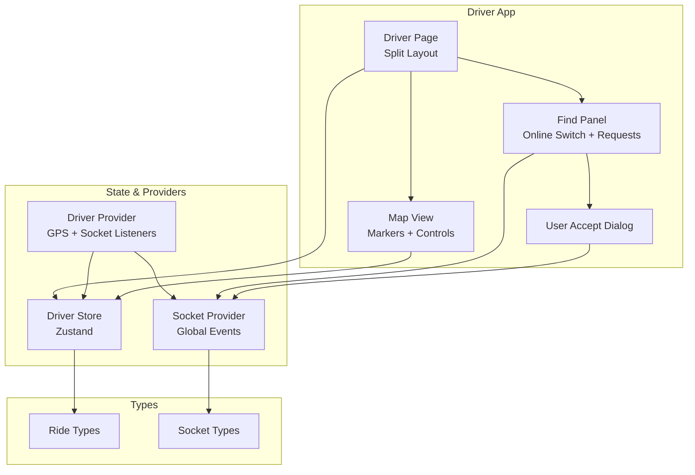
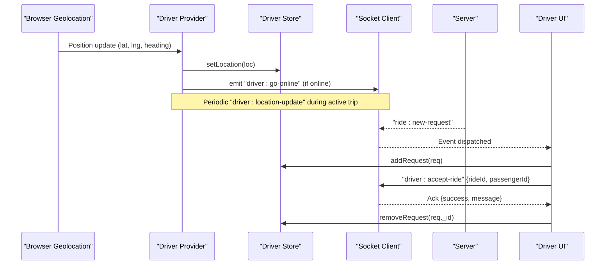
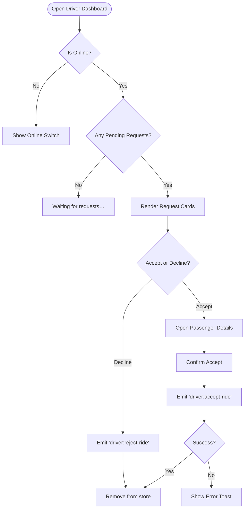
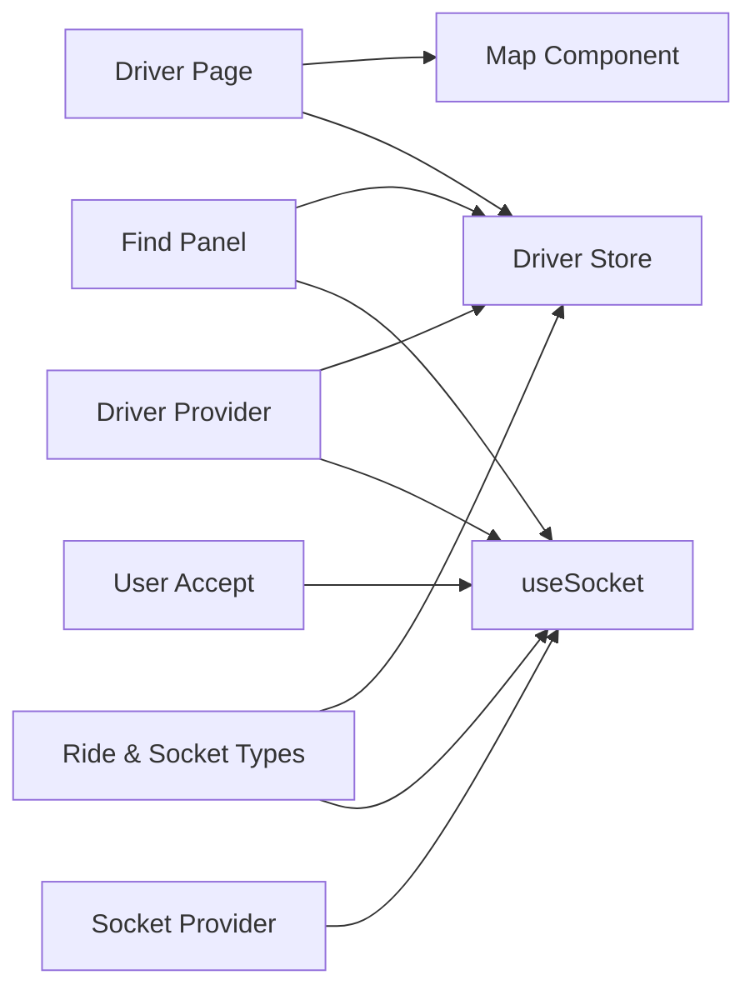

# Driver Dashboard & Ride Management

<cite>
**Referenced Files in This Document**
- [page.tsx](file://src/app/driver/(view)/page.tsx)
- [find.tsx](file://src/app/driver/(view)/find.tsx)
- [user-accept.tsx](file://src/app/driver/(view)/user-accept.tsx)
- [mapThree.ts](file://src/app/driver/(view)/mapThree.ts)
- [driver-provider.tsx](file://src/app/driver/driver-provider.tsx)
- [socket-provider.tsx](file://src/provider/socket-provider.tsx)
- [use-socket.ts](file://src/hooks/shared/use-socket.ts)
- [driver-store.ts](file://src/store/driver-store.ts)
- [ride.types.ts](file://src/types/ride.types.ts)
- [socket.types.ts](file://src/types/socket.types.ts)
- [map.tsx](file://src/components/ui/map.tsx)
</cite>

## Table of Contents
1. [Introduction](#introduction)
2. [Project Structure](#project-structure)
3. [Core Components](#core-components)
4. [Architecture Overview](#architecture-overview)
5. [Detailed Component Analysis](#detailed-component-analysis)
6. [Dependency Analysis](#dependency-analysis)
7. [Performance Considerations](#performance-considerations)
8. [Troubleshooting Guide](#troubleshooting-guide)
9. [Conclusion](#conclusion)

## Introduction
This document explains the driver dashboard and ride management system, focusing on:
- The main driver interface with real-time location tracking, available rides display, and map integration
- The ride acceptance workflow from receiving requests to confirming trips
- State management for driver location, online status, and incoming ride requests
- Interactive map implementation including driver positioning, nearby car markers, and camera following behavior
- Real-time synchronization via sockets for ride request handling and trip status transitions

## Project Structure
The driver dashboard is implemented as a Next.js client application with:
- A split layout: left panel for ride requests and controls; right panel for an interactive map
- A provider that manages GPS updates, online/offline signaling, and incoming socket events
- A Zustand store for local state (location, online flag, pending requests)
- A reusable Map component built on MapLibre GL with markers, popups, tooltips, and controls
- Socket integration for bidirectional communication with the server

**Diagram sources**
- [page.tsx](file://src/app/driver/(view)/page.tsx#L1-L164)
- [find.tsx](file://src/app/driver/(view)/find.tsx#L1-L241)
- [user-accept.tsx](file://src/app/driver/(view)/user-accept.tsx#L1-L217)
- [driver-provider.tsx:1-140](file://src/app/driver/driver-provider.tsx#L1-L140)
- [socket-provider.tsx:1-123](file://src/provider/socket-provider.tsx#L1-L123)
- [driver-store.ts:1-37](file://src/store/driver-store.ts#L1-L37)
- [ride.types.ts:1-161](file://src/types/ride.types.ts#L1-L161)
- [socket.types.ts:1-304](file://src/types/socket.types.ts#L1-L304)

**Section sources**
- [page.tsx](file://src/app/driver/(view)/page.tsx#L1-L164)
- [find.tsx](file://src/app/driver/(view)/find.tsx#L1-L241)
- [user-accept.tsx](file://src/app/driver/(view)/user-accept.tsx#L1-L217)
- [driver-provider.tsx:1-140](file://src/app/driver/driver-provider.tsx#L1-L140)
- [socket-provider.tsx:1-123](file://src/provider/socket-provider.tsx#L1-L123)
- [driver-store.ts:1-37](file://src/store/driver-store.ts#L1-L37)
- [ride.types.ts:1-161](file://src/types/ride.types.ts#L1-L161)
- [socket.types.ts:1-304](file://src/types/socket.types.ts#L1-L304)

## Core Components
- Driver Page: Renders a two-column layout with a ride list panel and an interactive map. It handles camera follow behavior and recentering.
- Find Panel: Provides an Online switch, displays incoming ride requests, and allows accepting or declining them.
- User Accept Dialog: Shows detailed passenger and route info, then emits an accept event over sockets.
- Driver Provider: Initializes GPS tracking, persists online state restoration, and subscribes to new ride requests.
- Driver Store: Holds location, online status, and pending requests with persistence for requests across sessions.
- Map Component: Wraps MapLibre GL with React-friendly APIs for markers, popups, tooltips, and viewport control.

**Section sources**
- [page.tsx](file://src/app/driver/(view)/page.tsx#L1-L164)
- [find.tsx](file://src/app/driver/(view)/find.tsx#L1-L241)
- [user-accept.tsx](file://src/app/driver/(view)/user-accept.tsx#L1-L217)
- [driver-provider.tsx:1-140](file://src/app/driver/driver-provider.tsx#L1-L140)
- [driver-store.ts:1-37](file://src/store/driver-store.ts#L1-L37)
- [map.tsx:1-800](file://src/components/ui/map.tsx#L1-L800)

## Architecture Overview
The system combines client-side state, geolocation, and real-time sockets to deliver a live driver experience.

**Diagram sources**
- [driver-provider.tsx:66-136](file://src/app/driver/driver-provider.tsx#L66-L136)
- [driver-store.ts:17-36](file://src/store/driver-store.ts#L17-L36)
- [socket-provider.tsx:67-116](file://src/provider/socket-provider.tsx#L67-L116)
- [use-socket.ts:12-39](file://src/hooks/shared/use-socket.ts#L12-L39)
- [find.tsx](file://src/app/driver/(view)/find.tsx#L87-L136)
- [user-accept.tsx](file://src/app/driver/(view)/user-accept.tsx#L121-L138)

## Detailed Component Analysis

### Driver Page (Main Interface)
Responsibilities:
- Render split layout with ride list and map
- Manage camera follow behavior when user drags the map
- Display driver marker with avatar and rotation based on heading
- Show dummy nearby car markers for demonstration

Key behaviors:
- Camera follows driver location when enabled; disables on drag and can be re-enabled via recenter button
- Uses MapRef to call easeTo/flyTo for smooth transitions
- Integrates with driver store for current location

**Section sources**
- [page.tsx](file://src/app/driver/(view)/page.tsx#L44-L163)
- [map.tsx:169-336](file://src/components/ui/map.tsx#L169-L336)

### Map Integration (Interactive Map)
Capabilities:
- Theme-aware base maps (light/dark)
- Controlled/uncontrolled viewport modes
- Markers with custom content, popups, tooltips, labels
- Zoom, compass, locate, fullscreen controls
- Safe SSR rendering and style loading lifecycle

Implementation highlights:
- Exposes imperative ref to parent components for programmatic navigation
- Handles internal vs external movement to avoid feedback loops
- Supports projection switching and dynamic style changes

**Section sources**
- [map.tsx:169-336](file://src/components/ui/map.tsx#L169-L336)
- [map.tsx:374-495](file://src/components/ui/map.tsx#L374-L495)
- [map.tsx:779-800](file://src/components/ui/map.tsx#L779-L800)

### Driver Location Tracking & Online Status
Features:
- Uses navigator.geolocation.getCurrentPosition and watchPosition
- Persists online state restoration after reload if profile indicates online and vehicle exists
- Emits periodic location updates during active trips (testing interval present)
- Distance-gated emission block included for production optimization

Flow:
- On position fix: update store, attempt restore online
- On watch updates: keep store fresh and try restore online
- Emit online/offline signals when toggled by user

**Section sources**
- [driver-provider.tsx:29-139](file://src/app/driver/driver-provider.tsx#L29-L139)
- [driver-store.ts:17-36](file://src/store/driver-store.ts#L17-L36)

### Available Rides & Request Handling
Components:
- OnlineSwitch: Toggle online status, guard against missing vehicle/location, emit go-online/go-offline
- Find: Lists pending requests, shows details like fare, distance, pickup/dropoff, seats, time
- UserAccept: Dialog with full passenger/route details and accept action

Workflow:
- When online, listen for "ride:new-request" and add to store
- Decline: emit "driver:reject-ride" and remove request locally
- Accept: open dialog, confirm, emit "driver:accept-ride", handle ack, remove request

**Diagram sources**
- [find.tsx](file://src/app/driver/(view)/find.tsx#L20-L136)
- [user-accept.tsx](file://src/app/driver/(view)/user-accept.tsx#L121-L138)
- [driver-provider.tsx:127-136](file://src/app/driver/driver-provider.tsx#L127-L136)

**Section sources**
- [find.tsx](file://src/app/driver/(view)/find.tsx#L1-L241)
- [user-accept.tsx](file://src/app/driver/(view)/user-accept.tsx#L1-L217)
- [driver-provider.tsx:127-136](file://src/app/driver/driver-provider.tsx#L127-L136)

### Trip Status Transitions & Upcoming Rides
- Upcoming rides page lists scheduled bookings and allows starting a trip
- Starting a trip emits "driver:start-trip" and updates UI accordingly
- Future steps would include arrival, pickup, drop-off, and completion flows using corresponding socket events

**Section sources**
- [upcoming.tsx](file://src/app/driver/(view)/my-rides/upcoming.tsx#L27-L127)
- [socket.types.ts:186-213](file://src/types/socket.types.ts#L186-L213)

### Data Models & Real-Time Contracts
- NewRideRequest: Incoming ride request payload with passenger, route, seats, fare, and timestamps
- Socket events: Centralized types define all client-server interactions for drivers and riders, including location updates, trip control, and notifications

**Section sources**
- [ride.types.ts:97-124](file://src/types/ride.types.ts#L97-L124)
- [socket.types.ts:85-160](file://src/types/socket.types.ts#L85-L160)
- [socket.types.ts:164-296](file://src/types/socket.types.ts#L164-L296)

## Dependency Analysis
High-level relationships:
- Driver Page depends on Map component and Driver Store
- Find and UserAccept depend on Socket hooks and Driver Store
- Driver Provider coordinates GPS, Store, and Socket listeners
- Socket Provider centralizes connection and global event dispatch
- Types enforce contracts between client and server

**Diagram sources**
- [page.tsx](file://src/app/driver/(view)/page.tsx#L1-L164)
- [find.tsx](file://src/app/driver/(view)/find.tsx#L1-L241)
- [user-accept.tsx](file://src/app/driver/(view)/user-accept.tsx#L1-L217)
- [driver-provider.tsx:1-140](file://src/app/driver/driver-provider.tsx#L1-L140)
- [socket-provider.tsx:1-123](file://src/provider/socket-provider.tsx#L1-L123)
- [use-socket.ts:12-39](file://src/hooks/shared/use-socket.ts#L12-L39)
- [driver-store.ts:1-37](file://src/store/driver-store.ts#L1-L37)
- [ride.types.ts:1-161](file://src/types/ride.types.ts#L1-L161)
- [socket.types.ts:1-304](file://src/types/socket.types.ts#L1-L304)

**Section sources**
- [page.tsx](file://src/app/driver/(view)/page.tsx#L1-L164)
- [find.tsx](file://src/app/driver/(view)/find.tsx#L1-L241)
- [user-accept.tsx](file://src/app/driver/(view)/user-accept.tsx#L1-L217)
- [driver-provider.tsx:1-140](file://src/app/driver/driver-provider.tsx#L1-L140)
- [socket-provider.tsx:1-123](file://src/provider/socket-provider.tsx#L1-L123)
- [use-socket.ts:12-39](file://src/hooks/shared/use-socket.ts#L12-L39)
- [driver-store.ts:1-37](file://src/store/driver-store.ts#L1-L37)
- [ride.types.ts:1-161](file://src/types/ride.types.ts#L1-L161)
- [socket.types.ts:1-304](file://src/types/socket.types.ts#L1-L304)

## Performance Considerations
- GPS updates: Use distance-gated emissions in production to reduce network overhead (haversine threshold block provided)
- Map viewport: Avoid unnecessary jumps by checking current vs next values before calling jumpTo/easeTo
- Marker updates: Only update positions when coordinates change; reuse marker instances
- Socket events: Centralize handlers and use stable refs to prevent stale closures
- Persistence: Persist only necessary state (requests) to minimize storage churn

[No sources needed since this section provides general guidance]

## Troubleshooting Guide
Common issues and resolutions:
- No location permission: Ensure browser permissions are granted; UI warns when missing
- Cannot go online without vehicle: Add a vehicle in profile before enabling online mode
- Map not centering: Verify map instance availability and disable internal move flags appropriately
- Missing socket events: Confirm SocketProvider is mounted and connected; check ALL_EVENTS registration
- Stale online state after reload: Provider attempts to restore online if profile and vehicle exist and location is known

**Section sources**
- [find.tsx](file://src/app/driver/(view)/find.tsx#L64-L84)
- [driver-provider.tsx:48-64](file://src/app/driver/driver-provider.tsx#L48-L64)
- [socket-provider.tsx:67-116](file://src/provider/socket-provider.tsx#L67-L116)

## Conclusion
The driver dashboard integrates geolocation, real-time sockets, and a robust map layer to provide a responsive and reliable experience. The architecture cleanly separates concerns: UI components manage interactions, providers orchestrate side effects, stores maintain reactive state, and types ensure consistent contracts. With production-ready optimizations and clear error paths, the system supports efficient ride matching and trip management.