# Driver Features

<cite>
**Referenced Files in This Document**
- [page.tsx](file://src/app/driver/(view)/page.tsx)
- [find.tsx](file://src/app/driver/(view)/find.tsx)
- [user-accept.tsx](file://src/app/driver/(view)/user-accept.tsx)
- [confirm/page.tsx](file://src/app/driver/(view)/confirm/page.tsx)
- [my-payments/page.tsx](file://src/app/driver/(view)/my-payments/page.tsx)
- [transaction-list.tsx](file://src/app/driver/(view)/my-payments/_components/transaction-list.tsx)
- [withdraw-history.tsx](file://src/app/driver/(view)/my-payments/_components/withdraw-history.tsx)
- [navbar.tsx](file://src/components/core/navbar.tsx)
- [use-driver-ride.ts](file://src/hooks/driver/use-driver-ride.ts)
- [use-stripe.ts](file://src/hooks/driver/use-stripe.ts)
- [use-kyc.ts](file://src/hooks/driver/use-kyc.ts)
- [use-vehicle.ts](file://src/hooks/driver/use-vehicle.ts)
- [use-withdraw.ts](file://src/hooks/driver/use-withdraw.ts)
- [driver-store.ts](file://src/store/driver-store.ts)
- [driver.service.ts](file://src/services/driver.service.ts)
- [driver.types.ts](file://src/types/driver.types.ts)
</cite>

## Update Summary
**Changes Made**
- Updated Navigation Structure section to reflect temporary hiding of 'My Payments' from main driver navigation
- Added clarification about alternative access methods for the My Payments feature
- Updated architecture diagrams to show current navigation state

## Table of Contents
1. Introduction
2. Project Structure
3. Core Components
4. Architecture Overview
5. Detailed Component Analysis
6. Dependency Analysis
7. Performance Considerations
8. Troubleshooting Guide
9. Conclusion

## Introduction
This document explains the driver-specific features in the Split Ride platform, focusing on:
- Driver dashboard for accepting rides and managing trip status
- Navigation integration and real-time ride acceptance workflow
- Earnings management including payment history, withdrawal requests, and Stripe Connect integration
- Driver onboarding process, KYC verification, and vehicle management
- Passenger communication and performance metrics tracking (where implemented)

The goal is to provide both a high-level overview and code-level insights so that developers and product stakeholders can understand how the system works and where to extend it.

## Project Structure
Driver-related UI resides under src/app/driver/(view). Key pages include:
- Dashboard with map and ride request list
- Acceptance dialog and confirmation flows
- My Payments page with tabs for transactions and withdrawals
- Supporting hooks and services for data fetching and mutations
- Local state store for online/offline status and incoming requests

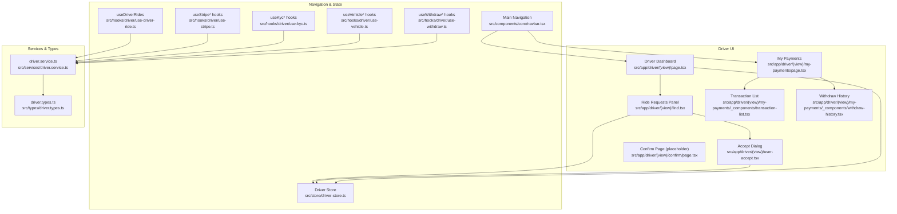

**Diagram sources**
- [page.tsx](file://src/app/driver/(view)/page.tsx#L1-L164)
- [find.tsx](file://src/app/driver/(view)/find.tsx#L1-L241)
- [user-accept.tsx](file://src/app/driver/(view)/user-accept.tsx#L1-L217)
- [confirm/page.tsx](file://src/app/driver/(view)/confirm/page.tsx#L1-L223)
- [my-payments/page.tsx](file://src/app/driver/(view)/my-payments/page.tsx#L1-L94)
- [transaction-list.tsx](file://src/app/driver/(view)/my-payments/_components/transaction-list.tsx#L1-L58)
- [withdraw-history.tsx](file://src/app/driver/(view)/my-payments/_components/withdraw-history.tsx#L1-L60)
- [navbar.tsx:59-64](file://src/components/core/navbar.tsx#L59-L64)
- [driver-store.ts:1-37](file://src/store/driver-store.ts#L1-L37)
- [use-driver-ride.ts:1-35](file://src/hooks/driver/use-driver-ride.ts#L1-L35)
- [use-stripe.ts:1-49](file://src/hooks/driver/use-stripe.ts#L1-L49)
- [use-kyc.ts:1-43](file://src/hooks/driver/use-kyc.ts#L1-L43)
- [use-vehicle.ts:1-57](file://src/hooks/driver/use-vehicle.ts#L1-L57)
- [use-withdraw.ts:1-50](file://src/hooks/driver/use-withdraw.ts#L1-L50)
- [driver.service.ts:1-97](file://src/services/driver.service.ts#L1-L97)
- [driver.types.ts:1-129](file://src/types/driver.types.ts#L1-L129)

**Section sources**
- [page.tsx](file://src/app/driver/(view)/page.tsx#L1-L164)
- [find.tsx](file://src/app/driver/(view)/find.tsx#L1-L241)
- [user-accept.tsx](file://src/app/driver/(view)/user-accept.tsx#L1-L217)
- [confirm/page.tsx](file://src/app/driver/(view)/confirm/page.tsx#L1-L223)
- [my-payments/page.tsx](file://src/app/driver/(view)/my-payments/page.tsx#L1-L94)
- [transaction-list.tsx](file://src/app/driver/(view)/my-payments/_components/transaction-list.tsx#L1-L58)
- [withdraw-history.tsx](file://src/app/driver/(view)/my-payments/_components/withdraw-history.tsx#L1-L60)
- [navbar.tsx:59-64](file://src/components/core/navbar.tsx#L59-L64)
- [driver-store.ts:1-37](file://src/store/driver-store.ts#L1-L37)
- [use-driver-ride.ts:1-35](file://src/hooks/driver/use-driver-ride.ts#L1-L35)
- [use-stripe.ts:1-49](file://src/hooks/driver/use-stripe.ts#L1-L49)
- [use-kyc.ts:1-43](file://src/hooks/driver/use-kyc.ts#L1-L43)
- [use-vehicle.ts:1-57](file://src/hooks/driver/use-vehicle.ts#L1-L57)
- [use-withdraw.ts:1-50](file://src/hooks/driver/use-withdraw.ts#L1-L50)
- [driver.service.ts:1-97](file://src/services/driver.service.ts#L1-L97)
- [driver.types.ts:1-129](file://src/types/driver.types.ts#L1-L129)

## Core Components
- Driver Dashboard
  - Displays a map with current location marker and controls to re-center.
  - Integrates with a local store for location and online status.
  - Shows available ride requests when online.
- Ride Request Panel
  - Online/offline toggle emits socket events to go online/offline.
  - Lists incoming ride requests with key details and actions (Accept/Decline).
  - Uses a dialog to confirm acceptance and navigate to ride details.
- My Payments
  - Shows balance placeholder and tabs for Transaction and Withdraw request history.
  - Provides navigation to connect Stripe or request withdrawal depending on connection status.
  - **Note**: Currently hidden from main navigation but accessible via direct URL (/driver/my-payments) and user profile dropdown.
- Data Layer
  - React Query hooks encapsulate API calls for rides, vehicles, KYC, Stripe, and withdrawals.
  - Services define REST endpoints and payloads.
  - Types define contracts for drivers, vehicles, KYC, Stripe, and withdrawals.

**Section sources**
- [page.tsx](file://src/app/driver/(view)/page.tsx#L1-L164)
- [find.tsx](file://src/app/driver/(view)/find.tsx#L1-L241)
- [user-accept.tsx](file://src/app/driver/(view)/user-accept.tsx#L1-L217)
- [my-payments/page.tsx](file://src/app/driver/(view)/my-payments/page.tsx#L1-L94)
- [navbar.tsx:59-64](file://src/components/core/navbar.tsx#L59-L64)
- [use-driver-ride.ts:1-35](file://src/hooks/driver/use-driver-ride.ts#L1-L35)
- [use-stripe.ts:1-49](file://src/hooks/driver/use-stripe.ts#L1-L49)
- [use-kyc.ts:1-43](file://src/hooks/driver/use-kyc.ts#L1-L43)
- [use-vehicle.ts:1-57](file://src/hooks/driver/use-vehicle.ts#L1-L57)
- [use-withdraw.ts:1-50](file://src/hooks/driver/use-withdraw.ts#L1-L50)
- [driver.service.ts:1-97](file://src/services/driver.service.ts#L1-L97)
- [driver.types.ts:1-129](file://src/types/driver.types.ts#L1-L129)

## Architecture Overview
The driver feature set combines client-side UI, real-time sockets, local state, and server APIs:
- Real-time flow: The driver toggles online/offline via socket events; incoming requests are added to local store; acceptance/decline emit socket events.
- Data flow: React Query hooks call service functions which perform HTTP requests; responses populate UI components.
- Payment flow: Stripe Connect checks and connection are handled by dedicated hooks and services; withdrawal requests are created and listed via withdraw hooks.
- **Updated Navigation Flow**: The My Payments feature is currently temporarily hidden from the main driver navigation menu but remains accessible via direct URL and user profile dropdown.

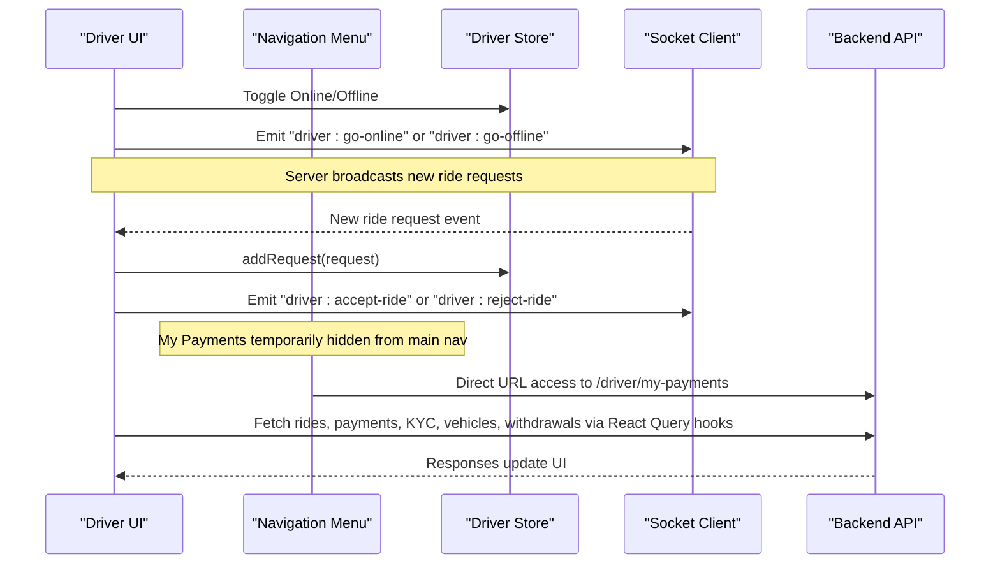

**Diagram sources**
- [find.tsx](file://src/app/driver/(view)/find.tsx#L1-L241)
- [user-accept.tsx](file://src/app/driver/(view)/user-accept.tsx#L1-L217)
- [navbar.tsx:59-64](file://src/components/core/navbar.tsx#L59-L64)
- [driver-store.ts:1-37](file://src/store/driver-store.ts#L1-L37)
- [use-driver-ride.ts:1-35](file://src/hooks/driver/use-driver-ride.ts#L1-L35)
- [use-stripe.ts:1-49](file://src/hooks/driver/use-stripe.ts#L1-L49)
- [use-kyc.ts:1-43](file://src/hooks/driver/use-kyc.ts#L1-L43)
- [use-vehicle.ts:1-57](file://src/hooks/driver/use-vehicle.ts#L1-L57)
- [use-withdraw.ts:1-50](file://src/hooks/driver/use-withdraw.ts#L1-L50)
- [driver.service.ts:1-97](file://src/services/driver.service.ts#L1-L97)

## Detailed Component Analysis

### Driver Dashboard and Map Integration
- Responsibilities
  - Render map with current location marker and zoom controls.
  - Follow user location automatically unless manually panned.
  - Provide a "Re-center" control to return to live location.
- Implementation highlights
  - Uses a custom map component with markers and controls.
  - Tracks internal vs external map movements to avoid conflicts.
  - Integrates with driver store for location and online state.

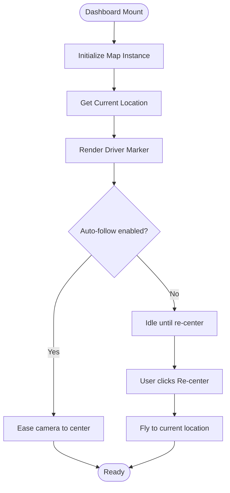

**Diagram sources**
- [page.tsx](file://src/app/driver/(view)/page.tsx#L1-L164)
- [driver-store.ts:1-37](file://src/store/driver-store.ts#L1-L37)

**Section sources**
- [page.tsx](file://src/app/driver/(view)/page.tsx#L1-L164)
- [driver-store.ts:1-37](file://src/store/driver-store.ts#L1-L37)

### Ride Acceptance Workflow
- Responsibilities
  - Display incoming ride requests when online.
  - Allow drivers to accept or decline requests.
  - Navigate to ride details after acceptance.
- Implementation highlights
  - Online switch emits socket events to register/unregister availability.
  - Incoming requests are stored locally and rendered in a scrollable list.
  - Accept dialog shows passenger info, route, fare, seats, and timing.
  - Accept action emits a socket event and navigates to the ride detail page.

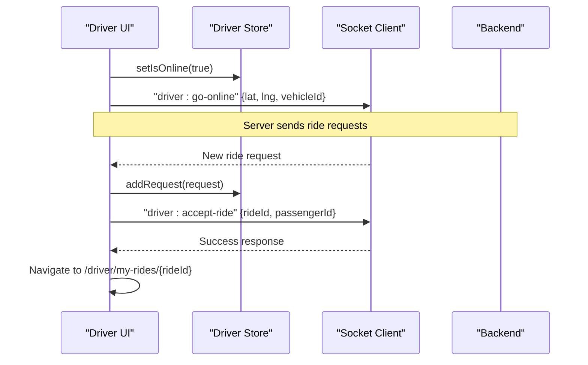

**Diagram sources**
- [find.tsx](file://src/app/driver/(view)/find.tsx#L1-L241)
- [user-accept.tsx](file://src/app/driver/(view)/user-accept.tsx#L1-L217)
- [driver-store.ts:1-37](file://src/store/driver-store.ts#L1-L37)

**Section sources**
- [find.tsx](file://src/app/driver/(view)/find.tsx#L1-L241)
- [user-accept.tsx](file://src/app/driver/(view)/user-accept.tsx#L1-L217)
- [driver-store.ts:1-37](file://src/store/driver-store.ts#L1-L37)

### Earnings Management and Stripe Connect
- Responsibilities
  - Display balance placeholder and tabs for transaction and withdrawal history.
  - Provide actions to connect Stripe or request withdrawal based on connection status.
- Implementation highlights
  - Tabs separate transaction list and withdrawal history views.
  - Conditional rendering routes to Stripe connect or withdrawal page depending on connection flag.
  - Transaction and withdrawal lists currently use mock data placeholders.
  - **Current Access Method**: Feature is temporarily hidden from main navigation but accessible via direct URL (/driver/my-payments) and user profile dropdown menu.

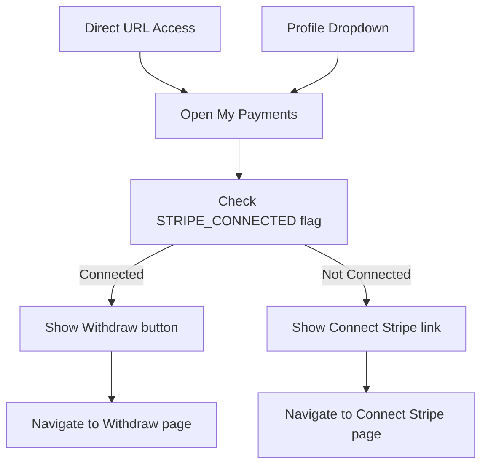

**Diagram sources**
- [my-payments/page.tsx](file://src/app/driver/(view)/my-payments/page.tsx#L1-L94)
- [transaction-list.tsx](file://src/app/driver/(view)/my-payments/_components/transaction-list.tsx#L1-L58)
- [withdraw-history.tsx](file://src/app/driver/(view)/my-payments/_components/withdraw-history.tsx#L1-L60)
- [navbar.tsx:59-64](file://src/components/core/navbar.tsx#L59-L64)

**Section sources**
- [my-payments/page.tsx](file://src/app/driver/(view)/my-payments/page.tsx#L1-L94)
- [transaction-list.tsx](file://src/app/driver/(view)/my-payments/_components/transaction-list.tsx#L1-L58)
- [withdraw-history.tsx](file://src/app/driver/(view)/my-payments/_components/withdraw-history.tsx#L1-L60)
- [navbar.tsx:59-64](file://src/components/core/navbar.tsx#L59-L64)

### Navigation Structure
- Main Driver Navigation
  - Home (/driver)
  - My Rides (/driver/my-rides)
  - Help & Support (/help)
  - **Note**: My Payments link is currently commented out from main navigation
- User Profile Navigation
  - Personal Info (/me)
  - Refund Amount (/refund)
  - My Payments (/my-payments) - Available in profile dropdown
  - My Vehicles (/my-vehicles)
  - Additional settings and support options
- **Temporary Change**: The 'My Payments' navigation link has been temporarily hidden from the main driver navigation menu in navbar.tsx (line 62), but remains fully functional and accessible via direct URL and user profile dropdown.

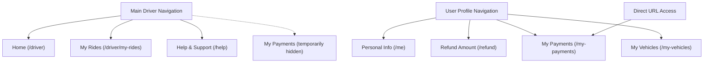

**Diagram sources**
- [navbar.tsx:59-64](file://src/components/core/navbar.tsx#L59-L64)
- [navbar.tsx:123-149](file://src/components/core/navbar.tsx#L123-L149)

**Section sources**
- [navbar.tsx:59-64](file://src/components/core/navbar.tsx#L59-L64)
- [navbar.tsx:123-149](file://src/components/core/navbar.tsx#L123-L149)

### Stripe Connect Integration
- Responsibilities
  - Check Stripe connection and account status.
  - Connect new Stripe accounts or link existing ones.
  - Disconnect Stripe accounts.
- Implementation highlights
  - Dedicated hooks wrap service calls and invalidate queries on success.
  - Service functions call backend endpoints for connection checks and operations.

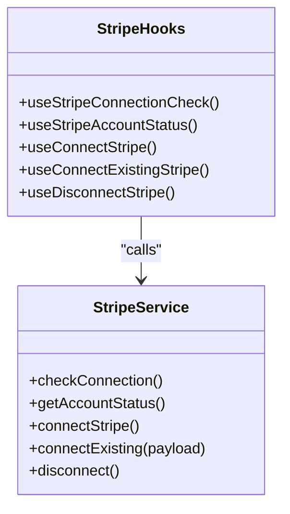

**Diagram sources**
- [use-stripe.ts:1-49](file://src/hooks/driver/use-stripe.ts#L1-L49)
- [driver.service.ts:1-97](file://src/services/driver.service.ts#L1-L97)

**Section sources**
- [use-stripe.ts:1-49](file://src/hooks/driver/use-stripe.ts#L1-L49)
- [driver.service.ts:1-97](file://src/services/driver.service.ts#L1-L97)

### Withdrawal Requests
- Responsibilities
  - Create withdrawal requests.
  - List driver's own withdrawals and all withdrawals (admin).
  - Change withdrawal status (admin).
- Implementation highlights
  - Hooks encapsulate create, list, and status change operations.
  - Service builds query parameters for filtering and pagination.

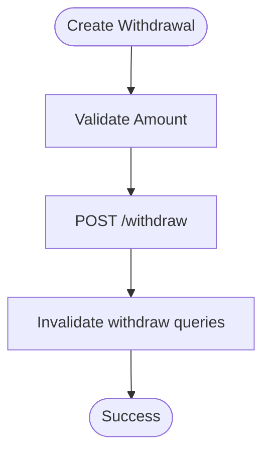

**Diagram sources**
- [use-withdraw.ts:1-50](file://src/hooks/driver/use-withdraw.ts#L1-L50)
- [driver.service.ts:1-97](file://src/services/driver.service.ts#L1-L97)

**Section sources**
- [use-withdraw.ts:1-50](file://src/hooks/driver/use-withdraw.ts#L1-L50)
- [driver.service.ts:1-97](file://src/services/driver.service.ts#L1-L97)

### Driver Onboarding, KYC Verification, and Vehicle Management
- Responsibilities
  - Manage driver vehicles (add, update, delete, list).
  - Handle KYC setup and status changes.
- Implementation highlights
  - Vehicle hooks manage CRUD operations and invalidate related queries.
  - KYC hooks support setup and admin status updates.
  - Services define endpoints for vehicles and provider/KYC resources.

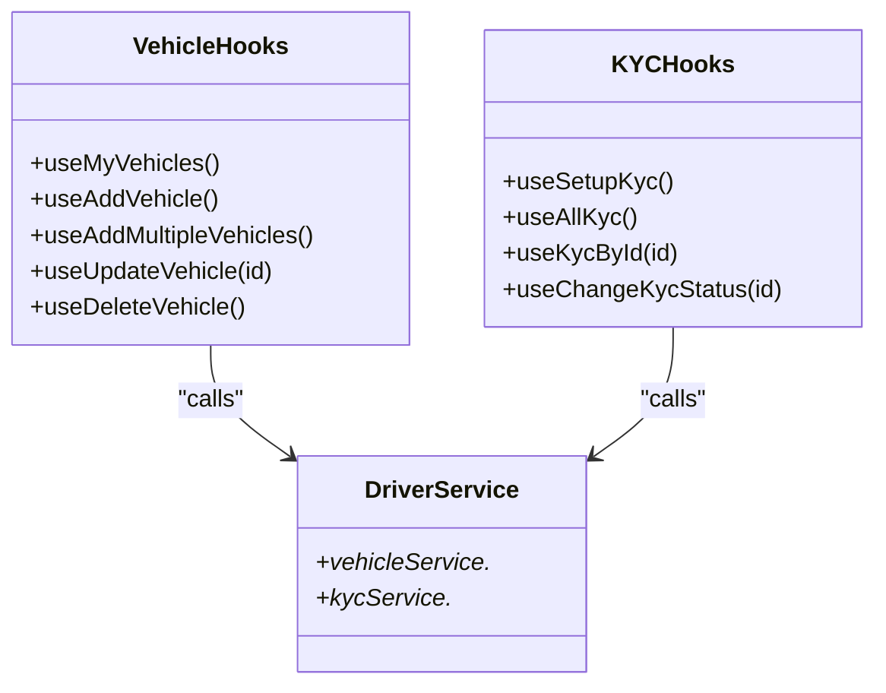

**Diagram sources**
- [use-vehicle.ts:1-57](file://src/hooks/driver/use-vehicle.ts#L1-L57)
- [use-kyc.ts:1-43](file://src/hooks/driver/use-kyc.ts#L1-L43)
- [driver.service.ts:1-97](file://src/services/driver.service.ts#L1-L97)

**Section sources**
- [use-vehicle.ts:1-57](file://src/hooks/driver/use-vehicle.ts#L1-L57)
- [use-kyc.ts:1-43](file://src/hooks/driver/use-kyc.ts#L1-L43)
- [driver.service.ts:1-97](file://src/services/driver.service.ts#L1-L97)

### Real-Time Ride Acceptance Workflow
- Responsibilities
  - Maintain online/offline state and broadcast presence.
  - Receive and display incoming ride requests.
  - Accept or decline requests via socket events.
- Implementation highlights
  - Online switch emits socket events with current location and vehicle ID.
  - Requests are persisted in local store and removed upon acceptance/decline.
  - Accept dialog triggers acceptance and navigates to ride details.

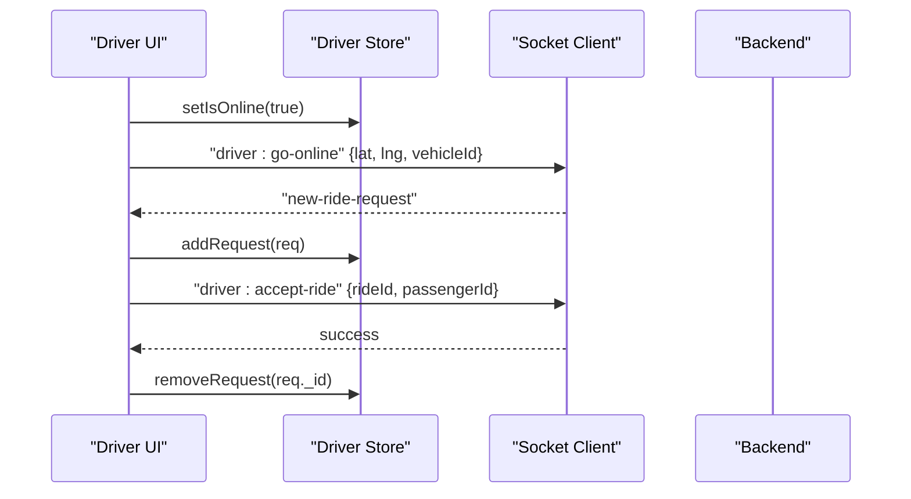

**Diagram sources**
- [find.tsx](file://src/app/driver/(view)/find.tsx#L1-L241)
- [user-accept.tsx](file://src/app/driver/(view)/user-accept.tsx#L1-L217)
- [driver-store.ts:1-37](file://src/store/driver-store.ts#L1-L37)

**Section sources**
- [find.tsx](file://src/app/driver/(view)/find.tsx#L1-L241)
- [user-accept.tsx](file://src/app/driver/(view)/user-accept.tsx#L1-L217)
- [driver-store.ts:1-37](file://src/store/driver-store.ts#L1-L37)

### Passenger Communication
- Responsibilities
  - Enable messaging between driver and passenger during rides.
- Implementation highlights
  - Chat components exist under my-rides detail pages for both passenger and driver views.
  - These components integrate with chat services and types defined elsewhere in the app.

[No sources needed since this section doesn't analyze specific files]

### Performance Metrics Tracking
- Responsibilities
  - Track driver performance indicators such as ratings and completed trips.
- Implementation highlights
  - Review and rating utilities exist in shared hooks and services.
  - Driver ride listing supports filtering by status to compute metrics.

**Section sources**
- [use-driver-ride.ts:1-35](file://src/hooks/driver/use-driver-ride.ts#L1-L35)

## Dependency Analysis
This section maps dependencies among driver components, hooks, services, and types.

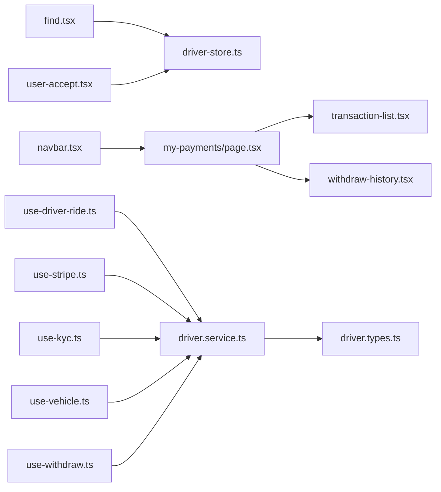

**Diagram sources**
- [find.tsx](file://src/app/driver/(view)/find.tsx#L1-L241)
- [user-accept.tsx](file://src/app/driver/(view)/user-accept.tsx#L1-L217)
- [my-payments/page.tsx](file://src/app/driver/(view)/my-payments/page.tsx#L1-L94)
- [transaction-list.tsx](file://src/app/driver/(view)/my-payments/_components/transaction-list.tsx#L1-L58)
- [withdraw-history.tsx](file://src/app/driver/(view)/my-payments/_components/withdraw-history.tsx#L1-L60)
- [navbar.tsx:59-64](file://src/components/core/navbar.tsx#L59-L64)
- [use-driver-ride.ts:1-35](file://src/hooks/driver/use-driver-ride.ts#L1-L35)
- [use-stripe.ts:1-49](file://src/hooks/driver/use-stripe.ts#L1-L49)
- [use-kyc.ts:1-43](file://src/hooks/driver/use-kyc.ts#L1-L43)
- [use-vehicle.ts:1-57](file://src/hooks/driver/use-vehicle.ts#L1-L57)
- [use-withdraw.ts:1-50](file://src/hooks/driver/use-withdraw.ts#L1-L50)
- [driver.service.ts:1-97](file://src/services/driver.service.ts#L1-L97)
- [driver.types.ts:1-129](file://src/types/driver.types.ts#L1-L129)

**Section sources**
- [find.tsx](file://src/app/driver/(view)/find.tsx#L1-L241)
- [user-accept.tsx](file://src/app/driver/(view)/user-accept.tsx#L1-L217)
- [my-payments/page.tsx](file://src/app/driver/(view)/my-payments/page.tsx#L1-L94)
- [transaction-list.tsx](file://src/app/driver/(view)/my-payments/_components/transaction-list.tsx#L1-L58)
- [withdraw-history.tsx](file://src/app/driver/(view)/my-payments/_components/withdraw-history.tsx#L1-L60)
- [navbar.tsx:59-64](file://src/components/core/navbar.tsx#L59-L64)
- [use-driver-ride.ts:1-35](file://src/hooks/driver/use-driver-ride.ts#L1-L35)
- [use-stripe.ts:1-49](file://src/hooks/driver/use-stripe.ts#L1-L49)
- [use-kyc.ts:1-43](file://src/hooks/driver/use-kyc.ts#L1-L43)
- [use-vehicle.ts:1-57](file://src/hooks/driver/use-vehicle.ts#L1-L57)
- [use-withdraw.ts:1-50](file://src/hooks/driver/use-withdraw.ts#L1-L50)
- [driver.service.ts:1-97](file://src/services/driver.service.ts#L1-L97)
- [driver.types.ts:1-129](file://src/types/driver.types.ts#L1-L129)

## Performance Considerations
- Prefer optimistic UI updates for online/offline toggle and request removal to improve responsiveness.
- Debounce map re-centering and location updates to reduce unnecessary renders.
- Use React Query caching and invalidation strategically to minimize redundant network calls.
- Avoid heavy computations in render paths; offload to memoized values or background tasks.
- For real-time events, ensure listeners are properly cleaned up to prevent memory leaks.
- **Navigation Optimization**: Since My Payments is temporarily hidden from main navigation, consider lazy loading the component to improve initial page load performance.

[No sources needed since this section provides general guidance]

## Troubleshooting Guide
- Cannot go online
  - Ensure location permission is granted and a vehicle is assigned.
  - Verify socket connection and that vehicleId is present before emitting online events.
- No ride requests received
  - Confirm online status and that socket events are emitted correctly.
  - Check server-side broadcasting and driver presence registration.
- Accept/Decline not reflected
  - Validate socket acknowledgment handling and local store updates.
  - Ensure request IDs match when removing from store.
- **My Payments Access Issues**
  - If unable to access My Payments via main navigation, use direct URL: /driver/my-payments
  - Alternatively, access through user profile dropdown menu under "My payments"
  - Verify the navigation link is temporarily hidden and will be restored later
- Stripe Connect issues
  - Check connection status endpoint and handle redirect URLs returned by connect endpoints.
  - Invalidate queries after successful connect/disconnect operations.
- Withdrawal failures
  - Validate amount against available balance and Stripe payout settings.
  - Inspect error messages from backend and retry with appropriate feedback.

**Section sources**
- [find.tsx](file://src/app/driver/(view)/find.tsx#L1-L241)
- [user-accept.tsx](file://src/app/driver/(view)/user-accept.tsx#L1-L217)
- [navbar.tsx:59-64](file://src/components/core/navbar.tsx#L59-L64)
- [use-stripe.ts:1-49](file://src/hooks/driver/use-stripe.ts#L1-L49)
- [use-withdraw.ts:1-50](file://src/hooks/driver/use-withdraw.ts#L1-L50)

## Conclusion
The driver feature set integrates real-time ride acceptance, map-based navigation, earnings management, and onboarding workflows. The architecture cleanly separates UI, state, hooks, services, and types, enabling extensibility and maintainability. 

**Current Status**: The My Payments feature is temporarily hidden from the main driver navigation menu but remains fully functional and accessible via direct URL (/driver/my-payments) and user profile dropdown. This temporary change allows for focused development while maintaining feature availability.

Future enhancements should focus on replacing placeholders with live data, implementing robust error handling, adding comprehensive performance metrics and analytics, and restoring the My Payments link to the main navigation when ready.