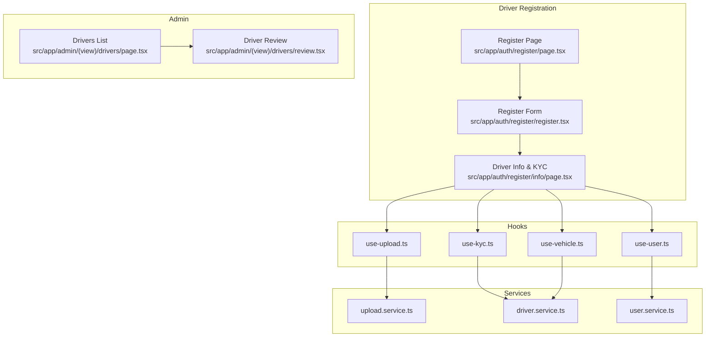
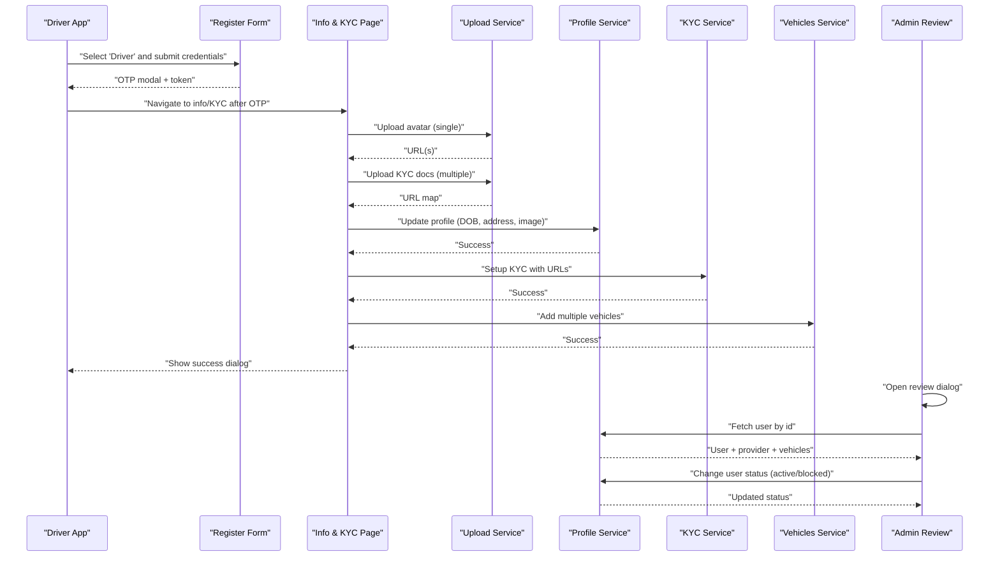
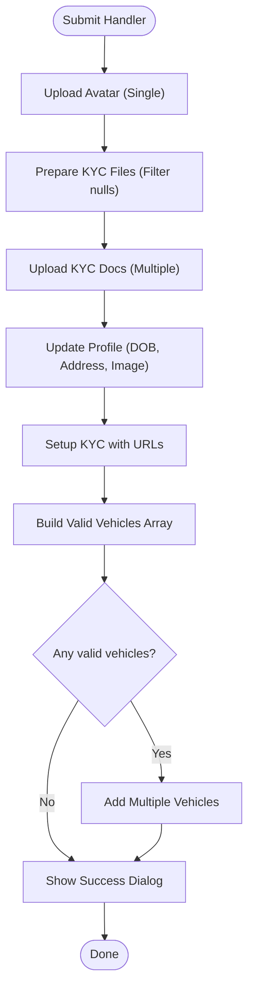
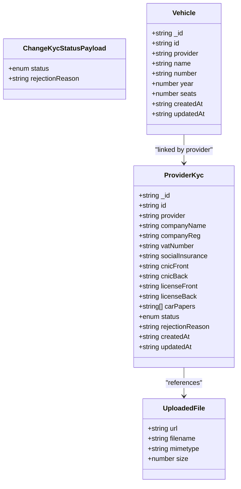
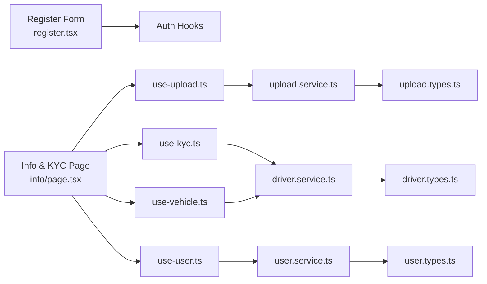

# Driver Onboarding & KYC Verification

<cite>
**Referenced Files in This Document**
- [page.tsx](file://src/app/auth/register/page.tsx)
- [register.tsx](file://src/app/auth/register/register.tsx)
- [info/page.tsx](file://src/app/auth/register/info/page.tsx)
- [use-kyc.ts](file://src/hooks/driver/use-kyc.ts)
- [use-vehicle.ts](file://src/hooks/driver/use-vehicle.ts)
- [driver.service.ts](file://src/services/driver.service.ts)
- [use-upload.ts](file://src/hooks/shared/use-upload.ts)
- [upload.service.ts](file://src/services/upload.service.ts)
- [driver.types.ts](file://src/types/driver.types.ts)
- [upload.types.ts](file://src/types/upload.types.ts)
- [use-user.ts](file://src/hooks/shared/use-user.ts)
- [user.service.ts](file://src/services/user.service.ts)
- [drivers/review.tsx](file://src/app/admin/(view)/drivers/review.tsx)
- [drivers/page.tsx](file://src/app/admin/(view)/drivers/page.tsx)
</cite>

## Table of Contents
1. [Introduction](#introduction)
2. [Project Structure](#project-structure)
3. [Core Components](#core-components)
4. [Architecture Overview](#architecture-overview)
5. [Detailed Component Analysis](#detailed-component-analysis)
6. [Dependency Analysis](#dependency-analysis)
7. [Performance Considerations](#performance-considerations)
8. [Troubleshooting Guide](#troubleshooting-guide)
9. [Conclusion](#conclusion)

## Introduction
This document explains the driver onboarding and Know Your Customer (KYC) verification process implemented in the application. It covers:
- Multi-step registration flow for drivers, including personal information collection and OTP verification
- Vehicle management for adding vehicles and uploading documents
- KYC submission workflow with document validation, approval processes, and status tracking
- File upload handling, form validation, and progress feedback during the onboarding funnel
- Security considerations for sensitive document handling and privacy compliance
- User experience optimizations for lengthy verification processes

## Project Structure
The onboarding and KYC features span several layers:
- UI pages for registration and driver info submission
- React Query hooks for mutations and queries
- Service layer for API calls
- Type definitions for payloads and responses
- Admin review interface for approving or blocking drivers

**Diagram sources**
- [page.tsx:1-41](file://src/app/auth/register/page.tsx#L1-L41)
- [register.tsx:1-219](file://src/app/auth/register/register.tsx#L1-L219)
- [info/page.tsx:105-201](file://src/app/auth/register/info/page.tsx#L105-L201)
- [use-upload.ts:1-17](file://src/hooks/shared/use-upload.ts#L1-L17)
- [upload.service.ts:1-20](file://src/services/upload.service.ts#L1-L20)
- [use-kyc.ts:1-43](file://src/hooks/driver/use-kyc.ts#L1-L43)
- [use-vehicle.ts:1-57](file://src/hooks/driver/use-vehicle.ts#L1-L57)
- [driver.service.ts:18-48](file://src/services/driver.service.ts#L18-L48)
- [use-user.ts:30-37](file://src/hooks/shared/use-user.ts#L30-L37)
- [user.service.ts:14-31](file://src/services/user.service.ts#L14-L31)
- [drivers/page.tsx](file://src/app/admin/(view)/drivers/page.tsx#L162-L591)
- [drivers/review.tsx](file://src/app/admin/(view)/drivers/review.tsx#L1-L307)

**Section sources**
- [page.tsx:1-41](file://src/app/auth/register/page.tsx#L1-L41)
- [register.tsx:1-219](file://src/app/auth/register/register.tsx#L1-L219)
- [info/page.tsx:105-201](file://src/app/auth/register/info/page.tsx#L105-L201)
- [use-upload.ts:1-17](file://src/hooks/shared/use-upload.ts#L1-L17)
- [upload.service.ts:1-20](file://src/services/upload.service.ts#L1-L20)
- [use-kyc.ts:1-43](file://src/hooks/driver/use-kyc.ts#L1-L43)
- [use-vehicle.ts:1-57](file://src/hooks/driver/use-vehicle.ts#L1-L57)
- [driver.service.ts:18-48](file://src/services/driver.service.ts#L18-L48)
- [use-user.ts:30-37](file://src/hooks/shared/use-user.ts#L30-L37)
- [user.service.ts:14-31](file://src/services/user.service.ts#L14-L31)
- [drivers/page.tsx](file://src/app/admin/(view)/drivers/page.tsx#L162-L591)
- [drivers/review.tsx](file://src/app/admin/(view)/drivers/review.tsx#L1-L307)

## Core Components
- Registration entry point and role selection
  - The register page renders a split layout and delegates to the registration form component.
  - The form supports passenger vs driver roles, collects name, email, phone, and triggers OTP verification.
- Driver info and KYC submission
  - Collects date of birth, address, avatar, multiple vehicle details, and KYC documents (CNIC front/back, driving license front/back, car papers).
  - Uploads files via single/multiple endpoints, updates profile, submits KYC setup, and adds vehicles.
- Admin review and user status management
  - Lists drivers with filters and pagination.
  - Opens a review dialog to inspect uploaded documents and vehicle details, then change user status (active/blocked).

Key implementation references:
- Registration form and OTP modal: [register.tsx:28-219](file://src/app/auth/register/register.tsx#L28-L219)
- Driver info/KYC submission: [info/page.tsx:105-201](file://src/app/auth/register/info/page.tsx#L105-L201)
- Upload hooks and services: [use-upload.ts:1-17](file://src/hooks/shared/use-upload.ts#L1-L17), [upload.service.ts:1-20](file://src/services/upload.service.ts#L1-L20)
- KYC hooks and service: [use-kyc.ts:1-43](file://src/hooks/driver/use-kyc.ts#L1-L43), [driver.service.ts:35-48](file://src/services/driver.service.ts#L35-L48)
- Vehicle hooks and service: [use-vehicle.ts:1-57](file://src/hooks/driver/use-vehicle.ts#L1-L57), [driver.service.ts:18-33](file://src/services/driver.service.ts#L18-L33)
- User update hook and service: [use-user.ts:30-37](file://src/hooks/shared/use-user.ts#L30-L37), [user.service.ts:14-31](file://src/services/user.service.ts#L14-L31)
- Admin drivers list and review: [drivers/page.tsx](file://src/app/admin/(view)/drivers/page.tsx#L162-L591), [drivers/review.tsx](file://src/app/admin/(view)/drivers/review.tsx#L1-L307)

**Section sources**
- [register.tsx:28-219](file://src/app/auth/register/register.tsx#L28-L219)
- [info/page.tsx:105-201](file://src/app/auth/register/info/page.tsx#L105-L201)
- [use-upload.ts:1-17](file://src/hooks/shared/use-upload.ts#L1-L17)
- [upload.service.ts:1-20](file://src/services/upload.service.ts#L1-L20)
- [use-kyc.ts:1-43](file://src/hooks/driver/use-kyc.ts#L1-L43)
- [use-vehicle.ts:1-57](file://src/hooks/driver/use-vehicle.ts#L1-L57)
- [use-user.ts:30-37](file://src/hooks/shared/use-user.ts#L30-L37)
- [drivers/page.tsx](file://src/app/admin/(view)/drivers/page.tsx#L162-L591)
- [drivers/review.tsx](file://src/app/admin/(view)/drivers/review.tsx#L1-L307)

## Architecture Overview
The onboarding and KYC pipeline is composed of:
- Client-side forms collecting data and files
- React Query hooks orchestrating mutations and caching
- Services making HTTP requests to backend endpoints
- Admin UI for reviewing submissions and changing user status

**Diagram sources**
- [register.tsx:53-83](file://src/app/auth/register/register.tsx#L53-L83)
- [info/page.tsx:137-201](file://src/app/auth/register/info/page.tsx#L137-L201)
- [use-upload.ts:6-16](file://src/hooks/shared/use-upload.ts#L6-L16)
- [upload.service.ts:5-19](file://src/services/upload.service.ts#L5-L19)
- [use-user.ts:30-37](file://src/hooks/shared/use-user.ts#L30-L37)
- [user.service.ts:14-31](file://src/services/user.service.ts#L14-L31)
- [use-kyc.ts:12-16](file://src/hooks/driver/use-kyc.ts#L12-L16)
- [driver.service.ts:35-48](file://src/services/driver.service.ts#L35-L48)
- [use-vehicle.ts:34-40](file://src/hooks/driver/use-vehicle.ts#L34-L40)
- [drivers/review.tsx](file://src/app/admin/(view)/drivers/review.tsx#L19-L92)

## Detailed Component Analysis

### Registration Flow (Passenger/Driver Selection and OTP)
- Role selection toggles between passenger and driver.
- Validates phone number using a phone input library.
- Submits registration payload with role set to "provider" for drivers.
- Displays an OTP modal; upon successful verification, proceeds to next steps.

Implementation references:
- Role toggle and form fields: [register.tsx:100-166](file://src/app/auth/register/register.tsx#L100-L166)
- Phone parsing and validation: [register.tsx:53-83](file://src/app/auth/register/register.tsx#L53-L83)
- OTP modal integration: [register.tsx:202-219](file://src/app/auth/register/register.tsx#L202-L219)

**Section sources**
- [register.tsx:28-219](file://src/app/auth/register/register.tsx#L28-L219)

### Driver Information and KYC Submission
- Avatar upload: single file upload returns a URL used to update profile.
- KYC documents: CNIC front/back, driving license front/back, car papers are collected and uploaded via a single multi-file endpoint.
- Profile update: includes optional DOB, address, and profile image URL.
- KYC setup: sends mapped URLs to the KYC service.
- Vehicle management: allows adding multiple vehicles with model, number, year, seats; validates required fields before submission.

Implementation references:
- State and handlers for avatar, KYC files, vehicles: [info/page.tsx:105-136](file://src/app/auth/register/info/page.tsx#L105-L136)
- Submit handler orchestration: [info/page.tsx:137-201](file://src/app/auth/register/info/page.tsx#L137-L201)
- Upload single/multiple hooks: [use-upload.ts:6-16](file://src/hooks/shared/use-upload.ts#L6-L16)
- Upload service endpoints: [upload.service.ts:5-19](file://src/services/upload.service.ts#L5-L19)
- Profile update hook/service: [use-user.ts:30-37](file://src/hooks/shared/use-user.ts#L30-L37), [user.service.ts:14-31](file://src/services/user.service.ts#L14-L31)
- KYC setup hook/service: [use-kyc.ts:12-16](file://src/hooks/driver/use-kyc.ts#L12-L16), [driver.service.ts:35-48](file://src/services/driver.service.ts#L35-L48)
- Multiple vehicles mutation: [use-vehicle.ts:34-40](file://src/hooks/driver/use-vehicle.ts#L34-L40), [driver.service.ts:25-26](file://src/services/driver.service.ts#L25-L26)

**Diagram sources**
- [info/page.tsx:137-201](file://src/app/auth/register/info/page.tsx#L137-L201)
- [use-upload.ts:6-16](file://src/hooks/shared/use-upload.ts#L6-L16)
- [upload.service.ts:5-19](file://src/services/upload.service.ts#L5-L19)
- [use-user.ts:30-37](file://src/hooks/shared/use-user.ts#L30-L37)
- [use-kyc.ts:12-16](file://src/hooks/driver/use-kyc.ts#L12-L16)
- [use-vehicle.ts:34-40](file://src/hooks/driver/use-vehicle.ts#L34-L40)

**Section sources**
- [info/page.tsx:105-201](file://src/app/auth/register/info/page.tsx#L105-L201)
- [use-upload.ts:1-17](file://src/hooks/shared/use-upload.ts#L1-L17)
- [upload.service.ts:1-20](file://src/services/upload.service.ts#L1-L20)
- [use-user.ts:30-37](file://src/hooks/shared/use-user.ts#L30-L37)
- [user.service.ts:14-31](file://src/services/user.service.ts#L14-L31)
- [use-kyc.ts:1-43](file://src/hooks/driver/use-kyc.ts#L1-L43)
- [use-vehicle.ts:1-57](file://src/hooks/driver/use-vehicle.ts#L1-L57)

### Vehicle Management System
- Adds one or more vehicles with fields: name (model), number, year, seats.
- Uses a typed payload array for bulk creation.
- Invalidates cached vehicle lists after mutations.

Implementation references:
- Create multiple vehicles mutation: [use-vehicle.ts:34-40](file://src/hooks/driver/use-vehicle.ts#L34-L40)
- Service endpoint mapping: [driver.service.ts:25-26](file://src/services/driver.service.ts#L25-L26)
- Payload types: [driver.types.ts:13-27](file://src/types/driver.types.ts#L13-L27)

**Section sources**
- [use-vehicle.ts:1-57](file://src/hooks/driver/use-vehicle.ts#L1-L57)
- [driver.service.ts:18-33](file://src/services/driver.service.ts#L18-L33)
- [driver.types.ts:13-27](file://src/types/driver.types.ts#L13-L27)

### KYC Verification Workflow
- Driver submits KYC documents via setup endpoint.
- Admin reviews submitted documents and vehicle details, then changes user status.
- Status values include pending, verified, rejected for KYC; active, blocked for user account.

Implementation references:
- KYC setup mutation: [use-kyc.ts:12-16](file://src/hooks/driver/use-kyc.ts#L12-L16)
- KYC service endpoints: [driver.service.ts:35-48](file://src/services/driver.service.ts#L35-L48)
- Admin review dialog fetching user details and updating status: [drivers/review.tsx](file://src/app/admin/(view)/drivers/review.tsx#L19-L92)
- User status change hook/service: [use-user.ts:82-92](file://src/hooks/shared/use-user.ts#L82-L92), [user.service.ts:114-116](file://src/services/user.service.ts#L114-L116)
- KYC type definitions: [driver.types.ts:29-63](file://src/types/driver.types.ts#L29-L63)

**Diagram sources**
- [driver.types.ts:1-63](file://src/types/driver.types.ts#L1-L63)
- [upload.types.ts:1-10](file://src/types/upload.types.ts#L1-L10)

**Section sources**
- [use-kyc.ts:1-43](file://src/hooks/driver/use-kyc.ts#L1-L43)
- [driver.service.ts:35-48](file://src/services/driver.service.ts#L35-L48)
- [drivers/review.tsx](file://src/app/admin/(view)/drivers/review.tsx#L1-L307)
- [use-user.ts:82-92](file://src/hooks/shared/use-user.ts#L82-L92)
- [user.service.ts:114-116](file://src/services/user.service.ts#L114-L116)
- [driver.types.ts:1-63](file://src/types/driver.types.ts#L1-L63)
- [upload.types.ts:1-10](file://src/types/upload.types.ts#L1-L10)

### Admin Review Interface
- Lists drivers with search, filters, and pagination.
- Opens a review dialog to view uploaded documents and vehicle info.
- Allows verifying (activate) or blocking a driver.

Implementation references:
- Drivers list page: [drivers/page.tsx](file://src/app/admin/(view)/drivers/page.tsx#L162-L591)
- Review dialog logic: [drivers/review.tsx](file://src/app/admin/(view)/drivers/review.tsx#L1-L307)

**Section sources**
- [drivers/page.tsx](file://src/app/admin/(view)/drivers/page.tsx#L162-L591)
- [drivers/review.tsx](file://src/app/admin/(view)/drivers/review.tsx#L1-L307)

## Dependency Analysis
- UI components depend on React Query hooks for state synchronization and caching.
- Hooks depend on service modules that wrap HTTP calls.
- Types define contracts across services and UI.

**Diagram sources**
- [register.tsx:1-219](file://src/app/auth/register/register.tsx#L1-L219)
- [info/page.tsx:1-445](file://src/app/auth/register/info/page.tsx#L1-L445)
- [use-upload.ts:1-17](file://src/hooks/shared/use-upload.ts#L1-L17)
- [use-kyc.ts:1-43](file://src/hooks/driver/use-kyc.ts#L1-L43)
- [use-vehicle.ts:1-57](file://src/hooks/driver/use-vehicle.ts#L1-L57)
- [use-user.ts:1-117](file://src/hooks/shared/use-user.ts#L1-L117)
- [upload.service.ts:1-20](file://src/services/upload.service.ts#L1-L20)
- [driver.service.ts:1-97](file://src/services/driver.service.ts#L1-L97)
- [user.service.ts:1-117](file://src/services/user.service.ts#L1-L117)
- [upload.types.ts:1-10](file://src/types/upload.types.ts#L1-L10)
- [driver.types.ts:1-129](file://src/types/driver.types.ts#L1-L129)

**Section sources**
- [register.tsx:1-219](file://src/app/auth/register/register.tsx#L1-L219)
- [info/page.tsx:1-445](file://src/app/auth/register/info/page.tsx#L1-L445)
- [use-upload.ts:1-17](file://src/hooks/shared/use-upload.ts#L1-L17)
- [use-kyc.ts:1-43](file://src/hooks/driver/use-kyc.ts#L1-L43)
- [use-vehicle.ts:1-57](file://src/hooks/driver/use-vehicle.ts#L1-L57)
- [use-user.ts:1-117](file://src/hooks/shared/use-user.ts#L1-L117)
- [upload.service.ts:1-20](file://src/services/upload.service.ts#L1-L20)
- [driver.service.ts:1-97](file://src/services/driver.service.ts#L1-L97)
- [user.service.ts:1-117](file://src/services/user.service.ts#L1-L117)
- [upload.types.ts:1-10](file://src/types/upload.types.ts#L1-L10)
- [driver.types.ts:1-129](file://src/types/driver.types.ts#L1-L129)

## Performance Considerations
- Batch uploads: Use the multiple upload endpoint to reduce round trips when submitting KYC documents.
- Mutation invalidation: Ensure query caches are invalidated after mutations to reflect updated states promptly.
- Conditional uploads: Only upload files when provided to avoid unnecessary network overhead.
- Pagination and filtering: Admin list uses server-side pagination and filters to minimize payload sizes.

[No sources needed since this section provides general guidance]

## Troubleshooting Guide
- Validation errors
  - Phone number validation occurs before registration; ensure the phone input parses correctly.
  - Vehicle fields require model, number, year, and seats; incomplete entries are filtered out before submission.
- Upload failures
  - Single and multiple uploads return URLs; if any upload fails, the submission handler shows an error toast.
  - Check file size and MIME type constraints enforced by the backend.
- KYC submission issues
  - If KYC setup fails, verify that all required document URLs are present and mapped correctly.
- Admin actions
  - Changing user status requires the correct user ID; ensure the review dialog fetches the right record.
  - After status changes, the admin list should refresh automatically due to cache invalidation.

**Section sources**
- [register.tsx:53-83](file://src/app/auth/register/register.tsx#L53-L83)
- [info/page.tsx:137-201](file://src/app/auth/register/info/page.tsx#L137-L201)
- [drivers/review.tsx](file://src/app/admin/(view)/drivers/review.tsx#L19-L92)

## Conclusion
The driver onboarding and KYC system integrates a streamlined multi-step registration flow, robust file upload handling, and comprehensive vehicle management. The admin review interface enables efficient verification and status control. By leveraging React Query for state synchronization and well-typed service contracts, the system maintains consistency and reliability throughout the onboarding funnel.

[No sources needed since this section summarizes without analyzing specific files]