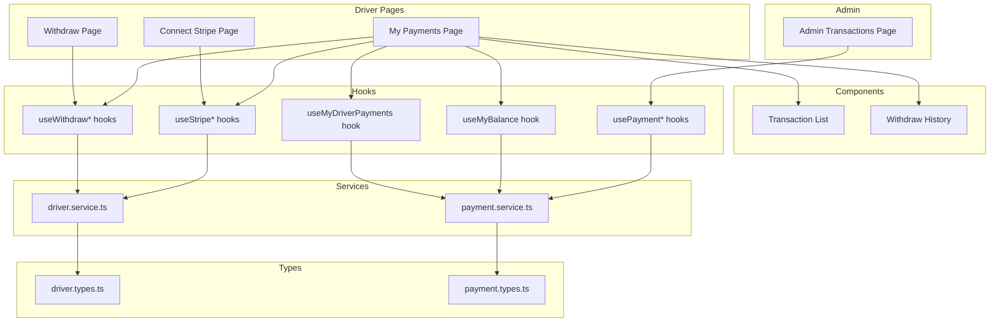
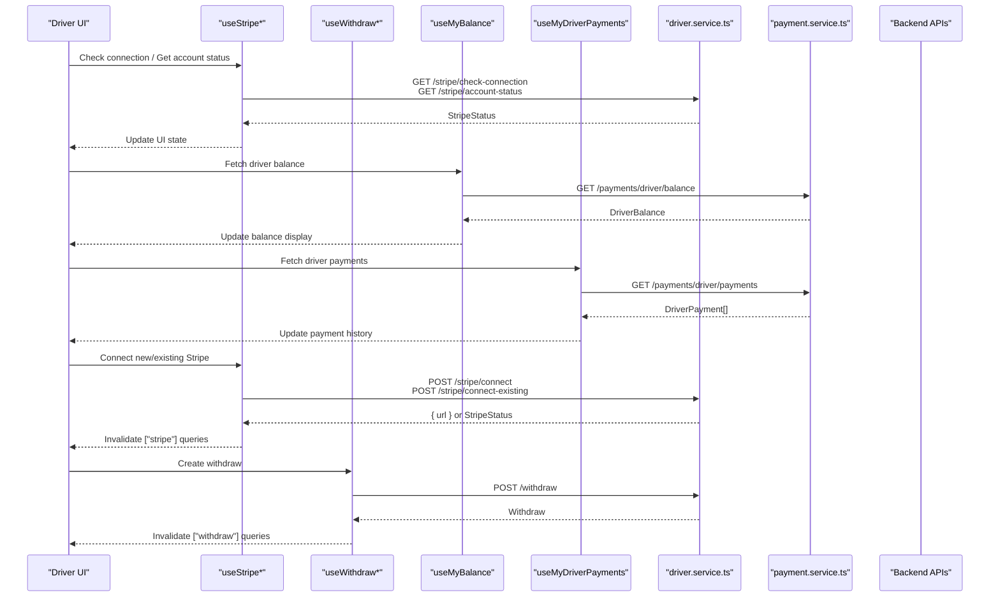
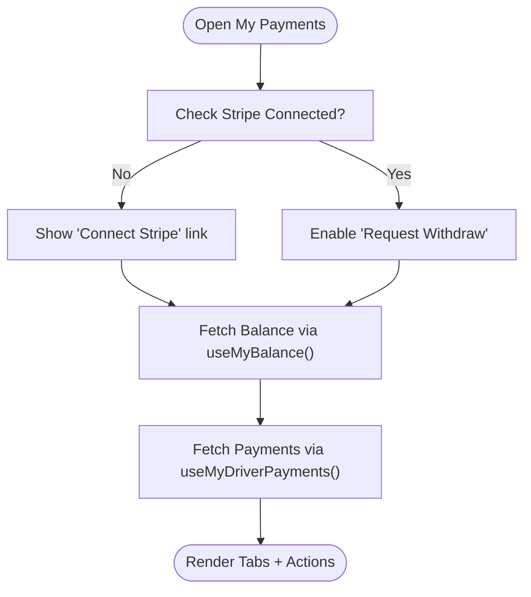
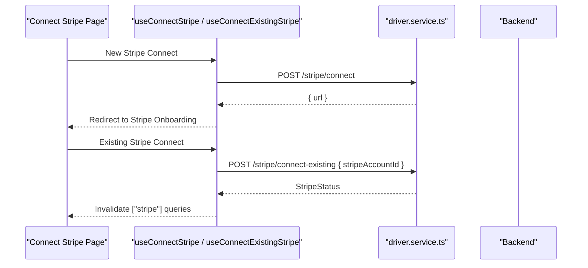
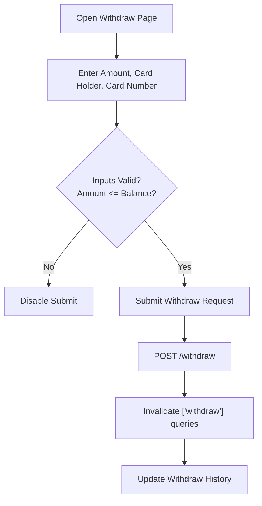
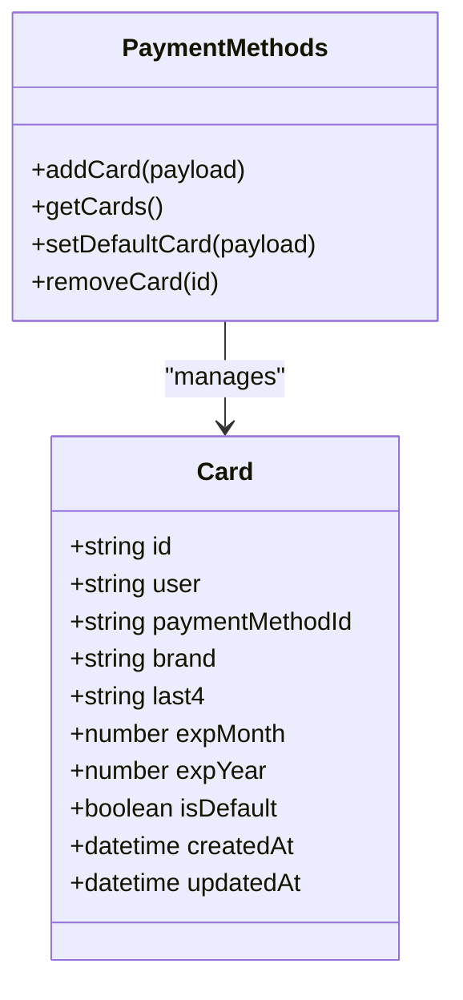
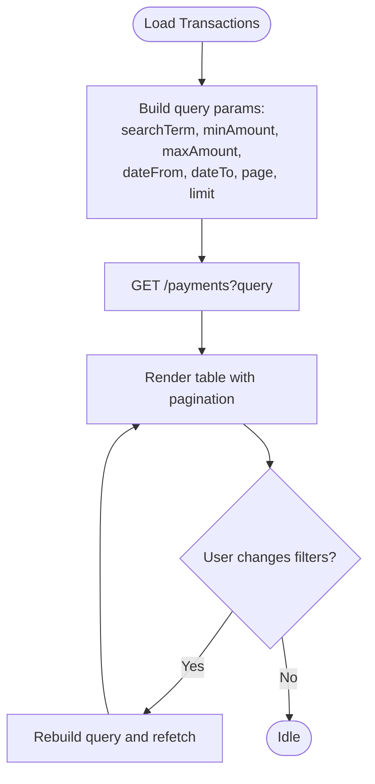
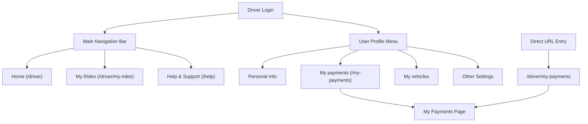
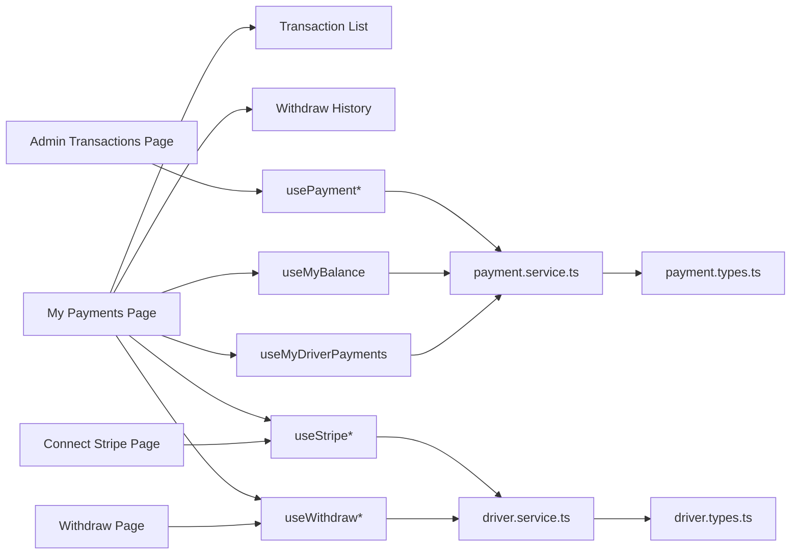

# Earnings & Payment Management

<cite>
**Referenced Files in This Document**
- [page.tsx](file://src/app/driver/(view)/my-payments/page.tsx)
- [connect-stripe/page.tsx](file://src/app/driver/(view)/my-payments/connect-stripe/page.tsx)
- [withdraw/page.tsx](file://src/app/driver/(view)/my-payments/withdraw/page.tsx)
- [transaction-list.tsx](file://src/app/driver/(view)/my-payments/_components/transaction-list.tsx)
- [withdraw-history.tsx](file://src/app/driver/(view)/my-payments/_components/withdraw-history.tsx)
- [use-payment.ts](file://src/hooks/booking/use-payment.ts)
- [payment.service.ts](file://src/services/payment.service.ts)
- [payment.types.ts](file://src/types/payment.types.ts)
- [navbar.tsx](file://src/components/core/navbar.tsx)
- [transactions/page.tsx](file://src/app/admin/(view)/transactions/page.tsx)
</cite>

## Update Summary
**Changes Made**
- Updated navigation accessibility section to reflect that 'My Payments' is no longer available in the main driver navigation bar
- Added clarification that the feature remains accessible via direct URL and user profile menu
- Updated navigation flow diagrams to show current access patterns
- Enhanced troubleshooting guide with navigation-related issues

## Table of Contents
1. Introduction
2. Project Structure
3. Core Components
4. Architecture Overview
5. Detailed Component Analysis
6. Navigation and Accessibility
7. Dependency Analysis
8. Performance Considerations
9. Troubleshooting Guide
10. Conclusion

## Introduction
This document explains the driver financial management system with a focus on:
- Earnings dashboard: balance display, transaction history, and withdrawal history
- Stripe Connect integration for driver onboarding and payout configuration
- Withdrawal request workflow including balance checks and status transitions
- Payment method management (cards), transaction filtering, and real-time updates via React Query cache invalidation
- **Updated**: Current navigation structure and accessibility patterns for the My Payments feature
- Security considerations, error handling strategies, and compliance requirements for payouts

The implementation is client-side focused using Next.js pages, React hooks, and service modules that call backend endpoints.

## Project Structure
The driver earnings and payments feature spans several pages, components, hooks, services, and types:
- Driver payment pages: My Payments overview, Stripe Connect, Withdraw form
- Shared UI components: Transaction list and Withdraw history lists
- Enhanced Hooks: Stripe connection, withdrawal operations, and driver-specific financial hooks
- Services: HTTP clients for Stripe, withdraw, and driver payment endpoints
- Types: Domain models for Stripe status, withdrawals, payments, cards, and driver-specific financial data
- Admin transactions page: Filtering and pagination over payments



**Diagram sources**
- [page.tsx](file://src/app/driver/(view)/my-payments/page.tsx)
- [connect-stripe/page.tsx](file://src/app/driver/(view)/my-payments/connect-stripe/page.tsx)
- [withdraw/page.tsx](file://src/app/driver/(view)/my-payments/withdraw/page.tsx)
- [transaction-list.tsx](file://src/app/driver/(view)/my-payments/_components/transaction-list.tsx)
- [withdraw-history.tsx](file://src/app/driver/(view)/my-payments/_components/withdraw-history.tsx)
- [use-payment.ts](file://src/hooks/booking/use-payment.ts)
- [payment.service.ts](file://src/services/payment.service.ts)
- [payment.types.ts](file://src/types/payment.types.ts)
- [transactions/page.tsx](file://src/app/admin/(view)/transactions/page.tsx)

**Section sources**
- [page.tsx](file://src/app/driver/(view)/my-payments/page.tsx)
- [connect-stripe/page.tsx](file://src/app/driver/(view)/my-payments/connect-stripe/page.tsx)
- [withdraw/page.tsx](file://src/app/driver/(view)/my-payments/withdraw/page.tsx)
- [transaction-list.tsx](file://src/app/driver/(view)/my-payments/_components/transaction-list.tsx)
- [withdraw-history.tsx](file://src/app/driver/(view)/my-payments/_components/withdraw-history.tsx)
- [use-payment.ts](file://src/hooks/booking/use-payment.ts)
- [payment.service.ts](file://src/services/payment.service.ts)
- [payment.types.ts](file://src/types/payment.types.ts)
- [transactions/page.tsx](file://src/app/admin/(view)/transactions/page.tsx)

## Core Components
- Earnings Dashboard (My Payments): Displays current balance, tabs for transactions and withdrawal history, and action buttons to connect Stripe or request a withdrawal.
- Stripe Connect Page: Allows new Stripe account creation or linking an existing Stripe Account ID.
- Withdraw Page: Collects amount and destination card details; enforces basic input validation against displayed balance.
- Transaction List: Renders recent earnings entries with booking identifiers and timestamps.
- Withdraw History: Lists past withdrawal requests with status badges.

Key behaviors:
- Balance shown as a static placeholder pending API integration with useMyBalance() hook.
- Transaction data currently uses mock data, planned integration with useMyDriverPayments() hook.
- Conditional navigation based on Stripe connection status.
- Client-side validation before submission.

**Updated** The infrastructure for driver-specific financial operations is now available through dedicated hooks, though the UI components still use mock data pending full integration.

**Section sources**
- [page.tsx](file://src/app/driver/(view)/my-payments/page.tsx)
- [connect-stripe/page.tsx](file://src/app/driver/(view)/my-payments/connect-stripe/page.tsx)
- [withdraw/page.tsx](file://src/app/driver/(view)/my-payments/withdraw/page.tsx)
- [transaction-list.tsx](file://src/app/driver/(view)/my-payments/_components/transaction-list.tsx)
- [withdraw-history.tsx](file://src/app/driver/(view)/my-payments/_components/withdraw-history.tsx)

## Architecture Overview
The frontend uses React Query hooks to manage server state and invalidate caches after mutations. Services encapsulate HTTP calls to backend endpoints. Types define contracts for payloads and responses. Enhanced with driver-specific financial operations.



**Diagram sources**
- [use-payment.ts](file://src/hooks/booking/use-payment.ts)
- [payment.service.ts](file://src/services/payment.service.ts)
- [use-stripe.ts](file://src/hooks/driver/use-stripe.ts)
- [use-withdraw.ts](file://src/hooks/driver/use-withdraw.ts)
- [driver.service.ts](file://src/services/driver.service.ts)

## Detailed Component Analysis

### Earnings Dashboard (My Payments)
Responsibilities:
- Show current balance
- Provide tabs for transactions and withdrawal history
- Route to Stripe Connect if not connected, otherwise to Withdraw

Data flow:
- **Current State**: Balance and Stripe connection are placeholders awaiting API integration.
- **Planned Integration**: Use useMyBalance() hook for real-time balance display and useMyDriverPayments() hook for transaction history.
- Tabs render TransactionList and WithdrawHistory components.



**Diagram sources**
- [page.tsx](file://src/app/driver/(view)/my-payments/page.tsx)
- [use-payment.ts](file://src/hooks/booking/use-payment.ts)

**Section sources**
- [page.tsx](file://src/app/driver/(view)/my-payments/page.tsx)

### Driver-Specific Financial Operations
**NEW SECTION**

The payment infrastructure has been extended with dedicated hooks for driver financial operations:

#### useMyBalance Hook
- **Purpose**: Fetches driver's current financial balance information
- **Returns**: DriverBalance object containing availableBalance, totalEarnings, and pendingAmount
- **Query Key**: `["payments", "driver", "balance"]`
- **API Endpoint**: `/payments/driver/balance`

#### useMyDriverPayments Hook  
- **Purpose**: Retrieves driver's complete payment history
- **Returns**: Array of DriverPayment objects with detailed transaction information
- **Query Key**: `["payments", "driver", "payments"]`
- **API Endpoint**: `/payments/driver/payments`

#### DriverBalance Interface
```typescript
interface DriverBalance {
  availableBalance: number;    // Immediately withdrawable funds
  totalEarnings: number;       // Cumulative earnings from all rides
  pendingAmount: number;       // Funds pending clearance
}
```

#### DriverPayment Interface
```typescript
interface DriverPayment {
  _id: string;
  id: string;
  user: PaymentUser;
  booking: string;
  amount: number;
  providerEarning: number;     // Driver's share
  platformCommission: number;  // Platform fee deducted
  status: PaymentStatus;
  method: string;
  transactionId: string;
  createdAt: string;
}
```

**Implementation Status**: Infrastructure complete, UI integration pending

**Section sources**
- [use-payment.ts](file://src/hooks/booking/use-payment.ts)
- [payment.service.ts](file://src/services/payment.service.ts)
- [payment.types.ts](file://src/types/payment.types.ts)

### Stripe Connect Integration
Capabilities:
- Check connection status and account capabilities
- Initiate new Stripe onboarding flow
- Link existing Stripe Account ID
- Disconnect Stripe

Implementation highlights:
- useStripeConnectionCheck and useStripeAccountStatus fetch status via driver.service.
- useConnectStripe and useConnectExistingStripe perform mutations and invalidate related queries.
- Stripe endpoints return either a redirect URL or updated StripeStatus.



**Diagram sources**
- [connect-stripe/page.tsx](file://src/app/driver/(view)/my-payments/connect-stripe/page.tsx)
- [use-stripe.ts](file://src/hooks/driver/use-stripe.ts)
- [driver.service.ts](file://src/services/driver.service.ts)

**Section sources**
- [connect-stripe/page.tsx](file://src/app/driver/(view)/my-payments/connect-stripe/page.tsx)
- [use-stripe.ts](file://src/hooks/driver/use-stripe.ts)
- [driver.service.ts](file://src/services/driver.service.ts)
- [driver.types.ts](file://src/types/driver.types.ts)

### Withdrawal Request System
Workflow:
- User enters amount and card details
- Client validates inputs (non-empty, within balance)
- Submit creates a withdrawal record via backend
- Cache invalidation refreshes withdrawal lists



**Diagram sources**
- [withdraw/page.tsx](file://src/app/driver/(view)/my-payments/withdraw/page.tsx)
- [use-withdraw.ts](file://src/hooks/driver/use-withdraw.ts)
- [driver.service.ts](file://src/services/driver.service.ts)

**Section sources**
- [withdraw/page.tsx](file://src/app/driver/(view)/my-payments/withdraw/page.tsx)
- [use-withdraw.ts](file://src/hooks/driver/use-withdraw.ts)
- [driver.service.ts](file://src/services/driver.service.ts)
- [driver.types.ts](file://src/types/driver.types.ts)

### Payment Method Management (Cards)
Features:
- Add a saved card by payment method ID
- Retrieve all saved cards
- Set default card
- Remove a card

Integration:
- useAddCard, useCards, useSetDefaultCard, useRemoveCard manage state and cache invalidation.
- cardService maps to /cards endpoints.



**Diagram sources**
- [payment.types.ts](file://src/types/payment.types.ts)
- [payment.service.ts](file://src/services/payment.service.ts)
- [use-payment.ts](file://src/hooks/booking/use-payment.ts)

**Section sources**
- [payment.types.ts](file://src/types/payment.types.ts)
- [payment.service.ts](file://src/services/payment.service.ts)
- [use-payment.ts](file://src/hooks/booking/use-payment.ts)

### Transaction History and Filtering
Admin transactions page demonstrates robust filtering and pagination:
- Search by text
- Filter by amount range
- Filter by date range
- Pagination controls



**Diagram sources**
- [transactions/page.tsx](file://src/app/admin/(view)/transactions/page.tsx)
- [use-payment.ts](file://src/hooks/booking/use-payment.ts)
- [payment.service.ts](file://src/services/payment.service.ts)

**Section sources**
- [transactions/page.tsx](file://src/app/admin/(view)/transactions/page.tsx)
- [use-payment.ts](file://src/hooks/booking/use-payment.ts)
- [payment.service.ts](file://src/services/payment.service.ts)
- [payment.types.ts](file://src/types/payment.types.ts)

### Real-time Balance Updates
Current state:
- Balance is a local placeholder value in the dashboard and withdraw pages.
- No live socket-based updates are implemented for balance.
- **New**: useMyBalance() hook infrastructure ready for integration.

Recommendations:
- Replace placeholders with API-driven balance retrieval using useMyBalance() hook.
- Use React Query polling or optimistic updates to reflect withdrawals promptly.
- Invalidate relevant queries after successful mutations.
- Integrate useMyDriverPayments() hook for real-time transaction history updates.

**Updated** The infrastructure for real-time balance updates is now available through the useMyBalance() hook, requiring only UI integration.

## Navigation and Accessibility

### Current Navigation Structure
The My Payments feature has undergone a navigation accessibility change:

**Primary Navigation Bar**: The 'My Payments' link has been commented out from the main driver navigation bar, making it less prominent in the primary navigation flow.

**Alternative Access Points**: The feature remains fully accessible through:
1. **Direct URL**: Drivers can navigate directly to `/driver/my-payments`
2. **User Profile Menu**: Available in the dropdown menu under "My payments" option
3. **Internal Links**: From other parts of the application where contextually appropriate

### Navigation Flow Diagram


**Diagram sources**
- [navbar.tsx](file://src/components/core/navbar.tsx)
- [page.tsx](file://src/app/driver/(view)/my-payments/page.tsx)

### Impact Assessment
- **Reduced Visibility**: The feature is no longer immediately visible in the main navigation
- **Maintained Functionality**: All core features remain fully functional
- **Alternative Access**: Users can still access the feature through the profile menu or direct URL
- **Strategic Decision**: This change may indicate a temporary deprecation or strategic repositioning of the feature

**Section sources**
- [navbar.tsx](file://src/components/core/navbar.tsx)
- [page.tsx](file://src/app/driver/(view)/my-payments/page.tsx)

## Dependency Analysis
Key relationships:
- Pages depend on hooks for data fetching and mutations.
- Hooks depend on services for HTTP calls.
- Services depend on shared API utilities and type definitions.
- Admin transactions page depends on payment hooks and services.
- **Enhanced**: Driver-specific hooks provide clean separation between general payment operations and driver financial data.



**Diagram sources**
- [page.tsx](file://src/app/driver/(view)/my-payments/page.tsx)
- [connect-stripe/page.tsx](file://src/app/driver/(view)/my-payments/connect-stripe/page.tsx)
- [withdraw/page.tsx](file://src/app/driver/(view)/my-payments/withdraw/page.tsx)
- [transaction-list.tsx](file://src/app/driver/(view)/my-payments/_components/transaction-list.tsx)
- [withdraw-history.tsx](file://src/app/driver/(view)/my-payments/_components/withdraw-history.tsx)
- [use-payment.ts](file://src/hooks/booking/use-payment.ts)
- [payment.service.ts](file://src/services/payment.service.ts)
- [payment.types.ts](file://src/types/payment.types.ts)
- [transactions/page.tsx](file://src/app/admin/(view)/transactions/page.tsx)

**Section sources**
- [use-payment.ts](file://src/hooks/booking/use-payment.ts)
- [payment.service.ts](file://src/services/payment.service.ts)
- [payment.types.ts](file://src/types/payment.types.ts)

## Performance Considerations
- Prefer server-side pagination and filtering for large datasets (already present in admin transactions).
- Use React Query caching and selective invalidation to minimize re-renders.
- Debounce search inputs and filter changes where appropriate.
- Avoid unnecessary re-fetches by enabling queries only when required.
- **Enhanced**: Driver-specific query keys enable efficient cache management separate from general payment operations.

**Updated** The new driver-specific query keys (`["payments", "driver", "balance"]` and `["payments", "driver", "payments"]`) allow for more granular cache control and better performance isolation.

## Troubleshooting Guide
Common issues and resolutions:
- Stripe connection not detected: Ensure backend returns correct StripeStatus and that UI reads it from useStripeAccountCheck/useStripeAccountStatus.
- Withdrawals not appearing: Confirm create mutation invalidates ["withdraw"] queries and that the list hook uses the correct query key.
- Payment filters not applied: Verify query parameters are built correctly and passed to getAllPayments.
- Error handling: Wrap mutations with try/catch in UI layers and surface user-friendly messages. For Stripe redirects, handle errors from connect endpoints gracefully.
- **NEW**: Driver balance not loading: Check that useMyBalance() hook is properly imported and that the backend endpoint `/payments/driver/balance` is accessible.
- **NEW**: Driver payments not displaying: Verify useMyDriverPayments() hook is used correctly and that the backend endpoint `/payments/driver/payments` returns proper DriverPayment array.
- **UPDATED**: My Payments not showing in navigation: The feature has been removed from the main navigation bar but remains accessible via direct URL `/driver/my-payments` or through the user profile menu.

**Navigation Access Issues**:
- If users cannot find the My Payments feature in the main navigation, direct them to use the user profile menu or enter the direct URL
- The feature is still fully functional despite being commented out from the primary navigation
- Consider adding bookmarks or providing alternative access methods for frequent users

**Updated** Added troubleshooting guidance for the new driver-specific financial hooks, their associated endpoints, and the updated navigation accessibility patterns.

**Section sources**
- [use-payment.ts](file://src/hooks/booking/use-payment.ts)
- [payment.service.ts](file://src/services/payment.service.ts)
- [navbar.tsx](file://src/components/core/navbar.tsx)

## Conclusion
The driver financial management system provides a solid foundation for earnings visibility, Stripe Connect onboarding, and withdrawal workflows. **Significant enhancements have been made with the introduction of driver-specific financial operations**, including dedicated hooks for balance tracking and payment history access. 

**Updated Navigation Strategy**: The My Payments feature has been strategically moved from the primary navigation bar to reduce clutter while maintaining full functionality through alternative access points. This change reflects a thoughtful approach to user experience design, prioritizing essential features in the main navigation while keeping advanced financial tools readily accessible.

The next steps include integrating the new useMyBalance() and useMyDriverPayments() hooks into the UI components, implementing comprehensive error handling, enforcing withdrawal limits and compliance rules on the backend, and ensuring secure handling of sensitive payment information.

**Updated** The infrastructure for advanced driver financial operations is now complete and ready for UI integration, providing a scalable foundation for future enhancements while maintaining optimal navigation usability.