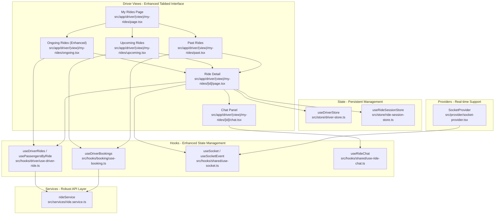
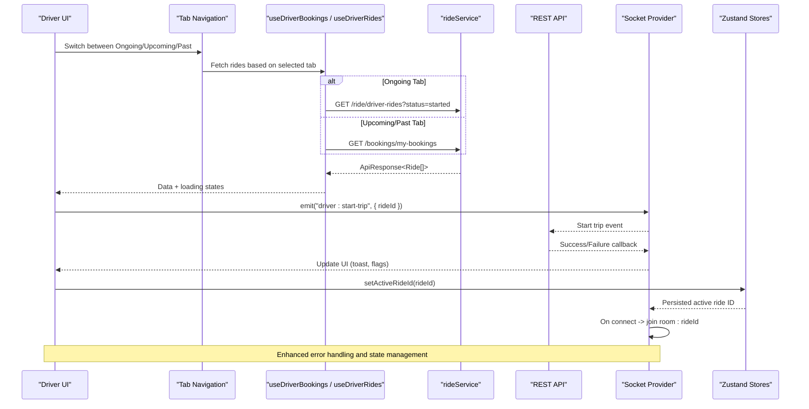
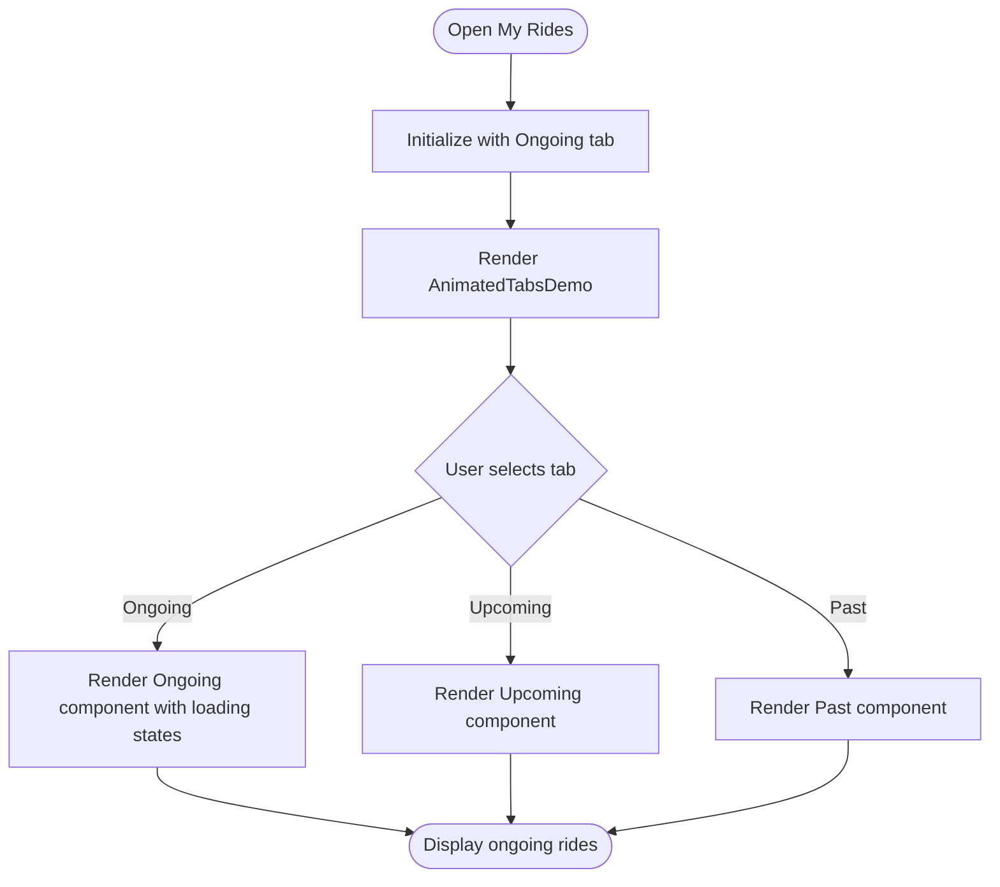
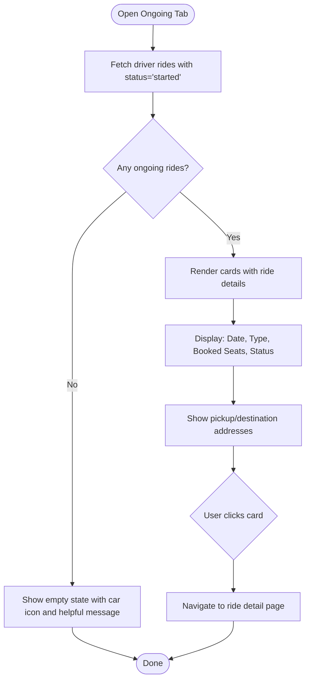
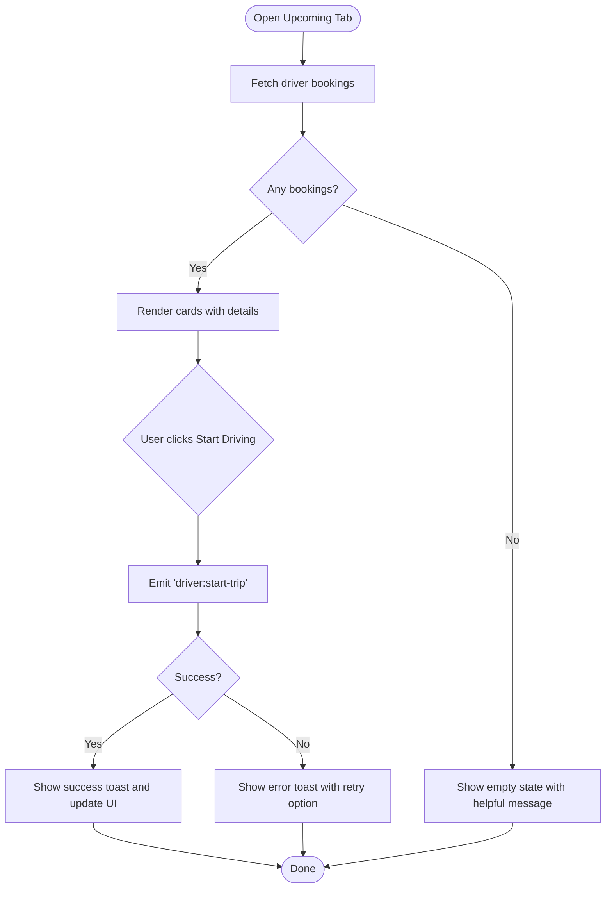
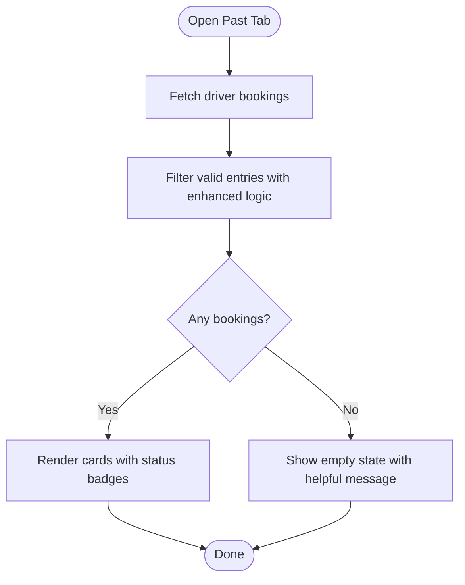
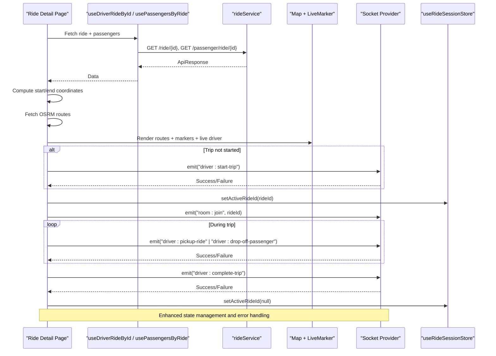
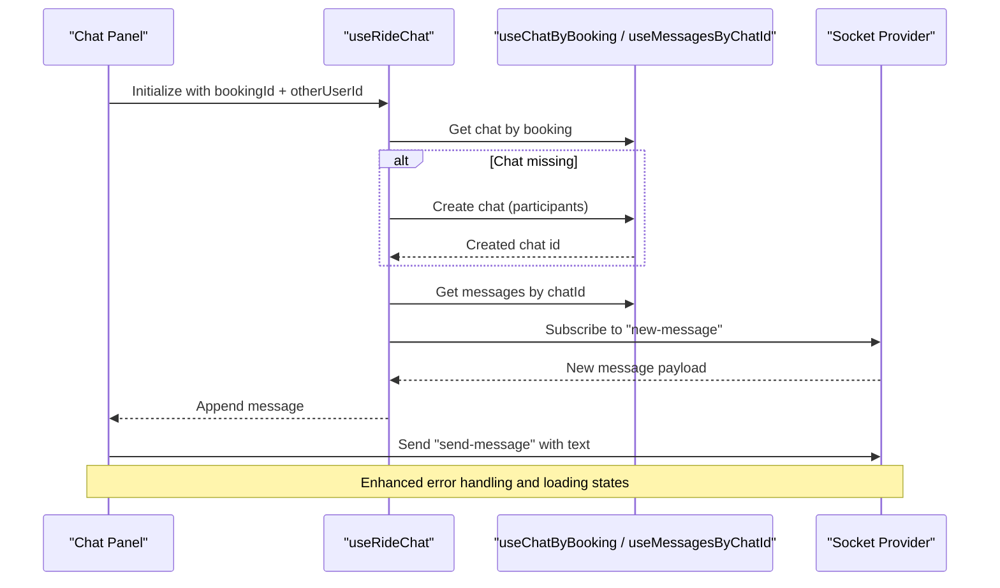
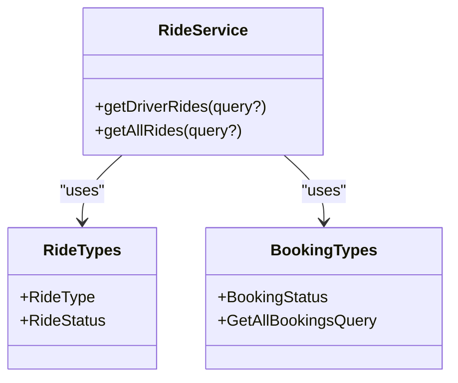

# Ride History & Trip Management

<cite>
**Referenced Files in This Document**
- [page.tsx](file://src/app/driver/(view)/my-rides/page.tsx)
- [ongoing.tsx](file://src/app/driver/(view)/my-rides/ongoing.tsx)
- [upcoming.tsx](file://src/app/driver/(view)/my-rides/upcoming.tsx)
- [past.tsx](file://src/app/driver/(view)/my-rides/past.tsx)
- [ride-detail-page.tsx](file://src/app/driver/(view)/my-rides/[id]/page.tsx)
- [chat.tsx](file://src/app/driver/(view)/my-rides/[id]/chat.tsx)
- [use-driver-ride.ts](file://src/hooks/driver/use-driver-ride.ts)
- [use-booking.ts](file://src/hooks/booking/use-booking.ts)
- [ride.service.ts](file://src/services/ride.service.ts)
- [use-socket.ts](file://src/hooks/shared/use-socket.ts)
- [socket-provider.tsx](file://src/provider/socket-provider.tsx)
- [use-ride-chat.ts](file://src/hooks/shared/use-ride-chat.ts)
- [ride.types.ts](file://src/types/ride.types.ts)
- [booking.types.ts](file://src/types/booking.types.ts)
- [driver-store.ts](file://src/store/driver-store.ts)
- [ride-session-store.ts](file://src/store/ride-session-store.ts)
- [live-marker.tsx](file://src/components/core/live-marker.tsx)
</cite>

## Update Summary
**Changes Made**
- Enhanced the Ongoing Rides interface with improved state management and user experience
- Added comprehensive loading states and empty states across all ride sections
- Improved real-time visibility into current active rides with better data fetching patterns
- Updated tabbed navigation to provide seamless switching between ride categories
- Enhanced error handling and user feedback throughout the ride management workflow

## Table of Contents
1. Introduction
2. Project Structure
3. Core Components
4. Architecture Overview
5. Detailed Component Analysis
6. Dependency Analysis
7. Performance Considerations
8. Troubleshooting Guide
9. Conclusion

## Introduction
This document explains the driver's ride history and trip management system with enhanced state management and user experience improvements. It covers:
- **Enhanced**: Dedicated Ongoing Rides interface with improved loading states and empty state handling
- Upcoming rides interface for pending requests with real-time status updates
- Active trip management (start, pick up, drop off, complete) with robust error handling
- Past ride history with comprehensive status indicators and payment tracking
- Ride detail page with passenger information, route tracking, and rating prompts
- Real-time updates via Socket.IO for active trips with automatic reconnection support
- Chat integration between drivers and passengers with message persistence
- Filtering and pagination support for historical data with optimized performance
- State management improvements with proper loading and error states

## Project Structure
The driver's ride management is organized under the driver view routes with an enhanced tabbed interface and improved state management:
- Driver views: Tabbed my-rides list (Ongoing, Upcoming, Past), per-ride detail with chat
- Hooks: React Query-based data fetching with status filtering and caching strategies
- Services: HTTP API wrappers for ride and booking endpoints with error handling
- State: Zustand stores for driver location/session and socket context with persistence
- Types: Shared TypeScript types for rides, bookings, and messages with comprehensive interfaces



**Diagram sources**
- [page.tsx](file://src/app/driver/(view)/my-rides/page.tsx#L1-L42)
- [ongoing.tsx](file://src/app/driver/(view)/my-rides/ongoing.tsx#L1-L111)
- [upcoming.tsx](file://src/app/driver/(view)/my-rides/upcoming.tsx#L1-L166)
- [past.tsx](file://src/app/driver/(view)/my-rides/past.tsx#L1-L160)
- [ride-detail-page.tsx](file://src/app/driver/(view)/my-rides/[id]/page.tsx#L1-L500)
- [chat.tsx](file://src/app/driver/(view)/my-rides/[id]/chat.tsx#L1-L212)
- [use-booking.ts:1-60](file://src/hooks/booking/use-booking.ts#L1-L60)
- [use-driver-ride.ts:1-35](file://src/hooks/driver/use-driver-ride.ts#L1-L35)
- [ride.service.ts:1-127](file://src/services/ride.service.ts#L1-L127)
- [use-socket.ts:1-57](file://src/hooks/shared/use-socket.ts#L1-L57)
- [socket-provider.tsx:1-123](file://src/provider/socket-provider.tsx#L1-L123)
- [use-ride-chat.ts:1-116](file://src/hooks/shared/use-ride-chat.ts#L1-L116)
- [driver-store.ts:1-37](file://src/store/driver-store.ts#L1-L37)
- [ride-session-store.ts:1-21](file://src/store/ride-session-store.ts#L1-L21)

**Section sources**
- [page.tsx](file://src/app/driver/(view)/my-rides/page.tsx#L1-L42)
- [ongoing.tsx](file://src/app/driver/(view)/my-rides/ongoing.tsx#L1-L111)
- [upcoming.tsx](file://src/app/driver/(view)/my-rides/upcoming.tsx#L1-L166)
- [past.tsx](file://src/app/driver/(view)/my-rides/past.tsx#L1-L160)
- [ride-detail-page.tsx](file://src/app/driver/(view)/my-rides/[id]/page.tsx#L1-L500)
- [chat.tsx](file://src/app/driver/(view)/my-rides/[id]/chat.tsx#L1-L212)
- [use-booking.ts:1-60](file://src/hooks/booking/use-booking.ts#L1-L60)
- [use-driver-ride.ts:1-35](file://src/hooks/driver/use-driver-ride.ts#L1-L35)
- [ride.service.ts:1-127](file://src/services/ride.service.ts#L1-L127)
- [use-socket.ts:1-57](file://src/hooks/shared/use-socket.ts#L1-L57)
- [socket-provider.tsx:1-123](file://src/provider/socket-provider.tsx#L1-L123)
- [use-ride-chat.ts:1-116](file://src/hooks/shared/use-ride-chat.ts#L1-L116)
- [driver-store.ts:1-37](file://src/store/driver-store.ts#L1-L37)
- [ride-session-store.ts:1-21](file://src/store/ride-session-store.ts#L1-L21)

## Core Components
- **Enhanced**: My Rides page with animated tabs switching between Ongoing, Upcoming, and Past views with improved state management
- **Improved**: Ongoing Rides interface showing current active trips with comprehensive loading states and empty state handling
- Upcoming Rides: Lists scheduled bookings with start-driving action; uses socket to start a trip with better error handling
- Past Rides: Shows completed or cancelled rides with status badges and enhanced filtering
- Ride Detail: Interactive map with OSRM routes, live driver marker, passenger list, and actions for pickup/drop-off/completion
- Chat: Per-passenger chat threads with real-time messaging and message persistence

Key responsibilities:
- Data fetching via React Query hooks with status filtering and caching strategies
- Real-time state transitions via Socket.IO events with automatic reconnection
- Local UI state for multi-passenger flows with proper loading indicators
- Route calculation using external routing service with error handling
- **Enhanced**: Dedicated ongoing ride management with comprehensive loading states, empty states, and user feedback

**Section sources**
- [page.tsx](file://src/app/driver/(view)/my-rides/page.tsx#L1-L42)
- [ongoing.tsx](file://src/app/driver/(view)/my-rides/ongoing.tsx#L1-L111)
- [upcoming.tsx](file://src/app/driver/(view)/my-rides/upcoming.tsx#L1-L166)
- [past.tsx](file://src/app/driver/(view)/my-rides/past.tsx#L1-L160)
- [ride-detail-page.tsx](file://src/app/driver/(view)/my-rides/[id]/page.tsx#L1-L500)
- [chat.tsx](file://src/app/driver/(view)/my-rides/[id]/chat.tsx#L1-L212)

## Architecture Overview
The system combines REST APIs (React Query), WebSocket events (Socket.IO), and local state (Zustand) with enhanced error handling and state management. The driver interacts with the server through typed hooks and services, while real-time updates are handled by a centralized socket provider that reattaches to the active ride room on reconnects.



**Diagram sources**
- [page.tsx](file://src/app/driver/(view)/my-rides/page.tsx#L1-L42)
- [ongoing.tsx](file://src/app/driver/(view)/my-rides/ongoing.tsx#L1-L111)
- [use-booking.ts:1-60](file://src/hooks/booking/use-booking.ts#L1-L60)
- [use-driver-ride.ts:1-35](file://src/hooks/driver/use-driver-ride.ts#L1-L35)
- [ride.service.ts:1-127](file://src/services/ride.service.ts#L1-L127)
- [socket-provider.tsx:1-123](file://src/provider/socket-provider.tsx#L1-L123)
- [ride-session-store.ts:1-21](file://src/store/ride-session-store.ts#L1-L21)
- [use-socket.ts:1-57](file://src/hooks/shared/use-socket.ts#L1-L57)

## Detailed Component Analysis

### Enhanced Tabbed Navigation Interface
- **Improved**: Main page now features animated tabs for Ongoing, Upcoming, and Past rides with better state management
- Provides seamless switching between different ride categories with optimized rendering
- Maintains consistent layout and styling across all tabs with enhanced user experience
- Uses React state management for tab selection with proper cleanup and memory management



**Diagram sources**
- [page.tsx](file://src/app/driver/(view)/my-rides/page.tsx#L1-L42)

**Section sources**
- [page.tsx](file://src/app/driver/(view)/my-rides/page.tsx#L1-L42)

### Enhanced Ongoing Rides Interface
- **Improved**: Dedicated interface for managing current active trips with comprehensive state management
- Displays ongoing rides with pickup/destination addresses, ride type, booked seats, and status information
- Uses card-based layout with proper loading states, skeleton loaders, and empty state handling
- Filters rides by "started" status using React Query hooks with caching and error handling
- Provides direct navigation to detailed ride management with enhanced user feedback



**Diagram sources**
- [ongoing.tsx](file://src/app/driver/(view)/my-rides/ongoing.tsx#L1-L111)
- [use-driver-ride.ts:13-18](file://src/hooks/driver/use-driver-ride.ts#L13-L18)

**Section sources**
- [ongoing.tsx](file://src/app/driver/(view)/my-rides/ongoing.tsx#L1-L111)
- [use-driver-ride.ts:13-18](file://src/hooks/driver/use-driver-ride.ts#L13-L18)

### Upcoming Rides Interface
- Displays scheduled bookings with passenger details, vehicle info, and fare
- Provides "Start Driving" action that emits a socket event to transition the ride to started
- Uses skeleton loaders and empty states for better UX with enhanced error handling
- Implements optimistic UI updates with proper loading states and user feedback



**Diagram sources**
- [upcoming.tsx](file://src/app/driver/(view)/my-rides/upcoming.tsx#L1-L166)
- [use-socket.ts:1-57](file://src/hooks/shared/use-socket.ts#L1-L57)

**Section sources**
- [upcoming.tsx](file://src/app/driver/(view)/my-rides/upcoming.tsx#L1-L166)
- [use-booking.ts:1-60](file://src/hooks/booking/use-booking.ts#L1-L60)

### Past Rides History
- Renders completed or cancelled rides with status badges indicating payment and booking status
- Filters out incomplete entries and provides consistent layout with upcoming view
- Includes comprehensive status indicators and payment tracking
- Enhanced filtering logic for better data presentation



**Diagram sources**
- [past.tsx](file://src/app/driver/(view)/my-rides/past.tsx#L1-L160)

**Section sources**
- [past.tsx](file://src/app/driver/(view)/my-rides/past.tsx#L1-L160)

### Ride Detail Page (Active Trip Management)
- Loads ride and passenger lists via React Query hooks with enhanced error handling
- Calculates alternative routes using an external routing service and renders them on the map
- Manages trip lifecycle: start, pick up, drop off, complete with comprehensive state management
- Joins the ride-specific socket room when the trip becomes ongoing and persists the active ride ID across reloads
- Displays live driver position and passenger avatars with status indicators
- **Enhanced**: Better state management with proper loading states and user feedback throughout the trip lifecycle



**Diagram sources**
- [ride-detail-page.tsx](file://src/app/driver/(view)/my-rides/[id]/page.tsx#L1-L500)
- [use-driver-ride.ts:13-18](file://src/hooks/driver/use-driver-ride.ts#L13-L18)
- [ride.service.ts:1-127](file://src/services/ride.service.ts#L1-L127)
- [socket-provider.tsx:1-123](file://src/provider/socket-provider.tsx#L1-L123)
- [ride-session-store.ts:1-21](file://src/store/ride-session-store.ts#L1-L21)
- [live-marker.tsx:1-30](file://src/components/core/live-marker.tsx#L1-L30)

**Section sources**
- [ride-detail-page.tsx](file://src/app/driver/(view)/my-rides/[id]/page.tsx#L1-L500)
- [use-driver-ride.ts:13-18](file://src/hooks/driver/use-driver-ride.ts#L13-L18)
- [ride.service.ts:1-127](file://src/services/ride.service.ts#L1-L127)
- [socket-provider.tsx:1-123](file://src/provider/socket-provider.tsx#L1-L123)
- [ride-session-store.ts:1-21](file://src/store/ride-session-store.ts#L1-L21)
- [driver-store.ts:1-37](file://src/store/driver-store.ts#L1-L37)
- [live-marker.tsx:1-30](file://src/components/core/live-marker.tsx#L1-L30)

### Passenger Communication (Chat Integration)
- Each passenger has a dedicated chat thread with enhanced message handling
- The hook lazily creates a 1:1 chat if missing, fetches message history, and subscribes to live messages
- Messages are marked seen automatically and sent via socket events with proper error handling
- **Enhanced**: Better loading states and empty state handling for improved user experience



**Diagram sources**
- [chat.tsx](file://src/app/driver/(view)/my-rides/[id]/chat.tsx#L1-L212)
- [use-ride-chat.ts:1-116](file://src/hooks/shared/use-ride-chat.ts#L1-L116)
- [use-socket.ts:1-57](file://src/hooks/shared/use-socket.ts#L1-L57)

**Section sources**
- [chat.tsx](file://src/app/driver/(view)/my-rides/[id]/chat.tsx#L1-L212)
- [use-ride-chat.ts:1-116](file://src/hooks/shared/use-ride-chat.ts#L1-L116)

### Ride Status Filtering and Pagination
- Driver rides can be filtered by status using query parameters (including the new "started" status for ongoing rides)
- Admin-level pagination is supported for all rides via query params (status, type, departureDate, departureTime, page, limit)
- **Enhanced**: Better error handling and caching strategies for improved performance



**Diagram sources**
- [ride.types.ts:1-161](file://src/types/ride.types.ts#L1-L161)
- [booking.types.ts:1-166](file://src/types/booking.types.ts#L1-L166)
- [ride.service.ts:1-127](file://src/services/ride.service.ts#L1-L127)

**Section sources**
- [ride.types.ts:1-161](file://src/types/ride.types.ts#L1-L161)
- [booking.types.ts:1-166](file://src/types/booking.types.ts#L1-L166)
- [ride.service.ts:1-127](file://src/services/ride.service.ts#L1-L127)

### Real-Time Updates for Active Trips
- The socket provider registers global handlers for ride-related events and dispatches them into a store
- On connection, it re-joins the last known active ride room based on persisted session state
- The detail page joins the room when the trip becomes ongoing and leaves on unmount
- **Enhanced**: Better reconnection handling and error recovery mechanisms

```mermaid
flowchart TD
Connect["Socket connects"] --> Rejoin["Read activeRideId from store"]
Rejoin --> JoinRoom{"activeRideId exists?"}
JoinRoom --> |Yes| Join["emit('room:join', rideId)"]
JoinRoom --> |No| Idle["No room join"]
Join --> Events["Subscribe to ALL_EVENTS"]
Idle --> Events
Events --> Dispatch["Dispatch events to store"]
Note over Connect,Dispatch : Enhanced reconnection and error handling
```

**Diagram sources**
- [socket-provider.tsx:1-123](file://src/provider/socket-provider.tsx#L1-L123)
- [ride-session-store.ts:1-21](file://src/store/ride-session-store.ts#L1-L21)
- [use-socket.ts:1-57](file://src/hooks/shared/use-socket.ts#L1-L57)

**Section sources**
- [socket-provider.tsx:1-123](file://src/provider/socket-provider.tsx#L1-L123)
- [ride-session-store.ts:1-21](file://src/store/ride-session-store.ts#L1-L21)
- [use-socket.ts:1-57](file://src/hooks/shared/use-socket.ts#L1-L57)

### Rating System
- The socket provider includes a "ride:request-rating" event, indicating the server may request a rating after trip completion
- The current driver detail page does not implement a rating dialog; this can be integrated by listening to the event and prompting the driver
- **Enhanced**: Better event handling and user flow integration

**Section sources**
- [socket-provider.tsx:1-123](file://src/provider/socket-provider.tsx#L1-L123)

## Dependency Analysis
- UI components depend on React Query hooks for data fetching and optimistic UI updates with enhanced error handling
- Socket interactions are centralized via the provider and typed hooks with improved reconnection logic
- Zustand stores persist critical runtime state (active ride, driver location, incoming requests) with better state management
- External routing service is used for route geometry and estimates with error handling
- **Enhanced**: Tabbed interface manages state for multiple ride categories simultaneously with improved performance

```mermaid
graph LR
UI["Driver UI Components"] --> Hooks["React Query Hooks"]
Hooks --> Services["HTTP Services"]
UI --> Socket["Socket Provider"]
UI --> Stores["Zustand Stores"]
UI --> Map["Map + LiveMarker"]
Map --> External["OSRM Routing"]
UI --> Tabs["Tab Navigation"]
Tabs --> UI
Note over UI,External : Enhanced dependencies with better error handling
```

**Diagram sources**
- [use-booking.ts:1-60](file://src/hooks/booking/use-booking.ts#L1-L60)
- [use-driver-ride.ts:1-35](file://src/hooks/driver/use-driver-ride.ts#L1-35)
- [ride.service.ts:1-127](file://src/services/ride.service.ts#L1-127)
- [socket-provider.tsx:1-123](file://src/provider/socket-provider.tsx#L1-123)
- [driver-store.ts:1-37](file://src/store/driver-store.ts#L1-37)
- [ride-session-store.ts:1-21](file://src/store/ride-session-store.ts#L1-21)
- [live-marker.tsx:1-30](file://src/components/core/live-marker.tsx#L1-30)
- [page.tsx:1-42](file://src/app/driver/(view)/my-rides/page.tsx#L1-42)

**Section sources**
- [use-booking.ts:1-60](file://src/hooks/booking/use-booking.ts#L1-L60)
- [use-driver-ride.ts:1-35](file://src/hooks/driver/use-driver-ride.ts#L1-L35)
- [ride.service.ts:1-127](file://src/services/ride.service.ts#L1-L127)
- [socket-provider.tsx:1-123](file://src/provider/socket-provider.tsx#L1-L123)
- [driver-store.ts:1-37](file://src/store/driver-store.ts#L1-L37)
- [ride-session-store.ts:1-21](file://src/store/ride-session-store.ts#L1-L21)
- [live-marker.tsx:1-30](file://src/components/core/live-marker.tsx#L1-L30)
- [page.tsx:1-42](file://src/app/driver/(view)/my-rides/page.tsx#L1-L42)

## Performance Considerations
- Prefer debouncing or throttling frequent socket updates (e.g., live location) to avoid excessive re-renders
- Use React Query caching and stale-time tuning to reduce network calls for static data like ride details
- Avoid recalculating routes on every render; cache results and only refetch when coordinates change
- For large historical datasets, leverage admin pagination queries and consider virtualized lists for long histories
- Minimize socket event subscriptions to necessary rooms and events to reduce overhead
- **Enhanced**: Optimize tab switching performance by lazy-loading components and avoiding unnecessary re-renders
- **New**: Implement proper loading states and skeleton loaders for better perceived performance
- **New**: Add comprehensive error boundaries and fallback UI for failed operations

## Troubleshooting Guide
- Socket not joining room: Ensure the active ride ID is set before emitting join and verify the provider's connect handler runs
- Missing chat messages: Confirm the chat was created and that the "new-message" listener is attached; check mark-seen logic
- Route not displayed: Validate OSRM response structure and handle errors gracefully; ensure coordinates are correct
- Duplicate actions: Guard against multiple emissions by disabling buttons during pending operations
- **Enhanced**: Ongoing rides not showing: Verify the "started" status filter is correctly applied and check network requests to `/ride/driver-rides?status=started`
- **New**: Loading states stuck: Check React Query cache invalidation and ensure proper cleanup of async operations
- **New**: Empty states not displaying: Verify data filtering logic and ensure proper null/undefined handling

**Section sources**
- [socket-provider.tsx:1-123](file://src/provider/socket-provider.tsx#L1-L123)
- [use-ride-chat.ts:1-116](file://src/hooks/shared/use-ride-chat.ts#L1-L116)
- [ride-detail-page.tsx](file://src/app/driver/(view)/my-rides/[id]/page.tsx#L1-L500)
- [ongoing.tsx:77-78](file://src/app/driver/(view)/my-rides/ongoing.tsx#L77-L78)

## Conclusion
The driver's ride history and trip management system integrates REST APIs, real-time sockets, and persistent local state to deliver a responsive experience with enhanced state management and user experience improvements. **Enhanced**: The new tabbed interface with dedicated Ongoing Rides functionality provides drivers with a streamlined way to manage current active trips alongside their upcoming and past rides, featuring comprehensive loading states, empty states, and error handling. The system clearly separates different ride categories while maintaining consistent user experience across all views with improved performance and reliability. The detail page orchestrates the full trip lifecycle with robust UI feedback, and chat enables direct communication with passengers. The architecture supports filtering and pagination for scalable data handling with enhanced error recovery and state persistence. Future enhancements include implementing the rating prompt and optimizing performance for high-frequency updates with even better user feedback mechanisms.