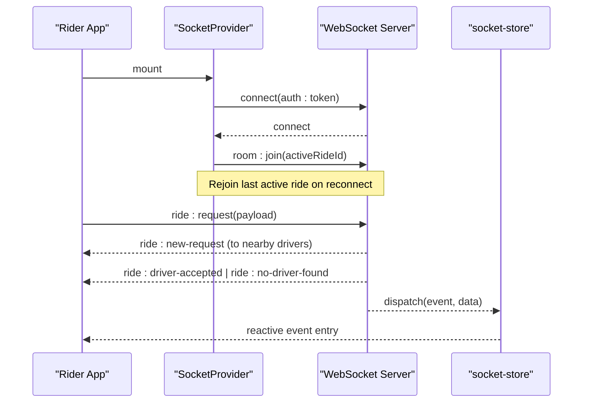
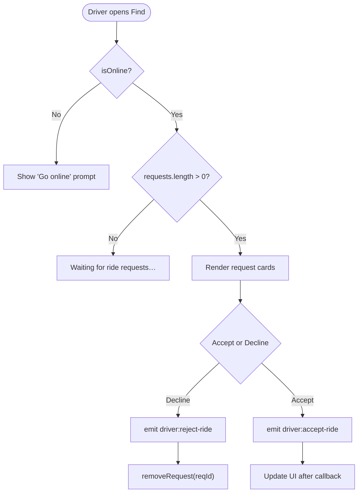
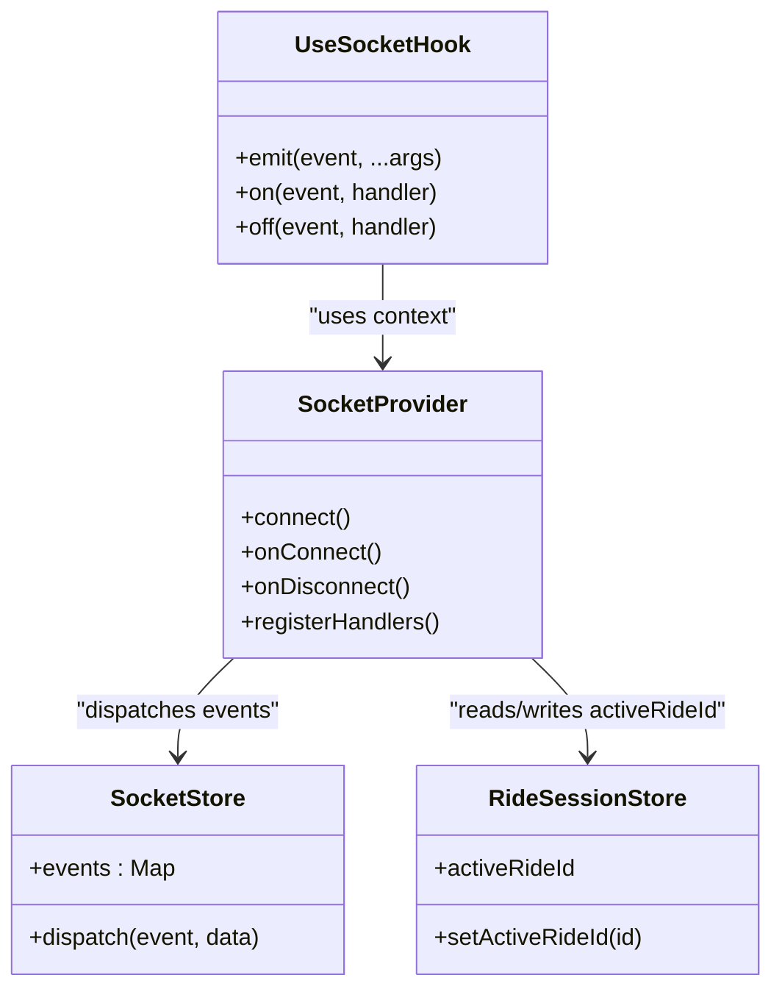
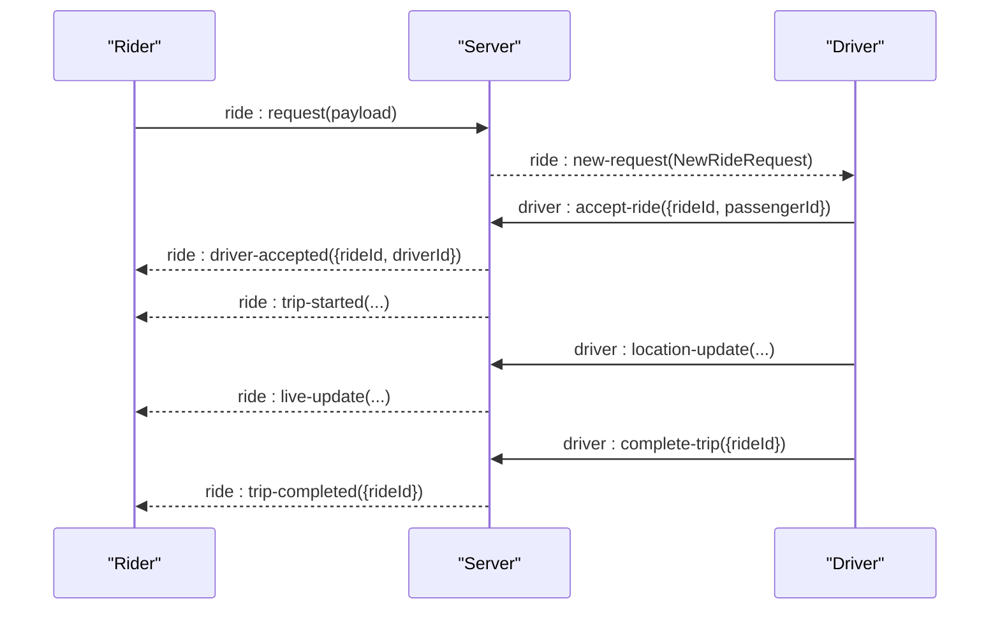
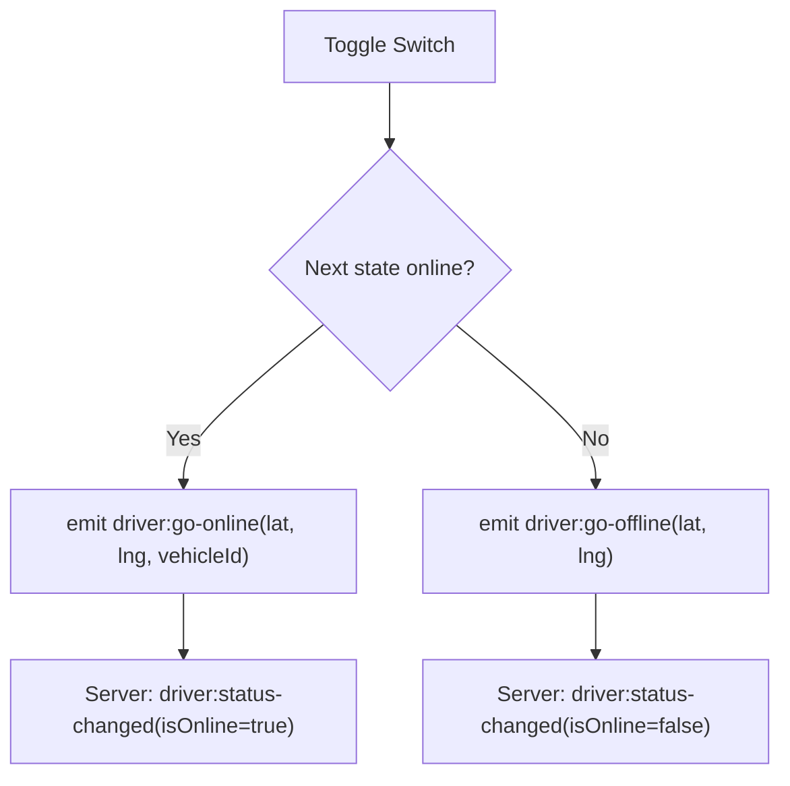
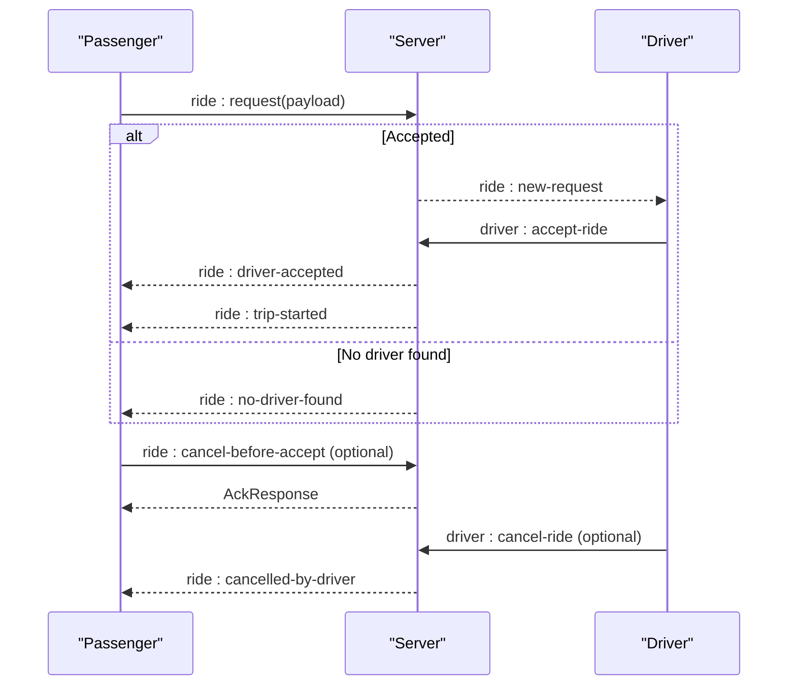
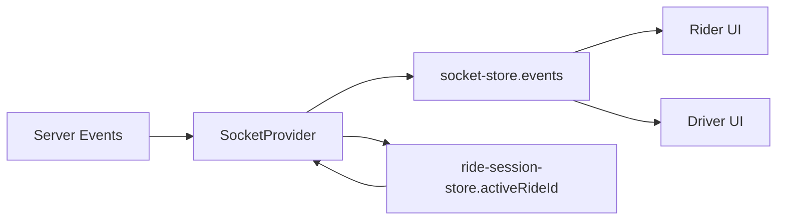
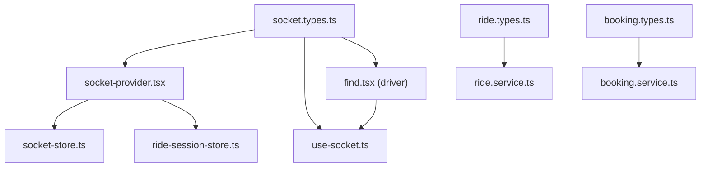

# Driver Matching System

<cite>
**Referenced Files in This Document**
- [socket.ts](file://src/lib/socket.ts)
- [socket-provider.tsx](file://src/provider/socket-provider.tsx)
- [use-socket.ts](file://src/hooks/shared/use-socket.ts)
- [socket-store.ts](file://src/store/socket-store.ts)
- [ride-session-store.ts](file://src/store/ride-session-store.ts)
- [booking-store.ts](file://src/store/booking-store.ts)
- [find.tsx (driver)](file://src/app/driver/(view)/find.tsx)
- [find.tsx (passenger)](file://src/app/(view)/book/find.tsx)
- [use-driver-ride.ts](file://src/hooks/driver/use-driver-ride.ts)
- [use-booking.ts](file://src/hooks/booking/use-booking.ts)
- [ride.service.ts](file://src/services/ride.service.ts)
- [booking.service.ts](file://src/services/booking.service.ts)
- [socket.types.ts](file://src/types/socket.types.ts)
- [ride.types.ts](file://src/types/ride.types.ts)
- [booking.types.ts](file://src/types/booking.types.ts)
</cite>

## Table of Contents
1. Introduction
2. Project Structure
3. Core Components
4. Architecture Overview
5. Detailed Component Analysis
6. Dependency Analysis
7. Performance Considerations
8. Troubleshooting Guide
9. Conclusion

## Introduction
This document explains the real-time driver matching system that connects passengers with available drivers. It covers:
- The driver acceptance workflow and availability signaling
- Real-time notifications via WebSocket events
- Passenger-driver communication protocol
- Matching algorithm considerations, availability tracking, and fallback mechanisms
- End-to-end ride request lifecycle from submission to acceptance, including timeouts and cancellations
- Examples of socket event handling and state synchronization between passenger and driver interfaces

## Project Structure
The client-side implementation is organized into:
- Socket layer for connection management and typed event contracts
- Provider and hooks for connecting, joining rooms, and subscribing to events
- Stores for local state (socket events, booking flow, active ride session)
- Services and hooks for REST interactions (rides, bookings)
- UI components for driver discovery and passenger booking flows

```mermaid
graph TB
subgraph "Client"
SP["SocketProvider<br/>connects & dispatches"] --> US["useSocket hook<br/>emit/on/off"]
SS["socket-store<br/>event cache"] <- --> SP
RS["ride-session-store<br/>activeRideId"] <- --> SP
BS["booking-store<br/>request/response/status"]
DFind["Driver Find UI<br/>go-online / accept/reject"]
PFind["Passenger Booking UI<br/>form inputs"]
end
subgraph "Server"
WS["WebSocket Server"]
end
SP --> WS
DFind --> WS
PFind --> WS
```

**Diagram sources**
- [socket-provider.tsx:67-123](file://src/provider/socket-provider.tsx#L67-L123)
- [use-socket.ts:12-57](file://src/hooks/shared/use-socket.ts#L12-L57)
- [socket-store.ts:19-34](file://src/store/socket-store.ts#L19-L34)
- [ride-session-store.ts:9-21](file://src/store/ride-session-store.ts#L9-L21)
- [booking-store.ts:19-27](file://src/store/booking-store.ts#L19-L27)
- [find.tsx (driver):87-241](file://src/app/driver/(view)/find.tsx#L87-L241)
- [find.tsx (passenger):47-480](file://src/app/(view)/book/find.tsx#L47-L480)

**Section sources**
- [socket-provider.tsx:67-123](file://src/provider/socket-provider.tsx#L67-L123)
- [use-socket.ts:12-57](file://src/hooks/shared/use-socket.ts#L12-L57)
- [socket-store.ts:19-34](file://src/store/socket-store.ts#L19-L34)
- [ride-session-store.ts:9-21](file://src/store/ride-session-store.ts#L9-L21)
- [booking-store.ts:19-27](file://src/store/booking-store.ts#L19-L27)
- [find.tsx (driver):87-241](file://src/app/driver/(view)/find.tsx#L87-L241)
- [find.tsx (passenger):47-480](file://src/app/(view)/book/find.tsx#L47-L480)

## Core Components
- Socket connection and typing
  - Singleton socket instance with auth token extraction and transport fallback
  - Centralized provider that connects, reattaches to the last active ride room, and dispatches all known events into a global store
- Event subscription helpers
  - Typed emit/on/off wrappers and a convenience hook to subscribe per component lifetime
- State stores
  - socket-store: caches latest server events by type with timestamps
  - ride-session-store: persists the active ride room across reloads
  - booking-store: holds current booking request/response and status
- Driver UI
  - Online switch emits go-online/go-offline; lists incoming requests; accepts or rejects rides
- Passenger UI
  - Booking form collects trip details and navigates to confirmation

**Section sources**
- [socket.ts:23-50](file://src/lib/socket.ts#L23-L50)
- [socket-provider.tsx:23-123](file://src/provider/socket-provider.tsx#L23-L123)
- [use-socket.ts:12-57](file://src/hooks/shared/use-socket.ts#L12-L57)
- [socket-store.ts:19-34](file://src/store/socket-store.ts#L19-L34)
- [ride-session-store.ts:9-21](file://src/store/ride-session-store.ts#L9-L21)
- [booking-store.ts:19-27](file://src/store/booking-store.ts#L19-L27)
- [find.tsx (driver):20-85](file://src/app/driver/(view)/find.tsx#L20-L85)
- [find.tsx (driver):87-241](file://src/app/driver/(view)/find.tsx#L87-L241)
- [find.tsx (passenger):47-480](file://src/app/(view)/book/find.tsx#L47-L480)

## Architecture Overview
The system uses Socket.IO for real-time communication. Clients authenticate using a cookie-based token and join ride-specific rooms. The provider centralizes event routing into a typed store, while UI components use typed hooks to emit actions and react to server events.



**Diagram sources**
- [socket-provider.tsx:72-109](file://src/provider/socket-provider.tsx#L72-L109)
- [socket.types.ts:268-296](file://src/types/socket.types.ts#L268-L296)
- [socket.types.ts:30-160](file://src/types/socket.types.ts#L30-L160)
- [socket-store.ts:19-34](file://src/store/socket-store.ts#L19-L34)

## Detailed Component Analysis

### Driver Acceptance Workflow
- Availability signaling
  - Driver toggles online/offline; emits driver:go-online or driver:go-offline with location and vehicle info
- Incoming requests
  - Drivers receive ride:new-request events containing pickup/destination, seats, fare, and timing
- Accept/Reject
  - Accept triggers driver:accept-ride with callback; Reject triggers driver:reject-ride
- UI behavior
  - When offline, UI shows a prompt to go online
  - When online but no requests, shows waiting state
  - When requests exist, lists them with route, fare, and action buttons



**Diagram sources**
- [find.tsx (driver):20-85](file://src/app/driver/(view)/find.tsx#L20-L85)
- [find.tsx (driver):87-241](file://src/app/driver/(view)/find.tsx#L87-L241)
- [socket.types.ts:220-243](file://src/types/socket.types.ts#L220-L243)

**Section sources**
- [find.tsx (driver):20-85](file://src/app/driver/(view)/find.tsx#L20-L85)
- [find.tsx (driver):87-241](file://src/app/driver/(view)/find.tsx#L87-L241)
- [socket.types.ts:220-243](file://src/types/socket.types.ts#L220-L243)

### Real-Time Notifications via WebSocket
- Connection and authentication
  - Token extracted from cookies; transports include websocket and polling
- Room management
  - On connect, provider joins the last active ride room persisted in ride-session-store
- Event dispatching
  - All known events are registered once and dispatched into socket-store for reactive consumption
- Debug logging
  - Incoming/outgoing events logged to console for development



**Diagram sources**
- [socket-provider.tsx:67-123](file://src/provider/socket-provider.tsx#L67-L123)
- [socket-store.ts:19-34](file://src/store/socket-store.ts#L19-L34)
- [ride-session-store.ts:9-21](file://src/store/ride-session-store.ts#L9-L21)
- [use-socket.ts:12-57](file://src/hooks/shared/use-socket.ts#L12-L57)

**Section sources**
- [socket.ts:23-50](file://src/lib/socket.ts#L23-L50)
- [socket-provider.tsx:23-123](file://src/provider/socket-provider.tsx#L23-L123)
- [use-socket.ts:12-57](file://src/hooks/shared/use-socket.ts#L12-L57)
- [socket-store.ts:19-34](file://src/store/socket-store.ts#L19-L34)
- [ride-session-store.ts:9-21](file://src/store/ride-session-store.ts#L9-L21)

### Passenger-Driver Communication Protocol
Key events and payloads are defined in the typed contract:
- Client → Server
  - ride:request: initiate matching with trip details
  - driver:accept-ride / driver:reject-ride: driver decisions
  - driver:start-trip, driver:arrived-pickup, driver:pickup-ride, driver:drop-off-passenger, driver:complete-trip, driver:cancel-ride: trip control
  - driver:location-update: live position during trips
  - room:join / room:leave: room membership
  - send-message / chat:seen: messaging
- Server → Client
  - ride:new-request: new matching opportunity to drivers
  - ride:driver-accepted, ride:cancelled, ride:no-driver-found, ride:trip-started, ride:live-update, ride:trip-completed, etc.: lifecycle updates
  - notification:new: generic notifications
  - error: connection or processing errors



**Diagram sources**
- [socket.types.ts:268-296](file://src/types/socket.types.ts#L268-L296)
- [socket.types.ts:30-160](file://src/types/socket.types.ts#L30-L160)
- [ride.types.ts:97-124](file://src/types/ride.types.ts#L97-L124)

**Section sources**
- [socket.types.ts:30-160](file://src/types/socket.types.ts#L30-L160)
- [socket.types.ts:268-296](file://src/types/socket.types.ts#L268-L296)
- [ride.types.ts:97-124](file://src/types/ride.types.ts#L97-L124)

### Matching Algorithm Considerations
- Inputs used by the server (from client payload)
  - Pickup/destination coordinates and addresses
  - Departure date/time
  - Number of seats requested and gender breakdown
  - Luggage counts and optional notes
- Matching factors (server-side)
  - Proximity to pickup
  - Driver availability (online status)
  - Vehicle capacity vs requested seats
  - Route compatibility and estimated duration
- Fallback when no drivers are available
  - Server may respond with ride:no-driver-found
  - Client can present options such as adjusting time, reducing seats, or expanding search radius

**Section sources**
- [socket.types.ts:268-296](file://src/types/socket.types.ts#L268-L296)
- [ride.types.ts:70-81](file://src/types/ride.types.ts#L70-L81)
- [socket.types.ts:42](file://src/types/socket.types.ts#L42)

### Driver Availability Tracking
- Driver toggles online/offline via UI
  - Emits driver:go-online with lat/lng and vehicleId
  - Emits driver:go-offline with lat/lng
- UI guards
  - Requires an assigned vehicle and location permission before enabling online mode
- Server broadcasts driver:status-changed to relevant clients



**Diagram sources**
- [find.tsx (driver):20-85](file://src/app/driver/(view)/find.tsx#L20-L85)
- [socket.types.ts:220-226](file://src/types/socket.types.ts#L220-L226)
- [socket.types.ts:106](file://src/types/socket.types.ts#L106)

**Section sources**
- [find.tsx (driver):20-85](file://src/app/driver/(view)/find.tsx#L20-L85)
- [socket.types.ts:220-226](file://src/types/socket.types.ts#L220-L226)
- [socket.types.ts:106](file://src/types/socket.types.ts#L106)

### Ride Request Lifecycle
From submission to acceptance and beyond:
- Submission
  - Passenger fills form and proceeds to confirm; client emits ride:request with payload
- Matching window
  - Server notifies eligible drivers with ride:new-request
  - If accepted, server sends ride:driver-accepted to rider
  - If no match within timeout, server may send ride:no-driver-found
- Trip progression
  - Driver controls trip lifecycle via driver:* events; server broadcasts corresponding ride:* events to the room
- Cancellations
  - Before acceptance: ride:cancel-before-accept
  - After acceptance: ride:cancel-after-accept
  - Server may also broadcast ride:cancelled or ride:cancelled-by-driver/passenger-cancelled



**Diagram sources**
- [socket.types.ts:268-296](file://src/types/socket.types.ts#L268-L296)
- [socket.types.ts:30-160](file://src/types/socket.types.ts#L30-L160)

**Section sources**
- [socket.types.ts:268-296](file://src/types/socket.types.ts#L268-L296)
- [socket.types.ts:30-160](file://src/types/socket.types.ts#L30-L160)

### State Synchronization Between Interfaces
- Global event cache
  - socket-store maintains the latest event per type with timestamp; components can read the most recent event reactively
- Active ride persistence
  - ride-session-store persists activeRideId so that on reconnect the provider re-joins the correct room
- Booking flow state
  - booking-store tracks request/response and status for the current booking flow



**Diagram sources**
- [socket-provider.tsx:90-109](file://src/provider/socket-provider.tsx#L90-L109)
- [socket-store.ts:19-34](file://src/store/socket-store.ts#L19-L34)
- [ride-session-store.ts:9-21](file://src/store/ride-session-store.ts#L9-L21)

**Section sources**
- [socket-provider.tsx:90-109](file://src/provider/socket-provider.tsx#L90-L109)
- [socket-store.ts:19-34](file://src/store/socket-store.ts#L19-L34)
- [ride-session-store.ts:9-21](file://src/store/ride-session-store.ts#L9-L21)

### Example: Socket Event Handling Patterns
- Subscribe to a specific event in a component
  - Use the typed hook to register/unregister handlers automatically
- Dispatch events
  - Use the typed emit wrapper to send actions like ride:request or driver:accept-ride
- Observe latest event globally
  - Read from socket-store via the typed selector for the event type

**Section sources**
- [use-socket.ts:42-57](file://src/hooks/shared/use-socket.ts#L42-L57)
- [use-socket.ts:12-39](file://src/hooks/shared/use-socket.ts#L12-L39)
- [socket-store.ts:27-34](file://src/store/socket-store.ts#L27-L34)

## Dependency Analysis
- Client dependencies
  - socket-provider depends on socket singleton and both stores
  - use-socket provides typed access to the underlying socket instance
  - Driver find UI depends on driver store and socket hooks
  - Passenger booking UI composes forms and navigation
- Service layer
  - ride.service and booking.service wrap REST endpoints for listing and mutating rides/bookings
- Type contracts
  - socket.types defines all emitted events and payloads
  - ride.types and booking.types define domain models used across services and UI



**Diagram sources**
- [socket.types.ts:30-160](file://src/types/socket.types.ts#L30-L160)
- [socket.types.ts:268-296](file://src/types/socket.types.ts#L268-L296)
- [ride.types.ts:1-161](file://src/types/ride.types.ts#L1-L161)
- [booking.types.ts:1-166](file://src/types/booking.types.ts#L1-L166)
- [ride.service.ts:1-127](file://src/services/ride.service.ts#L1-L127)
- [booking.service.ts:1-45](file://src/services/booking.service.ts#L1-L45)
- [socket-provider.tsx:67-123](file://src/provider/socket-provider.tsx#L67-L123)
- [use-socket.ts:12-57](file://src/hooks/shared/use-socket.ts#L12-L57)
- [find.tsx (driver):87-241](file://src/app/driver/(view)/find.tsx#L87-L241)

**Section sources**
- [socket.types.ts:30-160](file://src/types/socket.types.ts#L30-L160)
- [socket.types.ts:268-296](file://src/types/socket.types.ts#L268-L296)
- [ride.types.ts:1-161](file://src/types/ride.types.ts#L1-L161)
- [booking.types.ts:1-166](file://src/types/booking.types.ts#L1-L166)
- [ride.service.ts:1-127](file://src/services/ride.service.ts#L1-L127)
- [booking.service.ts:1-45](file://src/services/booking.service.ts#L1-L45)
- [socket-provider.tsx:67-123](file://src/provider/socket-provider.tsx#L67-L123)
- [use-socket.ts:12-57](file://src/hooks/shared/use-socket.ts#L12-L57)
- [find.tsx (driver):87-241](file://src/app/driver/(view)/find.tsx#L87-L241)

## Performance Considerations
- Prefer event-driven updates via socket-store rather than frequent polling
- Debounce driver location updates to reduce bandwidth
- Join only necessary rooms; avoid unnecessary subscriptions
- Cache REST responses using React Query keys already defined in hooks
- Keep socket transports flexible (websocket/polling) to handle network variability

## Troubleshooting Guide
- Connection issues
  - Verify token presence in cookies; ensure NEXT_PUBLIC_SOCKET_URL is configured
  - Check browser console logs for incoming/outgoing events
- Missing events
  - Confirm the component subscribes to the expected event name
  - Ensure the active ride room is joined after reconnect
- Driver not receiving requests
  - Ensure driver is online and has a valid vehicleId and location
  - Validate that driver:go-online was emitted successfully
- No driver found
  - Adjust departure time, seat count, or expand search area
  - Inspect server response for ride:no-driver-found and guide user accordingly

**Section sources**
- [socket.ts:23-50](file://src/lib/socket.ts#L23-L50)
- [socket-provider.tsx:72-109](file://src/provider/socket-provider.tsx#L72-L109)
- [find.tsx (driver):20-85](file://src/app/driver/(view)/find.tsx#L20-L85)
- [socket.types.ts:42](file://src/types/socket.types.ts#L42)

## Conclusion
The real-time driver matching system leverages a typed WebSocket contract, centralized event dispatching, and persistent room membership to synchronize passenger and driver states efficiently. The driver acceptance workflow is explicit and robust, with clear fallback paths when no drivers are available. By combining event-driven UI updates with REST-backed data fetching, the application achieves responsive, consistent experiences across both roles.