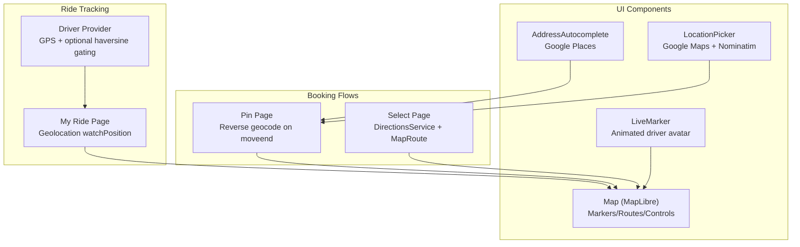
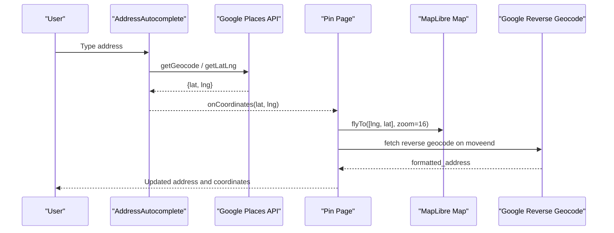
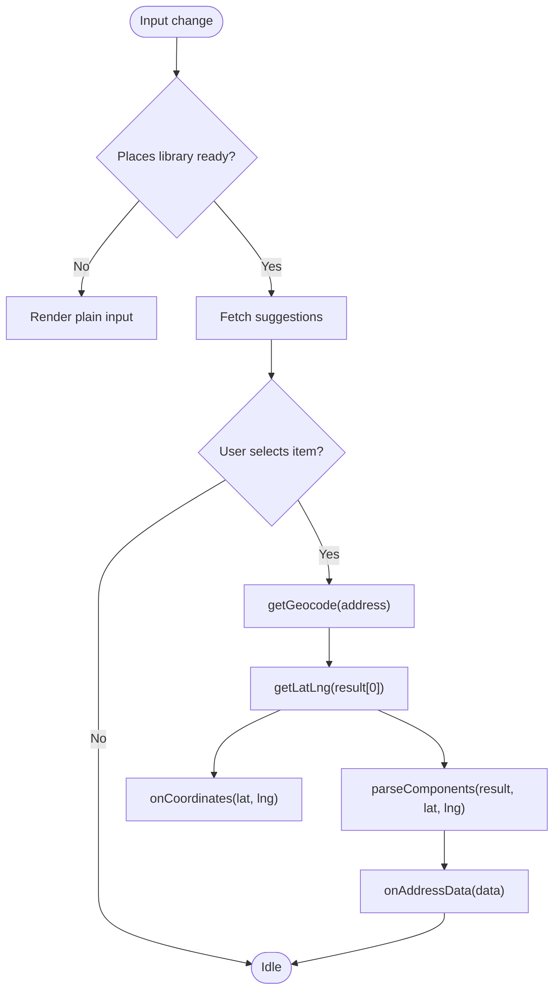
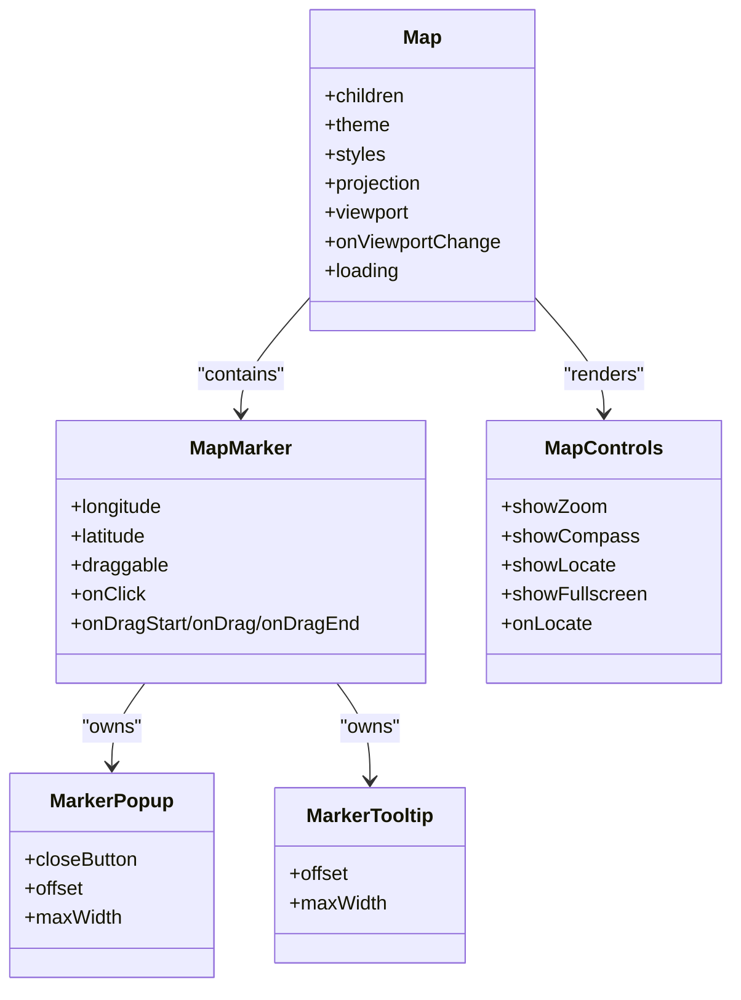
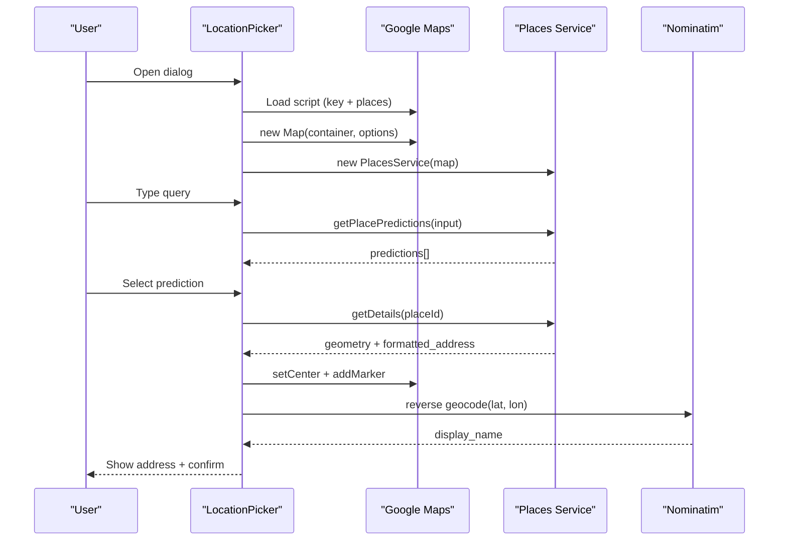
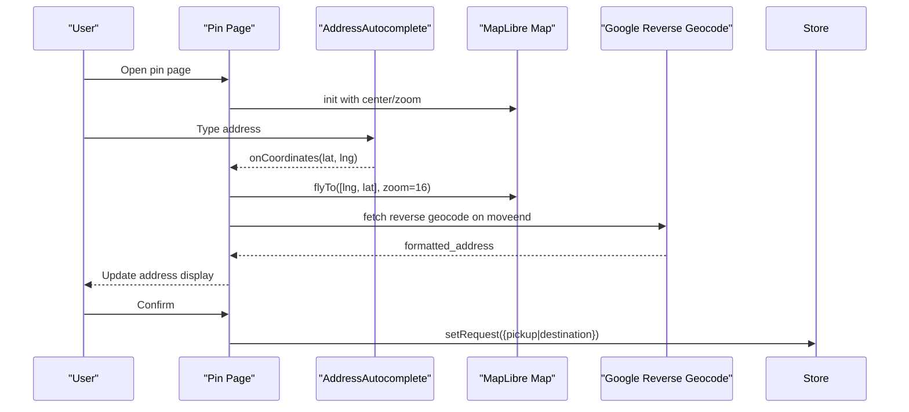
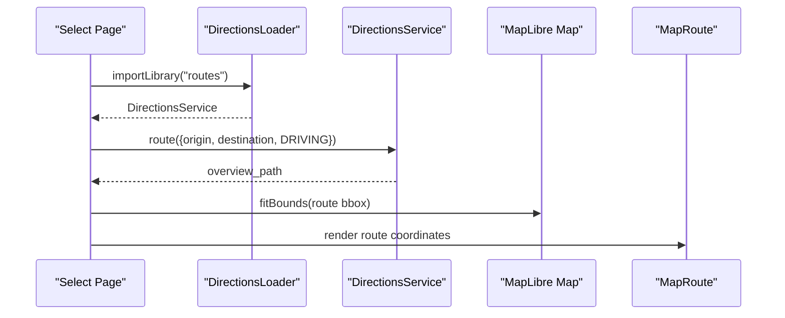
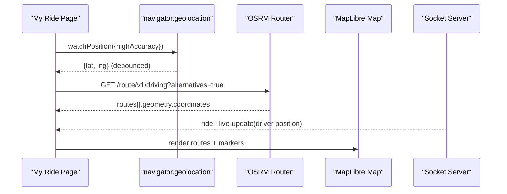
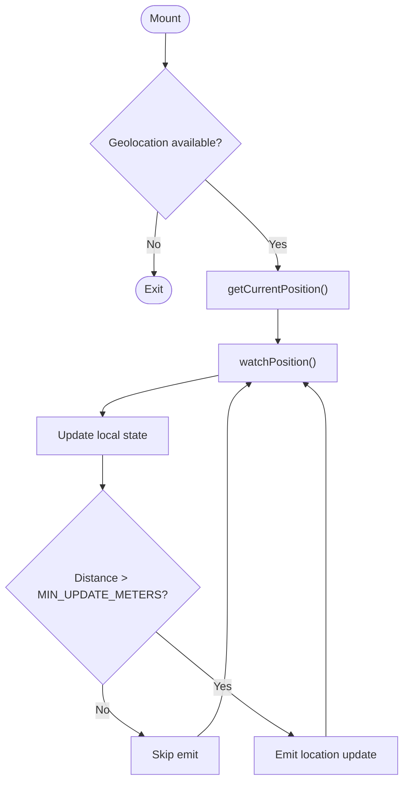
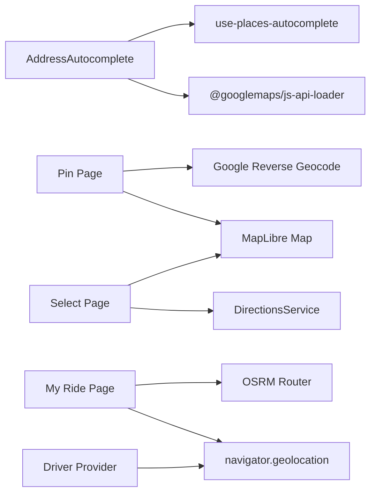

# Location Services & Maps

<cite>
**Referenced Files in This Document**
- [address-autocomplete.tsx](file://src/components/ui/address-autocomplete.tsx)
- [map.tsx](file://src/components/ui/map.tsx)
- [location-picker.tsx](file://src/components/core/location-picker.tsx)
- [pin/page.tsx](file://src/app/(view)/book/pin/page.tsx)
- [select/page.tsx](file://src/app/(view)/book/select/page.tsx)
- [my-rides/[id]/page.tsx](file://src/app/(view)/my-rides/[id]/page.tsx)
- [driver-provider.tsx](file://src/app/driver/driver-provider.tsx)
- [live-marker.tsx](file://src/components/core/live-marker.tsx)
- [mapThree.ts](file://src/app/(view)/book/mapThree.ts)
</cite>

## Table of Contents
1. [Introduction](#introduction)
2. [Project Structure](#project-structure)
3. [Core Components](#core-components)
4. [Architecture Overview](#architecture-overview)
5. [Detailed Component Analysis](#detailed-component-analysis)
6. [Dependency Analysis](#dependency-analysis)
7. [Performance Considerations](#performance-considerations)
8. [Troubleshooting Guide](#troubleshooting-guide)
9. [Conclusion](#conclusion)
10. [Appendices](#appendices)

## Introduction
This document explains the location services and map integration used in the passenger experience. It covers:
- Address autocomplete with Google Places API
- Interactive map components for location selection
- Geolocation API usage for current location detection
- Coordinate conversion, reverse geocoding, and distance calculations
- Map customization options, marker management, and real-time location updates
- Examples of map initialization, address validation, error handling, and performance optimization

## Project Structure
The location and mapping features are implemented across reusable UI components and booking/ride pages:
- Address autocomplete component integrates Google Places via a dynamic loader
- A MapLibre-based map component provides theme-aware styling, markers, popups, tooltips, routes, and controls
- Booking pages use both Google Directions and OSRM for route visualization
- Driver and ride tracking pages use the browser Geolocation API to update positions in real time

**Diagram sources**
- [address-autocomplete.tsx:1-170](file://src/components/ui/address-autocomplete.tsx#L1-L170)
- [map.tsx:169-336](file://src/components/ui/map.tsx#L169-L336)
- [location-picker.tsx:1-501](file://src/components/core/location-picker.tsx#L1-L501)
- [pin/page.tsx:1-188](file://src/app/(view)/book/pin/page.tsx#L1-L188)
- [select/page.tsx:42-97](file://src/app/(view)/book/select/page.tsx#L42-L97)
- [my-rides/[id]/page.tsx:105-154](file://src/app/(view)/my-rides/[id]/page.tsx#L105-L154)
- [driver-provider.tsx:66-104](file://src/app/driver/driver-provider.tsx#L66-L104)
- [live-marker.tsx:1-30](file://src/components/core/live-marker.tsx#L1-L30)

**Section sources**
- [address-autocomplete.tsx:1-170](file://src/components/ui/address-autocomplete.tsx#L1-L170)
- [map.tsx:169-336](file://src/components/ui/map.tsx#L169-L336)
- [location-picker.tsx:1-501](file://src/components/core/location-picker.tsx#L1-L501)
- [pin/page.tsx:1-188](file://src/app/(view)/book/pin/page.tsx#L1-L188)
- [select/page.tsx:42-97](file://src/app/(view)/book/select/page.tsx#L42-L97)
- [my-rides/[id]/page.tsx:105-154](file://src/app/(view)/my-rides/[id]/page.tsx#L105-L154)
- [driver-provider.tsx:66-104](file://src/app/driver/driver-provider.tsx#L66-L104)
- [live-marker.tsx:1-30](file://src/components/core/live-marker.tsx#L1-L30)

## Core Components
- AddressAutocomplete: Provides Google Places autocomplete, coordinate extraction, and structured address parsing.
- Map (MapLibre): Theme-aware map with markers, popups, tooltips, routes, arcs, and controls; supports controlled viewport and custom styles.
- LocationPicker: Dialog-based picker using Google Maps, Places Autocomplete, and Nominatim reverse geocoding.
- Pin Page: Uses MapLibre map with center crosshair pin, reverse geocoding on moveend, and address autocomplete integration.
- Select Page: Uses Google DirectionsService to draw route between pickup and destination on MapLibre.
- My Ride Page: Watches user GPS position and displays live route from OSRM.
- Driver Provider: Demonstrates GPS getCurrentPosition/watchPosition and optional haversine-based update gating.
- LiveMarker: Animated avatar marker for live driver display.

**Section sources**
- [address-autocomplete.tsx:1-170](file://src/components/ui/address-autocomplete.tsx#L1-L170)
- [map.tsx:169-336](file://src/components/ui/map.tsx#L169-L336)
- [location-picker.tsx:1-501](file://src/components/core/location-picker.tsx#L1-L501)
- [pin/page.tsx:1-188](file://src/app/(view)/book/pin/page.tsx#L1-L188)
- [select/page.tsx:42-97](file://src/app/(view)/book/select/page.tsx#L42-L97)
- [my-rides/[id]/page.tsx:105-154](file://src/app/(view)/my-rides/[id]/page.tsx#L105-L154)
- [driver-provider.tsx:66-104](file://src/app/driver/driver-provider.tsx#L66-L104)
- [live-marker.tsx:1-30](file://src/components/core/live-marker.tsx#L1-L30)

## Architecture Overview
The system combines two mapping stacks:
- Google Maps Platform: Places Autocomplete, DirectionsService, and optional reverse geocoding
- MapLibre GL: Rendering engine for interactive maps, markers, routes, and themes

**Diagram sources**
- [address-autocomplete.tsx:76-88](file://src/components/ui/address-autocomplete.tsx#L76-L88)
- [pin/page.tsx:44-80](file://src/app/(view)/book/pin/page.tsx#L44-L80)
- [pin/page.tsx:112-125](file://src/app/(view)/book/pin/page.tsx#L112-L125)

## Detailed Component Analysis

### Address Autocomplete (Google Places)
Responsibilities:
- Dynamically load Google Places library
- Provide debounced suggestions
- Convert selected suggestion to coordinates and structured address data
- Graceful fallback when libraries are not ready

Key behaviors:
- Debounce input to reduce API calls
- Use getGeocode/getLatLng to extract coordinates
- Parse address components into street, district, municipality, zip
- Optional callbacks for coordinates and parsed address

**Diagram sources**
- [address-autocomplete.tsx:72-88](file://src/components/ui/address-autocomplete.tsx#L72-L88)
- [address-autocomplete.tsx:27-47](file://src/components/ui/address-autocomplete.tsx#L27-L47)

**Section sources**
- [address-autocomplete.tsx:1-170](file://src/components/ui/address-autocomplete.tsx#L1-L170)

### Map Component (MapLibre)
Responsibilities:
- Initialize and manage MapLibre instance
- Support light/dark themes with auto-detection
- Controlled/uncontrolled viewport
- Markers, popups, tooltips, labels
- Route drawing and arc generation
- Built-in controls (zoom, compass, locate, fullscreen)

Highlights:
- Theme resolution via document class and system preference
- Style switching with diff mode to avoid full reload
- Marker lifecycle and drag events
- Arc path generation for curved lines
- Context provider for nested map interactions

**Diagram sources**
- [map.tsx:169-336](file://src/components/ui/map.tsx#L169-L336)
- [map.tsx:374-495](file://src/components/ui/map.tsx#L374-L495)
- [map.tsx:543-606](file://src/components/ui/map.tsx#L543-L606)
- [map.tsx:615-682](file://src/components/ui/map.tsx#L615-L682)
- [map.tsx:779-800](file://src/components/ui/map.tsx#L779-L800)

**Section sources**
- [map.tsx:169-336](file://src/components/ui/map.tsx#L169-L336)
- [map.tsx:374-495](file://src/components/ui/map.tsx#L374-L495)
- [map.tsx:543-606](file://src/components/ui/map.tsx#L543-L606)
- [map.tsx:615-682](file://src/components/ui/map.tsx#L615-L682)
- [map.tsx:779-800](file://src/components/ui/map.tsx#L779-L800)

### Location Picker (Dialog-based)
Responsibilities:
- Load Google Maps dynamically
- Initialize Places Autocomplete and Places Service
- Render interactive map with draggable marker
- Reverse geocode via Nominatim to show human-readable address
- Search results dropdown and confirmation flow

**Diagram sources**
- [location-picker.tsx:71-93](file://src/components/core/location-picker.tsx#L71-L93)
- [location-picker.tsx:105-143](file://src/components/core/location-picker.tsx#L105-L143)
- [location-picker.tsx:145-150](file://src/components/core/location-picker.tsx#L145-L150)
- [location-picker.tsx:152-176](file://src/components/core/location-picker.tsx#L152-L176)
- [location-picker.tsx:178-213](file://src/components/core/location-picker.tsx#L178-L213)
- [location-picker.tsx:233-265](file://src/components/core/location-picker.tsx#L233-L265)
- [location-picker.tsx:267-320](file://src/components/core/location-picker.tsx#L267-L320)

**Section sources**
- [location-picker.tsx:1-501](file://src/components/core/location-picker.tsx#L1-L501)

### Pin Page (Pickup/Destination Selection)
Responsibilities:
- Display MapLibre map with a fixed center crosshair pin
- Integrate AddressAutocomplete to search and fly to coordinates
- Reverse geocode on map moveend to update address text
- Persist selected location to booking store

**Diagram sources**
- [pin/page.tsx:44-80](file://src/app/(view)/book/pin/page.tsx#L44-L80)
- [pin/page.tsx:112-125](file://src/app/(view)/book/pin/page.tsx#L112-L125)
- [pin/page.tsx:82-85](file://src/app/(view)/book/pin/page.tsx#L82-L85)

**Section sources**
- [pin/page.tsx:1-188](file://src/app/(view)/book/pin/page.tsx#L1-L188)

### Select Page (Route Visualization)
Responsibilities:
- Fetch driving directions between pickup and destination using Google DirectionsService
- Fit map bounds to route
- Draw route on MapLibre using MapRoute

**Diagram sources**
- [select/page.tsx:52-78](file://src/app/(view)/book/select/page.tsx#L52-L78)
- [select/page.tsx:80-91](file://src/app/(view)/book/select/page.tsx#L80-L91)
- [select/page.tsx:93-96](file://src/app/(view)/book/select/page.tsx#L93-L96)

**Section sources**
- [select/page.tsx:42-97](file://src/app/(view)/book/select/page.tsx#L42-L97)

### My Ride Page (Real-time Tracking)
Responsibilities:
- Watch passenger’s GPS position with debounced updates
- Receive driver live updates via socket
- Fetch multiple route alternatives from OSRM
- Render routes and markers on MapLibre

**Diagram sources**
- [my-rides/[id]/page.tsx:105-129](file://src/app/(view)/my-rides/[id]/page.tsx#L105-L129)
- [my-rides/[id]/page.tsx:131-154](file://src/app/(view)/my-rides/[id]/page.tsx#L131-L154)

**Section sources**
- [my-rides/[id]/page.tsx:105-154](file://src/app/(view)/my-rides/[id]/page.tsx#L105-L154)

### Driver Provider (GPS and Optional Haversine Gating)
Responsibilities:
- Obtain initial fix via getCurrentPosition
- Continuously watch position
- Optionally gate updates by distance threshold before emitting

**Diagram sources**
- [driver-provider.tsx:66-104](file://src/app/driver/driver-provider.tsx#L66-L104)

**Section sources**
- [driver-provider.tsx:66-104](file://src/app/driver/driver-provider.tsx#L66-L104)

### Live Marker
A simple animated avatar marker used to represent moving vehicles or users.

**Section sources**
- [live-marker.tsx:1-30](file://src/components/core/live-marker.tsx#L1-L30)

## Dependency Analysis
- AddressAutocomplete depends on Google Places via @googlemaps/js-api-loader and use-places-autocomplete
- Pin Page uses MapLibre Map and Google Reverse Geocode
- Select Page uses Google DirectionsService and MapLibre MapRoute
- My Ride Page uses OSRM for routing and navigator.geolocation for live updates
- Driver Provider demonstrates GPS usage and optional haversine gating logic

**Diagram sources**
- [address-autocomplete.tsx:1-10](file://src/components/ui/address-autocomplete.tsx#L1-L10)
- [pin/page.tsx:44-80](file://src/app/(view)/book/pin/page.tsx#L44-L80)
- [select/page.tsx:52-78](file://src/app/(view)/book/select/page.tsx#L52-L78)
- [my-rides/[id]/page.tsx:105-154](file://src/app/(view)/my-rides/[id]/page.tsx#L105-L154)
- [driver-provider.tsx:66-104](file://src/app/driver/driver-provider.tsx#L66-L104)

**Section sources**
- [address-autocomplete.tsx:1-10](file://src/components/ui/address-autocomplete.tsx#L1-L10)
- [pin/page.tsx:44-80](file://src/app/(view)/book/pin/page.tsx#L44-L80)
- [select/page.tsx:52-78](file://src/app/(view)/book/select/page.tsx#L52-L78)
- [my-rides/[id]/page.tsx:105-154](file://src/app/(view)/my-rides/[id]/page.tsx#L105-L154)
- [driver-provider.tsx:66-104](file://src/app/driver/driver-provider.tsx#L66-L104)

## Performance Considerations
- Debounce inputs: AddressAutocomplete uses debounce to limit Places requests; Pin Page debounces reverse geocoding on moveend.
- Conditional rendering: Map children only render after map is loaded to avoid DOM errors.
- Efficient style switching: MapLibre uses diff mode for style changes to minimize reflows.
- Route fitting: Fit bounds once per route update to avoid repeated layout thrashing.
- GPS throttling: My Ride Page applies a minimum delta to ignore tiny jitter; Driver Provider includes commented haversine gating for production.
- Custom map styles: mapThree.ts defines a lightweight vector/raster style with selective layers to reduce payload.

[No sources needed since this section provides general guidance]

## Troubleshooting Guide
Common issues and resolutions:
- Google Places not loading: Ensure NEXT_PUBLIC_GOOGLE_MAPS_API_KEY is set; AddressAutocomplete sets options and imports the places library.
- Reverse geocode failures: Pin Page handles empty results gracefully; consider fallback messages if no address found.
- MapLibre not initializing: Verify container exists and dimensions; Map component shows a loader until fully loaded.
- DirectionsService errors: Select Page checks for cancelled effects and logs errors; ensure valid origin/destination coordinates.
- Geolocation denied: My Ride Page and Driver Provider should handle permission errors and provide user feedback.
- Excessive API calls: Increase debounce intervals or implement distance-gated updates for GPS.

**Section sources**
- [address-autocomplete.tsx:140-145](file://src/components/ui/address-autocomplete.tsx#L140-L145)
- [pin/page.tsx:59-72](file://src/app/(view)/book/pin/page.tsx#L59-L72)
- [map.tsx:216-270](file://src/components/ui/map.tsx#L216-L270)
- [select/page.tsx:52-78](file://src/app/(view)/book/select/page.tsx#L52-L78)
- [my-rides/[id]/page.tsx:105-129](file://src/app/(view)/my-rides/[id]/page.tsx#L105-L129)

## Conclusion
The passenger experience leverages a hybrid approach:
- Google Places and Directions for robust address search and routing
- MapLibre for flexible, theme-aware rendering and rich interactivity
- Browser Geolocation for real-time tracking with debouncing and optional distance gating
Together, these components deliver a responsive, accurate, and performant location and mapping experience.

[No sources needed since this section summarizes without analyzing specific files]

## Appendices

### Coordinate Conversion and Reverse Geocoding
- AddressAutocomplete converts place descriptions to lat/lng via getGeocode/getLatLng and parses address components.
- Pin Page performs reverse geocoding on moveend to update the displayed address.
- LocationPicker uses Nominatim for reverse geocoding when selecting locations on the map.

**Section sources**
- [address-autocomplete.tsx:76-88](file://src/components/ui/address-autocomplete.tsx#L76-L88)
- [pin/page.tsx:59-72](file://src/app/(view)/book/pin/page.tsx#L59-L72)
- [location-picker.tsx:186-213](file://src/components/core/location-picker.tsx#L186-L213)

### Distance Calculations
- The codebase references haversineMeters in comments within Driver Provider for optional distance-gated updates.
- My Ride Page uses OSRM-provided distance values for route alternatives.

**Section sources**
- [driver-provider.tsx:77-87](file://src/app/driver/driver-provider.tsx#L77-L87)
- [my-rides/[id]/page.tsx:131-154](file://src/app/(view)/my-rides/[id]/page.tsx#L131-L154)

### Map Customization Options
- Map component supports theme prop, custom styles object, projection, and viewport control.
- mapThree.ts defines a custom style with vector and raster sources, road classes, buildings, and labels.

**Section sources**
- [map.tsx:116-145](file://src/components/ui/map.tsx#L116-L145)
- [mapThree.ts:1-229](file://src/app/(view)/book/mapThree.ts#L1-L229)

### Marker Management
- MapMarker supports draggable markers, click/hover events, and drag lifecycle hooks.
- MarkerPopup and MarkerTooltip provide contextual overlays.
- LiveMarker offers an animated avatar for live updates.

**Section sources**
- [map.tsx:374-495](file://src/components/ui/map.tsx#L374-L495)
- [map.tsx:543-606](file://src/components/ui/map.tsx#L543-L606)
- [map.tsx:615-682](file://src/components/ui/map.tsx#L615-L682)
- [live-marker.tsx:1-30](file://src/components/core/live-marker.tsx#L1-L30)

### Real-time Location Updates
- My Ride Page watches user GPS and receives driver updates via socket.
- Driver Provider demonstrates GPS usage and optional haversine gating.

**Section sources**
- [my-rides/[id]/page.tsx:105-129](file://src/app/(view)/my-rides/[id]/page.tsx#L105-L129)
- [driver-provider.tsx:66-104](file://src/app/driver/driver-provider.tsx#L66-L104)