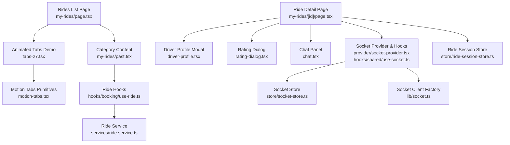
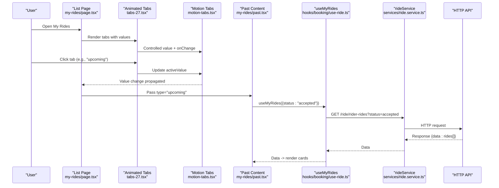
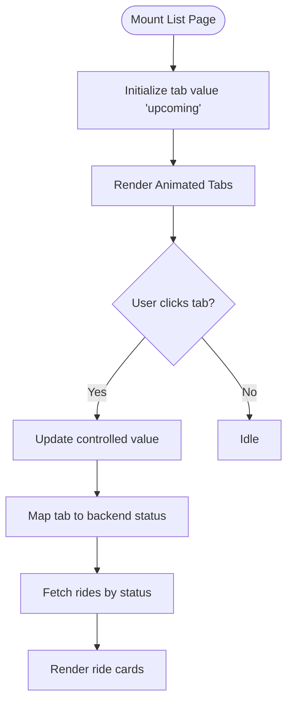
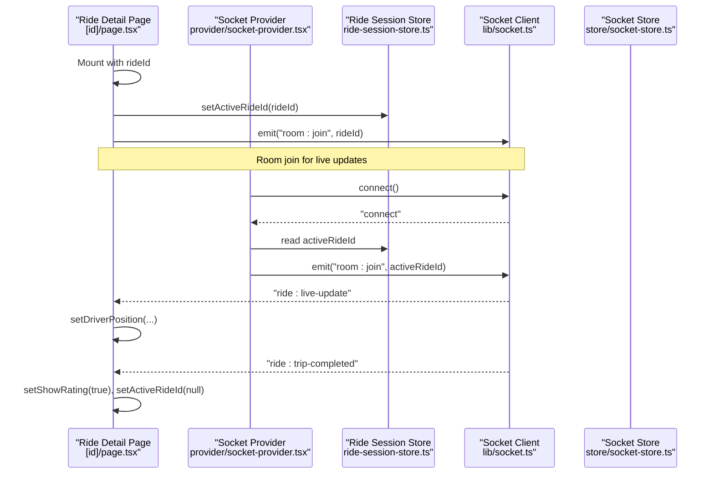
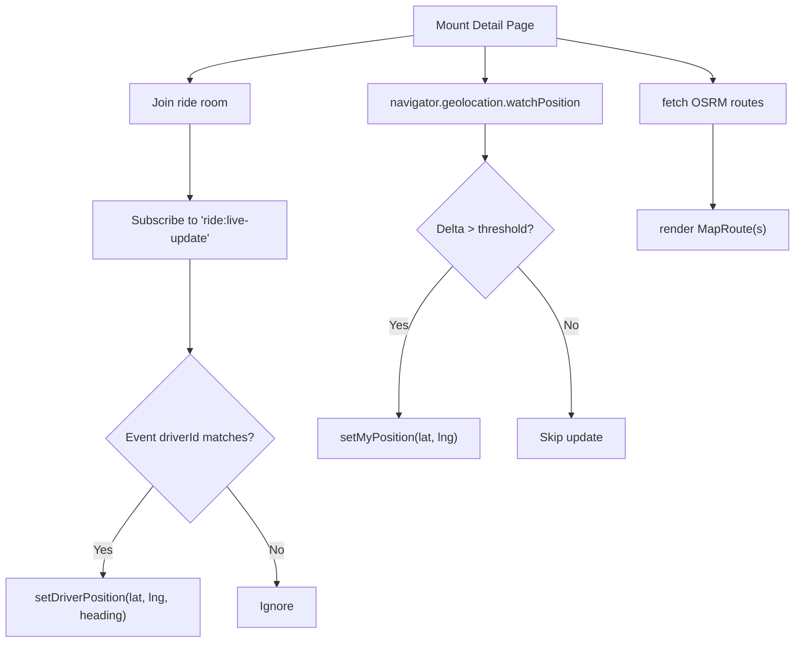
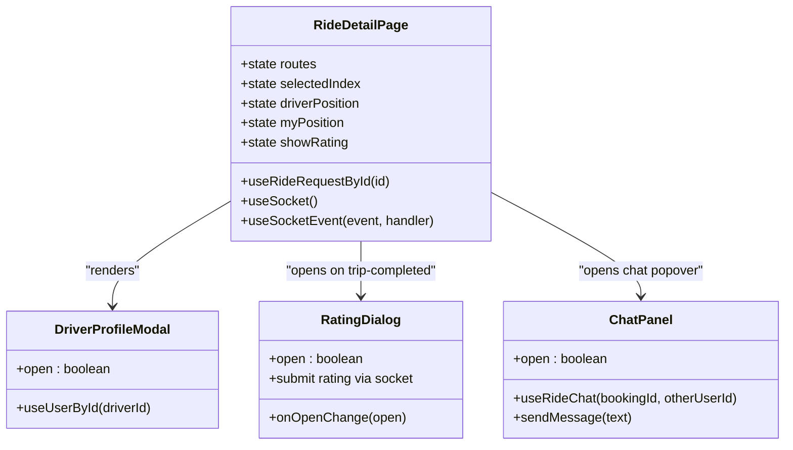
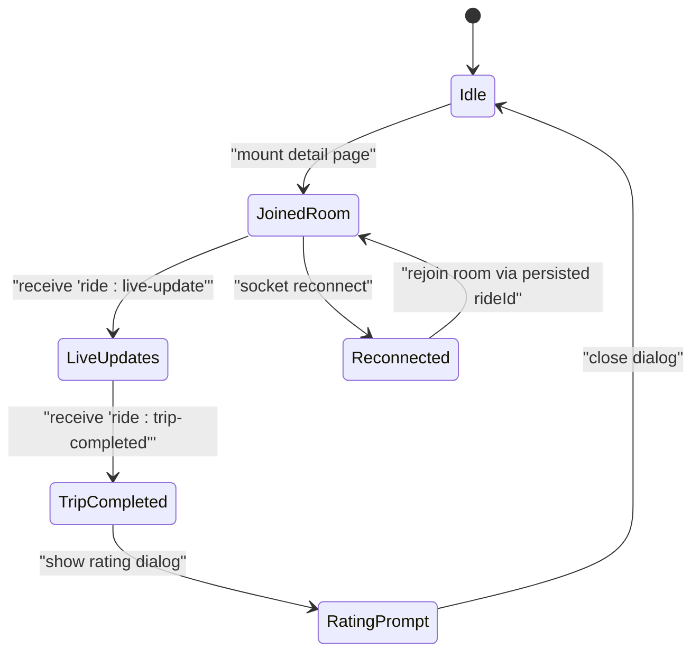
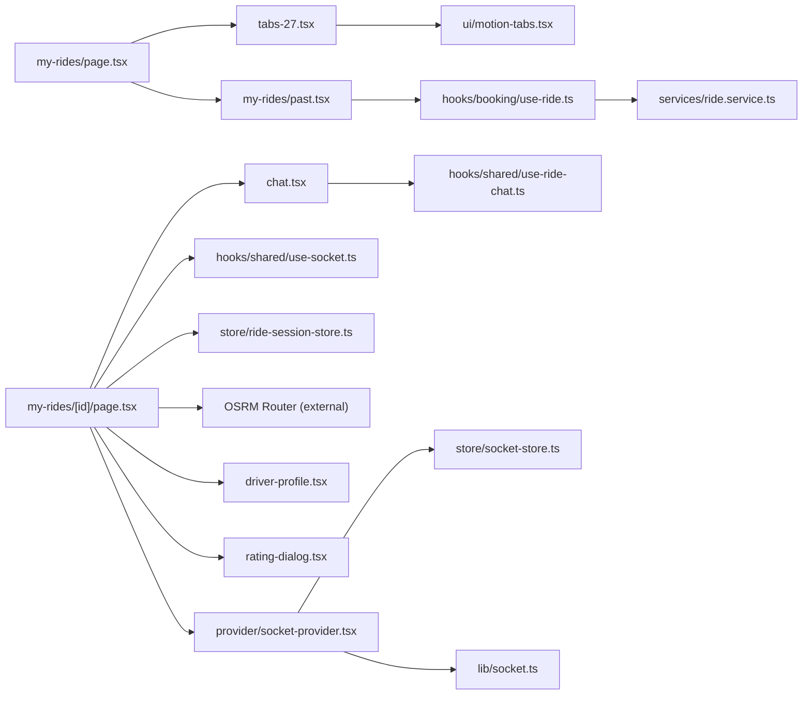

# Active Rides Management

<cite>
**Referenced Files in This Document**
- [page.tsx](file://src/app/(view)/my-rides/page.tsx)
- [past.tsx](file://src/app/(view)/my-rides/past.tsx)
- [tabs-27.tsx](file://src/components/shadcn-studio/tabs/tabs-27.tsx)
- [motion-tabs.tsx](file://src/components/ui/motion-tabs.tsx)
- [ride-detail page.tsx](file://src/app/(view)/my-rides/[id]/page.tsx)
- [driver-profile.tsx](file://src/app/(view)/my-rides/[id]/driver-profile.tsx)
- [rating-dialog.tsx](file://src/app/(view)/my-rides/[id]/rating-dialog.tsx)
- [chat.tsx](file://src/app/(view)/my-rides/[id]/chat.tsx)
- [use-ride.ts](file://src/hooks/booking/use-ride.ts)
- [ride.service.ts](file://src/services/ride.service.ts)
- [ride.types.ts](file://src/types/ride.types.ts)
- [socket-provider.tsx](file://src/provider/socket-provider.tsx)
- [use-socket.ts](file://src/hooks/shared/use-socket.ts)
- [socket-store.ts](file://src/store/socket-store.ts)
- [socket.ts](file://src/lib/socket.ts)
- [ride-session-store.ts](file://src/store/ride-session-store.ts)
</cite>

## Table of Contents
1. Introduction
2. Project Structure
3. Core Components
4. Architecture Overview
5. Detailed Component Analysis
6. Dependency Analysis
7. Performance Considerations
8. Troubleshooting Guide
9. Conclusion

## Introduction
This document explains the active rides management system for tracking ongoing and upcoming rides, including a tabbed interface with animated transitions between ride categories (ongoing, upcoming, past). It covers real-time updates via WebSockets, driver assignment notifications, live location tracking, and the ride detail page features such as driver profile display, chat access, rating dialog, and progress monitoring. The document also describes state management patterns for ride lifecycle, optimistic UI updates for status changes, and error handling for cancelled or failed rides.

## Project Structure
The active rides feature is implemented under the rider view routes and related hooks, services, stores, and providers:
- Tabbed list page: src/app/(view)/my-rides/page.tsx
- Ride category content: src/app/(view)/my-rides/past.tsx
- Animated tabs component: src/components/shadcn-studio/tabs/tabs-27.tsx
- Motion-based tabs primitives: src/components/ui/motion-tabs.tsx
- Ride detail page: src/app/(view)/my-rides/[id]/page.tsx
- Driver profile modal: src/app/(view)/my-rides/[id]/driver-profile.tsx
- Rating dialog: src/app/(view)/my-rides/[id]/rating-dialog.tsx
- Chat panel: src/app/(view)/my-rides/[id]/chat.tsx
- Ride data hooks and services: src/hooks/booking/use-ride.ts, src/services/ride.service.ts
- Socket provider and hooks: src/provider/socket-provider.tsx, src/hooks/shared/use-socket.ts
- Global socket store: src/store/socket-store.ts
- Socket client factory: src/lib/socket.ts
- Ride session persistence: src/store/ride-session-store.ts
- Types: src/types/ride.types.ts

**Diagram sources**
- [page.tsx](file://src/app/(view)/my-rides/page.tsx#L1-L37)
- [tabs-27.tsx:1-52](file://src/components/shadcn-studio/tabs/tabs-27.tsx#L1-L52)
- [motion-tabs.tsx:1-300](file://src/components/ui/motion-tabs.tsx#L1-L300)
- [past.tsx](file://src/app/(view)/my-rides/past.tsx#L1-L153)
- [use-ride.ts:1-60](file://src/hooks/booking/use-ride.ts#L1-L60)
- [ride.service.ts:1-127](file://src/services/ride.service.ts#L1-L127)
- [ride-detail page.tsx](file://src/app/(view)/my-rides/[id]/page.tsx#L1-L371)
- [driver-profile.tsx](file://src/app/(view)/my-rides/[id]/driver-profile.tsx#L1-L139)
- [rating-dialog.tsx](file://src/app/(view)/my-rides/[id]/rating-dialog.tsx#L1-L116)
- [chat.tsx](file://src/app/(view)/my-rides/[id]/chat.tsx#L1-L143)
- [socket-provider.tsx:1-123](file://src/provider/socket-provider.tsx#L1-L123)
- [use-socket.ts:1-57](file://src/hooks/shared/use-socket.ts#L1-L57)
- [socket-store.ts:1-34](file://src/store/socket-store.ts#L1-L34)
- [socket.ts:1-50](file://src/lib/socket.ts#L1-L50)
- [ride-session-store.ts:1-21](file://src/store/ride-session-store.ts#L1-L21)

**Section sources**
- [page.tsx](file://src/app/(view)/my-rides/page.tsx#L1-L37)
- [tabs-27.tsx:1-52](file://src/components/shadcn-studio/tabs/tabs-27.tsx#L1-L52)
- [motion-tabs.tsx:1-300](file://src/components/ui/motion-tabs.tsx#L1-L300)
- [past.tsx](file://src/app/(view)/my-rides/past.tsx#L1-L153)
- [use-ride.ts:1-60](file://src/hooks/booking/use-ride.ts#L1-L60)
- [ride.service.ts:1-127](file://src/services/ride.service.ts#L1-L127)
- [ride-detail page.tsx](file://src/app/(view)/my-rides/[id]/page.tsx#L1-L371)
- [driver-profile.tsx](file://src/app/(view)/my-rides/[id]/driver-profile.tsx#L1-L139)
- [rating-dialog.tsx](file://src/app/(view)/my-rides/[id]/rating-dialog.tsx#L1-L116)
- [chat.tsx](file://src/app/(view)/my-rides/[id]/chat.tsx#L1-L143)
- [socket-provider.tsx:1-123](file://src/provider/socket-provider.tsx#L1-L123)
- [use-socket.ts:1-57](file://src/hooks/shared/use-socket.ts#L1-L57)
- [socket-store.ts:1-34](file://src/store/socket-store.ts#L1-L34)
- [socket.ts:1-50](file://src/lib/socket.ts#L1-L50)
- [ride-session-store.ts:1-21](file://src/store/ride-session-store.ts#L1-L21)

## Core Components
- Tabbed list page: Controls active tab value and renders an animated tabs bar; passes the selected type to the content component.
- Animated tabs demo: Wraps motion-based tabs primitives to provide a controlled tab interface with gradient active states.
- Motion tabs primitives: Provide context-driven tabs with spring animations and blur transitions for content panels.
- Category content: Maps tab types to backend statuses and fetches rides accordingly; shows skeletons, empty states, and errors.
- Ride detail page: Loads passenger request details, joins a WebSocket room for live updates, subscribes to driver location events, tracks passenger GPS, fetches OSRM routes, and renders map markers and info cards.
- Driver profile modal: Displays driver information, ratings, and default vehicle details.
- Rating dialog: Collects star rating and optional feedback; submits via socket callback and shows toast feedback.
- Chat panel: Lazily creates or finds a 1:1 chat for the booking, loads messages, marks seen, and sends new messages over sockets.
- Socket infrastructure: Provides a singleton socket instance, reattaches to the last active ride room on reconnect, and dispatches events into a global store.
- Ride session store: Persists the active ride ID across reloads to auto-rejoin rooms.

**Section sources**
- [page.tsx](file://src/app/(view)/my-rides/page.tsx#L1-L37)
- [tabs-27.tsx:1-52](file://src/components/shadcn-studio/tabs/tabs-27.tsx#L1-L52)
- [motion-tabs.tsx:1-300](file://src/components/ui/motion-tabs.tsx#L1-L300)
- [past.tsx](file://src/app/(view)/my-rides/past.tsx#L1-L153)
- [ride-detail page.tsx](file://src/app/(view)/my-rides/[id]/page.tsx#L1-L371)
- [driver-profile.tsx](file://src/app/(view)/my-rides/[id]/driver-profile.tsx#L1-L139)
- [rating-dialog.tsx](file://src/app/(view)/my-rides/[id]/rating-dialog.tsx#L1-L116)
- [chat.tsx](file://src/app/(view)/my-rides/[id]/chat.tsx#L1-L143)
- [socket-provider.tsx:1-123](file://src/provider/socket-provider.tsx#L1-L123)
- [use-socket.ts:1-57](file://src/hooks/shared/use-socket.ts#L1-L57)
- [socket-store.ts:1-34](file://src/store/socket-store.ts#L1-L34)
- [socket.ts:1-50](file://src/lib/socket.ts#L1-L50)
- [ride-session-store.ts:1-21](file://src/store/ride-session-store.ts#L1-L21)

## Architecture Overview
The system combines React Query for HTTP data, Zustand for local state, and Socket.IO for real-time updates. The ride list uses a tabbed interface to filter by status. The ride detail page joins a per-ride room to receive live updates (e.g., driver location, trip completion), while OSRM provides route geometry for visualization.

**Diagram sources**
- [page.tsx](file://src/app/(view)/my-rides/page.tsx#L1-L37)
- [tabs-27.tsx:1-52](file://src/components/shadcn-studio/tabs/tabs-27.tsx#L1-L52)
- [motion-tabs.tsx:1-300](file://src/components/ui/motion-tabs.tsx#L1-L300)
- [past.tsx](file://src/app/(view)/my-rides/past.tsx#L1-L153)
- [use-ride.ts:1-60](file://src/hooks/booking/use-ride.ts#L1-L60)
- [ride.service.ts:1-127](file://src/services/ride.service.ts#L1-L127)

## Detailed Component Analysis

### Tabbed Interface with Animated Transitions
- The list page maintains a controlled tab value and passes it to the animated tabs wrapper.
- The animated tabs wrapper composes motion-based tabs primitives that animate the highlight indicator and apply blur transitions to inactive content.
- The content component maps tab values to backend statuses and fetches corresponding rides.

**Diagram sources**
- [page.tsx](file://src/app/(view)/my-rides/page.tsx#L1-L37)
- [tabs-27.tsx:1-52](file://src/components/shadcn-studio/tabs/tabs-27.tsx#L1-L52)
- [motion-tabs.tsx:1-300](file://src/components/ui/motion-tabs.tsx#L1-L300)
- [past.tsx](file://src/app/(view)/my-rides/past.tsx#L1-L153)

**Section sources**
- [page.tsx](file://src/app/(view)/my-rides/page.tsx#L1-L37)
- [tabs-27.tsx:1-52](file://src/components/shadcn-studio/tabs/tabs-27.tsx#L1-L52)
- [motion-tabs.tsx:1-300](file://src/components/ui/motion-tabs.tsx#L1-L300)
- [past.tsx](file://src/app/(view)/my-rides/past.tsx#L1-L153)

### Real-Time Ride Status Updates and Notifications
- The socket provider connects once, registers all known events, and reattaches to the last active ride room after any reconnect using the persisted ride session store.
- The ride detail page joins the ride room when mounted and leaves on unmount. It listens for driver location updates and trip completion events.
- The global socket store captures the latest event payload for each event type, enabling components to react to the most recent update.

**Diagram sources**
- [ride-detail page.tsx](file://src/app/(view)/my-rides/[id]/page.tsx#L1-L371)
- [socket-provider.tsx:1-123](file://src/provider/socket-provider.tsx#L1-L123)
- [ride-session-store.ts:1-21](file://src/store/ride-session-store.ts#L1-L21)
- [socket.ts:1-50](file://src/lib/socket.ts#L1-L50)
- [socket-store.ts:1-34](file://src/store/socket-store.ts#L1-L34)

**Section sources**
- [socket-provider.tsx:1-123](file://src/provider/socket-provider.tsx#L1-L123)
- [use-socket.ts:1-57](file://src/hooks/shared/use-socket.ts#L1-L57)
- [socket-store.ts:1-34](file://src/store/socket-store.ts#L1-L34)
- [socket.ts:1-50](file://src/lib/socket.ts#L1-L50)
- [ride-session-store.ts:1-21](file://src/store/ride-session-store.ts#L1-L21)
- [ride-detail page.tsx](file://src/app/(view)/my-rides/[id]/page.tsx#L1-L371)

### Live Location Tracking Integration
- The ride detail page subscribes to "ride:live-update" events filtered by the assigned driver’s ID and updates the driver marker position on the map.
- Passenger GPS is watched locally with debouncing based on coordinate deltas to avoid jitter.
- Routes are fetched from OSRM and rendered as selectable paths; the selected route is highlighted.

**Diagram sources**
- [ride-detail page.tsx](file://src/app/(view)/my-rides/[id]/page.tsx#L1-L371)

**Section sources**
- [ride-detail page.tsx](file://src/app/(view)/my-rides/[id]/page.tsx#L1-L371)

### Ride Detail Page Functionality
- Driver profile display: Opens a modal showing name, contact, average rating, completed rides, address, and default vehicle info.
- Chat access: A floating button opens a popover chat panel; it lazily creates or finds a 1:1 chat for the booking, loads messages, marks them seen, and sends new messages via sockets.
- Rating dialog: Triggered on trip completion; collects star rating and optional feedback; submits via socket callback and shows success/error toasts.
- Progress monitoring: Shows departure time/date, addresses, estimated fare/distance/duration, and live markers for pickup, destination, driver, and passenger.

**Diagram sources**
- [ride-detail page.tsx](file://src/app/(view)/my-rides/[id]/page.tsx#L1-L371)
- [driver-profile.tsx](file://src/app/(view)/my-rides/[id]/driver-profile.tsx#L1-L139)
- [rating-dialog.tsx](file://src/app/(view)/my-rides/[id]/rating-dialog.tsx#L1-L116)
- [chat.tsx](file://src/app/(view)/my-rides/[id]/chat.tsx#L1-L143)

**Section sources**
- [ride-detail page.tsx](file://src/app/(view)/my-rides/[id]/page.tsx#L1-L371)
- [driver-profile.tsx](file://src/app/(view)/my-rides/[id]/driver-profile.tsx#L1-L139)
- [rating-dialog.tsx](file://src/app/(view)/my-rides/[id]/rating-dialog.tsx#L1-L116)
- [chat.tsx](file://src/app/(view)/my-rides/[id]/chat.tsx#L1-L143)

### State Management for Ride Lifecycle
- Ride list filtering: Controlled tab value maps to backend statuses ("started", "accepted", "completed").
- Ride detail lifecycle: On mount, persist active ride ID and join room; on trip completion, clear active ride and prompt rating.
- Chat lifecycle: Lazy creation of chat if missing, then subscribe to messages and mark unseen messages as seen.

**Diagram sources**
- [ride-detail page.tsx](file://src/app/(view)/my-rides/[id]/page.tsx#L1-L371)
- [socket-provider.tsx:1-123](file://src/provider/socket-provider.tsx#L1-L123)
- [ride-session-store.ts:1-21](file://src/store/ride-session-store.ts#L1-L21)

**Section sources**
- [past.tsx](file://src/app/(view)/my-rides/past.tsx#L1-L153)
- [ride-detail page.tsx](file://src/app/(view)/my-rides/[id]/page.tsx#L1-L371)
- [socket-provider.tsx:1-123](file://src/provider/socket-provider.tsx#L1-L123)
- [ride-session-store.ts:1-21](file://src/store/ride-session-store.ts#L1-L21)

### Optimistic UI Updates for Ride Status Changes
- Chat messages: New messages are appended immediately upon sending; server acknowledgment and history sync ensure consistency.
- Ratings: Submitting a rating disables the submit button and shows toasts based on server response; no immediate optimistic UI beyond disabling the button.
- Note: For ride status changes, the current implementation relies on server-driven updates via sockets rather than client-side optimistic mutations. If needed, optimistic updates can be layered on top of existing hooks by pre-updating local state before awaiting server confirmation.

**Section sources**
- [chat.tsx](file://src/app/(view)/my-rides/[id]/chat.tsx#L1-L143)
- [use-ride-chat.ts:1-116](file://src/hooks/shared/use-ride-chat.ts#L1-L116)
- [rating-dialog.tsx](file://src/app/(view)/my-rides/[id]/rating-dialog.tsx#L1-L116)

### Error Handling for Cancelled or Failed Rides
- List page: Shows a generic failure message when fetching rides fails; handles empty lists gracefully.
- Socket events: The provider registers cancellation-related events (e.g., "ride:cancelled", "ride:cancelled-by-driver", "ride:no-driver-found") which can be used to update UI or notify users.
- Route fetching: Errors during OSRM route requests are logged; UI continues without routes.

**Section sources**
- [past.tsx](file://src/app/(view)/my-rides/past.tsx#L1-L153)
- [socket-provider.tsx:1-123](file://src/provider/socket-provider.tsx#L1-L123)
- [ride-detail page.tsx](file://src/app/(view)/my-rides/[id]/page.tsx#L1-L371)

## Dependency Analysis
The following diagram highlights key dependencies among components, hooks, services, and stores.

**Diagram sources**
- [page.tsx](file://src/app/(view)/my-rides/page.tsx#L1-L37)
- [tabs-27.tsx:1-52](file://src/components/shadcn-studio/tabs/tabs-27.tsx#L1-L52)
- [motion-tabs.tsx:1-300](file://src/components/ui/motion-tabs.tsx#L1-L300)
- [past.tsx](file://src/app/(view)/my-rides/past.tsx#L1-L153)
- [use-ride.ts:1-60](file://src/hooks/booking/use-ride.ts#L1-L60)
- [ride.service.ts:1-127](file://src/services/ride.service.ts#L1-L127)
- [ride-detail page.tsx](file://src/app/(view)/my-rides/[id]/page.tsx#L1-L371)
- [driver-profile.tsx](file://src/app/(view)/my-rides/[id]/driver-profile.tsx#L1-L139)
- [rating-dialog.tsx](file://src/app/(view)/my-rides/[id]/rating-dialog.tsx#L1-L116)
- [chat.tsx](file://src/app/(view)/my-rides/[id]/chat.tsx#L1-L143)
- [use-ride-chat.ts:1-116](file://src/hooks/shared/use-ride-chat.ts#L1-L116)
- [socket-provider.tsx:1-123](file://src/provider/socket-provider.tsx#L1-L123)
- [use-socket.ts:1-57](file://src/hooks/shared/use-socket.ts#L1-L57)
- [socket-store.ts:1-34](file://src/store/socket-store.ts#L1-L34)
- [socket.ts:1-50](file://src/lib/socket.ts#L1-L50)
- [ride-session-store.ts:1-21](file://src/store/ride-session-store.ts#L1-L21)

**Section sources**
- [page.tsx](file://src/app/(view)/my-rides/page.tsx#L1-L37)
- [tabs-27.tsx:1-52](file://src/components/shadcn-studio/tabs/tabs-27.tsx#L1-L52)
- [motion-tabs.tsx:1-300](file://src/components/ui/motion-tabs.tsx#L1-L300)
- [past.tsx](file://src/app/(view)/my-rides/past.tsx#L1-L153)
- [use-ride.ts:1-60](file://src/hooks/booking/use-ride.ts#L1-L60)
- [ride.service.ts:1-127](file://src/services/ride.service.ts#L1-L127)
- [ride-detail page.tsx](file://src/app/(view)/my-rides/[id]/page.tsx#L1-L371)
- [driver-profile.tsx](file://src/app/(view)/my-rides/[id]/driver-profile.tsx#L1-L139)
- [rating-dialog.tsx](file://src/app/(view)/my-rides/[id]/rating-dialog.tsx#L1-L116)
- [chat.tsx](file://src/app/(view)/my-rides/[id]/chat.tsx#L1-L143)
- [use-ride-chat.ts:1-116](file://src/hooks/shared/use-ride-chat.ts#L1-L116)
- [socket-provider.tsx:1-123](file://src/provider/socket-provider.tsx#L1-L123)
- [use-socket.ts:1-57](file://src/hooks/shared/use-socket.ts#L1-L57)
- [socket-store.ts:1-34](file://src/store/socket-store.ts#L1-L34)
- [socket.ts:1-50](file://src/lib/socket.ts#L1-L50)
- [ride-session-store.ts:1-21](file://src/store/ride-session-store.ts#L1-L21)

## Performance Considerations
- Debounce GPS updates: The detail page filters small coordinate deltas to reduce unnecessary re-renders.
- Route selection optimization: Routes are sorted to keep the selected route first, minimizing layout shifts.
- Socket event registration: The provider registers a fixed set of events once, avoiding repeated subscriptions.
- Local storage persistence: The ride session store persists the active ride ID to avoid redundant room joins after reloads.
- OSRM calls: Routes are fetched once per request load; consider caching responses if frequently revisited.

[No sources needed since this section provides general guidance]

## Troubleshooting Guide
- No rides shown: Verify the mapped status for the selected tab and check network responses from the rides endpoint.
- Driver not moving on map: Ensure the driver emits "ride:live-update" with matching driverId and that the detail page has joined the correct room.
- Chat not loading: Confirm the chat exists for the booking or was created; check socket "new-message" events and message seen marking.
- Rating submission fails: Inspect socket callback response and toast messages; verify required fields are provided.
- Socket disconnects: Check provider logs and confirm room rejoin behavior using the persisted ride session store.

**Section sources**
- [past.tsx](file://src/app/(view)/my-rides/past.tsx#L1-L153)
- [ride-detail page.tsx](file://src/app/(view)/my-rides/[id]/page.tsx#L1-L371)
- [chat.tsx](file://src/app/(view)/my-rides/[id]/chat.tsx#L1-L143)
- [rating-dialog.tsx](file://src/app/(view)/my-rides/[id]/rating-dialog.tsx#L1-L116)
- [socket-provider.tsx:1-123](file://src/provider/socket-provider.tsx#L1-L123)
- [ride-session-store.ts:1-21](file://src/store/ride-session-store.ts#L1-L21)

## Conclusion
The active rides management system integrates a responsive tabbed interface, real-time updates, and rich ride detail features. It leverages React Query for HTTP data, Zustand for local state, and Socket.IO for live interactions. The design supports robust lifecycle management, optimistic UX where appropriate, and clear error handling pathways. Future enhancements may include more aggressive optimistic updates for ride status changes and additional caching strategies for routes and chat history.