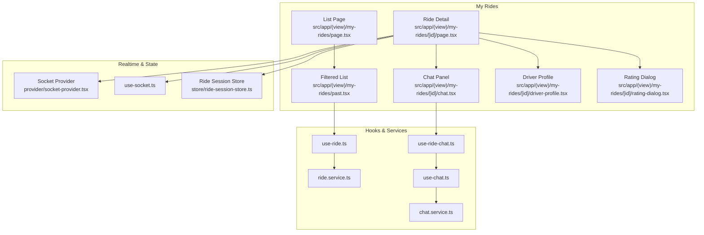
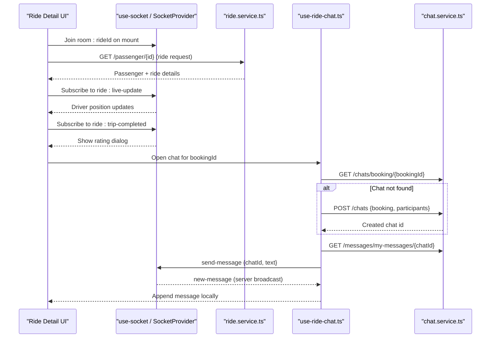
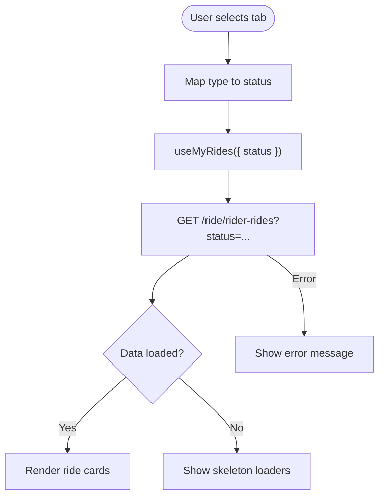
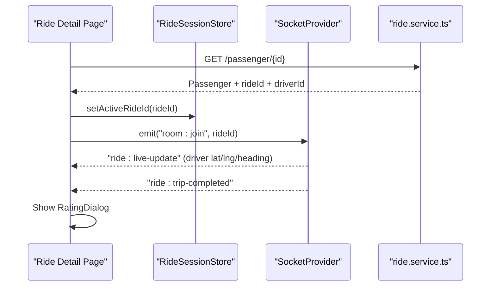
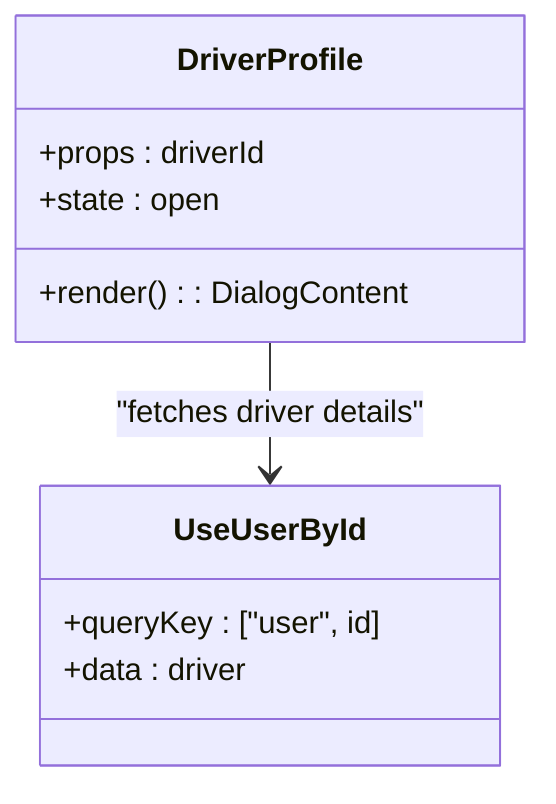
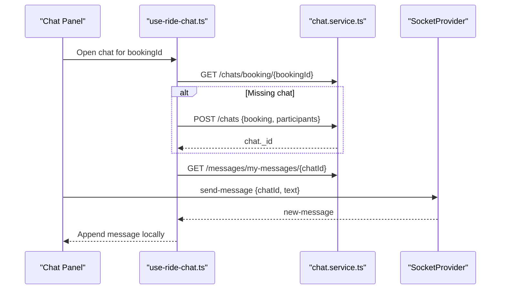
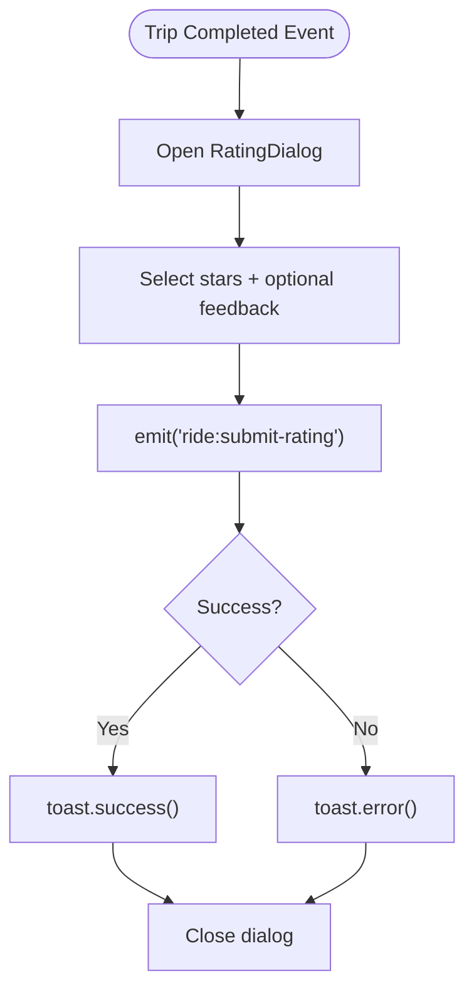
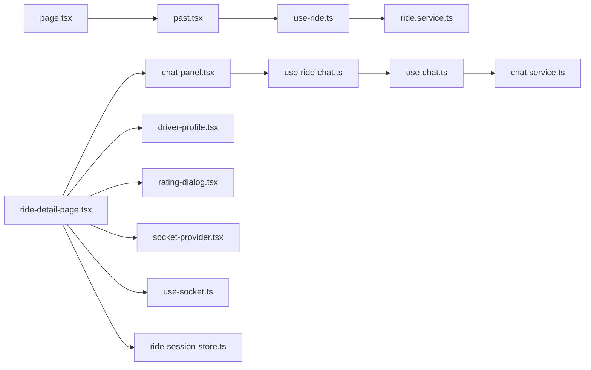

# My Rides Management

<cite>
**Referenced Files in This Document**
- [page.tsx](file://src/app/(view)/my-rides/page.tsx)
- [past.tsx](file://src/app/(view)/my-rides/past.tsx)
- [ride-detail-page.tsx](file://src/app/(view)/my-rides/[id]/page.tsx)
- [chat-panel.tsx](file://src/app/(view)/my-rides/[id]/chat.tsx)
- [driver-profile.tsx](file://src/app/(view)/my-rides/[id]/driver-profile.tsx)
- [rating-dialog.tsx](file://src/app/(view)/my-rides/[id]/rating-dialog.tsx)
- [use-ride.ts](file://src/hooks/booking/use-ride.ts)
- [ride.service.ts](file://src/services/ride.service.ts)
- [use-ride-chat.ts](file://src/hooks/shared/use-ride-chat.ts)
- [chat.service.ts](file://src/services/chat.service.ts)
- [use-chat.ts](file://src/hooks/shared/use-chat.ts)
- [ride.types.ts](file://src/types/ride.types.ts)
- [chat.types.ts](file://src/types/chat.types.ts)
- [socket-provider.tsx](file://src/provider/socket-provider.tsx)
- [use-socket.ts](file://src/hooks/shared/use-socket.ts)
- [ride-session-store.ts](file://src/store/ride-session-store.ts)
</cite>

## Table of Contents
1. Introduction
2. Project Structure
3. Core Components
4. Architecture Overview
5. Detailed Component Analysis
6. Dependency Analysis
7. Performance Considerations
8. Troubleshooting Guide
9. Conclusion

## Introduction
This document explains the My Rides section for passengers, covering active and past trip management. It documents:
- The ride list interface with filtering by status (ongoing, upcoming, past).
- Ride status tracking and detailed ride information display.
- The individual ride page including driver profile integration, real-time chat access, rating system, and navigation to ride history.
- Data fetching strategies using React Query, optimistic updates via socket events, and error handling for failed rides.
- Examples of state management patterns, pagination considerations for past rides, and integration with the messaging system.

## Project Structure
The My Rides feature is implemented under a Next.js App Router structure with client components, hooks, services, types, and providers.

**Diagram sources**
- [page.tsx](file://src/app/(view)/my-rides/page.tsx#L1-L37)
- [past.tsx](file://src/app/(view)/my-rides/past.tsx#L1-L153)
- [ride-detail-page.tsx](file://src/app/(view)/my-rides/[id]/page.tsx#L1-L371)
- [chat-panel.tsx](file://src/app/(view)/my-rides/[id]/chat.tsx#L1-L143)
- [driver-profile.tsx](file://src/app/(view)/my-rides/[id]/driver-profile.tsx#L1-L139)
- [rating-dialog.tsx](file://src/app/(view)/my-rides/[id]/rating-dialog.tsx#L1-L116)
- [use-ride.ts:1-60](file://src/hooks/booking/use-ride.ts#L1-L60)
- [ride.service.ts:1-127](file://src/services/ride.service.ts#L1-L127)
- [use-ride-chat.ts:1-116](file://src/hooks/shared/use-ride-chat.ts#L1-L116)
- [use-chat.ts:1-95](file://src/hooks/shared/use-chat.ts#L1-L95)
- [chat.service.ts:1-51](file://src/services/chat.service.ts#L1-L51)
- [socket-provider.tsx:1-123](file://src/provider/socket-provider.tsx#L1-L123)
- [use-socket.ts:1-57](file://src/hooks/shared/use-socket.ts#L1-L57)
- [ride-session-store.ts:1-21](file://src/store/ride-session-store.ts#L1-L21)

**Section sources**
- [page.tsx](file://src/app/(view)/my-rides/page.tsx#L1-L37)
- [past.tsx](file://src/app/(view)/my-rides/past.tsx#L1-L153)
- [ride-detail-page.tsx](file://src/app/(view)/my-rides/[id]/page.tsx#L1-L371)

## Core Components
- Ride list page: Provides tabs for ongoing, upcoming, and past rides. It renders a filtered list component based on the selected tab.
- Filtered list: Fetches rides by status mapping (ongoing → started, upcoming → accepted, past → completed), shows loading skeletons, empty states, and errors.
- Ride detail page: Displays map routes, live driver position, passenger location, departure info, driver contact, estimated fare/distance/duration, and integrates chat and rating dialog.
- Chat panel: Opens a popover chat UI per booking, lazily creates a 1:1 chat if missing, fetches messages, and sends new messages over sockets.
- Driver profile: Shows driver details, average rating, completed rides, and default vehicle info.
- Rating dialog: Collects star rating and optional feedback; submits via socket event and provides user feedback via toast.

Key data flows:
- Ride list uses React Query to fetch rides filtered by status.
- Ride detail subscribes to socket events for live updates and completion prompts.
- Chat uses a get-or-create pattern for the chat room and merges server history with live messages.

**Section sources**
- [page.tsx](file://src/app/(view)/my-rides/page.tsx#L1-L37)
- [past.tsx](file://src/app/(view)/my-rides/past.tsx#L1-L153)
- [ride-detail-page.tsx](file://src/app/(view)/my-rides/[id]/page.tsx#L1-L371)
- [chat-panel.tsx](file://src/app/(view)/my-rides/[id]/chat.tsx#L1-L143)
- [driver-profile.tsx](file://src/app/(view)/my-rides/[id]/driver-profile.tsx#L1-L139)
- [rating-dialog.tsx](file://src/app/(view)/my-rides/[id]/rating-dialog.tsx#L1-L116)

## Architecture Overview
The My Rides architecture combines REST APIs via React Query with real-time updates through WebSockets.

**Diagram sources**
- [ride-detail-page.tsx](file://src/app/(view)/my-rides/[id]/page.tsx#L75-L104)
- [socket-provider.tsx:67-116](file://src/provider/socket-provider.tsx#L67-L116)
- [use-ride-chat.ts:17-116](file://src/hooks/shared/use-ride-chat.ts#L17-L116)
- [chat.service.ts:1-51](file://src/services/chat.service.ts#L1-L51)
- [ride.service.ts:33-111](file://src/services/ride.service.ts#L33-L111)

## Detailed Component Analysis

### Ride List Interface and Filtering
- Tabs control type selection: ongoing, upcoming, past.
- Type-to-status mapping drives API queries:
  - ongoing → started
  - upcoming → accepted
  - past → completed
- The list component uses a hook that wraps a React Query key and calls the service endpoint with a status query parameter.
- Error and empty states are handled explicitly.

**Diagram sources**
- [page.tsx](file://src/app/(view)/my-rides/page.tsx#L14-L28)
- [past.tsx](file://src/app/(view)/my-rides/past.tsx#L12-L26)
- [use-ride.ts:24-29](file://src/hooks/booking/use-ride.ts#L24-L29)
- [ride.service.ts:18-21](file://src/services/ride.service.ts#L18-L21)

**Section sources**
- [page.tsx](file://src/app/(view)/my-rides/page.tsx#L1-L37)
- [past.tsx](file://src/app/(view)/my-rides/past.tsx#L1-L153)
- [use-ride.ts:1-60](file://src/hooks/booking/use-ride.ts#L1-L60)
- [ride.service.ts:1-127](file://src/services/ride.service.ts#L1-L127)
- [ride.types.ts:1-62](file://src/types/ride.types.ts#L1-L62)

### Individual Ride Page
- Loads passenger and ride details via a dedicated endpoint.
- Joins a socket room for the ride and persists the active ride ID across reloads.
- Subscribes to live driver position updates and trip completion events.
- Displays multiple OSRM routes, markers for pickup/destination, driver, and passenger locations.
- Integrates driver profile view and chat panel.
- Prompts rating when trip completes.

**Diagram sources**
- [ride-detail-page.tsx](file://src/app/(view)/my-rides/[id]/page.tsx#L55-L104)
- [ride-session-store.ts:1-21](file://src/store/ride-session-store.ts#L1-L21)
- [socket-provider.tsx:72-84](file://src/provider/socket-provider.tsx#L72-L84)
- [ride.service.ts:36-111](file://src/services/ride.service.ts#L36-L111)

**Section sources**
- [ride-detail-page.tsx](file://src/app/(view)/my-rides/[id]/page.tsx#L1-L371)
- [ride-session-store.ts:1-21](file://src/store/ride-session-store.ts#L1-L21)
- [socket-provider.tsx:1-123](file://src/provider/socket-provider.tsx#L1-L123)
- [use-socket.ts:1-57](file://src/hooks/shared/use-socket.ts#L1-L57)

### Driver Profile Integration
- Opens a modal showing driver name, email, phone, completed rides, average rating, total ratings, address, and default vehicle details.
- Uses a user-by-id hook to fetch profile data.

**Diagram sources**
- [driver-profile.tsx](file://src/app/(view)/my-rides/[id]/driver-profile.tsx#L1-L139)

**Section sources**
- [driver-profile.tsx](file://src/app/(view)/my-rides/[id]/driver-profile.tsx#L1-L139)

### Real-time Chat Access
- Lazily creates a 1:1 chat for a booking if it does not exist.
- Fetches chat history from either the chat object or messages endpoint.
- Subscribes to new-message events and appends messages without duplicates.
- Marks messages as seen automatically.

**Diagram sources**
- [chat-panel.tsx](file://src/app/(view)/my-rides/[id]/chat.tsx#L1-L143)
- [use-ride-chat.ts:17-116](file://src/hooks/shared/use-ride-chat.ts#L17-L116)
- [chat.service.ts:1-51](file://src/services/chat.service.ts#L1-L51)
- [use-chat.ts:1-95](file://src/hooks/shared/use-chat.ts#L1-L95)

**Section sources**
- [chat-panel.tsx](file://src/app/(view)/my-rides/[id]/chat.tsx#L1-L143)
- [use-ride-chat.ts:1-116](file://src/hooks/shared/use-ride-chat.ts#L1-L116)
- [chat.service.ts:1-51](file://src/services/chat.service.ts#L1-L51)
- [use-chat.ts:1-95](file://src/hooks/shared/use-chat.ts#L1-L95)
- [chat.types.ts:1-80](file://src/types/chat.types.ts#L1-L80)

### Rating System Implementation
- Triggered by a socket event when the trip is marked completed.
- Collects star rating and optional feedback.
- Submits rating via a socket event and displays success/error toasts.

**Diagram sources**
- [ride-detail-page.tsx](file://src/app/(view)/my-rides/[id]/page.tsx#L98-L104)
- [rating-dialog.tsx](file://src/app/(view)/my-rides/[id]/rating-dialog.tsx#L35-L54)

**Section sources**
- [rating-dialog.tsx](file://src/app/(view)/my-rides/[id]/rating-dialog.tsx#L1-L116)
- [ride-detail-page.tsx](file://src/app/(view)/my-rides/[id]/page.tsx#L98-L104)

### Ride Data Fetching Strategies
- List rides: useMyRides(query) maps to GET /ride/rider-rides?status=...
- Request detail: useRideRequestById(id) maps to GET /passenger/{id}
- Chat: get-or-create chat by booking, then fetch messages by chatId
- All queries are keyed with React Query keys for cache invalidation and refetching.

**Section sources**
- [use-ride.ts:1-60](file://src/hooks/booking/use-ride.ts#L1-L60)
- [ride.service.ts:1-127](file://src/services/ride.service.ts#L1-L127)
- [use-chat.ts:1-95](file://src/hooks/shared/use-chat.ts#L1-L95)
- [chat.service.ts:1-51](file://src/services/chat.service.ts#L1-L51)

### Optimistic Updates for Ride Status Changes
- Live driver positions are applied immediately upon receiving "ride:live-update".
- Trip completion triggers immediate UI changes (show rating dialog) before any HTTP confirmation.
- Active ride persistence ensures rejoining rooms after reconnects.

**Section sources**
- [ride-detail-page.tsx](file://src/app/(view)/my-rides/[id]/page.tsx#L75-L104)
- [socket-provider.tsx:72-84](file://src/provider/socket-provider.tsx#L72-L84)
- [ride-session-store.ts:1-21](file://src/store/ride-session-store.ts#L1-L21)

### Error Handling for Failed Rides
- List component shows an error message when ride fetch fails.
- Route fetching catches and logs errors.
- Rating submission handles server response and shows appropriate toasts.

**Section sources**
- [past.tsx](file://src/app/(view)/my-rides/past.tsx#L39-L45)
- [ride-detail-page.tsx](file://src/app/(view)/my-rides/[id]/page.tsx#L151-L154)
- [rating-dialog.tsx](file://src/app/(view)/my-rides/[id]/rating-dialog.tsx#L35-L54)

### Pagination for Past Rides
- Current implementation returns arrays for rider rides without pagination wrappers.
- For large datasets, consider switching to a paginated endpoint and updating the hook/service to handle pages and metadata.

[No sources needed since this section provides general guidance]

### Integration with Messaging System
- Chat panel integrates with the global messaging system:
  - Get-or-create chat per booking
  - Fetch messages by chatId
  - Send messages via socket
  - Mark messages as seen
  - Merge live messages into local state

**Section sources**
- [use-ride-chat.ts:1-116](file://src/hooks/shared/use-ride-chat.ts#L1-L116)
- [chat.service.ts:1-51](file://src/services/chat.service.ts#L1-L51)
- [use-chat.ts:1-95](file://src/hooks/shared/use-chat.ts#L1-L95)

## Dependency Analysis

**Diagram sources**
- [page.tsx](file://src/app/(view)/my-rides/page.tsx#L1-L37)
- [past.tsx](file://src/app/(view)/my-rides/past.tsx#L1-L153)
- [use-ride.ts:1-60](file://src/hooks/booking/use-ride.ts#L1-L60)
- [ride.service.ts:1-127](file://src/services/ride.service.ts#L1-L127)
- [ride-detail-page.tsx](file://src/app/(view)/my-rides/[id]/page.tsx#L1-L371)
- [chat-panel.tsx](file://src/app/(view)/my-rides/[id]/chat.tsx#L1-L143)
- [driver-profile.tsx](file://src/app/(view)/my-rides/[id]/driver-profile.tsx#L1-L139)
- [rating-dialog.tsx](file://src/app/(view)/my-rides/[id]/rating-dialog.tsx#L1-L116)
- [use-ride-chat.ts:1-116](file://src/hooks/shared/use-ride-chat.ts#L1-L116)
- [use-chat.ts:1-95](file://src/hooks/shared/use-chat.ts#L1-L95)
- [chat.service.ts:1-51](file://src/services/chat.service.ts#L1-L51)
- [socket-provider.tsx:1-123](file://src/provider/socket-provider.tsx#L1-L123)
- [use-socket.ts:1-57](file://src/hooks/shared/use-socket.ts#L1-L57)
- [ride-session-store.ts:1-21](file://src/store/ride-session-store.ts#L1-L21)

**Section sources**
- [page.tsx](file://src/app/(view)/my-rides/page.tsx#L1-L37)
- [past.tsx](file://src/app/(view)/my-rides/past.tsx#L1-L153)
- [ride-detail-page.tsx](file://src/app/(view)/my-rides/[id]/page.tsx#L1-L371)
- [use-ride.ts:1-60](file://src/hooks/booking/use-ride.ts#L1-L60)
- [ride.service.ts:1-127](file://src/services/ride.service.ts#L1-L127)
- [use-ride-chat.ts:1-116](file://src/hooks/shared/use-ride-chat.ts#L1-L116)
- [use-chat.ts:1-95](file://src/hooks/shared/use-chat.ts#L1-L95)
- [chat.service.ts:1-51](file://src/services/chat.service.ts#L1-L51)
- [socket-provider.tsx:1-123](file://src/provider/socket-provider.tsx#L1-L123)
- [use-socket.ts:1-57](file://src/hooks/shared/use-socket.ts#L1-L57)
- [ride-session-store.ts:1-21](file://src/store/ride-session-store.ts#L1-L21)

## Performance Considerations
- Prefer debouncing or throttling geolocation updates if frequent updates cause excessive re-renders.
- Cache OSRM route results per route pair to avoid repeated network calls.
- Use React Query staleTime and refetchOnWindowFocus appropriately for ride lists.
- Avoid unnecessary re-renders by memoizing derived values like sorted routes.

[No sources needed since this section provides general guidance]

## Troubleshooting Guide
- If ride list fails to load, check the error state rendering and network responses for the status-filtered endpoint.
- If live driver position does not update, verify socket connection and room join events.
- If chat messages do not appear, ensure the chat exists or is created, and confirm new-message events are received.
- If rating submission fails, inspect the socket callback response and toast messages.

**Section sources**
- [past.tsx](file://src/app/(view)/my-rides/past.tsx#L39-L45)
- [ride-detail-page.tsx](file://src/app/(view)/my-rides/[id]/page.tsx#L151-L154)
- [rating-dialog.tsx](file://src/app/(view)/my-rides/[id]/rating-dialog.tsx#L35-L54)

## Conclusion
The My Rides feature provides a robust passenger experience with clear filtering, real-time updates, integrated chat, and post-trip rating. It leverages React Query for reliable data fetching and WebSockets for live interactions. Future enhancements can include pagination for past rides and additional caching strategies for improved performance.