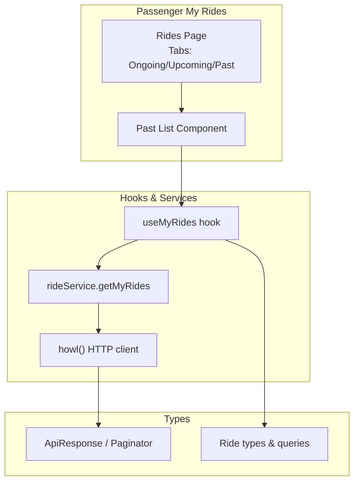
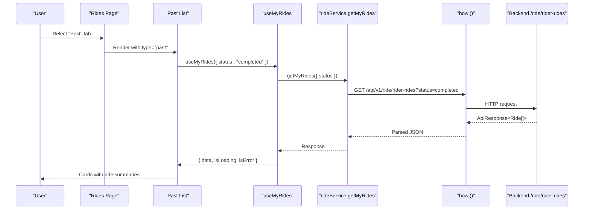
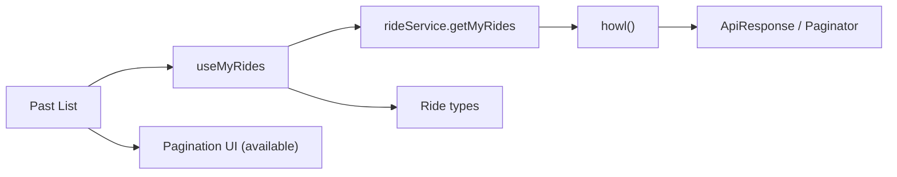

# Past Rides History

<cite>
**Referenced Files in This Document**
- [page.tsx](file://src/app/(view)/my-rides/page.tsx)
- [past.tsx](file://src/app/(view)/my-rides/past.tsx)
- [use-ride.ts](file://src/hooks/booking/use-ride.ts)
- [ride.service.ts](file://src/services/ride.service.ts)
- [ride.types.ts](file://src/types/ride.types.ts)
- [api.ts](file://src/lib/api.ts)
- [base.ts](file://src/types/base.ts)
- [pagination.tsx](file://src/components/ui/pagination.tsx)
- [page.tsx (ride detail)](file://src/app/(view)/my-rides/[id]/page.tsx)
- [rating-dialog.tsx](file://src/app/(view)/my-rides/[id]/rating-dialog.tsx)
- [use-review.ts](file://src/hooks/shared/use-review.ts)
- [review.service.ts](file://src/services/review.service.ts)
</cite>

## Table of Contents
1. Introduction
2. Project Structure
3. Core Components
4. Architecture Overview
5. Detailed Component Analysis
6. Dependency Analysis
7. Performance Considerations
8. Troubleshooting Guide
9. Conclusion

## Introduction
This document explains the past rides history system for viewing and managing historical trips. It covers:
- How historical rides are loaded and displayed
- The current pagination approach and how to extend it
- Search and filtering by date and status
- Ride summary display with pickup/dropoff, fare details, driver info, and ratings
- Data fetching strategies including caching and lazy loading
- Error handling for network failures and empty state management
- Examples of data transformation and date formatting
- Integration with the rating system for completed trips

## Project Structure
The past rides feature is implemented under the passenger-facing “My Rides” section. Key files include:
- A tabbed page that switches between ongoing/upcoming/past views
- A list component that renders ride cards with key trip information
- React Query hooks for data fetching and caching
- Service layer functions that call the backend API
- Types defining ride models and query parameters
- UI components for pagination and dialogs

**Diagram sources**
- [page.tsx](file://src/app/(view)/my-rides/page.tsx#L1-L37)
- [past.tsx](file://src/app/(view)/my-rides/past.tsx#L1-L153)
- [use-ride.ts:1-60](file://src/hooks/booking/use-ride.ts#L1-L60)
- [ride.service.ts:1-127](file://src/services/ride.service.ts#L1-L127)
- [api.ts:1-106](file://src/lib/api.ts#L1-L106)
- [base.ts:1-28](file://src/types/base.ts#L1-L28)
- [ride.types.ts:1-161](file://src/types/ride.types.ts#L1-L161)

**Section sources**
- [page.tsx](file://src/app/(view)/my-rides/page.tsx#L1-L37)
- [past.tsx](file://src/app/(view)/my-rides/past.tsx#L1-L153)
- [use-ride.ts:1-60](file://src/hooks/booking/use-ride.ts#L1-L60)
- [ride.service.ts:1-127](file://src/services/ride.service.ts#L1-L127)
- [ride.types.ts:1-161](file://src/types/ride.types.ts#L1-L161)
- [api.ts:1-106](file://src/lib/api.ts#L1-L106)
- [base.ts:1-28](file://src/types/base.ts#L1-L28)

## Core Components
- Rides Page: Renders tabs for ongoing/upcoming/past and mounts the corresponding list view.
- Past List Component: Fetches and displays past rides using a status filter mapped from the selected tab.
- useMyRides Hook: Wraps a React Query fetch for the rider’s rides filtered by status.
- rideService.getMyRides: Builds the query string and calls the backend endpoint.
- howl HTTP Client: Centralized fetch wrapper with token injection and error normalization.
- Types: Define ride model, query shapes, and response wrappers.

Key responsibilities:
- State-driven tab selection maps to a ride status filter.
- Caching via React Query keys ensures efficient re-fetching and deduplication.
- UI handles loading skeletons, empty states, and error messages.

**Section sources**
- [page.tsx](file://src/app/(view)/my-rides/page.tsx#L1-L37)
- [past.tsx](file://src/app/(view)/my-rides/past.tsx#L1-L153)
- [use-ride.ts:1-60](file://src/hooks/booking/use-ride.ts#L1-L60)
- [ride.service.ts:1-127](file://src/services/ride.service.ts#L1-L127)
- [api.ts:1-106](file://src/lib/api.ts#L1-L106)
- [ride.types.ts:1-161](file://src/types/ride.types.ts#L1-L161)

## Architecture Overview
The flow from user interaction to data rendering:

**Diagram sources**
- [page.tsx](file://src/app/(view)/my-rides/page.tsx#L1-L37)
- [past.tsx](file://src/app/(view)/my-rides/past.tsx#L1-L153)
- [use-ride.ts:1-60](file://src/hooks/booking/use-ride.ts#L1-L60)
- [ride.service.ts:1-127](file://src/services/ride.service.ts#L1-L127)
- [api.ts:1-106](file://src/lib/api.ts#L1-L106)

## Detailed Component Analysis

### Past List Component
Responsibilities:
- Map tab value to a ride status filter.
- Fetch rides via useMyRides.
- Display loading skeletons, empty state, or error message.
- Render each ride card with:
  - Pickup and destination addresses
  - Booking ID snippet
  - Date and time formatted for display
  - Driver name (handles both object and string forms)
  - Seats requested
  - Status label

Data transformation examples:
- Booking ID truncation and uppercase formatting
- Date/time formatting using locale-aware options
- Driver field normalization when payload shape varies

Empty and error states:
- Loading: grid of skeleton placeholders
- Empty: localized message indicating no rides found
- Error: simple failure message

Navigation:
- Each card links to the ride detail page using passengerId.

**Section sources**
- [past.tsx](file://src/app/(view)/my-rides/past.tsx#L1-L153)

### Rides Page (Tabs)
Responsibilities:
- Maintain active tab state (ongoing/upcoming/past).
- Provide localized labels for tabs.
- Mount the Past component with the selected type.

**Section sources**
- [page.tsx](file://src/app/(view)/my-rides/page.tsx#L1-L37)

### Data Fetching Layer
- useMyRides:
  - Uses React Query with a stable query key including the status parameter.
  - Automatically caches results and refetches on dependency changes.
- rideService.getMyRides:
  - Accepts optional status and appends it as a query parameter.
  - Returns an ApiResponse envelope typed as Ride[].
- howl():
  - Injects Authorization header from cookie-based token.
  - Normalizes non-OK responses into thrown errors with message extraction.
  - Parses JSON responses safely.

Caching strategy:
- Keys are derived from function arguments; identical filters share cached data.
- No explicit staleTime or retry configuration is set here; defaults apply.

Lazy loading:
- Data is fetched on first render of the Past component when the tab is selected.
- No infinite scroll or cursor-based pagination is implemented in this component.

**Section sources**
- [use-ride.ts:1-60](file://src/hooks/booking/use-ride.ts#L1-L60)
- [ride.service.ts:1-127](file://src/services/ride.service.ts#L1-L127)
- [api.ts:1-106](file://src/lib/api.ts#L1-L106)

### Pagination Implementation
Current state:
- The passenger “Past” list does not implement pagination; it renders all returned rides.

Available building blocks:
- UI pagination primitives exist (previous/next/ellipsis/link).
- Base types define a generic paginator shape used elsewhere in the app.

Recommended approach to add pagination:
- Extend GetRiderRidesQuery with page and limit fields.
- Update rideService.getMyRides to append page and limit to the query string.
- In useMyRides, accept page/limit and include them in the query key.
- In the Past component, manage local page state and trigger refetch on change.
- Use the existing pagination UI to wire up previous/next actions.

Note: The admin GetAllRides endpoint already supports pagination parameters and returns a Paginator envelope.

**Section sources**
- [pagination.tsx:1-142](file://src/components/ui/pagination.tsx#L1-L142)
- [base.ts:1-28](file://src/types/base.ts#L1-L28)
- [ride.service.ts:117-126](file://src/services/ride.service.ts#L117-L126)
- [ride.types.ts:57-62](file://src/types/ride.types.ts#L57-L62)

### Search and Filtering Capabilities
Status filtering:
- Implemented via the status query parameter mapped from the selected tab.

Date filtering:
- Not currently implemented for the rider’s past rides list.
- The admin getAllRides endpoint supports departureDate and departureTime; consider mirroring these parameters for the rider endpoint if needed.

Implementation guidance:
- Add optional date fields to GetRiderRidesQuery.
- Append them to the query string in rideService.getMyRides.
- Include them in the React Query key so different filters produce separate cache entries.

**Section sources**
- [ride.types.ts:53-62](file://src/types/ride.types.ts#L53-L62)
- [ride.service.ts:18-21](file://src/services/ride.service.ts#L18-L21)
- [ride.service.ts:117-126](file://src/services/ride.service.ts#L117-L126)

### Ride Summary Display
Each ride card shows:
- Pickup and dropoff addresses
- Booking ID (truncated and uppercased)
- Formatted date and time
- Driver name (normalized)
- Requested seats
- Status label

Fare details:
- Not shown in the passenger past list.
- Fare breakdown is available in other endpoints and can be surfaced in the ride detail view.

Driver information:
- Name is extracted from either a nested object or a string field depending on payload shape.

Ratings:
- Ratings are collected after a trip completes via a dialog triggered by a socket event.
- See the Rating Dialog section below.

**Section sources**
- [past.tsx](file://src/app/(view)/my-rides/past.tsx#L55-L152)

### Data Fetching Strategies: Caching and Lazy Loading
- Caching:
  - React Query automatically caches responses keyed by the query function arguments.
  - Identical filters reuse cached data without additional network requests.
- Lazy loading:
  - Requests are issued only when the Past component mounts.
  - No background preloading or prefetching is configured.

Recommendations:
- Configure staleTime/gcTime in useMyRides to reduce unnecessary refetches.
- Consider refetchOnWindowFocus to keep lists fresh after user returns to the app.

**Section sources**
- [use-ride.ts:24-29](file://src/hooks/booking/use-ride.ts#L24-L29)

### Error Handling for Network Failures
- howl throws normalized errors when the server responds with non-OK status.
- The Past component checks isError and shows a user-friendly message.

Best practices:
- Surface actionable feedback (e.g., retry button).
- Log detailed errors for diagnostics while keeping user messages concise.

**Section sources**
- [api.ts:42-73](file://src/lib/api.ts#L42-L73)
- [past.tsx](file://src/app/(view)/my-rides/past.tsx#L39-L45)

### Empty State Management
- When no rides match the filter, a clear message is shown.
- Skeleton placeholders are rendered during loading to improve perceived performance.

**Section sources**
- [past.tsx](file://src/app/(view)/my-rides/past.tsx#L28-L53)

### Examples of Data Transformation and Formatting
- Booking ID: last 8 characters converted to uppercase.
- Date & Time: formatted using locale-aware options for day, month, year, hour, minute.
- Driver name: safe access whether the field is a string or an object with a name property.

These transformations ensure consistent presentation across varying backend payloads.

**Section sources**
- [past.tsx](file://src/app/(view)/my-rides/past.tsx#L58-L82)

### Integration with the Rating System
Flow:
- After a trip completes, a socket event triggers a rating dialog.
- The dialog collects star rating and optional feedback.
- Submission uses a socket event to send rating data to the server.
- Success or failure is communicated via toast notifications.

Related components:
- Ride detail page listens for completion events and opens the rating dialog.
- Rating dialog emits the rating over the socket connection.

Optional REST integration:
- A review service exists for creating reviews via REST; the current rating submission path uses sockets.

**Section sources**
- [page.tsx (ride detail)](file://src/app/(view)/my-rides/[id]/page.tsx#L98-L103)
- [rating-dialog.tsx](file://src/app/(view)/my-rides/[id]/rating-dialog.tsx#L35-L54)
- [use-review.ts:11-15](file://src/hooks/shared/use-review.ts#L11-L15)
- [review.service.ts:5-11](file://src/services/review.service.ts#L5-L11)

## Dependency Analysis
High-level dependencies among core modules:

Observations:
- Low coupling: Past depends only on the hook; the hook depends on the service; the service depends on the HTTP client.
- Clear separation of concerns: UI, data fetching, and networking layers are distinct.
- Potential extension points:
  - Add pagination parameters to the rider endpoint similar to the admin endpoint.
  - Introduce search filters by extending query types and service logic.

**Diagram sources**
- [past.tsx](file://src/app/(view)/my-rides/past.tsx#L1-L153)
- [use-ride.ts:1-60](file://src/hooks/booking/use-ride.ts#L1-L60)
- [ride.service.ts:1-127](file://src/services/ride.service.ts#L1-L127)
- [api.ts:1-106](file://src/lib/api.ts#L1-L106)
- [base.ts:1-28](file://src/types/base.ts#L1-L28)
- [ride.types.ts:1-161](file://src/types/ride.types.ts#L1-L161)
- [pagination.tsx:1-142](file://src/components/ui/pagination.tsx#L1-L142)

**Section sources**
- [past.tsx](file://src/app/(view)/my-rides/past.tsx#L1-L153)
- [use-ride.ts:1-60](file://src/hooks/booking/use-ride.ts#L1-L60)
- [ride.service.ts:1-127](file://src/services/ride.service.ts#L1-L127)
- [api.ts:1-106](file://src/lib/api.ts#L1-L106)
- [base.ts:1-28](file://src/types/base.ts#L1-L28)
- [ride.types.ts:1-161](file://src/types/ride.types.ts#L1-L161)
- [pagination.tsx:1-142](file://src/components/ui/pagination.tsx#L1-L142)

## Performance Considerations
- Avoid large payloads: If the number of past rides grows, implement pagination to limit per-page size.
- Reduce re-renders: Memoize expensive computations (e.g., sorting/filtering) if added later.
- Optimize images: Replace placeholder images with actual assets or lazy-load them.
- Debounce inputs: If adding search/filter controls, debounce to minimize refetches.
- Tune React Query: Set appropriate staleTime and gcTime to balance freshness and bandwidth.

[No sources needed since this section provides general guidance]

## Troubleshooting Guide
Common issues and resolutions:
- Network failures:
  - howl throws normalized errors; ensure the Past component surfaces a retry option.
- Empty results:
  - Verify the status mapping from tabs to backend statuses.
  - Confirm the backend returns data for the given user and filter.
- Incorrect dates:
  - Ensure timestamps are in UTC or properly adjusted before formatting.
- Driver name missing:
  - Handle both string and object forms defensively.
- Rating not submitted:
  - Check socket connection and event names; verify server-side handlers.

Operational tips:
- Inspect React Query cache keys to confirm unique filters.
- Log request URLs built by the service layer to validate query parameters.

**Section sources**
- [api.ts:42-73](file://src/lib/api.ts#L42-L73)
- [past.tsx](file://src/app/(view)/my-rides/past.tsx#L39-L53)
- [use-ride.ts:24-29](file://src/hooks/booking/use-ride.ts#L24-L29)
- [ride.service.ts:18-21](file://src/services/ride.service.ts#L18-L21)

## Conclusion
The past rides history system provides a clean, cached, and responsive way to view historical trips. While pagination and advanced search are not yet implemented for the rider’s past list, the codebase includes reusable pagination UI and a well-structured service layer that makes adding these features straightforward. Error handling and empty states are present, and the rating integration ensures users can provide feedback after completing trips. Extending the rider endpoint with pagination and date filters will further enhance usability and scalability.