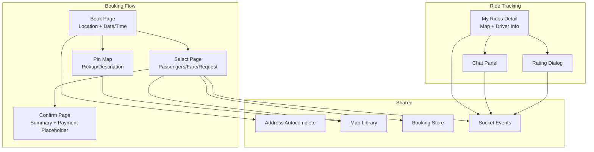
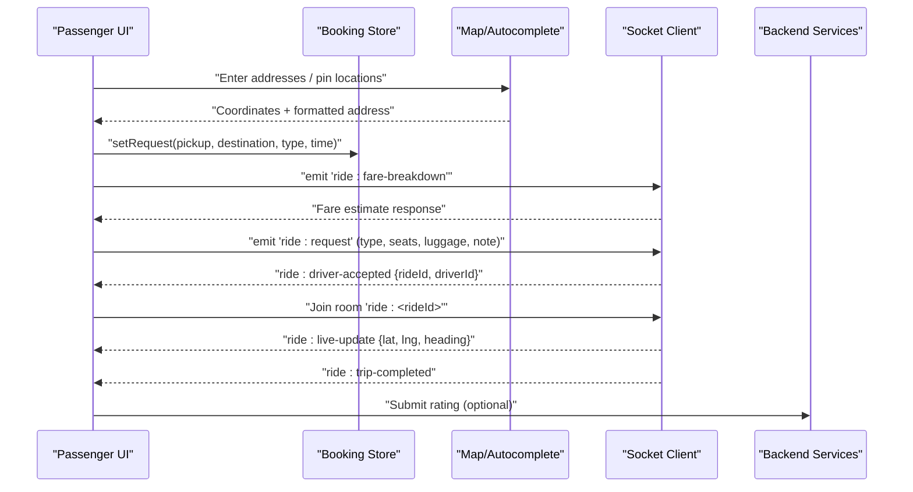
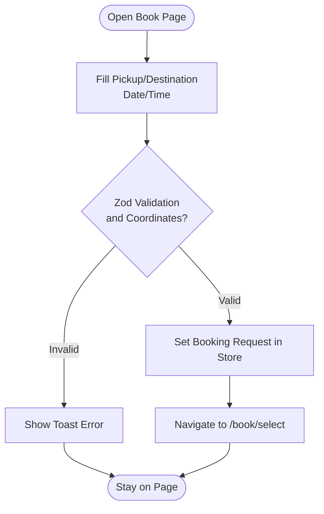
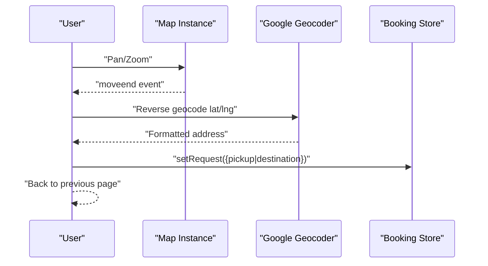
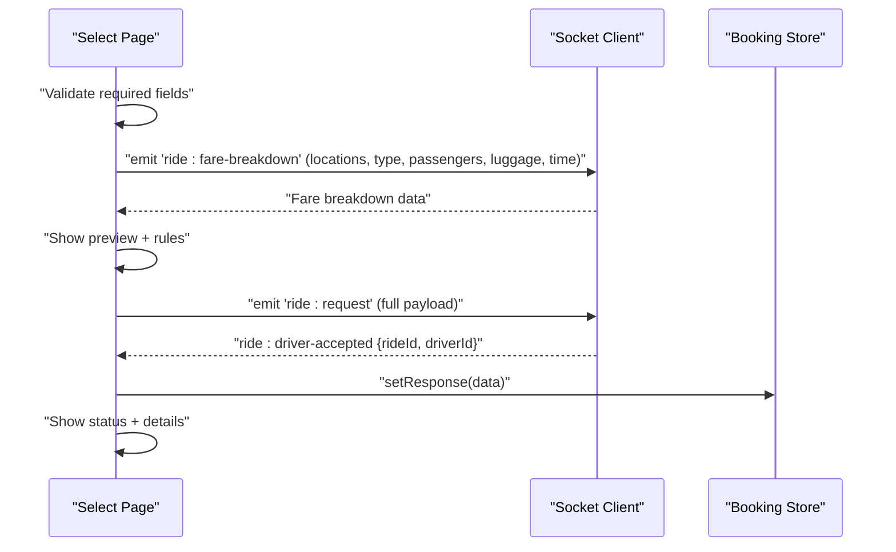
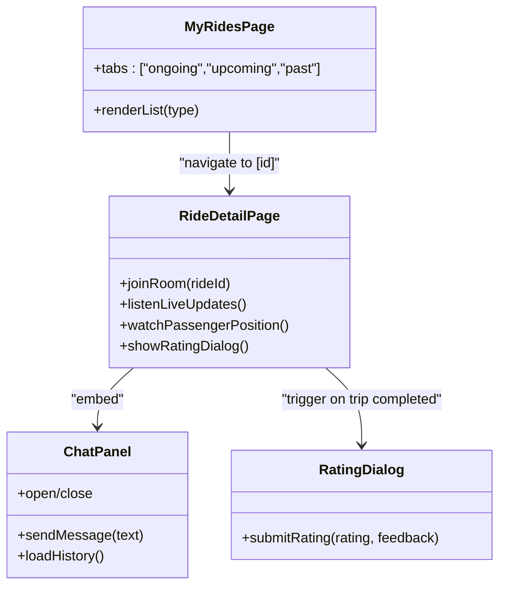
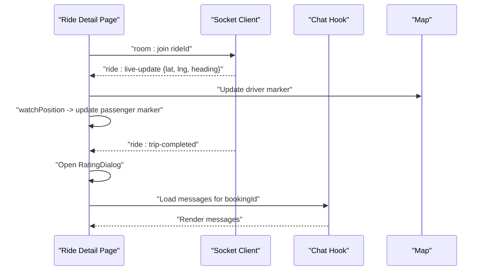
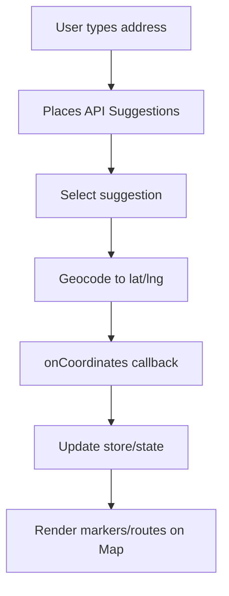
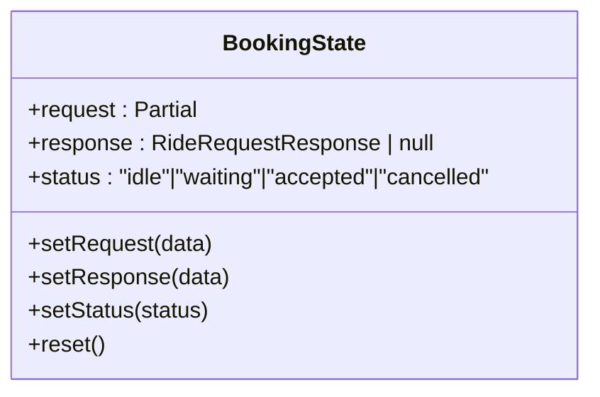
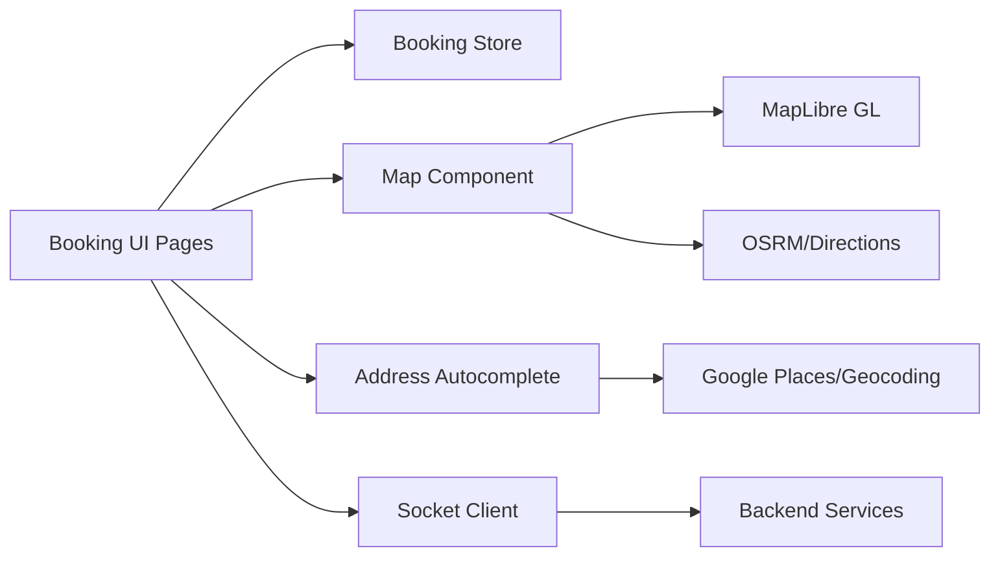

# Passenger Features

<cite>
**Referenced Files in This Document**
- [book/page.tsx](file://src/app/(view)/book/page.tsx)
- [book/form.tsx](file://src/app/(view)/book/form.tsx)
- [book/find.tsx](file://src/app/(view)/book/find.tsx)
- [book/select/page.tsx](file://src/app/(view)/book/select/page.tsx)
- [book/confirm/page.tsx](file://src/app/(view)/book/confirm/page.tsx)
- [book/pin/page.tsx](file://src/app/(view)/book/pin/page.tsx)
- [store/booking-store.ts](file://src/store/booking-store.ts)
- [hooks/booking/use-booking.ts](file://src/hooks/booking/use-booking.ts)
- [components/ui/address-autocomplete.tsx](file://src/components/ui/address-autocomplete.tsx)
- [components/ui/map.tsx](file://src/components/ui/map.tsx)
- [my-rides/page.tsx](file://src/app/(view)/my-rides/page.tsx)
- [my-rides/[id]/page.tsx](file://src/app/(view)/my-rides/[id]/page.tsx)
- [my-rides/[id]/chat.tsx](file://src/app/(view)/my-rides/[id]/chat.tsx)
- [my-rides/[id]/rating-dialog.tsx](file://src/app/(view)/my-rides/[id]/rating-dialog.tsx)
- [hooks/shared/use-review.ts](file://src/hooks/shared/use-review.ts)
</cite>

## Table of Contents
1. Introduction
2. Project Structure
3. Core Components
4. Architecture Overview
5. Detailed Component Analysis
6. Dependency Analysis
7. Performance Considerations
8. Troubleshooting Guide
9. Conclusion

## Introduction
This document explains the passenger-facing features of the Split Ride platform, focusing on the complete ride booking workflow and post-ride experience. It covers:
- Multi-step booking interface with address autocomplete, map integration, and real-time availability
- Ride type selection (split/private), driver matching, and ride tracking
- Booking store management, form validation with Zod, and state persistence
- My Rides section for managing active and past trips, rating system, and chat functionality with drivers

## Project Structure
The passenger flow is implemented as a series of Next.js pages under the book route, supported by shared UI components, hooks, stores, and services. The my rides section provides trip history, live tracking, chat, and rating.

**Diagram sources**
- [book/page.tsx](file://src/app/(view)/book/page.tsx)
- [book/pin/page.tsx](file://src/app/(view)/book/pin/page.tsx)
- [book/select/page.tsx](file://src/app/(view)/book/select/page.tsx)
- [book/confirm/page.tsx](file://src/app/(view)/book/confirm/page.tsx)
- [my-rides/[id]/page.tsx](file://src/app/(view)/my-rides/[id]/page.tsx)
- [my-rides/[id]/chat.tsx](file://src/app/(view)/my-rides/[id]/chat.tsx)
- [my-rides/[id]/rating-dialog.tsx](file://src/app/(view)/my-rides/[id]/rating-dialog.tsx)
- [components/ui/address-autocomplete.tsx](file://src/components/ui/address-autocomplete.tsx)
- [components/ui/map.tsx](file://src/components/ui/map.tsx)
- [store/booking-store.ts](file://src/store/booking-store.ts)

**Section sources**
- [book/page.tsx](file://src/app/(view)/book/page.tsx)
- [book/select/page.tsx](file://src/app/(view)/book/select/page.tsx)
- [book/confirm/page.tsx](file://src/app/(view)/book/confirm/page.tsx)
- [book/pin/page.tsx](file://src/app/(view)/book/pin/page.tsx)
- [my-rides/page.tsx](file://src/app/(view)/my-rides/page.tsx)
- [my-rides/[id]/page.tsx](file://src/app/(view)/my-rides/[id]/page.tsx)

## Core Components
- Booking entry page: multi-tab form with address autocomplete, date/time pickers, and validation before proceeding to ride selection.
- Pin map page: interactive map with reverse geocoding to confirm pickup or destination.
- Select page: step-by-step passenger configuration, fare breakdown, request submission, and driver acceptance status.
- Confirm page: summary view and payment placeholder.
- My Rides detail: live map with driver position, chat panel, and rating dialog.
- Shared utilities: AddressAutocomplete, MapLibre-based Map component, Zustand booking store, and socket-driven events.

Key responsibilities:
- Form validation using Zod on the booking entry page.
- State persistence via Zustand store for the current booking request/response.
- Real-time updates through socket events for fare calculation, driver acceptance, and live location.
- Map rendering and route drawing using MapLibre and Google Maps APIs where needed.

**Section sources**
- [book/page.tsx](file://src/app/(view)/book/page.tsx)
- [book/pin/page.tsx](file://src/app/(view)/book/pin/page.tsx)
- [book/select/page.tsx](file://src/app/(view)/book/select/page.tsx)
- [book/confirm/page.tsx](file://src/app/(view)/book/confirm/page.tsx)
- [store/booking-store.ts](file://src/store/booking-store.ts)
- [components/ui/address-autocomplete.tsx](file://src/components/ui/address-autocomplete.tsx)
- [components/ui/map.tsx](file://src/components/ui/map.tsx)

## Architecture Overview
The passenger booking and tracking architecture combines client-side forms, global state, and real-time communication.

**Diagram sources**
- [book/select/page.tsx](file://src/app/(view)/book/select/page.tsx)
- [my-rides/[id]/page.tsx](file://src/app/(view)/my-rides/[id]/page.tsx)
- [my-rides/[id]/rating-dialog.tsx](file://src/app/(view)/my-rides/[id]/rating-dialog.tsx)
- [store/booking-store.ts](file://src/store/booking-store.ts)

## Detailed Component Analysis

### Booking Entry Page
- Provides tabs for different modes (find/start/private).
- Uses AddressAutocomplete for both pickup and dropoff fields.
- Validates inputs with Zod before setting the booking request and navigating to the select page.
- Attempts to auto-detect current location if coordinates are missing.

**Diagram sources**
- [book/page.tsx](file://src/app/(view)/book/page.tsx)

**Section sources**
- [book/page.tsx](file://src/app/(view)/book/page.tsx)
- [components/ui/address-autocomplete.tsx](file://src/components/ui/address-autocomplete.tsx)

### Pin Map Page
- Allows users to pan the map and reverse geocode the center to set an address.
- Integrates AddressAutocomplete to fly to selected coordinates.
- Persists the chosen location back into the booking store.

**Diagram sources**
- [book/pin/page.tsx](file://src/app/(view)/book/pin/page.tsx)
- [components/ui/address-autocomplete.tsx](file://src/components/ui/address-autocomplete.tsx)
- [store/booking-store.ts](file://src/store/booking-store.ts)

**Section sources**
- [book/pin/page.tsx](file://src/app/(view)/book/pin/page.tsx)

### Ride Selection and Fare Breakdown
- Step 1: Passengers and luggage counts; optional note.
- Step 2: Preview with fare breakdown and rules; requires agreement.
- Step 3: Status showing driver search and acceptance.
- Uses socket events for fare breakdown and ride request; listens for driver acceptance.

**Diagram sources**
- [book/select/page.tsx](file://src/app/(view)/book/select/page.tsx)
- [store/booking-store.ts](file://src/store/booking-store.ts)

**Section sources**
- [book/select/page.tsx](file://src/app/(view)/book/select/page.tsx)
- [store/booking-store.ts](file://src/store/booking-store.ts)

### Confirm Page
- Displays booking summary, payment placeholder, terms checkbox, and success confirmation modal.
- Links to My Rides after successful booking.

**Section sources**
- [book/confirm/page.tsx](file://src/app/(view)/book/confirm/page.tsx)

### My Rides Section
- Lists ongoing/upcoming/past rides with tabs.
- Detail page shows live map, driver info, estimated fare/distance/duration, and quick actions.

**Diagram sources**
- [my-rides/page.tsx](file://src/app/(view)/my-rides/page.tsx)
- [my-rides/[id]/page.tsx](file://src/app/(view)/my-rides/[id]/page.tsx)
- [my-rides/[id]/chat.tsx](file://src/app/(view)/my-rides/[id]/chat.tsx)
- [my-rides/[id]/rating-dialog.tsx](file://src/app/(view)/my-rides/[id]/rating-dialog.tsx)

**Section sources**
- [my-rides/page.tsx](file://src/app/(view)/my-rides/page.tsx)
- [my-rides/[id]/page.tsx](file://src/app/(view)/my-rides/[id]/page.tsx)

### Live Tracking and Chat
- Joins a ride-specific socket room upon entering the detail page.
- Listens for driver live updates and marks trip completion to prompt rating.
- Watches passenger GPS position and displays it on the map.
- Chat panel loads messages and sends new ones via socket.

**Diagram sources**
- [my-rides/[id]/page.tsx](file://src/app/(view)/my-rides/[id]/page.tsx)
- [my-rides/[id]/chat.tsx](file://src/app/(view)/my-rides/[id]/chat.tsx)
- [my-rides/[id]/rating-dialog.tsx](file://src/app/(view)/my-rides/[id]/rating-dialog.tsx)

**Section sources**
- [my-rides/[id]/page.tsx](file://src/app/(view)/my-rides/[id]/page.tsx)
- [my-rides/[id]/chat.tsx](file://src/app/(view)/my-rides/[id]/chat.tsx)
- [my-rides/[id]/rating-dialog.tsx](file://src/app/(view)/my-rides/[id]/rating-dialog.tsx)

### Address Autocomplete and Map Integration
- AddressAutocomplete uses Google Places API to provide suggestions and returns coordinates and structured address data.
- Map component wraps MapLibre GL, providing markers, routes, controls, and theme switching.

**Diagram sources**
- [components/ui/address-autocomplete.tsx](file://src/components/ui/address-autocomplete.tsx)
- [components/ui/map.tsx](file://src/components/ui/map.tsx)

**Section sources**
- [components/ui/address-autocomplete.tsx](file://src/components/ui/address-autocomplete.tsx)
- [components/ui/map.tsx](file://src/components/ui/map.tsx)

### Booking Store Management and Persistence
- Zustand store holds the current booking request, server response, and status.
- Pages read/write to this store to persist user selections across steps and navigate between screens.

**Diagram sources**
- [store/booking-store.ts](file://src/store/booking-store.ts)

**Section sources**
- [store/booking-store.ts](file://src/store/booking-store.ts)

### Form Validation with Zod
- The booking entry page validates pickup, destination, and presence of destination coordinates before proceeding.
- Errors are surfaced via toast notifications.

**Section sources**
- [book/page.tsx](file://src/app/(view)/book/page.tsx)

### My Rides Data Fetching
- Hooks provide queries and mutations for bookings and reviews, enabling listing and detail views.

**Section sources**
- [hooks/booking/use-booking.ts](file://src/hooks/booking/use-booking.ts)
- [hooks/shared/use-review.ts](file://src/hooks/shared/use-review.ts)

## Dependency Analysis
The passenger features rely on several layers:
- UI components (address autocomplete, map, dialogs, inputs)
- State management (Zustand store)
- Real-time communication (socket events)
- External APIs (Google Maps Places/Geocoding/Directions, OSRM routing)

**Diagram sources**
- [book/select/page.tsx](file://src/app/(view)/book/select/page.tsx)
- [book/pin/page.tsx](file://src/app/(view)/book/pin/page.tsx)
- [components/ui/address-autocomplete.tsx](file://src/components/ui/address-autocomplete.tsx)
- [components/ui/map.tsx](file://src/components/ui/map.tsx)
- [store/booking-store.ts](file://src/store/booking-store.ts)

**Section sources**
- [book/select/page.tsx](file://src/app/(view)/book/select/page.tsx)
- [book/pin/page.tsx](file://src/app/(view)/book/pin/page.tsx)
- [components/ui/address-autocomplete.tsx](file://src/components/ui/address-autocomplete.tsx)
- [components/ui/map.tsx](file://src/components/ui/map.tsx)
- [store/booking-store.ts](file://src/store/booking-store.ts)

## Performance Considerations
- Debounce address input and reverse geocoding to reduce API calls.
- Use minimal GPS updates with thresholds to avoid excessive re-renders during live tracking.
- Prefer controlled viewport updates only when necessary to prevent map thrashing.
- Cache fare breakdown results per request to avoid redundant calculations.

[No sources needed since this section provides general guidance]

## Troubleshooting Guide
- Missing coordinates: Ensure destination has valid coordinates; otherwise, prompt user to pin on map or enable geolocation.
- Socket events not received: Verify room join/leave lifecycle and that rideId is persisted in session store.
- Map not loading: Check environment variables for Google Maps API key and ensure MapLibre styles load successfully.
- Validation errors: Confirm all required fields are present before emitting requests; show clear toasts for user feedback.

**Section sources**
- [book/page.tsx](file://src/app/(view)/book/page.tsx)
- [book/pin/page.tsx](file://src/app/(view)/book/pin/page.tsx)
- [book/select/page.tsx](file://src/app/(view)/book/select/page.tsx)
- [my-rides/[id]/page.tsx](file://src/app/(view)/my-rides/[id]/page.tsx)

## Conclusion
The passenger experience in Split Ride is built around a robust multi-step booking flow, powered by validated forms, persistent state, and real-time updates. Users can easily select locations, choose ride types, review fares, track drivers live, communicate via chat, and rate their trips. The modular architecture separates concerns across UI, state, and communication layers, making it maintainable and extensible.