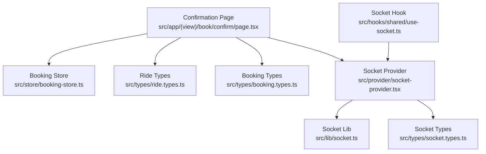
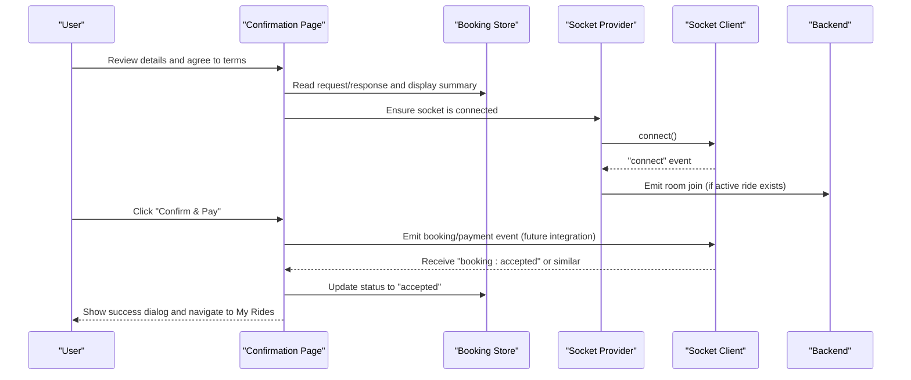
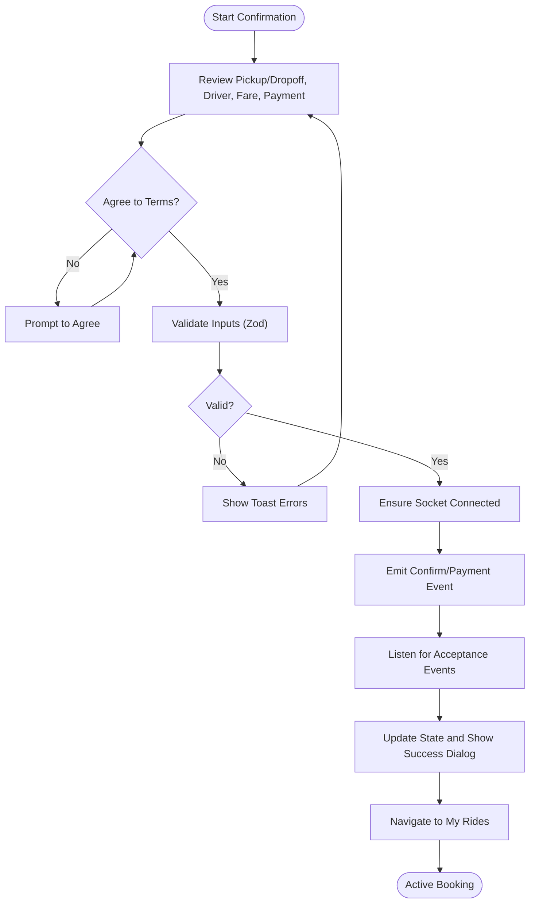
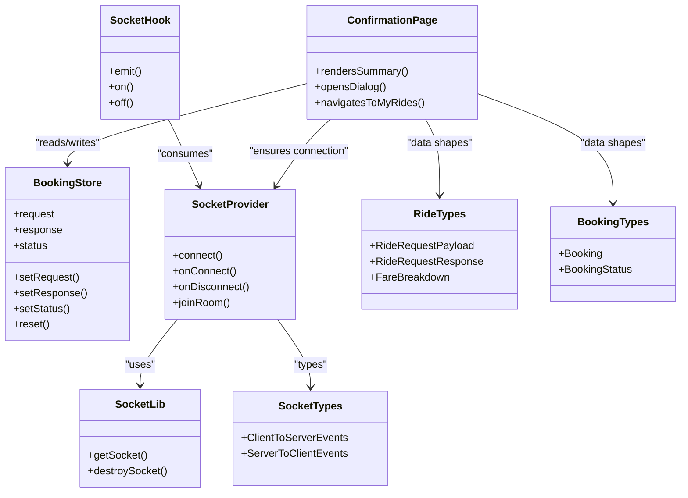

# Booking Confirmation

<cite>
**Referenced Files in This Document**
- [page.tsx](file://src/app/(view)/book/confirm/page.tsx)
- [form.tsx](file://src/app/(view)/book/form.tsx)
- [page.tsx](file://src/app/(view)/book/page.tsx)
- [use-booking.ts](file://src/hooks/booking/use-booking.ts)
- [booking.types.ts](file://src/types/booking.types.ts)
- [ride.types.ts](file://src/types/ride.types.ts)
- [socket-provider.tsx](file://src/provider/socket-provider.tsx)
- [use-socket.ts](file://src/hooks/shared/use-socket.ts)
- [socket.ts](file://src/lib/socket.ts)
- [socket.types.ts](file://src/types/socket.types.ts)
</cite>

## Table of Contents
1. [Introduction](#introduction)
2. [Project Structure](#project-structure)
3. [Core Components](#core-components)
4. [Architecture Overview](#architecture-overview)
5. [Detailed Component Analysis](#detailed-component-analysis)
6. [Dependency Analysis](#dependency-analysis)
7. [Performance Considerations](#performance-considerations)
8. [Troubleshooting Guide](#troubleshooting-guide)
9. [Conclusion](#conclusion)

## Introduction
This document explains the booking confirmation process in Split Ride, focusing on the final review step where users verify all booking details before confirming payment and transitioning to an active booking state. It covers:
- The confirmation UI that displays pickup/dropoff locations, selected driver, fare breakdown, and payment method
- Form validation using Zod schema with required field checks and error handling
- Transition from confirmation to active booking state
- Real-time updates via socket connection establishment and event subscriptions

## Project Structure
The confirmation flow spans several components and services:
- Confirmation page renders a summary of the ride and payment options
- Booking store holds request/response data used across the flow
- Socket provider manages real-time connections and events
- Types define the shape of requests, responses, and server-client events

**Diagram sources**
- [page.tsx](file://src/app/(view)/book/confirm/page.tsx#L1-L215)
- [use-booking.ts:1-60](file://src/hooks/booking/use-booking.ts#L1-L60)
- [booking.types.ts:1-166](file://src/types/booking.types.ts#L1-L166)
- [ride.types.ts:1-161](file://src/types/ride.types.ts#L1-L161)
- [socket-provider.tsx:1-123](file://src/provider/socket-provider.tsx#L1-L123)
- [use-socket.ts:1-57](file://src/hooks/shared/use-socket.ts#L1-L57)
- [socket.ts:1-50](file://src/lib/socket.ts#L1-L50)
- [socket.types.ts:1-304](file://src/types/socket.types.ts#L1-L304)

**Section sources**
- [page.tsx](file://src/app/(view)/book/confirm/page.tsx#L1-L215)
- [form.tsx](file://src/app/(view)/book/form.tsx#L1-L484)
- [page.tsx](file://src/app/(view)/book/page.tsx#L1-L305)
- [use-booking.ts:1-60](file://src/hooks/booking/use-booking.ts#L1-L60)
- [booking.types.ts:1-166](file://src/types/booking.types.ts#L1-L166)
- [ride.types.ts:1-161](file://src/types/ride.types.ts#L1-L161)
- [socket-provider.tsx:1-123](file://src/provider/socket-provider.tsx#L1-L123)
- [use-socket.ts:1-57](file://src/hooks/shared/use-socket.ts#L1-L57)
- [socket.ts:1-50](file://src/lib/socket.ts#L1-L50)
- [socket.types.ts:1-304](file://src/types/socket.types.ts#L1-L304)

## Core Components
- Confirmation Page: Displays a summary of the ride (pickup/dropoff, car type, seats, luggage, date/time), VAT and total amount, and a payment section placeholder. It includes a terms agreement checkbox and a confirmation dialog that shows a success message and navigation to “My Rides.”
- Booking Store: Holds the current request payload and response, plus a simple status machine for the booking flow.
- Socket Provider and Hooks: Establishes a persistent socket connection, joins rooms, and provides typed emit/on/off helpers for real-time updates.
- Types: Define shapes for ride requests/responses, fare breakdowns, bookings, and socket events.

Key responsibilities:
- Present accurate booking details for user verification
- Enforce required fields and constraints before proceeding
- Manage state transitions and real-time updates post-confirmation

**Section sources**
- [page.tsx](file://src/app/(view)/book/confirm/page.tsx#L1-L215)
- [use-booking.ts:1-60](file://src/hooks/booking/use-booking.ts#L1-L60)
- [booking.types.ts:1-166](file://src/types/booking.types.ts#L1-L166)
- [ride.types.ts:1-161](file://src/types/ride.types.ts#L1-L161)
- [socket-provider.tsx:1-123](file://src/provider/socket-provider.tsx#L1-L123)
- [use-socket.ts:1-57](file://src/hooks/shared/use-socket.ts#L1-L57)

## Architecture Overview
The confirmation flow integrates UI, state, types, and real-time communication:

**Diagram sources**
- [page.tsx](file://src/app/(view)/book/confirm/page.tsx#L1-L215)
- [socket-provider.tsx:1-123](file://src/provider/socket-provider.tsx#L1-L123)
- [use-socket.ts:1-57](file://src/hooks/shared/use-socket.ts#L1-L57)
- [socket.ts:1-50](file://src/lib/socket.ts#L1-L50)
- [socket.types.ts:1-304](file://src/types/socket.types.ts#L1-L304)

## Detailed Component Analysis

### Confirmation Page
- Displays pickup and dropoff addresses with change actions
- Shows overview details: approximate price, car type, luggage tags, pickup date/time, seats, your pickup time
- Presents VAT and total amount
- Includes a payment section placeholder and a terms agreement checkbox
- Opens a confirmation dialog showing a success message, booking ID, and a link to view the booking

Validation and UX notes:
- Terms agreement checkbox is present; backend enforcement should be added prior to submission
- Payment integration placeholder indicates Stripe will be integrated here

Transition behavior:
- On confirm, a success dialog is shown and the user can navigate to “My Rides”

**Section sources**
- [page.tsx](file://src/app/(view)/book/confirm/page.tsx#L1-L215)

### Booking Store
State shape:
- request: Partial ride request payload
- response: Full ride request response
- status: Machine states idle | waiting | accepted | cancelled

Actions:
- setRequest: Merge partial updates into request
- setResponse: Replace response
- setStatus: Update status
- reset: Clear state

Usage in confirmation:
- The confirmation page reads stored request/response to render summary details

**Section sources**
- [use-booking.ts:1-60](file://src/hooks/booking/use-booking.ts#L1-L60)
- [ride.types.ts:1-161](file://src/types/ride.types.ts#L1-L161)

### Validation and Error Handling (Zod Schema)
The main booking form uses a Zod schema to validate inputs before proceeding:
- Required fields: pickup address, destination address, and destination coordinates presence
- Error handling: Uses toast notifications to surface validation errors and geolocation permission issues

Flow highlights:
- Validates input and shows first error message if invalid
- Attempts to fetch current location if pickup coordinates are missing
- Persists validated request to the booking store and navigates to the next step

Note: The confirmation page itself does not re-validate; it relies on prior steps ensuring valid data.

**Section sources**
- [page.tsx](file://src/app/(view)/book/page.tsx#L1-L305)

### Data Structures and Examples
Examples of key structures used during confirmation:

- Ride Request Payload:
  - Fields include pickup and destination points (lat/lng/address), type, seats, passenger counts, departure date/time, luggage counts, and optional note

- Fare Breakdown:
  - Includes initial charge, per-km charge, total km charge, luggage charge, extra charges, holiday surcharge, waiting charge, VAT, and total fare

- Ride Request Response:
  - Contains estimated fare, distance, duration, fare breakdown, and ride details such as booking date/time, pickup/destination, ride type, and seat info

- Booking Types:
  - Defines statuses like upcoming, ongoing, completed, cancelled and core booking fields including estimatedFare and requestedSeats

These structures inform what is displayed on the confirmation page and how state is updated after confirmation.

**Section sources**
- [ride.types.ts:1-161](file://src/types/ride.types.ts#L1-L161)
- [booking.types.ts:1-166](file://src/types/booking.types.ts#L1-L166)

### Real-Time Updates and Socket Connection
Socket setup and lifecycle:
- A singleton socket client is created with authentication token from cookies
- The provider connects on mount, tracks connected state, and re-joins the active ride room after reconnects
- All relevant events are registered and dispatched to a central store

Event categories relevant to booking:
- Rider events: driver accepted, trip started, live updates, trip completed, etc.
- Driver events: new request, rating received, passenger picked/dropped, etc.
- Booking events: request, accepted, rejected, cancelled
- Generic: notifications, chat, errors

Hooks:
- useSocket returns emit/on/off helpers
- useSocketEvent subscribes to a specific event for the component lifetime

Integration point for confirmation:
- After successful confirmation, the app should listen for acceptance/completion events and update UI accordingly

**Section sources**
- [socket-provider.tsx:1-123](file://src/provider/socket-provider.tsx#L1-L123)
- [use-socket.ts:1-57](file://src/hooks/shared/use-socket.ts#L1-L57)
- [socket.ts:1-50](file://src/lib/socket.ts#L1-L50)
- [socket.types.ts:1-304](file://src/types/socket.types.ts#L1-L304)

### User Confirmation Workflow
End-to-end flow:
1. User enters pickup/dropoff, selects date/time, and proceeds to selection
2. System validates inputs using Zod and persists request to store
3. User reviews summary on the confirmation page
4. User agrees to terms and clicks confirm
5. App establishes or ensures socket connection and emits confirmation/payment event (integration point)
6. Backend responds with acceptance; frontend updates store and shows success dialog
7. User navigates to “My Rides” to track the active booking

[No sources needed since this diagram shows conceptual workflow, not actual code structure]

## Dependency Analysis
Component relationships and dependencies:

**Diagram sources**
- [page.tsx](file://src/app/(view)/book/confirm/page.tsx#L1-L215)
- [use-booking.ts:1-60](file://src/hooks/booking/use-booking.ts#L1-L60)
- [socket-provider.tsx:1-123](file://src/provider/socket-provider.tsx#L1-L123)
- [use-socket.ts:1-57](file://src/hooks/shared/use-socket.ts#L1-L57)
- [socket.ts:1-50](file://src/lib/socket.ts#L1-L50)
- [socket.types.ts:1-304](file://src/types/socket.types.ts#L1-L304)
- [ride.types.ts:1-161](file://src/types/ride.types.ts#L1-L161)
- [booking.types.ts:1-166](file://src/types/booking.types.ts#L1-L166)

**Section sources**
- [page.tsx](file://src/app/(view)/book/confirm/page.tsx#L1-L215)
- [use-booking.ts:1-60](file://src/hooks/booking/use-booking.ts#L1-L60)
- [socket-provider.tsx:1-123](file://src/provider/socket-provider.tsx#L1-L123)
- [use-socket.ts:1-57](file://src/hooks/shared/use-socket.ts#L1-L57)
- [socket.ts:1-50](file://src/lib/socket.ts#L1-L50)
- [socket.types.ts:1-304](file://src/types/socket.types.ts#L1-L304)
- [ride.types.ts:1-161](file://src/types/ride.types.ts#L1-L161)
- [booking.types.ts:1-166](file://src/types/booking.types.ts#L1-L166)

## Performance Considerations
- Minimize re-renders by reading only necessary fields from the booking store
- Debounce any frequent socket listeners if they trigger heavy computations
- Avoid unnecessary network calls by leveraging React Query caching for booking queries
- Keep socket event handlers lightweight; dispatch to stores rather than performing expensive work inline

## Troubleshooting Guide
Common issues and resolutions:
- Missing destination coordinates: Ensure the user selects a suggestion or pins the destination; validation will prompt otherwise
- Geolocation permission denied: Provide a fallback option to manually pin pickup location
- Socket not connected: Verify provider initialization and environment variables for socket URL; check browser console for connection logs
- Payment integration placeholder: Implement Stripe integration and ensure terms agreement is enforced before emitting confirmation events

**Section sources**
- [page.tsx](file://src/app/(view)/book/page.tsx#L1-L305)
- [socket-provider.tsx:1-123](file://src/provider/socket-provider.tsx#L1-L123)
- [socket.ts:1-50](file://src/lib/socket.ts#L1-L50)

## Conclusion
The booking confirmation process in Split Ride centers on a clear review screen backed by robust validation and real-time capabilities. By validating inputs early, persisting structured request data, and leveraging a centralized socket provider, the application ensures a smooth transition from confirmation to an active booking state. Future enhancements should integrate payment processing and enforce terms agreement at the backend while continuing to rely on the existing socket event model for live updates.