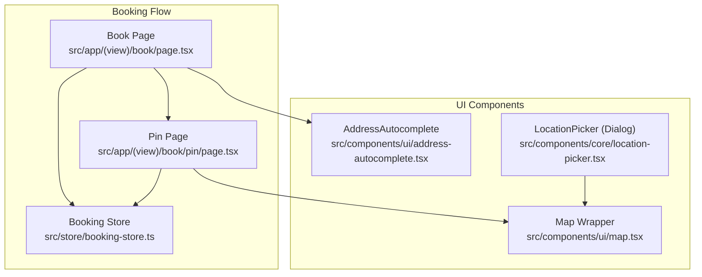
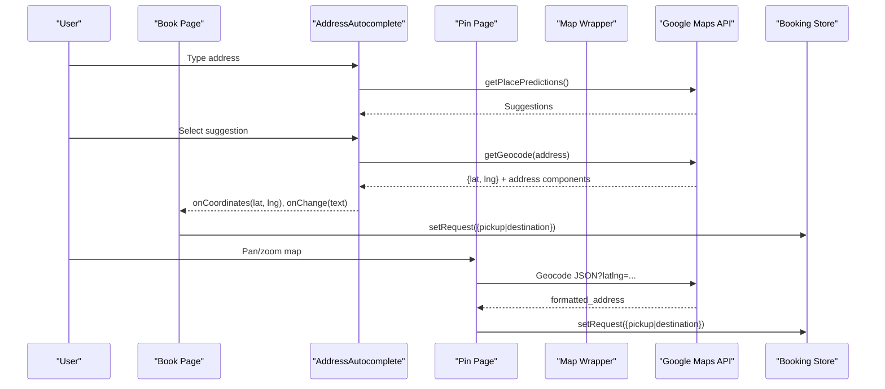
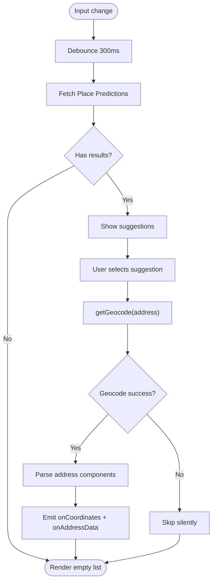
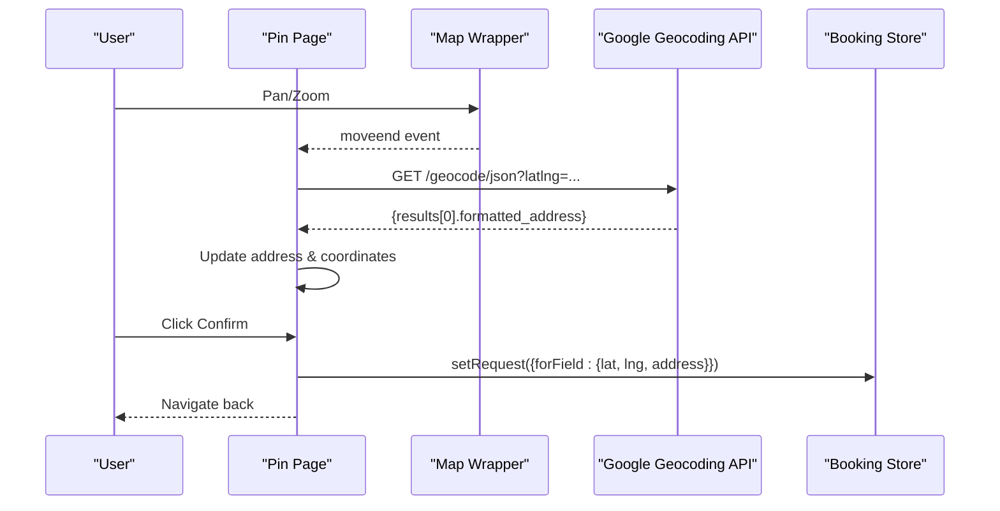
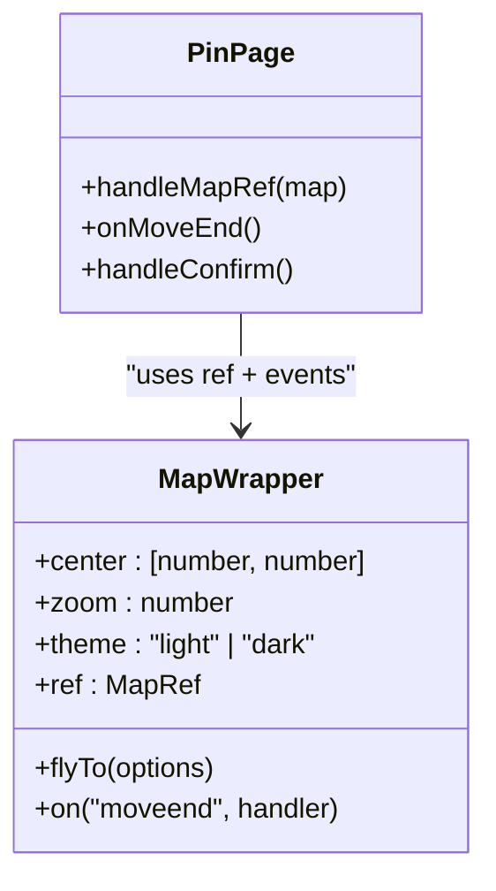
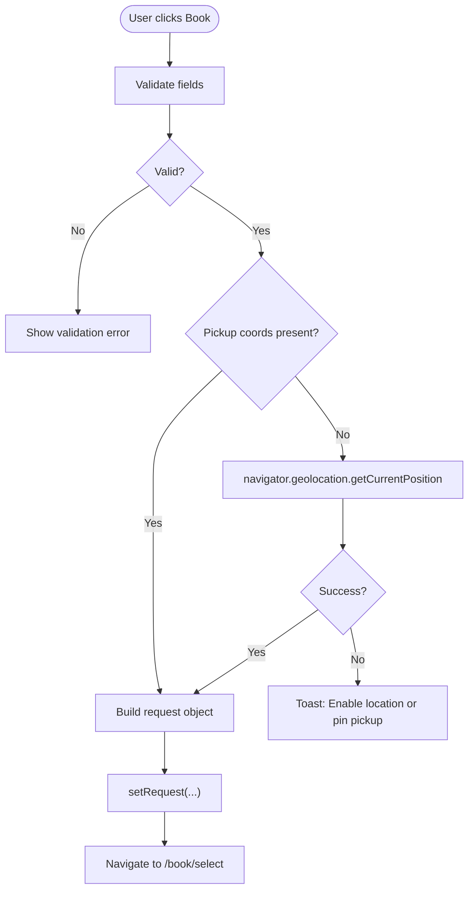
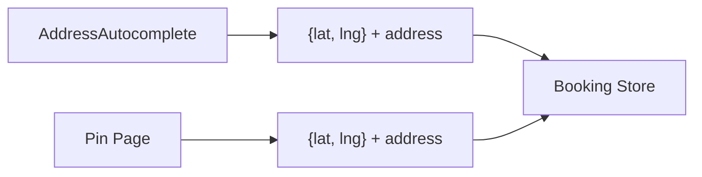
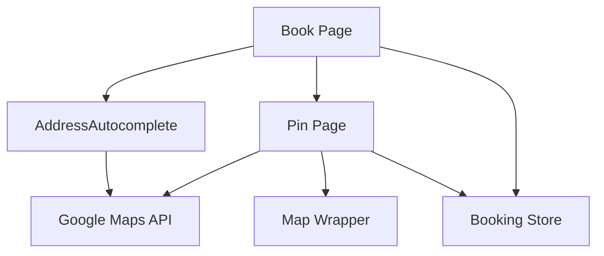

# Location Selection

<cite>
**Referenced Files in This Document**
- [address-autocomplete.tsx](file://src/components/ui/address-autocomplete.tsx)
- [location-picker.tsx](file://src/components/core/location-picker.tsx)
- [pin/page.tsx](file://src/app/(view)/book/pin/page.tsx)
- [map.tsx](file://src/components/ui/map.tsx)
- [book/page.tsx](file://src/app/(view)/book/page.tsx)
- [booking-store.ts](file://src/store/booking-store.ts)
</cite>

## Table of Contents
1. [Introduction](#introduction)
2. [Project Structure](#project-structure)
3. [Core Components](#core-components)
4. [Architecture Overview](#architecture-overview)
5. [Detailed Component Analysis](#detailed-component-analysis)
6. [Dependency Analysis](#dependency-analysis)
7. [Performance Considerations](#performance-considerations)
8. [Troubleshooting Guide](#troubleshooting-guide)
9. [Conclusion](#conclusion)

## Introduction
This document explains the location selection system used in Split Ride’s booking flow. It covers:
- Address autocomplete using Google Maps API (search suggestions, geocoding, and coordinate extraction)
- Map-based pinning to manually select pickup and dropoff locations by interacting with the map
- Integration points with the AddressAutocomplete component
- Coordinate validation and fallback mechanisms when geolocation fails
- Handling of location permissions, error states, and user feedback patterns for invalid or incomplete locations

## Project Structure
The location selection spans a few key areas:
- A reusable address autocomplete input that integrates Google Places Autocomplete and Geocoding
- A dedicated pin page that combines an interactive map with reverse geocoding to set precise coordinates
- The main booking form that orchestrates inputs, validates required fields, and persists selections into a global store
- A shared map wrapper that provides controls and utilities for rendering markers and routes

**Diagram sources**
- [book/page.tsx](file://src/app/(view)/book/page.tsx)
- [pin/page.tsx](file://src/app/(view)/book/pin/page.tsx)
- [address-autocomplete.tsx](file://src/components/ui/address-autocomplete.tsx)
- [map.tsx](file://src/components/ui/map.tsx)
- [location-picker.tsx](file://src/components/core/location-picker.tsx)
- [booking-store.ts](file://src/store/booking-store.ts)

**Section sources**
- [book/page.tsx](file://src/app/(view)/book/page.tsx)
- [pin/page.tsx](file://src/app/(view)/book/pin/page.tsx)
- [address-autocomplete.tsx](file://src/components/ui/address-autocomplete.tsx)
- [map.tsx](file://src/components/ui/map.tsx)
- [location-picker.tsx](file://src/components/core/location-picker.tsx)
- [booking-store.ts](file://src/store/booking-store.ts)

## Core Components
- AddressAutocomplete: Provides typed address search suggestions via Google Places Autocomplete, then geocodes the selected suggestion to extract lat/lng and structured address components. It exposes callbacks to propagate coordinates and parsed data upward.
- Pin Page: Presents a full-screen map where users can pan and zoom; it reverse geocodes the current center on moveend to update the displayed address. Users confirm the pinned location, which is persisted to the booking store.
- Map Wrapper: A MapLibre-based map abstraction providing controls, markers, and route drawing. Used by the Pin Page and other map features.
- Booking Store: Centralized state for the current ride request including pickup and destination coordinates and addresses.

Key responsibilities:
- AddressAutocomplete: Search suggestions, geocode selection, parse address components, emit coordinates
- Pin Page: Reverse geocode on map movement, display address and coordinates, persist selection
- Map Wrapper: Render map, handle interactions, provide controls
- Booking Store: Persist and share location data across steps

**Section sources**
- [address-autocomplete.tsx](file://src/components/ui/address-autocomplete.tsx)
- [pin/page.tsx](file://src/app/(view)/book/pin/page.tsx)
- [map.tsx](file://src/components/ui/map.tsx)
- [booking-store.ts](file://src/store/booking-store.ts)

## Architecture Overview
The location selection architecture follows a clear separation between UI, services, and state:
- UI layer: AddressAutocomplete and Pin Page render inputs and maps
- Service layer: Google Maps APIs (Places Autocomplete, Geocoding) and Nominatim (reverse geocoding)
- State layer: Booking store holds the final request payload

**Diagram sources**
- [address-autocomplete.tsx](file://src/components/ui/address-autocomplete.tsx)
- [pin/page.tsx](file://src/app/(view)/book/pin/page.tsx)
- [book/page.tsx](file://src/app/(view)/book/page.tsx)
- [booking-store.ts](file://src/store/booking-store.ts)

## Detailed Component Analysis

### AddressAutocomplete Component
Responsibilities:
- Dynamically load Google Maps Places library
- Provide debounced text input with live suggestions
- On selection, geocode the chosen description to obtain coordinates and structured address parts
- Emit coordinates and parsed address data via optional callbacks

Data structures:
- AddressData includes lat, lng, streetName, streetNumber, district, municipality, zip

Processing logic:
- Debounce input changes to reduce API calls
- Use getGeocode to resolve the selected suggestion to a single result
- Parse address_components to populate structured fields
- Gracefully skip if geocoding fails (coordinates are optional)

Error handling:
- Silently continue if geocoding throws; UI remains usable
- Disabled state while Google Maps library loads

Integration points:
- Parent components receive onCoordinates and onAddressData to update local state and proceed

**Diagram sources**
- [address-autocomplete.tsx](file://src/components/ui/address-autocomplete.tsx)

**Section sources**
- [address-autocomplete.tsx](file://src/components/ui/address-autocomplete.tsx)

### Pin Page (Map-based Pinning)
Responsibilities:
- Display a full-screen map with controls
- Reverse geocode the map center on moveend to update the address
- Allow confirmation of the current center as the selected location
- Persist the selected location to the booking store

Coordinate validation:
- Uses existing stored coordinates if available; otherwise defaults to a predefined center
- Updates center state from map events and debounces reverse geocoding

Fallback mechanisms:
- If no address is returned, shows a neutral message
- If geocoding fails, clears loading state without blocking confirmation

User feedback:
- Shows “Getting address…” while reverse geocoding
- Displays coordinates and address once available
- Confirms selection and navigates back after saving

**Diagram sources**
- [pin/page.tsx](file://src/app/(view)/book/pin/page.tsx)
- [map.tsx](file://src/components/ui/map.tsx)
- [booking-store.ts](file://src/store/booking-store.ts)

**Section sources**
- [pin/page.tsx](file://src/app/(view)/book/pin/page.tsx)
- [map.tsx](file://src/components/ui/map.tsx)
- [booking-store.ts](file://src/store/booking-store.ts)

### Map Wrapper (Map Controls and Markers)
Responsibilities:
- Initialize and manage a MapLibre map instance
- Provide controls (zoom, locate, fullscreen)
- Expose imperative ref to parent components for programmatic control (e.g., flyTo)
- Support markers and route overlays

Integration with Pin Page:
- Parent uses ref to call flyTo when a suggestion is selected
- Parent listens to moveend to trigger reverse geocoding

**Diagram sources**
- [map.tsx](file://src/components/ui/map.tsx)
- [pin/page.tsx](file://src/app/(view)/book/pin/page.tsx)

**Section sources**
- [map.tsx](file://src/components/ui/map.tsx)
- [pin/page.tsx](file://src/app/(view)/book/pin/page.tsx)

### Booking Form Orchestration and Validation
Responsibilities:
- Collect pickup and destination inputs via AddressAutocomplete
- Validate required fields before proceeding
- Attempt to auto-fill pickup coordinates from browser geolocation if not provided
- Persist final request to the booking store and navigate to the next step

Validation rules:
- Pickup and destination must be non-empty strings
- Destination must have valid coordinates (non-zero latitude)

Geolocation fallback:
- If pickup coordinates are missing, attempt navigator.geolocation.getCurrentPosition with a timeout
- On failure, show a toast prompting the user to enable location access or pin the pickup location

**Diagram sources**
- [book/page.tsx](file://src/app/(view)/book/page.tsx)
- [booking-store.ts](file://src/store/booking-store.ts)

**Section sources**
- [book/page.tsx](file://src/app/(view)/book/page.tsx)
- [booking-store.ts](file://src/store/booking-store.ts)

### Conceptual Overview
The overall flow supports two complementary ways to choose locations:
- Text-based selection: Type an address, pick a suggestion, and automatically receive coordinates
- Map-based selection: Pan/zoom to a spot and confirm the center as the location

Both flows converge on the same data shape and are persisted to the booking store for subsequent steps.

[No sources needed since this diagram shows conceptual workflow, not actual code structure]

## Dependency Analysis
- AddressAutocomplete depends on Google Maps Places and Geocoding libraries loaded at runtime
- Pin Page depends on Google Geocoding API for reverse geocoding and the Map Wrapper for interaction
- Map Wrapper depends on MapLibre GL for rendering and DOM events for user interactions
- Booking Store is a lightweight Zustand store used by multiple pages to share state

**Diagram sources**
- [address-autocomplete.tsx](file://src/components/ui/address-autocomplete.tsx)
- [pin/page.tsx](file://src/app/(view)/book/pin/page.tsx)
- [map.tsx](file://src/components/ui/map.tsx)
- [book/page.tsx](file://src/app/(view)/book/page.tsx)
- [booking-store.ts](file://src/store/booking-store.ts)

**Section sources**
- [address-autocomplete.tsx](file://src/components/ui/address-autocomplete.tsx)
- [pin/page.tsx](file://src/app/(view)/book/pin/page.tsx)
- [map.tsx](file://src/components/ui/map.tsx)
- [book/page.tsx](file://src/app/(view)/book/page.tsx)
- [booking-store.ts](file://src/store/booking-store.ts)

## Performance Considerations
- Debouncing: Both AddressAutocomplete and Pin Page debounce user input and map movements to limit API calls
- Lazy loading: Google Maps libraries are loaded on demand to avoid blocking initial render
- Efficient updates: Pin Page skips unnecessary reverse geocoding when programmatically moving the map using a flag
- Minimal re-renders: Store updates are shallow merges to keep UI responsive

[No sources needed since this section provides general guidance]

## Troubleshooting Guide
Common issues and resolutions:
- No suggestions appear: Ensure Google Maps API key is configured and Places library is loaded successfully
- Coordinates not updated after selecting a suggestion: Verify onCoordinates callback is wired and that geocoding succeeds
- Reverse geocoding fails on map move: Check network connectivity and API key; ensure moveend listener is attached
- Geolocation permission denied: Prompt user to enable location access or use the pin feature to manually select pickup
- Invalid destination: Enforce that destination has non-zero latitude; guide users to select from suggestions or pin on the map

Error states and user feedback:
- AddressAutocomplete: Silently continues if geocoding fails; UI remains functional
- Pin Page: Shows “Getting address…” during reverse geocoding; displays errors only when address cannot be retrieved
- Book Page: Uses toast notifications for validation failures and geolocation errors

**Section sources**
- [address-autocomplete.tsx](file://src/components/ui/address-autocomplete.tsx)
- [pin/page.tsx](file://src/app/(view)/book/pin/page.tsx)
- [book/page.tsx](file://src/app/(view)/book/page.tsx)

## Conclusion
Split Ride’s location selection system combines robust text-based autocomplete with precise map-based pinning. It leverages Google Maps APIs for suggestions and geocoding, uses reverse geocoding to enrich map interactions, and centralizes state in a simple store. Validation and fallbacks ensure a smooth experience even when geolocation is unavailable, while clear user feedback guides users toward valid selections.