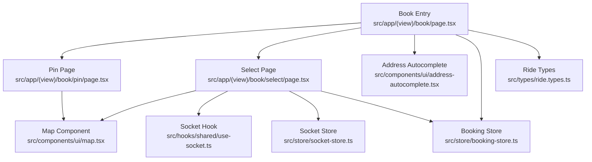
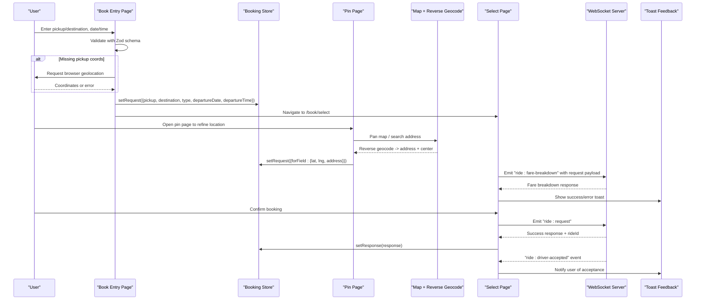
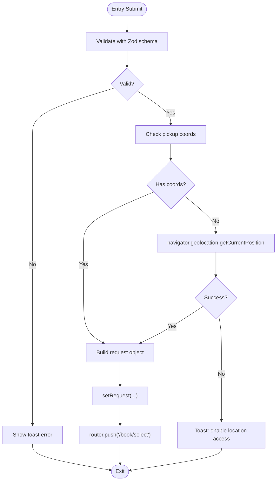
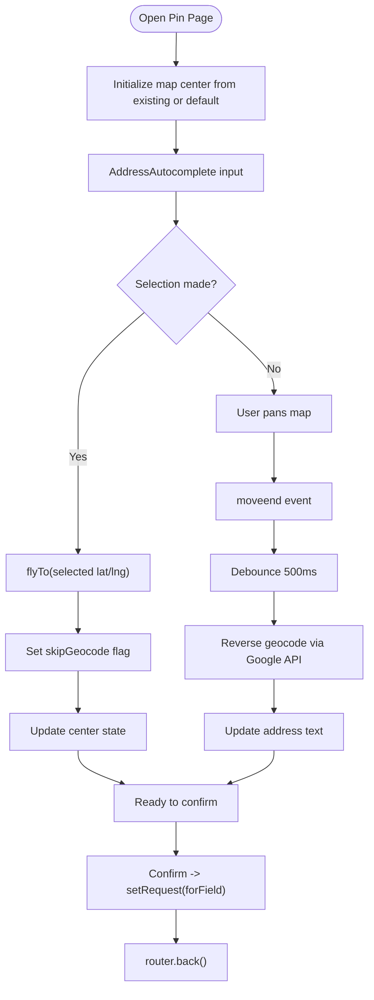
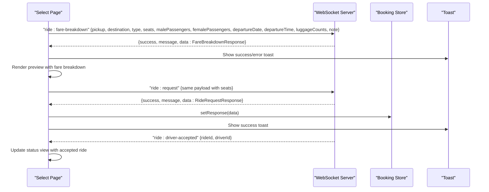
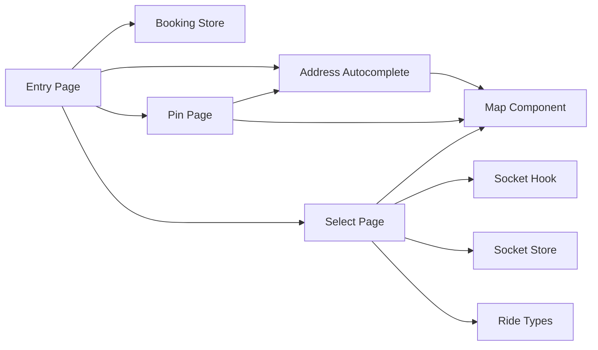

# Ride Booking Flow

<cite>
**Referenced Files in This Document**
- [page.tsx](file://src/app/(view)/book/page.tsx)
- [pin/page.tsx](file://src/app/(view)/book/pin/page.tsx)
- [select/page.tsx](file://src/app/(view)/book/select/page.tsx)
- [address-autocomplete.tsx](file://src/components/ui/address-autocomplete.tsx)
- [map.tsx](file://src/components/ui/map.tsx)
- [booking-store.ts](file://src/store/booking-store.ts)
- [ride.types.ts](file://src/types/ride.types.ts)
- [use-socket.ts](file://src/hooks/shared/use-socket.ts)
- [socket-store.ts](file://src/store/socket-store.ts)
</cite>

## Table of Contents
1. Introduction
2. Project Structure
3. Core Components
4. Architecture Overview
5. Detailed Component Analysis
6. Dependency Analysis
7. Performance Considerations
8. Troubleshooting Guide
9. Conclusion

## Introduction
This document explains the multi-step ride booking flow in Split Ride. It covers:
- Location selection with address autocomplete and map pinning
- Ride type selection (split vs private)
- Real-time availability and fare estimation via WebSocket
- Form validation using Zod schema
- State management through a booking store
- Navigation between booking steps
- Geolocation API integration for automatic pickup detection
- Coordinate handling and error states
- Examples of request structures, validation rules, and user feedback patterns

## Project Structure
The booking wizard spans several pages and shared components:
- Entry page for location inputs and tabs to choose split or private flows
- Pin page for precise map-based location selection
- Selection page for passenger details, fare preview, and real-time driver matching
- Shared UI for address autocomplete and map rendering
- Global stores for booking state and socket events
- Types defining payloads and responses

**Diagram sources**
- [page.tsx](file://src/app/(view)/book/page.tsx#L1-L305)
- [pin/page.tsx](file://src/app/(view)/book/pin/page.tsx#L1-L188)
- [select/page.tsx](file://src/app/(view)/book/select/page.tsx#L1-L801)
- [address-autocomplete.tsx:1-170](file://src/components/ui/address-autocomplete.tsx#L1-L170)
- [map.tsx:1-800](file://src/components/ui/map.tsx#L1-L800)
- [booking-store.ts:1-28](file://src/store/booking-store.ts#L1-L28)
- [use-socket.ts:1-57](file://src/hooks/shared/use-socket.ts#L1-L57)
- [socket-store.ts:1-34](file://src/store/socket-store.ts#L1-L34)
- [ride.types.ts:1-161](file://src/types/ride.types.ts#L1-L161)

**Section sources**
- [page.tsx](file://src/app/(view)/book/page.tsx#L1-L305)
- [pin/page.tsx](file://src/app/(view)/book/pin/page.tsx#L1-L188)
- [select/page.tsx](file://src/app/(view)/book/select/page.tsx#L1-L801)
- [address-autocomplete.tsx:1-170](file://src/components/ui/address-autocomplete.tsx#L1-L170)
- [map.tsx:1-800](file://src/components/ui/map.tsx#L1-L800)
- [booking-store.ts:1-28](file://src/store/booking-store.ts#L1-L28)
- [use-socket.ts:1-57](file://src/hooks/shared/use-socket.ts#L1-L57)
- [socket-store.ts:1-34](file://src/store/socket-store.ts#L1-L34)
- [ride.types.ts:1-161](file://src/types/ride.types.ts#L1-L161)

## Core Components
- Book entry form: validates locations, attempts geolocation for pickup if missing, persists data to store, and navigates to selection.
- Pin page: integrates Google Maps reverse geocoding on pan, supports address search, and updates store with selected coordinates.
- Select page: collects passengers/luggage, requests fare breakdown via WebSocket, previews costs, and sends booking request; listens for driver acceptance.
- Address autocomplete: loads Google Places, provides suggestions, and returns lat/lng and structured address data.
- Map component: renders MapLibre GL map, markers, routes, and controls; used across pin and select pages.
- Booking store: centralizes request/response/status for the booking flow.
- Socket utilities: typed emit/on/off helpers and event subscription hook.

**Section sources**
- [page.tsx](file://src/app/(view)/book/page.tsx#L1-L305)
- [pin/page.tsx](file://src/app/(view)/book/pin/page.tsx#L1-L188)
- [select/page.tsx](file://src/app/(view)/book/select/page.tsx#L1-L801)
- [address-autocomplete.tsx:1-170](file://src/components/ui/address-autocomplete.tsx#L1-L170)
- [map.tsx:1-800](file://src/components/ui/map.tsx#L1-L800)
- [booking-store.ts:1-28](file://src/store/booking-store.ts#L1-L28)
- [use-socket.ts:1-57](file://src/hooks/shared/use-socket.ts#L1-L57)
- [socket-store.ts:1-34](file://src/store/socket-store.ts#L1-L34)

## Architecture Overview
The booking flow is a client-side wizard coordinated by React components and Zustand stores, with real-time communication over WebSockets and third-party services (Google Maps).

**Diagram sources**
- [page.tsx](file://src/app/(view)/book/page.tsx#L1-L305)
- [pin/page.tsx](file://src/app/(view)/book/pin/page.tsx#L1-L188)
- [select/page.tsx](file://src/app/(view)/book/select/page.tsx#L1-L801)
- [booking-store.ts:1-28](file://src/store/booking-store.ts#L1-L28)
- [use-socket.ts:1-57](file://src/hooks/shared/use-socket.ts#L1-L57)
- [socket-store.ts:1-34](file://src/store/socket-store.ts#L1-L34)

## Detailed Component Analysis

### Book Entry Page
Responsibilities:
- Tabs for find/start/private modes
- Address inputs with autocomplete and coordinate callbacks
- Date/time pickers
- Validation with Zod schema requiring non-empty addresses and valid destination coordinates
- Automatic pickup detection via browser geolocation when coordinates are missing
- Persisting request to store and navigating to selection

Key behaviors:
- Validates fields before proceeding
- Attempts navigator.geolocation.getCurrentPosition with timeout
- Sets request.type based on active tab ("split" or "private")
- Navigates to "/book/select" after successful validation

Validation example (Zod):
- Required pickup and dropoff strings
- Destination must have coordinates (boolean flag derived from presence of latitude)

Navigation:
- Links to pin page for both pickup and destination
- On submit, pushes to "/book/select"

**Section sources**
- [page.tsx](file://src/app/(view)/book/page.tsx#L1-L305)

#### Sequence: Entry Validation and Geolocation

**Diagram sources**
- [page.tsx](file://src/app/(view)/book/page.tsx#L1-L305)

### Pin Page
Responsibilities:
- Provide a full-screen map with a centered crosshair pin
- Support address search via AddressAutocomplete
- Reverse geocode on map moveend to update address text
- Confirm selection and persist to store

Geocoding integration:
- Uses Google Maps Geocoding API with environment key
- Debounces reverse geocode calls on map movement
- Skips geocode when user selects an address from autocomplete

Coordinate handling:
- Maintains center coordinates and updates them on pan
- Flies to selected coordinates when autocomplete chooses a place

Persistence:
- Updates either pickup or destination in store depending on URL param "for"

**Section sources**
- [pin/page.tsx](file://src/app/(view)/book/pin/page.tsx#L1-L188)
- [address-autocomplete.tsx:1-170](file://src/components/ui/address-autocomplete.tsx#L1-L170)
- [map.tsx:1-800](file://src/components/ui/map.tsx#L1-L800)

#### Flow: Pin and Reverse Geocode

**Diagram sources**
- [pin/page.tsx](file://src/app/(view)/book/pin/page.tsx#L1-L188)
- [address-autocomplete.tsx:1-170](file://src/components/ui/address-autocomplete.tsx#L1-L170)

### Select Page
Responsibilities:
- Collect male/female passengers and luggage count
- Request fare breakdown via WebSocket
- Display route on map and show estimated distance/duration and fare breakdown
- Accept terms and send booking request
- Listen for driver acceptance event and update UI accordingly

Real-time availability and pricing:
- Emits "ride:fare-breakdown" with request payload including type, seats, gender counts, date/time, luggage, note
- Receives breakdown with estimatedFare, estimatedDistance, estimatedDuration, and detailed fareBreakdown
- Emits "ride:request" to create booking
- Subscribes to "ride:driver-accepted" to show accepted ride info

Map integration:
- Draws route using Google DirectionsService and displays it on MapLibre map
- Fits bounds to route path

State management:
- Reads request from booking store
- Stores response and shows status view

**Section sources**
- [select/page.tsx](file://src/app/(view)/book/select/page.tsx#L1-L801)
- [booking-store.ts:1-28](file://src/store/booking-store.ts#L1-L28)
- [use-socket.ts:1-57](file://src/hooks/shared/use-socket.ts#L1-L57)
- [socket-store.ts:1-34](file://src/store/socket-store.ts#L1-L34)
- [map.tsx:1-800](file://src/components/ui/map.tsx#L1-L800)

#### Sequence: Fare Breakdown and Booking

**Diagram sources**
- [select/page.tsx](file://src/app/(view)/book/select/page.tsx#L1-L801)
- [use-socket.ts:1-57](file://src/hooks/shared/use-socket.ts#L1-L57)
- [socket-store.ts:1-34](file://src/store/socket-store.ts#L1-L34)
- [booking-store.ts:1-28](file://src/store/booking-store.ts#L1-L28)

### Address Autocomplete
Responsibilities:
- Load Google Maps Places library
- Provide debounced suggestions
- On selection, geocode to get lat/lng and parse address components
- Expose optional callbacks for coordinates and structured address data

Integration points:
- Used in entry page and pin page
- Provides onCoordinates callback to update local state and map center

**Section sources**
- [address-autocomplete.tsx:1-170](file://src/components/ui/address-autocomplete.tsx#L1-L170)

### Map Component
Responsibilities:
- Initialize MapLibre GL map with theme-aware styles
- Provide markers, popups, tooltips, labels, and route drawing
- Expose imperative ref and viewport control
- Offer built-in controls (zoom, locate, fullscreen)

Usage in booking:
- Pin page uses map for pan-to-select and reverse geocode
- Select page draws route and markers for pickup/destination

**Section sources**
- [map.tsx:1-800](file://src/components/ui/map.tsx#L1-L800)

### Booking Store
Responsibilities:
- Hold partial request, response, and status
- Provide setters to merge request fields and reset state

Flow usage:
- Entry page sets request fields
- Pin page updates specific field (pickup or destination)
- Select page reads request and writes response

**Section sources**
- [booking-store.ts:1-28](file://src/store/booking-store.ts#L1-L28)

### Socket Utilities
Responsibilities:
- Typed emit/on/off helpers around socket instance
- Hook to subscribe to a single event for component lifetime

Flow usage:
- Select page emits fare breakdown and booking request
- Listens for driver acceptance event

**Section sources**
- [use-socket.ts:1-57](file://src/hooks/shared/use-socket.ts#L1-L57)
- [socket-store.ts:1-34](file://src/store/socket-store.ts#L1-L34)

## Dependency Analysis
High-level dependencies among core pieces:

**Diagram sources**
- [page.tsx](file://src/app/(view)/book/page.tsx#L1-L305)
- [pin/page.tsx](file://src/app/(view)/book/pin/page.tsx#L1-L188)
- [select/page.tsx](file://src/app/(view)/book/select/page.tsx#L1-L801)
- [address-autocomplete.tsx:1-170](file://src/components/ui/address-autocomplete.tsx#L1-L170)
- [map.tsx:1-800](file://src/components/ui/map.tsx#L1-L800)
- [booking-store.ts:1-28](file://src/store/booking-store.ts#L1-L28)
- [use-socket.ts:1-57](file://src/hooks/shared/use-socket.ts#L1-L57)
- [socket-store.ts:1-34](file://src/store/socket-store.ts#L1-L34)
- [ride.types.ts:1-161](file://src/types/ride.types.ts#L1-L161)

**Section sources**
- [page.tsx](file://src/app/(view)/book/page.tsx#L1-L305)
- [pin/page.tsx](file://src/app/(view)/book/pin/page.tsx#L1-L188)
- [select/page.tsx](file://src/app/(view)/book/select/page.tsx#L1-L801)
- [address-autocomplete.tsx:1-170](file://src/components/ui/address-autocomplete.tsx#L1-L170)
- [map.tsx:1-800](file://src/components/ui/map.tsx#L1-L800)
- [booking-store.ts:1-28](file://src/store/booking-store.ts#L1-L28)
- [use-socket.ts:1-57](file://src/hooks/shared/use-socket.ts#L1-L57)
- [socket-store.ts:1-34](file://src/store/socket-store.ts#L1-L34)
- [ride.types.ts:1-161](file://src/types/ride.types.ts#L1-L161)

## Performance Considerations
- Debounce reverse geocoding on map pan to avoid excessive API calls.
- Use lazy loading for Google Maps libraries (places, routes) to reduce initial bundle size.
- Fit map bounds only once after route coordinates are available.
- Avoid re-render loops by skipping internal viewport updates in controlled mode.
- Keep toast notifications lightweight and avoid repeated errors for transient failures.

[No sources needed since this section provides general guidance]

## Troubleshooting Guide
Common issues and resolutions:
- Missing destination coordinates:
  - Ensure destination is selected from autocomplete or pinned on map; validation requires coordinates.
- Pickup geolocation denied or timed out:
  - Prompt user to allow location access or manually pin pickup location.
- No fare estimate returned:
  - Verify network connectivity and that all required fields (type, seats, date/time, locations) are present.
- Driver not accepting:
  - Confirm WebSocket connection and that server is broadcasting "ride:driver-accepted".
- Map not showing route:
  - Ensure Google Maps API key is configured and DirectionsService is loaded; check console for errors.

**Section sources**
- [page.tsx](file://src/app/(view)/book/page.tsx#L1-L305)
- [pin/page.tsx](file://src/app/(view)/book/pin/page.tsx#L1-L188)
- [select/page.tsx](file://src/app/(view)/book/select/page.tsx#L1-L801)

## Conclusion
The Split Ride booking wizard combines robust form validation, intuitive map interactions, and real-time availability checks to deliver a smooth user experience. Centralized state and typed socket hooks ensure consistent behavior across steps, while clear user feedback guides users through potential errors and confirms successful bookings.

[No sources needed since this section summarizes without analyzing specific files]