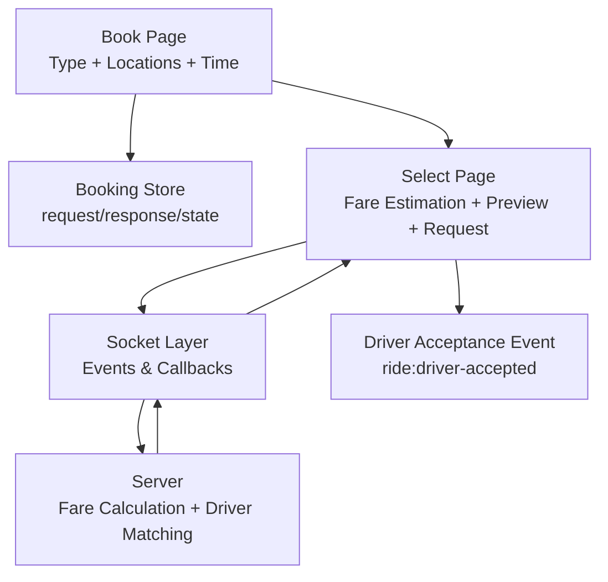
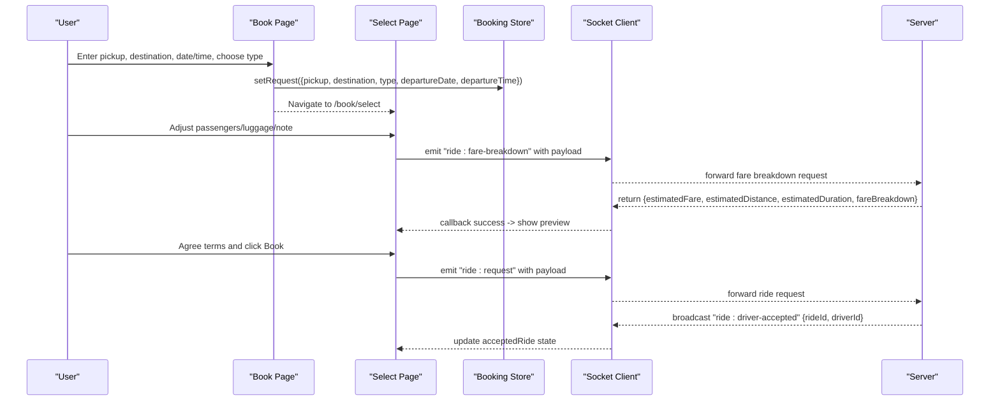
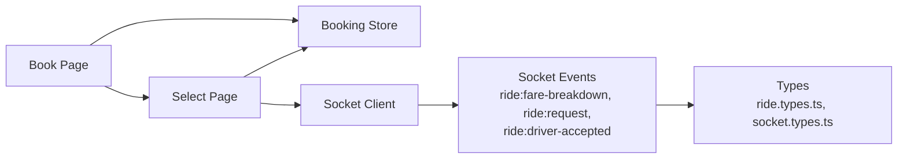

# Ride Configuration

<cite>
**Referenced Files in This Document**
- [page.tsx](file://src/app/(view)/book/page.tsx)
- [select/page.tsx](file://src/app/(view)/book/select/page.tsx)
- [booking-store.ts](file://src/store/booking-store.ts)
- [ride.types.ts](file://src/types/ride.types.ts)
- [socket.types.ts](file://src/types/socket.types.ts)
- [socket.ts](file://src/lib/socket.ts)
- [form.tsx](file://src/app/(view)/book/form.tsx)
- [find.tsx](file://src/app/(view)/book/find.tsx)
</cite>

## Table of Contents
1. [Introduction](#introduction)
2. [Project Structure](#project-structure)
3. [Core Components](#core-components)
4. [Architecture Overview](#architecture-overview)
5. [Detailed Component Analysis](#detailed-component-analysis)
6. [Dependency Analysis](#dependency-analysis)
7. [Performance Considerations](#performance-considerations)
8. [Troubleshooting Guide](#troubleshooting-guide)
9. [Conclusion](#conclusion)

## Introduction
This document explains the ride configuration stage in Split Ride’s booking flow. It covers:
- Choosing between split and private rides, including how type selection affects downstream behavior
- Availability checking and fare estimation
- Real-time driver matching via WebSocket events
- Fare calculation logic and estimated arrival times
- State management through the booking store to persist preferences across navigation
- Examples of filtering and sorting options for available drivers (including ratings and vehicle types)

## Project Structure
The ride configuration spans a few key pages and stores:
- Entry form page where users choose ride type and enter locations/time
- Selection page that estimates fares, previews details, and initiates driver matching
- Booking store that persists request/response state
- Socket layer for real-time communication with the server
- Type definitions for payloads and responses
- UI examples for driver filtering/sorting (static demo data)

**Diagram sources**
- [page.tsx](file://src/app/(view)/book/page.tsx#L46-L134)
- [select/page.tsx](file://src/app/(view)/book/select/page.tsx#L579-L689)
- [booking-store.ts:19-27](file://src/store/booking-store.ts#L19-L27)
- [socket.ts:23-42](file://src/lib/socket.ts#L23-L42)
- [socket.types.ts:267-283](file://src/types/socket.types.ts#L267-L283)

**Section sources**
- [page.tsx](file://src/app/(view)/book/page.tsx#L46-L134)
- [select/page.tsx](file://src/app/(view)/book/select/page.tsx#L579-L689)
- [booking-store.ts:19-27](file://src/store/booking-store.ts#L19-L27)
- [socket.ts:23-42](file://src/lib/socket.ts#L23-L42)
- [socket.types.ts:267-283](file://src/types/socket.types.ts#L267-L283)

## Core Components
- Book page: collects pickup/dropoff, date/time, and ride type; validates inputs; writes to booking store and navigates to selection
- Select page: requests fare breakdown, shows preview, accepts terms, emits ride request, listens for driver acceptance
- Booking store: centralizes request/response/status for persistence across navigation
- Socket layer: typed client/server event contracts for fare breakdown and ride request flows
- Types: define payload/response shapes for fare breakdown and ride request

Key responsibilities:
- Input validation and normalization before emitting socket events
- Real-time updates on driver acceptance
- Displaying fare components and totals
- Persisting user preferences across steps

**Section sources**
- [page.tsx](file://src/app/(view)/book/page.tsx#L46-L134)
- [select/page.tsx](file://src/app/(view)/book/select/page.tsx#L579-L689)
- [booking-store.ts:19-27](file://src/store/booking-store.ts#L19-L27)
- [ride.types.ts:70-160](file://src/types/ride.types.ts#L70-L160)
- [socket.types.ts:267-283](file://src/types/socket.types.ts#L267-L283)

## Architecture Overview
The ride configuration uses a clear separation between UI, state, and real-time communication:

**Diagram sources**
- [page.tsx](file://src/app/(view)/book/page.tsx#L89-L134)
- [select/page.tsx](file://src/app/(view)/book/select/page.tsx#L611-L689)
- [socket.types.ts:267-283](file://src/types/socket.types.ts#L267-L283)

## Detailed Component Analysis

### Ride Type Selection and Availability
- The book page provides tabs for different modes, including “find” (split) and “private”. The selected tab determines the ride type persisted in the booking store.
- After validation, the page sets the full request object (locations, coordinates, type, scheduled time) and navigates to the selection page.

Behavior highlights:
- If pickup coordinates are missing, it attempts to fetch current geolocation
- Destination must be selected from suggestions or pinned on the map
- Type is stored as “split” or “private” based on the active tab

Availability checking:
- Availability is not computed locally; the server responds during fare breakdown and request phases. The UI reflects availability by enabling/disabling actions and showing messages when no driver is found.

**Section sources**
- [page.tsx](file://src/app/(view)/book/page.tsx#L46-L134)

### Real-Time Driver Matching Algorithm
- On confirmation, the select page emits a ride request via socket. The server notifies nearby drivers and broadcasts a driver-accepted event back to the rider.
- The rider’s UI listens for the acceptance event and transitions to a status view indicating a driver has been found.

Matching characteristics:
- Server-side proximity and availability determine which drivers receive the request
- The client only observes outcomes via events; there is no local ranking algorithm

**Section sources**
- [select/page.tsx](file://src/app/(view)/book/select/page.tsx#L652-L689)
- [socket.types.ts:30-33](file://src/types/socket.types.ts#L30-L33)

### Fare Calculation Logic
- Before confirming, the select page requests a fare breakdown. The response includes:
  - Estimated distance and duration
  - Breakdown fields such as initial charge, per-km charge, luggage charge, VAT, and total fare
- These values are displayed in the preview and later echoed in the status view after the request is created.

Notes:
- The exact pricing rules are implemented server-side; the client consumes the structured breakdown
- Luggage count can influence additional charges

**Section sources**
- [select/page.tsx](file://src/app/(view)/book/select/page.tsx#L611-L649)
- [ride.types.ts:126-142](file://src/types/ride.types.ts#L126-L142)

### Estimated Arrival Times
- The fare breakdown includes an estimated duration in minutes.
- During live trips, the server may broadcast live updates including ETA; however, in the configuration phase, ETA is primarily derived from the fare breakdown estimate.

**Section sources**
- [ride.types.ts:126-142](file://src/types/ride.types.ts#L126-L142)
- [socket.types.ts:52-62](file://src/types/socket.types.ts#L52-L62)

### State Management Through Booking Store
- The booking store holds:
  - request: partial ride request payload (locations, type, schedule)
  - response: ride request response (after creation)
  - status: lifecycle state (idle/waiting/accepted/cancelled)
- The book page writes to the store; the select page reads from it and updates response upon successful request.

Benefits:
- Persists user preferences across navigation
- Centralizes state for consistent UI behavior

**Section sources**
- [booking-store.ts:19-27](file://src/store/booking-store.ts#L19-L27)
- [page.tsx](file://src/app/(view)/book/page.tsx#L57-L134)
- [select/page.tsx](file://src/app/(view)/book/select/page.tsx#L582-L584)

### Filtering, Sorting, and Multiple Drivers
- The codebase includes static demo lists for choosing among multiple drivers with attributes like rating, price, ETA, and seats.
- These examples demonstrate how to present and filter/sort options (e.g., by rating or ETA). In production, these would be populated from server responses.

Examples:
- Static driver list with rating, price, ETA, and seat capacity
- UI patterns for selecting a preferred option

**Section sources**
- [form.tsx](file://src/app/(view)/book/form.tsx#L46-L51)
- [find.tsx](file://src/app/(view)/book/find.tsx#L407-L454)

## Dependency Analysis
The following diagram maps runtime dependencies relevant to ride configuration:

**Diagram sources**
- [page.tsx](file://src/app/(view)/book/page.tsx#L46-L134)
- [select/page.tsx](file://src/app/(view)/book/select/page.tsx#L579-L689)
- [booking-store.ts:19-27](file://src/store/booking-store.ts#L19-L27)
- [socket.ts:23-42](file://src/lib/socket.ts#L23-L42)
- [ride.types.ts:70-160](file://src/types/ride.types.ts#L70-L160)
- [socket.types.ts:267-283](file://src/types/socket.types.ts#L267-L283)

**Section sources**
- [page.tsx](file://src/app/(view)/book/page.tsx#L46-L134)
- [select/page.tsx](file://src/app/(view)/book/select/page.tsx#L579-L689)
- [booking-store.ts:19-27](file://src/store/booking-store.ts#L19-L27)
- [socket.ts:23-42](file://src/lib/socket.ts#L23-L42)
- [ride.types.ts:70-160](file://src/types/ride.types.ts#L70-L160)
- [socket.types.ts:267-283](file://src/types/socket.types.ts#L267-L283)

## Performance Considerations
- Debounce fare breakdown calls if the user frequently changes inputs
- Cache recent fare estimates keyed by route and parameters to avoid redundant server calls
- Use optimistic UI for driver acceptance to improve perceived responsiveness
- Limit re-renders by subscribing to minimal store slices in components

[No sources needed since this section provides general guidance]

## Troubleshooting Guide
Common issues and resolutions:
- Missing location coordinates: ensure destination is selected from suggestions or pinned; fallback to geolocation if allowed
- No driver found: the server may broadcast a “no driver found” event; inform the user and allow retry
- Fare breakdown failure: display error message and allow reattempt
- Socket connection problems: verify environment variables for socket URL and token handling

Operational checks:
- Validate required fields before emitting socket events
- Inspect socket logs for emitted/received events
- Confirm correct ride type is persisted in the booking store

**Section sources**
- [page.tsx](file://src/app/(view)/book/page.tsx#L89-L134)
- [select/page.tsx](file://src/app/(view)/book/select/page.tsx#L611-L689)
- [socket.types.ts:30-43](file://src/types/socket.types.ts#L30-L43)
- [socket.ts:23-42](file://src/lib/socket.ts#L23-L42)

## Conclusion
The ride configuration stage integrates input collection, fare estimation, and real-time driver matching into a cohesive flow. The booking store ensures continuity across navigation, while the socket layer enables responsive updates. Pricing and availability are determined server-side and reflected in the client via structured responses and events. The included UI examples illustrate how to present and manage multiple driver options with attributes like rating, price, ETA, and vehicle capacity.