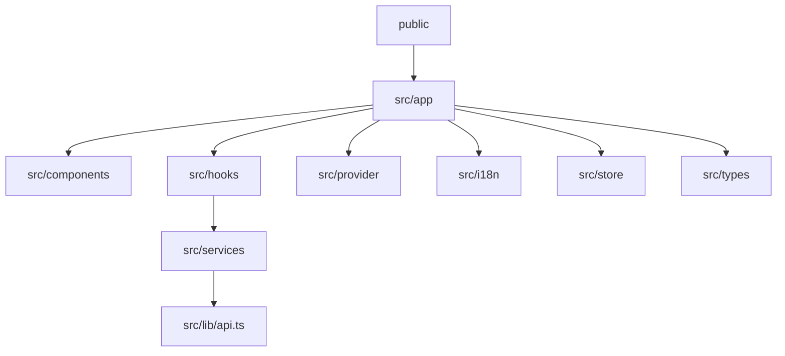
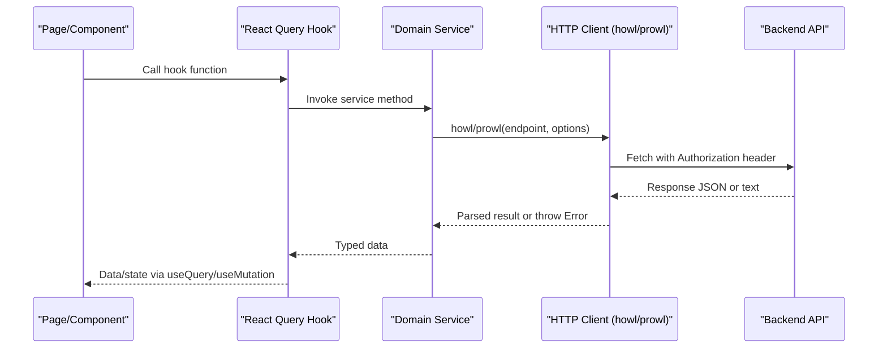
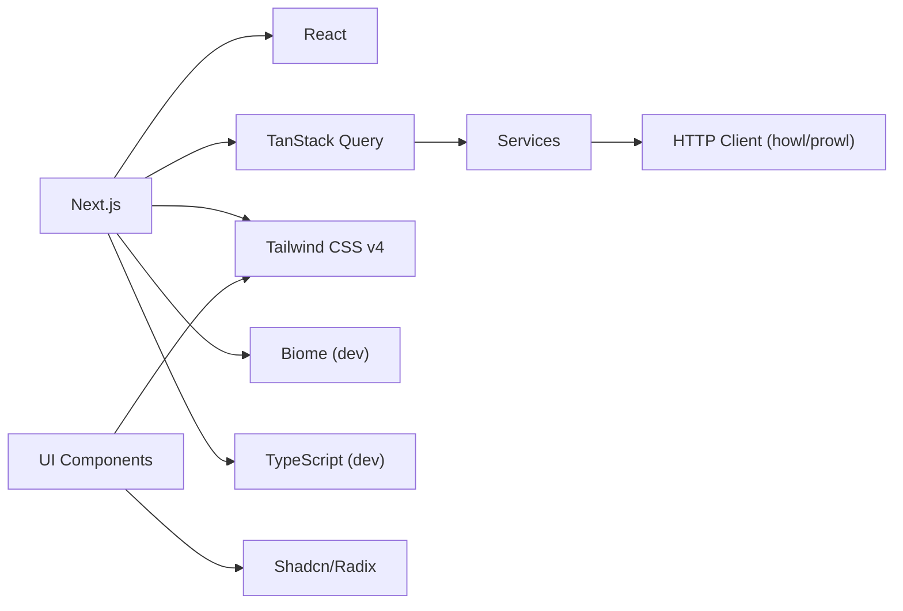

# Development Guide

<cite>
**Referenced Files in This Document**
- [package.json](file://package.json)
- [tsconfig.json](file://tsconfig.json)
- [biome.json](file://biome.json)
- [next.config.ts](file://next.config.ts)
- [postcss.config.mjs](file://postcss.config.mjs)
- [components.json](file://components.json)
- [README.md](file://README.md)
- [AGENTS.md](file://AGENTS.md)
- [CLAUDE.md](file://CLAUDE.md)
- [API-INTEGRATION.md](file://API-INTEGRATION.md)
- [src/lib/api.ts](file://src/lib/api.ts)
- [src/lib/utils.ts](file://src/lib/utils.ts)
- [src/types/base.ts](file://src/types/base.ts)
- [src/app/layout.tsx](file://src/app/layout.tsx)
- [src/app/globals.css](file://src/app/globals.css)
</cite>

## Table of Contents
1. Introduction
2. Project Structure
3. Core Components
4. Architecture Overview
5. Detailed Component Analysis
6. Dependency Analysis
7. Performance Considerations
8. Troubleshooting Guide
9. Conclusion
10. Appendices

## Introduction
This Development Guide consolidates code standards, development workflow, and best practices for the project. It explains TypeScript configuration, code quality tooling (Biome), build process, project structure conventions, naming patterns, file organization rules, debugging techniques, testing strategies, performance optimization guidelines, contribution guidelines, and code review processes. The goal is to make onboarding smooth and ensure consistent, high-quality development across the team.

## Project Structure
The project follows a Next.js App Router layout with clear separation between UI components, hooks, services, types, providers, and shared utilities. Key directories:
- src/app: Application routes and layouts using Next.js App Router
- src/components: Reusable UI components and shadcn/ui primitives
- src/hooks: React Query-based hooks organized by domain
- src/services: Pure fetch wrappers around API endpoints
- src/types: Shared TypeScript interfaces and response shapes
- src/provider: Global providers (e.g., i18n, socket, theme)
- src/lib: Low-level utilities and HTTP clients
- public: Static assets and service worker

**Diagram sources**
- [src/app/layout.tsx:1-48](file://src/app/layout.tsx#L1-L48)
- [src/lib/api.ts:1-106](file://src/lib/api.ts#L1-L106)
- [API-INTEGRATION.md:311-379](file://API-INTEGRATION.md#L311-L379)

**Section sources**
- [README.md:1-37](file://README.md#L1-L37)
- [API-INTEGRATION.md:311-379](file://API-INTEGRATION.md#L311-L379)

## Core Components
- HTTP client layer: Centralized JSON and FormData request helpers that auto-inject token from cookies and normalize error messages.
- Utilities: Tailwind class merging helper used across UI components.
- Base types: Common response shapes for APIs and pagination.
- Root layout: Global providers and fonts setup.

Key responsibilities:
- src/lib/api.ts: Encapsulates base URL, token injection, headers, and error handling for both JSON and FormData requests.
- src/lib/utils.ts: Provides a single source of truth for class name merging.
- src/types/base.ts: Defines ApiResponse and pagination structures consumed by services and hooks.
- src/app/layout.tsx: Configures global CSS, fonts, and top-level providers.

**Section sources**
- [src/lib/api.ts:1-106](file://src/lib/api.ts#L1-L106)
- [src/lib/utils.ts:1-7](file://src/lib/utils.ts#L1-L7)
- [src/types/base.ts:1-28](file://src/types/base.ts#L1-L28)
- [src/app/layout.tsx:1-48](file://src/app/layout.tsx#L1-L48)

## Architecture Overview
High-level architecture emphasizes clean separation:
- Pages and layouts under src/app compose UI and orchestrate data via hooks.
- Hooks encapsulate TanStack Query usage and call domain-specific services.
- Services perform pure fetch calls using centralized HTTP helpers.
- Providers wrap the app with global context (i18n, sockets, notifications).
- Types define contracts between layers.

**Diagram sources**
- [API-INTEGRATION.md:9-24](file://API-INTEGRATION.md#L9-L24)
- [src/lib/api.ts:22-73](file://src/lib/api.ts#L22-L73)
- [src/lib/api.ts:82-105](file://src/lib/api.ts#L82-L105)

## Detailed Component Analysis

### TypeScript Configuration
- Target ES2017 with modern DOM libs; strict mode enabled; no emit (Next.js handles compilation).
- Module resolution set to bundler; isolated modules; JSX react-jsx.
- Path alias @/* maps to ./src/* for cleaner imports.
- Includes generated types and .mts files; excludes node_modules.

Best practices:
- Keep strict mode on to catch type issues early.
- Use path aliases consistently to avoid deep relative imports.
- Prefer explicit types over any; leverage shared types in src/types.

**Section sources**
- [tsconfig.json:1-35](file://tsconfig.json#L1-L35)

### Code Quality Tools (Biome)
- Formatter: Enabled with 2-space indentation.
- Linter: Recommended rules plus Next.js and React domains enabled; specific rule overrides where needed.
- VCS integration: Git-aware with ignore file support.
- Assist: Organize imports action enabled.

Workflow:
- Run linting: npm run lint
- Auto-format: npm run format
- Configure additional rules in biome.json as needed.

**Section sources**
- [biome.json:1-38](file://biome.json#L1-L38)
- [package.json:5-11](file://package.json#L5-L11)

### Build Process and Next.js Configuration
- Scripts: dev, build, start, lint, format.
- Next config:
  - Images remotePatterns allowlist for external image hosts.
  - serverExternalPackages marks Firebase packages as external for server-side.
  - Turbopack enabled for faster builds.

Guidelines:
- Use environment variables for base URLs and secrets.
- Keep images optimized and restricted to allowed domains.
- Leverage Turbopack during development for speed.

**Section sources**
- [package.json:5-11](file://package.json#L5-L11)
- [next.config.ts:1-37](file://next.config.ts#L1-L37)

### Styling and Theme System
- Tailwind v4 via PostCSS plugin.
- Global CSS defines design tokens (colors, shadows, radii, fonts) and dark mode variants.
- Shadcn/ui configured with Radix style, RSC enabled, and alias mappings.

Recommendations:
- Extend themes via CSS variables rather than ad-hoc styles.
- Use cn utility for conditional classes.
- Keep component styling localized and composable.

**Section sources**
- [postcss.config.mjs:1-8](file://postcss.config.mjs#L1-L8)
- [src/app/globals.css:1-198](file://src/app/globals.css#L1-L198)
- [components.json:1-30](file://components.json#L1-L30)

### HTTP Client Layer
- howl: JSON API calls with automatic Authorization header from cookie token; robust error parsing.
- prowl: FormData uploads without Content-Type override; standardized error handling.
- Base URL composition uses NEXT_PUBLIC_SERVER_URL + /api/v1.

Error handling:
- Non-ok responses parse server message when available; otherwise fallback to status text.
- Network errors wrapped into generic Error messages.

Usage guidance:
- Prefer howl for JSON endpoints; use prowl for file uploads.
- Always handle loading/error states in hooks and components.

**Section sources**
- [src/lib/api.ts:1-106](file://src/lib/api.ts#L1-L106)
- [API-INTEGRATION.md:18-24](file://API-INTEGRATION.md#L18-L24)

### Utilities and Shared Types
- cn utility merges Tailwind classes deterministically.
- Base types define common API responses and pagination shapes.

Adoption:
- Import cn from utils for all className compositions.
- Use ApiResponse<T> and PagedResponse<T> to type service returns.

**Section sources**
- [src/lib/utils.ts:1-7](file://src/lib/utils.ts#L1-L7)
- [src/types/base.ts:1-28](file://src/types/base.ts#L1-L28)

### Root Layout and Providers
- Root layout sets metadata, fonts, and wraps children with TooltipProvider, GodProvider, and I18nProvider.
- Ensures consistent theming and internationalization across pages.

Operational notes:
- Add new global providers here to keep them accessible app-wide.
- Avoid heavy logic in layout; delegate to providers.

**Section sources**
- [src/app/layout.tsx:1-48](file://src/app/layout.tsx#L1-L48)

## Dependency Analysis
Top-level dependencies include Next.js, React, TanStack Query, Socket.IO client, Firebase, MapLibre GL, Zustand, and UI libraries. DevDependencies cover Biome, Tailwind v4, and TypeScript.

**Diagram sources**
- [package.json:12-57](file://package.json#L12-L57)
- [postcss.config.mjs:1-8](file://postcss.config.mjs#L1-L8)
- [biome.json:1-38](file://biome.json#L1-L38)

**Section sources**
- [package.json:12-57](file://package.json#L12-L57)

## Performance Considerations
- Image optimization: Restrict remotePatterns to necessary domains; prefer Next/Image for caching and resizing.
- Server external packages: Mark heavy server-only packages (e.g., Firebase Admin) as external to reduce bundle size.
- Turbopack: Enable for faster local builds and HMR.
- Lazy loading: Split large components and routes; defer non-critical resources.
- State management: Use Zustand for lightweight global state; TanStack Query for server state caching and deduplication.
- Networking: Batch requests where possible; implement retry/backoff for transient failures.

[No sources needed since this section provides general guidance]

## Troubleshooting Guide
Common issues and resolutions:
- Authentication failures: Ensure token cookie is set after login and readable by the client; verify Authorization header injection.
- CORS or network errors: Check NEXT_PUBLIC_SERVER_URL and proxy settings; confirm backend availability.
- File upload errors: Use prowl for FormData; do not set Content-Type manually.
- Styling conflicts: Use cn utility; avoid inline styles overriding Tailwind.
- Build warnings: Review next.config.ts for unused or conflicting settings; validate image hostnames.

Debugging tips:
- Inspect network requests in browser DevTools to verify headers and payloads.
- Log error messages thrown by HTTP client to understand server responses.
- Use TanStack Query Devtools to inspect cache and mutations.

**Section sources**
- [src/lib/api.ts:42-73](file://src/lib/api.ts#L42-L73)
- [src/lib/api.ts:99-105](file://src/lib/api.ts#L99-L105)

## Conclusion
This guide outlines the project’s development standards, tooling, and workflows. By adhering to the TypeScript configuration, Biome rules, Next.js setup, and layered architecture, teams can maintain consistency, improve productivity, and deliver reliable features. Follow the contribution and review practices below to ensure quality and collaboration.

[No sources needed since this section summarizes without analyzing specific files]

## Appendices

### Development Workflow
- Install dependencies and start development server using package scripts.
- Run linter and formatter before committing changes.
- Use Turbopack-enabled dev server for faster iteration.

**Section sources**
- [README.md:5-15](file://README.md#L5-L15)
- [package.json:5-11](file://package.json#L5-L11)

### Code Standards and Naming Patterns
- File names: kebab-case for feature folders and PascalCase for components.
- Hooks: useXxx pattern grouped by domain (auth, booking, driver, shared).
- Services: domain.service.ts naming; one service per domain.
- Types: xxx.types.ts with shared base types in base.ts.
- Components: colocated _components folders for page-scoped UI; reusable UI in src/components/ui.

**Section sources**
- [API-INTEGRATION.md:311-379](file://API-INTEGRATION.md#L311-L379)

### Testing Strategies
- Unit tests: Validate pure functions in services and utilities.
- Integration tests: Test hooks’ interactions with mocked services.
- End-to-end tests: Simulate user flows across critical pages (auth, booking, payments).
- Mocks: Stub HTTP client responses and WebSocket events for deterministic tests.

[No sources needed since this section provides general guidance]

### Contribution Guidelines
- Create feature branches named feature/<short-description>.
- Commit messages should be descriptive and follow conventional commits.
- Ensure lint and format pass locally before pushing.
- Open pull requests with clear descriptions and linked issues.

[No sources needed since this section provides general guidance]

### Code Review Processes
- Reviewers check adherence to standards, type safety, and error handling.
- Verify that new hooks/services are properly typed and documented.
- Confirm UI components use cn and Tailwind tokens consistently.
- Approve only when CI passes and all comments are addressed.

[No sources needed since this section provides general guidance]

### Environment and Configuration Notes
- NEXT_PUBLIC_SERVER_URL must point to the backend base URL.
- Token storage: Cookie named token is expected by HTTP client.
- AGENTS.md and CLAUDE.md contain Next.js agent rules references.

**Section sources**
- [src/lib/api.ts:2-3](file://src/lib/api.ts#L2-L3)
- [AGENTS.md:1-6](file://AGENTS.md#L1-L6)
- [CLAUDE.md:1-2](file://CLAUDE.md#L1-L2)