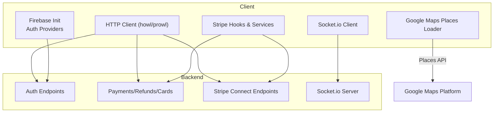
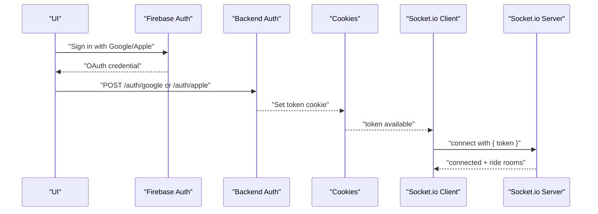
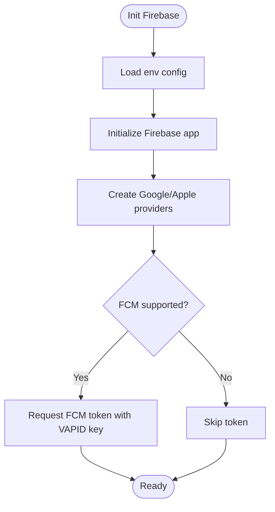
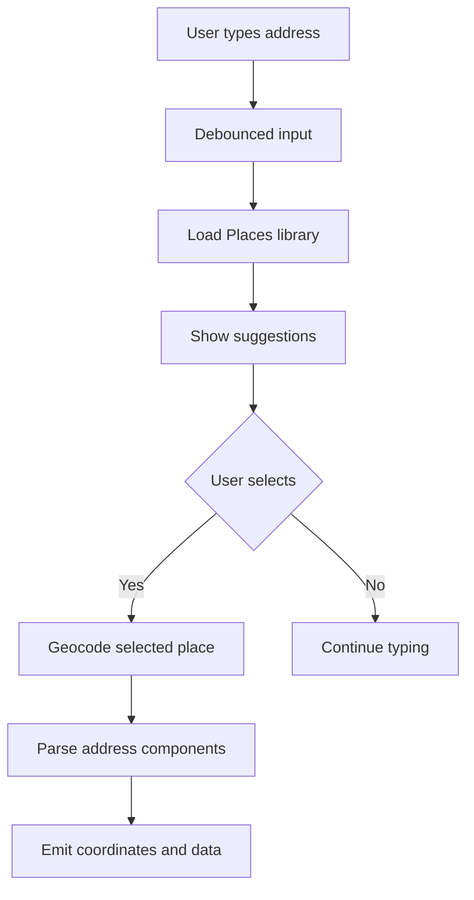
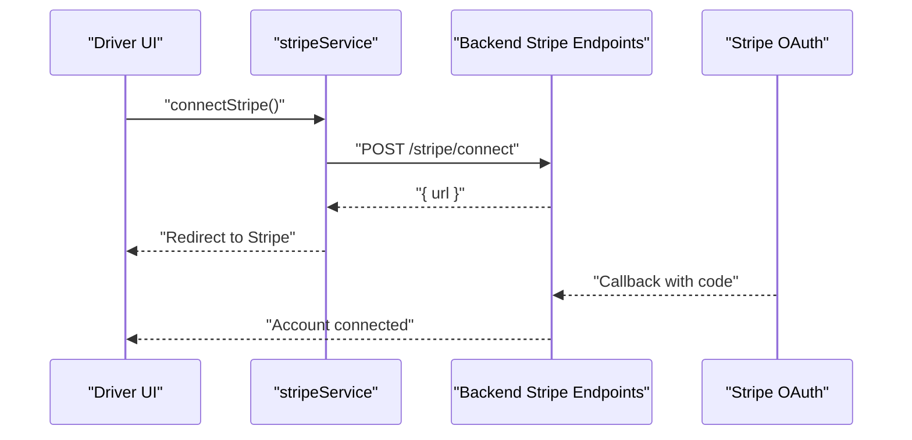
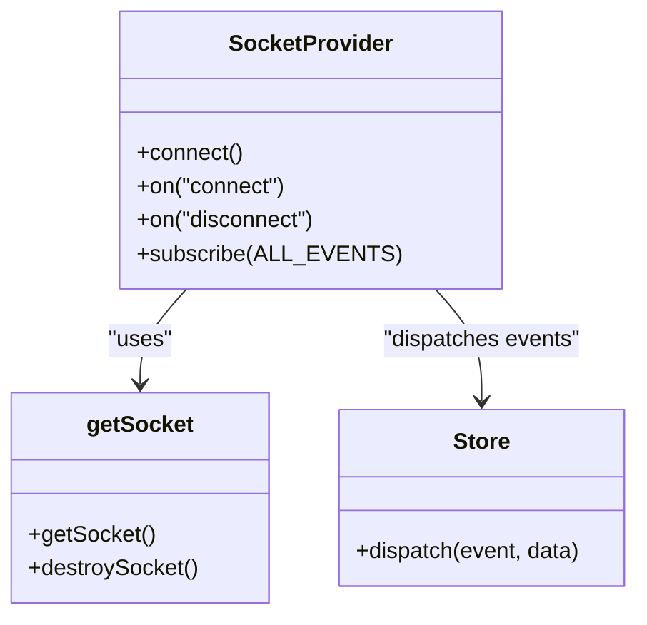
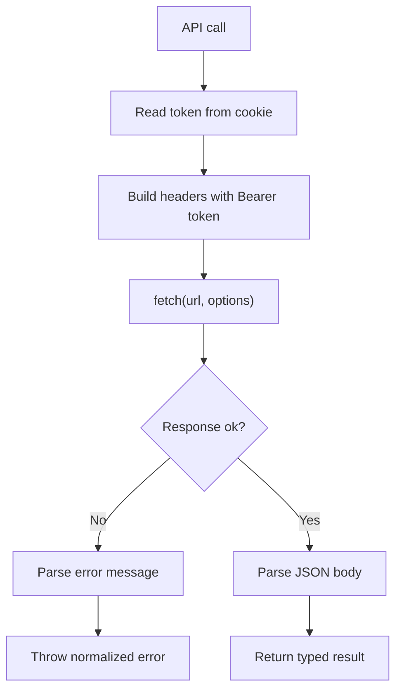
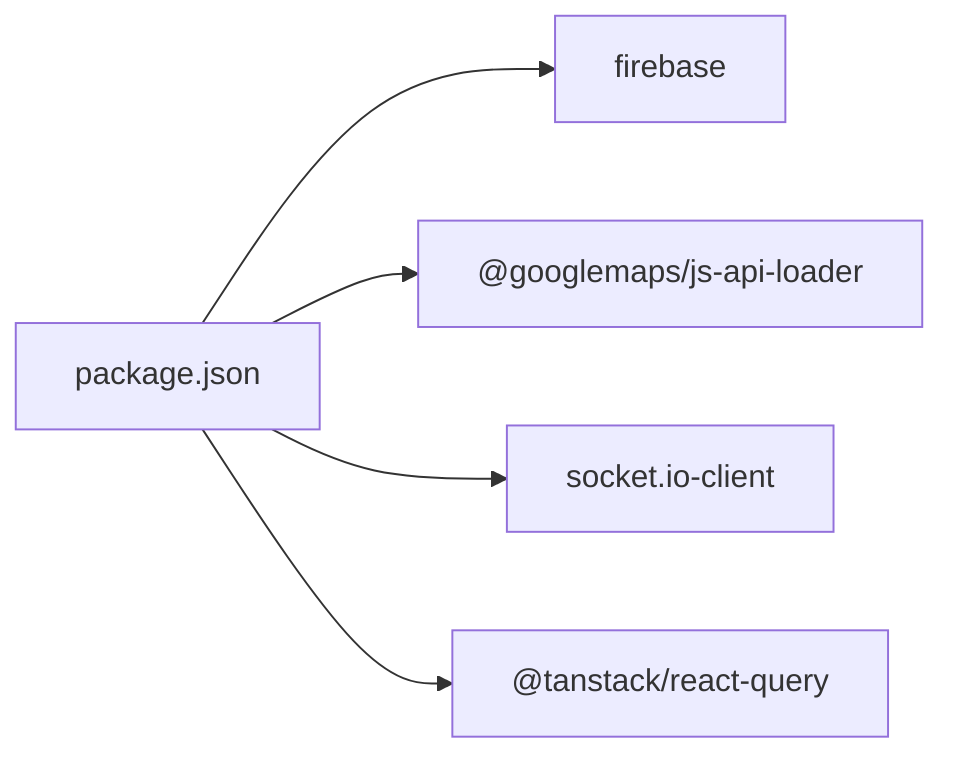

# External Integrations

<cite>
**Referenced Files in This Document**
- [firebase.ts](file://src/lib/firebase.ts)
- [firebase-messaging-sw.js](file://public/firebase-messaging-sw.js)
- [address-autocomplete.tsx](file://src/components/ui/address-autocomplete.tsx)
- [payment.service.ts](file://src/services/payment.service.ts)
- [driver.service.ts](file://src/services/driver.service.ts)
- [use-stripe.ts](file://src/hooks/driver/use-stripe.ts)
- [socket.ts](file://src/lib/socket.ts)
- [socket-provider.tsx](file://src/provider/socket-provider.tsx)
- [api.ts](file://src/lib/api.ts)
- [auth.service.ts](file://src/services/auth.service.ts)
- [proxy.ts](file://src/proxy.ts)
- [next.config.ts](file://next.config.ts)
- [package.json](file://package.json)
</cite>

## Table of Contents
1. [Introduction](#introduction)
2. [Project Structure](#project-structure)
3. [Core Components](#core-components)
4. [Architecture Overview](#architecture-overview)
5. [Detailed Component Analysis](#detailed-component-analysis)
6. [Dependency Analysis](#dependency-analysis)
7. [Performance Considerations](#performance-considerations)
8. [Troubleshooting Guide](#troubleshooting-guide)
9. [Conclusion](#conclusion)

## Introduction
This document explains the external service integrations used by the application: Firebase Authentication and Messaging, Google Maps API (Places), Stripe Payments, and Socket.io for real-time communication. It covers configuration requirements, authentication flows, error handling, webhook considerations, security considerations, rate limiting strategies, and setup guidance for development and production environments.

## Project Structure
The integrations are implemented across client libraries, services, hooks, providers, and Next.js configuration:
- Firebase: initialization, auth providers, and FCM token retrieval on the client; background messaging via a service worker.
- Google Maps: Places Autocomplete library loader and address parsing utilities.
- Stripe: driver account connection and payment endpoints through backend APIs.
- Socket.io: persistent real-time connections with cookie-based authentication and event routing.
- Shared HTTP client: centralized fetch wrapper that attaches tokens and normalizes errors.

**Diagram sources**
- [firebase.ts:1-46](file://src/lib/firebase.ts#L1-L46)
- [address-autocomplete.tsx:1-170](file://src/components/ui/address-autocomplete.tsx#L1-L170)
- [payment.service.ts:1-72](file://src/services/payment.service.ts#L1-L72)
- [driver.service.ts:50-65](file://src/services/driver.service.ts#L50-L65)
- [socket.ts:1-50](file://src/lib/socket.ts#L1-L50)
- [api.ts:1-106](file://src/lib/api.ts#L1-L106)

**Section sources**
- [firebase.ts:1-46](file://src/lib/firebase.ts#L1-L46)
- [address-autocomplete.tsx:1-170](file://src/components/ui/address-autocomplete.tsx#L1-L170)
- [payment.service.ts:1-72](file://src/services/payment.service.ts#L1-L72)
- [driver.service.ts:50-65](file://src/services/driver.service.ts#L50-L65)
- [socket.ts:1-50](file://src/lib/socket.ts#L1-L50)
- [api.ts:1-106](file://src/lib/api.ts#L1-L106)

## Core Components
- Firebase Authentication and Messaging
  - Initializes Firebase app and exposes Google and Apple OAuth providers.
  - Retrieves FCM token using a VAPID key when supported.
  - Background notifications handled by a dedicated service worker.
- Google Maps Places Autocomplete
  - Dynamically loads the Places library and configures the API key.
  - Parses geocoder results into structured address data.
- Stripe Integration
  - Driver account connection flow via backend endpoints returning an OAuth URL.
  - Payment checkout and confirmation via backend endpoints returning client secrets and payment objects.
- Socket.io Real-time Communication
  - Single global socket instance with cookie-based token authentication.
  - Centralized provider subscribes to all relevant events and dispatches them to stores.

**Section sources**
- [firebase.ts:1-46](file://src/lib/firebase.ts#L1-L46)
- [firebase-messaging-sw.js:1-22](file://public/firebase-messaging-sw.js#L1-L22)
- [address-autocomplete.tsx:1-170](file://src/components/ui/address-autocomplete.tsx#L1-L170)
- [payment.service.ts:1-72](file://src/services/payment.service.ts#L1-L72)
- [driver.service.ts:50-65](file://src/services/driver.service.ts#L50-L65)
- [use-stripe.ts:1-49](file://src/hooks/driver/use-stripe.ts#L1-L49)
- [socket.ts:1-50](file://src/lib/socket.ts#L1-L50)
- [socket-provider.tsx:1-122](file://src/provider/socket-provider.tsx#L1-L122)

## Architecture Overview
End-to-end flows for each integration:

**Diagram sources**
- [auth.service.ts:25-29](file://src/services/auth.service.ts#L25-L29)
- [api.ts:5-13](file://src/lib/api.ts#L5-L13)
- [socket.ts:11-32](file://src/lib/socket.ts#L11-L32)
- [socket-provider.tsx:66-108](file://src/provider/socket-provider.tsx#L66-L108)

## Detailed Component Analysis

### Firebase Authentication and Messaging
- Configuration
  - App initialized with environment variables for project identity and keys.
  - Google and Apple OAuth providers configured; Apple scopes include email and name.
  - FCM token retrieval uses dynamic import and a VAPID key from environment.
- Background Notifications
  - Service worker initializes Firebase compat and shows browser notifications on background messages.
- Security Considerations
  - Keep Firebase web API keys scoped appropriately.
  - Use HTTPS-only cookies and secure SameSite policies server-side.
  - Validate roles and permissions server-side after social login.
- Error Handling
  - FCM token retrieval returns null if unsupported or fails.
  - Social login errors should be surfaced to users via UI state.

**Diagram sources**
- [firebase.ts:1-46](file://src/lib/firebase.ts#L1-L46)
- [firebase-messaging-sw.js:1-22](file://public/firebase-messaging-sw.js#L1-L22)

**Section sources**
- [firebase.ts:1-46](file://src/lib/firebase.ts#L1-L46)
- [firebase-messaging-sw.js:1-22](file://public/firebase-messaging-sw.js#L1-L22)

### Google Maps API (Places Autocomplete)
- Configuration
  - Sets the Google Maps API key via options before loading the Places library.
  - Uses a lazy loader to avoid unnecessary overhead.
- Data Flow
  - User types address → suggestions appear → selection triggers geocoding → coordinates and parsed address components returned.
- Error Handling
  - Geocoding failures are caught and ignored gracefully since coordinates/components are optional.
- Rate Limiting and Quotas
  - Respect Google Maps Platform quotas; implement client-side debounce and caching where appropriate.
- Security Considerations
  - Restrict API key usage to required domains and APIs.
  - Do not expose backend-only keys.

**Diagram sources**
- [address-autocomplete.tsx:1-170](file://src/components/ui/address-autocomplete.tsx#L1-L170)

**Section sources**
- [address-autocomplete.tsx:1-170](file://src/components/ui/address-autocomplete.tsx#L1-L170)

### Stripe Payments and Driver Account Connection
- Configuration
  - Driver connects Stripe via backend endpoint that returns a redirect URL.
  - Existing accounts can be linked with credentials.
  - Payment checkout returns a client secret; confirmation finalizes the payment.
- Flows
  - Connect Stripe: UI calls connect endpoint → redirects user to Stripe OAuth → backend completes linking.
  - Checkout: UI requests checkout → receives client secret → confirms payment via backend.
- Error Handling
  - Backend returns structured responses; UI should handle non-ok statuses and display messages.
- Webhooks
  - Stripe webhooks must be verified server-side using signatures and processed to update payment states.
- Security Considerations
  - Never handle raw card details in the frontend beyond Stripe’s hosted elements (if used).
  - Verify webhook payloads and enforce idempotency.
- Rate Limiting Strategies
  - Implement exponential backoff on retries.
  - Throttle repeated connect attempts and checkout calls.

**Diagram sources**
- [driver.service.ts:50-65](file://src/services/driver.service.ts#L50-L65)
- [use-stripe.ts:26-40](file://src/hooks/driver/use-stripe.ts#L26-L40)

**Section sources**
- [driver.service.ts:50-65](file://src/services/driver.service.ts#L50-L65)
- [use-stripe.ts:1-49](file://src/hooks/driver/use-stripe.ts#L1-L49)
- [payment.service.ts:1-72](file://src/services/payment.service.ts#L1-L72)

### Socket.io Real-time Communication
- Configuration
  - Global socket instance created once with autoConnect disabled.
  - Authenticates via a token read from cookies and passed in the auth handshake.
  - Transports fallback to polling if WebSocket is unavailable.
- Provider Behavior
  - Connects on mount, reattaches to the active ride room after reconnects.
  - Subscribes to a comprehensive list of events and dispatches them to a store.
- Error Handling
  - Connection state exposed; disconnects reset connected flag.
  - All incoming/outgoing events logged for debugging.
- Security Considerations
  - Ensure token cookie is HttpOnly and Secure in production.
  - Validate session/server-side per event handler.
- Rate Limiting Strategies
  - Apply server-side throttling per user/session for high-frequency events.
  - Debounce client emissions where applicable.

**Diagram sources**
- [socket-provider.tsx:1-122](file://src/provider/socket-provider.tsx#L1-L122)
- [socket.ts:1-50](file://src/lib/socket.ts#L1-L50)

**Section sources**
- [socket.ts:1-50](file://src/lib/socket.ts#L1-L50)
- [socket-provider.tsx:1-122](file://src/provider/socket-provider.tsx#L1-L122)

### Shared HTTP Client and Authentication
- Token Propagation
  - Reads token from cookies and injects Authorization header automatically.
  - Credentials included for cross-site cookie support.
- Error Normalization
  - Non-ok responses parse JSON error message or fall back to status text.
- Base URLs
  - Central base URL and API version prefix configurable via environment.

**Diagram sources**
- [api.ts:1-106](file://src/lib/api.ts#L1-L106)

**Section sources**
- [api.ts:1-106](file://src/lib/api.ts#L1-L106)
- [auth.service.ts:1-43](file://src/services/auth.service.ts#L1-L43)

## Dependency Analysis
External dependencies relevant to integrations:
- Firebase SDK for auth and messaging.
- Google Maps JS API loader for Places.
- Socket.io client for real-time events.
- React Query for data fetching and cache invalidation around Stripe flows.

**Diagram sources**
- [package.json:12-47](file://package.json#L12-L47)

**Section sources**
- [package.json:12-47](file://package.json#L12-L47)

## Performance Considerations
- Lazy-load heavy libraries (e.g., Google Maps Places) only when needed.
- Reuse single Socket.io instance and minimize reconnections.
- Debounce user inputs for Places autocomplete to reduce API calls.
- Cache Stripe account status and connection checks using React Query keys.
- Prefer server-side processing for sensitive operations (webhook verification, payment confirmations).

[No sources needed since this section provides general guidance]

## Troubleshooting Guide
- Firebase
  - If FCM token is null, ensure browser supports push and VAPID key is set.
  - Verify service worker registration and CORS settings for notifications.
- Google Maps
  - If Places does not load, confirm API key is valid and enabled for Places API.
  - Check console for quota exceeded errors and adjust billing/quota.
- Stripe
  - If connect fails, verify backend endpoint returns a valid URL and Stripe OAuth is configured.
  - For payments, ensure client secret is fresh and not reused.
- Socket.io
  - If disconnected, check cookie presence and server CORS/credentials configuration.
  - Inspect event logs for missing handlers or mismatched event names.
- HTTP Client
  - If requests fail, inspect Authorization header and cookie propagation.
  - Review normalized error messages from the backend.

**Section sources**
- [firebase.ts:23-45](file://src/lib/firebase.ts#L23-L45)
- [address-autocomplete.tsx:140-145](file://src/components/ui/address-autocomplete.tsx#L140-L145)
- [driver.service.ts:50-65](file://src/services/driver.service.ts#L50-L65)
- [socket.ts:23-42](file://src/lib/socket.ts#L23-L42)
- [api.ts:42-73](file://src/lib/api.ts#L42-L73)

## Conclusion
The application integrates Firebase for authentication and messaging, Google Maps for location features, Stripe for payments and driver payouts, and Socket.io for real-time updates. Each integration follows clear patterns for configuration, authentication, error handling, and security. Proper environment setup, cookie management, and server-side validations are essential for robust operation in both development and production.