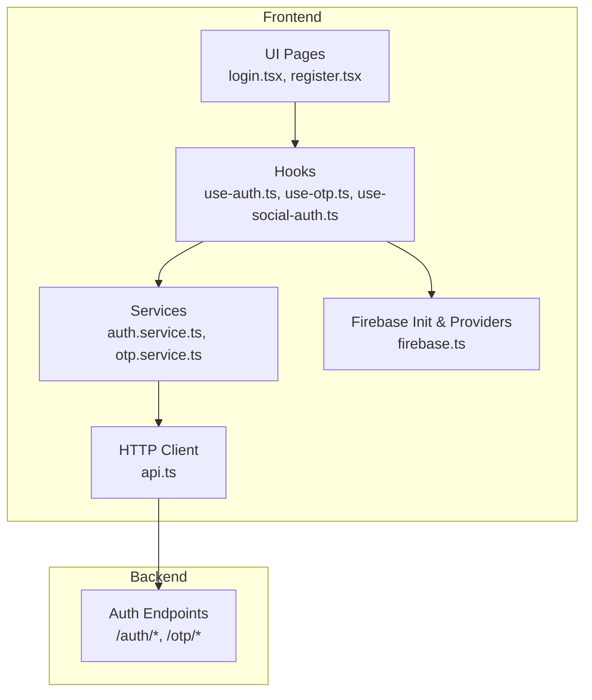
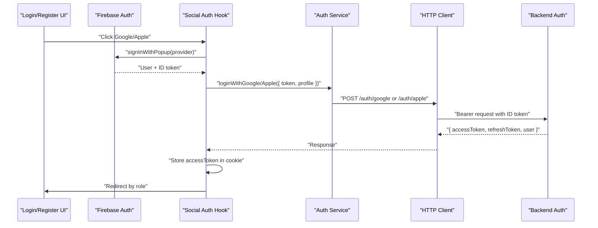
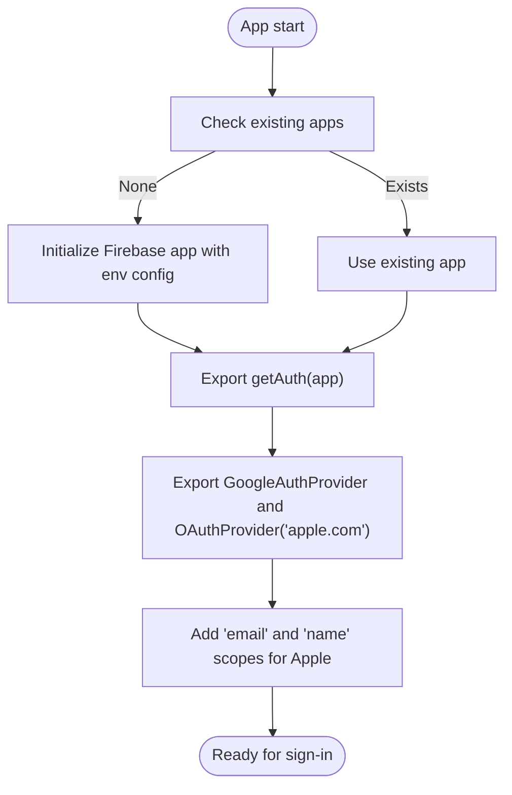
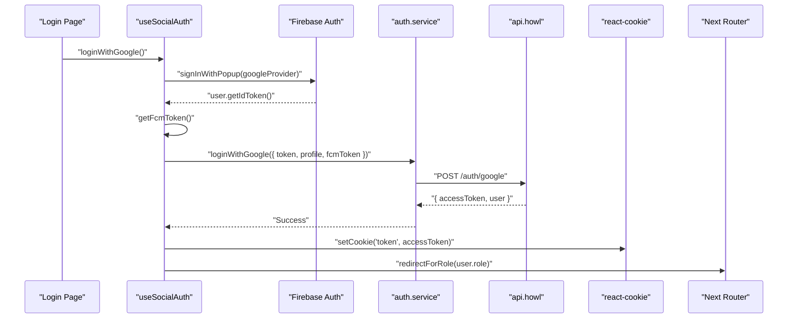
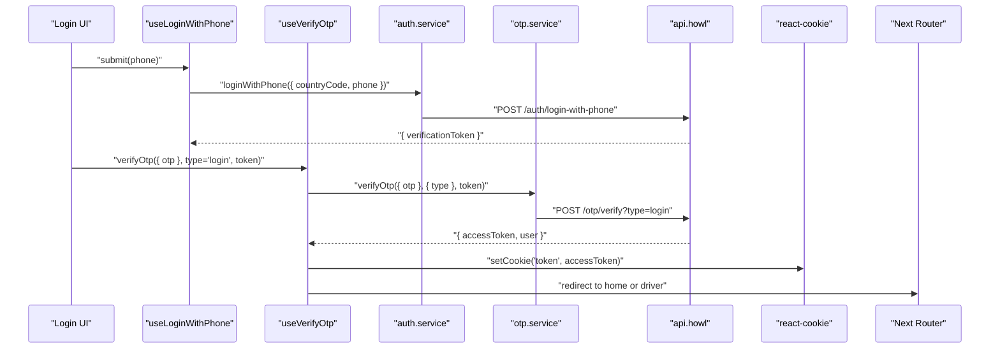
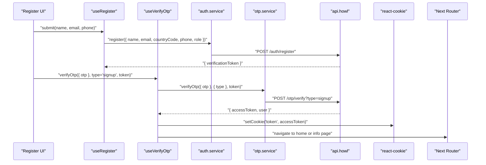
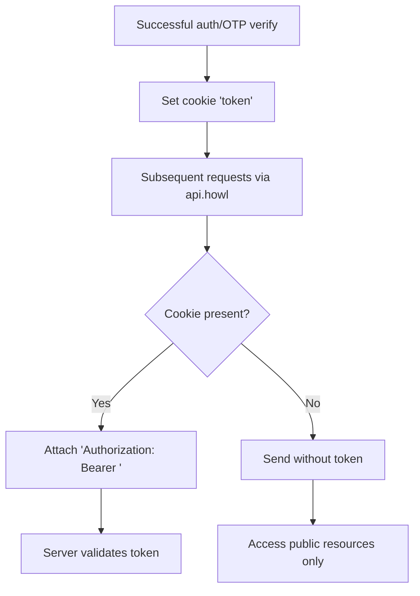
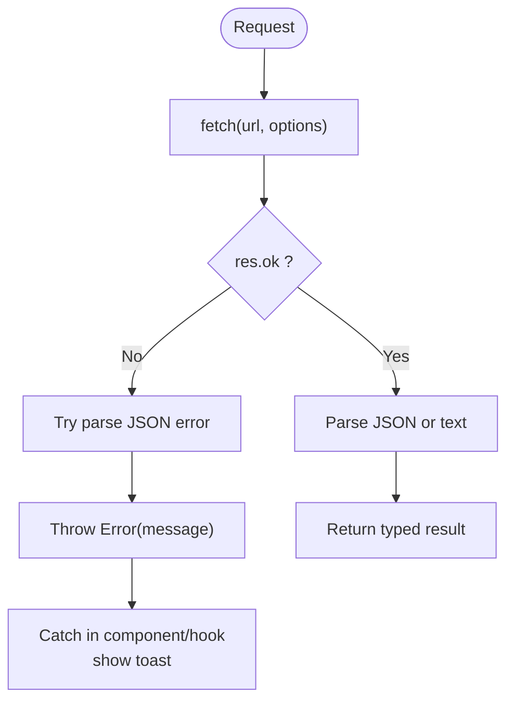
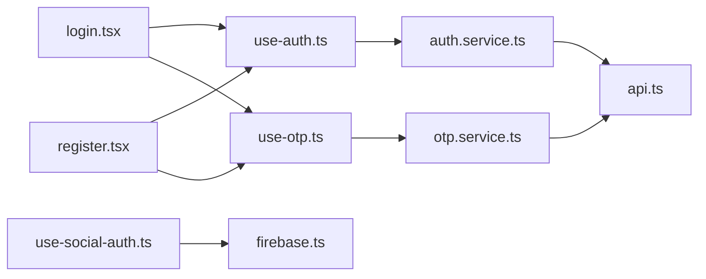
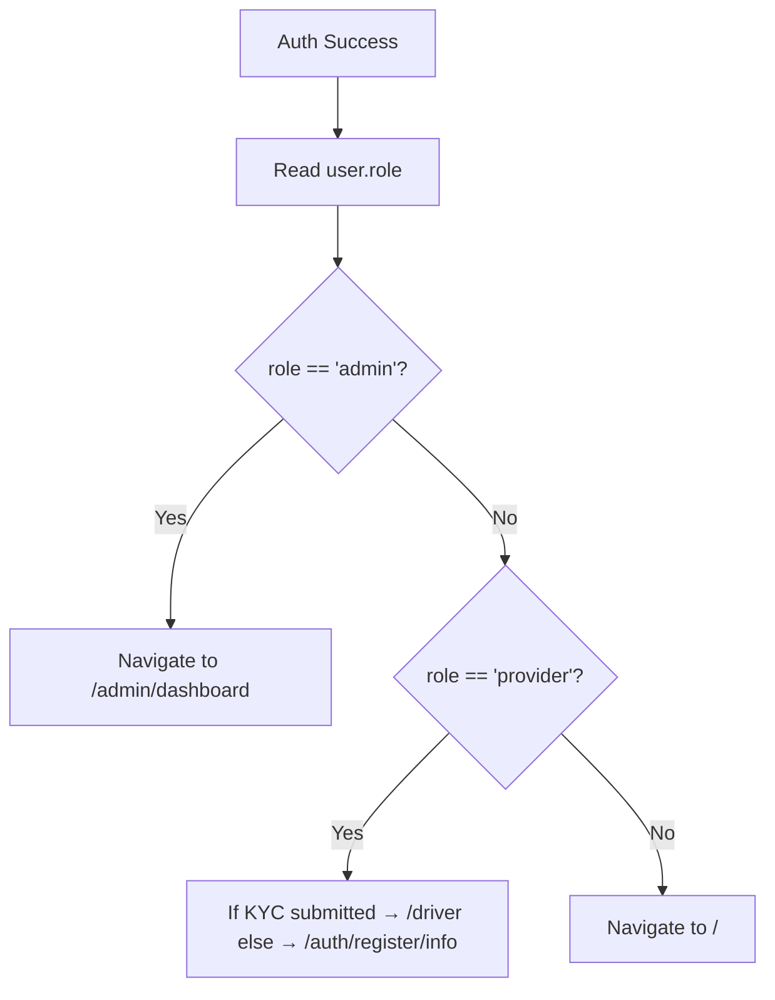

# Firebase Authentication

<cite>
**Referenced Files in This Document**
- [firebase.ts](file://src/lib/firebase.ts)
- [auth.service.ts](file://src/services/auth.service.ts)
- [otp.service.ts](file://src/services/otp.service.ts)
- [use-auth.ts](file://src/hooks/auth/use-auth.ts)
- [use-social-auth.ts](file://src/hooks/auth/use-social-auth.ts)
- [use-otp.ts](file://src/hooks/auth/use-otp.ts)
- [api.ts](file://src/lib/api.ts)
- [login.tsx](file://src/app/auth/login/login.tsx)
- [register.tsx](file://src/app/auth/register/register.tsx)
- [otp.tsx](file://src/app/auth/register/otp.tsx)
- [auth.types.ts](file://src/types/auth.types.ts)
- [otp.types.ts](file://src/types/otp.types.ts)
</cite>

## Table of Contents
1. [Introduction](#introduction)
2. [Project Structure](#project-structure)
3. [Core Components](#core-components)
4. [Architecture Overview](#architecture-overview)
5. [Detailed Component Analysis](#detailed-component-analysis)
6. [Dependency Analysis](#dependency-analysis)
7. [Performance Considerations](#performance-considerations)
8. [Security Considerations](#security-considerations)
9. [Troubleshooting Guide](#troubleshooting-guide)
10. [Conclusion](#conclusion)
11. [Appendices](#appendices)

## Introduction
This document explains how Firebase Authentication is integrated into the application, focusing on initialization, configuration via environment variables, and authentication providers (Google OAuth and Apple Sign-In). It also documents OTP verification flows, token management, user session handling, security considerations, error handling strategies, troubleshooting guidance, and examples for implementing custom authentication flows with role-based access control.

## Project Structure
The authentication implementation spans several layers:
- Initialization and provider setup in a shared library module
- React hooks that wrap API calls and orchestrate flows
- Services that call backend endpoints
- UI components that trigger login, registration, and OTP verification
- Types that define payloads and responses

**Diagram sources**
- [login.tsx:1-325](file://src/app/auth/login/login.tsx#L1-L325)
- [register.tsx:1-219](file://src/app/auth/register/register.tsx#L1-L219)
- [use-auth.ts:1-68](file://src/hooks/auth/use-auth.ts#L1-L68)
- [use-otp.ts:1-32](file://src/hooks/auth/use-otp.ts#L1-L32)
- [use-social-auth.ts:1-102](file://src/hooks/auth/use-social-auth.ts#L1-L102)
- [auth.service.ts:1-43](file://src/services/auth.service.ts#L1-L43)
- [otp.service.ts:1-27](file://src/services/otp.service.ts#L1-L27)
- [api.ts:1-106](file://src/lib/api.ts#L1-L106)
- [firebase.ts:1-46](file://src/lib/firebase.ts#L1-L46)

**Section sources**
- [firebase.ts:1-46](file://src/lib/firebase.ts#L1-L46)
- [auth.service.ts:1-43](file://src/services/auth.service.ts#L1-L43)
- [otp.service.ts:1-27](file://src/services/otp.service.ts#L1-L27)
- [use-auth.ts:1-68](file://src/hooks/auth/use-auth.ts#L1-L68)
- [use-social-auth.ts:1-102](file://src/hooks/auth/use-social-auth.ts#L1-L102)
- [use-otp.ts:1-32](file://src/hooks/auth/use-otp.ts#L1-L32)
- [api.ts:1-106](file://src/lib/api.ts#L1-L106)
- [login.tsx:1-325](file://src/app/auth/login/login.tsx#L1-L325)
- [register.tsx:1-219](file://src/app/auth/register/register.tsx#L1-L219)
- [otp.tsx:1-167](file://src/app/auth/register/otp.tsx#L1-L167)
- [auth.types.ts:1-113](file://src/types/auth.types.ts#L1-L113)
- [otp.types.ts:1-19](file://src/types/otp.types.ts#L1-L19)

## Core Components
- Firebase initialization and providers: Initializes the Firebase app once and exports auth instance, Google provider, and Apple provider configured with required scopes. Also includes a helper to fetch an FCM token when supported.
- Social sign-in hook: Orchestrates Google and Apple popup sign-ins, exchanges Firebase ID tokens for server-side sessions, stores the server access token in a cookie, and redirects based on user roles.
- Auth hooks: Provide mutation wrappers for email/password login, phone login, social logins, password reset/change, and logout.
- OTP hooks and service: Send OTPs (email or phone), verify OTPs, and return either a temporary verification token or a full login response depending on the flow.
- HTTP client: Centralized fetch wrapper that attaches the Authorization header from a cookie and normalizes errors.

Key responsibilities:
- Environment-driven configuration for Firebase
- Provider-specific scopes and popup flows
- Token exchange and session persistence
- OTP lifecycle (send, resend, verify)
- Role-aware navigation after successful authentication

**Section sources**
- [firebase.ts:1-46](file://src/lib/firebase.ts#L1-L46)
- [use-social-auth.ts:1-102](file://src/hooks/auth/use-social-auth.ts#L1-L102)
- [use-auth.ts:1-68](file://src/hooks/auth/use-auth.ts#L1-L68)
- [use-otp.ts:1-32](file://src/hooks/auth/use-otp.ts#L1-L32)
- [auth.service.ts:1-43](file://src/services/auth.service.ts#L1-L43)
- [otp.service.ts:1-27](file://src/services/otp.service.ts#L1-L27)
- [api.ts:1-106](file://src/lib/api.ts#L1-L106)

## Architecture Overview
High-level flow:
- UI triggers authentication (phone OTP, email/password, or social)
- Frontend uses Firebase for social sign-in and obtains an ID token
- Frontend exchanges the ID token with the backend via auth services
- Backend returns an access token; frontend stores it in a cookie
- Subsequent requests include the token automatically via the HTTP client

**Diagram sources**
- [use-social-auth.ts:1-102](file://src/hooks/auth/use-social-auth.ts#L1-L102)
- [auth.service.ts:1-43](file://src/services/auth.service.ts#L1-L43)
- [api.ts:1-106](file://src/lib/api.ts#L1-L106)
- [firebase.ts:1-46](file://src/lib/firebase.ts#L1-L46)

## Detailed Component Analysis

### Firebase Initialization and Providers
- Initializes the Firebase app only once using environment variables.
- Exports:
  - Auth instance
  - Google provider
  - Apple provider with scopes for email and name
- Provides a helper to retrieve an FCM token when supported.

**Diagram sources**
- [firebase.ts:1-46](file://src/lib/firebase.ts#L1-L46)

**Section sources**
- [firebase.ts:1-46](file://src/lib/firebase.ts#L1-L46)

### Social Authentication Flow (Google and Apple)
- Triggers a popup with the selected provider.
- Retrieves the Firebase ID token and optional FCM token.
- Sends the ID token along with profile data to the backend.
- On success, stores the server access token in a cookie and navigates based on user role.

**Diagram sources**
- [use-social-auth.ts:1-102](file://src/hooks/auth/use-social-auth.ts#L1-L102)
- [auth.service.ts:1-43](file://src/services/auth.service.ts#L1-L43)
- [api.ts:1-106](file://src/lib/api.ts#L1-L106)
- [firebase.ts:1-46](file://src/lib/firebase.ts#L1-L46)

**Section sources**
- [use-social-auth.ts:1-102](file://src/hooks/auth/use-social-auth.ts#L1-L102)
- [auth.service.ts:1-43](file://src/services/auth.service.ts#L1-L43)
- [api.ts:1-106](file://src/lib/api.ts#L1-L106)
- [firebase.ts:1-46](file://src/lib/firebase.ts#L1-L46)

### Phone OTP Login Flow
- User enters phone number and submits.
- Frontend sends a phone login request to obtain a verification token.
- An OTP dialog appears; user enters the code.
- Verification endpoint validates the OTP and returns an access token.
- Access token is stored in a cookie and the user is redirected.

**Diagram sources**
- [login.tsx:1-325](file://src/app/auth/login/login.tsx#L1-L325)
- [use-auth.ts:1-68](file://src/hooks/auth/use-auth.ts#L1-L68)
- [use-otp.ts:1-32](file://src/hooks/auth/use-otp.ts#L1-L32)
- [auth.service.ts:1-43](file://src/services/auth.service.ts#L1-L43)
- [otp.service.ts:1-27](file://src/services/otp.service.ts#L1-L27)
- [api.ts:1-106](file://src/lib/api.ts#L1-L106)

**Section sources**
- [login.tsx:1-325](file://src/app/auth/login/login.tsx#L1-L325)
- [use-auth.ts:1-68](file://src/hooks/auth/use-auth.ts#L1-L68)
- [use-otp.ts:1-32](file://src/hooks/auth/use-otp.ts#L1-L32)
- [auth.service.ts:1-43](file://src/services/auth.service.ts#L1-L43)
- [otp.service.ts:1-27](file://src/services/otp.service.ts#L1-L27)
- [api.ts:1-106](file://src/lib/api.ts#L1-L106)

### Registration with OTP
- User provides name, email, and phone.
- Registration endpoint returns a verification token.
- OTP dialog collects the code and verifies it.
- On success, sets the access token cookie and proceeds to next step (e.g., profile completion).

**Diagram sources**
- [register.tsx:1-219](file://src/app/auth/register/register.tsx#L1-L219)
- [otp.tsx:1-167](file://src/app/auth/register/otp.tsx#L1-L167)
- [use-auth.ts:1-68](file://src/hooks/auth/use-auth.ts#L1-L68)
- [use-otp.ts:1-32](file://src/hooks/auth/use-otp.ts#L1-L32)
- [auth.service.ts:1-43](file://src/services/auth.service.ts#L1-L43)
- [otp.service.ts:1-27](file://src/services/otp.service.ts#L1-L27)
- [api.ts:1-106](file://src/lib/api.ts#L1-L106)

**Section sources**
- [register.tsx:1-219](file://src/app/auth/register/register.tsx#L1-L219)
- [otp.tsx:1-167](file://src/app/auth/register/otp.tsx#L1-L167)
- [use-auth.ts:1-68](file://src/hooks/auth/use-auth.ts#L1-L68)
- [use-otp.ts:1-32](file://src/hooks/auth/use-otp.ts#L1-L32)
- [auth.service.ts:1-43](file://src/services/auth.service.ts#L1-L43)
- [otp.service.ts:1-27](file://src/services/otp.service.ts#L1-L27)
- [api.ts:1-106](file://src/lib/api.ts#L1-L106)

### Token Management and Session Handling
- Access tokens are returned by the backend upon successful authentication or OTP verification.
- The frontend stores the access token in a cookie with path “/” and a one-week expiry.
- The HTTP client reads the cookie and attaches it as an Authorization header for all subsequent requests.

**Diagram sources**
- [use-social-auth.ts:1-102](file://src/hooks/auth/use-social-auth.ts#L1-L102)
- [login.tsx:1-325](file://src/app/auth/login/login.tsx#L1-L325)
- [otp.tsx:1-167](file://src/app/auth/register/otp.tsx#L1-L167)
- [api.ts:1-106](file://src/lib/api.ts#L1-L106)

**Section sources**
- [use-social-auth.ts:1-102](file://src/hooks/auth/use-social-auth.ts#L1-L102)
- [login.tsx:1-325](file://src/app/auth/login/login.tsx#L1-L325)
- [otp.tsx:1-167](file://src/app/auth/register/otp.tsx#L1-L167)
- [api.ts:1-106](file://src/lib/api.ts#L1-L106)

### Error Handling Strategies
- Network and server errors are normalized by the HTTP client, which throws an Error with a message extracted from the response body or status text.
- UI components display errors via toast notifications and disable buttons during pending operations.
- Social sign-in catches exceptions and shows user-friendly messages.

**Diagram sources**
- [api.ts:1-106](file://src/lib/api.ts#L1-L106)
- [use-social-auth.ts:1-102](file://src/hooks/auth/use-social-auth.ts#L1-L102)
- [login.tsx:1-325](file://src/app/auth/login/login.tsx#L1-L325)
- [otp.tsx:1-167](file://src/app/auth/register/otp.tsx#L1-L167)

**Section sources**
- [api.ts:1-106](file://src/lib/api.ts#L1-L106)
- [use-social-auth.ts:1-102](file://src/hooks/auth/use-social-auth.ts#L1-L102)
- [login.tsx:1-325](file://src/app/auth/login/login.tsx#L1-L325)
- [otp.tsx:1-167](file://src/app/auth/register/otp.tsx#L1-L167)

## Dependency Analysis
The following diagram maps key dependencies between modules involved in authentication.

**Diagram sources**
- [login.tsx:1-325](file://src/app/auth/login/login.tsx#L1-L325)
- [register.tsx:1-219](file://src/app/auth/register/register.tsx#L1-L219)
- [use-auth.ts:1-68](file://src/hooks/auth/use-auth.ts#L1-L68)
- [use-otp.ts:1-32](file://src/hooks/auth/use-otp.ts#L1-L32)
- [use-social-auth.ts:1-102](file://src/hooks/auth/use-social-auth.ts#L1-L102)
- [auth.service.ts:1-43](file://src/services/auth.service.ts#L1-L43)
- [otp.service.ts:1-27](file://src/services/otp.service.ts#L1-L27)
- [api.ts:1-106](file://src/lib/api.ts#L1-L106)
- [firebase.ts:1-46](file://src/lib/firebase.ts#L1-L46)

**Section sources**
- [login.tsx:1-325](file://src/app/auth/login/login.tsx#L1-L325)
- [register.tsx:1-219](file://src/app/auth/register/register.tsx#L1-L219)
- [use-auth.ts:1-68](file://src/hooks/auth/use-auth.ts#L1-L68)
- [use-otp.ts:1-32](file://src/hooks/auth/use-otp.ts#L1-L32)
- [use-social-auth.ts:1-102](file://src/hooks/auth/use-social-auth.ts#L1-L102)
- [auth.service.ts:1-43](file://src/services/auth.service.ts#L1-L43)
- [otp.service.ts:1-27](file://src/services/otp.service.ts#L1-L27)
- [api.ts:1-106](file://src/lib/api.ts#L1-L106)
- [firebase.ts:1-46](file://src/lib/firebase.ts#L1-L46)

## Performance Considerations
- Lazy load messaging SDK only when needed to avoid unnecessary bundle size.
- Cache and reuse Firebase instances to prevent reinitialization overhead.
- Debounce OTP resend actions if necessary to reduce server load.
- Minimize re-renders by keeping state local to small components and leveraging React Query’s caching where appropriate.

[No sources needed since this section provides general guidance]

## Security Considerations
- Do not expose sensitive secrets in the browser; only use NEXT_PUBLIC_* variables intended for client usage.
- Validate and sanitize inputs on both client and server sides.
- Store short-lived access tokens securely and consider refresh token rotation on the server side.
- Enforce HTTPS and secure cookie attributes (e.g., SameSite, Secure) at the server level.
- Limit Apple provider scopes to only what is required.
- Implement rate limiting and account lockout policies on the backend for OTP and login attempts.

[No sources needed since this section provides general guidance]

## Troubleshooting Guide
Common issues and resolutions:
- Missing or incorrect Firebase environment variables: Ensure all NEXT_PUBLIC_FIREBASE_* variables are set and match your Firebase project.
- Apple Sign-In scope missing: Confirm that email and name scopes are added for the Apple provider.
- Popup blocked by browser: Allow popups for the domain and ensure the user initiated the action.
- Invalid phone format: Validate phone numbers before sending OTP requests.
- Incorrect OTP length: Enforce a 6-digit input and show clear validation feedback.
- Token not attached to requests: Verify that the cookie is set correctly and that the HTTP client reads it.
- CORS or network errors: Check base URL configuration and server availability.

**Section sources**
- [firebase.ts:1-46](file://src/lib/firebase.ts#L1-L46)
- [use-social-auth.ts:1-102](file://src/hooks/auth/use-social-auth.ts#L1-L102)
- [login.tsx:1-325](file://src/app/auth/login/login.tsx#L1-L325)
- [register.tsx:1-219](file://src/app/auth/register/register.tsx#L1-L219)
- [otp.tsx:1-167](file://src/app/auth/register/otp.tsx#L1-L167)
- [api.ts:1-106](file://src/lib/api.ts#L1-L106)

## Conclusion
The application integrates Firebase Authentication for social sign-in while relying on a backend for session management and OTP verification. The architecture cleanly separates concerns across UI, hooks, services, and a centralized HTTP client. Tokens are managed via cookies, and role-based navigation ensures users reach the correct areas after authentication. Following the security and troubleshooting recommendations will help maintain a robust and user-friendly authentication experience.

[No sources needed since this section summarizes without analyzing specific files]

## Appendices

### Configuration Setup (Environment Variables)
Required client-side variables for Firebase initialization:
- NEXT_PUBLIC_FIREBASE_API_KEY
- NEXT_PUBLIC_FIREBASE_AUTH_DOMAIN
- NEXT_PUBLIC_FIREBASE_PROJECT_ID
- NEXT_PUBLIC_FIREBASE_STORAGE_BUCKET
- NEXT_PUBLIC_FIREBASE_MESSAGING_SENDER_ID
- NEXT_PUBLIC_FIREBASE_APP_ID
- NEXT_PUBLIC_FIREBASE_MEASUREMENT_ID
- NEXT_PUBLIC_FIREBASE_VAPID_KEY (for FCM token retrieval)

Additional runtime variable:
- NEXT_PUBLIC_SERVER_URL (base URL for backend API)

**Section sources**
- [firebase.ts:1-46](file://src/lib/firebase.ts#L1-L46)
- [api.ts:1-106](file://src/lib/api.ts#L1-L106)

### Data Models and Payloads
Key types used across authentication flows:
- UserRole, OtpType
- RegisterPayload, LoginWithPhonePayload, LoginWithEmailPayload
- SocialLoginPayload
- ForgotPasswordPayload, ResetPasswordPayload, ChangePasswordPayload
- AuthTokens, AuthUser, LoginUser, LoginResponse, OtpTokenResponse
- VerifyOtpPayload, VerifyOtpQuery, SendOtpEmailPayload, SendOtpPhonePayload

**Section sources**
- [auth.types.ts:1-113](file://src/types/auth.types.ts#L1-L113)
- [otp.types.ts:1-19](file://src/types/otp.types.ts#L1-L19)

### Example: Custom Authentication Flow with Role-Based Access Control
Conceptual steps:
- After successful authentication (social or OTP), read the user role from the response.
- Route users to different dashboards based on role:
  - admin → admin dashboard
  - provider → driver area or KYC info page
  - user → main application
- Persist the access token in a cookie for subsequent authenticated requests.

[No sources needed since this diagram shows conceptual workflow, not actual code structure]