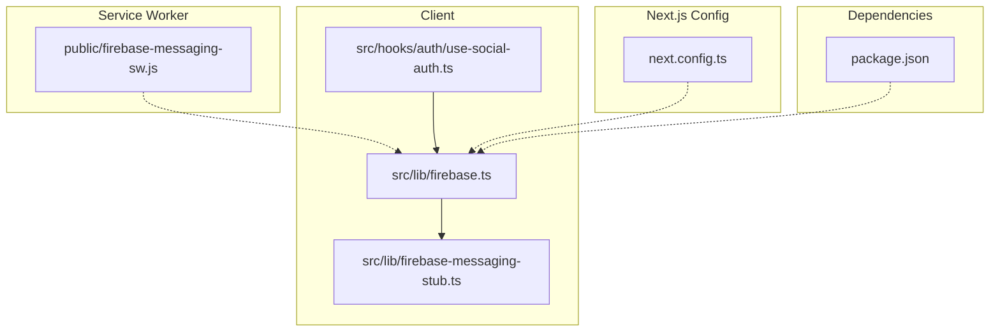
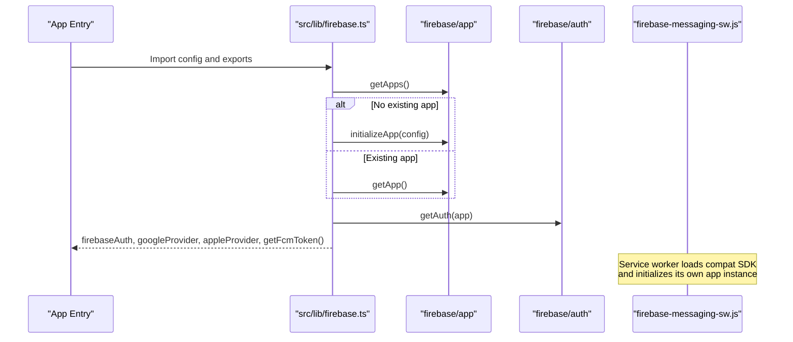
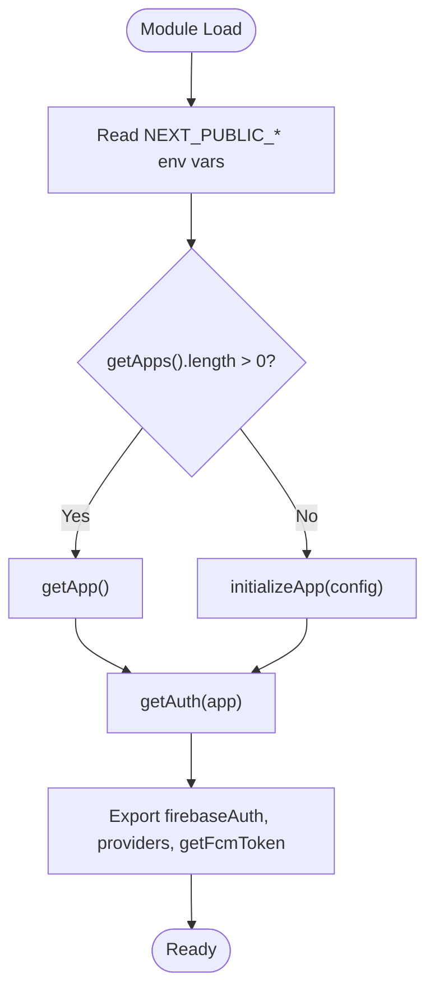
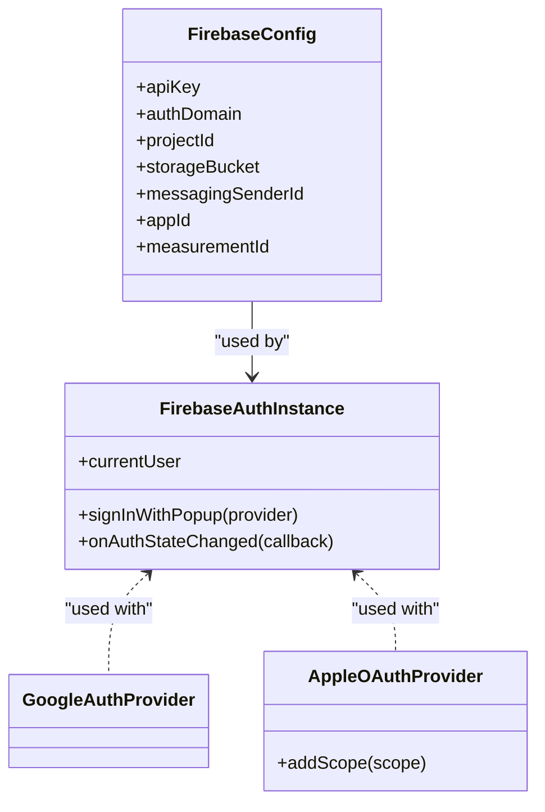
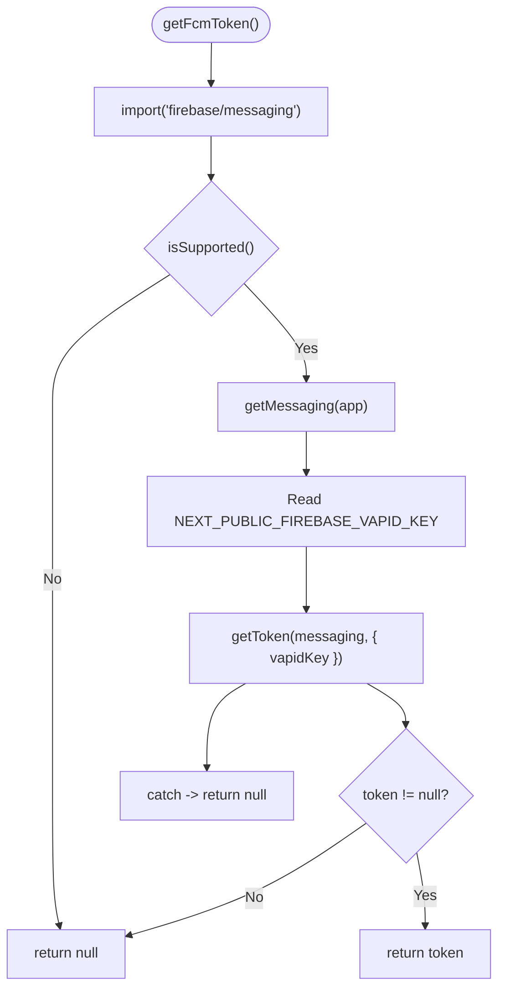
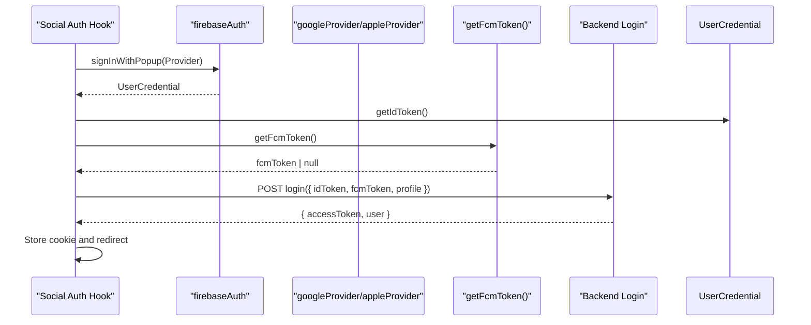
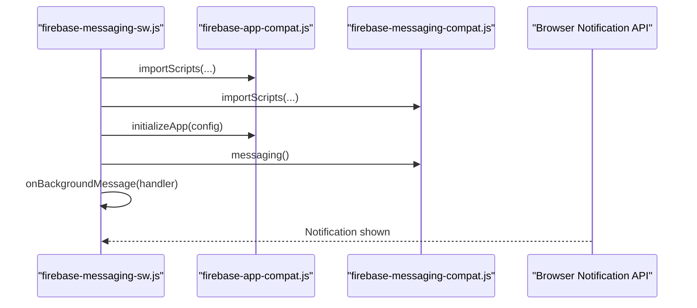
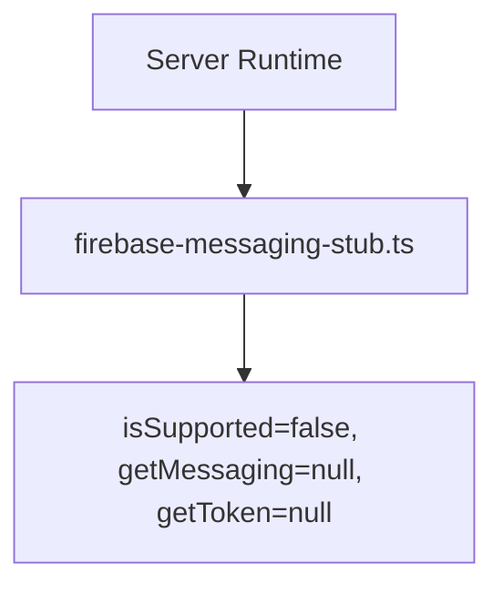
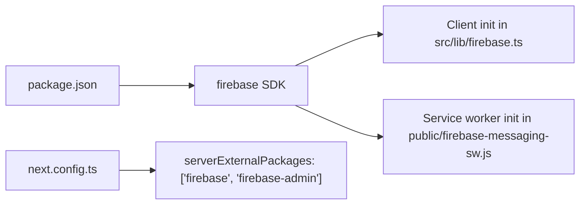

# Firebase Initialization & Configuration

<cite>
**Referenced Files in This Document**
- [firebase.ts](file://src/lib/firebase.ts)
- [firebase-messaging-sw.js](file://public/firebase-messaging-sw.js)
- [firebase-messaging-stub.ts](file://src/lib/firebase-messaging-stub.ts)
- [use-social-auth.ts](file://src/hooks/auth/use-social-auth.ts)
- [next.config.ts](file://next.config.ts)
- [package.json](file://package.json)
</cite>

## Table of Contents
1. [Introduction](#introduction)
2. [Project Structure](#project-structure)
3. [Core Components](#core-components)
4. [Architecture Overview](#architecture-overview)
5. [Detailed Component Analysis](#detailed-component-analysis)
6. [Dependency Analysis](#dependency-analysis)
7. [Performance Considerations](#performance-considerations)
8. [Troubleshooting Guide](#troubleshooting-guide)
9. [Conclusion](#conclusion)
10. [Appendices](#appendices)

## Introduction
This document explains how Firebase is initialized and configured in the project, focusing on environment variables, app initialization with a singleton pattern, authentication instance creation, and background messaging setup. It also covers security considerations for environment variables, error handling during initialization, and troubleshooting common configuration issues. Examples are provided for development and production environments.

## Project Structure
Firebase-related code is centralized under the library layer and used by hooks and services:
- Client-side initialization and auth providers live in the library module.
- Background messaging uses a service worker file.
- Social sign-in flows consume the initialized auth instance and FCM token helper.
- Next.js configuration exposes specific packages to the server runtime.

**Diagram sources**
- [firebase.ts:1-46](file://src/lib/firebase.ts#L1-L46)
- [firebase-messaging-sw.js:1-22](file://public/firebase-messaging-sw.js#L1-L22)
- [firebase-messaging-stub.ts:1-5](file://src/lib/firebase-messaging-stub.ts#L1-L5)
- [use-social-auth.ts:1-101](file://src/hooks/auth/use-social-auth.ts#L1-L101)
- [next.config.ts:1-36](file://next.config.ts#L1-L36)
- [package.json:1-68](file://package.json#L1-L68)

**Section sources**
- [firebase.ts:1-46](file://src/lib/firebase.ts#L1-L46)
- [firebase-messaging-sw.js:1-22](file://public/firebase-messaging-sw.js#L1-L22)
- [firebase-messaging-stub.ts:1-5](file://src/lib/firebase-messaging-stub.ts#L1-L5)
- [use-social-auth.ts:1-101](file://src/hooks/auth/use-social-auth.ts#L1-L101)
- [next.config.ts:1-36](file://next.config.ts#L1-L36)
- [package.json:1-68](file://package.json#L1-L68)

## Core Components
- Environment-driven configuration object containing all required Firebase client settings.
- Singleton app initialization using getApps() and initializeApp().
- Auth instance created via getAuth(app).
- OAuth providers (Google and Apple) exported for use in social sign-in flows.
- FCM token retrieval helper that dynamically imports messaging and handles unsupported environments.
- Service worker initializes a separate compat app instance for background notifications.

Key responsibilities:
- Centralize configuration and prevent multiple app instances.
- Provide ready-to-use auth instance and providers.
- Safely obtain FCM tokens only when supported.

**Section sources**
- [firebase.ts:1-46](file://src/lib/firebase.ts#L1-L46)
- [firebase-messaging-sw.js:1-22](file://public/firebase-messaging-sw.js#L1-L22)

## Architecture Overview
The application initializes Firebase once per browser context, reusing the existing app if present. Authentication and OAuth providers are exported for reuse across features. Background messaging is handled separately in a service worker.

**Diagram sources**
- [firebase.ts:1-46](file://src/lib/firebase.ts#L1-L46)
- [firebase-messaging-sw.js:1-22](file://public/firebase-messaging-sw.js#L1-L22)

## Detailed Component Analysis

### Firebase Client Initialization (Singleton Pattern)
- Reads environment variables into a configuration object.
- Checks for existing apps; initializes only if none exist.
- Exports a single auth instance and OAuth providers.

**Diagram sources**
- [firebase.ts:1-46](file://src/lib/firebase.ts#L1-L46)

**Section sources**
- [firebase.ts:1-46](file://src/lib/firebase.ts#L1-L46)

### Authentication Instance and OAuth Providers
- The auth instance is derived from the singleton app.
- Google provider is created directly.
- Apple provider is created with an OAuth provider and scopes added.

**Diagram sources**
- [firebase.ts:1-46](file://src/lib/firebase.ts#L1-L46)

**Section sources**
- [firebase.ts:1-46](file://src/lib/firebase.ts#L1-L46)

### FCM Token Retrieval Helper
- Dynamically imports messaging to avoid bundling it unless needed.
- Checks browser support before requesting a token.
- Uses a VAPID key from environment variables.
- Returns null gracefully when unsupported or on errors.

**Diagram sources**
- [firebase.ts:23-45](file://src/lib/firebase.ts#L23-L45)

**Section sources**
- [firebase.ts:23-45](file://src/lib/firebase.ts#L23-L45)

### Social Sign-In Flow Integration
- Hooks import the shared auth instance and providers.
- After successful sign-in, obtains an ID token and FCM token.
- Sends credentials to backend and persists session token.

**Diagram sources**
- [use-social-auth.ts:1-101](file://src/hooks/auth/use-social-auth.ts#L1-L101)
- [firebase.ts:1-46](file://src/lib/firebase.ts#L1-L46)

**Section sources**
- [use-social-auth.ts:1-101](file://src/hooks/auth/use-social-auth.ts#L1-L101)
- [firebase.ts:1-46](file://src/lib/firebase.ts#L1-L46)

### Background Messaging Service Worker
- Loads compat versions of Firebase app and messaging.
- Initializes a separate app instance with configuration values.
- Registers a background message handler to show notifications.

**Diagram sources**
- [firebase-messaging-sw.js:1-22](file://public/firebase-messaging-sw.js#L1-L22)

**Section sources**
- [firebase-messaging-sw.js:1-22](file://public/firebase-messaging-sw.js#L1-L22)

### Server-Side Messaging Stub
- Provides no-op implementations for messaging functions to avoid runtime errors on the server.

**Diagram sources**
- [firebase-messaging-stub.ts:1-5](file://src/lib/firebase-messaging-stub.ts#L1-L5)

**Section sources**
- [firebase-messaging-stub.ts:1-5](file://src/lib/firebase-messaging-stub.ts#L1-L5)

## Dependency Analysis
- The project depends on the official Firebase JS SDK.
- Next.js configuration marks Firebase packages as external for the server bundle.

**Diagram sources**
- [package.json:1-68](file://package.json#L1-L68)
- [next.config.ts:1-36](file://next.config.ts#L1-L36)
- [firebase.ts:1-46](file://src/lib/firebase.ts#L1-L46)
- [firebase-messaging-sw.js:1-22](file://public/firebase-messaging-sw.js#L1-L22)

**Section sources**
- [package.json:1-68](file://package.json#L1-L68)
- [next.config.ts:1-36](file://next.config.ts#L1-L36)

## Performance Considerations
- Lazy loading of messaging: The FCM token helper dynamically imports messaging to reduce initial bundle size and avoid unnecessary work when not supported.
- Singleton app: Using getApps() prevents redundant initialization overhead.
- Externalizing Firebase on the server: Marking Firebase as external reduces server bundle size and avoids bundling browser-only modules.

[No sources needed since this section provides general guidance]

## Troubleshooting Guide
Common issues and resolutions:
- Missing or empty environment variables:
  - Ensure all NEXT_PUBLIC_FIREBASE_* variables are set at build time for client-side usage.
  - For FCM, ensure NEXT_PUBLIC_FIREBASE_VAPID_KEY is set when requesting tokens.
- Multiple app initialization errors:
  - The code already guards against duplicate initialization using getApps(); verify you are not calling initializeApp elsewhere.
- Messaging not supported:
  - The helper returns null when messaging is unsupported; handle this gracefully in your flow.
- Service worker configuration mismatch:
  - The service worker initializes its own app instance; ensure its configuration matches your project’s settings.
- Build-time vs runtime variables:
  - NEXT_PUBLIC_* variables are inlined at build time; changing them requires rebuilding the app.

**Section sources**
- [firebase.ts:1-46](file://src/lib/firebase.ts#L1-L46)
- [firebase-messaging-sw.js:1-22](file://public/firebase-messaging-sw.js#L1-L22)

## Conclusion
The project centralizes Firebase configuration and initialization in a single module, enforces a singleton app pattern, and provides reusable auth and provider instances. Background messaging is isolated in a service worker, and the FCM token helper safely handles unsupported environments. Properly setting NEXT_PUBLIC_* environment variables at build time is essential for correct behavior in both development and production.

[No sources needed since this section summarizes without analyzing specific files]

## Appendices

### Environment Variables Reference
Required client-side variables (NEXT_PUBLIC_ prefix):
- NEXT_PUBLIC_FIREBASE_API_KEY
- NEXT_PUBLIC_FIREBASE_AUTH_DOMAIN
- NEXT_PUBLIC_FIREBASE_PROJECT_ID
- NEXT_PUBLIC_FIREBASE_STORAGE_BUCKET
- NEXT_PUBLIC_FIREBASE_MESSAGING_SENDER_ID
- NEXT_PUBLIC_FIREBASE_APP_ID
- NEXT_PUBLIC_FIREBASE_MEASUREMENT_ID
- NEXT_PUBLIC_FIREBASE_VAPID_KEY (for FCM token retrieval)

Security considerations:
- Only variables prefixed with NEXT_PUBLIC_ are exposed to the browser; keep secrets out of these variables.
- These variables are inlined at build time; rebuild after updating them.

Development example:
- Set all NEXT_PUBLIC_FIREBASE_* variables locally in your environment or .env.local.
- Run the dev server; the app will initialize Firebase using these values.

Production example:
- Configure the same NEXT_PUBLIC_FIREBASE_* variables in your deployment platform’s environment settings.
- Rebuild the app so the inlined values reflect the production configuration.

**Section sources**
- [firebase.ts:4-12](file://src/lib/firebase.ts#L4-L12)
- [firebase.ts:38-41](file://src/lib/firebase.ts#L38-L41)