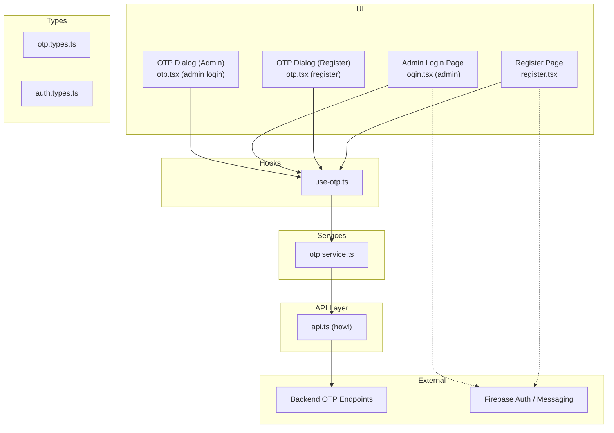
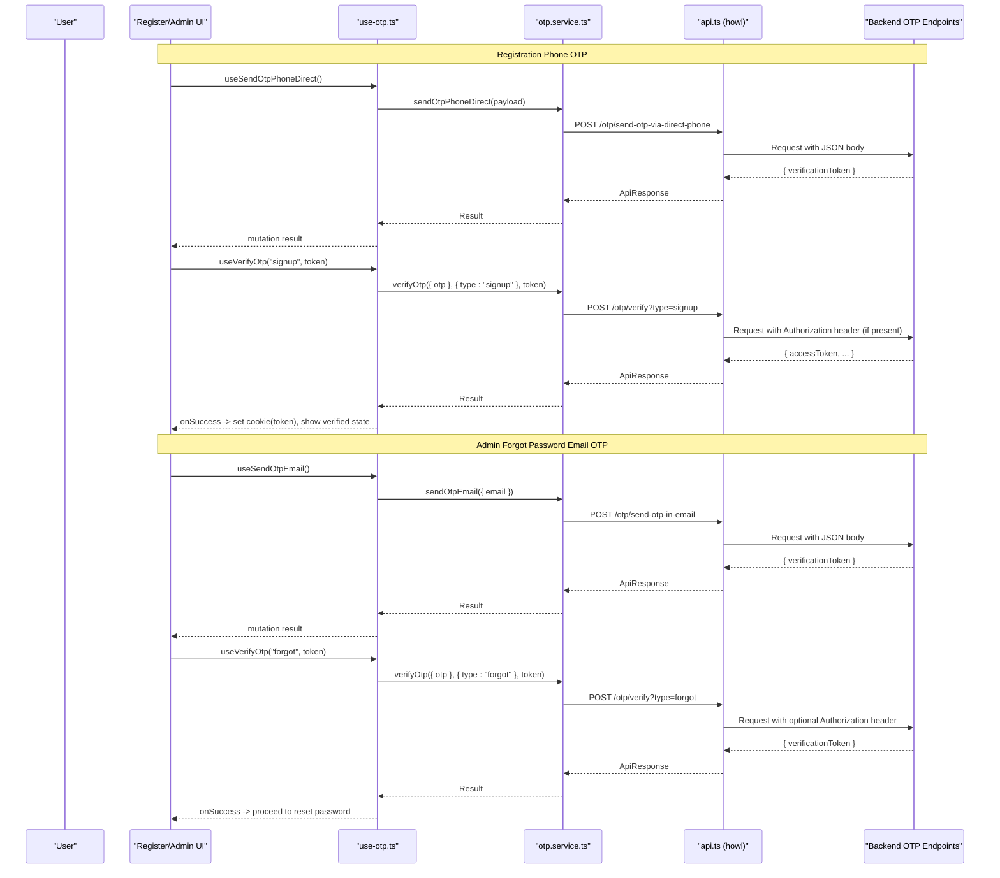
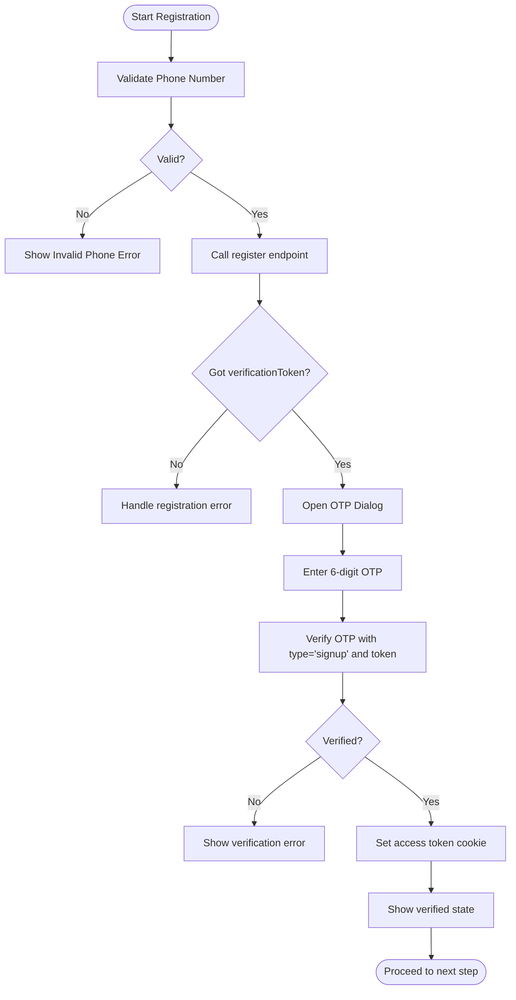
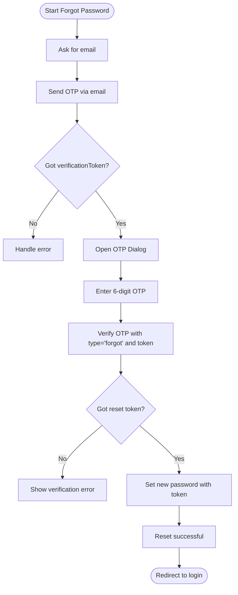
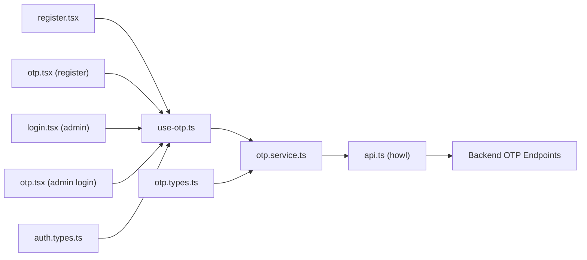

# OTP Verification Flow

<cite>
**Referenced Files in This Document**
- [use-otp.ts](file://src/hooks/auth/use-otp.ts)
- [otp.service.ts](file://src/services/otp.service.ts)
- [otp.types.ts](file://src/types/otp.types.ts)
- [auth.types.ts](file://src/types/auth.types.ts)
- [api.ts](file://src/lib/api.ts)
- [register.tsx](file://src/app/auth/register/register.tsx)
- [otp (register).tsx](file://src/app/auth/register/otp.tsx)
- [login.tsx (admin)](file://src/app/admin/auth/login/login.tsx)
- [otp (admin login).tsx](file://src/app/admin/auth/login/otp.tsx)
- [firebase.ts](file://src/lib/firebase.ts)
</cite>

## Table of Contents
1. [Introduction](#introduction)
2. [Project Structure](#project-structure)
3. [Core Components](#core-components)
4. [Architecture Overview](#architecture-overview)
5. [Detailed Component Analysis](#detailed-component-analysis)
6. [Dependency Analysis](#dependency-analysis)
7. [Performance Considerations](#performance-considerations)
8. [Security Considerations](#security-considerations)
9. [Troubleshooting Guide](#troubleshooting-guide)
10. [Conclusion](#conclusion)

## Introduction
This document explains the One-Time Password (OTP) verification implementation across the application, covering:
- Phone number validation and SMS sending flows
- Email-based OTP for password reset
- Code verification and token handling
- Error handling and user feedback
- The use-otp hook and OTP service methods
- Integration points with Firebase (for social auth and messaging; phone OTP is handled via backend endpoints)
- Custom flow examples, timeout handling, retry logic, security considerations, and troubleshooting guidance

## Project Structure
The OTP feature spans hooks, services, types, UI components, and API utilities:
- Hooks: React Query wrappers for OTP operations
- Services: HTTP calls to backend OTP endpoints
- Types: Payloads and responses for OTP flows
- UI: Registration and admin login OTP dialogs
- API utility: Centralized fetch wrapper with token injection
- Firebase: Social providers and FCM token retrieval (not used for phone OTP)

**Diagram sources**
- [register.tsx:1-219](file://src/app/auth/register/register.tsx#L1-L219)
- [otp (register).tsx:1-167](file://src/app/auth/register/otp.tsx#L1-L167)
- [login.tsx (admin):1-223](file://src/app/admin/auth/login/login.tsx#L1-L223)
- [otp (admin login).tsx:1-249](file://src/app/admin/auth/login/otp.tsx#L1-L249)
- [use-otp.ts:1-32](file://src/hooks/auth/use-otp.ts#L1-L32)
- [otp.service.ts:1-27](file://src/services/otp.service.ts#L1-L27)
- [api.ts:1-106](file://src/lib/api.ts#L1-L106)
- [firebase.ts:1-46](file://src/lib/firebase.ts#L1-L46)

**Section sources**
- [use-otp.ts:1-32](file://src/hooks/auth/use-otp.ts#L1-L32)
- [otp.service.ts:1-27](file://src/services/otp.service.ts#L1-L27)
- [otp.types.ts:1-19](file://src/types/otp.types.ts#L1-L19)
- [auth.types.ts:1-113](file://src/types/auth.types.ts#L1-L113)
- [api.ts:1-106](file://src/lib/api.ts#L1-L106)
- [register.tsx:1-219](file://src/app/auth/register/register.tsx#L1-L219)
- [otp (register).tsx:1-167](file://src/app/auth/register/otp.tsx#L1-L167)
- [login.tsx (admin):1-223](file://src/app/admin/auth/login/login.tsx#L1-L223)
- [otp (admin login).tsx:1-249](file://src/app/admin/auth/login/otp.tsx#L1-L249)
- [firebase.ts:1-46](file://src/lib/firebase.ts#L1-L46)

## Core Components
- use-otp hooks: Provide React Query mutations for verifying OTP and sending OTP via email or phone.
- otpService: Encapsulates HTTP calls to backend OTP endpoints using the howl utility.
- UI components: OTP dialog for registration and admin forgot-password flows, including resend and verification states.
- Types: Strongly typed payloads and query parameters for OTP operations.
- API layer: Centralized fetch wrapper that injects Bearer tokens from cookies and normalizes errors.

Key responsibilities:
- Validation: Client-side checks before calling APIs (e.g., OTP length).
- State management: Pending/success/error states via React Query.
- Token handling: Storing access tokens after successful signup verification; passing temporary verification tokens for reset flows.
- Resend logic: Triggering new OTP sends and updating tokens when provided by the server.

**Section sources**
- [use-otp.ts:1-32](file://src/hooks/auth/use-otp.ts#L1-L32)
- [otp.service.ts:1-27](file://src/services/otp.service.ts#L1-L27)
- [otp.types.ts:1-19](file://src/types/otp.types.ts#L1-L19)
- [auth.types.ts:1-113](file://src/types/auth.types.ts#L1-L113)
- [api.ts:1-106](file://src/lib/api.ts#L1-L106)
- [otp (register).tsx:1-167](file://src/app/auth/register/otp.tsx#L1-L167)
- [otp (admin login).tsx:1-249](file://src/app/admin/auth/login/otp.tsx#L1-L249)

## Architecture Overview
End-to-end OTP flows:

**Diagram sources**
- [register.tsx:1-219](file://src/app/auth/register/register.tsx#L1-L219)
- [otp (register).tsx:1-167](file://src/app/auth/register/otp.tsx#L1-L167)
- [login.tsx (admin):1-223](file://src/app/admin/auth/login/login.tsx#L1-L223)
- [otp (admin login).tsx:1-249](file://src/app/admin/auth/login/otp.tsx#L1-L249)
- [use-otp.ts:1-32](file://src/hooks/auth/use-otp.ts#L1-L32)
- [otp.service.ts:1-27](file://src/services/otp.service.ts#L1-L27)
- [api.ts:1-106](file://src/lib/api.ts#L1-L106)

## Detailed Component Analysis

### use-otp Hook
Purpose:
- Expose React Query mutations for OTP verification and sending.
- Accept an optional token parameter for verification requests that require a temporary verification token.

Key behaviors:
- useVerifyOtp(type, otpToken?): Builds a mutation that posts OTP to /otp/verify with type query param and optional token.
- useSendOtpEmail(): Posts to /otp/send-otp-in-email.
- useSendOtpPhoneViaToken(): Posts to /otp/send-otp-via-token-in-phone.
- useSendOtpPhoneDirect(): Posts to /otp/send-otp-via-direct-phone and expects a verificationToken in response.

Usage patterns:
- Register flow uses direct phone send and then verifies with signup type.
- Admin forgot-password flow uses email send and verifies with forgot type.

**Section sources**
- [use-otp.ts:1-32](file://src/hooks/auth/use-otp.ts#L1-L32)

### OTP Service
Purpose:
- Wrap HTTP calls to OTP endpoints using the howl utility.
- Define request/response shapes via TypeScript generics.

Endpoints:
- POST /otp/verify?type={type}
- POST /otp/send-otp-in-email
- POST /otp/send-otp-via-token-in-phone
- POST /otp/send-otp-via-direct-phone

Error handling:
- Errors are thrown by the howl wrapper and surfaced to callers via React Query onError callbacks.

**Section sources**
- [otp.service.ts:1-27](file://src/services/otp.service.ts#L1-L27)
- [api.ts:1-106](file://src/lib/api.ts#L1-L106)

### Types
- VerifyOtpPayload: Contains the OTP string.
- VerifyOtpQuery: Contains the OTP type ("signup" | "forgot" | "login" | "changeEmail" | "changePhone").
- SendOtpEmailPayload: Contains email address.
- SendOtpPhonePayload: Contains countryCode and phone.
- OtpType and OtpTokenResponse: Shared types for OTP flows and token responses.

These types ensure consistent payloads and responses across hooks and services.

**Section sources**
- [otp.types.ts:1-19](file://src/types/otp.types.ts#L1-L19)
- [auth.types.ts:1-113](file://src/types/auth.types.ts#L1-L113)

### Registration Phone OTP Flow
Steps:
1. User submits registration form with name, email, and phone.
2. Phone number is parsed and validated; if invalid, error is shown.
3. On success, a verificationToken is received and stored locally.
4. OTP dialog opens; user enters 6-digit code.
5. Verification call uses type "signup" and the verificationToken.
6. On success, access token is stored in a cookie and verified state is shown.
7. Resend functionality triggers direct phone send again and updates the verificationToken.

**Diagram sources**
- [register.tsx:1-219](file://src/app/auth/register/register.tsx#L1-L219)
- [otp (register).tsx:1-167](file://src/app/auth/register/otp.tsx#L1-L167)
- [use-otp.ts:1-32](file://src/hooks/auth/use-otp.ts#L1-L32)
- [otp.service.ts:1-27](file://src/services/otp.service.ts#L1-L27)
- [api.ts:1-106](file://src/lib/api.ts#L1-L106)

**Section sources**
- [register.tsx:1-219](file://src/app/auth/register/register.tsx#L1-L219)
- [otp (register).tsx:1-167](file://src/app/auth/register/otp.tsx#L1-L167)

### Admin Forgot Password Email OTP Flow
Steps:
1. User clicks "Forgot Password" and provides email.
2. System sends OTP via email and returns a verificationToken.
3. OTP dialog opens; user enters 6-digit code.
4. Verification call uses type "forgot" and the verificationToken.
5. On success, a new verificationToken is returned for resetting the password.
6. User sets a new password using the token; on success, they are redirected.

**Diagram sources**
- [login.tsx (admin):1-223](file://src/app/admin/auth/login/login.tsx#L1-L223)
- [otp (admin login).tsx:1-249](file://src/app/admin/auth/login/otp.tsx#L1-L249)
- [use-otp.ts:1-32](file://src/hooks/auth/use-otp.ts#L1-L32)
- [otp.service.ts:1-27](file://src/services/otp.service.ts#L1-L27)
- [api.ts:1-106](file://src/lib/api.ts#L1-L106)

**Section sources**
- [login.tsx (admin):1-223](file://src/app/admin/auth/login/login.tsx#L1-L223)
- [otp (admin login).tsx:1-249](file://src/app/admin/auth/login/otp.tsx#L1-L249)

### API Layer and Token Handling
- howl wraps fetch, attaches Bearer token from cookie if available, and throws normalized errors.
- For OTP verification, an optional token can be passed to include it in the request context.
- Responses are parsed as JSON; non-JSON responses are handled gracefully.

**Section sources**
- [api.ts:1-106](file://src/lib/api.ts#L1-L106)

### Firebase Integration Notes
- Firebase is initialized for social authentication (Google, Apple) and FCM token retrieval.
- Phone OTP does not use Firebase Phone Auth in this codebase; it relies on backend OTP endpoints.
- If you choose to integrate Firebase Phone Auth later, you would use PhoneAuthProvider or signInWithPhoneNumber and exchange the verification ID/code with your backend.

**Section sources**
- [firebase.ts:1-46](file://src/lib/firebase.ts#L1-L46)

## Dependency Analysis
High-level dependencies:
- UI components depend on hooks for mutations.
- Hooks depend on services for HTTP calls.
- Services depend on the API utility for network requests.
- Types define contracts between layers.

**Diagram sources**
- [register.tsx:1-219](file://src/app/auth/register/register.tsx#L1-L219)
- [otp (register).tsx:1-167](file://src/app/auth/register/otp.tsx#L1-L167)
- [login.tsx (admin):1-223](file://src/app/admin/auth/login/login.tsx#L1-L223)
- [otp (admin login).tsx:1-249](file://src/app/admin/auth/login/otp.tsx#L1-L249)
- [use-otp.ts:1-32](file://src/hooks/auth/use-otp.ts#L1-L32)
- [otp.service.ts:1-27](file://src/services/otp.service.ts#L1-L27)
- [api.ts:1-106](file://src/lib/api.ts#L1-L106)
- [auth.types.ts:1-113](file://src/types/auth.types.ts#L1-L113)
- [otp.types.ts:1-19](file://src/types/otp.types.ts#L1-L19)

**Section sources**
- [use-otp.ts:1-32](file://src/hooks/auth/use-otp.ts#L1-L32)
- [otp.service.ts:1-27](file://src/services/otp.service.ts#L1-L27)
- [api.ts:1-106](file://src/lib/api.ts#L1-L106)
- [auth.types.ts:1-113](file://src/types/auth.types.ts#L1-L113)
- [otp.types.ts:1-19](file://src/types/otp.types.ts#L1-L19)
- [register.tsx:1-219](file://src/app/auth/register/register.tsx#L1-L219)
- [otp (register).tsx:1-167](file://src/app/auth/register/otp.tsx#L1-L167)
- [login.tsx (admin):1-223](file://src/app/admin/auth/login/login.tsx#L1-L223)
- [otp (admin login).tsx:1-249](file://src/app/admin/auth/login/otp.tsx#L1-L249)

## Performance Considerations
- Debounce resend actions to avoid spamming backend endpoints.
- Cache and reuse verification tokens where appropriate to reduce unnecessary re-sends.
- Use React Query’s built-in caching and background refetch strategies for better UX.
- Minimize re-renders by keeping OTP input state local and only lifting necessary data up.

[No sources needed since this section provides general guidance]

## Security Considerations
- Transmission security: Ensure HTTPS/TLS is enforced for all API calls.
- Token handling: Store short-lived access tokens securely; clear them on logout.
- Rate limiting: Implement server-side rate limits per IP/user for OTP send and verify endpoints.
- Abuse prevention: Enforce maximum attempts per OTP, lockout after repeated failures, and CAPTCHA for suspicious activity.
- Input validation: Validate phone numbers and emails client-side and server-side.
- CSRF protection: Use secure cookies and SameSite attributes; consider anti-CSRF tokens for sensitive endpoints.
- Logging and monitoring: Log failed attempts and anomalies without exposing sensitive details.

[No sources needed since this section provides general guidance]

## Troubleshooting Guide
Common issues and resolutions:
- Invalid phone number: Ensure proper parsing and formatting; display localized error messages.
- OTP not received: Check carrier delivery, spam filters, and backend logs; allow resend with cooldown.
- Verification fails: Confirm correct OTP type and token; check server logs for mismatched codes or expired tokens.
- Network errors: Inspect howl error handling and backend status codes; retry transient failures with exponential backoff.
- Token expiration: Refresh or re-send OTP when verification tokens expire; guide users to resend.
- Cookie issues: Verify cookie domain/path/SameSite settings; ensure cookies are included in cross-origin requests.

**Section sources**
- [api.ts:1-106](file://src/lib/api.ts#L1-L106)
- [otp (register).tsx:1-167](file://src/app/auth/register/otp.tsx#L1-L167)
- [otp (admin login).tsx:1-249](file://src/app/admin/auth/login/otp.tsx#L1-L249)

## Conclusion
The OTP verification system is implemented through a clean separation of concerns: UI components orchestrate flows, hooks manage mutations, services encapsulate HTTP calls, and types enforce contracts. The flows support both phone and email OTPs, with robust error handling and token management. Security best practices should be applied at both client and server levels to protect against abuse and ensure safe transmission.

[No sources needed since this section summarizes without analyzing specific files]