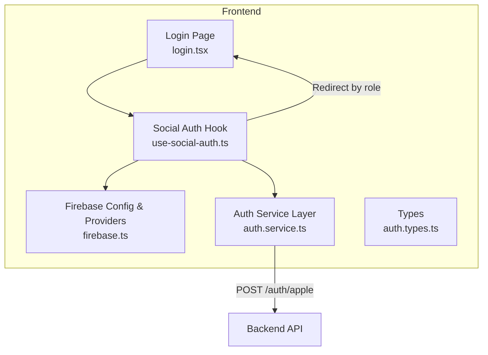
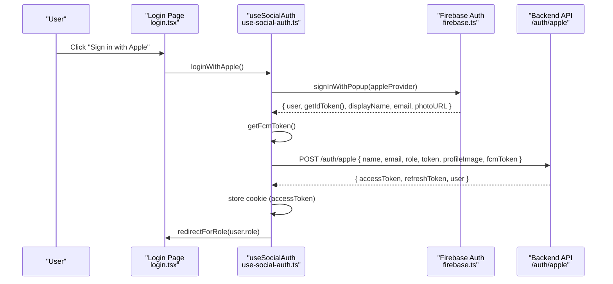
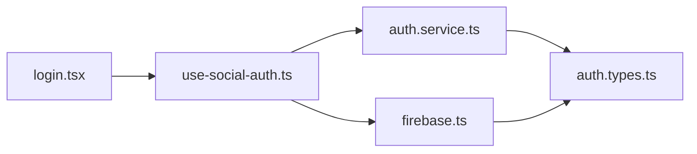
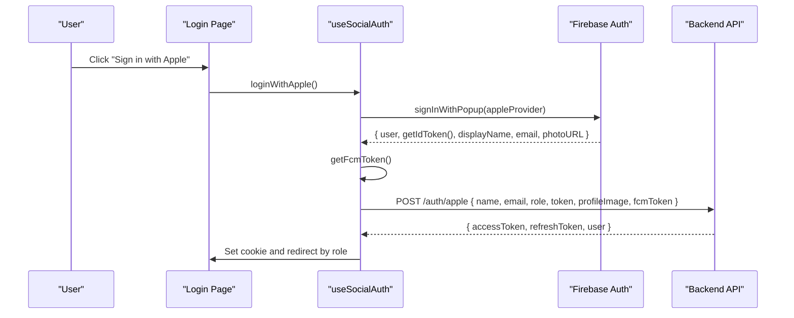

# Apple Sign-In Provider

<cite>
**Referenced Files in This Document**
- [firebase.ts](file://src/lib/firebase.ts)
- [use-social-auth.ts](file://src/hooks/auth/use-social-auth.ts)
- [auth.service.ts](file://src/services/auth.service.ts)
- [login.tsx](file://src/app/auth/login/login.tsx)
- [auth.types.ts](file://src/types/auth.types.ts)
</cite>

## Table of Contents
1. [Introduction](#introduction)
2. [Project Structure](#project-structure)
3. [Core Components](#core-components)
4. [Architecture Overview](#architecture-overview)
5. [Detailed Component Analysis](#detailed-component-analysis)
6. [Dependency Analysis](#dependency-analysis)
7. [Performance Considerations](#performance-considerations)
8. [Troubleshooting Guide](#troubleshooting-guide)
9. [Conclusion](#conclusion)
10. [Appendices](#appendices)

## Introduction
This document explains the Apple Sign-In provider implementation using Firebase Authentication and how it is integrated into the application’s login flow. It covers:
- How the OAuthProvider('apple.com') is configured in Firebase
- The signInWithPopup flow with appleProvider
- User data extraction, including privacy considerations for hidden emails
- First-time user registration vs returning user scenarios
- UI examples for Apple sign-in buttons
- Handling authentication state changes and managing user profile data
- Platform-specific considerations for iOS and macOS web implementations

## Project Structure
The Apple Sign-In feature spans a few key files:
- Firebase configuration and provider setup
- Social auth hook orchestrating the popup flow and backend exchange
- Service layer calling the backend endpoints
- Login page rendering the Apple button and wiring to the hook
- Types defining payloads and responses

**Diagram sources**
- [login.tsx](file://src/app/auth/login/login.tsx)
- [use-social-auth.ts](file://src/hooks/auth/use-social-auth.ts)
- [firebase.ts](file://src/lib/firebase.ts)
- [auth.service.ts](file://src/services/auth.service.ts)
- [auth.types.ts](file://src/types/auth.types.ts)

**Section sources**
- [firebase.ts](file://src/lib/firebase.ts)
- [use-social-auth.ts](file://src/hooks/auth/use-social-auth.ts)
- [auth.service.ts](file://src/services/auth.service.ts)
- [login.tsx](file://src/app/auth/login/login.tsx)
- [auth.types.ts](file://src/types/auth.types.ts)

## Core Components
- Firebase provider initialization and Apple provider configuration
- Social auth hook that triggers the Apple popup, exchanges tokens, and handles redirection
- Service method that posts the Apple ID token to the backend
- Login UI component that renders the Apple button and wires to the social auth hook
- Type definitions for payloads and responses used across the flow

Key responsibilities:
- firebase.ts: Initialize Firebase, create OAuthProvider('apple.com'), add scopes
- use-social-auth.ts: Trigger signInWithPopup, extract user info, call backend, set cookies, redirect
- auth.service.ts: Provide loginWithApple endpoint call
- login.tsx: Render Apple button and handle pending states
- auth.types.ts: Define SocialLoginPayload and LoginResponse shapes

**Section sources**
- [firebase.ts](file://src/lib/firebase.ts)
- [use-social-auth.ts](file://src/hooks/auth/use-social-auth.ts)
- [auth.service.ts](file://src/services/auth.service.ts)
- [login.tsx](file://src/app/auth/login/login.tsx)
- [auth.types.ts](file://src/types/auth.types.ts)

## Architecture Overview
The Apple Sign-In flow uses Firebase Authentication to authenticate users via Apple, then exchanges the resulting ID token with the application backend to establish an application session.

**Diagram sources**
- [login.tsx](file://src/app/auth/login/login.tsx)
- [use-social-auth.ts](file://src/hooks/auth/use-social-auth.ts)
- [firebase.ts](file://src/lib/firebase.ts)
- [auth.service.ts](file://src/services/auth.service.ts)

## Detailed Component Analysis

### Firebase Configuration and Apple Provider Setup
- Initializes Firebase app from environment variables
- Creates GoogleAuthProvider and OAuthProvider('apple.com')
- Adds scopes 'email' and 'name' to the Apple provider
- Exports a helper to fetch FCM token when supported

Implementation highlights:
- Provider instantiation and scope addition
- Conditional dynamic import for messaging to avoid unnecessary overhead
- Graceful fallback if messaging is not supported

Privacy note:
- Scopes request email and name; Apple may return a relay address or hide the real email depending on user choice.

**Section sources**
- [firebase.ts](file://src/lib/firebase.ts)

### Social Auth Hook (signInWithPopup Flow)
Responsibilities:
- Call signInWithPopup with appleProvider
- Retrieve ID token and optional FCM token
- Extract displayName, email, photoURL from the authenticated user
- Send payload to backend via authService.loginWithApple
- Store access token in a cookie
- Redirect based on user role

Error handling:
- Displays toast errors on failure
- Uses try/catch around the popup flow

Data mapping:
- Maps Firebase user fields to SocialLoginPayload
- Uses LoginResponse to persist session and navigate

**Section sources**
- [use-social-auth.ts](file://src/hooks/auth/use-social-auth.ts)

### Backend Integration (Service Layer)
- Provides loginWithApple(payload) which calls POST /auth/apple
- Payload shape matches SocialLoginPayload

Notes:
- The backend is responsible for verifying the Apple ID token and creating or linking the account
- Returns an application session token and minimal user metadata for navigation

**Section sources**
- [auth.service.ts](file://src/services/auth.service.ts)
- [auth.types.ts](file://src/types/auth.types.ts)

### Login UI and Apple Button
- Renders a dedicated Apple sign-in button
- Disables the button while the operation is pending
- Calls loginWithApple from useSocialAuth with the appropriate role

Behavior:
- On success, the hook stores the token and redirects according to role
- On error, shows a toast message

**Section sources**
- [login.tsx](file://src/app/auth/login/login.tsx)

### Data Models and Payloads
- SocialLoginPayload includes name, email, role, token, optional profileImage and fcmToken
- LoginResponse includes accessToken, refreshToken, and user object used for redirection

These types ensure consistent contracts between frontend and backend.

**Section sources**
- [auth.types.ts](file://src/types/auth.types.ts)

### Apple-Specific Authentication Flows
First-time user registration:
- After successful Apple authentication, the frontend sends the ID token and basic profile to the backend
- The backend should create a new user record if none exists and link the Apple identity
- The response includes an access token and minimal user info for navigation

Returning user scenario:
- If the Apple identity already exists, the backend returns an existing session
- The frontend stores the token and proceeds with role-based redirection

Privacy considerations for hidden emails:
- Apple allows users to hide their real email and receive a relay address
- The application must accept and store the relay address as the user’s email
- Do not assume the email is a permanent, unique identifier beyond what Apple provides

**Section sources**
- [use-social-auth.ts](file://src/hooks/auth/use-social-auth.ts)
- [auth.service.ts](file://src/services/auth.service.ts)
- [auth.types.ts](file://src/types/auth.types.ts)

### Implementing Apple Sign-In Buttons
- Use the provided loginWithApple function from useSocialAuth
- Bind it to a button click handler
- Show pending state while the operation is in progress
- Display error messages via toast on failure

Example references:
- Button rendering and disabled state management
- Calling loginWithApple with the selected role

**Section sources**
- [login.tsx](file://src/app/auth/login/login.tsx)
- [use-social-auth.ts](file://src/hooks/auth/use-social-auth.ts)

### Handling Authentication State Changes and Profile Data
- After login, the hook sets a cookie with the access token and redirects based on role
- The application can listen for auth state changes at the Firebase level to update UI globally
- Profile image URL and name are available from the Firebase user object and sent to the backend

Best practices:
- Centralize auth state listeners in a top-level provider or layout
- Persist session tokens securely and refresh as needed
- Update UI components reactively to auth state

[No sources needed since this section provides general guidance]

### Platform-Specific Considerations for iOS and macOS
Web behavior:
- signInWithPopup opens a browser window for Apple’s consent and authentication
- Ensure your site is served over HTTPS in production
- Configure allowed domains in Apple Developer portal and Firebase console

Native app integration patterns:
- For native iOS/macOS apps, prefer the official Apple Sign-In SDK and link accounts with Firebase using credential APIs rather than web popups
- Web views inside apps may be blocked by Apple’s restrictions; use native flows where possible

[No sources needed since this section provides general guidance]

## Dependency Analysis
The following diagram shows how the Apple Sign-In feature depends on Firebase, the service layer, and the UI.

**Diagram sources**
- [login.tsx](file://src/app/auth/login/login.tsx)
- [use-social-auth.ts](file://src/hooks/auth/use-social-auth.ts)
- [firebase.ts](file://src/lib/firebase.ts)
- [auth.service.ts](file://src/services/auth.service.ts)
- [auth.types.ts](file://src/types/auth.types.ts)

**Section sources**
- [firebase.ts](file://src/lib/firebase.ts)
- [use-social-auth.ts](file://src/hooks/auth/use-social-auth.ts)
- [auth.service.ts](file://src/services/auth.service.ts)
- [login.tsx](file://src/app/auth/login/login.tsx)
- [auth.types.ts](file://src/types/auth.types.ts)

## Performance Considerations
- Avoid unnecessary re-renders by keeping the Apple button disabled during pending operations
- Lazy-load messaging only when needed to reduce bundle size
- Minimize network calls by caching FCM tokens when stable
- Handle large profile images carefully; consider resizing before upload

[No sources needed since this section provides general guidance]

## Troubleshooting Guide
Common issues and resolutions:
- Popup blocked by browser: Ensure the user initiated the action and allow popups for the domain
- CORS or network errors: Verify backend endpoint availability and correct headers
- Missing email due to Apple privacy: Accept relay addresses and do not enforce uniqueness beyond Apple-provided identifiers
- Role-based redirect not working: Confirm backend returns expected user role and status fields

Operational checks:
- Verify Firebase project has Apple provider enabled and scopes configured
- Validate environment variables for Firebase configuration
- Inspect toast messages for detailed error feedback

**Section sources**
- [use-social-auth.ts](file://src/hooks/auth/use-social-auth.ts)
- [auth.service.ts](file://src/services/auth.service.ts)

## Conclusion
The Apple Sign-In implementation integrates cleanly with Firebase Authentication and the application’s backend. It follows a straightforward flow: trigger the Apple popup, obtain an ID token, exchange it with the backend, store the session, and redirect based on user role. Privacy-aware handling of hidden emails ensures compliance with Apple’s policies. For native platforms, prefer native Apple Sign-In flows for best compatibility and security.

[No sources needed since this section summarizes without analyzing specific files]

## Appendices

### Apple Developer Account Requirements and App Configuration
- Enable Sign In with Apple in your Apple Developer account
- Register your app’s bundle identifier and associated domains in Apple Developer portal
- Add Apple as a sign-in provider in the Firebase console and configure allowed domains
- Ensure your website is served over HTTPS in production

[No sources needed since this section provides general guidance]

### Sequence Diagram: Apple Sign-In Flow

**Diagram sources**
- [login.tsx](file://src/app/auth/login/login.tsx)
- [use-social-auth.ts](file://src/hooks/auth/use-social-auth.ts)
- [firebase.ts](file://src/lib/firebase.ts)
- [auth.service.ts](file://src/services/auth.service.ts)