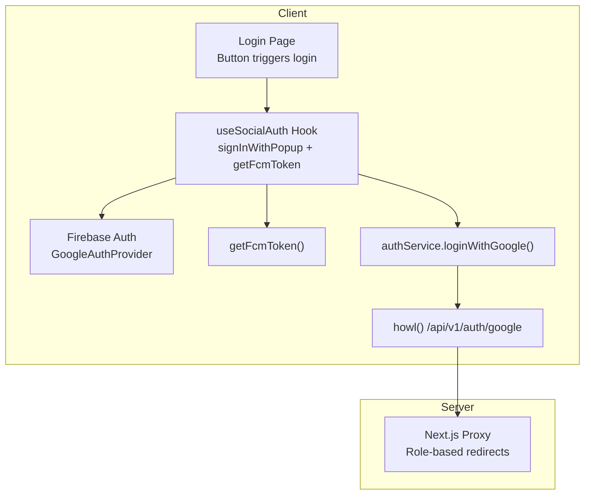
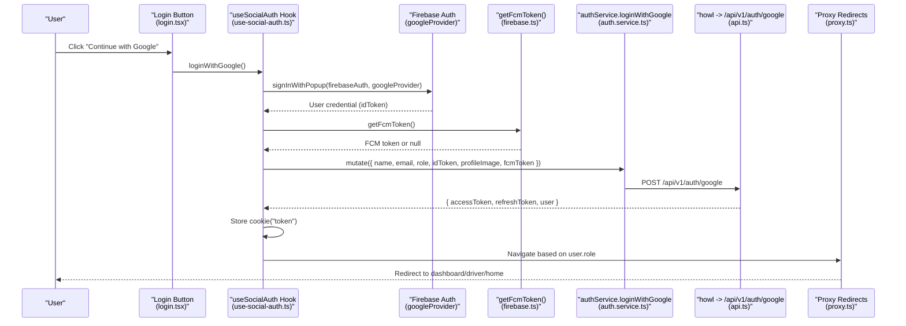
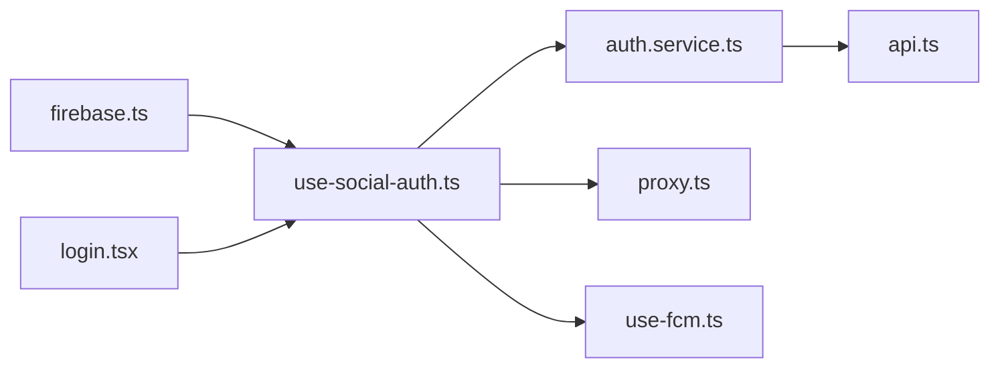

# Google OAuth Provider

<cite>
**Referenced Files in This Document**
- [firebase.ts](file://src/lib/firebase.ts)
- [use-social-auth.ts](file://src/hooks/auth/use-social-auth.ts)
- [auth.service.ts](file://src/services/auth.service.ts)
- [login.tsx](file://src/app/auth/login/login.tsx)
- [api.ts](file://src/lib/api.ts)
- [proxy.ts](file://src/proxy.ts)
- [use-fcm.ts](file://src/hooks/shared/use-fcm.ts)
</cite>

## Table of Contents
1. [Introduction](#introduction)
2. [Project Structure](#project-structure)
3. [Core Components](#core-components)
4. [Architecture Overview](#architecture-overview)
5. [Detailed Component Analysis](#detailed-component-analysis)
6. [Dependency Analysis](#dependency-analysis)
7. [Performance Considerations](#performance-considerations)
8. [Troubleshooting Guide](#troubleshooting-guide)
9. [Conclusion](#conclusion)

## Introduction
This document explains the Google OAuth provider implementation in the project, focusing on:
- Firebase configuration and GoogleAuthProvider setup
- The signInWithPopup flow with googleProvider
- Extraction of user data (displayName, email, photoURL)
- FCM token integration during sign-in
- Error handling strategies for authentication failures, popup blocking, and network errors
- Example usage patterns for Google sign-in buttons and role-based access control
- Platform-specific considerations for mobile devices and browser compatibility

## Project Structure
The Google OAuth implementation spans several layers:
- Firebase initialization and provider setup
- Client-side social auth hook orchestrating the popup flow
- UI button triggering the sign-in
- Backend API call to exchange the Firebase ID token for a session
- Middleware enforcing role-based access control
- FCM token acquisition utility

**Diagram sources**
- [login.tsx:282-304](file://src/app/auth/login/login.tsx#L282-L304)
- [use-social-auth.ts:27-59](file://src/hooks/auth/use-social-auth.ts#L27-L59)
- [firebase.ts:1-22](file://src/lib/firebase.ts#L1-L22)
- [auth.service.ts:25-26](file://src/services/auth.service.ts#L25-L26)
- [api.ts:23-73](file://src/lib/api.ts#L23-L73)
- [proxy.ts:25-100](file://src/proxy.ts#L25-L100)

**Section sources**
- [firebase.ts:1-22](file://src/lib/firebase.ts#L1-L22)
- [use-social-auth.ts:1-101](file://src/hooks/auth/use-social-auth.ts#L1-L101)
- [auth.service.ts:1-43](file://src/services/auth.service.ts#L1-L43)
- [login.tsx:282-304](file://src/app/auth/login/login.tsx#L282-L304)
- [api.ts:1-106](file://src/lib/api.ts#L1-L106)
- [proxy.ts:1-104](file://src/proxy.ts#L1-L104)

## Core Components
- Firebase configuration and providers
  - Initializes Firebase app and exposes firebaseAuth and googleProvider
  - Exposes getFcmToken for dynamic messaging import and token retrieval
- Social auth hook
  - Performs Google sign-in via signInWithPopup
  - Extracts displayName, email, photoURL from the authenticated user
  - Retrieves FCM token and posts credentials to backend
  - Stores server session cookie and redirects based on role
- Login page UI
  - Provides a Google sign-in button wired to the hook
- API layer
  - howl helper attaches Authorization header using a cookie token
- Role-based middleware
  - Next.js proxy enforces route access by role and redirects accordingly

**Section sources**
- [firebase.ts:1-46](file://src/lib/firebase.ts#L1-L46)
- [use-social-auth.ts:1-101](file://src/hooks/auth/use-social-auth.ts#L1-L101)
- [login.tsx:282-304](file://src/app/auth/login/login.tsx#L282-L304)
- [api.ts:1-106](file://src/lib/api.ts#L1-L106)
- [proxy.ts:25-100](file://src/proxy.ts#L25-L100)

## Architecture Overview
End-to-end flow for Google sign-in:

**Diagram sources**
- [login.tsx:282-304](file://src/app/auth/login/login.tsx#L282-L304)
- [use-social-auth.ts:27-59](file://src/hooks/auth/use-social-auth.ts#L27-L59)
- [firebase.ts:23-45](file://src/lib/firebase.ts#L23-L45)
- [auth.service.ts:25-26](file://src/services/auth.service.ts#L25-L26)
- [api.ts:23-73](file://src/lib/api.ts#L23-L73)
- [proxy.ts:56-99](file://src/proxy.ts#L56-L99)

## Detailed Component Analysis

### Firebase Configuration and Providers
- Initializes Firebase with environment variables
- Exports:
  - firebaseAuth instance
  - googleProvider configured for Google OAuth
  - appleProvider (for completeness)
- getFcmToken():
  - Dynamically imports firebase/messaging
  - Checks browser support
  - Requests VAPID key from environment
  - Returns token or null on failure

Key responsibilities:
- Centralized provider setup
- Safe FCM token retrieval with graceful fallback

**Section sources**
- [firebase.ts:1-46](file://src/lib/firebase.ts#L1-L46)

### Social Authentication Hook (Google Sign-In Flow)
Responsibilities:
- Trigger Google popup via signInWithPopup
- Obtain Firebase ID token
- Retrieve FCM token
- Extract user fields: displayName, email, photoURL
- Call backend to exchange tokens and create a session
- Persist server session cookie
- Redirect based on user role

Error handling:
- Popup/network errors caught and surfaced via toast
- Server errors surfaced via toast

Data mapping:
- Maps Firebase user fields to SocialLoginPayload
- Includes optional profileImage and fcmToken

**Section sources**
- [use-social-auth.ts:27-59](file://src/hooks/auth/use-social-auth.ts#L27-L59)

### Login UI Integration
- Renders a Google sign-in button
- Disables button while pending
- Calls useSocialAuth.loginWithGoogle

Integration points:
- Uses i18n labels for accessibility and localization
- Composes with phone OTP flow and Apple sign-in

**Section sources**
- [login.tsx:282-304](file://src/app/auth/login/login.tsx#L282-L304)

### Backend Exchange and Session Management
- authService.loginWithGoogle posts to /api/v1/auth/google
- howl helper:
  - Reads token from cookies
  - Attaches Authorization header
  - Handles JSON responses and error messages

Session persistence:
- On success, stores server accessToken in a cookie
- Subsequent requests include the token automatically

**Section sources**
- [auth.service.ts:25-26](file://src/services/auth.service.ts#L25-L26)
- [api.ts:1-106](file://src/lib/api.ts#L1-L106)

### Role-Based Access Control (RBAC)
- Next.js proxy inspects the token cookie
- Public paths allow unauthenticated access
- Redirects logged-in users away from public auth pages
- Enforces admin/provider/user route access
- Logout clears token and redirects appropriately

**Section sources**
- [proxy.ts:14-100](file://src/proxy.ts#L14-L100)

### FCM Token Integration
- getFcmToken is called during sign-in to associate device notifications with the account
- useFcmToken demonstrates permission request and token retrieval outside of login flow

Platform considerations:
- Only runs in browsers with Notification support
- Gracefully returns null when unsupported

**Section sources**
- [firebase.ts:23-45](file://src/lib/firebase.ts#L23-L45)
- [use-fcm.ts:1-20](file://src/hooks/shared/use-fcm.ts#L1-L20)

## Dependency Analysis
High-level dependencies among components:

**Diagram sources**
- [firebase.ts:1-46](file://src/lib/firebase.ts#L1-L46)
- [use-social-auth.ts:1-101](file://src/hooks/auth/use-social-auth.ts#L1-L101)
- [auth.service.ts:1-43](file://src/services/auth.service.ts#L1-L43)
- [api.ts:1-106](file://src/lib/api.ts#L1-L106)
- [login.tsx:282-304](file://src/app/auth/login/login.tsx#L282-L304)
- [proxy.ts:1-104](file://src/proxy.ts#L1-L104)
- [use-fcm.ts:1-20](file://src/hooks/shared/use-fcm.ts#L1-L20)

**Section sources**
- [firebase.ts:1-46](file://src/lib/firebase.ts#L1-L46)
- [use-social-auth.ts:1-101](file://src/hooks/auth/use-social-auth.ts#L1-L101)
- [auth.service.ts:1-43](file://src/services/auth.service.ts#L1-L43)
- [api.ts:1-106](file://src/lib/api.ts#L1-L106)
- [login.tsx:282-304](file://src/app/auth/login/login.tsx#L282-L304)
- [proxy.ts:1-104](file://src/proxy.ts#L1-L104)
- [use-fcm.ts:1-20](file://src/hooks/shared/use-fcm.ts#L1-L20)

## Performance Considerations
- Dynamic import of firebase/messaging avoids bundling unnecessary code on non-browser environments
- getFcmToken returns null quickly when unsupported, preventing blocking flows
- Using React Query mutations provides caching and retry hooks if needed
- Cookie-based session avoids repeated token exchanges per request

[No sources needed since this section provides general guidance]

## Troubleshooting Guide

Common issues and resolutions:
- Popup blocked by browser
  - Ensure the sign-in is triggered by a direct user gesture
  - Test on multiple browsers; some block popups aggressively
- Network errors during token exchange
  - Verify NEXT_PUBLIC_SERVER_URL and CORS settings
  - Check that /api/v1/auth/google responds with expected payload
- Missing or invalid FCM token
  - Confirm browser supports Notifications and has granted permission
  - Ensure NEXT_PUBLIC_FIREBASE_VAPID_KEY is set
- Incorrect redirection after login
  - Validate user.role returned by backend matches expected values
  - Review proxy rules for public paths and role-based redirects

Operational checks:
- Confirm environment variables are present for Firebase and messaging
- Inspect cookies for token presence after successful login
- Use browser dev tools to inspect fetch calls and headers

**Section sources**
- [use-social-auth.ts:56-58](file://src/hooks/auth/use-social-auth.ts#L56-L58)
- [api.ts:42-73](file://src/lib/api.ts#L42-L73)
- [firebase.ts:23-45](file://src/lib/firebase.ts#L23-L45)
- [proxy.ts:25-100](file://src/proxy.ts#L25-L100)

## Conclusion
The Google OAuth implementation integrates Firebase authentication, FCM token acquisition, and a secure backend exchange flow. It leverages client-side hooks for clean separation of concerns, uses cookies for session management, and enforces RBAC at the middleware layer. With robust error handling and platform-aware FCM token retrieval, it provides a reliable and scalable foundation for social sign-in across browsers and devices.