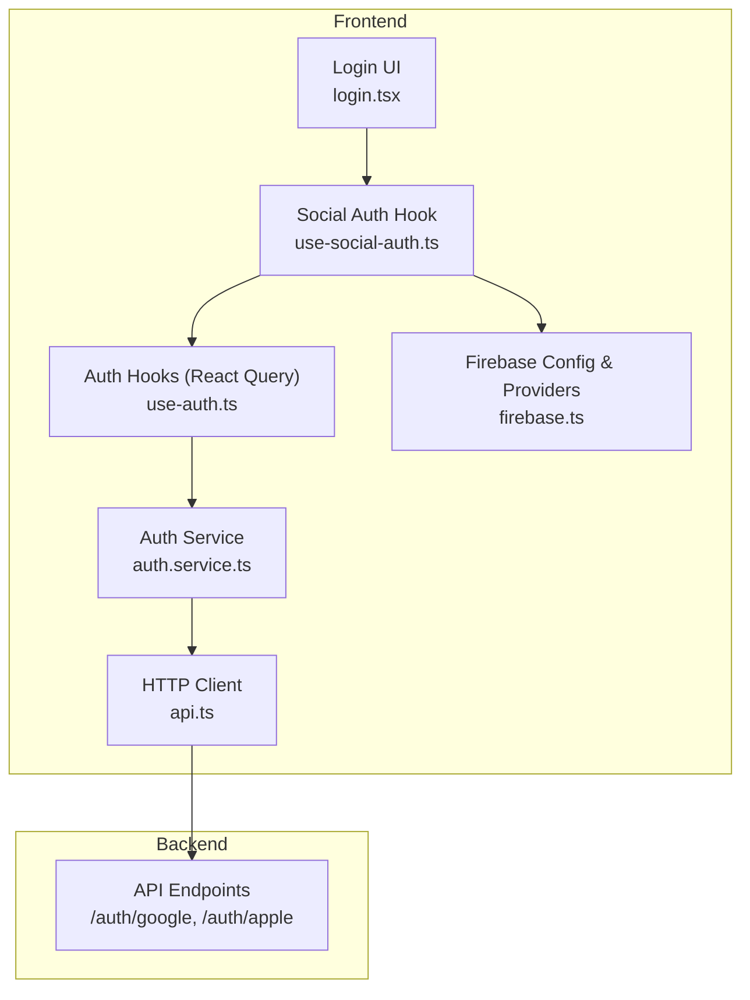
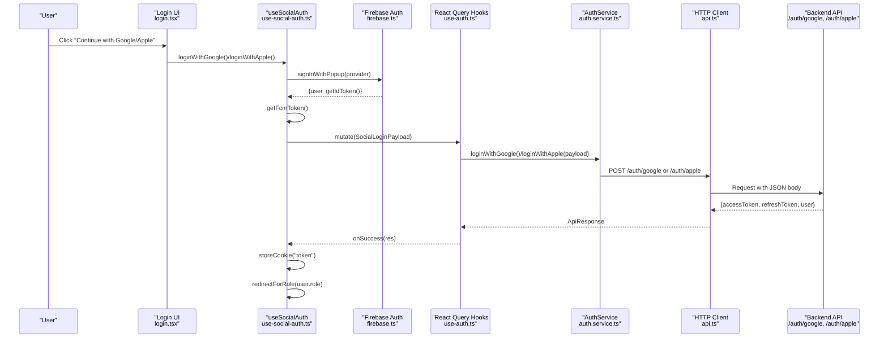
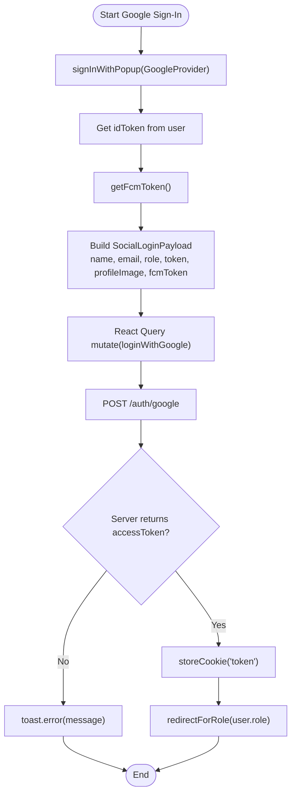
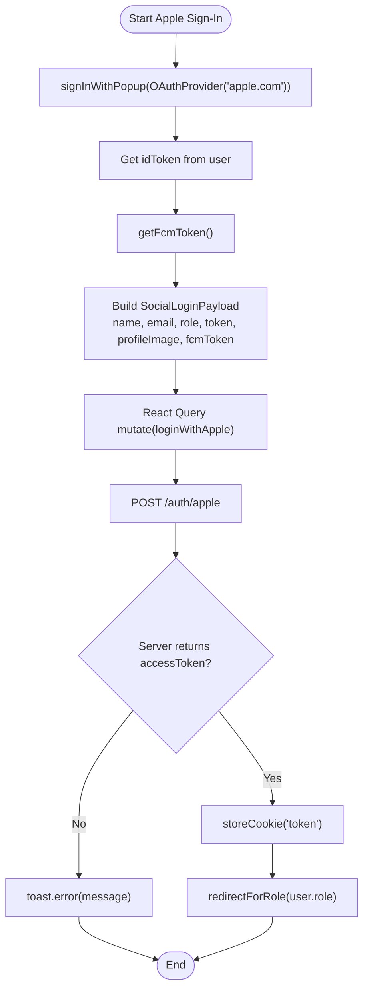
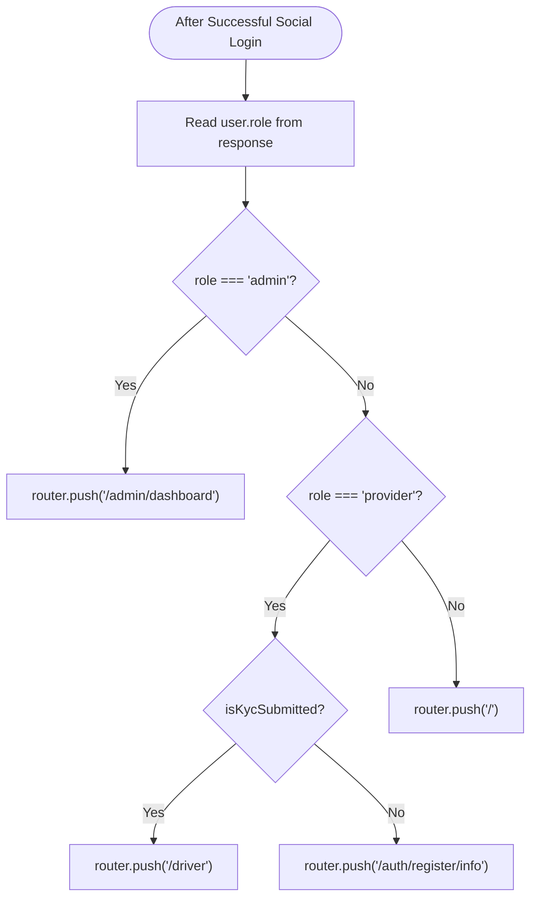
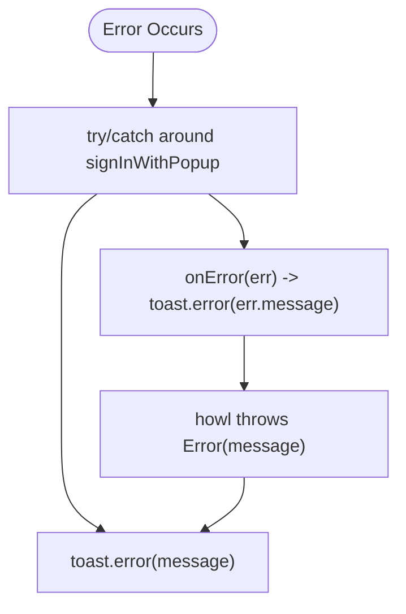
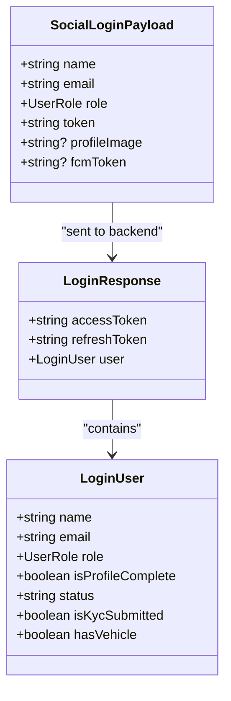
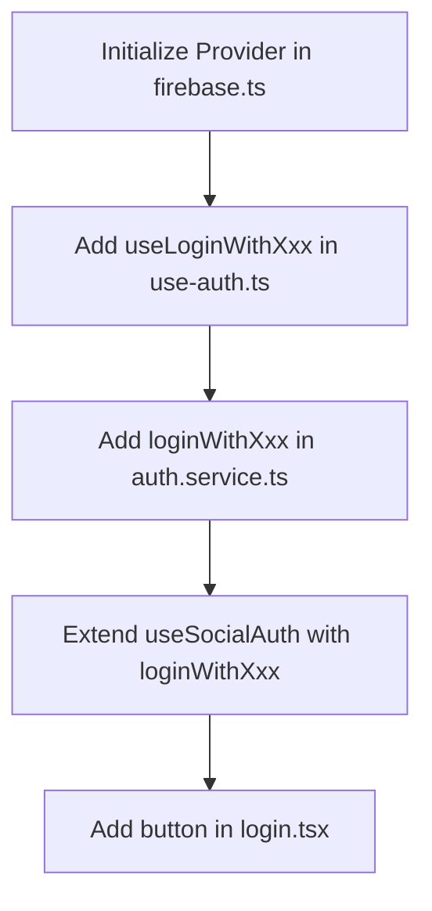
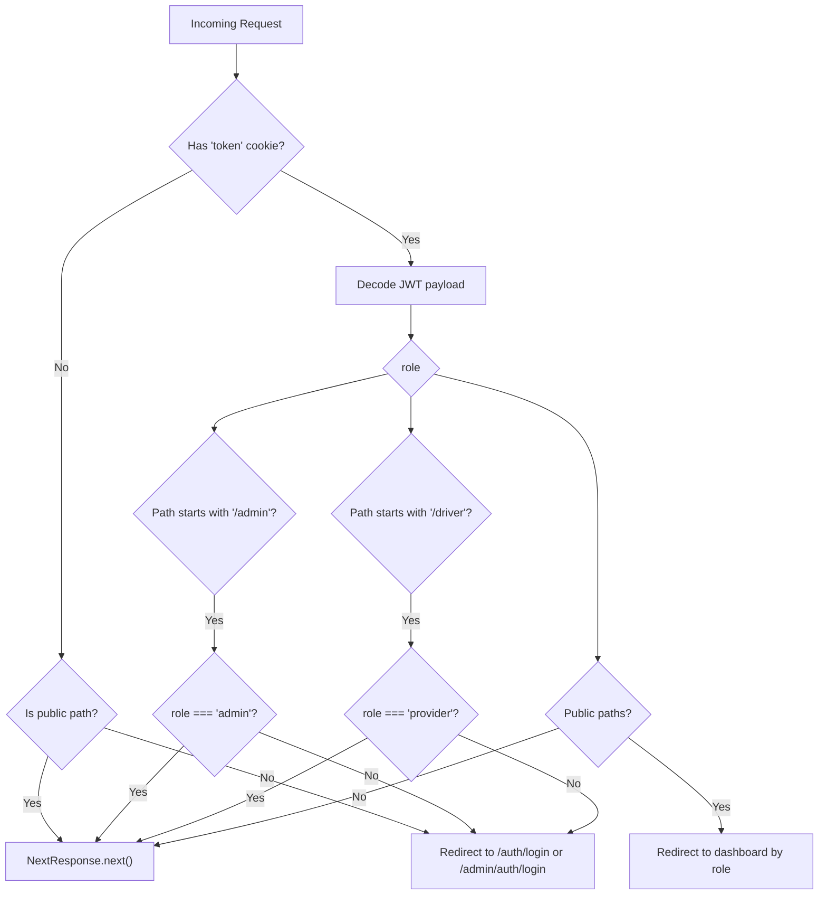
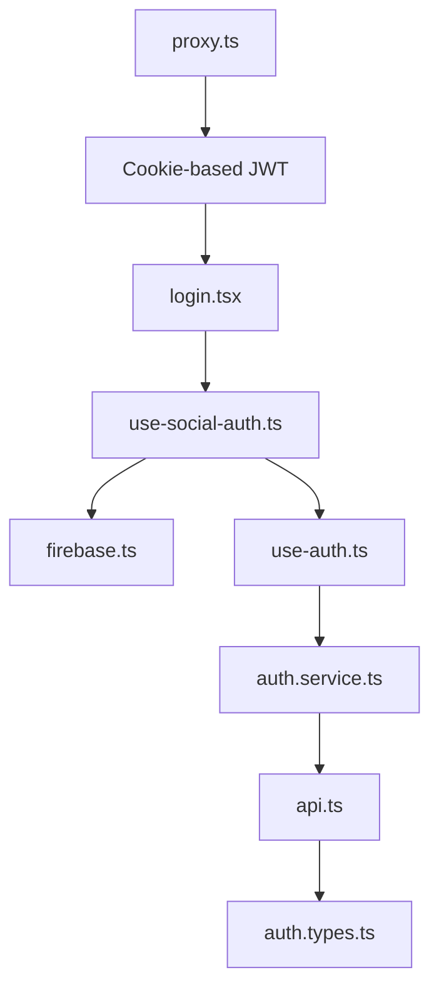

# Social Authentication Providers

<cite>
**Referenced Files in This Document**
- [use-social-auth.ts](file://src/hooks/auth/use-social-auth.ts)
- [use-auth.ts](file://src/hooks/auth/use-auth.ts)
- [firebase.ts](file://src/lib/firebase.ts)
- [auth.service.ts](file://src/services/auth.service.ts)
- [api.ts](file://src/lib/api.ts)
- [auth.types.ts](file://src/types/auth.types.ts)
- [login.tsx](file://src/app/auth/login/login.tsx)
- [proxy.ts](file://src/proxy.ts)
</cite>

## Table of Contents
1. [Introduction](#introduction)
2. [Project Structure](#project-structure)
3. [Core Components](#core-components)
4. [Architecture Overview](#architecture-overview)
5. [Detailed Component Analysis](#detailed-component-analysis)
6. [Dependency Analysis](#dependency-analysis)
7. [Performance Considerations](#performance-considerations)
8. [Troubleshooting Guide](#troubleshooting-guide)
9. [Conclusion](#conclusion)
10. [Appendices](#appendices)

## Introduction
This document explains how social authentication providers are integrated into the application, focusing on Google and Apple Sign-In. It covers provider setup, scope configuration, redirect handling, error handling strategies, user data extraction, role-based access control integration, and platform-specific considerations for web and mobile.

## Project Structure
Social authentication is implemented across hooks, Firebase configuration, services, types, UI components, and middleware:
- Provider initialization and scopes are defined in the Firebase module.
- The social auth hook orchestrates sign-in flows and post-login actions.
- React Query hooks wrap service calls to backend endpoints.
- Services map to API endpoints using a shared HTTP client.
- Types define payloads and responses for social login.
- Login UI wires buttons to the social auth hook.
- Middleware enforces role-based access control based on JWT cookies.

**Diagram sources**
- [login.tsx](file://src/app/auth/login/login.tsx)
- [use-social-auth.ts](file://src/hooks/auth/use-social-auth.ts)
- [use-auth.ts](file://src/hooks/auth/use-auth.ts)
- [auth.service.ts](file://src/services/auth.service.ts)
- [api.ts](file://src/lib/api.ts)
- [firebase.ts](file://src/lib/firebase.ts)

**Section sources**
- [firebase.ts](file://src/lib/firebase.ts)
- [use-social-auth.ts](file://src/hooks/auth/use-social-auth.ts)
- [use-auth.ts](file://src/hooks/auth/use-auth.ts)
- [auth.service.ts](file://src/services/auth.service.ts)
- [api.ts](file://src/lib/api.ts)
- [login.tsx](file://src/app/auth/login/login.tsx)

## Core Components
- Firebase provider setup and scopes:
  - Google provider initialized with default settings.
  - Apple provider configured with email and name scopes.
- Social auth hook:
  - Triggers popup sign-in via Firebase.
  - Extracts idToken and FCM token.
  - Sends payload to backend via React Query mutation.
  - Stores server token in cookie and redirects by role.
- Auth hooks and services:
  - useLoginWithGoogle and useLoginWithApple wrap service methods.
  - authService.loginWithGoogle and authService.loginWithApple call backend endpoints.
- HTTP client:
  - Adds Authorization header from cookie if present.
  - Normalizes errors and returns typed responses.
- Types:
  - SocialLoginPayload defines fields sent to backend.
  - LoginResponse includes accessToken and user info used for redirection.
- UI integration:
  - Login page buttons invoke social login functions and show pending states.
- Role-based access control:
  - Middleware reads JWT cookie to enforce route access and redirects.

**Section sources**
- [firebase.ts](file://src/lib/firebase.ts)
- [use-social-auth.ts](file://src/hooks/auth/use-social-auth.ts)
- [use-auth.ts](file://src/hooks/auth/use-auth.ts)
- [auth.service.ts](file://src/services/auth.service.ts)
- [api.ts](file://src/lib/api.ts)
- [auth.types.ts](file://src/types/auth.types.ts)
- [login.tsx](file://src/app/auth/login/login.tsx)
- [proxy.ts](file://src/proxy.ts)

## Architecture Overview
The social authentication flow combines client-side OAuth popups with server-side token exchange and role-based routing.

**Diagram sources**
- [login.tsx](file://src/app/auth/login/login.tsx)
- [use-social-auth.ts](file://src/hooks/auth/use-social-auth.ts)
- [firebase.ts](file://src/lib/firebase.ts)
- [use-auth.ts](file://src/hooks/auth/use-auth.ts)
- [auth.service.ts](file://src/services/auth.service.ts)
- [api.ts](file://src/lib/api.ts)

## Detailed Component Analysis

### Google OAuth Provider Setup and Flow
- Provider initialization:
  - A GoogleAuthProvider instance is created and exported for use in sign-in.
- Popup sign-in:
  - signInWithPopup uses the Google provider to authenticate the user.
- Token and profile extraction:
  - The idToken is obtained from the authenticated user.
  - Profile fields such as display name, email, and photo URL are extracted.
- Backend exchange:
  - A SocialLoginPayload is constructed and sent to the backend via React Query and the auth service.
- Post-login:
  - On success, the server’s access token is stored in a cookie and the user is redirected according to their role.

**Diagram sources**
- [use-social-auth.ts](file://src/hooks/auth/use-social-auth.ts)
- [auth.service.ts](file://src/services/auth.service.ts)
- [api.ts](file://src/lib/api.ts)

**Section sources**
- [firebase.ts](file://src/lib/firebase.ts)
- [use-social-auth.ts](file://src/hooks/auth/use-social-auth.ts)
- [auth.service.ts](file://src/services/auth.service.ts)
- [api.ts](file://src/lib/api.ts)

### Apple Sign-In Implementation
- Provider initialization:
  - An OAuthProvider with identifier "apple.com" is created.
  - Scopes "email" and "name" are added to request user information.
- Popup sign-in:
  - signInWithPopup uses the Apple provider to authenticate the user.
- Token and profile extraction:
  - The idToken is obtained from the authenticated user.
  - Profile fields such as display name, email, and photo URL are extracted.
- Backend exchange:
  - A SocialLoginPayload is constructed and sent to the backend via React Query and the auth service.
- Post-login:
  - On success, the server’s access token is stored in a cookie and the user is redirected according to their role.

**Diagram sources**
- [use-social-auth.ts](file://src/hooks/auth/use-social-auth.ts)
- [auth.service.ts](file://src/services/auth.service.ts)
- [api.ts](file://src/lib/api.ts)
- [firebase.ts](file://src/lib/firebase.ts)

**Section sources**
- [firebase.ts](file://src/lib/firebase.ts)
- [use-social-auth.ts](file://src/hooks/auth/use-social-auth.ts)
- [auth.service.ts](file://src/services/auth.service.ts)
- [api.ts](file://src/lib/api.ts)

### Scope Configuration and Redirect Handling
- Scopes:
  - Apple provider adds "email" and "name" scopes to request user details.
  - Google provider uses default scopes; additional scopes can be added at initialization if needed.
- Redirect handling:
  - After successful login, the hook stores the server token in a cookie and redirects based on user role:
    - Admin: admin dashboard
    - Provider: driver area or KYC completion page
    - User: home page

**Diagram sources**
- [use-social-auth.ts](file://src/hooks/auth/use-social-auth.ts)

**Section sources**
- [firebase.ts](file://src/lib/firebase.ts)
- [use-social-auth.ts](file://src/hooks/auth/use-social-auth.ts)

### Error Handling Strategies
- Frontend errors:
  - Popup failures and network errors are caught and displayed via toast notifications.
- Backend errors:
  - The HTTP client throws an Error with message from server response when status is not OK.
- Mutation callbacks:
  - onError handlers display server messages to users.

**Diagram sources**
- [use-social-auth.ts](file://src/hooks/auth/use-social-auth.ts)
- [api.ts](file://src/lib/api.ts)

**Section sources**
- [use-social-auth.ts](file://src/hooks/auth/use-social-auth.ts)
- [api.ts](file://src/lib/api.ts)

### User Data Extraction from Social Accounts
- From Firebase user object:
  - Display name, email, and profile image URL are extracted after successful sign-in.
- Payload construction:
  - These values are included in SocialLoginPayload along with the idToken and optional FCM token.
- Server response:
  - The backend returns a LoginResponse containing accessToken and user metadata used for redirection.

**Diagram sources**
- [auth.types.ts](file://src/types/auth.types.ts)
- [use-social-auth.ts](file://src/hooks/auth/use-social-auth.ts)

**Section sources**
- [auth.types.ts](file://src/types/auth.types.ts)
- [use-social-auth.ts](file://src/hooks/auth/use-social-auth.ts)

### Implementing Custom Social Providers
To add a new provider:
- Initialize a provider in the Firebase module and configure any required scopes.
- Add a corresponding React Query hook that wraps the service method.
- Create a service method mapping to the backend endpoint.
- Extend the social auth hook with a new function that:
  - Calls signInWithPopup with the new provider.
  - Extracts idToken and profile fields.
  - Builds and sends SocialLoginPayload.
  - Stores the server token and redirects by role.
- Wire up UI buttons to the new function.

[No sources needed since this section provides general guidance]

### Handling Authentication State Changes
- Pending states:
  - The social auth hook exposes isGooglePending and isApplePending to disable buttons during requests.
- Cookie persistence:
  - The server token is stored in a cookie with path "/" and expiration set for one week.
- Navigation:
  - After successful login, the user is redirected based on role and KYC status.

**Section sources**
- [use-social-auth.ts](file://src/hooks/auth/use-social-auth.ts)
- [login.tsx](file://src/app/auth/login/login.tsx)

### Integrating with Role-Based Access Control
- Middleware enforcement:
  - The proxy middleware reads the JWT cookie, decodes the payload, and enforces access rules:
    - Public paths allow unauthenticated access.
    - Admin routes require admin role.
    - Driver routes require provider role.
    - Logged-in users are redirected away from public auth pages to appropriate dashboards.
- Logout:
  - The logout route clears the token cookie and redirects to the relevant login page.

**Diagram sources**
- [proxy.ts](file://src/proxy.ts)

**Section sources**
- [proxy.ts](file://src/proxy.ts)

### Platform-Specific Considerations for Mobile and Web
- Web:
  - Popup-based sign-in works well in browsers.
  - Cookies are used for session management and are read by the HTTP client and middleware.
- Mobile:
  - Popups may be blocked or behave differently on mobile devices.
  - Consider using redirect-based flows or native SDKs for iOS/Android where applicable.
  - Ensure environment variables for Firebase messaging are configured if push notifications are required.

[No sources needed since this section provides general guidance]

## Dependency Analysis
The following diagram shows key dependencies between modules involved in social authentication.

**Diagram sources**
- [login.tsx](file://src/app/auth/login/login.tsx)
- [use-social-auth.ts](file://src/hooks/auth/use-social-auth.ts)
- [firebase.ts](file://src/lib/firebase.ts)
- [use-auth.ts](file://src/hooks/auth/use-auth.ts)
- [auth.service.ts](file://src/services/auth.service.ts)
- [api.ts](file://src/lib/api.ts)
- [auth.types.ts](file://src/types/auth.types.ts)
- [proxy.ts](file://src/proxy.ts)

**Section sources**
- [use-social-auth.ts](file://src/hooks/auth/use-social-auth.ts)
- [use-auth.ts](file://src/hooks/auth/use-auth.ts)
- [auth.service.ts](file://src/services/auth.service.ts)
- [api.ts](file://src/lib/api.ts)
- [auth.types.ts](file://src/types/auth.types.ts)
- [proxy.ts](file://src/proxy.ts)

## Performance Considerations
- Avoid redundant network calls by leveraging React Query caching and refetch policies where appropriate.
- Minimize payload size by sending only necessary fields in SocialLoginPayload.
- Use conditional imports for optional features like Firebase messaging to reduce bundle size.
- Debounce or throttle UI interactions that trigger multiple mutations.

[No sources needed since this section provides general guidance]

## Troubleshooting Guide
- Popup blocked:
  - Ensure popups are allowed by the browser and test on desktop first.
- Missing scopes:
  - Verify Apple provider scopes include "email" and "name".
  - For Google, add required scopes at provider initialization if needed.
- Network errors:
  - Check server availability and CORS settings.
  - Inspect error messages thrown by the HTTP client.
- Cookie issues:
  - Confirm cookie path and sameSite settings align with your deployment domain.
  - Validate that the middleware can read the cookie and decode the JWT.
- Role mismatches:
  - Ensure the backend assigns correct roles and the middleware checks them consistently.

**Section sources**
- [use-social-auth.ts](file://src/hooks/auth/use-social-auth.ts)
- [firebase.ts](file://src/lib/firebase.ts)
- [api.ts](file://src/lib/api.ts)
- [proxy.ts](file://src/proxy.ts)

## Conclusion
The application integrates Google and Apple social authentication through Firebase popups, React Query mutations, and a secure cookie-based session managed by middleware. Roles determine post-login navigation and route access. Extending to additional providers follows a consistent pattern: initialize provider, create hooks and services, handle token exchange, and enforce RBAC.

[No sources needed since this section summarizes without analyzing specific files]

## Appendices
- Environment variables:
  - Firebase configuration keys must be set for app initialization and messaging.
- API endpoints:
  - Social login endpoints are POST /auth/google and POST /auth/apple.

**Section sources**
- [firebase.ts](file://src/lib/firebase.ts)
- [auth.service.ts](file://src/services/auth.service.ts)