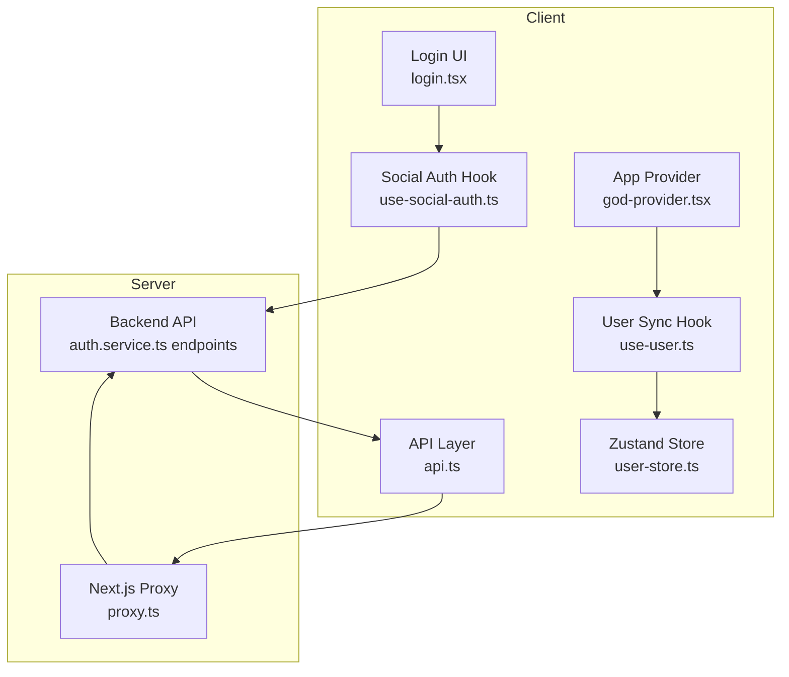
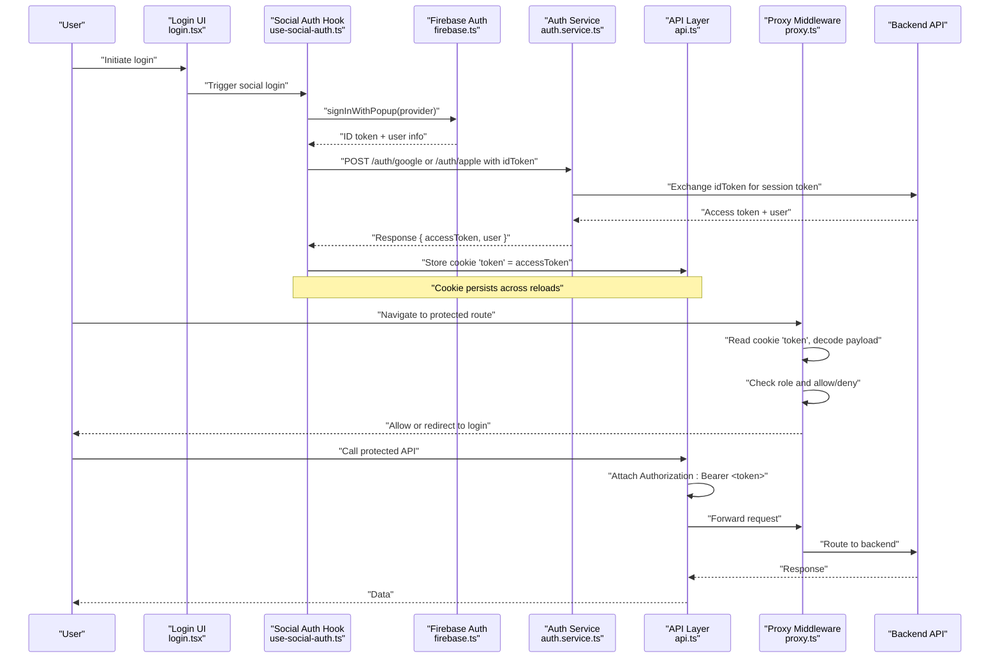
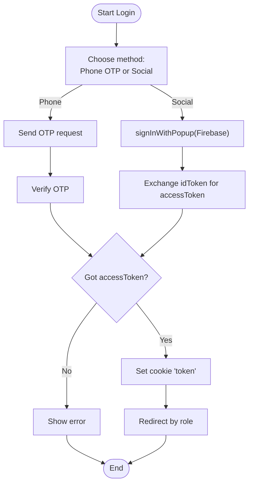
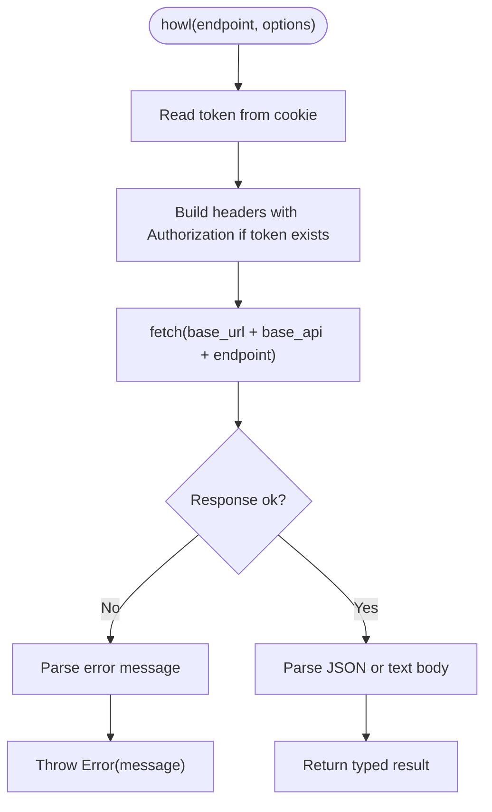
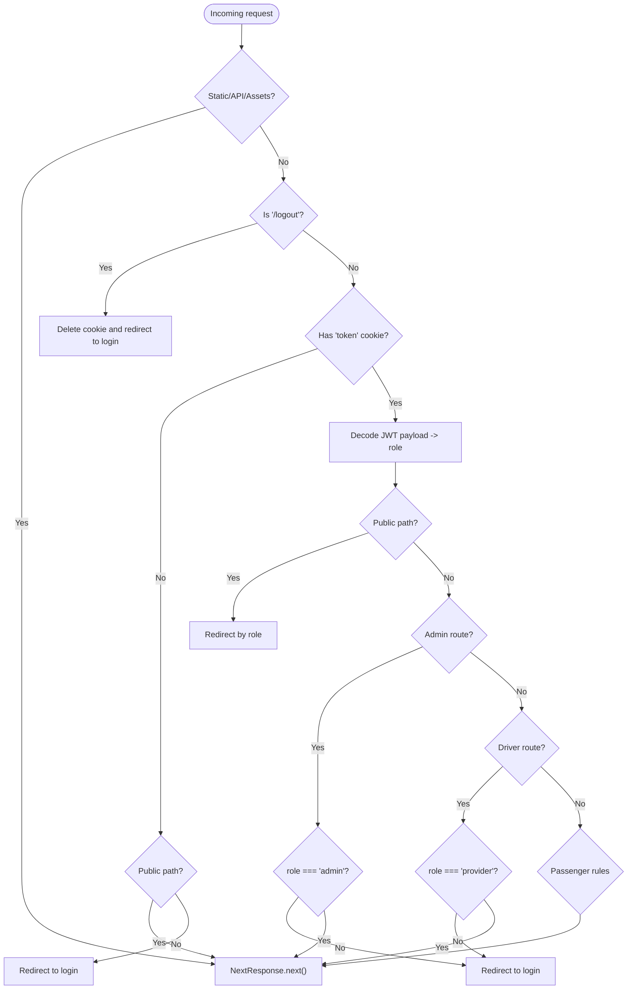
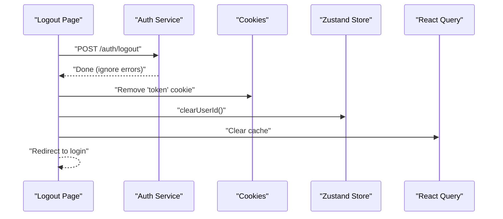
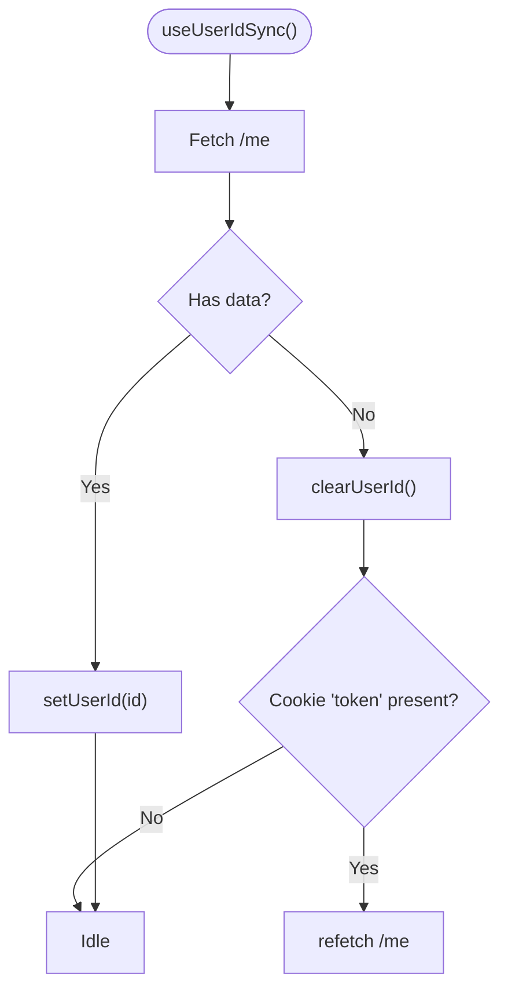
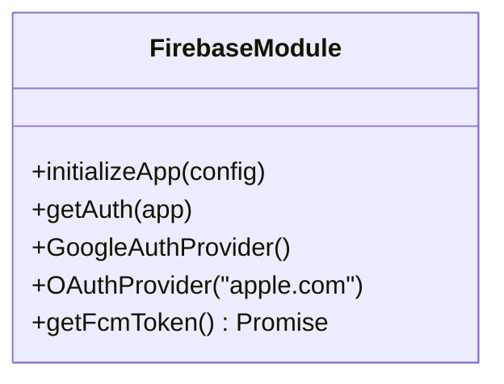
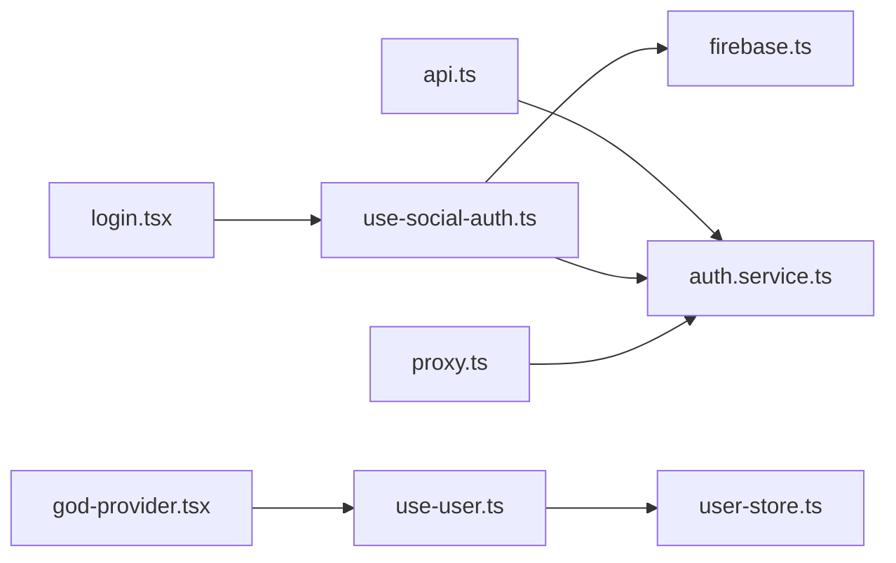

# Token Management & Session Handling

<cite>
**Referenced Files in This Document**
- [firebase.ts](file://src/lib/firebase.ts)
- [api.ts](file://src/lib/api.ts)
- [auth.service.ts](file://src/services/auth.service.ts)
- [use-auth.ts](file://src/hooks/auth/use-auth.ts)
- [use-social-auth.ts](file://src/hooks/auth/use-social-auth.ts)
- [login.tsx](file://src/app/auth/login/login.tsx)
- [page.tsx](file://src/app/auth/login/page.tsx)
- [proxy.ts](file://src/proxy.ts)
- [logout page.tsx](file://src/app/logout/page.tsx)
- [user-store.ts](file://src/store/user-store.ts)
- [use-user.ts](file://src/hooks/shared/use-user.ts)
- [god-provider.tsx](file://src/provider/god-provider.tsx)
- [auth.types.ts](file://src/types/auth.types.ts)
</cite>

## Table of Contents
1. [Introduction](#introduction)
2. [Project Structure](#project-structure)
3. [Core Components](#core-components)
4. [Architecture Overview](#architecture-overview)
5. [Detailed Component Analysis](#detailed-component-analysis)
6. [Dependency Analysis](#dependency-analysis)
7. [Performance Considerations](#performance-considerations)
8. [Troubleshooting Guide](#troubleshooting-guide)
9. [Conclusion](#conclusion)

## Introduction
This document explains how the application manages authentication tokens and sessions, focusing on:
- How JWT access tokens are obtained, stored, and attached to API requests
- How server-side route protection uses the token cookie for session validation
- How user state is synchronized across components using Zustand and React Query
- How logout clears tokens and resets state
- Security best practices and cross-origin considerations
- Practical guidance for implementing custom interceptors and handling token expiration gracefully

The implementation combines Firebase Auth for social sign-in, a backend-provided JWT access token stored in an HTTP-only-style cookie (via react-cookie), and Next.js middleware for route-level authorization.

## Project Structure
Key areas involved in token management and session handling:
- Client-side token storage and request attachment
  - Cookie-based token storage and retrieval
  - Authorization header injection for API calls
- Server-side route protection
  - Middleware reads the token cookie and enforces role-based access
- Social login flow
  - Firebase ID token exchange with backend to obtain a session token
- State synchronization
  - User identity synced into a Zustand store via React Query
- Logout procedure
  - Clears cookies, invalidates caches, and redirects

**Diagram sources**
- [login.tsx](file://src/app/auth/login/login.tsx)
- [use-social-auth.ts](file://src/hooks/auth/use-social-auth.ts)
- [api.ts](file://src/lib/api.ts)
- [proxy.ts](file://src/proxy.ts)
- [auth.service.ts](file://src/services/auth.service.ts)
- [user-store.ts](file://src/store/user-store.ts)
- [use-user.ts](file://src/hooks/shared/use-user.ts)
- [god-provider.tsx](file://src/provider/god-provider.tsx)

**Section sources**
- [login.tsx](file://src/app/auth/login/login.tsx)
- [use-social-auth.ts](file://src/hooks/auth/use-social-auth.ts)
- [api.ts](file://src/lib/api.ts)
- [proxy.ts](file://src/proxy.ts)
- [auth.service.ts](file://src/services/auth.service.ts)
- [user-store.ts](file://src/store/user-store.ts)
- [use-user.ts](file://src/hooks/shared/use-user.ts)
- [god-provider.tsx](file://src/provider/god-provider.tsx)

## Core Components
- Token storage and request attachment
  - The API layer reads the token from cookies and attaches it as a Bearer Authorization header for all JSON requests.
  - Credentials mode is set to include for cookie sharing.
- Route protection
  - The proxy middleware inspects the token cookie, decodes its payload to determine the role, and enforces access rules per route segment.
- Social login
  - Firebase popup sign-in obtains an ID token; the client exchanges it with the backend to receive a session access token, which is then stored in a cookie.
- State synchronization
  - A hook fetches the current user profile and syncs the user ID into a Zustand store.
- Logout
  - Calls the backend logout endpoint, removes the token cookie, clears the Zustand store, and clears React Query cache before redirecting.

**Section sources**
- [api.ts](file://src/lib/api.ts)
- [proxy.ts](file://src/proxy.ts)
- [use-social-auth.ts](file://src/hooks/auth/use-social-auth.ts)
- [auth.service.ts](file://src/services/auth.service.ts)
- [use-user.ts](file://src/hooks/shared/use-user.ts)
- [user-store.ts](file://src/store/user-store.ts)
- [logout page.tsx](file://src/app/logout/page.tsx)

## Architecture Overview
End-to-end flows for authentication and session enforcement:

**Diagram sources**
- [login.tsx](file://src/app/auth/login/login.tsx)
- [use-social-auth.ts](file://src/hooks/auth/use-social-auth.ts)
- [firebase.ts](file://src/lib/firebase.ts)
- [auth.service.ts](file://src/services/auth.service.ts)
- [api.ts](file://src/lib/api.ts)
- [proxy.ts](file://src/proxy.ts)

## Detailed Component Analysis

### Login Flow (Phone OTP and Social)
- Phone OTP login
  - The login form sends phone number to initiate OTP. After verification, the backend returns an access token, which is stored in a cookie.
- Social login
  - Firebase popup obtains an ID token. The client posts this to the backend to receive a session access token, which is stored in a cookie.
- Post-login behavior
  - On success, the app stores the token cookie and navigates based on user role.

**Diagram sources**
- [login.tsx](file://src/app/auth/login/login.tsx)
- [use-social-auth.ts](file://src/hooks/auth/use-social-auth.ts)
- [auth.types.ts](file://src/types/auth.types.ts)

**Section sources**
- [login.tsx](file://src/app/auth/login/login.tsx)
- [use-social-auth.ts](file://src/hooks/auth/use-social-auth.ts)
- [auth.types.ts](file://src/types/auth.types.ts)

### API Layer and Token Attachment
- Token retrieval
  - Reads the token from cookies when available.
- Request construction
  - Adds Authorization header with Bearer token if present.
  - Uses credentials: include to ensure cookies are sent.
- Error handling
  - Normalizes response errors and throws descriptive messages.

**Diagram sources**
- [api.ts](file://src/lib/api.ts)

**Section sources**
- [api.ts](file://src/lib/api.ts)

### Route Protection and Role-Based Access
- Public paths
  - Certain auth pages are public and bypass checks.
- Token presence
  - If no token, redirect to appropriate login page depending on target route.
- Role decoding
  - Decodes the token payload to extract role and enforce route restrictions.
- Redirect logic
  - Admin routes require admin role; driver routes require provider role; otherwise redirect accordingly.

**Diagram sources**
- [proxy.ts](file://src/proxy.ts)

**Section sources**
- [proxy.ts](file://src/proxy.ts)

### Logout Procedure
- Backend notification
  - Calls the logout endpoint to invalidate server-side sessions.
- Local cleanup
  - Removes the token cookie, clears the Zustand user store, and clears React Query cache.
- Navigation
  - Redirects to the appropriate login page.

**Diagram sources**
- [logout page.tsx](file://src/app/logout/page.tsx)
- [auth.service.ts](file://src/services/auth.service.ts)
- [user-store.ts](file://src/store/user-store.ts)

**Section sources**
- [logout page.tsx](file://src/app/logout/page.tsx)
- [auth.service.ts](file://src/services/auth.service.ts)
- [user-store.ts](file://src/store/user-store.ts)

### User State Synchronization
- User identity sync
  - A hook fetches the current user profile and updates the Zustand store with the user ID.
- Rehydration trigger
  - If the store has no user ID but a token cookie exists, it refetches the profile to rehydrate state.

**Diagram sources**
- [use-user.ts](file://src/hooks/shared/use-user.ts)
- [user-store.ts](file://src/store/user-store.ts)

**Section sources**
- [use-user.ts](file://src/hooks/shared/use-user.ts)
- [user-store.ts](file://src/store/user-store.ts)

### Firebase Integration and FCM Token
- Firebase initialization
  - Initializes Firebase app and providers for Google and Apple.
- FCM token acquisition
  - Dynamically imports messaging module, checks support, and retrieves the FCM token with VAPID key.

**Diagram sources**
- [firebase.ts](file://src/lib/firebase.ts)

**Section sources**
- [firebase.ts](file://src/lib/firebase.ts)

## Dependency Analysis
High-level dependencies among core modules:

**Diagram sources**
- [api.ts](file://src/lib/api.ts)
- [auth.service.ts](file://src/services/auth.service.ts)
- [use-social-auth.ts](file://src/hooks/auth/use-social-auth.ts)
- [firebase.ts](file://src/lib/firebase.ts)
- [login.tsx](file://src/app/auth/login/login.tsx)
- [proxy.ts](file://src/proxy.ts)
- [use-user.ts](file://src/hooks/shared/use-user.ts)
- [user-store.ts](file://src/store/user-store.ts)
- [god-provider.tsx](file://src/provider/god-provider.tsx)

**Section sources**
- [api.ts](file://src/lib/api.ts)
- [auth.service.ts](file://src/services/auth.service.ts)
- [use-social-auth.ts](file://src/hooks/auth/use-social-auth.ts)
- [firebase.ts](file://src/lib/firebase.ts)
- [login.tsx](file://src/app/auth/login/login.tsx)
- [proxy.ts](file://src/proxy.ts)
- [use-user.ts](file://src/hooks/shared/use-user.ts)
- [user-store.ts](file://src/store/user-store.ts)
- [god-provider.tsx](file://src/provider/god-provider.tsx)

## Performance Considerations
- Avoid redundant network calls
  - Use React Query caching and stale times to minimize repeated profile fetches.
- Minimize token lookups
  - Centralize token reading in the API layer to avoid repeated cookie parsing.
- Efficient redirects
  - Keep middleware checks minimal and fast; rely on cookie presence and simple payload decoding.

[No sources needed since this section provides general guidance]

## Troubleshooting Guide
Common issues and resolutions:
- Requests missing Authorization header
  - Ensure the token cookie is present and not blocked by browser settings.
  - Confirm that the API layer reads the cookie and sets the Authorization header.
- Cross-origin cookie issues
  - Verify that the frontend and backend share the same domain or properly configure SameSite and secure flags.
  - Ensure credentials: include is used for cross-site requests and CORS allows credentials.
- Route redirection loops
  - Check the middleware’s public path list and role-based redirects to prevent infinite loops.
- State desynchronization after reload
  - Confirm that the user sync hook triggers refetch when a token cookie exists but the store lacks a user ID.
- Logout not clearing state
  - Validate that the logout page removes the cookie, clears the Zustand store, and clears React Query cache.

**Section sources**
- [api.ts](file://src/lib/api.ts)
- [proxy.ts](file://src/proxy.ts)
- [use-user.ts](file://src/hooks/shared/use-user.ts)
- [logout page.tsx](file://src/app/logout/page.tsx)

## Conclusion
The application implements a robust token and session strategy:
- Tokens are obtained via social login or OTP verification and stored in cookies
- All API requests attach the token automatically
- Server-side middleware enforces role-based access by inspecting the token cookie
- User state is synchronized into a Zustand store for consistent UI behavior
- Logout comprehensively cleans up local state and redirects appropriately

For future enhancements, consider:
- Implementing automatic token refresh using a refresh token mechanism
- Adding retry logic with backoff for transient 401 responses
- Centralizing interceptor-like behavior for both JSON and FormData requests
- Enhancing security with HttpOnly cookies and strict SameSite policies where supported

[No sources needed since this section summarizes without analyzing specific files]