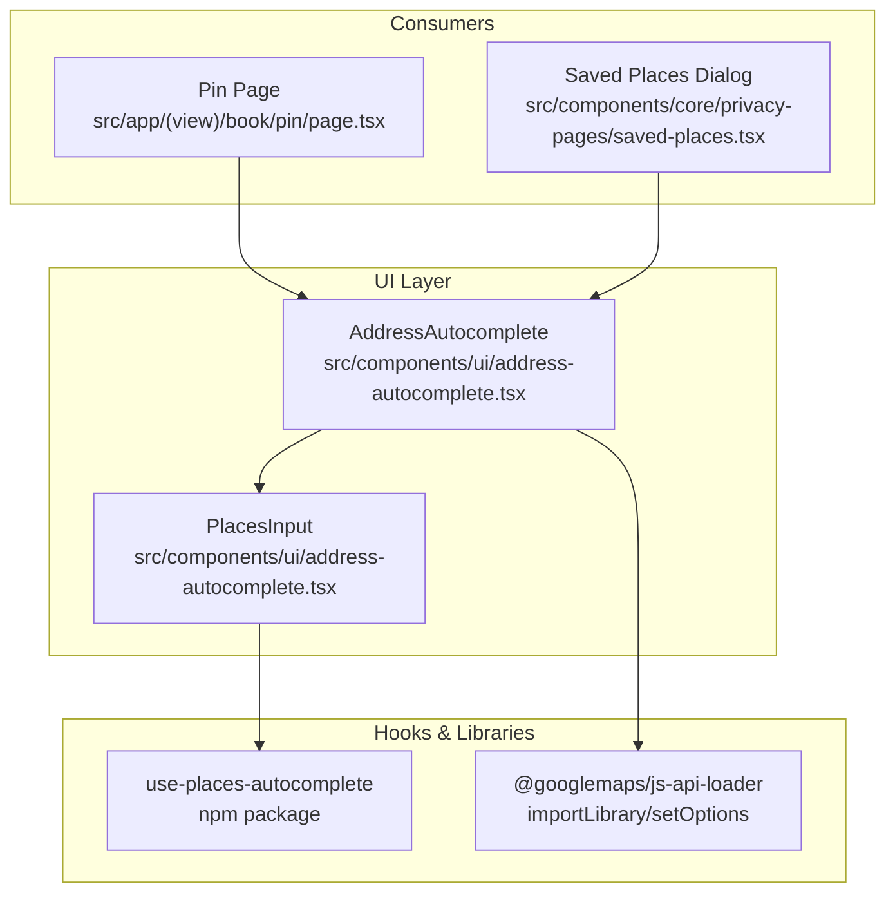
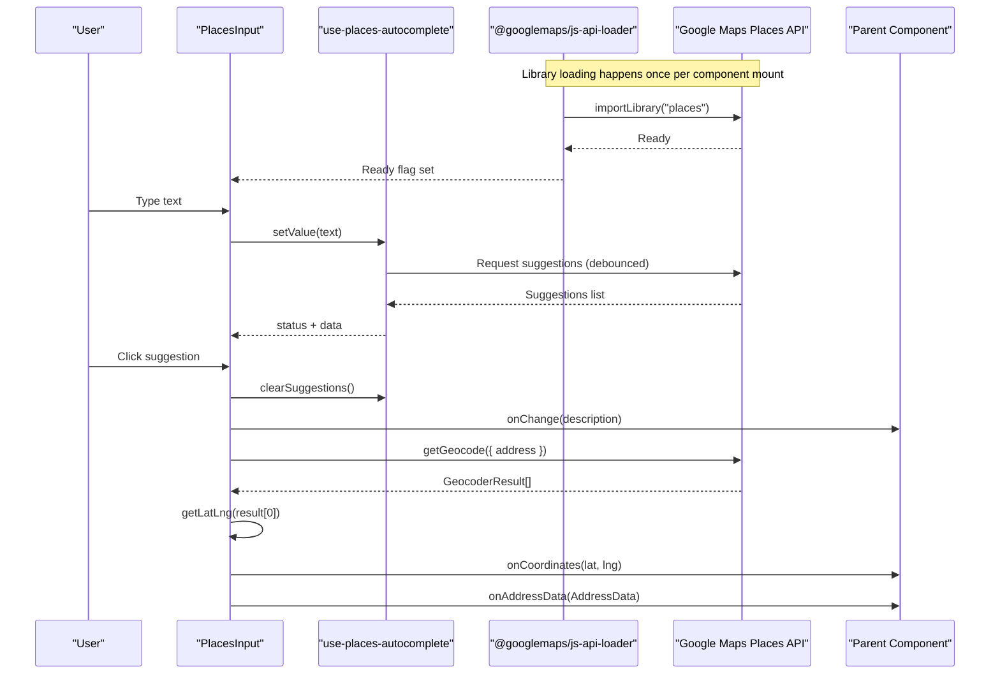
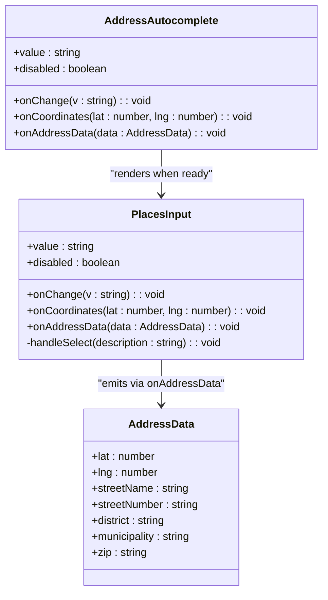
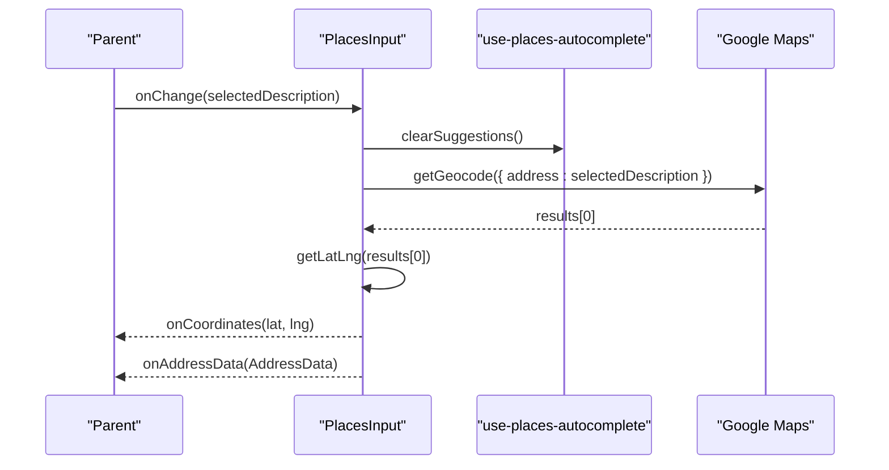
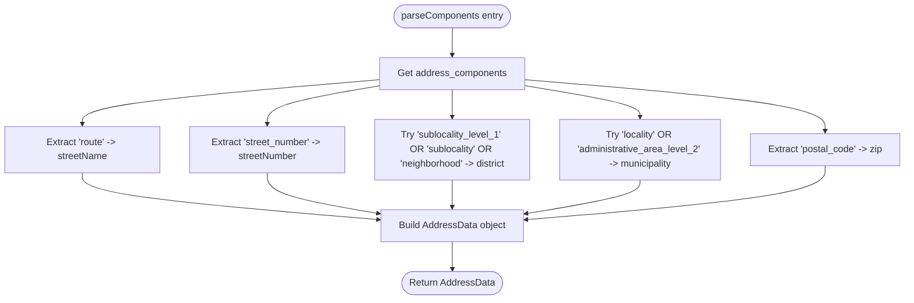
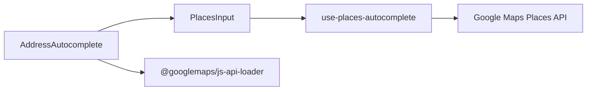

# Address Autocomplete Component

<cite>
**Referenced Files in This Document**
- [address-autocomplete.tsx](file://src/components/ui/address-autocomplete.tsx)
- [pin/page.tsx](file://src/app/(view)/book/pin/page.tsx)
- [saved-places.tsx](file://src/components/core/privacy-pages/saved-places.tsx)
</cite>

## Table of Contents
1. [Introduction](#introduction)
2. [Project Structure](#project-structure)
3. [Core Components](#core-components)
4. [Architecture Overview](#architecture-overview)
5. [Detailed Component Analysis](#detailed-component-analysis)
6. [Dependency Analysis](#dependency-analysis)
7. [Performance Considerations](#performance-considerations)
8. [Troubleshooting Guide](#troubleshooting-guide)
9. [Conclusion](#conclusion)

## Introduction
This document explains the Address Autocomplete component implementation that integrates with Google Maps Places API to provide real-time address suggestions. It covers:
- How the use-places-autocomplete hook is used to fetch and display suggestions
- The AddressData interface structure (lat, lng, streetName, streetNumber, district, municipality, zip)
- The PlacesInput component’s props interface and event handling for address selection
- Coordinate extraction using getGeocode and getLatLng functions
- Address component parsing logic into structured fields
- Usage patterns in application pages
- Error handling strategies
- Performance considerations including debouncing
- Fallback behavior when the Google Maps library is not ready

## Project Structure
The Address Autocomplete feature is implemented as a reusable UI component and consumed by multiple pages:
- Core component: src/components/ui/address-autocomplete.tsx
- Usage examples:
  - Pin page: src/app/(view)/book/pin/page.tsx
  - Saved places dialog: src/components/core/privacy-pages/saved-places.tsx

**Diagram sources**
- [address-autocomplete.tsx:10-169](file://src/components/ui/address-autocomplete.tsx#L10-L169)
- [pin/page.tsx:110-125](file://src/app/(view)/book/pin/page.tsx#L110-L125)
- [saved-places.tsx:15-17](file://src/components/core/privacy-pages/saved-places.tsx#L15-L17)

**Section sources**
- [address-autocomplete.tsx:10-169](file://src/components/ui/address-autocomplete.tsx#L10-L169)
- [pin/page.tsx:110-125](file://src/app/(view)/book/pin/page.tsx#L110-L125)
- [saved-places.tsx:15-17](file://src/components/core/privacy-pages/saved-places.tsx#L15-L17)

## Core Components
- AddressAutocomplete: A client-side React component that loads the Google Maps Places library on demand and renders either a fallback input or the full autocomplete experience.
- PlacesInput: Internal component that wires up use-places-autocomplete, handles user interactions, suggestion rendering, geocoding, and coordinate/component extraction.
- AddressData: Structured data shape returned after selecting an address, containing coordinates and parsed address components.

Key responsibilities:
- Lazy-load the Places library and configure the API key
- Provide real-time suggestions via use-places-autocomplete with debounced queries
- On selection, geocode the description to extract lat/lng and parse address components
- Expose optional callbacks for coordinates and structured address data

**Section sources**
- [address-autocomplete.tsx:10-18](file://src/components/ui/address-autocomplete.tsx#L10-L18)
- [address-autocomplete.tsx:49-70](file://src/components/ui/address-autocomplete.tsx#L49-L70)
- [address-autocomplete.tsx:131-169](file://src/components/ui/address-autocomplete.tsx#L131-L169)

## Architecture Overview
The component architecture follows a layered approach:
- Presentation layer: AddressAutocomplete and PlacesInput render inputs and suggestion lists
- Integration layer: use-places-autocomplete manages query state and suggestions
- Geocoding layer: getGeocode and getLatLng convert selected descriptions to coordinates
- Parsing layer: parseComponents maps raw address components to AddressData

**Diagram sources**
- [address-autocomplete.tsx:140-145](file://src/components/ui/address-autocomplete.tsx#L140-L145)
- [address-autocomplete.tsx:64-70](file://src/components/ui/address-autocomplete.tsx#L64-L70)
- [address-autocomplete.tsx:76-88](file://src/components/ui/address-autocomplete.tsx#L76-L88)

## Detailed Component Analysis

### AddressData Interface
A typed representation of a selected address with coordinates and parsed components:
- lat: number — Latitude from geocoded result
- lng: number — Longitude from geocoded result
- streetName: string — Route name
- streetNumber: string — Street number
- district: string — Sublocality or neighborhood
- municipality: string — Locality or administrative area level 2
- zip: string — Postal code

Parsing strategy:
- Uses helper to find address_components by type
- Falls back across alternative types for district and municipality to maximize coverage

**Section sources**
- [address-autocomplete.tsx:10-18](file://src/components/ui/address-autocomplete.tsx#L10-L18)
- [address-autocomplete.tsx:20-47](file://src/components/ui/address-autocomplete.tsx#L20-L47)

### PlacesInput Props and Behavior
Props:
- value: string — Controlled input value
- onChange: (v: string) => void — Emitted on every keystroke and selection
- onCoordinates?: (lat: number, lng: number) => void — Optional callback invoked after successful geocoding
- onAddressData?: (data: AddressData) => void — Optional callback invoked with parsed address components
- disabled?: boolean — Disables input and suggestions

Behavior highlights:
- Integrates with use-places-autocomplete with debounce: 300ms
- Syncs external value into internal state if provided
- Renders a styled dropdown list when suggestions are available
- Prevents default mouse behavior on suggestion click to avoid focus loss before selection

**Section sources**
- [address-autocomplete.tsx:49-74](file://src/components/ui/address-autocomplete.tsx#L49-L74)
- [address-autocomplete.tsx:90-121](file://src/components/ui/address-autocomplete.tsx#L90-L121)

### Address Autocomplete Lifecycle and Fallback
Lifecycle:
- On mount, sets the Google Maps API key and imports the Places library
- Once loaded, switches from fallback input to PlacesInput
- If library fails to load, logs error and remains in fallback mode

Fallback behavior:
- When mapsReady is false, renders a plain input that still supports manual typing and onChange
- No suggestions or geocoding until the library is ready

**Section sources**
- [address-autocomplete.tsx:131-169](file://src/components/ui/address-autocomplete.tsx#L131-L169)

### Event Handling and Data Flow
Selection flow:
- User clicks a suggestion
- Input clears suggestions and updates its own value
- Parent receives onChange with the selected description
- Component calls getGeocode with the description
- Extracts lat/lng via getLatLng and invokes onCoordinates
- Parses address components and invokes onAddressData

Error handling:
- Geocoding errors are caught and silently ignored; parent can still proceed with just the text if needed

**Section sources**
- [address-autocomplete.tsx:76-88](file://src/components/ui/address-autocomplete.tsx#L76-L88)

### Usage Patterns

#### Pattern A: Map-centric selection (coordinates only)
- Use onChange to update the displayed address text
- Use onCoordinates to move the map center and fly to the location
- Useful for pinning locations on a map

Example reference:
- [pin/page.tsx:110-125](file://src/app/(view)/book/pin/page.tsx#L110-L125)

#### Pattern B: Structured address storage (parsed components)
- Use onAddressData to capture lat/lng and parsed fields
- Populate form fields like streetName, streetNumber, district, municipality, zip
- Useful for saving addresses with detailed components

Example reference:
- [saved-places.tsx:77-84](file://src/components/core/privacy-pages/saved-places.tsx#L77-L84)
- [saved-places.tsx:161-166](file://src/components/core/privacy-pages/saved-places.tsx#L161-L166)

### Class Diagram

**Diagram sources**
- [address-autocomplete.tsx:123-169](file://src/components/ui/address-autocomplete.tsx#L123-L169)
- [address-autocomplete.tsx:49-70](file://src/components/ui/address-autocomplete.tsx#L49-L70)
- [address-autocomplete.tsx:10-18](file://src/components/ui/address-autocomplete.tsx#L10-L18)

### Sequence Diagram: Selection and Geocoding

**Diagram sources**
- [address-autocomplete.tsx:76-88](file://src/components/ui/address-autocomplete.tsx#L76-L88)

### Flowchart: Address Component Parsing

**Diagram sources**
- [address-autocomplete.tsx:27-47](file://src/components/ui/address-autocomplete.tsx#L27-L47)

## Dependency Analysis
External dependencies:
- @googlemaps/js-api-loader: Dynamically loads the Places library and configures the API key
- use-places-autocomplete: Provides hooks for managing input state, fetching suggestions, and utilities like getGeocode and getLatLng

Internal relationships:
- AddressAutocomplete controls library readiness and delegates to PlacesInput
- PlacesInput orchestrates user interaction, suggestion rendering, and geocoding
- Consumers receive structured data through optional callbacks

**Diagram sources**
- [address-autocomplete.tsx:3-8](file://src/components/ui/address-autocomplete.tsx#L3-L8)
- [address-autocomplete.tsx:140-145](file://src/components/ui/address-autocomplete.tsx#L140-L145)

**Section sources**
- [address-autocomplete.tsx:3-8](file://src/components/ui/address-autocomplete.tsx#L3-L8)
- [address-autocomplete.tsx:140-145](file://src/components/ui/address-autocomplete.tsx#L140-L145)

## Performance Considerations
- Debouncing: use-places-autocomplete is configured with debounce: 300ms to reduce API calls during rapid typing
- Conditional rendering: Fallback input avoids unnecessary work until the Places library is ready
- Optional callbacks: onCoordinates and onAddressData allow consumers to opt-in to geocoding and parsing only when needed
- Suggestion clearing: clearSuggestions prevents stale lists from lingering after selection

Recommendations:
- Keep debounce between 250–400ms depending on UX needs
- Avoid heavy work inside onChange; prefer lightweight state updates
- Ensure environment variable NEXT_PUBLIC_GOOGLE_MAPS_API_KEY is set to prevent silent failures

**Section sources**
- [address-autocomplete.tsx:70](file://src/components/ui/address-autocomplete.tsx#L70)
- [address-autocomplete.tsx:140-145](file://src/components/ui/address-autocomplete.tsx#L140-L145)

## Troubleshooting Guide
Common issues and resolutions:
- No suggestions appear:
  - Verify NEXT_PUBLIC_GOOGLE_MAPS_API_KEY is set
  - Check browser console for importLibrary errors
- Coordinates not updated:
  - Ensure onCoordinates is provided and not suppressed by errors
  - Confirm getGeocode returns at least one result
- Parsed fields missing:
  - Some regions may lack certain address components; the parser uses fallbacks but some fields may be empty
- Fallback input active:
  - Indicates Places library is not yet loaded; wait for ready state or check network/API key configuration

Operational notes:
- Geocoding errors are caught and ignored; consumers should handle cases where onCoordinates/onAddressData are not called
- The component disables the input while the library is loading to prevent invalid interactions

**Section sources**
- [address-autocomplete.tsx:140-145](file://src/components/ui/address-autocomplete.tsx#L140-L145)
- [address-autocomplete.tsx:76-88](file://src/components/ui/address-autocomplete.tsx#L76-L88)

## Conclusion
The Address Autocomplete component provides a robust, reusable solution for integrating Google Maps Places API into forms and map-based flows. It balances performance with usability through debounced queries and lazy library loading, offers structured address data via AddressData, and gracefully falls back to a simple input when the library is unavailable. Consumers can choose to leverage coordinates, parsed components, or both, enabling flexible integration patterns across the application.