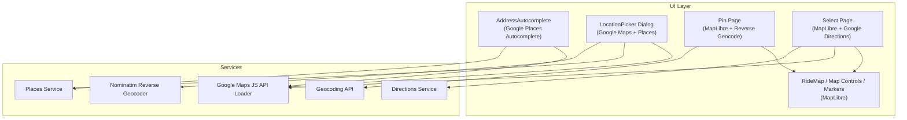
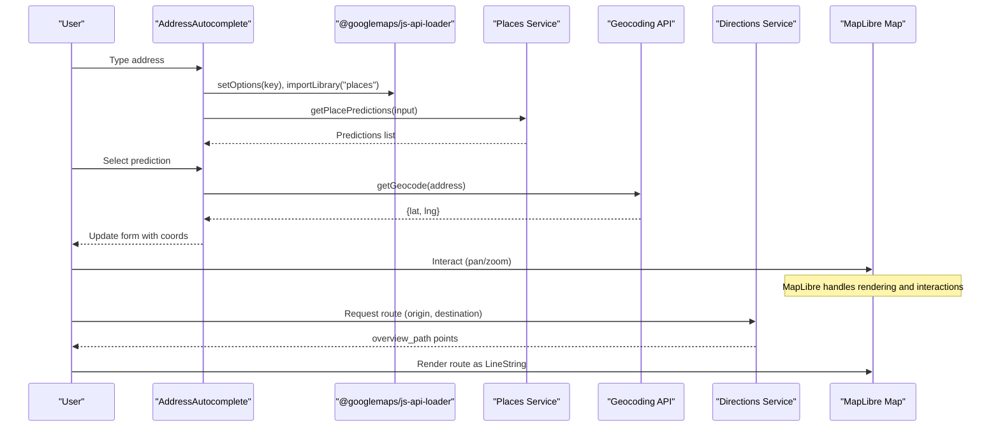
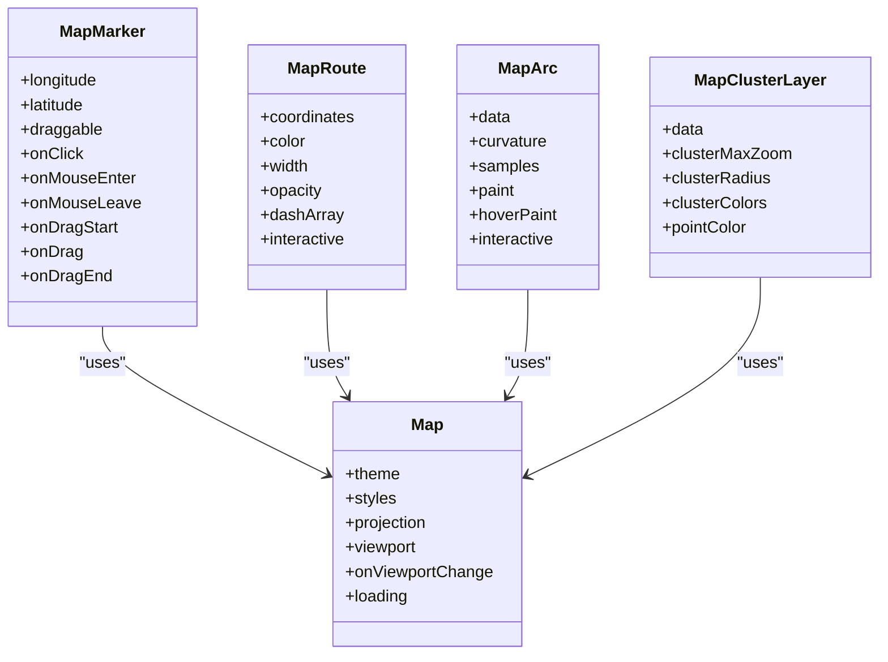
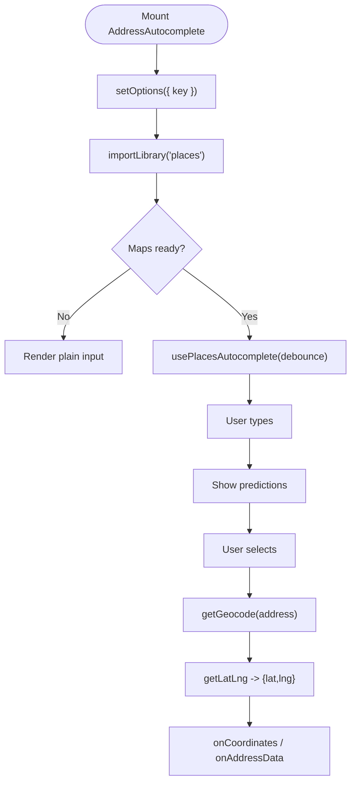
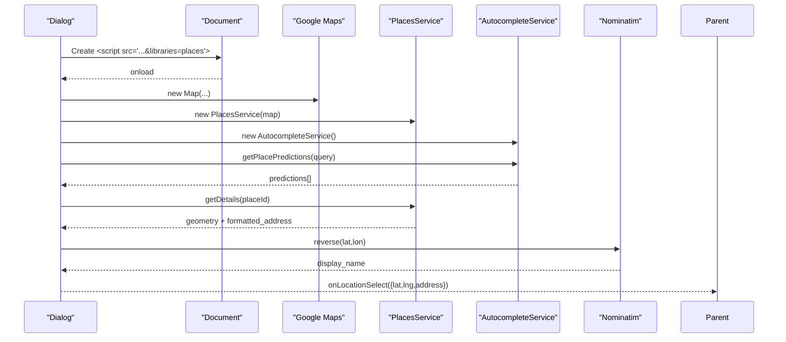
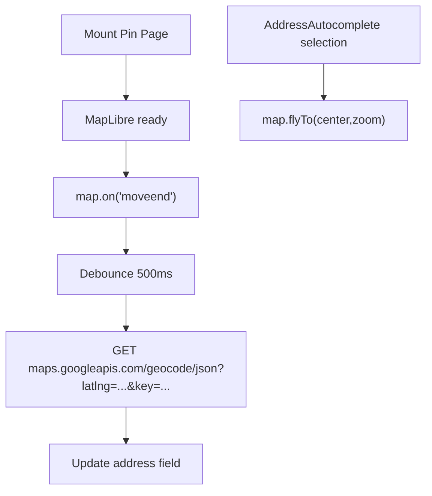
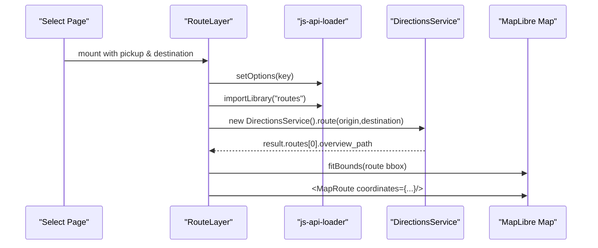
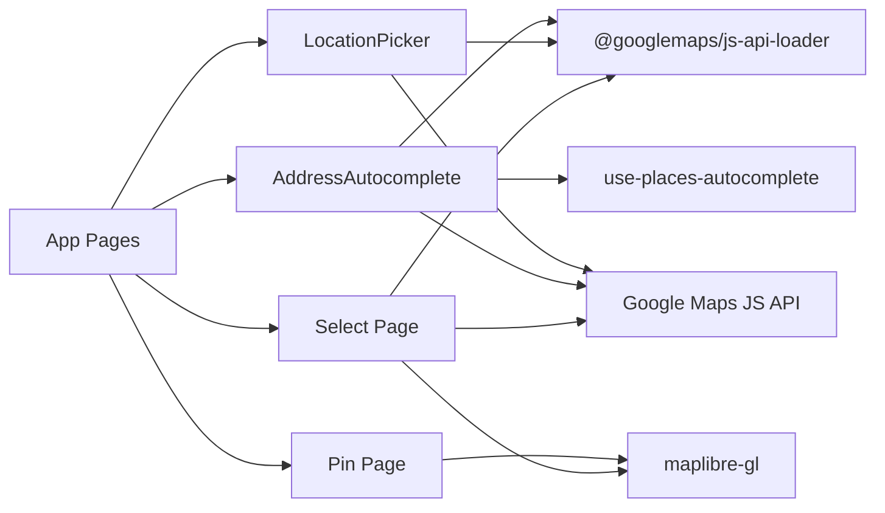

# Google Maps Integration

<cite>
**Referenced Files in This Document**
- [map.tsx](file://src/components/ui/map.tsx)
- [address-autocomplete.tsx](file://src/components/ui/address-autocomplete.tsx)
- [location-picker.tsx](file://src/components/core/location-picker.tsx)
- [page.tsx (book pin)](file://src/app/(view)/book/pin/page.tsx)
- [page.tsx (book select)](file://src/app/(view)/book/select/page.tsx)
- [mapThree.ts](file://src/app/(view)/book/mapThree.ts)
- [live-marker.tsx](file://src/components/core/live-marker.tsx)
</cite>

## Table of Contents
1. [Introduction](#introduction)
2. [Project Structure](#project-structure)
3. [Core Components](#core-components)
4. [Architecture Overview](#architecture-overview)
5. [Detailed Component Analysis](#detailed-component-analysis)
6. [Dependency Analysis](#dependency-analysis)
7. [Performance Considerations](#performance-considerations)
8. [Troubleshooting Guide](#troubleshooting-guide)
9. [Conclusion](#conclusion)

## Introduction
This document explains how the application integrates mapping and location services, focusing on:
- Address autocomplete with place predictions
- Interactive map rendering and customization
- Marker management and route visualization
- Geocoding and reverse geocoding flows
- Real-time location tracking patterns
- API key configuration, error handling for limits, and fallback strategies when Google Maps is unavailable

The codebase uses two complementary approaches:
- A MapLibre-based interactive map component for rendering markers, routes, arcs, clusters, and controls
- Google Maps JavaScript API integration for address autocomplete, place details, directions/routing, and reverse geocoding

## Project Structure
Key files involved in mapping and location features:
- UI map primitives and controls: src/components/ui/map.tsx
- Address autocomplete input: src/components/ui/address-autocomplete.tsx
- Standalone location picker dialog with Google Maps: src/components/core/location-picker.tsx
- Pinning page using MapLibre + Google reverse geocoding: src/app/(view)/book/pin/page.tsx
- Route visualization using Google Directions + MapLibre overlay: src/app/(view)/book/select/page.tsx
- Custom MapLibre style definition: src/app/(view)/book/mapThree.ts
- Live marker visual asset: src/components/core/live-marker.tsx

**Diagram sources**
- [address-autocomplete.tsx:1-170](file://src/components/ui/address-autocomplete.tsx#L1-L170)
- [location-picker.tsx:1-501](file://src/components/core/location-picker.tsx#L1-L501)
- [page.tsx (book pin)](file://src/app/(view)/book/pin/page.tsx#L1-L188)
- [page.tsx (book select)](file://src/app/(view)/book/select/page.tsx#L1-L800)
- [map.tsx:1-1845](file://src/components/ui/map.tsx#L1-L1845)

**Section sources**
- [map.tsx:1-1845](file://src/components/ui/map.tsx#L1-L1845)
- [address-autocomplete.tsx:1-170](file://src/components/ui/address-autocomplete.tsx#L1-L170)
- [location-picker.tsx:1-501](file://src/components/core/location-picker.tsx#L1-L501)
- [page.tsx (book pin)](file://src/app/(view)/book/pin/page.tsx#L1-L188)
- [page.tsx (book select)](file://src/app/(view)/book/select/page.tsx#L1-L800)
- [mapThree.ts](file://src/app/(view)/book/mapThree.ts#L1-L229)
- [live-marker.tsx:1-30](file://src/components/core/live-marker.tsx#L1-L30)

## Core Components
- MapLibre Map Container and Controls
  - Provides a theme-aware Map instance, viewport control, zoom/compass/fullscreen locate controls, and lifecycle-safe event binding.
  - Exposes context for child components to access the map instance and loading state.
- Markers and Popups
  - Declarative marker composition with content, tooltips, labels, drag events, and popups.
- Routes and Arcs
  - GeoJSON-based line rendering for routes and curved arcs with hover/click interactions.
- Clustering
  - Built-in clustering layer for large point datasets with click-to-expand behavior.
- Address Autocomplete
  - Uses Google Places Autocomplete via js-api-loader and a React hook to provide suggestions and coordinates.
- Location Picker Dialog
  - Loads Google Maps on demand, initializes Places service, supports search, click/drag selection, and reverse geocoding via Nominatim.
- Pin Page
  - Uses MapLibre for interaction and calls Google Geocoding API for reverse geocoding on moveend.
- Select Page
  - Calls Google Directions Service to compute route path and renders it as a MapLibre line.

**Section sources**
- [map.tsx:1-1845](file://src/components/ui/map.tsx#L1-L1845)
- [address-autocomplete.tsx:1-170](file://src/components/ui/address-autocomplete.tsx#L1-L170)
- [location-picker.tsx:1-501](file://src/components/core/location-picker.tsx#L1-L501)
- [page.tsx (book pin)](file://src/app/(view)/book/pin/page.tsx#L1-L188)
- [page.tsx (book select)](file://src/app/(view)/book/select/page.tsx#L1-L800)

## Architecture Overview
High-level flow of data and services across components:

**Diagram sources**
- [address-autocomplete.tsx:1-170](file://src/components/ui/address-autocomplete.tsx#L1-L170)
- [page.tsx (book select)](file://src/app/(view)/book/select/page.tsx#L40-L97)
- [map.tsx:1029-1168](file://src/components/ui/map.tsx#L1029-L1168)

## Detailed Component Analysis

### MapLibre Map and Controls
Responsibilities:
- Initialize and manage MapLibre GL map instance
- Theme detection and dynamic style switching
- Controlled/uncontrolled viewport updates
- Lifecycle-safe event listeners and cleanup
- Provide MapContext for children

Key behaviors:
- Default light/dark styles from Carto basemaps
- Optional projection support
- Loading indicator while map/style loads
- Viewport change callback and controlled mode via props

Controls:
- Zoom in/out
- Compass reset bearing
- Locate user (navigator.geolocation)
- Fullscreen toggle

Markers:
- Declarative MapMarker with draggable support
- MarkerContent, MarkerPopup, MarkerTooltip, MarkerLabel
- Event hooks: onClick, onMouseEnter, onMouseLeave, onDragStart/onDrag/onDragEnd

Routes and Arcs:
- MapRoute draws a LineString from coordinate array
- MapArc computes quadratic Bézier curves between pairs with hover/click

Clustering:
- MapClusterLayer adds clustered circles and unclustered points
- Click handlers expand cluster or call custom callbacks

**Diagram sources**
- [map.tsx:169-336](file://src/components/ui/map.tsx#L169-L336)
- [map.tsx:374-495](file://src/components/ui/map.tsx#L374-L495)
- [map.tsx:1052-1168](file://src/components/ui/map.tsx#L1052-L1168)
- [map.tsx:1312-1524](file://src/components/ui/map.tsx#L1312-L1524)
- [map.tsx:1554-1827](file://src/components/ui/map.tsx#L1554-L1827)

**Section sources**
- [map.tsx:1-1845](file://src/components/ui/map.tsx#L1-L1845)

### Address Autocomplete
Responsibilities:
- Load Google Maps JS API once per app session
- Provide an input that shows place predictions
- On selection, geocode to obtain lat/lng and structured address fields

Flow:
- setOptions(apiKey) then importLibrary("places")
- use-places-autocomplete hook manages debounce and suggestions
- getGeocode/getLatLng helpers convert selected description to coordinates
- parseComponents extracts street, district, municipality, zip

**Diagram sources**
- [address-autocomplete.tsx:1-170](file://src/components/ui/address-autocomplete.tsx#L1-L170)

**Section sources**
- [address-autocomplete.tsx:1-170](file://src/components/ui/address-autocomplete.tsx#L1-L170)

### Location Picker Dialog (Google Maps)
Responsibilities:
- Dynamically load Google Maps script only when opened
- Initialize Map and PlacesService
- Support search via AutocompleteService and PlaceDetails
- Allow click/drag to select location
- Reverse geocode via Nominatim to display human-readable address

**Diagram sources**
- [location-picker.tsx:71-150](file://src/components/core/location-picker.tsx#L71-L150)
- [location-picker.tsx:152-213](file://src/components/core/location-picker.tsx#L152-L213)
- [location-picker.tsx:233-320](file://src/components/core/location-picker.tsx#L233-L320)

**Section sources**
- [location-picker.tsx:1-501](file://src/components/core/location-picker.tsx#L1-L501)

### Pin Page (MapLibre + Reverse Geocoding)
Responsibilities:
- Render MapLibre map with center crosshair pin
- Debounced reverse geocoding on map moveend using Google Geocoding API
- AddressAutocomplete integration to flyTo selected coordinates

**Diagram sources**
- [page.tsx (book pin)](file://src/app/(view)/book/pin/page.tsx#L44-L80)
- [page.tsx (book pin)](file://src/app/(view)/book/pin/page.tsx#L110-L125)

**Section sources**
- [page.tsx (book pin)](file://src/app/(view)/book/pin/page.tsx#L1-L188)

### Select Page (Google Directions + MapLibre Route)
Responsibilities:
- Compute driving route using Google Directions Service
- Convert overview_path to [lng,lat] array
- Fit bounds to route and render via MapRoute

**Diagram sources**
- [page.tsx (book select)](file://src/app/(view)/book/select/page.tsx#L40-L97)
- [map.tsx:1052-1168](file://src/components/ui/map.tsx#L1052-L1168)

**Section sources**
- [page.tsx (book select)](file://src/app/(view)/book/select/page.tsx#L1-L800)
- [map.tsx:1029-1168](file://src/components/ui/map.tsx#L1029-L1168)

### Map Styling and Basemap Options
- Default Carto basemaps for light/dark themes
- Optional custom style object (e.g., mapThree.ts) can be passed to override defaults
- Projection support for globe view

**Section sources**
- [map.tsx:23-26](file://src/components/ui/map.tsx#L23-L26)
- [map.tsx:197-203](file://src/components/ui/map.tsx#L197-L203)
- [mapThree.ts](file://src/app/(view)/book/mapThree.ts#L1-L229)

### Live Marker Visual
- Reusable avatar-based marker with ping animation and gradient ring
- Used within MapMarker content to represent moving entities

**Section sources**
- [live-marker.tsx:1-30](file://src/components/core/live-marker.tsx#L1-L30)

## Dependency Analysis
External libraries and their roles:
- @googlemaps/js-api-loader: Bootstraps Google Maps JS API and imports specific libraries (places, routes)
- use-places-autocomplete: React hook wrapping Places Autocomplete with debouncing and utilities
- maplibre-gl: Core map engine for rendering, markers, routes, clustering, and interactions

**Diagram sources**
- [address-autocomplete.tsx:1-170](file://src/components/ui/address-autocomplete.tsx#L1-L170)
- [location-picker.tsx:1-501](file://src/components/core/location-picker.tsx#L1-L501)
- [page.tsx (book pin)](file://src/app/(view)/book/pin/page.tsx#L1-L188)
- [page.tsx (book select)](file://src/app/(view)/book/select/page.tsx#L1-L800)

**Section sources**
- [address-autocomplete.tsx:1-170](file://src/components/ui/address-autocomplete.tsx#L1-L170)
- [location-picker.tsx:1-501](file://src/components/core/location-picker.tsx#L1-L501)
- [page.tsx (book pin)](file://src/app/(view)/book/pin/page.tsx#L1-L188)
- [page.tsx (book select)](file://src/app/(view)/book/select/page.tsx#L1-L800)

## Performance Considerations
- Lazy loading of Google Maps
  - AddressAutocomplete and Select Page load only required libraries (places, routes) on demand
  - LocationPicker dynamically injects the global script only when dialog opens
- Debouncing and throttling
  - AddressAutocomplete uses a 300ms debounce for typing
  - Pin Page debounces reverse geocoding by 500ms on moveend
- Efficient route rendering
  - Directions overview_path converted to a single LineString; MapRoute updates source data rather than recreating layers
- MapLibre optimizations
  - Use fitBounds after route computation to avoid unnecessary re-renders
  - Cluster large point sets with MapClusterLayer to reduce draw calls
- Avoid redundant API calls
  - Skip geocode when programmatically updating center (skipGeocodeRef in Pin Page)
- Memory and cleanup
  - All event listeners are removed on unmount; map instances are disposed properly

[No sources needed since this section provides general guidance]

## Troubleshooting Guide
Common issues and resolutions:
- Missing or invalid API key
  - Ensure NEXT_PUBLIC_GOOGLE_MAPS_API_KEY is set in environment variables
  - Verify billing enabled and APIs allowed (Maps JavaScript API, Places, Geocoding, Directions)
- Places Autocomplete not showing results
  - Confirm importLibrary("places") resolves successfully
  - Check browser console for loader errors
- Directions route fails
  - Validate origin/destination coordinates are valid numbers
  - Handle empty routes gracefully and show fallback message
- Reverse geocoding returns no address
  - For Google Geocoding, handle cases where results are empty
  - For Nominatim, implement retry/backoff and user-friendly error messages
- Rate limits and quotas exceeded
  - Implement exponential backoff and user-facing warnings
  - Cache frequent queries (e.g., recent addresses) client-side
- MapLibre layer conflicts
  - Ensure unique IDs for sources/layers; remove old layers before adding new ones
- Geolocation permission denied
  - Provide clear prompts and fallback to manual pin selection

**Section sources**
- [address-autocomplete.tsx:140-145](file://src/components/ui/address-autocomplete.tsx#L140-L145)
- [location-picker.tsx:71-93](file://src/components/core/location-picker.tsx#L71-L93)
- [page.tsx (book pin)](file://src/app/(view)/book/pin/page.tsx#L59-L73)
- [page.tsx (book select)](file://src/app/(view)/book/select/page.tsx#L57-L73)

## Conclusion
The application combines MapLibre’s flexible rendering with Google Maps’ rich location services:
- Address autocomplete and place details via Places
- Routing via Directions
- Reverse geocoding via Google Geocoding and Nominatim fallback
- Robust marker, route, and clustering capabilities through MapLibre

By lazy-loading APIs, debouncing requests, and carefully managing map resources, the system balances performance and reliability. Proper error handling and fallbacks ensure a resilient experience even when external services are limited or unavailable.