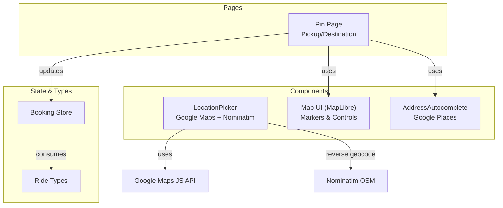
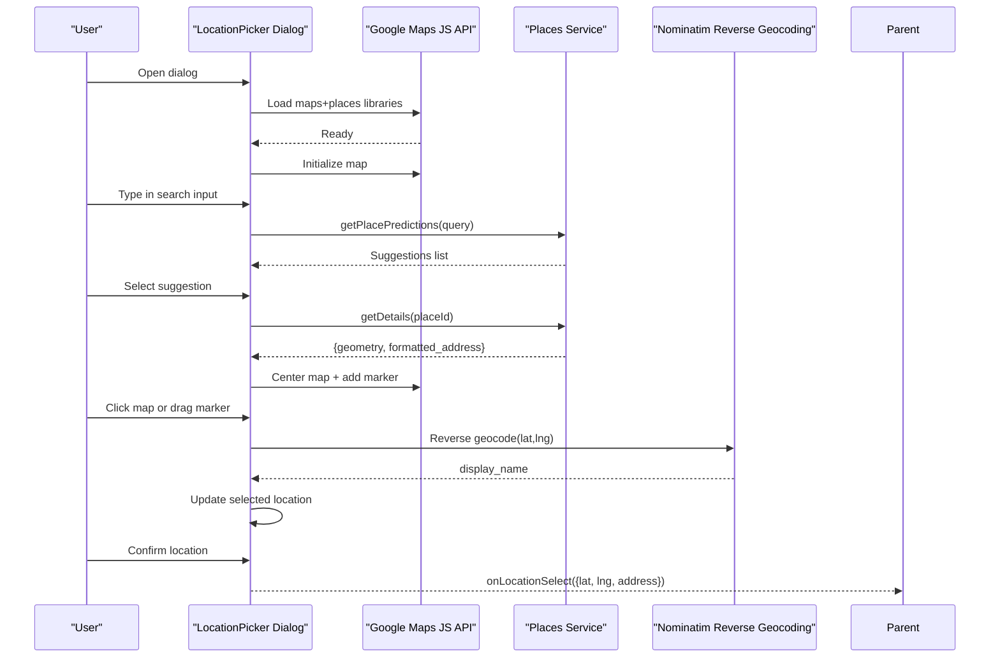
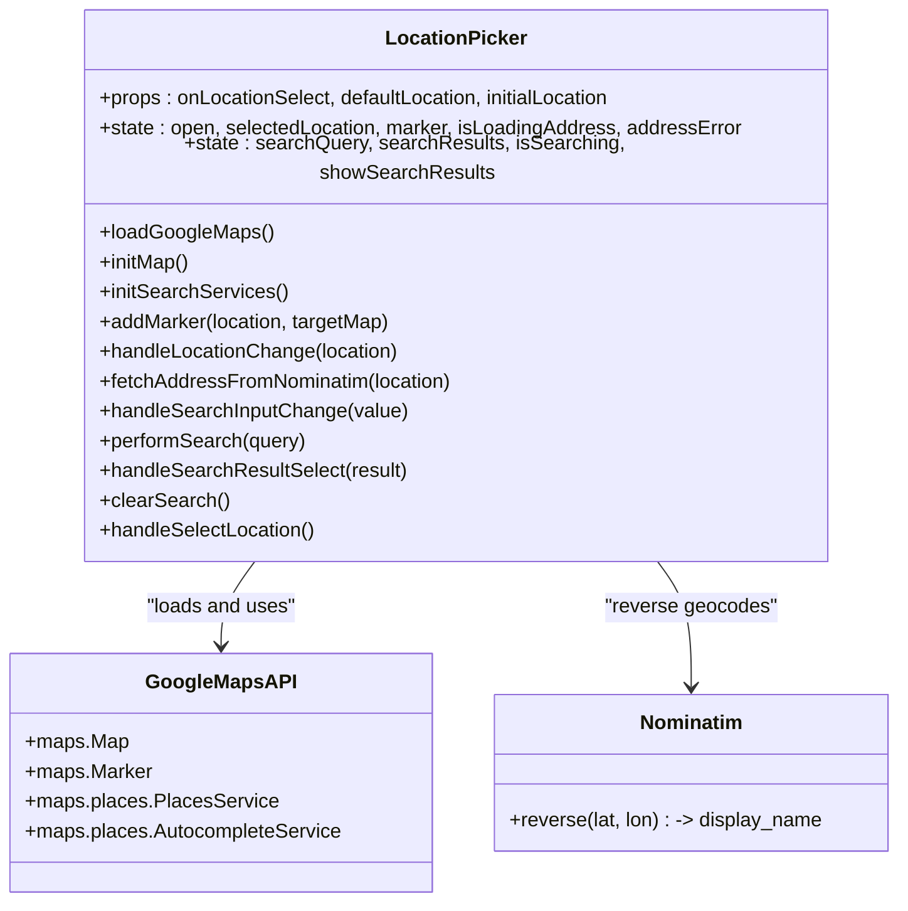
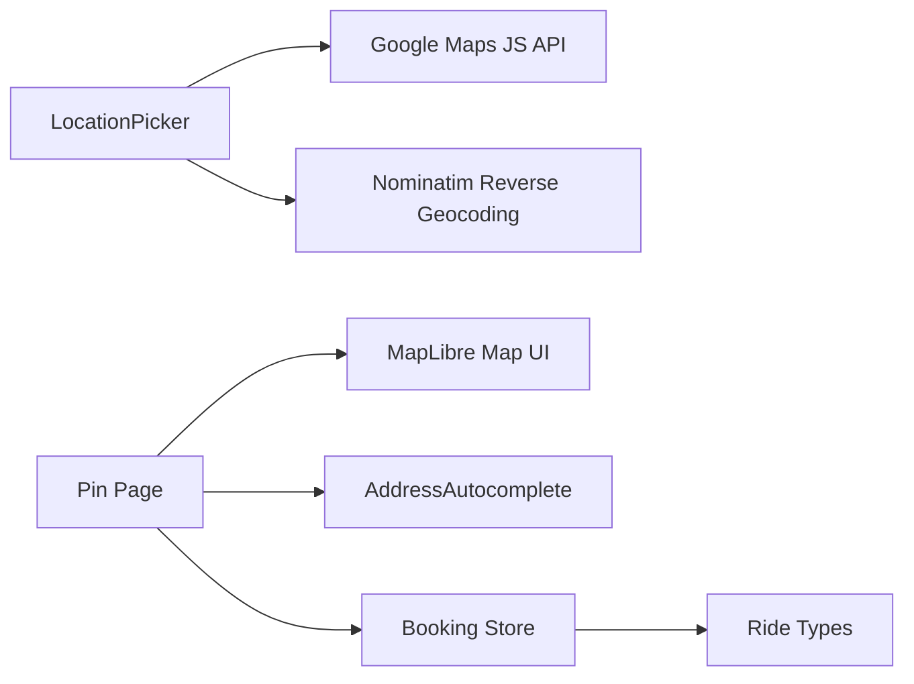

# Location Picker Component

<cite>
**Referenced Files in This Document**
- [location-picker.tsx](file://src/components/core/location-picker.tsx)
- [map.tsx](file://src/components/ui/map.tsx)
- [address-autocomplete.tsx](file://src/components/ui/address-autocomplete.tsx)
- [pin/page.tsx](file://src/app/(view)/book/pin/page.tsx)
- [booking-store.ts](file://src/store/booking-store.ts)
- [ride.types.ts](file://src/types/ride.types.ts)
</cite>

## Table of Contents
1. [Introduction](#introduction)
2. [Project Structure](#project-structure)
3. [Core Components](#core-components)
4. [Architecture Overview](#architecture-overview)
5. [Detailed Component Analysis](#detailed-component-analysis)
6. [Dependency Analysis](#dependency-analysis)
7. [Performance Considerations](#performance-considerations)
8. [Troubleshooting Guide](#troubleshooting-guide)
9. [Conclusion](#conclusion)
10. [Appendices](#appendices)

## Introduction
This document provides comprehensive documentation for the Location Picker component that enables interactive map-based location selection. It explains how the component integrates with Google Maps, manages markers for pickup/dropoff locations, and handles user interactions to select geographic coordinates. The document also covers state management for current location, selected addresses, and map viewport control; the address resolution process from coordinates to human-readable addresses (reverse geocoding); validation rules for location selection; usage scenarios; customization options for map appearance; and accessibility considerations for location-based interactions.

## Project Structure
The Location Picker is implemented as a reusable client-side React component and is used across booking flows. Related components include:
- A Map UI library built on MapLibre GL for general-purpose mapping and marker controls.
- An Address Autocomplete input that integrates with Google Places to provide search suggestions and coordinate extraction.
- A dedicated pinning page that uses the Map UI and reverse geocoding to set pickup or destination points.
- A global booking store that persists the current request including pickup and destination.

**Diagram sources**
- [location-picker.tsx:1-500](file://src/components/core/location-picker.tsx#L1-L500)
- [map.tsx:1-800](file://src/components/ui/map.tsx#L1-L800)
- [address-autocomplete.tsx:1-170](file://src/components/ui/address-autocomplete.tsx#L1-L170)
- [pin/page.tsx:1-188](file://src/app/(view)/book/pin/page.tsx#L1-L188)
- [booking-store.ts:1-28](file://src/store/booking-store.ts#L1-L28)
- [ride.types.ts:1-161](file://src/types/ride.types.ts#L1-L161)

**Section sources**
- [location-picker.tsx:1-500](file://src/components/core/location-picker.tsx#L1-L500)
- [map.tsx:1-800](file://src/components/ui/map.tsx#L1-L800)
- [address-autocomplete.tsx:1-170](file://src/components/ui/address-autocomplete.tsx#L1-L170)
- [pin/page.tsx:1-188](file://src/app/(view)/book/pin/page.tsx#L1-L188)
- [booking-store.ts:1-28](file://src/store/booking-store.ts#L1-L28)
- [ride.types.ts:1-161](file://src/types/ride.types.ts#L1-L161)

## Core Components
- LocationPicker: A dialog-based component that loads Google Maps dynamically, renders an interactive map, supports click-to-select and draggable markers, provides autocomplete search via Google Places, and resolves addresses using Nominatim reverse geocoding.
- Map UI (MapLibre): Provides a theme-aware map with markers, popups, tooltips, and controls. Used by other pages for rich mapping experiences.
- AddressAutocomplete: A Google Places-powered input that returns both text and coordinates when a suggestion is selected.
- Pin Page: A full-screen flow to set pickup or destination by panning the map and confirming the center point, with reverse geocoding via Google Geocoding API.

Key responsibilities:
- Dynamic loading of Google Maps libraries.
- Marker lifecycle management (creation, dragging, removal).
- Search and place details retrieval.
- Reverse geocoding to human-readable addresses.
- State synchronization between UI and store.

**Section sources**
- [location-picker.tsx:1-500](file://src/components/core/location-picker.tsx#L1-L500)
- [map.tsx:1-800](file://src/components/ui/map.tsx#L1-L800)
- [address-autocomplete.tsx:1-170](file://src/components/ui/address-autocomplete.tsx#L1-L170)
- [pin/page.tsx:1-188](file://src/app/(view)/book/pin/page.tsx#L1-L188)

## Architecture Overview
The Location Picker follows a layered architecture:
- Presentation Layer: Dialog UI, search input, map container, results dropdown, and confirmation button.
- Integration Layer: Google Maps JS API loader, Places service, and Nominatim reverse geocoding.
- State Layer: Local React state for dialog visibility, selected location, search query/results, and loading/error states.
- External Services: Google Maps (maps, places), OpenStreetMap Nominatim (reverse geocoding).

**Diagram sources**
- [location-picker.tsx:71-150](file://src/components/core/location-picker.tsx#L71-L150)
- [location-picker.tsx:152-213](file://src/components/core/location-picker.tsx#L152-L213)
- [location-picker.tsx:233-320](file://src/components/core/location-picker.tsx#L233-L320)
- [location-picker.tsx:328-334](file://src/components/core/location-picker.tsx#L328-L334)

## Detailed Component Analysis

### LocationPicker Component
Responsibilities:
- Dynamically load Google Maps and Places libraries.
- Initialize map with default or provided initial location.
- Manage a single draggable marker representing the selected location.
- Provide autocomplete search with debounced queries and result dropdown.
- Resolve coordinates to human-readable addresses via Nominatim.
- Emit selected location to parent via callback.

Key behaviors:
- Map initialization occurs when the dialog opens.
- Clicking the map sets a new marker position and triggers reverse geocoding.
- Dragging the marker updates the selected location and clears search state.
- Searching filters predictions and navigates the map to the selected place.
- Confirmation emits the current location data and closes the dialog.

Data model:
- Selected location includes latitude, longitude, and optional address string.

Error handling:
- Displays error alerts if reverse geocoding fails or no address is found.
- Gracefully handles missing Google Maps APIs by checking availability before use.

Accessibility:
- Uses semantic buttons and inputs with labels.
- Provides clear visual feedback for loading and errors.

Customization:
- Accepts defaultLocation and initialLocation props.
- Can be styled via Tailwind classes within the dialog and map container.

Usage example paths:
- See [location-picker.tsx:37-49](file://src/components/core/location-picker.tsx#L37-L49) for props interface.
- See [location-picker.tsx:328-334](file://src/components/core/location-picker.tsx#L328-L334) for emitting selection.

**Section sources**
- [location-picker.tsx:1-500](file://src/components/core/location-picker.tsx#L1-L500)

#### Class Diagram (Conceptual Mapping)

**Diagram sources**
- [location-picker.tsx:71-150](file://src/components/core/location-picker.tsx#L71-L150)
- [location-picker.tsx:152-213](file://src/components/core/location-picker.tsx#L152-L213)
- [location-picker.tsx:233-320](file://src/components/core/location-picker.tsx#L233-L320)

### Map UI (MapLibre)
Responsibilities:
- Provide a theme-aware map with markers, popups, tooltips, and controls.
- Support controlled viewport updates and style switching.
- Offer reusable marker components and content portals.

Integration notes:
- Used by the Pin page for pan-to-pin UX and custom crosshair pin overlay.
- Not directly used by LocationPicker (which uses Google Maps), but available for other flows.

**Section sources**
- [map.tsx:1-800](file://src/components/ui/map.tsx#L1-L800)

### AddressAutocomplete Input
Responsibilities:
- Load Google Places library and provide typed suggestions.
- On selection, resolve coordinates and structured address components.
- Emit coordinates and parsed address data to parent.

Integration notes:
- Used by the Pin page to search and fly to a location.
- Complements the map’s pan-to-pin interaction.

**Section sources**
- [address-autocomplete.tsx:1-170](file://src/components/ui/address-autocomplete.tsx#L1-L170)

### Pin Page (Pickup/Destination Flow)
Responsibilities:
- Allow users to set either pickup or destination by panning the map.
- Use AddressAutocomplete to search and navigate to a location.
- Perform reverse geocoding on moveend to update the displayed address.
- Persist the selected point into the booking store and return to previous screen.

Validation rules:
- Requires a resolved address before enabling confirm action.
- Debounces reverse geocoding to avoid excessive requests.

**Section sources**
- [pin/page.tsx:1-188](file://src/app/(view)/book/pin/page.tsx#L1-L188)

## Dependency Analysis
External dependencies:
- Google Maps JavaScript API (maps and places libraries).
- OpenStreetMap Nominatim service for reverse geocoding.
- MapLibre GL for alternative mapping experience in other flows.

Internal dependencies:
- UI primitives (buttons, dialogs, inputs, alerts, skeletons).
- Booking store for persisting request data.
- Ride types for consistent data contracts.

**Diagram sources**
- [location-picker.tsx:71-150](file://src/components/core/location-picker.tsx#L71-L150)
- [location-picker.tsx:186-213](file://src/components/core/location-picker.tsx#L186-L213)
- [pin/page.tsx:1-188](file://src/app/(view)/book/pin/page.tsx#L1-L188)
- [map.tsx:1-800](file://src/components/ui/map.tsx#L1-L800)
- [address-autocomplete.tsx:1-170](file://src/components/ui/address-autocomplete.tsx#L1-L170)
- [booking-store.ts:1-28](file://src/store/booking-store.ts#L1-L28)
- [ride.types.ts:1-161](file://src/types/ride.types.ts#L1-L161)

**Section sources**
- [location-picker.tsx:1-500](file://src/components/core/location-picker.tsx#L1-L500)
- [pin/page.tsx:1-188](file://src/app/(view)/book/pin/page.tsx#L1-L188)
- [map.tsx:1-800](file://src/components/ui/map.tsx#L1-L800)
- [address-autocomplete.tsx:1-170](file://src/components/ui/address-autocomplete.tsx#L1-L170)
- [booking-store.ts:1-28](file://src/store/booking-store.ts#L1-L28)
- [ride.types.ts:1-161](file://src/types/ride.types.ts#L1-L161)

## Performance Considerations
- Debounce search input to reduce API calls (implemented in both LocationPicker and AddressAutocomplete).
- Avoid reinitializing the map unnecessarily; reuse existing instances where possible.
- Use efficient event listeners and cleanup to prevent memory leaks.
- Prefer lightweight reverse geocoding services; consider caching frequently requested addresses.
- For large datasets or multiple markers, consider clustering or virtualization strategies.

[No sources needed since this section provides general guidance]

## Troubleshooting Guide
Common issues and resolutions:
- Google Maps not loading:
  - Ensure environment variable for API key is set.
  - Verify script injection and check network console for errors.
- Reverse geocoding failures:
  - Nominatim may rate-limit or fail; handle errors gracefully and allow manual address entry fallback.
- No address found:
  - Display informative messages and allow users to refine selection or type manually.
- Marker not updating:
  - Confirm marker instance is correctly removed and recreated on location change.
- Search results not appearing:
  - Validate Places library loaded and AutocompleteService initialized.

Operational checks:
- Inspect network requests to Google Places and Nominatim endpoints.
- Review console logs for API status codes and errors.
- Validate that dialog open/close resets internal state properly.

**Section sources**
- [location-picker.tsx:186-213](file://src/components/core/location-picker.tsx#L186-L213)
- [location-picker.tsx:233-265](file://src/components/core/location-picker.tsx#L233-L265)
- [location-picker.tsx:337-354](file://src/components/core/location-picker.tsx#L337-L354)

## Conclusion
The Location Picker component offers a robust, user-friendly way to select geographic locations through an interactive map, search, and reverse geocoding. It integrates seamlessly with Google Maps and Nominatim, manages marker lifecycles effectively, and provides clear feedback during loading and error conditions. When combined with the Map UI and AddressAutocomplete, it supports diverse booking workflows, including pin-to-center selection and typed address search. Proper state management and validation ensure reliable data capture for pickup and destination points.

[No sources needed since this section summarizes without analyzing specific files]

## Appendices

### Usage Scenarios
- Inline dialog picker:
  - Triggered by a button to open a modal map for selecting a location.
  - Emits selected coordinates and address to parent via callback.
- Full-screen pinning flow:
  - Pan the map to center a pin and confirm the location.
  - Uses AddressAutocomplete to search and fly to a place.
  - Updates the booking store with the chosen point.

Example paths:
- Dialog picker: [location-picker.tsx:356-499](file://src/components/core/location-picker.tsx#L356-L499)
- Pin flow: [pin/page.tsx:89-187](file://src/app/(view)/book/pin/page.tsx#L89-L187)

**Section sources**
- [location-picker.tsx:356-499](file://src/components/core/location-picker.tsx#L356-L499)
- [pin/page.tsx:89-187](file://src/app/(view)/book/pin/page.tsx#L89-L187)

### Customization Options
- Default and initial locations:
  - Provide defaultLocation for initial map center and initialLocation for preselected coordinates.
- Appearance:
  - Customize dialog size, map container height, and UI elements via Tailwind classes.
- Behavior:
  - Enable/disable search, adjust debounce timing, and configure reverse geocoding behavior.

**Section sources**
- [location-picker.tsx:37-49](file://src/components/core/location-picker.tsx#L37-L49)
- [location-picker.tsx:377-441](file://src/components/core/location-picker.tsx#L377-L441)

### Accessibility Considerations
- Keyboard navigation:
  - Ensure inputs and buttons are focusable and operable via keyboard.
- Screen reader support:
  - Provide descriptive labels for map actions and status messages.
- Visual feedback:
  - Show loading indicators and error alerts clearly.
- Contrast and readability:
  - Maintain sufficient contrast for text and icons over map backgrounds.

[No sources needed since this section provides general guidance]

### Data Models and Validation Rules
- Selected location model:
  - Latitude, longitude, and optional address string.
- Validation:
  - Require a valid address before confirming selection in pin flow.
  - Debounce reverse geocoding to minimize requests.
- Store integration:
  - Persist pickup and destination points in the booking store for subsequent steps.

**Section sources**
- [location-picker.tsx:16-20](file://src/components/core/location-picker.tsx#L16-L20)
- [pin/page.tsx:82-85](file://src/app/(view)/book/pin/page.tsx#L82-L85)
- [booking-store.ts:19-27](file://src/store/booking-store.ts#L19-L27)
- [ride.types.ts:64-81](file://src/types/ride.types.ts#L64-L81)