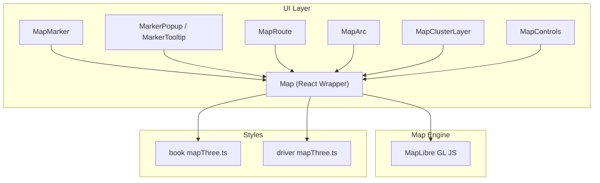
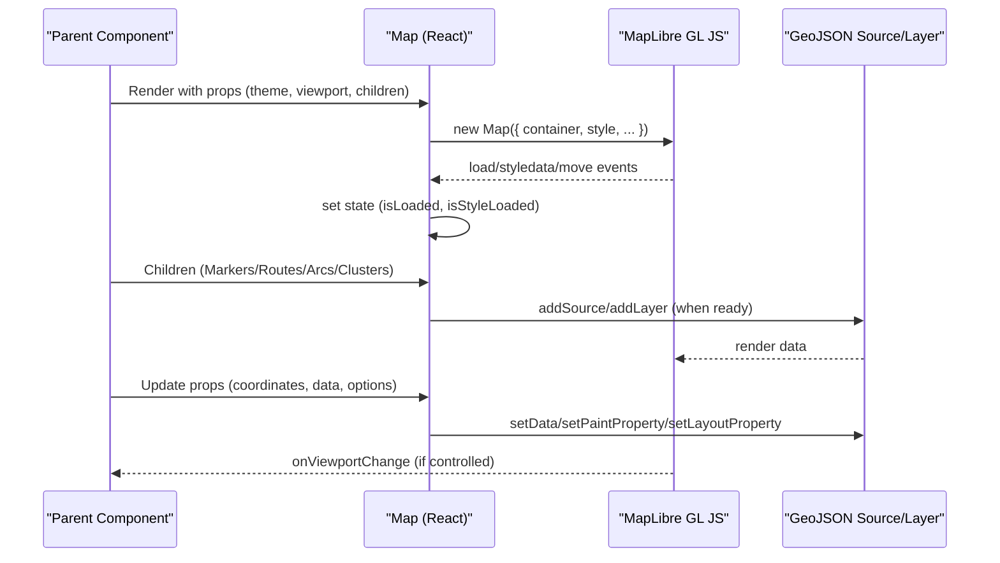
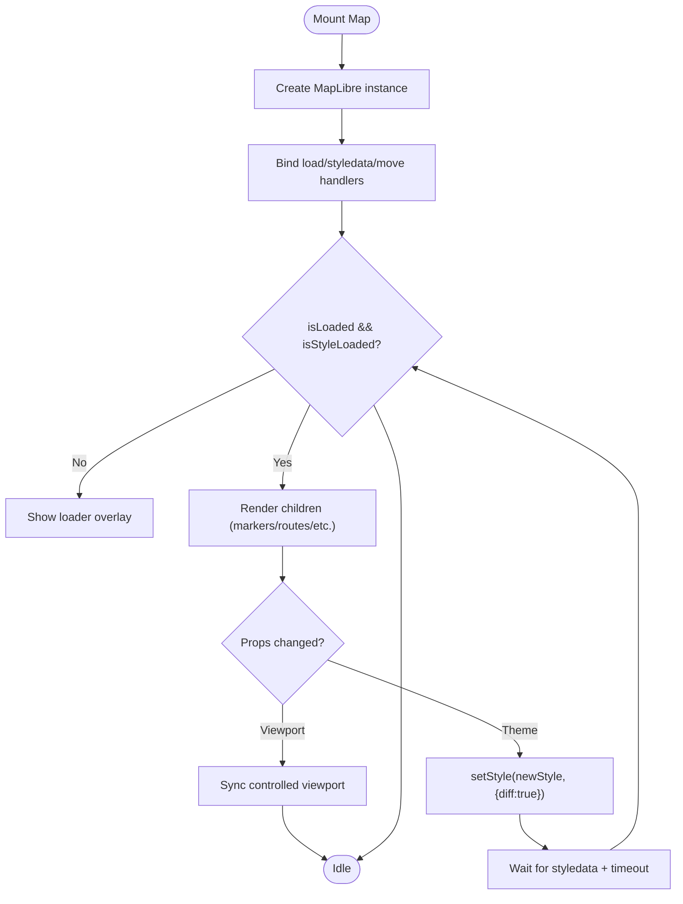
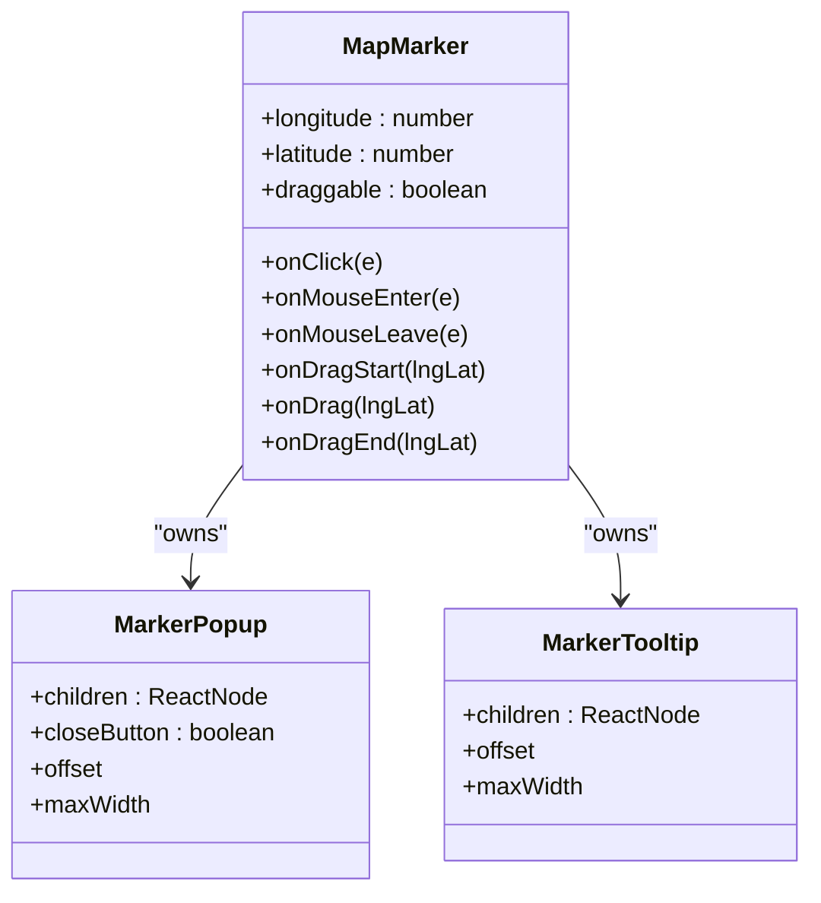
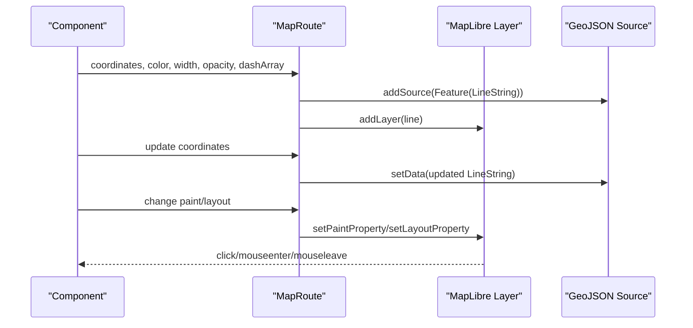
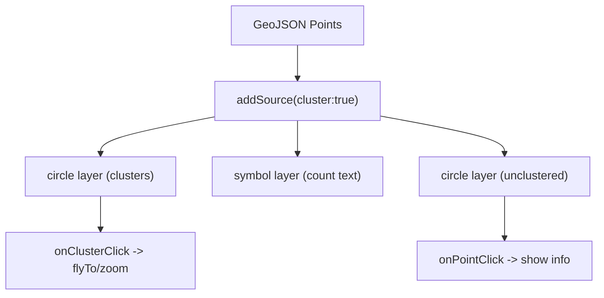
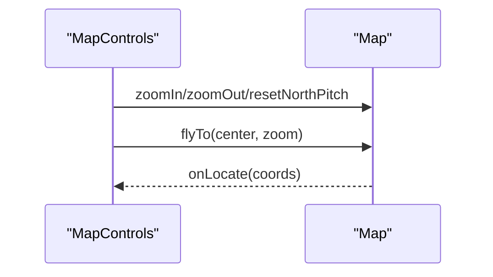
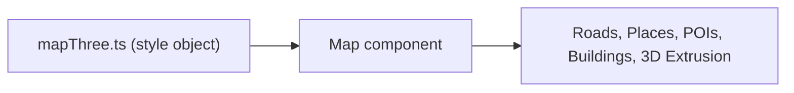
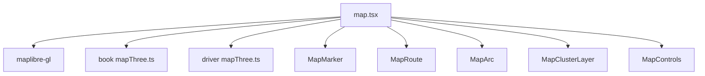

# Map Rendering Engine

<cite>
**Referenced Files in This Document**
- [map.tsx](file://src/components/ui/map.tsx)
- [book-mapThree.ts](file://src/app/(view)/book/mapThree.ts)
- [driver-mapThree.ts](file://src/app/driver/(view)/mapThree.ts)
</cite>

## Table of Contents
1. [Introduction](#introduction)
2. [Project Structure](#project-structure)
3. [Core Components](#core-components)
4. [Architecture Overview](#architecture-overview)
5. [Detailed Component Analysis](#detailed-component-analysis)
6. [Dependency Analysis](#dependency-analysis)
7. [Performance Considerations](#performance-considerations)
8. [Troubleshooting Guide](#troubleshooting-guide)
9. [Conclusion](#conclusion)
10. [Appendices](#appendices)

## Introduction
This document explains the map rendering system used across the application, focusing on:
- The 2D map component built with MapLibre GL JS
- Custom layer management, markers, popups, tooltips, routes, arcs, and clustering
- Real-time updates for live tracking
- Map styling customization (light/dark themes)
- Responsive design considerations and cross-browser compatibility
- Error handling for map loading failures and fallback strategies
- Integration patterns for multiple map types and large datasets
- A note on Three.js integration status

The codebase implements a robust React wrapper around MapLibre GL JS to provide a consistent API for markers, routes, arcs, clustering, and controls. It also includes reusable style definitions for vector tiles and 3D building extrusions.

## Project Structure
The map-related implementation is primarily contained in:
- src/components/ui/map.tsx: The main React-based map component and related subcomponents
- src/app/(view)/book/mapThree.ts: Style definition used by the booking flow
- src/app/driver/(view)/mapThree.ts: Style definition used by the driver flow

**Diagram sources**
- [map.tsx:1-1845](file://src/components/ui/map.tsx#L1-L1845)
- [book-mapThree.ts](file://src/app/(view)/book/mapThree.ts#L1-L229)
- [driver-mapThree.ts](file://src/app/driver/(view)/mapThree.ts#L1-L229)

**Section sources**
- [map.tsx:1-1845](file://src/components/ui/map.tsx#L1-L1845)
- [book-mapThree.ts](file://src/app/(view)/book/mapThree.ts#L1-L229)
- [driver-mapThree.ts](file://src/app/driver/(view)/mapThree.ts#L1-L229)

## Core Components
- Map: Initializes MapLibre GL JS, manages theme switching, controlled/uncontrolled viewport, and lifecycle events. Exposes a ref to the underlying map instance.
- MapMarker: Creates draggable markers with mouse events and drag callbacks.
- MarkerPopup/MarkerTooltip: Rich content overlays attached to markers via portals.
- MapRoute: Draws interactive line features using GeoJSON sources/layers.
- MapArc: Renders curved lines between coordinates with hover/click interactions and feature-state-driven styling.
- MapClusterLayer: Efficiently renders large point datasets with clustering and zoom-to-cluster behavior.
- MapControls: Zoom, compass, locate, and fullscreen controls integrated with the map instance.

Key capabilities:
- Theme-aware styles (light/dark) with automatic detection and mutation observation
- Controlled viewport mode with internal update guards to avoid feedback loops
- Safe cleanup of layers/sources on unmount
- Event-driven interactivity for routes and arcs
- Clustering for performance with large datasets

**Section sources**
- [map.tsx:169-336](file://src/components/ui/map.tsx#L169-L336)
- [map.tsx:374-495](file://src/components/ui/map.tsx#L374-L495)
- [map.tsx:543-606](file://src/components/ui/map.tsx#L543-L606)
- [map.tsx:615-682](file://src/components/ui/map.tsx#L615-L682)
- [map.tsx:1052-1168](file://src/components/ui/map.tsx#L1052-L1168)
- [map.tsx:1312-1524](file://src/components/ui/map.tsx#L1312-L1524)
- [map.tsx:1554-1651](file://src/components/ui/map.tsx#L1554-L1651)
- [map.tsx:779-885](file://src/components/ui/map.tsx#L779-L885)

## Architecture Overview
The architecture centers on a React component that encapsulates MapLibre GL JS. It provides a declarative API for markers, routes, arcs, clusters, and controls while managing the imperative map instance internally. Styles are provided as MapLibre style objects or URLs, enabling light/dark theming and optional projection changes.

**Diagram sources**
- [map.tsx:216-270](file://src/components/ui/map.tsx#L216-L270)
- [map.tsx:1071-1105](file://src/components/ui/map.tsx#L1071-L1105)
- [map.tsx:1369-1414](file://src/components/ui/map.tsx#L1369-L1414)
- [map.tsx:1580-1651](file://src/components/ui/map.tsx#L1580-L1651)

## Detailed Component Analysis

### Map Component
Responsibilities:
- Initialize and dispose the MapLibre instance
- Manage theme resolution and dynamic style switching
- Provide controlled viewport synchronization
- Expose map instance via ref
- Guard against race conditions during style/data loading

Key behaviors:
- Uses MutationObserver and media query listeners to detect theme changes
- Applies diff-based style updates to minimize re-render cost
- Skips viewport updates when moving internally to prevent cycles
- Delays enabling layer operations until style is fully loaded

**Diagram sources**
- [map.tsx:216-270](file://src/components/ui/map.tsx#L216-L270)
- [map.tsx:272-298](file://src/components/ui/map.tsx#L272-L298)
- [map.tsx:300-314](file://src/components/ui/map.tsx#L300-L314)

**Section sources**
- [map.tsx:169-336](file://src/components/ui/map.tsx#L169-L336)
- [map.tsx:216-270](file://src/components/ui/map.tsx#L216-L270)
- [map.tsx:272-298](file://src/components/ui/map.tsx#L272-L298)
- [map.tsx:300-314](file://src/components/ui/map.tsx#L300-L314)

### Markers, Popups, and Tooltips
- MapMarker creates a marker element, attaches DOM event listeners, and supports dragging with callbacks.
- MarkerPopup and MarkerTooltip use portals to render rich content and manage open/close states.

**Diagram sources**
- [map.tsx:374-495](file://src/components/ui/map.tsx#L374-L495)
- [map.tsx:543-606](file://src/components/ui/map.tsx#L543-L606)
- [map.tsx:615-682](file://src/components/ui/map.tsx#L615-L682)

**Section sources**
- [map.tsx:374-495](file://src/components/ui/map.tsx#L374-L495)
- [map.tsx:543-606](file://src/components/ui/map.tsx#L543-L606)
- [map.tsx:615-682](file://src/components/ui/map.tsx#L615-L682)

### Routes and Arcs
- MapRoute adds a GeoJSON source and line layer, updates data and paint properties reactively, and wires click/hover events.
- MapArc computes quadratic Bézier curves from coordinate pairs, builds a FeatureCollection, and uses feature-state for hover effects. It also adds an invisible hit layer for improved pointer interaction.

**Diagram sources**
- [map.tsx:1052-1168](file://src/components/ui/map.tsx#L1052-L1168)
- [map.tsx:1312-1524](file://src/components/ui/map.tsx#L1312-L1524)

**Section sources**
- [map.tsx:1052-1168](file://src/components/ui/map.tsx#L1052-L1168)
- [map.tsx:1312-1524](file://src/components/ui/map.tsx#L1312-L1524)

### Clustering for Large Datasets
- MapClusterLayer configures a clustered GeoJSON source and renders circles plus count labels based on thresholds. Unclustered points are rendered separately. Clicking a cluster can zoom into it; custom handlers allow additional logic.

**Diagram sources**
- [map.tsx:1554-1651](file://src/components/ui/map.tsx#L1554-L1651)

**Section sources**
- [map.tsx:1554-1651](file://src/components/ui/map.tsx#L1554-L1651)

### Controls and Live Tracking
- MapControls integrates zoom, compass reset, geolocation locate, and fullscreen toggles.
- For live tracking, update marker positions or route coordinates frequently; the components efficiently sync to the map without recreating layers.

**Diagram sources**
- [map.tsx:779-885](file://src/components/ui/map.tsx#L779-L885)
- [map.tsx:803-826](file://src/components/ui/map.tsx#L803-L826)

**Section sources**
- [map.tsx:779-885](file://src/components/ui/map.tsx#L779-L885)
- [map.tsx:803-826](file://src/components/ui/map.tsx#L803-L826)

### Map Styling and 3D Buildings
- The project includes two identical style modules for book and driver flows that define vector tile sources, sprites, glyphs, and layers including 3D building extrusions at higher zoom levels.
- These styles can be passed to the Map component via the styles prop to override defaults.

**Diagram sources**
- [book-mapThree.ts](file://src/app/(view)/book/mapThree.ts#L1-L229)
- [driver-mapThree.ts](file://src/app/driver/(view)/mapThree.ts#L1-L229)

**Section sources**
- [book-mapThree.ts](file://src/app/(view)/book/mapThree.ts#L1-L229)
- [driver-mapThree.ts](file://src/app/driver/(view)/mapThree.ts#L1-L229)

### Three.js Integration Status
- There is no Three.js integration present in the analyzed files. The mapThree.ts modules export MapLibre style specifications rather than Three.js scenes. If 3D visualization beyond MapLibre’s fill-extrusion is required, a separate Three.js renderer would need to be integrated alongside or instead of MapLibre.

[No sources needed since this section clarifies absence of Three.js]

## Dependency Analysis
- External dependency: MapLibre GL JS is used directly by the Map component and its subcomponents.
- Internal dependencies: The Map component composes Marker, Popup, Tooltip, Route, Arc, Cluster, and Controls.
- Style modules are consumed by passing style objects to the Map component.

**Diagram sources**
- [map.tsx:1-1845](file://src/components/ui/map.tsx#L1-L1845)
- [book-mapThree.ts](file://src/app/(view)/book/mapThree.ts#L1-L229)
- [driver-mapThree.ts](file://src/app/driver/(view)/mapThree.ts#L1-L229)

**Section sources**
- [map.tsx:1-1845](file://src/components/ui/map.tsx#L1-L1845)
- [book-mapThree.ts](file://src/app/(view)/book/mapThree.ts#L1-L229)
- [driver-mapThree.ts](file://src/app/driver/(view)/mapThree.ts#L1-L229)

## Performance Considerations
- Use MapClusterLayer for large point datasets to reduce rendering overhead.
- Prefer updating existing sources/layers via setData and setPaintProperty/setLayoutProperty rather than recreating them.
- Avoid unnecessary re-renders by keeping coordinate arrays stable and batching updates.
- Use controlled viewport sparingly; frequent updates can cause jank if not throttled.
- Keep arc samples reasonable; high sample counts increase geometry size.
- Leverage diff-based style updates for theme switches.

[No sources needed since this section provides general guidance]

## Troubleshooting Guide
Common issues and resolutions:
- Map does not render: Ensure the container has non-zero dimensions and the map is mounted client-side. Check isLoaded state before adding layers.
- Layers not visible after style change: Wait for styledata and the internal timeout before modifying layers.
- Marker events not firing: Verify marker element exists and event listeners are attached; ensure draggable is configured correctly.
- Route/Arc not updating: Confirm source and layer IDs exist and setData is called with valid GeoJSON.
- Clustering not working: Ensure input data is a FeatureCollection of Point features and clusterMaxZoom/clusterRadius are appropriate.
- Geolocation locate fails: Handle permission errors and provide user feedback.

**Section sources**
- [map.tsx:216-270](file://src/components/ui/map.tsx#L216-L270)
- [map.tsx:1071-1105](file://src/components/ui/map.tsx#L1071-L1105)
- [map.tsx:1369-1414](file://src/components/ui/map.tsx#L1369-L1414)
- [map.tsx:1580-1651](file://src/components/ui/map.tsx#L1580-L1651)
- [map.tsx:803-826](file://src/components/ui/map.tsx#L803-L826)

## Conclusion
The map rendering engine provides a comprehensive, React-friendly interface over MapLibre GL JS. It supports rich interactivity, efficient rendering of large datasets, and flexible styling. While 3D buildings are supported via MapLibre’s fill-extrusion, there is no Three.js integration in the current codebase. For advanced 3D needs, consider integrating a dedicated Three.js renderer or extending the existing MapLibre setup.

[No sources needed since this section summarizes without analyzing specific files]

## Appendices

### Configuration Options Summary
- Map
  - theme: light | dark | auto-detected
  - styles: { light?: string|object; dark?: string|object }
  - projection: MapLibre ProjectionSpecification
  - viewport: { center, zoom, bearing, pitch }
  - onViewportChange(viewport): callback for viewport changes
  - loading: boolean to force loader overlay
  - Additional MapLibre options spread through props
- MapMarker
  - longitude, latitude, draggable, offset, rotation, rotationAlignment, pitchAlignment
  - onClick, onMouseEnter, onMouseLeave, onDragStart, onDrag, onDragEnd
- MapRoute
  - id, coordinates, color, width, opacity, dashArray, interactive, onClick, onMouseEnter, onMouseLeave
- MapArc
  - data[], curvature, samples, paint, layout, hoverPaint, interactive, beforeId, onClick, onHover
- MapClusterLayer
  - data (string URL or GeoJSON), clusterMaxZoom, clusterRadius, clusterColors, clusterThresholds, pointColor, onPointClick, onClusterClick
- MapControls
  - position, showZoom, showCompass, showLocate, showFullscreen, className, onLocate

**Section sources**
- [map.tsx:116-146](file://src/components/ui/map.tsx#L116-L146)
- [map.tsx:353-372](file://src/components/ui/map.tsx#L353-L372)
- [map.tsx:1029-1050](file://src/components/ui/map.tsx#L1029-L1050)
- [map.tsx:1197-1238](file://src/components/ui/map.tsx#L1197-L1238)
- [map.tsx:1526-1552](file://src/components/ui/map.tsx#L1526-L1552)
- [map.tsx:717-732](file://src/components/ui/map.tsx#L717-L732)