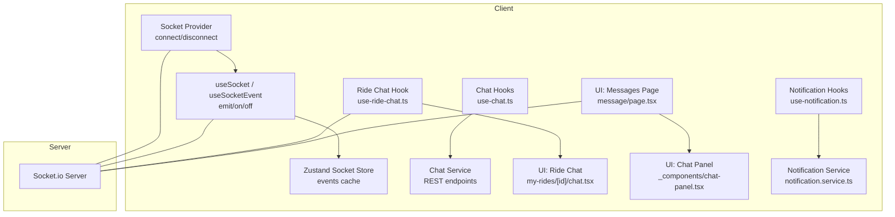
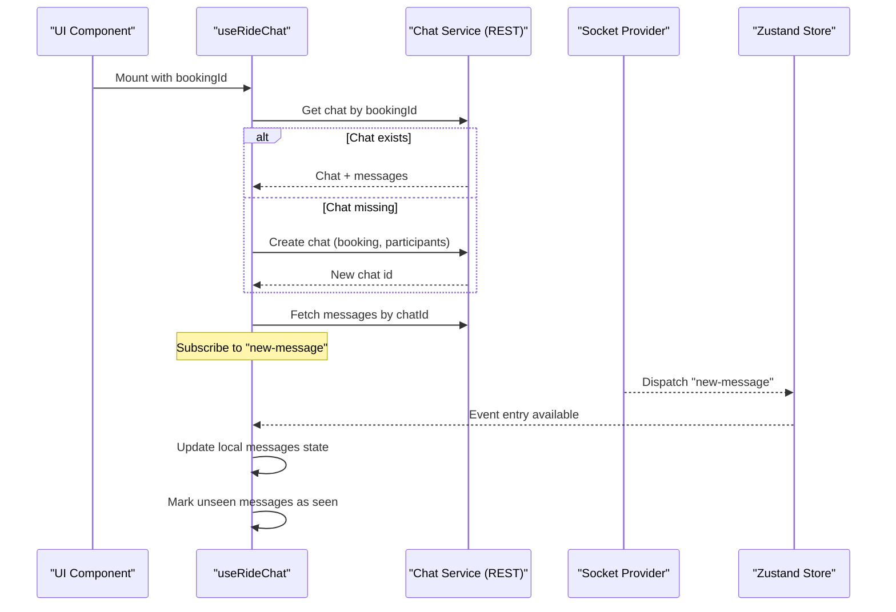
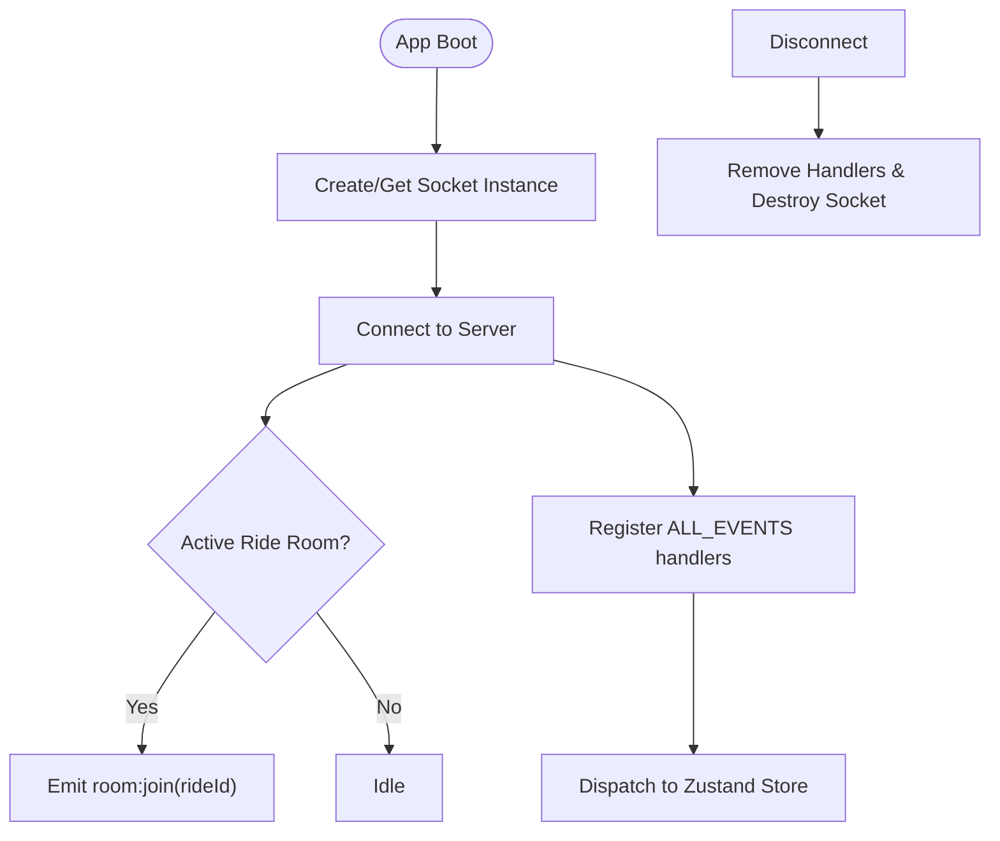
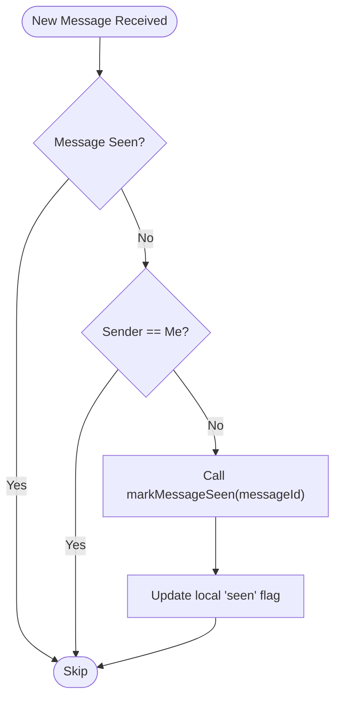
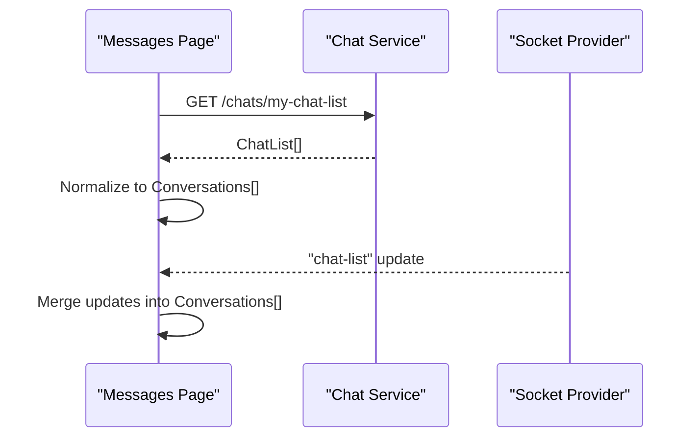
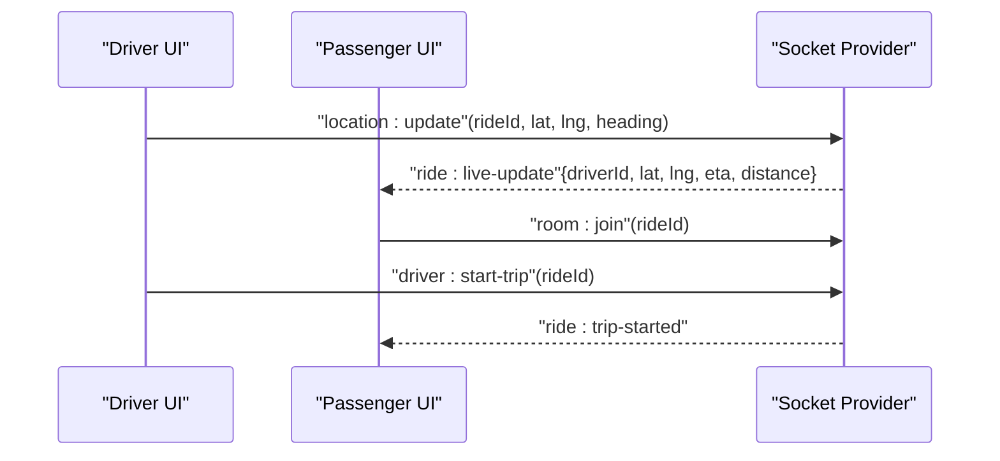
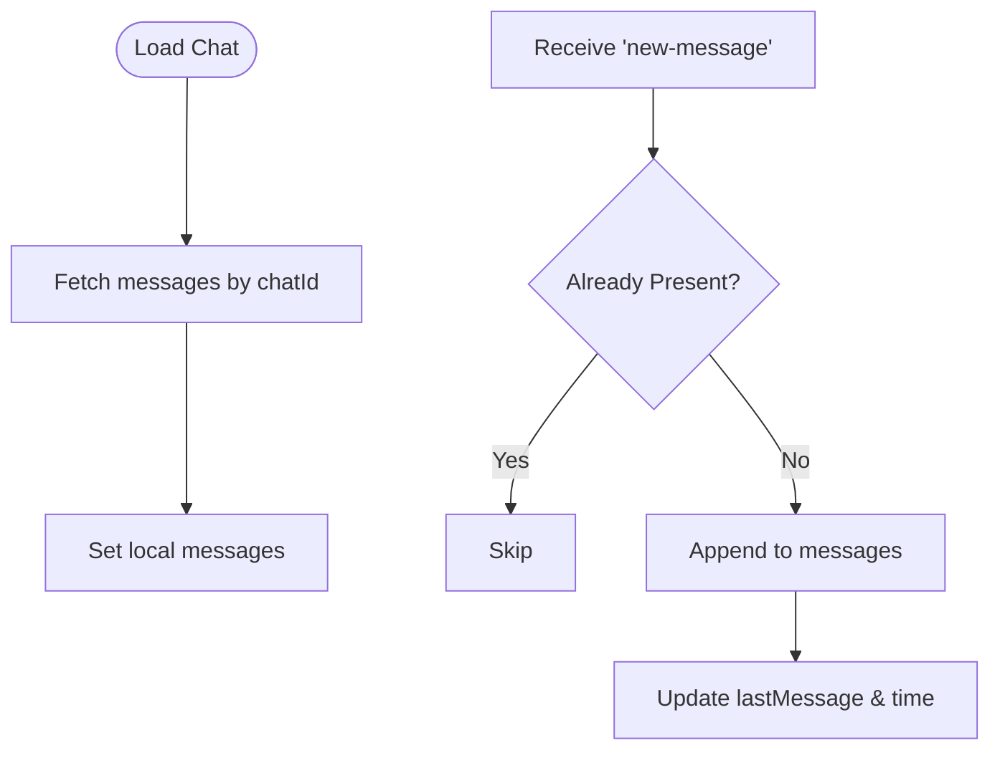
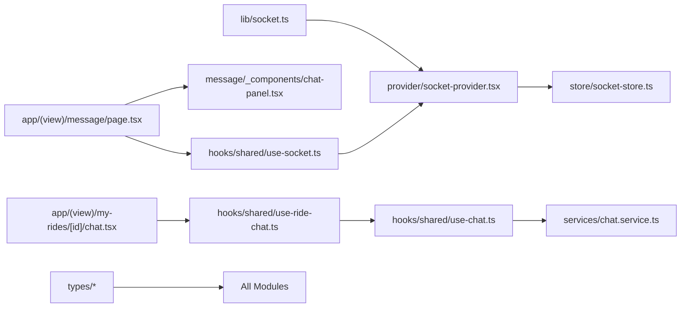
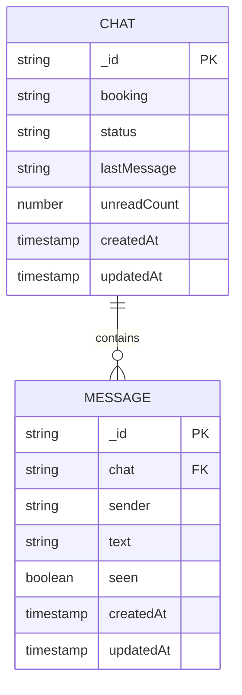

# Chat and Real-time Features

<cite>
**Referenced Files in This Document**
- [socket.ts](file://src/lib/socket.ts)
- [socket-provider.tsx](file://src/provider/socket-provider.tsx)
- [use-socket.ts](file://src/hooks/shared/use-socket.ts)
- [socket-store.ts](file://src/store/socket-store.ts)
- [chat.types.ts](file://src/types/chat.types.ts)
- [socket.types.ts](file://src/types/socket.types.ts)
- [chat.service.ts](file://src/services/chat.service.ts)
- [use-chat.ts](file://src/hooks/shared/use-chat.ts)
- [use-ride-chat.ts](file://src/hooks/shared/use-ride-chat.ts)
- [page.tsx](file://src/app/(view)/message/page.tsx)
- [chat-panel.tsx](file://src/app/message/_components/chat-panel.tsx)
- [chat.tsx](file://src/app/(view)/my-rides/[id]/chat.tsx)
- [notification.service.ts](file://src/services/notification.service.ts)
- [use-notification.ts](file://src/hooks/shared/use-notification.ts)
</cite>

## Table of Contents
1. Introduction
2. Project Structure
3. Core Components
4. Architecture Overview
5. Detailed Component Analysis
6. Dependency Analysis
7. Performance Considerations
8. Troubleshooting Guide
9. Conclusion
10. Appendices

## Introduction
This document explains the chat and real-time features built on Socket.io within the application. It covers real-time message delivery, conversation management, online presence indicators, ride status updates, driver-passenger communication, live notifications, typing indicators, read receipts, file sharing capabilities, message history synchronization, offline queuing strategies, and scaling considerations for high-volume messaging.

## Project Structure
The chat and real-time features are implemented across several layers:
- Client socket connection and lifecycle management
- React hooks to emit/listen to events
- Services and hooks for REST-based chat operations (create, list, messages, seen)
- UI components for general chat and ride-specific chat
- Centralized event dispatching into a Zustand store for global access
- Notification services and hooks for persisted notifications

**Diagram sources**
- [socket-provider.tsx:67-116](file://src/provider/socket-provider.tsx#L67-L116)
- [use-socket.ts:12-39](file://src/hooks/shared/use-socket.ts#L12-L39)
- [socket-store.ts:19-31](file://src/store/socket-store.ts#L19-L31)
- [use-chat.ts:18-95](file://src/hooks/shared/use-chat.ts#L18-L95)
- [chat.service.ts:12-51](file://src/services/chat.service.ts#L12-L51)
- [use-ride-chat.ts:17-116](file://src/hooks/shared/use-ride-chat.ts#L17-L116)
- [chat.tsx](file://src/app/(view)/my-rides/[id]/chat.tsx#L26-L143)
- [page.tsx](file://src/app/(view)/message/page.tsx#L82-L377)
- [chat-panel.tsx:20-183](file://src/app/message/_components/chat-panel.tsx#L20-L183)
- [use-notification.ts:10-40](file://src/hooks/shared/use-notification.ts#L10-L40)
- [notification.service.ts:5-18](file://src/services/notification.service.ts#L5-L18)

**Section sources**
- [socket-provider.tsx:67-116](file://src/provider/socket-provider.tsx#L67-L116)
- [use-socket.ts:12-39](file://src/hooks/shared/use-socket.ts#L12-L39)
- [socket-store.ts:19-31](file://src/store/socket-store.ts#L19-L31)
- [use-chat.ts:18-95](file://src/hooks/shared/use-chat.ts#L18-L95)
- [chat.service.ts:12-51](file://src/services/chat.service.ts#L12-L51)
- [use-ride-chat.ts:17-116](file://src/hooks/shared/use-ride-chat.ts#L17-L116)
- [chat.tsx](file://src/app/(view)/my-rides/[id]/chat.tsx#L26-L143)
- [page.tsx](file://src/app/(view)/message/page.tsx#L82-L377)
- [chat-panel.tsx:20-183](file://src/app/message/_components/chat-panel.tsx#L20-L183)
- [use-notification.ts:10-40](file://src/hooks/shared/use-notification.ts#L10-L40)
- [notification.service.ts:5-18](file://src/services/notification.service.ts#L5-L18)

## Core Components
- Socket connection singleton with auth token from cookies and transport fallbacks
- Socket provider that connects, reattaches to active rooms, and centralizes event dispatch
- Typed hooks for emitting and subscribing to events
- Chat REST service and React Query hooks for CRUD and pagination keys
- Ride chat hook that lazily creates chats, syncs history, and handles live messages and read receipts
- General chat page with optimistic send, incoming message handling, and chat list updates via socket
- Notification hooks and service for persisted notifications

**Section sources**
- [socket.ts:1-50](file://src/lib/socket.ts#L1-L50)
- [socket-provider.tsx:67-116](file://src/provider/socket-provider.tsx#L67-L116)
- [use-socket.ts:12-39](file://src/hooks/shared/use-socket.ts#L12-L39)
- [chat.service.ts:12-51](file://src/services/chat.service.ts#L12-L51)
- [use-chat.ts:18-95](file://src/hooks/shared/use-chat.ts#L18-L95)
- [use-ride-chat.ts:17-116](file://src/hooks/shared/use-ride-chat.ts#L17-L116)
- [page.tsx](file://src/app/(view)/message/page.tsx#L82-L377)
- [use-notification.ts:10-40](file://src/hooks/shared/use-notification.ts#L10-L40)

## Architecture Overview
The client maintains a single Socket.io instance, managed by a provider that connects on mount and reattaches to the last known active ride room after reconnects. Events are dispatched into a Zustand store for global consumption. Chat data is fetched via REST using React Query; live updates are applied through socket events. The ride chat flow includes lazy chat creation when missing, message history synchronization, and automatic read receipt marking.

**Diagram sources**
- [use-ride-chat.ts:17-116](file://src/hooks/shared/use-ride-chat.ts#L17-L116)
- [use-chat.ts:33-60](file://src/hooks/shared/use-chat.ts#L33-L60)
- [chat.service.ts:12-51](file://src/services/chat.service.ts#L12-L51)
- [socket-provider.tsx:67-116](file://src/provider/socket-provider.tsx#L67-L116)
- [socket-store.ts:19-31](file://src/store/socket-store.ts#L19-L31)

## Detailed Component Analysis

### Socket Connection and Lifecycle
- Singleton socket created with environment-based URL, credentials enabled, and explicit transports
- Authentication token extracted from cookies and attached during handshake
- Global logging for incoming/outgoing events for debugging
- Provider manages connect/disconnect, rejoining active ride rooms, and centralized event dispatch

**Diagram sources**
- [socket.ts:23-42](file://src/lib/socket.ts#L23-L42)
- [socket-provider.tsx:67-116](file://src/provider/socket-provider.tsx#L67-L116)
- [socket-store.ts:19-31](file://src/store/socket-store.ts#L19-L31)

**Section sources**
- [socket.ts:1-50](file://src/lib/socket.ts#L1-L50)
- [socket-provider.tsx:67-116](file://src/provider/socket-provider.tsx#L67-L116)
- [socket-store.ts:19-31](file://src/store/socket-store.ts#L19-L31)

### Typing Indicators
- The input UI supports text composition and sending. To implement typing indicators:
  - Emit a "typing:start" or "typing:stop" event per keystroke or debounce strategy
  - Broadcast to the chat room so other participants see "isTyping"
  - Display a small indicator in the chat header or next to the participant name
- Recommended approach:
  - Debounce typing events to reduce traffic
  - Clear typing state on leave/unmount
  - Use room scoping to avoid cross-chat noise

[No sources needed since this section provides implementation guidance]

### Message Read Receipts
- Automatic read receipts are implemented in the ride chat hook:
  - On new messages, unseen messages not sent by the current user are marked as seen via REST
  - A ref set prevents duplicate mark requests
- For general chat, apply the same pattern:
  - Track seen message IDs per conversation
  - Batch or debounce mark-seen calls if needed

**Diagram sources**
- [use-ride-chat.ts:86-96](file://src/hooks/shared/use-ride-chat.ts#L86-L96)
- [use-chat.ts:71-77](file://src/hooks/shared/use-chat.ts#L71-L77)
- [chat.service.ts:39-41](file://src/services/chat.service.ts#L39-L41)

**Section sources**
- [use-ride-chat.ts:86-96](file://src/hooks/shared/use-ride-chat.ts#L86-L96)
- [use-chat.ts:71-77](file://src/hooks/shared/use-chat.ts#L71-L77)
- [chat.service.ts:39-41](file://src/services/chat.service.ts#L39-L41)

### File Sharing Capabilities
- The chat panel UI includes an attachment button placeholder. To enable file sharing:
  - Upload files via the upload service endpoint
  - Include image URLs in the message payload (the server types support imageUrl arrays)
  - Render images in message bubbles and handle loading states
- Ensure size limits, MIME validation, and CDN caching are configured on the server

**Section sources**
- [chat-panel.tsx:148-179](file://src/app/message/_components/chat-panel.tsx#L148-L179)
- [socket.types.ts:170-171](file://src/types/socket.types.ts#L170-L171)

### Conversation Management
- Chat list retrieval and normalization:
  - Fetch my chat list and map to UI conversations
  - Handle participants as either strings or objects
  - Maintain last message preview and unread counts
- Active conversation selection and mobile view switching

**Diagram sources**
- [page.tsx](file://src/app/(view)/message/page.tsx#L90-L155)
- [page.tsx](file://src/app/(view)/message/page.tsx#L252-L298)
- [chat.service.ts:16-19](file://src/services/chat.service.ts#L16-L19)

**Section sources**
- [page.tsx](file://src/app/(view)/message/page.tsx#L82-L155)
- [page.tsx](file://src/app/(view)/message/page.tsx#L252-L298)
- [chat.service.ts:16-19](file://src/services/chat.service.ts#L16-L19)

### Online Presence Indicators
- Participant presence can be derived from:
  - Last seen timestamps
  - Live socket presence tracking (e.g., join/leave events)
  - Driver availability events ("driver:go-online"/"driver:go-offline")
- Implement a presence store keyed by user ID and display badges in chat headers and lists

**Section sources**
- [socket.types.ts:220-225](file://src/types/socket.types.ts#L220-L225)
- [chat.types.ts:3-9](file://src/types/chat.types.ts#L3-L9)

### Ride Status Updates and Driver-Passenger Communication
- Ride lifecycle events include acceptance, arrival, trip start/completion, live position updates, cancellations, and ratings
- Drivers broadcast location updates; passengers receive live positions and ETA/distance
- Communication channels are scoped to ride rooms for isolation

**Diagram sources**
- [socket.types.ts:52-62](file://src/types/socket.types.ts#L52-L62)
- [socket.types.ts:186-193](file://src/types/socket.types.ts#L186-L193)
- [socket-provider.tsx:77-84](file://src/provider/socket-provider.tsx#L77-L84)

**Section sources**
- [socket.types.ts:30-160](file://src/types/socket.types.ts#L30-L160)
- [socket-provider.tsx:77-84](file://src/provider/socket-provider.tsx#L77-L84)

### Live Notifications
- Generic notification events are emitted via "notification:new"
- Persisted notifications are managed via REST endpoints and React Query hooks
- Combine real-time alerts with persistent inbox for consistency

**Section sources**
- [socket.types.ts:151-156](file://src/types/socket.types.ts#L151-L156)
- [use-notification.ts:10-40](file://src/hooks/shared/use-notification.ts#L10-L40)
- [notification.service.ts:5-18](file://src/services/notification.service.ts#L5-L18)

### Message History Synchronization
- Ride chat hook fetches existing messages and merges with live updates
- General chat page normalizes messages and updates conversation state
- Deduplication ensures no duplicate messages when server echoes optimistic sends

**Diagram sources**
- [use-ride-chat.ts:57-84](file://src/hooks/shared/use-ride-chat.ts#L57-L84)
- [page.tsx](file://src/app/(view)/message/page.tsx#L191-L247)

**Section sources**
- [use-ride-chat.ts:57-84](file://src/hooks/shared/use-ride-chat.ts#L57-L84)
- [page.tsx](file://src/app/(view)/message/page.tsx#L191-L247)

### Offline Message Queuing
- Strategy:
  - Queue outgoing messages locally with unique IDs and pending status
  - Persist queue in IndexedDB or localStorage
  - On reconnect, replay queued messages and reconcile with server echo
  - Remove successful entries; retry failed ones with exponential backoff
- UI:
  - Show pending indicators until server acknowledgment
  - Allow canceling failed sends

[No sources needed since this section provides implementation guidance]

### Scaling Considerations for High-Volume Messaging
- Use room scoping per chat/ride to limit fan-out
- Debounce and throttle live updates (e.g., location updates)
- Paginate message history and load more on scroll
- Offload heavy processing to the server; keep client minimal
- Consider horizontal scaling with Redis adapter for multi-instance deployments
- Monitor memory usage and connection counts; tune heartbeat intervals

[No sources needed since this section provides general guidance]

## Dependency Analysis
The following diagram shows key dependencies between modules involved in chat and real-time features.

**Diagram sources**
- [socket.ts:1-50](file://src/lib/socket.ts#L1-L50)
- [socket-provider.tsx:67-116](file://src/provider/socket-provider.tsx#L67-L116)
- [socket-store.ts:19-31](file://src/store/socket-store.ts#L19-L31)
- [use-socket.ts:12-39](file://src/hooks/shared/use-socket.ts#L12-L39)
- [use-chat.ts:18-95](file://src/hooks/shared/use-chat.ts#L18-L95)
- [chat.service.ts:12-51](file://src/services/chat.service.ts#L12-L51)
- [use-ride-chat.ts:17-116](file://src/hooks/shared/use-ride-chat.ts#L17-L116)
- [page.tsx](file://src/app/(view)/message/page.tsx#L82-L377)
- [chat-panel.tsx:20-183](file://src/app/message/_components/chat-panel.tsx#L20-L183)
- [chat.tsx](file://src/app/(view)/my-rides/[id]/chat.tsx#L26-L143)
- [chat.types.ts:1-80](file://src/types/chat.types.ts#L1-L80)
- [socket.types.ts:1-304](file://src/types/socket.types.ts#L1-L304)

**Section sources**
- [socket.ts:1-50](file://src/lib/socket.ts#L1-L50)
- [socket-provider.tsx:67-116](file://src/provider/socket-provider.tsx#L67-L116)
- [socket-store.ts:19-31](file://src/store/socket-store.ts#L19-L31)
- [use-socket.ts:12-39](file://src/hooks/shared/use-socket.ts#L12-L39)
- [use-chat.ts:18-95](file://src/hooks/shared/use-chat.ts#L18-L95)
- [chat.service.ts:12-51](file://src/services/chat.service.ts#L12-L51)
- [use-ride-chat.ts:17-116](file://src/hooks/shared/use-ride-chat.ts#L17-L116)
- [page.tsx](file://src/app/(view)/message/page.tsx#L82-L377)
- [chat-panel.tsx:20-183](file://src/app/message/_components/chat-panel.tsx#L20-L183)
- [chat.tsx](file://src/app/(view)/my-rides/[id]/chat.tsx#L26-L143)
- [chat.types.ts:1-80](file://src/types/chat.types.ts#L1-L80)
- [socket.types.ts:1-304](file://src/types/socket.types.ts#L1-L304)

## Performance Considerations
- Debounce typing and read-receipt updates to minimize network overhead
- Limit live location update frequency based on speed and battery constraints
- Use virtualization for long message lists
- Prefer incremental updates over full re-fetches where possible
- Cache chat metadata and last messages to reduce API calls

[No sources needed since this section provides general guidance]

## Troubleshooting Guide
- Connection issues:
  - Verify socket URL and cookie-based token availability
  - Check browser console logs for incoming/outgoing events
- Missing messages:
  - Ensure chat exists before fetching messages; rely on lazy creation logic
  - Confirm deduplication logic prevents duplicates
- Read receipts not updating:
  - Validate unseen detection and mark-seen mutation triggers
- Chat list not refreshing:
  - Confirm "chat-list" socket event handler merges updates correctly

**Section sources**
- [socket.ts:23-42](file://src/lib/socket.ts#L23-L42)
- [use-ride-chat.ts:40-55](file://src/hooks/shared/use-ride-chat.ts#L40-L55)
- [page.tsx](file://src/app/(view)/message/page.tsx#L252-L298)

## Conclusion
The chat and real-time features combine a robust Socket.io integration with REST-backed persistence and React Query for reliable state management. The ride chat flow ensures seamless creation, synchronization, and read receipts, while the general chat interface supports optimistic sends and live updates. With typed events, centralized dispatch, and clear separation of concerns, the system is well-positioned for enhancements like typing indicators, file sharing, presence, and scalable deployment patterns.

## Appendices

### Data Models

**Diagram sources**
- [chat.types.ts:28-66](file://src/types/chat.types.ts#L28-L66)

### API Definitions (Selected)
- Chat REST endpoints:
  - POST /chats — create chat
  - GET /chats/my-chat-list — list chats
  - GET /chats/booking/:bookingId — get chat by booking
  - PATCH /chats/:chatId — update chat status
  - DELETE /chats/:chatId — delete chat
  - GET /message/my-messages/:chatId — get messages
  - PATCH /messages/update/:messageId — edit message
  - PATCH /messages/seen/:messageId — mark seen
  - DELETE /messages/:messageId — delete message
  - DELETE /messages/chat/:chatId — delete conversation
- Socket events:
  - Client emits: "send-message", "chat:seen", "room:join", "room:leave"
  - Server emits: "new-message", "chat-list", "chat:seen", plus ride and notification events

**Section sources**
- [chat.service.ts:12-51](file://src/services/chat.service.ts#L12-L51)
- [socket.types.ts:164-296](file://src/types/socket.types.ts#L164-L296)