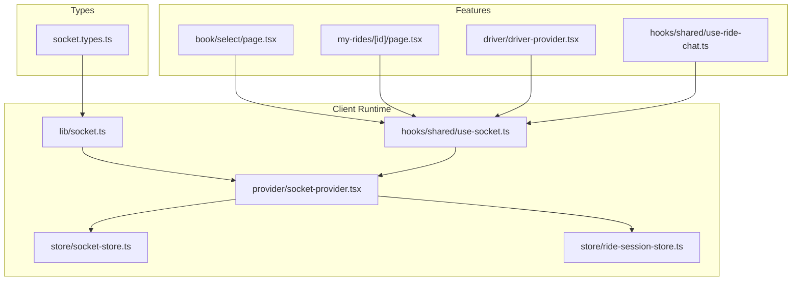
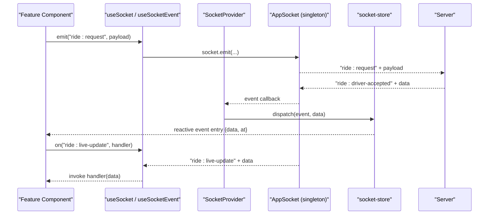
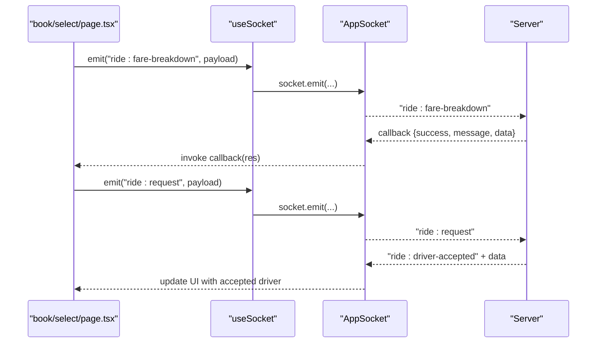
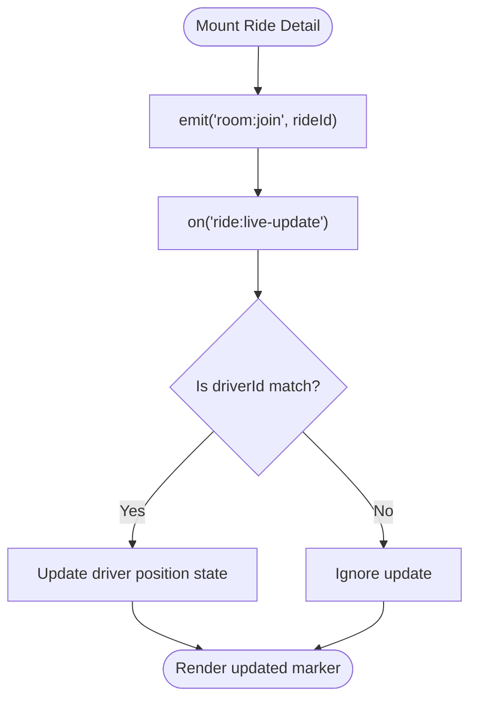
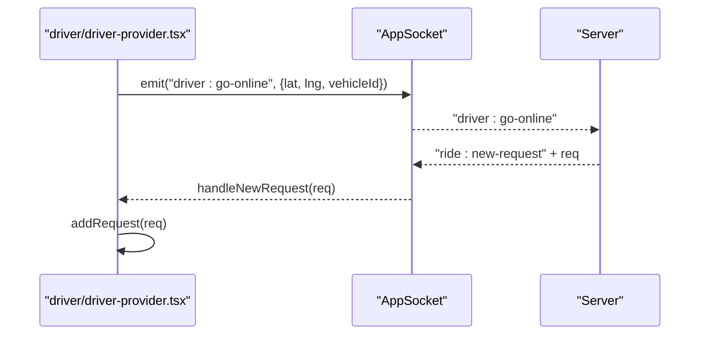
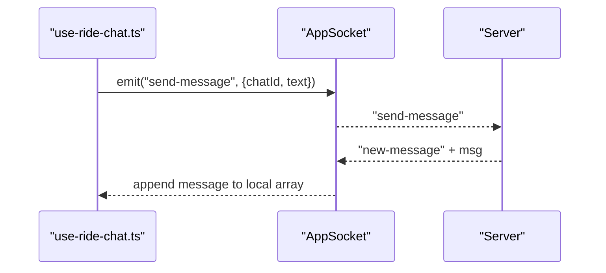
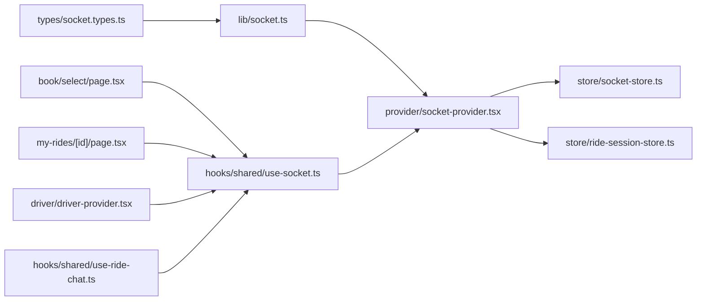

# Event Handling System

<cite>
**Referenced Files in This Document**
- [socket.ts](file://src/lib/socket.ts)
- [socket.types.ts](file://src/types/socket.types.ts)
- [socket-provider.tsx](file://src/provider/socket-provider.tsx)
- [use-socket.ts](file://src/hooks/shared/use-socket.ts)
- [socket-store.ts](file://src/store/socket-store.ts)
- [ride-session-store.ts](file://src/store/ride-session-store.ts)
- [select/page.tsx](file://src/app/(view)/book/select/page.tsx)
- [my-rides/[id]/page.tsx](file://src/app/(view)/my-rides/[id]/page.tsx)
- [driver-provider.tsx](file://src/app/driver/driver-provider.tsx)
- [use-ride-chat.ts](file://src/hooks/shared/use-ride-chat.ts)
</cite>

## Table of Contents
1. [Introduction](#introduction)
2. [Project Structure](#project-structure)
3. [Core Components](#core-components)
4. [Architecture Overview](#architecture-overview)
5. [Detailed Component Analysis](#detailed-component-analysis)
6. [Dependency Analysis](#dependency-analysis)
7. [Performance Considerations](#performance-considerations)
8. [Troubleshooting Guide](#troubleshooting-guide)
9. [Conclusion](#conclusion)

## Introduction
This document explains the Socket.io event handling system used across the application. It focuses on the typed event architecture built with TypeScript interfaces for client-to-server and server-to-client events, how events are emitted and listened to, payload structures, and patterns for real-time features such as ride updates and chat. It also covers error handling strategies, throttling techniques, and debugging approaches for analyzing event flows.

## Project Structure
The event system is implemented in a layered way:
- Types define the contract between client and server (event names and payloads).
- A singleton socket instance is created and configured with authentication and transports.
- A React provider wires up connection lifecycle and centralizes event dispatching into a store.
- Hooks provide type-safe emit/on/off utilities and convenient subscriptions.
- Feature hooks and pages consume these hooks to implement real-time behaviors.

**Diagram sources**
- [socket.types.ts:1-304](file://src/types/socket.types.ts#L1-L304)
- [socket.ts:1-50](file://src/lib/socket.ts#L1-L50)
- [socket-provider.tsx:1-123](file://src/provider/socket-provider.tsx#L1-L123)
- [use-socket.ts:1-57](file://src/hooks/shared/use-socket.ts#L1-L57)
- [socket-store.ts:1-34](file://src/store/socket-store.ts#L1-L34)
- [ride-session-store.ts:1-21](file://src/store/ride-session-store.ts#L1-L21)
- [select/page.tsx](file://src/app/(view)/book/select/page.tsx#L590-L789)
- [my-rides/[id]/page.tsx](file://src/app/(view)/my-rides/[id]/page.tsx#L80-L110)
- [driver-provider.tsx:120-140](file://src/app/driver/driver-provider.tsx#L120-L140)
- [use-ride-chat.ts:1-116](file://src/hooks/shared/use-ride-chat.ts#L1-L116)

**Section sources**
- [socket.types.ts:1-304](file://src/types/socket.types.ts#L1-L304)
- [socket.ts:1-50](file://src/lib/socket.ts#L1-L50)
- [socket-provider.tsx:1-123](file://src/provider/socket-provider.tsx#L1-L123)
- [use-socket.ts:1-57](file://src/hooks/shared/use-socket.ts#L1-L57)
- [socket-store.ts:1-34](file://src/store/socket-store.ts#L1-L34)
- [ride-session-store.ts:1-21](file://src/store/ride-session-store.ts#L1-L21)

## Core Components
- Typed event contracts:
  - ServerToClientEvents defines all events the server can send to the client, including ride lifecycle, driver status, chat, booking, notifications, and generic error.
  - ClientToServerEvents defines all events the client can emit to the server, including room management, chat, location updates, driver controls, ride requests, fare breakdown, cancellations, and ratings.
- Socket instance:
  - A single AppSocket is created with credentials-based auth, fallback transports, and global debug logging for incoming/outgoing events.
- Provider:
  - Connects/disconnects the socket, reattaches to the active ride room after reconnect, and registers handlers for all known events that forward data to a centralized store.
- Hooks:
  - useSocket provides type-safe emit/on/off wrappers around the underlying socket.
  - useSocketEvent subscribes to an event for the lifetime of a component.
- Store:
  - The last occurrence of each event is stored with its timestamp, enabling UI components to react to the latest event without manual subscription.

Key responsibilities:
- Type safety: All event names and payloads are strongly typed via the two interfaces.
- Centralized dispatch: The provider funnels all incoming events into the store for consistent state synchronization.
- Room scoping: Clients join/leave rooms per ride to receive targeted broadcasts.
- Debugging: Global listeners log every event name and payload for easy tracing.

**Section sources**
- [socket.types.ts:1-304](file://src/types/socket.types.ts#L1-L304)
- [socket.ts:1-50](file://src/lib/socket.ts#L1-L50)
- [socket-provider.tsx:1-123](file://src/provider/socket-provider.tsx#L1-L123)
- [use-socket.ts:1-57](file://src/hooks/shared/use-socket.ts#L1-L57)
- [socket-store.ts:1-34](file://src/store/socket-store.ts#L1-L34)

## Architecture Overview
The runtime flow connects the typed contracts to the React layer and feature code.

**Diagram sources**
- [socket-provider.tsx:67-116](file://src/provider/socket-provider.tsx#L67-L116)
- [use-socket.ts:12-56](file://src/hooks/shared/use-socket.ts#L12-L56)
- [socket-store.ts:19-31](file://src/store/socket-store.ts#L19-L31)
- [select/page.tsx](file://src/app/(view)/book/select/page.tsx#L621-L689)
- [my-rides/[id]/page.tsx](file://src/app/(view)/my-rides/[id]/page.tsx#L87-L103)

## Detailed Component Analysis

### Typed Event Contracts
- ServerToClientEvents includes:
  - Rider events: acceptance, cancellation, arrival, trip start/completion, live position updates, charges, passenger pick/drop, rating prompts, co-passenger changes.
  - Driver events: new request, cancellation by rider, no-show, rating received, passenger picked, all passengers dropped, driver online status change.
  - Legacy/generic: older ride events and status broadcast.
  - Chat: new message, chat list, seen updates.
  - Booking: request, accept/reject/cancel.
  - Notification: generic notification delivery.
  - Error: generic error event.
- ClientToServerEvents includes:
  - Rooms: join/leave.
  - Chat: send-message, chat:seen.
  - Location: location:update (rider), driver:location-update (driver).
  - Booking: accept/reject.
  - Driver trip control: start-trip, arrived-pickup, pickup-ride, drop-off-passenger, complete-trip, cancel-ride, ride-passenger.
  - Driver availability: go-online/go-offline.
  - Ride request: ride:request, ride:fare-breakdown, cancel-before/after accept, submit-rating.
- Utility types:
  - SocketEvent maps to all server event keys.
  - SocketEventData<E> extracts the payload type for a given event.

These types ensure compile-time validation for both emitting and listening to events.

**Section sources**
- [socket.types.ts:1-304](file://src/types/socket.types.ts#L1-L304)

### Socket Instance and Authentication
- Creates a singleton socket with:
  - Auto-connect disabled; explicit connect called by the provider.
  - Credentials enabled and token passed via auth handshake.
  - Fallback transports: WebSocket then polling.
  - Global debug hooks for incoming and outgoing events.
- Provides destroySocket to disconnect and reset the singleton.

Operational notes:
- Token extraction reads from cookies when available.
- URL resolution prefers NEXT_PUBLIC_SOCKET_URL, falls back to NEXT_PUBLIC_SERVER_URL, then defaults to localhost.

**Section sources**
- [socket.ts:1-50](file://src/lib/socket.ts#L1-L50)

### Provider: Connection Lifecycle and Central Dispatch
- Establishes connection and tracks connected state.
- On connect, re-joins the persisted active ride room if present.
- Registers handlers for all known events and forwards them to the store’s dispatch function.
- Cleans up all listeners and destroys the socket on unmount.

Room rejoin strategy:
- Uses a persisted ride session store to restore the active ride room after reload or reconnect.

**Section sources**
- [socket-provider.tsx:67-116](file://src/provider/socket-provider.tsx#L67-L116)
- [ride-session-store.ts:1-21](file://src/store/ride-session-store.ts#L1-L21)

### Hooks: Type-Safe Emit/On/Off and Subscriptions
- useSocket:
  - Exposes emit, on, off with full type inference based on the event contracts.
  - Returns the raw socket and connected flag.
- useSocketEvent:
  - Subscribes to a specific event for the component’s lifetime and auto-cleans up.

Usage patterns:
- Emit actions like ride requests, fare breakdown, and driver controls.
- Subscribe to live updates, completion events, and chat messages.

**Section sources**
- [use-socket.ts:1-57](file://src/hooks/shared/use-socket.ts#L1-L57)

### Store: Last Event Snapshot
- Maintains a map of the most recent event per type, including timestamp.
- Provides a selector hook to read the latest event entry for any event.

Benefits:
- Enables declarative UI reactions without manual subscription in every component.
- Simplifies logic where only the latest event matters (e.g., showing accepted driver info).

**Section sources**
- [socket-store.ts:1-34](file://src/store/socket-store.ts#L1-L34)

### Real-Time Features Examples

#### Ride Request Flow (Rider)
- The rider page emits a fare breakdown and a ride request using the typed emit wrapper.
- Listens for driver acceptance through the store’s snapshot or direct subscription.

**Diagram sources**
- [select/page.tsx](file://src/app/(view)/book/select/page.tsx#L621-L689)
- [use-socket.ts:12-20](file://src/hooks/shared/use-socket.ts#L12-L20)

#### Live Driver Position Updates (Passenger)
- The ride detail page joins the ride room and listens for live updates.
- Filters updates by driverId to avoid stale or unrelated positions.

**Diagram sources**
- [my-rides/[id]/page.tsx](file://src/app/(view)/my-rides/[id]/page.tsx#L80-L96)

#### Driver Online Status and New Requests
- The driver provider toggles online/offline and listens for new ride requests.
- Adds incoming requests to local state for display.

**Diagram sources**
- [driver-provider.tsx:120-140](file://src/app/driver/driver-provider.tsx#L120-L140)

#### Chat Messages
- The ride chat hook subscribes to new messages and appends them to local state.
- Emits send-message to post new text.

**Diagram sources**
- [use-ride-chat.ts:71-102](file://src/hooks/shared/use-ride-chat.ts#L71-L102)

## Dependency Analysis
The following diagram shows key dependencies among modules involved in event handling.

**Diagram sources**
- [socket.types.ts:1-304](file://src/types/socket.types.ts#L1-L304)
- [socket.ts:1-50](file://src/lib/socket.ts#L1-L50)
- [socket-provider.tsx:1-123](file://src/provider/socket-provider.tsx#L1-L123)
- [socket-store.ts:1-34](file://src/store/socket-store.ts#L1-L34)
- [ride-session-store.ts:1-21](file://src/store/ride-session-store.ts#L1-L21)
- [use-socket.ts:1-57](file://src/hooks/shared/use-socket.ts#L1-L57)
- [select/page.tsx](file://src/app/(view)/book/select/page.tsx#L590-L789)
- [my-rides/[id]/page.tsx](file://src/app/(view)/my-rides/[id]/page.tsx#L80-L110)
- [driver-provider.tsx:120-140](file://src/app/driver/driver-provider.tsx#L120-L140)
- [use-ride-chat.ts:1-116](file://src/hooks/shared/use-ride-chat.ts#L1-L116)

**Section sources**
- [socket.types.ts:1-304](file://src/types/socket.types.ts#L1-L304)
- [socket.ts:1-50](file://src/lib/socket.ts#L1-L50)
- [socket-provider.tsx:1-123](file://src/provider/socket-provider.tsx#L1-L123)
- [use-socket.ts:1-57](file://src/hooks/shared/use-socket.ts#L1-L57)
- [socket-store.ts:1-34](file://src/store/socket-store.ts#L1-L34)
- [ride-session-store.ts:1-21](file://src/store/ride-session-store.ts#L1-L21)
- [select/page.tsx](file://src/app/(view)/book/select/page.tsx#L590-L789)
- [my-rides/[id]/page.tsx](file://src/app/(view)/my-rides/[id]/page.tsx#L80-L110)
- [driver-provider.tsx:120-140](file://src/app/driver/driver-provider.tsx#L120-L140)
- [use-ride-chat.ts:1-116](file://src/hooks/shared/use-ride-chat.ts#L1-L116)

## Performance Considerations
- Throttling live updates:
  - For high-frequency events like location updates, apply client-side throttling before emitting to reduce network overhead.
  - Example pattern: track last coordinates and ignore small deltas or enforce a minimum time interval.
- Debouncing user-triggered emissions:
  - Debounce rapid emissions (e.g., typing in chat) to prevent redundant server calls.
- Efficient subscriptions:
  - Prefer useSocketEvent for component-scoped subscriptions to avoid memory leaks.
  - Use the store’s last-event snapshot when only the latest value is needed.
- Room scoping:
  - Always join the correct room and leave on unmount to minimize unnecessary broadcasts.
- Transports and credentials:
  - Keep withCredentials enabled and prefer WebSocket first for lower latency.

[No sources needed since this section provides general guidance]

## Troubleshooting Guide
- Debugging event flow:
  - Global listeners log every incoming and outgoing event with colorized console output. Use browser DevTools to trace event names and payloads.
- Common issues:
  - Missing token: Ensure the cookie containing the token is present before connecting; the socket passes it during auth handshake.
  - Wrong room: Verify that the active ride id is set and that room:join is emitted before expecting ride-specific events.
  - Stale listeners: Confirm that components clean up subscriptions via useEffect return functions or useSocketEvent.
  - Reconnection behavior: After reconnect, the provider re-joins the persisted active ride room automatically.
- Error handling:
  - Handle server error events via the generic error listener.
  - For ack callbacks, check success flags and display user-friendly messages.

**Section sources**
- [socket.ts:34-39](file://src/lib/socket.ts#L34-L39)
- [socket-provider.tsx:72-109](file://src/provider/socket-provider.tsx#L72-L109)
- [socket.types.ts:159-160](file://src/types/socket.types.ts#L159-L160)

## Conclusion
The event system combines strong typing, a centralized provider, and ergonomic hooks to deliver a robust, maintainable real-time experience. By adhering to the typed contracts, managing rooms carefully, and applying throttling/debouncing where appropriate, the application achieves responsive UI updates while keeping network usage efficient. The provided debugging hooks and store snapshots simplify troubleshooting and enable declarative UI reactions to server-driven events.