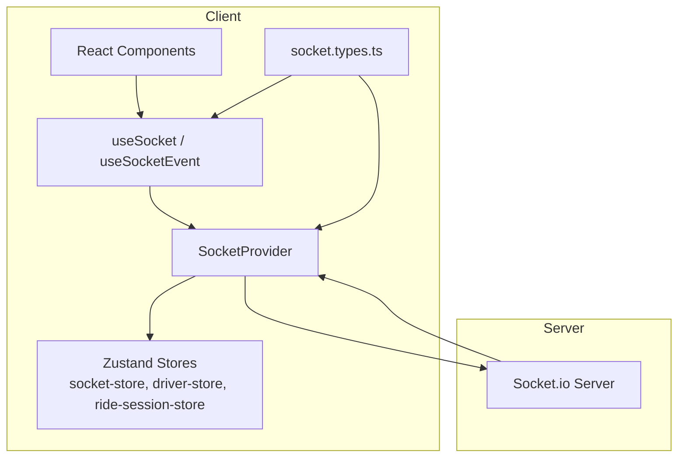
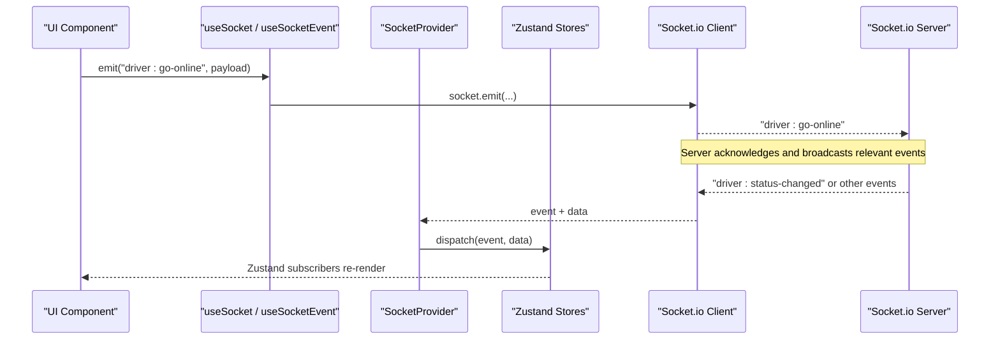
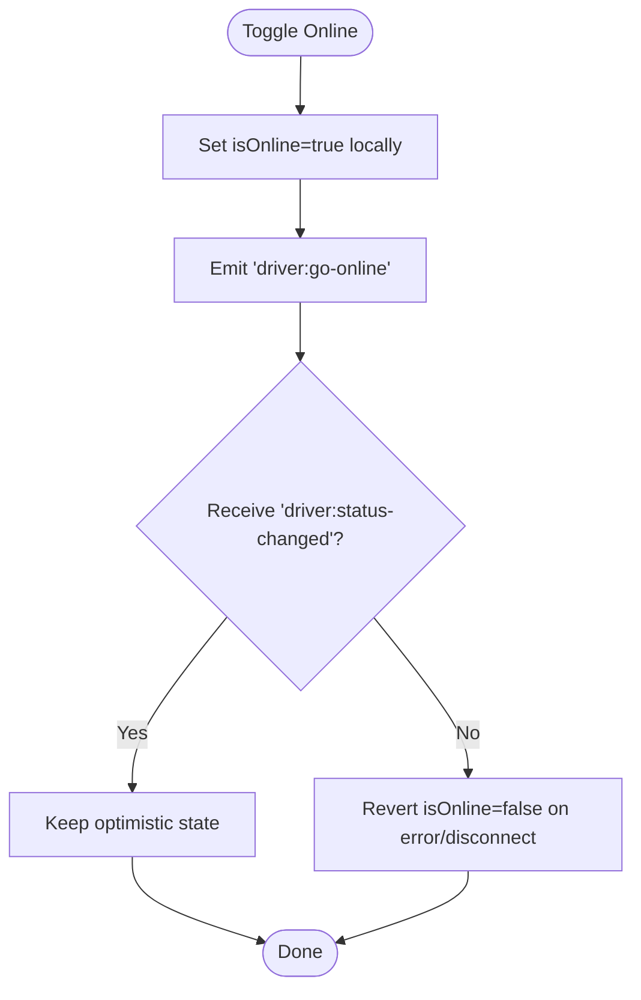
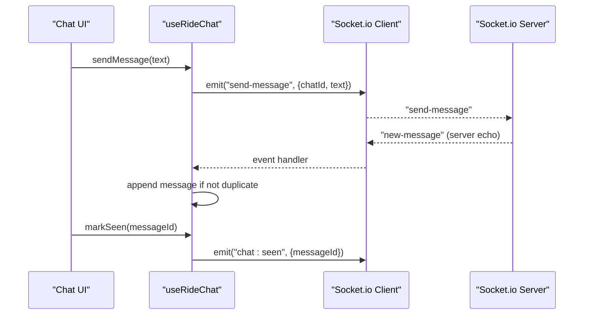
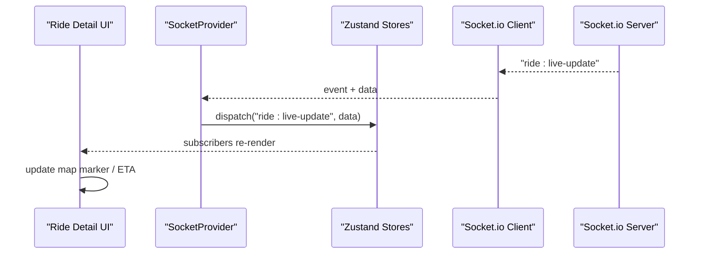
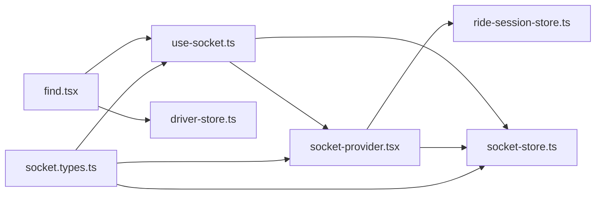

# Real-time State Synchronization

<cite>
**Referenced Files in This Document**
- [socket.ts](file://src/lib/socket.ts)
- [socket-provider.tsx](file://src/provider/socket-provider.tsx)
- [use-socket.ts](file://src/hooks/shared/use-socket.ts)
- [socket-store.ts](file://src/store/socket-store.ts)
- [ride-session-store.ts](file://src/store/ride-session-store.ts)
- [driver-store.ts](file://src/store/driver-store.ts)
- [socket.types.ts](file://src/types/socket.types.ts)
- [ride.types.ts](file://src/types/ride.types.ts)
- [chat.types.ts](file://src/types/chat.types.ts)
- [use-ride-chat.ts](file://src/hooks/shared/use-ride-chat.ts)
- [use-chat.ts](file://src/hooks/shared/use-chat.ts)
- [find.tsx](file://src/app/driver/(view)/find.tsx)
</cite>

## Table of Contents
1. Introduction
2. Project Structure
3. Core Components
4. Architecture Overview
5. Detailed Component Analysis
6. Dependency Analysis
7. Performance Considerations
8. Troubleshooting Guide
9. Conclusion

## Introduction
This document explains how the application synchronizes real-time state between clients and server using Socket.io, React hooks, and Zustand stores. It covers:
- How WebSocket events update Zustand stores and trigger re-renders
- Optimistic updates for driver online/offline status
- Conflict resolution strategies for ride status, chat messages, and user presence
- Integration points between Socket.io events and React state management
- Offline support, persistence, and recovery mechanisms for disconnected states
- Examples for ride status updates, chat messages, and user presence indicators

## Project Structure
The real-time layer is composed of:
- A singleton Socket.io client with typed event contracts
- A provider that connects/disconnects and dispatches incoming events into a global store
- Typed hooks to emit and subscribe to events
- Zustand stores for socket events, driver state, and active ride session
- Feature hooks (e.g., ride chat) that bridge REST queries and live events

**Diagram sources**
- [socket-provider.tsx:1-123](file://src/provider/socket-provider.tsx#L1-L123)
- [use-socket.ts:1-57](file://src/hooks/shared/use-socket.ts#L1-L57)
- [socket-store.ts:1-34](file://src/store/socket-store.ts#L1-L34)
- [socket.types.ts:1-304](file://src/types/socket.types.ts#L1-L304)

**Section sources**
- [socket.ts:1-50](file://src/lib/socket.ts#L1-L50)
- [socket-provider.tsx:1-123](file://src/provider/socket-provider.tsx#L1-L123)
- [use-socket.ts:1-57](file://src/hooks/shared/use-socket.ts#L1-L57)
- [socket-store.ts:1-34](file://src/store/socket-store.ts#L1-L34)
- [ride-session-store.ts:1-21](file://src/store/ride-session-store.ts#L1-L21)
- [driver-store.ts:1-37](file://src/store/driver-store.ts#L1-L37)
- [socket.types.ts:1-304](file://src/types/socket.types.ts#L1-L304)

## Core Components
- Socket client factory: Creates a single typed Socket.io instance with auth token from cookies and transports fallback.
- Socket provider: Connects on mount, re-joins the last active ride room after reconnect, and routes all known events into the socket store via a central dispatcher.
- Socket hooks: Provide type-safe emit/on/off helpers and a convenience hook to subscribe to an event for component lifetime.
- Socket store: Holds the latest payload per event type with timestamps; components can read this to react to changes.
- Driver store: Persists driver location and online status; used for optimistic toggling and request queueing.
- Ride session store: Persists the active ride ID to auto-join rooms after reload/reconnect.
- Type contracts: Strongly typed ServerToClientEvents and ClientToServerEvents ensure consistent payloads across the stack.

Key responsibilities:
- Centralized connection lifecycle and event routing
- Minimal coupling between UI and transport
- Predictable state shape for consumers
- Persistence for critical session data

**Section sources**
- [socket.ts:1-50](file://src/lib/socket.ts#L1-L50)
- [socket-provider.tsx:1-123](file://src/provider/socket-provider.tsx#L1-L123)
- [use-socket.ts:1-57](file://src/hooks/shared/use-socket.ts#L1-L57)
- [socket-store.ts:1-34](file://src/store/socket-store.ts#L1-L34)
- [driver-store.ts:1-37](file://src/store/driver-store.ts#L1-L37)
- [ride-session-store.ts:1-21](file://src/store/ride-session-store.ts#L1-L21)
- [socket.types.ts:1-304](file://src/types/socket.types.ts#L1-L304)

## Architecture Overview
End-to-end flow from UI action to server broadcast and back:

**Diagram sources**
- [use-socket.ts:12-39](file://src/hooks/shared/use-socket.ts#L12-L39)
- [socket-provider.tsx:67-116](file://src/provider/socket-provider.tsx#L67-L116)
- [socket-store.ts:19-25](file://src/store/socket-store.ts#L19-L25)
- [socket.types.ts:220-225](file://src/types/socket.types.ts#L220-L225)

## Detailed Component Analysis

### Socket Client and Provider
- The client is created once with credentials and logging hooks.
- The provider connects on mount, tracks connected state, and re-joins the active ride room after connect using persisted activeRideId.
- All known events are dynamically bound to a central dispatcher that writes to the socket store.

Optimistic behavior:
- When toggling driver online/offline, the UI immediately updates local Zustand state before emitting the socket event. If the server rejects or disconnects occurs, the UI should reconcile by listening to authoritative events (e.g., driver:status-changed).

Reconnection:
- On connect, the provider emits room:join with the persisted activeRideId so the client resumes receiving ride-scoped events without manual intervention.

**Section sources**
- [socket.ts:23-42](file://src/lib/socket.ts#L23-L42)
- [socket-provider.tsx:67-116](file://src/provider/socket-provider.tsx#L67-L116)
- [ride-session-store.ts:9-20](file://src/store/ride-session-store.ts#L9-L20)

### Socket Hooks and Store
- useSocket provides type-safe emit/on/off wrappers around the underlying socket instance.
- useSocketEvent subscribes to a specific event for the component’s lifetime and cleans up automatically.
- useSocketStore exposes the latest event entry per event name with a timestamp; components can derive UI state from it.

Conflict resolution pattern:
- Use the most recent event entry (by at timestamp) to decide whether to apply an optimistic change or revert it based on authoritative server events.

**Section sources**
- [use-socket.ts:12-56](file://src/hooks/shared/use-socket.ts#L12-L56)
- [socket-store.ts:14-31](file://src/store/socket-store.ts#L14-L31)

### Driver Presence and Optimistic Updates
- The driver toggle sets isOnline optimistically in the driver store, then emits driver:go-online or driver:go-offline.
- The server may broadcast driver:status-changed; consumers should reconcile local isOnline against this authoritative signal.
- Location is persisted partially (requests only), while location itself is refreshed on load.

**Diagram sources**
- [find.tsx:29-44](file://src/app/driver/(view)/find.tsx#L29-L44)
- [driver-store.ts:17-36](file://src/store/driver-store.ts#L17-L36)
- [socket.types.ts:106](file://src/types/socket.types.ts#L106)

**Section sources**
- [find.tsx:20-74](file://src/app/driver/(view)/find.tsx#L20-L74)
- [driver-store.ts:1-37](file://src/store/driver-store.ts#L1-L37)
- [socket.types.ts:106](file://src/types/socket.types.ts#L106)

### Chat Messages: Live Sync and Seen Status
- useRideChat lazily creates a chat if missing, fetches history, and listens for new-message events.
- Incoming messages are deduplicated by id and appended to local state.
- Seen markers are tracked locally and sent via chat:seen when needed.

**Diagram sources**
- [use-ride-chat.ts:71-102](file://src/hooks/shared/use-ride-chat.ts#L71-L102)
- [socket.types.ts:166-171](file://src/types/socket.types.ts#L166-L171)

**Section sources**
- [use-ride-chat.ts:1-116](file://src/hooks/shared/use-ride-chat.ts#L1-L116)
- [use-chat.ts:1-95](file://src/hooks/shared/use-chat.ts#L1-L95)
- [socket.types.ts:115-142](file://src/types/socket.types.ts#L115-L142)

### Ride Status Updates and Live Position
- The server emits ride-scoped events such as ride:trip-started, ride:live-update, ride:passenger-picked-up, ride:trip-completed, etc.
- Consumers listen to these events and reconcile ride state accordingly. For example, ride:live-update contains driver position and optional route encoding for map rendering.

**Diagram sources**
- [socket-provider.tsx:90-97](file://src/provider/socket-provider.tsx#L90-L97)
- [socket.types.ts:52-62](file://src/types/socket.types.ts#L52-L62)

**Section sources**
- [socket.types.ts:30-160](file://src/types/socket.types.ts#L30-L160)
- [ride.types.ts:1-161](file://src/types/ride.types.ts#L1-L161)

### User Presence Indicators
- driver:status-changed indicates driver online/offline state.
- Chat participants may include isOnline flags; keep them in sync by reconciling with authoritative events.

**Section sources**
- [socket.types.ts:106](file://src/types/socket.types.ts#L106)
- [chat.types.ts:3-9](file://src/types/chat.types.ts#L3-L9)

## Dependency Analysis
High-level dependencies among core modules:

**Diagram sources**
- [socket.types.ts:1-304](file://src/types/socket.types.ts#L1-L304)
- [socket-provider.tsx:1-123](file://src/provider/socket-provider.tsx#L1-L123)
- [use-socket.ts:1-57](file://src/hooks/shared/use-socket.ts#L1-L57)
- [socket-store.ts:1-34](file://src/store/socket-store.ts#L1-L34)
- [ride-session-store.ts:1-21](file://src/store/ride-session-store.ts#L1-L21)
- [driver-store.ts:1-37](file://src/store/driver-store.ts#L1-L37)
- [find.tsx:1-74](file://src/app/driver/(view)/find.tsx#L1-L74)

**Section sources**
- [socket.types.ts:1-304](file://src/types/socket.types.ts#L1-L304)
- [socket-provider.tsx:1-123](file://src/provider/socket-provider.tsx#L1-L123)
- [use-socket.ts:1-57](file://src/hooks/shared/use-socket.ts#L1-L57)
- [socket-store.ts:1-34](file://src/store/socket-store.ts#L1-L34)
- [ride-session-store.ts:1-21](file://src/store/ride-session-store.ts#L1-L21)
- [driver-store.ts:1-37](file://src/store/driver-store.ts#L1-L37)
- [find.tsx:1-74](file://src/app/driver/(view)/find.tsx#L1-L74)

## Performance Considerations
- Event batching: The provider dispatches each event individually. For high-frequency events like ride:live-update, consider debouncing or throttling in consumers to reduce render churn.
- Selective subscriptions: Prefer reading only the fields you need from the socket store to minimize re-renders.
- Deduplication: Ensure message and event handlers check for duplicates by id or timestamp to avoid redundant work.
- Room scoping: Always join the correct room (rideId) to limit event fan-out.
- Transport resilience: The client uses websocket and polling transports; prefer websocket when available.

[No sources needed since this section provides general guidance]

## Troubleshooting Guide
Common issues and resolutions:
- No events received after reload: Verify that the active ride room is rejoined on connect. The provider emits room:join with the persisted activeRideId.
- Stale driver online state: Reconcile local isOnline with driver:status-changed. If the server does not respond, revert to previous state on disconnect.
- Duplicate chat messages: Ensure new-message handler checks for existing message ids before appending.
- Missing chat history: useRideChat attempts to create a chat if none exists; confirm that the creation mutation succeeds and invalidates related queries.

**Section sources**
- [socket-provider.tsx:77-84](file://src/provider/socket-provider.tsx#L77-L84)
- [use-ride-chat.ts:40-55](file://src/hooks/shared/use-ride-chat.ts#L40-L55)
- [use-ride-chat.ts:71-84](file://src/hooks/shared/use-ride-chat.ts#L71-L84)

## Conclusion
The system combines a typed Socket.io client, a centralized provider, and Zustand stores to deliver real-time synchronization with predictable state updates. Optimistic UI updates improve responsiveness, while authoritative server events provide conflict resolution. Persistence ensures continuity across reloads and reconnects. By following the patterns outlined here—room scoping, deduplication, selective subscriptions, and reconciliation—you can extend real-time features safely and efficiently.