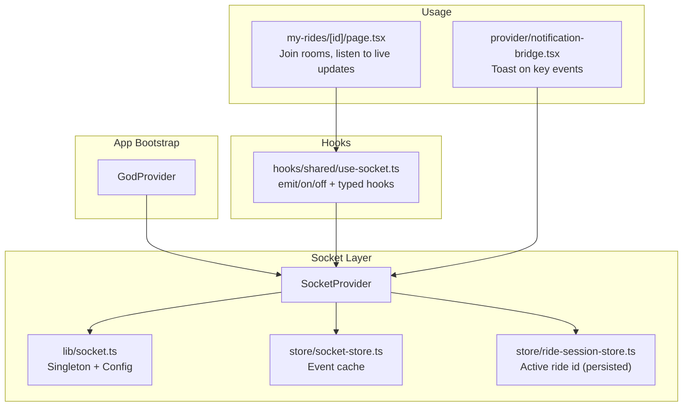
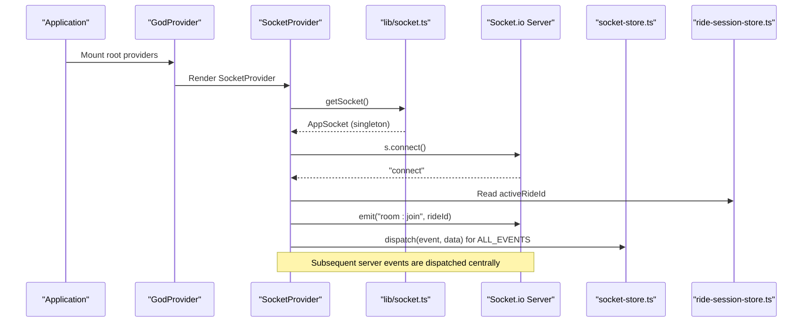
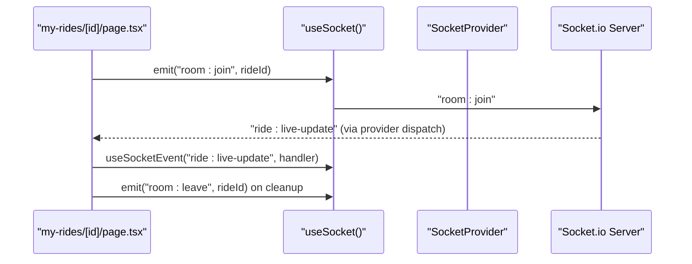
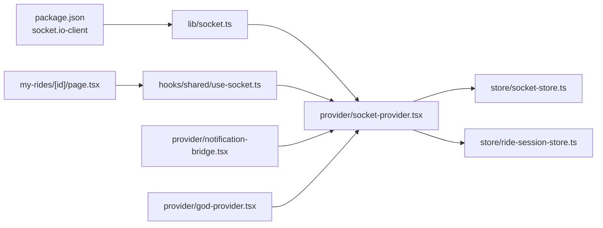

# Socket Connection Management

<cite>
**Referenced Files in This Document**
- [socket.ts](file://src/lib/socket.ts)
- [socket-provider.tsx](file://src/provider/socket-provider.tsx)
- [use-socket.ts](file://src/hooks/shared/use-socket.ts)
- [socket-store.ts](file://src/store/socket-store.ts)
- [ride-session-store.ts](file://src/store/ride-session-store.ts)
- [socket.types.ts](file://src/types/socket.types.ts)
- [god-provider.tsx](file://src/provider/god-provider.tsx)
- [page.tsx](file://src/app/(view)/my-rides/[id]/page.tsx)
- [notification-bridge.tsx](file://src/provider/notification-bridge.tsx)
- [package.json](file://package.json)
</cite>

## Table of Contents
1. Introduction
2. Project Structure
3. Core Components
4. Architecture Overview
5. Detailed Component Analysis
6. Dependency Analysis
7. Performance Considerations
8. Troubleshooting Guide
9. Conclusion

## Introduction
This document explains the Socket.io connection management implementation used by the application. It covers the singleton socket instance pattern, authentication via cookies, transport fallback configuration, connection lifecycle, reconnection behavior, error handling, and practical examples for initialization, state management, custom authentication flows, debugging, and performance optimization for high-concurrency scenarios.

## Project Structure
The Socket.io client integration is implemented across a small set of focused modules:
- A singleton factory that creates and configures the socket instance with cookie-based auth and transport options.
- A React provider that manages connection lifecycle, event routing, and room membership.
- Hooks to emit events and subscribe to server events with strong typing.
- A Zustand store to centralize recent events for UI consumption.
- A persisted ride session store to maintain active room membership across reloads.
- A global provider that wraps the app and initializes the socket context.

**Diagram sources**
- [god-provider.tsx:1-48](file://src/provider/god-provider.tsx#L1-L48)
- [socket-provider.tsx:1-123](file://src/provider/socket-provider.tsx#L1-L123)
- [socket.ts:1-50](file://src/lib/socket.ts#L1-L50)
- [socket-store.ts:1-34](file://src/store/socket-store.ts#L1-L34)
- [ride-session-store.ts:1-21](file://src/store/ride-session-store.ts#L1-L21)
- [use-socket.ts:1-57](file://src/hooks/shared/use-socket.ts#L1-L57)
- [page.tsx](file://src/app/(view)/my-rides/[id]/page.tsx#L1-L371)
- [notification-bridge.tsx:35-60](file://src/provider/notification-bridge.tsx#L35-L60)

**Section sources**
- [god-provider.tsx:1-48](file://src/provider/god-provider.tsx#L1-L48)
- [socket-provider.tsx:1-123](file://src/provider/socket-provider.tsx#L1-L123)
- [socket.ts:1-50](file://src/lib/socket.ts#L1-L50)
- [socket-store.ts:1-34](file://src/store/socket-store.ts#L1-L34)
- [ride-session-store.ts:1-21](file://src/store/ride-session-store.ts#L1-L21)
- [use-socket.ts:1-57](file://src/hooks/shared/use-socket.ts#L1-L57)
- [page.tsx:1-371](file://src/app/(view)/my-rides/[id]/page.tsx#L1-L371)
- [notification-bridge.tsx:35-60](file://src/provider/notification-bridge.tsx#L35-L60)

## Core Components
- Singleton socket factory: Creates one shared socket instance per process, reads the token from cookies, configures transports, and attaches debug listeners.
- Socket provider: Connects the socket, tracks connected state, joins the last known ride room after connect, and dispatches all known events into a centralized store.
- Hooks: Provide type-safe emit/on/off helpers and a convenience hook to subscribe for component lifetime.
- Event store: Keeps the latest payload and timestamp for each event, enabling UI components to react without manual subscriptions.
- Ride session store: Persists the active ride ID so that reconnects can automatically rejoin the correct room.

Key behaviors:
- Authentication: The client sends a token read from the cookie named token during handshake.
- Transports: Prefers WebSocket; falls back to HTTP long-polling if needed.
- Reconnection: Handled by the underlying client library; provider reattaches to the active ride room upon connect.
- Debugging: Global listeners log incoming and outgoing events to the console.

**Section sources**
- [socket.ts:1-50](file://src/lib/socket.ts#L1-L50)
- [socket-provider.tsx:1-123](file://src/provider/socket-provider.tsx#L1-L123)
- [use-socket.ts:1-57](file://src/hooks/shared/use-socket.ts#L1-L57)
- [socket-store.ts:1-34](file://src/store/socket-store.ts#L1-L34)
- [ride-session-store.ts:1-21](file://src/store/ride-session-store.ts#L1-L21)

## Architecture Overview
The architecture separates concerns between low-level socket creation, React lifecycle, and UI usage.

**Diagram sources**
- [god-provider.tsx:1-48](file://src/provider/god-provider.tsx#L1-L48)
- [socket-provider.tsx:1-123](file://src/provider/socket-provider.tsx#L1-L123)
- [socket.ts:1-50](file://src/lib/socket.ts#L1-L50)
- [socket-store.ts:1-34](file://src/store/socket-store.ts#L1-L34)
- [ride-session-store.ts:1-21](file://src/store/ride-session-store.ts#L1-L21)

## Detailed Component Analysis

### Singleton Socket Factory (lib/socket.ts)
Responsibilities:
- Resolve server URL from environment variables.
- Extract the authentication token from the cookie named token.
- Create a single socket instance with:
  - autoConnect disabled to allow explicit control.
  - withCredentials enabled to send cookies.
  - transports ordered as ["websocket", "polling"].
  - auth callback that attaches { token } to the handshake.
- Attach global debug listeners for incoming and outgoing events.
- Provide a destroy function to disconnect and reset the singleton.

Configuration highlights:
- Transport fallback: WebSocket first, then polling.
- Cookie-based auth: Token is read at connection time from document.cookie.

Error handling:
- If no cookie is present, the token may be undefined; server-side validation should handle this.

Performance notes:
- Single instance avoids redundant connections.
- Debug logging is always attached; consider gating it behind an environment flag in production.

**Section sources**
- [socket.ts:1-50](file://src/lib/socket.ts#L1-L50)

### Socket Provider (provider/socket-provider.tsx)
Responsibilities:
- Obtain the singleton socket via getSocket().
- Manage connection state (connected boolean).
- On connect:
  - Set connected to true.
  - Read the persisted active ride ID and rejoin the room.
- Subscribe to a fixed list of server events and dispatch them into the centralized store.
- Clean up event handlers and disconnect on unmount.

Reconnection strategy:
- Relies on the underlying client’s automatic reconnection.
- After every connect (including reconnects), the provider re-joins the last known ride room using the persisted ride session.

Room management:
- Uses "room:join" and "room:leave" events to scope real-time updates to specific rides.

Centralized event dispatch:
- All listed events are funneled into the Zustand store, making them available to any component via useSocketEvent or direct store access.

Cleanup:
- Removes all event listeners and destroys the socket instance on unmount.

**Section sources**
- [socket-provider.tsx:1-123](file://src/provider/socket-provider.tsx#L1-L123)
- [ride-session-store.ts:1-21](file://src/store/ride-session-store.ts#L1-L21)

### Hooks (hooks/shared/use-socket.ts)
Provides:
- useSocket(): Returns the socket instance, connected status, and typed emit/on/off helpers.
- useSocketEvent(event, handler): Subscribes to a specific event for the component’s lifetime and cleans up on unmount.

Type safety:
- Strongly typed against ClientToServerEvents and ServerToClientEvents.

Usage patterns:
- Emit actions like "room:join"/"room:leave".
- Subscribe to events such as "ride:live-update" or "ride:trip-completed".

**Section sources**
- [use-socket.ts:1-57](file://src/hooks/shared/use-socket.ts#L1-L57)
- [socket.types.ts:1-304](file://src/types/socket.types.ts#L1-304)

### Event Store (store/socket-store.ts)
Design:
- Maintains a map of the most recent event payloads with timestamps.
- Provides a dispatch action used by the provider to update the store.
- Exposes a selector hook to read the latest entry for a given event.

Benefits:
- Enables UI components to observe the latest event without manual subscription.
- Simplifies logic in components that only need the current state of an event.

**Section sources**
- [socket-store.ts:1-34](file://src/store/socket-store.ts#L1-L34)

### Ride Session Store (store/ride-session-store.ts)
Design:
- Persisted store keeping the active ride ID across page reloads.
- Used by the provider to rejoin the correct room after connect/reconnect.

Impact:
- Ensures continuity of real-time updates even when the user navigates away and returns.

**Section sources**
- [ride-session-store.ts:1-21](file://src/store/ride-session-store.ts#L1-L21)

### Usage Examples

#### Initializing and managing connection state
- The root provider mounts SocketProvider, which connects the socket and exposes connected state through context.
- Components can read connected via useSocketContext or useSocket.

**Section sources**
- [god-provider.tsx:1-48](file://src/provider/god-provider.tsx#L1-L48)
- [socket-provider.tsx:1-123](file://src/provider/socket-provider.tsx#L1-L123)
- [use-socket.ts:1-57](file://src/hooks/shared/use-socket.ts#L1-L57)

#### Joining a ride room and listening to live updates
- The ride detail page sets the active ride ID, emits "room:join" on mount, and listens for "ride:live-update" to render driver position.
- On trip completion, it clears the active ride ID.

**Diagram sources**
- [page.tsx:1-371](file://src/app/(view)/my-rides/[id]/page.tsx#L1-L371)
- [use-socket.ts:1-57](file://src/hooks/shared/use-socket.ts#L1-L57)
- [socket-provider.tsx:1-123](file://src/provider/socket-provider.tsx#L1-L123)

**Section sources**
- [page.tsx:1-371](file://src/app/(view)/my-rides/[id]/page.tsx#L1-L371)

#### Implementing custom authentication flows
- Current flow: The client reads the token from the cookie named token and sends it in the auth handshake object.
- To customize:
  - Update the auth callback to compute or refresh tokens before connecting.
  - Ensure cookies are configured with SameSite and Secure attributes appropriate for your deployment.
  - Handle server-side rejection by reacting to disconnect/error events and prompting re-authentication.

**Section sources**
- [socket.ts:1-50](file://src/lib/socket.ts#L1-L50)

#### Error handling for network failures
- The provider toggles connected state on "connect" and "disconnect".
- The notification bridge shows toast messages for selected events, including generic "error".
- For robust UX:
  - Show a banner when connected becomes false.
  - Retry critical actions (e.g., joining a room) after reconnection.
  - Log errors and surface actionable messages to users.

**Section sources**
- [socket-provider.tsx:1-123](file://src/provider/socket-provider.tsx#L1-L123)
- [notification-bridge.tsx:35-60](file://src/provider/notification-bridge.tsx#L35-L60)

## Dependency Analysis
High-level dependencies:
- socket-provider depends on lib/socket, socket-store, and ride-session-store.
- use-socket depends on socket-provider context.
- page.tsx uses use-socket and ride-session-store.
- god-provider includes socket-provider at the app root.
- package.json declares socket.io-client.

**Diagram sources**
- [package.json:1-68](file://package.json#L1-68)
- [socket.ts:1-50](file://src/lib/socket.ts#L1-L50)
- [socket-provider.tsx:1-123](file://src/provider/socket-provider.tsx#L1-L123)
- [socket-store.ts:1-34](file://src/store/socket-store.ts#L1-L34)
- [ride-session-store.ts:1-21](file://src/store/ride-session-store.ts#L1-L21)
- [use-socket.ts:1-57](file://src/hooks/shared/use-socket.ts#L1-L57)
- [page.tsx:1-371](file://src/app/(view)/my-rides/[id]/page.tsx#L1-L371)
- [notification-bridge.tsx:35-60](file://src/provider/notification-bridge.tsx#L35-L60)
- [god-provider.tsx:1-48](file://src/provider/god-provider.tsx#L1-L48)

**Section sources**
- [package.json:1-68](file://package.json#L1-68)
- [socket.ts:1-50](file://src/lib/socket.ts#L1-L50)
- [socket-provider.tsx:1-123](file://src/provider/socket-provider.tsx#L1-L123)
- [socket-store.ts:1-34](file://src/store/socket-store.ts#L1-L34)
- [ride-session-store.ts:1-21](file://src/store/ride-session-store.ts#L1-L21)
- [use-socket.ts:1-57](file://src/hooks/shared/use-socket.ts#L1-L57)
- [page.tsx:1-371](file://src/app/(view)/my-rides/[id]/page.tsx#L1-L371)
- [notification-bridge.tsx:35-60](file://src/provider/notification-bridge.tsx#L35-L60)
- [god-provider.tsx:1-48](file://src/provider/god-provider.tsx#L1-L48)

## Performance Considerations
- Prefer WebSocket: The transport order prioritizes WebSocket for lower latency and overhead. Polling is used as a fallback.
- Minimize event volume:
  - Throttle location updates on the client side before emitting.
  - Debounce frequent UI-triggered emissions.
- Centralized dispatch:
  - Avoid duplicate subscriptions in multiple components; prefer the event store for read-only consumers.
- Room scoping:
  - Always join/leave rooms explicitly to limit broadcast fan-out.
- Debug logging:
  - Consider disabling verbose console logs in production to reduce I/O overhead.
- Reconnection:
  - Rely on built-in reconnection; ensure room rejoin logic runs on every connect to avoid missed events.

[No sources needed since this section provides general guidance]

## Troubleshooting Guide
Common issues and remedies:
- No token in cookies:
  - Verify that the cookie named token exists and is accessible to the client domain/path.
  - Confirm withCredentials is enabled and CORS allows credentials.
- Connection not established:
  - Check the server URL resolution and environment variables.
  - Inspect browser console for debug logs emitted by the socket layer.
- Events not received:
  - Ensure the component has subscribed via useSocketEvent or is reading from the event store.
  - Confirm the room was joined and not left prematurely.
- Reconnect not restoring room:
  - Validate that the active ride ID is persisted and that the provider re-emits "room:join" on connect.

Debug techniques:
- Use the built-in global listeners that log incoming and outgoing events.
- Observe the connected state exposed by the provider.
- Add temporary toast notifications for key events to verify delivery.

**Section sources**
- [socket.ts:1-50](file://src/lib/socket.ts#L1-L50)
- [socket-provider.tsx:1-123](file://src/provider/socket-provider.tsx#L1-L123)
- [notification-bridge.tsx:35-60](file://src/provider/notification-bridge.tsx#L35-L60)

## Conclusion
The implementation follows a clean separation of concerns: a singleton socket factory handles configuration and authentication, a provider manages lifecycle and room membership, hooks provide ergonomic APIs, and stores centralize state and persistence. With WebSocket-first transport, cookie-based auth, and automatic room rejoining on reconnect, the system supports responsive, reliable real-time features suitable for high-concurrency environments.

[No sources needed since this section summarizes without analyzing specific files]